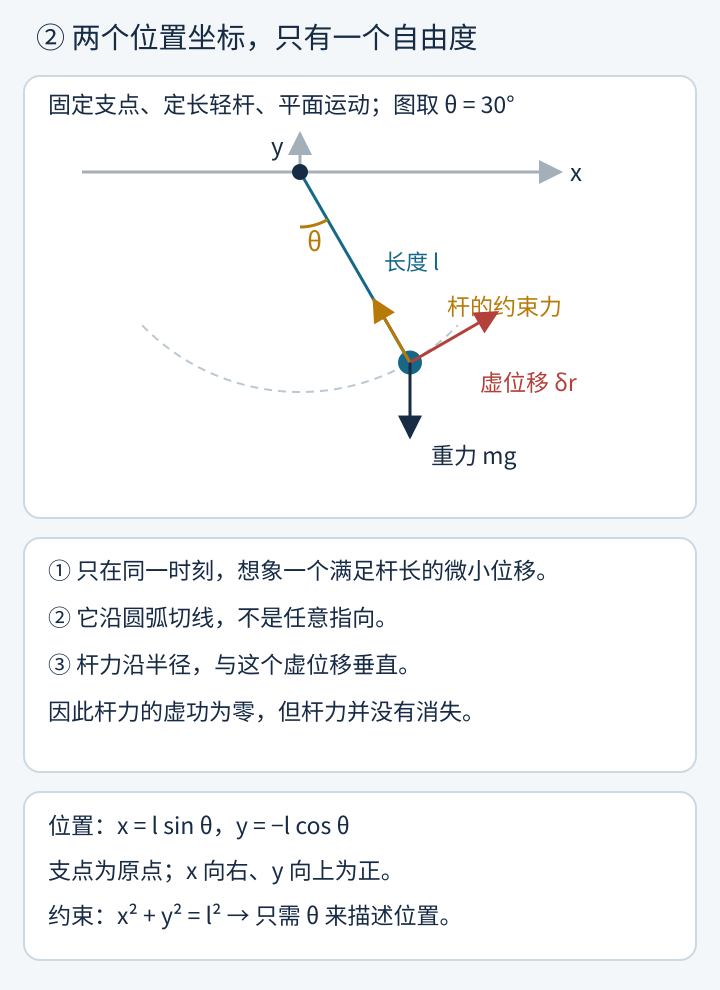
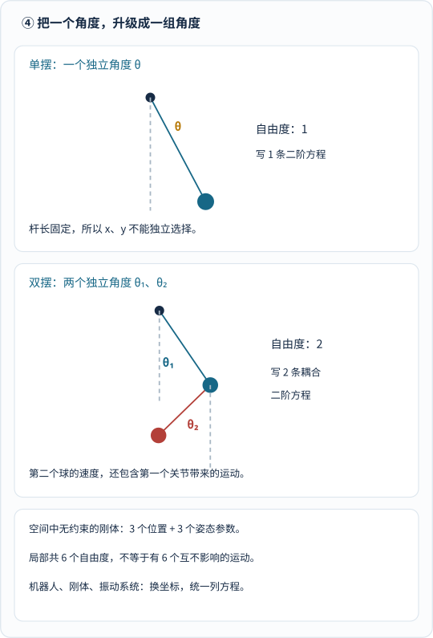
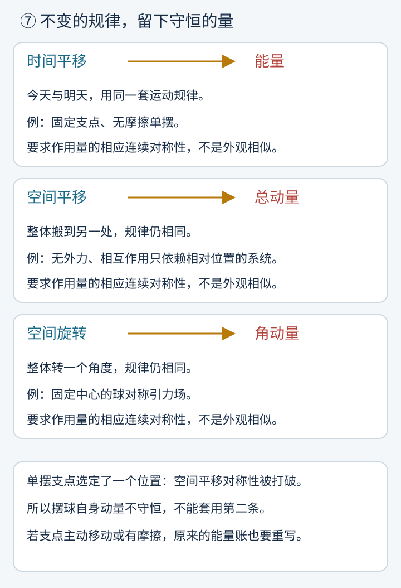
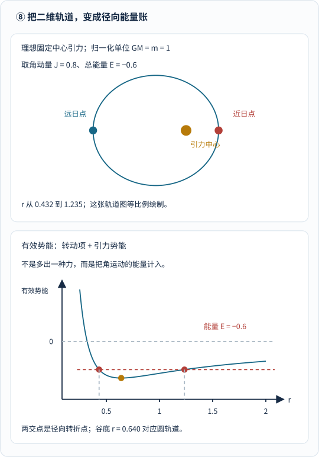

1788 年，拉格朗日出版《分析力学》。在前言里，他说了句对科普作者不太友好的话：

> 这部书中找不到图形。

他的意思不是“力学没有画面”，而是：**处理运动，可以不再每遇到一种机器就重新发明一套几何解法，而是用统一的分析运算。** 这段前言及出版背景，可在圣安德鲁斯大学的[拉格朗日传记](https://mathshistory.st-andrews.ac.uk/Biographies/Lagrange/)中核查。

不过，今天我们偏要画图。

因为读者真正想问的，往往不是“请把拉格朗日方程写出来”，而是：

**牛顿不是已经告诉我们“力等于质量乘加速度”了吗？为什么还要折腾出一整门分析力学？**

先想象桌上摆着一只钟摆。再给它接上第二根杆，接上齿轮，装进机器，最后升级成一台多关节机器人。

牛顿定律没有失效。变麻烦的是：**坐标越来越多，约束力越来越多，哪些变量可以独立变化也越来越难看清。**

分析力学的厉害之处，是把问题重新整理。

它当然离不开微积分，但不只是“把力学公式拿去求导”。它还要做三件事：选真正独立的坐标，用能量组织方程，寻找运动中不变的结构。

本文用一只单摆贯穿，再走到弹簧、刚体和天体。公式是第二条阅读路线：先沿着图和数值理解，再回头看符号怎样把同一件事说得更准确。

## 1. 一群人怎样把“运动”变成可以统一计算的问题？

这不是欧拉写完一章、拉格朗日接着写下一章的接力赛。许多方法交错发展，同一个思想也会在不同问题里重新出现。

不过，六个路标足以帮我们建立地图。

_图 1：先看年份，再看每个人解决的任务。这里的年份指相关著作或论文，不等于思想第一次萌芽的时间，也不是完整的发明人名单。_

### 牛顿给规律，欧拉把它们写成分析语言

1687 年，牛顿的《自然哲学的数学原理》把运动定律与万有引力组织成一个强大的体系。牛顿本人发展过微积分，但《原理》的主要论证形式是几何的；不能把“他会微积分”与“书里处处是今天的微分方程”混为一谈。[MacTutor 的牛顿传记](https://mathshistory.st-andrews.ac.uk/Biographies/Newton/)说明了这段研究与出版背景。

到了欧拉手里，分析方法越来越像力学的日常语言。

欧拉 1736 年出版的《力学》第一卷，系统用分析方法处理自由和受约束的质点运动。其拉丁文标题就明确写着“以分析方式阐述的运动科学”。[Euler Archive 的 E15 档案](https://scholarlycommons.pacific.edu/euler-works/15/)列出了出版年份与内容。

用今天的记号，一个方向上的牛顿第二定律可以写成：

$$
m\frac{d^2x}{dt^2}=F.
$$

这句话的物理内容没有变。它只是变成了一个明确的数学任务：

**已知力怎样依赖位置、速度或时间，求一个位置函数，使它的二阶导数满足这条规律。**

这里 \(m\) 是质量，\(x(t)\) 是位置，\(F\) 是这一方向的合力；默认质量恒定、采用惯性参考系。

### 达朗贝尔问：那些难算的约束力，能不能先绕开？

达朗贝尔不只研究力学，还与狄德罗共同参与《百科全书》。但与本文最相关的，是他 1743 年出版的《动力学论》。[MacTutor 传记](https://mathshistory.st-andrews.ac.uk/Biographies/DAlembert/)区分了此前的学院报告与正式出版。

他的原理允许我们把动力学写成一种“虚功平衡”：

$$
\sum_i(\mathbf F_i-m_i\mathbf a_i)\cdot\delta\mathbf r_i=0.
$$

先不急着背。读成一句话就好：

**对所有符合约束的微小假想位移，实际力与 \(m\mathbf a\) 的差，合起来不做虚功。**

式中的 \(\delta\mathbf r_i\) 是同一时刻的假想位移，不是经过一小段时间后的实际位移。若已把理想约束力的零虚功消去，\(\mathbf F_i\) 就只需写其余施加的力。这里的 \(-m_i\mathbf a_i\) 是整理方程的项，不是一种突然出现的新相互作用。

这一步怎样帮我们省事？看单摆就明白了。

## 2. 钟摆为什么有两个位置坐标，却只有一个自由度？

设一只小球由长度为 \(l\) 的轻杆连到固定支点，只能在一个竖直平面内运动。

小球的位置当然可以用 \(x,y\) 表示。但是，不能随便选择它们：杆长要求

$$
x^2+y^2=l^2.
$$

你选定一个摆角 \(\theta\)，小球的位置就确定了：

$$
\begin{aligned}
x&=l\sin\theta,\\
y&=-l\cos\theta.
\end{aligned}
$$

这里把支点当原点，\(y\) 向上为正，\(\theta\) 从竖直向下的方向量起。

**两个坐标不等于两个自由度。自由度数的是“能独立选择几个变量”。**

_图 2：先看灰色圆弧，再看红色切线箭头。满足杆长的瞬时虚位移沿切线，杆力沿半径，两者垂直。支点为坐标原点，横轴向右、纵轴向上，与正文公式一致。_

这正是达朗贝尔方法的一个漂亮入口。

直接用牛顿定律，当然能把杆力拆成两个分量，再联立求解。牛顿方法本身也可以直接用切向分量省掉杆力，并不是它“不会选坐标”。

但如果系统有十根杆、十个关节，逐个处理很容易变成一场代数体力劳动。

广义坐标的思路是：**先把“只能这样动”写进坐标，再列运动方程。**

单摆的广义坐标就是 \(\theta\)。广义坐标可以是角度，也可以是长度或其他能标记构型的变量，“广义”不是“更玄”。

还有一个重要限定：我们这里使用的是固定支点、定长杆这样的**完整约束**，并假定约束是理想的，即对允许虚位移不做虚功。摩擦、主动移动的支点或复杂滚动约束，都不能未经处理直接照搬这一简化。[MIT 分析力学讲义第一章](https://ocw.mit.edu/courses/8-09-classical-mechanics-iii-fall-2014/resources/mit8_09f14_chapter_1/)讨论了这些条件。

## 3. 拉格朗日：先记能量账，再让微积分列方程

拉格朗日很年轻时就与欧拉通信。1755 年，他向欧拉介绍处理极值问题的方法；后来把这些思想用于力学。1788 年的《分析力学》则把许多工作组织成系统。[这段发展史](https://mathshistory.st-andrews.ac.uk/Biographies/Lagrange/)比“他突然发明了一条万能公式”有意思得多。

他的办法可以先从一张账表理解。

小球在端点静止，位置高；经过最低点，位置低、速度大。

在无摩擦、固定支点的模型里，**能量并没有凭空消失，而是从势能账户转进动能账户。**

_图 3：先盯小球，再看两根能量条。小球下降时，势能减少、动能增加；升高时相反。动画采用完整的正弦单摆方程，统一放慢三倍，播放一个周期后停在释放点；不是用匀速摆动假装真实运动。_

[单独打开单摆与能量动画](/assets/images/analytical-mechanics/pendulum-energy.svg)。刷新可重播；启用“减少动态效果”时保留完整圆弧、端点、最低点与静态能量账。后面的动画也遵循这一规则。

图中采用 \(m=1\) 千克、\(l=1\) 米、\(g=9.81\) 米/秒²，从 \(30^\circ\) 静止释放。把最低点的势能设为零：

| 位置 | 速度大小 | 动能 \(K\) | 势能 \(U\) |
|---|---:|---:|---:|
| 释放端点 | 0 米/秒 | 0 焦耳 | 约 1.314 焦耳 |
| 最低点 | 约 1.621 米/秒 | 约 1.314 焦耳 | 0 焦耳 |
| 另一侧端点 | 0 米/秒 | 0 焦耳 | 约 1.314 焦耳 |

能量账怎样变成运动方程？分四步。

### 第一步：角速度变成球的速度

在半径为 \(l\) 的圆上，一小段弧长对应 \(l\,d\theta\)，所以速度大小是 \(l|\dot\theta|\)。

点号表示对时间求导：\(\dot\theta=d\theta/dt\)，不是一个新的物理量。

动能因此是：

$$
K=\frac12ml^2\dot\theta^2.
$$

### 第二步：升高多少，就记多少势能

小球比最低点高出 \(l(1-\cos\theta)\)，所以

$$
U=mgl(1-\cos\theta).
$$

换一个势能零点，只会给 \(U\) 加上常数，不改变这里得到的运动。

### 第三步：相减，构造拉格朗日量

对本文这类保守机械系统，取

$$
\begin{aligned}
L&=K-U\\
&=\frac12ml^2\dot\theta^2-mgl(1-\cos\theta).
\end{aligned}
$$

注意：**\(K+U\) 是总能量，\(K-U\) 是拉格朗日量。二者不是同一个东西。**

我们用 \(K,U\) 表示动能、势能，是为了不让常见记号 \(T\) 与周期或时间区间混淆。

### 第四步：代入统一的方程

对没有另加非保守广义力的系统，欧拉—拉格朗日方程写成：

$$
\frac{d}{dt}
\left(\frac{\partial L}{\partial\dot\theta}\right)
-\frac{\partial L}{\partial\theta}=0.
$$

符号 \(\partial\) 表示偏导数。计算 \(\partial L/\partial\dot\theta\) 时暂时把 \(\theta\) 固定；计算 \(\partial L/\partial\theta\) 时暂时把 \(\dot\theta\) 固定。

这不是声称实际运动中角度与角速度互不相关，而是先把 \(L\) 当作这两个输入的函数，计算它对各个输入的敏感程度。

逐项计算：

$$
\begin{aligned}
\frac{\partial L}{\partial\dot\theta}
&=ml^2\dot\theta,\\
\frac{d}{dt}\left(ml^2\dot\theta\right)
&=ml^2\ddot\theta,\\
\frac{\partial L}{\partial\theta}
&=-mgl\sin\theta.
\end{aligned}
$$

于是：

$$
ml^2\ddot\theta+mgl\sin\theta=0,
$$

也就是

$$
\boxed{\ddot\theta+\frac{g}{l}\sin\theta=0.}
$$

**杆力没有出现在最后的角运动方程里。不是杆力不存在，而是坐标与理想约束已经帮我们处理了它。**

如果还想知道杆承受多大的力，可以把求出的运动代回径向受力方程；拉格朗日乘子也能帮助恢复约束力。这里暂时只求“怎样摆”。

### 为什么钟摆不一定完全等时？

只有角度足够小、以弧度计时，才可以近似 \(\sin\theta\approx\theta\)。这样得到线性方程

$$
\ddot\theta+\frac{g}{l}\theta=0,
$$

小角周期约为 \(2\pi\sqrt{l/g}\)。一米摆约 2.006 秒。

但图中的振幅是 \(30^\circ\)，完整方程的周期约 2.041 秒，比小角近似长约 1.74%。不能把近似公式当作任意振幅下的精确等时定理。

如果读过[摆线文章]()，就会认出这个差别：理想摆线等时运动与普通圆弧单摆，不是同一个约束几何。

## 4. 一只摆球已经够用，为什么还说它适合机器人？

因为真正省事的不是单摆这一次计算，而是**换系统后仍能沿用列方程的规则**。

_图 4：先比较单摆与双摆的关节数，再看“独立”二字。双摆有两个角度，但两个运动互相影响；图为固定构型，不是假装算出了一段双摆动画。_

例如双摆，第二个球的速度既来自第二根杆的转动，也来自第一根杆带动整个关节的运动。

所以动能里会出现同时包含两个角速度的项。方程互相耦合，并不是“把单摆公式抄两遍”。

若用 \(\theta_1,\theta_2\) 表示两根杆相对竖直方向的角度，动能中就会有形如

$$
m_2l_1l_2\dot\theta_1\dot\theta_2
\cos(\theta_1-\theta_2)
$$

的交叉项。这里 \(m_2\) 是第二球的质量，\(l_1,l_2\) 是杆长。这个项来自把第二球速度的两个贡献相加后再平方；不是为了让公式看起来复杂而添加的。

对一般独立坐标 \(q_1,\ldots,q_n\)，统一规则是：

$$
\frac{d}{dt}
\left(\frac{\partial L}{\partial\dot q_i}\right)
-\frac{\partial L}{\partial q_i}=Q_i.
$$

\(Q_i\) 表示没有放进势能的那部分广义力，其定义使 \(\sum_i Q_i\delta q_i\) 等于相应虚功。

坐标若是长度，广义力的单位通常是牛顿；坐标若是角度，广义力通常是力矩。

例如单摆加上线性阻尼力矩 \(-c\dot\theta\)，就变成：

$$
ml^2\ddot\theta+mgl\sin\theta=-c\dot\theta.
$$

\(c\) 是阻尼系数，单位为牛顿·米·秒，弧度视为无量纲。这时机械能会耗散，不能继续宣称 \(K+U\) 恒定。

**分析力学不会把摩擦“分析没了”。你必须把模型中的物理作用交代清楚。**

同样，空间中一个无约束刚体，局部需要三个位置参数和三个姿态参数。多关节机器人的每个独立关节也是坐标候选，但齿轮联动等约束还会减少独立变量。

MIT 的[经典力学课程目录](https://ocw.mit.edu/courses/8-09-classical-mechanics-iii-fall-2014/pages/lecture-notes/)把刚体、振动、哈密顿—雅可比方法、流体和混沌安排在后续章节。统一形式是入口，远不是“从此一切都能手算”的保证。

## 5. 为什么“比较整段运动”，能得到每一刻的方程？

前面一直说统一的方程，终于轮到问：它从哪里来？

这里需要一种比普通求导多走一步的思路——**变分**。

普通求导可以问：把输入数值 \(x\) 改一点，函数值 \(f(x)\) 改多少？

变分则问：**把一整条候选函数稍微改一下，一个依赖整条函数的量会改多少？**

对于拉格朗日量 \(L\)，把它沿一段候选运动对时间积分，得到作用量：

$$
S[q]=\int_{t_0}^{t_1}L(q,\dot q,t)\,dt.
$$

这里 \(S[q]\) 的方括号提醒我们：输入是一整条运动函数，不是单个位置数字。作用量的单位是焦耳·秒，不是焦耳。

比较时固定两个时刻及两端位置，让中间的候选运动略有不同：

$$
\begin{aligned}
q_\varepsilon(t)&=q(t)+\varepsilon\eta(t),\\
\eta(t_0)&=\eta(t_1)=0.
\end{aligned}
$$

\(\eta(t)\) 是扰动的形状，\(\varepsilon\) 控制扰动有多小。固定的是端点位置，**并没有要求所有候选的端点速度也相同**。

哈密顿原理在本文的适用系统中说：真实运动使作用量的一阶变化为零，写作 \(\delta S=0\)。更准确的名字是**驻定作用量原理**。[MIT 第一章](https://ocw.mit.edu/courses/8-09-classical-mechanics-iii-fall-2014/resources/mit8_09f14_chapter_1/)就是这样表述的。

### 不是“物体预知未来”，也不总是“最小”

所谓固定两端比较，是数学刻画，不是物体在出发前翻阅未来路线菜单。

而“驻定”只要求一阶变化为零。它可能是极小，也可能不是。

来一个可以直接核算的反例。

一只无摩擦弹簧振子，取质量 \(m=1\) 千克、刚度 \(k=1\) 牛顿/米，因此角频率 \(\omega=\sqrt{k/m}=1\) 弧度/秒。真实解可以是平衡点静止：\(x(t)\equiv0\)。

固定 \(t=0\) 与 \(t=\tau=2\pi\) 秒的两端位置为零，比较候选：

$$
x_\varepsilon(t)
=\varepsilon\sin\left(\frac{n\pi t}{\tau}\right).
$$

取 \(n=1\) 或 \(n=3\)，两类候选都满足相同端点条件。它们只是用于比较的曲线，不必满足运动方程。

代入 \(L=\frac12m\dot x^2-\frac12m\omega^2x^2\) 并积分：

$$
S_\varepsilon-S_0
=\frac{m\varepsilon^2}{4}
\left(\frac{n^2\pi^2}{\tau}-\omega^2\tau\right).
$$

没有与 \(\varepsilon\) 成正比的一阶项。但是括号可以为负，也可以为正。

_图 5：先看两端都落在蓝线，再比较下面的作用量差。真实解是蓝色水平线；金色候选比它小，红色候选比它大。五秒动画只依次强调候选，不代表物体沿这些曲线运行，更不是竞速。_

取 \(\varepsilon=0.2\) 米，\(n=1\) 时作用量差约为 \(-0.047124\) 焦耳·秒；\(n=3\) 时约为 \(+0.078540\) 焦耳·秒。

任意小的非零 \(\varepsilon\) 都保留这两个符号。所以真实解不是“所有附近候选里最小的”，而是一个驻定但非极小的解。

[单独打开作用量比较图](/assets/images/analytical-mechanics/stationary-action.svg)。虚线候选和全部数值始终保留，动画结束后两条候选都完整可见。

### 一个积分分部，为什么会把整条曲线变回运动方程？

如果愿意往里走一步，核心推导并不长。

作用量的一阶变化是：

$$
\delta S
=\int_{t_0}^{t_1}
\left(
\frac{\partial L}{\partial q}\eta
+\frac{\partial L}{\partial\dot q}\dot\eta
\right)dt.
$$

第二项做积分分部。边界项因为 \(\eta\) 在两端为零而消失：

$$
\delta S
=\int_{t_0}^{t_1}
\left[
\frac{\partial L}{\partial q}
-\frac{d}{dt}\left(
\frac{\partial L}{\partial\dot q}
\right)
\right]\eta(t)\,dt.
$$

若它对所有足够光滑、固定端点的扰动都为零，在相应光滑性条件下，方括号中的系数就必须处处为零。

这正是前面的欧拉—拉格朗日方程。

**“比较整段运动”与“满足每一刻的运动方程”，原来是同一件事的两种表达。**

这个关系是数学上的等价刻画，不是凭空创造引力、质量或弹簧刚度。那些物理内容已经放进了 \(L\)。

### 这与悬链线的“最低势能”是不是一回事？

有关联，但不能直接画等号。

悬链线静力问题可以在固定链长、固定支点下寻找势能极小的形状；比较的是空间里的链形。本文的动力学作用量则积分 \(K-U\)，比较的是时间中的整段运动。

变分方法的历史还包括伯努利家族、莫佩尔蒂和欧拉。欧拉 1744 年的[变分法著作 E65](https://scholarlycommons.pacific.edu/euler-works/65/)是一个重要路标。不能把所有早期“最小作用”表述都倒写成今天完全相同的固定端点公式。

## 6. 哈密顿：光知道在哪里，还不够知道接下来怎样动

拍一张摆球照片，你知道它在哪里。

但它下一刻向左还是向右？速度多大？单凭照片不够。

哈密顿形式把“位置”和与之配对的“动量”放在同一张状态地图上。

哈密顿原先深入研究光学，随后把相关方法带入动力学。他在 1834、1835 年发表的两篇动力学论文，可以在[都柏林圣三一学院的原始文献档案](https://www.maths.tcd.ie/pub/HistMath/People/Hamilton/Dynamics/)中找到。

这里使用现代统一记号；1834 年论文中的特征函数及“作用”的具体定义，不应与今天的 \(\int(K-U)\,dt\) 不加区分地等同。

### 位置与动量，组成相空间

在一维弹簧振子里，位置为 \(x\)，动量为 \(p=m\dot x\)。

一个状态就是一对数 \((x,p)\)。把所有这样的状态画出来，得到相空间。

_图 6：先看上面球的直线运动，再看下面红点怎样走。右端虽然动量为零，却有向左的加速度；最低端的相图点表示“经过平衡位置、正在向左”。椭圆不是球绕出来的空间轨道。相图横轴为位置、纵轴为动量，不能把两轴长度当作同一种距离。_

[单独打开空间运动与相图动画](/assets/images/analytical-mechanics/phase-space.svg)。两幅图用同一物理时间，统一放慢两倍，一周期后停回右端；减少动态效果保留椭圆、方向和四个静态状态。

图中 \(m=1\) 千克、\(k=4\) 牛顿/米，振幅为 0.5 米。解析解为：

$$
\begin{aligned}
x(t)&=0.5\cos(2t),\\
p(t)&=-\sin(2t).
\end{aligned}
$$

这里 \(t\) 以秒计，位置以米计，动量以千克·米/秒计，角频率为 2 弧度/秒。

注意相图上 \(x=0\) 有两个状态：\(p=1\) 与 \(p=-1\)。**同一个位置，可能向两个相反方向运动。**

### 哈密顿量怎样给出运动？

先定义共轭动量：

$$
p_i=\frac{\partial L}{\partial\dot q_i}.
$$

对可以从这组关系反解速度的系统，定义哈密顿量：

$$
H(q,p,t)=\sum_i p_i\dot q_i-L.
$$

要把右边的速度用 \(q,p,t\) 改写。这一步是勒让德变换；若关系不可逆，就需要进一步处理约束，不能假装这条换元总能直接完成。

对本例弹簧振子：

$$
H(x,p)=\frac{p^2}{2m}+\frac12kx^2.
$$

这里 \(H\) 恰好等于总能量。但不是任意坐标、任意显含时间或速度的模型，都能不检查条件就写成“哈密顿量永远等于 \(K+U\)”。[MIT 讲义](https://ocw.mit.edu/courses/8-09-classical-mechanics-iii-fall-2014/resources/mit8_09f14_chapter_1/)明确说明了这一点。

哈密顿方程给出：

$$
\begin{aligned}
\dot x&=\frac{\partial H}{\partial p}=\frac{p}{m},\\
\dot p&=-\frac{\partial H}{\partial x}=-kx.
\end{aligned}
$$

第一条说动量怎样决定位置变化；第二条说弹簧力怎样改变动量。

把它们合起来，仍然是 \(m\ddot x=-kx\)。

**我们没有换掉物理规律，而是把一条二阶方程换成两条一阶方程，让“状态怎样流动”更清楚。**

## 7. 诺特：为什么有些量怎么动都不变？

到这里，还可以再问一句：

钟摆能量守恒、自由系统动量守恒、中心引力下角动量守恒，是不是三个各不相干的幸运现象？

1918 年，艾米·诺特把连续对称性与守恒律系统地联系起来。她的原论文《不变变分问题》有[英语译本与全文](https://arxiv.org/html/physics/0503066v3)；页面上的 2005 年是译本重刊记录，不是定理诞生的年份。

先把“对称”理解为：**对系统做某种连续改变，作用量的物理内容不变。** 允许相应边界项的更一般表述，这里不展开。

_图 7：先读左边“改变了什么”，再读右边“什么量保持”。判断的是系统作用量的连续对称性，不是物体长得圆不圆。固定支点单摆没有空间平移对称性，所以不能据此宣称摆球动量守恒。_

三个常见对应是：

| 连续对称性 | 常见对应守恒量 | 条件直觉 |
|---|---|---|
| 时间平移 | 能量 | 运动规律不因开始时刻改变 |
| 空间平移 | 总动量 | 整个系统搬到另一处，规律仍相同 |
| 空间旋转 | 角动量 | 整体转一个角度，规律仍相同 |

例如，固定中心的球对称引力只看距离，不偏爱某个空间方向，于是绕中心的角动量守恒。

而固定支点单摆，“支点就在这里”本身选定了一个位置。摆球自身的动量不守恒；杆力不断改变它。

如果支点由电机主动驱动，或者有摩擦，原先那套封闭机械能账也不再适用。把电机、环境纳入更大系统，才可能重新讨论相应总量。

最容易看懂的数学入口，是**循环坐标**。

如果 \(L\) 不显含某个坐标 \(q_j\)，则 \(\partial L/\partial q_j=0\)。欧拉—拉格朗日方程马上给出：

$$
\frac{d}{dt}
\left(\frac{\partial L}{\partial\dot q_j}\right)=0.
$$

括号里就是共轭动量 \(p_j\)，所以它不随时间改变。

**守恒量不只是方便背的结论，也是帮我们减少未知量的工具。**

## 8. 从钟摆走到星空：角动量怎样帮我们简化轨道？

在理想固定中心引力场中，取平面极坐标 \(r,\varphi\)。\(r\) 是距离，\(\varphi\) 是方向角。

这里忽略其他天体的扰动，把中心质量 \(M\) 固定。对两个质量都不能忽略的真实二体问题，应改用相对坐标、约化质量等处理；本文只讲这个简化入口。

质点质量为 \(m\)，其拉格朗日量为：

$$
L=\frac12m
\left(\dot r^2+r^2\dot\varphi^2\right)
+\frac{GMm}{r}.
$$

最后一项是正号，因为引力势能 \(U=-GMm/r\)，而 \(L=K-U\)。\(G\) 是万有引力常数。

式子没有显含方向角 \(\varphi\)，所以：

$$
p_\varphi
=mr^2\dot\varphi
=J
$$

保持不变。这就是关于中心的角动量。

于是角速度可以用 \(r\) 与常量 \(J\) 表示。再写总能量：

$$
E=\frac12m\dot r^2+
\underbrace{\left(
\frac{J^2}{2mr^2}-\frac{GMm}{r}
\right)}_{U_{\mathrm{eff}}(r)}.
$$

括号里的量叫**有效势能**。

“有效”不是说发明了一种新力，而是把角运动的能量整理进径向能量账。剩下的第一项只负责“距离怎样变化”。

_图 8：先看上方近日点与远日点，再看下方红线的两个交点。两处径向速度为零，但行星仍有切向速度，绝不是“停住了”。上方椭圆等比例；下方横轴是距离、纵轴是能量，两轴不同单位，不能比较图上的几何斜率大小。_

图中采用归一化单位 \(GM=m=1\)，取 \(J=0.8\)、\(E=-0.6\)。不是太阳系实测参数。

代入公式，径向转折点约为 \(r=0.432\) 和 \(r=1.235\)，正好与同一模型椭圆的近日点、远日点一致。

而有效势能谷底在 \(r=0.640\)，对应**同一角动量下的圆轨道**；它与图中能量为 \(-0.6\) 的椭圆不是同一条轨道。

只要看能量水平线与曲线的关系，就能理解：

在允许区域 \(E\ge U_{\mathrm{eff}}\)，径向动能非负；到了交点，径向速度降为零并转向。至于方向角怎样随时间变化，再由 \(J=mr^2\dot\varphi\) 恢复。

原来的二维运动，借一个守恒量变成更容易处理的径向问题。

这就是分析力学真正好用的样子：**不是多写几个高深符号，而是让结构替你省掉一部分计算。**

## 9. 分析力学的任务，是把问题整理好，不是把自然变简单

到这里，可以把几个人的工作重新串起来：

欧拉让运动规律进入分析计算；达朗贝尔帮我们在理想约束下组织虚功；拉格朗日让不同机械系统共享坐标与能量方法；哈密顿把位置和动量放进状态地图；诺特进一步解释对称性为什么会留下守恒量。

但统一形式没有取消现实中的困难。

你仍然要决定杆能不能当刚体、摩擦要不要计入、哪个尺度下的模型足够准确；仍然要给出初始位置和速度，才能从方程中选出具体运动；复杂系统仍可能需要数值求解，甚至表现出对初值敏感的混沌。

守恒量也不等于“运动很简单”。双摆可以守恒能量，同时具有复杂的动力学。

分析力学提供的，是一套可扩展的组织方式：

**先告诉数学，系统到底可以怎样动；再把它怎样储存能量、受到哪些作用写清楚；最后让方程、初始条件与守恒结构共同决定运动。**

所以，拉格朗日说书里没有图，并不是因为力学离现实远了。

恰恰相反。他想找到一种语言，让钟摆、机器、刚体与星空，不必每次都从一张全新的草图重新开始。

## 参考资料与图解说明

1. [Euler Archive：E15，《Mechanica》第一卷](https://scholarlycommons.pacific.edu/euler-works/15/)：支持欧拉 1736 年著作的出版信息及以分析方法处理自由、受约束质点运动的内容。
2. [Euler Archive：E65，1744 年变分法著作](https://scholarlycommons.pacific.edu/euler-works/65/)：支持变分方法的发展背景；不把早期各种最小作用表述等同于现代哈密顿原理。
3. [圣安德鲁斯大学 MacTutor：达朗贝尔](https://mathshistory.st-andrews.ac.uk/Biographies/DAlembert/)：支持《动力学论》1743 年出版及人物背景，区分报告与出版。
4. [圣安德鲁斯大学 MacTutor：拉格朗日](https://mathshistory.st-andrews.ac.uk/Biographies/Lagrange/)：支持 1755 年与欧拉通信、1788 年《分析力学》出版及“不用图形”的前言内容。开头引语为短句意译。
5. [都柏林圣三一学院：哈密顿动力学原始论文档案](https://www.maths.tcd.ie/pub/HistMath/People/Hamilton/Dynamics/)：提供 1834、1835 年论文与特征函数背景；正文采用现代统一记号，不声称原论文每个术语都与今天完全同义。
6. [MIT OCW：8.09 经典力学第三课程，第一章](https://ocw.mit.edu/courses/8-09-classical-mechanics-iii-fall-2014/resources/mit8_09f14_chapter_1/)：实际阅读其 PDF。支持拉格朗日、哈密顿形式、驻定作用量、坐标变换、守恒量与约束条件；[课程讲义目录](https://ocw.mit.edu/courses/8-09-classical-mechanics-iii-fall-2014/pages/lecture-notes/)展示刚体、振动、流体与混沌等后续任务。
7. [艾米·诺特：《不变变分问题》英语译本全文](https://arxiv.org/html/physics/0503066v3)：支持 1918 年连续对称性与守恒定理。译者为 M. A. Tavel；译本于 1971 年发表，arXiv 上的年份不是原定理年份。
8. [圣安德鲁斯大学 MacTutor：牛顿](https://mathshistory.st-andrews.ac.uk/Biographies/Newton/)：支持牛顿的微积分、动力学研究与 1687 年《原理》出版背景。

八幅图均为本文原创 SVG，由 `tools/generate_analytical_mechanics_visuals.py` 计算或明确构造。没有转载论文插图或来源不明的肖像。

单摆动画使用完整非线性方程的四阶 Runge—Kutta 积分，周期由椭圆积分计算；脚本校验杆长构造、能量误差与关键帧插值误差。相空间动画使用解析谐振解，同步校验能量和时间。作用量图的候选差值同时用解析式与数值积分核对；其动画仅强调阅读次序，不模拟候选运动。轨道图核对椭圆转折距离与有效势能交点。

三段动画播放一次，保留完整结果，并响应 `prefers-reduced-motion: reduce`。所有静态路线、数值与推导都在正文中；不支持动画也不妨碍理解。
