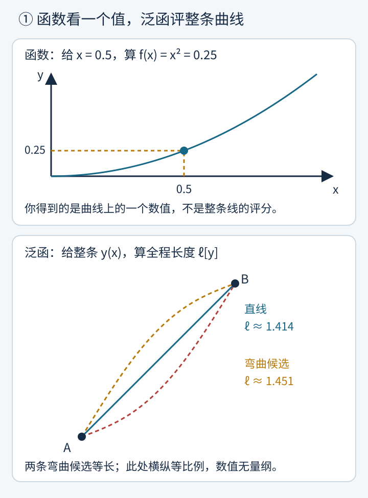
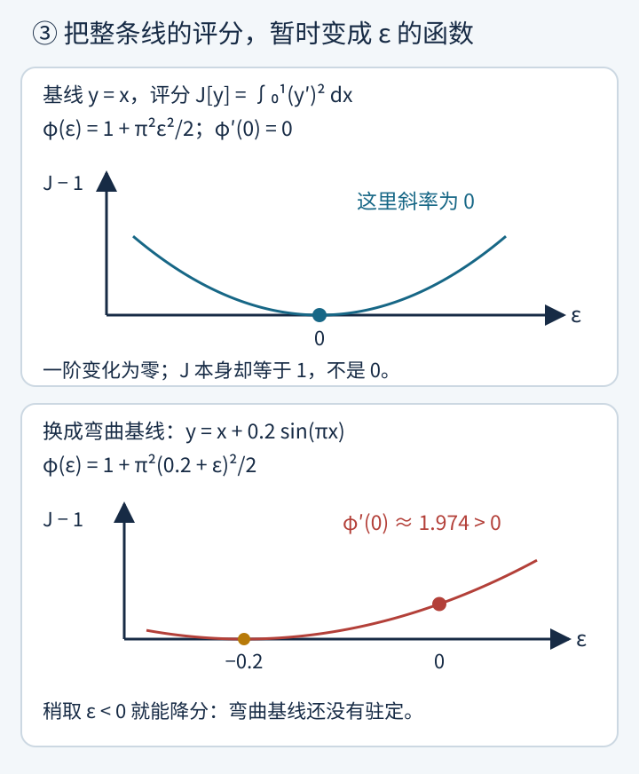
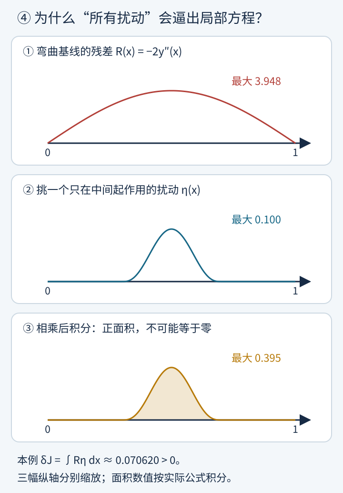
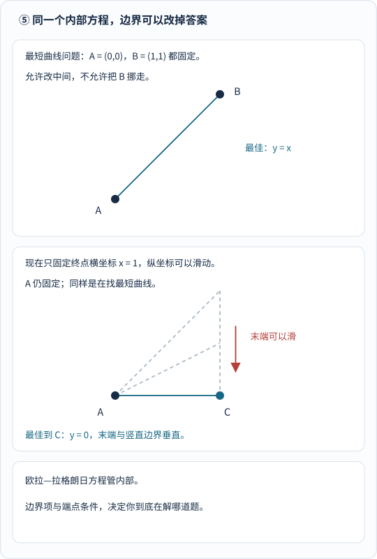
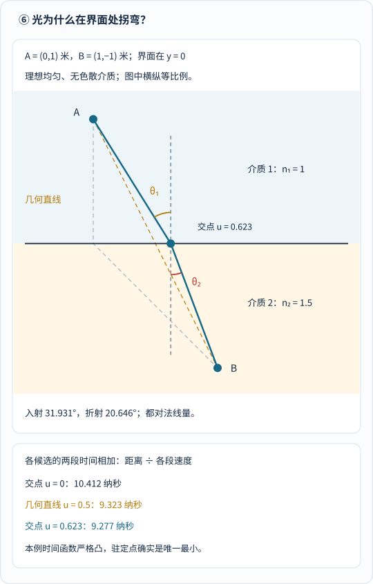
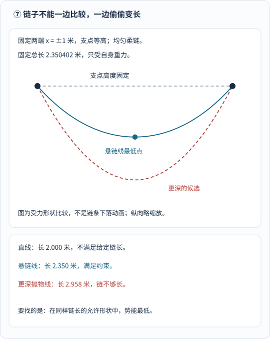
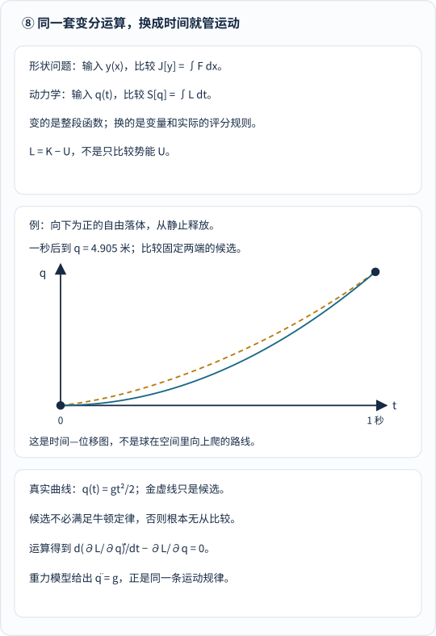

有些数学名词，第一次听见就像竖着一道高墙。

“变分法（Calculus of Variations）”就是最典型的一个。

你在最速降线、悬链线、费马光折射、肥皂泡极小曲面乃至整部拉格朗日力学里天天撞见它，仿佛它是一把包打天下的万能钥匙；可一翻开公式里的 $$\delta J = 0$$，又很容易一头雾水：这个古怪的希腊字母 $$\delta$$ 跟平时熟悉的微分 $$d$$ 到底差在哪儿？

今天我们把门槛降到最低，只揪住一个核心问题往深里拆：

**普通微积分求导，是在微调一个数字 $$x$$；那么变分法，到底是在“变”什么？**

先给出一句掏心窝的答案：**变分法改动的不是某一个孤立的数字，而是把“一整条候选曲线 $$y(x)$$”当作可捏塑的橡皮泥，问怎样调整整条曲线的形状，才能让某个“全程总评分”达到驻定或最优！**

1834 年，哈密顿在经典论文《论动力学的一般方法》引言里（原文转录见[都柏林圣三一学院 GenMeth.tex](https://www.maths.tcd.ie/pub/HistMath/People/Hamilton/Dynamics/GenMeth.tex) 及[论文档案 PDF](https://www.maths.tcd.ie/pub/HistMath/People/Hamilton/Dynamics/)），曾把拉格朗日建立在变分原理上的力学体系赞美为 **“某种科学的诗篇”（a kind of scientific poem）**——因为看似风马牛不相及的物理难题，竟然都能从同一条极值母式里自然流淌出来。

这套工具同样经历了两代人的接力打磨：1744 年，欧拉出版专著（见 [Euler Archive E65 档案](https://scholarlycommons.pacific.edu/euler-works/65/)，1743 年完稿、1744 年刊行），首次把零散的极值曲线难题系统化；1755 年，年仅 **19 岁**的拉格朗日写信给欧拉，献上纯代数的 $$\delta$$ 变分算法，彻底摆脱了繁琐的几何折线近似，欧拉读后大喜过望，当即搁下自己的论文让年轻人先行发表，并在日后正式为这门学科命名“变分法”（见 [MacTutor 拉格朗日传记](https://mathshistory.st-andrews.ac.uk/Biographies/Lagrange/)）。

下面我们就顺着拉格朗日当年那封信的思路，从四条曲线同台打分开始，一步步亲手推导出欧拉—拉格朗日方程、自然边界条件，再看肥皂膜悬链面为什么拉到临界距离会突然崩断。

---

## 一、函数给一个点算值，泛函给整条曲线打分

学微积分时，我们对**普通函数（Function）**早已烂熟于心：比如平方函数 $$f(x) = x^2$$，你喂给它一个数字 $$x = 0.5$$，它吐还给你一个数字 $$f(0.5) = 0.25$$。这台机器是**“吃进一个数，吐出一个数”**。

### 1. 从单点输入 $$f(x)$$ 到整条路径输入 $$J[y]$$

可现实世界里最迷人的优化问题，几乎都不能只靠填一个数字来回答！

比如问：**在平面上从起点 $$A(0, 0)$$ 走到终点 $$B(1, 1)$$，哪一条光滑路线总长度最短？**

你只报一个横坐标 $$x = 0.5$$，没人能算出路有多长；你必须交出**从 $$x = 0$$ 到 $$x = 1$$ 的一整条函数曲线 $$y(x)$$**，沿着曲线把每一小段斜边 $$ds = \sqrt{dx^2 + dy^2} = \sqrt{1 + \bigl(y'(x)\bigr)^2}\,dx$$ 全部累加起来，才能算出它的全程总长度：

$$
J[y] = \ell[y] = \int_0^1 \sqrt{1 + \bigl(y'(x)\bigr)^2}\,dx
$$

_图 1 怎么看：先对比上下两格的“输入对象”。上格是普通函数 $$f(x) = x^2$$，输入单个横坐标 $$0.5$$ 得单个纵坐标 $$0.25$$；下格是弧长泛函 $$\ell[y]$$，输入连接 $$A(0, 0)$$ 与 $$B(1, 1)$$ 的整条蓝实线或弯曲虚线，输出全程总弧长（下格横纵等比例绘制，无量纲教学坐标）。_

请特别留意记号 **$$J[y]$$ 里的方括号 `[ ]`**：数学家特意不用圆括号 `J(x)` 而改用方括号 `J[y]`，就是在提醒我们——**这台评分机器吃进去的是一整条函数曲线 $$y(x)$$，吐出来的则是一个代表全程表现的总分数字！** 这种“函数的函数（Function of a function）”，在数学上就叫做**泛函（Functional）**。

### 2. 四条候选曲线同台打分：直线、正弦微扰、正弦拱与抛物线谁更短？

别被“泛函”两个字唬住，我们立刻拿连接起点 $$A(0, 0)$$ 和终点 $$B(1, 1)$$ 的**四条具体光滑曲线**，挨个塞进弧长泛函 $$J[y] = \int_0^1 \sqrt{1 + (y')^2}\,dx$$ 里算一笔真金白银的分数账：

1. **一号选手（对角直线 $$y_1(x) = x$$）**：
   先算导数 $$y_1'(x) = 1$$，处处斜率恒定。代进积分：

   $$
   J[y_1] = \int_0^1 \sqrt{1 + 1^2}\,dx = \sqrt{2} \approx \mathbf{1.4142}
   $$

2. **二号选手（图 1 中的正弦鼓包微扰 $$y_2(x) = x + 0.2\sin(\pi x)$$）**：
   检查两端：$$y_2(0) = 0,\; y_2(1) = 1 + 0.2\sin\pi = 1$$，完全合法！导数为 $$y_2'(x) = 1 + 0.2\pi\cos(\pi x)$$，数值积分算出全程弧长（无论是往上鼓 $$+0.2\sin(\pi x)$$ 还是往下凹 $$-0.2\sin(\pi x)$$，由对称性完全等长）：

   $$
   J[y_2] = \int_0^1 \sqrt{1 + \bigl(1 + 0.2\pi\cos(\pi x)\bigr)^2}\,dx \approx \mathbf{1.4509}
   $$

3. **三号选手（四分之一正弦拱弧 $$y_3(x) = \sin\left(\frac{\pi x}{2}\right)$$）**：
   检查两端：$$y_3(0) = 0,\; y_3(1) = \sin(\pi/2) = 1$$，出发时较陡、抵达 $$B$$ 点时刚好水平（$$y_3'(1) = 0$$）。代入导数 $$y_3'(x) = \frac{\pi}{2}\cos\left(\frac{\pi x}{2}\right)$$ 积分得：

   $$
   J[y_3] = \int_0^1 \sqrt{1 + \frac{\pi^2}{4}\cos^2\left(\frac{\pi x}{2}\right)}\,dx \approx \mathbf{1.4637}
   $$

4. **四号选手（二次抛物线 $$y_4(x) = x^2$$）**：
   检查两端：$$y_4(0) = 0,\; y_4(1) = 1$$，出发水平、越走越陡。导数为 $$y_4'(x) = 2x$$，这个积分甚至能直接写出精确原函数核验（利用 $$\int \sqrt{1+u^2}\,du = \frac{u}{2}\sqrt{1+u^2} + \frac{1}{2}\operatorname{arsinh} u$$，令 $$u = 2x$$）：

   $$
   J[y_4] = \int_0^1 \sqrt{1 + 4x^2}\,dx = \left[\frac{x}{2}\sqrt{1 + 4x^2} + \frac{1}{4}\ln\left(2x + \sqrt{1 + 4x^2}\right)\right]_0^1 = \frac{\sqrt{5}}{2} + \frac{1}{4}\ln\left(2 + \sqrt{5}\right) \approx \mathbf{1.4789}
   $$

把四位选手的成绩单排成一张表，泛函“吃曲线、吐分数”的工作方式一清二楚：

| 候选曲线 $$y(x)$$（均过 $$(0,0)$$ 与 $$(1,1)$$） | 导数（局部坡度）$$y'(x)$$ | 路线形态特征 | 弧长泛函得分 $$J[y]$$ | 相对直线多绕的路程 |
|---|---|---|---:|---:|
| **直线** $$y_1 = x$$ | $$1$$ | 坡度处处均匀 | **约 $$1.4142$$**（$$\sqrt{2}$$） | 基准最短（$$0\%$$） |
| **正弦微扰** $$y_2 = x \pm 0.2\sin(\pi x)$$ | $$1 \pm 0.2\pi\cos(\pi x)$$ | 在直线基础上轻微鼓起或下凹 | **约 $$1.4509$$** | $$+2.60\%$$ |
| **正弦拱弧** $$y_3 = \sin(\pi x / 2)$$ | $$\frac{\pi}{2}\cos(\pi x / 2)$$ | 先陡升、末端水平切入终点 | **约 $$1.4637$$** | $$+3.50\%$$ |
| **二次抛物线** $$y_4 = x^2$$ | $$2x$$ | 先平缓贴底、后半程急剧变陡 | **约 $$1.4789$$** | $$+4.58\%$$ |

但问题也紧跟着来了：连接 $$A$$ 和 $$B$$ 的光滑曲线有**无穷多条**！你就算用超级计算机测完一亿条曲线，也永远不能排除“第一亿零一条古怪曲线会不会偷偷跑进 $$1.414$$ 以内”。况且一旦把评分规则换成光折射时间或悬链势能，肉眼根本猜不出赢家是谁——我们急需一套**不用靠猜、直接从无穷多条曲线里揪出最优解**的系统算法！

---

## 二、“改整条曲线”怎样下刀？冻结形状 $$\eta(x)$$，只拧幅度旋钮 $$\varepsilon$$

为什么在无穷多条曲线里找极值这么难？因为普通微积分只会在一维数轴或有限维空间里求导，面对无穷维的“全体光滑函数海洋”，根本不知道导数往哪儿求！

19 岁的拉格朗日想出了一个四两拨千斤的**降维绝招**。

### 1. 拆开两个角色：扰动形状 $$\eta(x)$$ 与控制旋钮 $$\varepsilon$$

假设你手里有一条待检验的候选曲线 $$y(x)$$，两端已经死死钉在 $$y(a) = y_a$$ 和 $$y(b) = y_b$$ 上。现在我们不要漫无目的地乱揉曲线，而是先任意挑定一条光滑的**“扰动形状模板” $$\eta(x)$$**，唯一的要求是它在左右两个端点必须归零：

$$
\eta(a) = 0, \qquad \eta(b) = 0
$$

接着再配上一个控制改动幅度的普通实数小旋钮 **$$\varepsilon$$**，构造出一族单参数变形曲线：

$$
y_\varepsilon(x) = y(x) + \varepsilon\eta(x)
$$

_图 2 怎么看：上格画出两端归零的扰动模板 $$\eta(x) = \sin(\pi x)$$；下格把它乘上小旋钮 $$\varepsilon$$ 叠回基线 $$y(x) = x$$。往正方向拧（$$\varepsilon = +0.2$$，金虚线）整条线向上鼓起，往负方向拧（$$\varepsilon = -0.2$$，红虚线）整条线向下压低，而由于 $$\eta(0) = \eta(1) = 0$$，左右端点 $$A, B$$ 始终纹丝不动！[单独打开小扰动演示，刷新可重播](/assets/images/variations/perturb-a-curve.svg)。_

千万分清公式里这两个搭档的分工：

- **函数 $$\eta(x)$$ 管“往哪个形状方向改”**（可以选半个正弦波 $$\sin(\pi x)$$，也可以选两个波 $$\sin(2\pi x)$$，或者只在 $$0.3 < x < 0.7$$ 局部凸起一个小包）；
- **数字 $$\varepsilon$$ 管“顺着这个形状改多大劲”**（当 $$\varepsilon = 0$$ 时，$$y_0(x) = y(x)$$ 原封不动退回待测曲线本身！）。

### 2. 降维妙招：怎样把无穷维曲线空间压回一元函数 $$g(\varepsilon)$$？

现在奇迹发生了！**一旦你暂时把基线 $$y(x)$$ 和某一条测试形状 $$\eta(x)$$ 双双冻住不改，整条变形曲线 $$y_\varepsilon(x) = y(x) + \varepsilon\eta(x)$$ 里唯一还在动的变量，就只剩下那个普通实数 $$\varepsilon$$ 了！**

把它喂进泛函 $$J$$，原本吓人的无穷维泛函 $$J[y + \varepsilon\eta]$$，瞬间降维退化成了一个大一微积分最拿手的**普通一元实函数 $$g(\varepsilon)$$**（图 3 中亦记作 $$\phi(\varepsilon)$$）：

$$
g(\varepsilon) \equiv \phi(\varepsilon) = J[y + \varepsilon\eta]
$$

接下来只需动用大一上册最基本的极值常识：

> 如果待测曲线 $$y(x)$$ 真的是所有合格曲线里的最优解（极小或极大），那么不管我们换哪一种合法的扰动形状 $$\eta(x)$$，当旋钮停在 **$$\varepsilon = 0$$（即不加扰动）** 时，一元函数 $$g(\varepsilon)$$ 都必须正好处在谷底或峰顶——也就是说，**它在 $$\varepsilon = 0$$ 处的一阶导数必须等于零！**

$$
g'(0) = \left.\frac{d}{d\varepsilon} J[y + \varepsilon\eta]\right|_{\varepsilon = 0} = 0 \qquad \text{（对一切允许的光滑 }\eta(x)\text{ 皆成立！）}
$$

这个导数 $$g'(0)$$，就是大名鼎鼎的**第一变分（First variation）**，记作 $$\delta J[y; \eta]$$！你看，变分法一点也没跳出微积分的五指山——它就是“**先挑方向 $$\eta$$ 冻成一元函数 $$g(\varepsilon)$$，在 $$\varepsilon = 0$$ 求一次普通导数，再要求所有方向导数统统归零**”！

---

## 三、第一变分实战：先在坡度平方泛函上亲手算出 $$g'(0) = 0$$

在推导通用公式之前，我们先挑一把没有根号、心算就能积出来的教学尺子——**坡度平方泛函** $$J[y] = \int_0^1 \bigl(y'(x)\bigr)^2\,dx$$（两端仍固定在 $$y(0)=0, y(1)=1$$），亲手拧一次旋钮 $$\varepsilon$$，看看合格基线与不合格基线在 $$g'(0)$$ 面前怎样当场现形。

### 1. 直线基线 vs 弯曲基线：把 $$g(\varepsilon)$$ 展开看斜率

固定测试扰动形状 $$\eta(x) = \sin(\pi x)$$（导数 $$\eta'(x) = \pi\cos(\pi x)$$），我们分别测试两条基线：

1. **测试甲（直线基线 $$y(x) = x$$）**：
   变形曲线为 $$y_\varepsilon(x) = x + \varepsilon\sin(\pi x)$$，求导得 $$y_\varepsilon'(x) = 1 + \varepsilon\pi\cos(\pi x)$$。平方后从 $$0$$ 到 $$1$$ 积分（利用 $$\int_0^1 \cos(\pi x)\,dx = 0$$ 以及 $$\int_0^1 \cos^2(\pi x)\,dx = \frac{1}{2}$$）：

   $$
   g(\varepsilon) = \int_0^1 \bigl[1 + 2\varepsilon\pi\cos(\pi x) + \varepsilon^2\pi^2\cos^2(\pi x)\bigr]dx = 1 + 0\cdot\varepsilon + \frac{\pi^2}{2}\varepsilon^2
   $$

   对 $$\varepsilon$$ 求导得 $$g'(\varepsilon) = \pi^2\varepsilon$$，代入 $$\varepsilon = 0$$：**$$g'(0) = 0$$**！抛物线谷底稳稳落在 $$\varepsilon = 0$$ 处！

2. **测试乙（带鼓包的弯曲基线 $$y(x) = x + 0.2\sin(\pi x)$$）**：
   加上 $$\varepsilon\sin(\pi x)$$ 后，$$y_\varepsilon(x) = x + (0.2 + \varepsilon)\sin(\pi x)$$。直接套用上一行的积分结果，一元函数变成：

   $$
   g(\varepsilon) = 1 + \frac{\pi^2}{2}(0.2 + \varepsilon)^2
   $$

   对 $$\varepsilon$$ 求导并在 $$\varepsilon = 0$$ 处取值：**$$g'(0) = \pi^2(0.2 + 0) = 0.2\pi^2 \approx +1.974 \ne 0$$**！

_图 3 怎么看：注意横轴不是空间坐标 $$x$$，而是扰动旋钮 $$\varepsilon$$！上图从直线出发，评分曲线 $$g(\varepsilon) - 1$$ 在 $$\varepsilon = 0$$ 处切线水平（$$g'(0) = 0$$）；下图从弯曲基线出发，在 $$\varepsilon = 0$$ 处切线斜率高达 $$1.974$$，说明它根本没站在谷底——只要把旋钮往左边拧一点（取负的 $$\varepsilon$$ 压平鼓包），总评分立刻往下掉！_

顺手拎清两个最容易混淆的“零”：**第一变分 $$g'(0) = 0$$，绝不等于泛函本身的值 $$J[y] = 0$$！** 直线基线的评分明明是 $$J[x] = 1$$，归零的只是评分随微扰变化的**一阶斜率**。

### 2. 为什么单方向过关不算完，且 $$g'(0) = 0$$ 不等于全局最小？

刚算完 $$g'(0) = 0$$，必须立刻立下两块防踩坑警示牌：

- **警示一（不能只测一个 $$\eta$$ 就开香槟）**：刚才我们只试了 $$\eta(x) = \sin(\pi x)$$ 这一个方向；万一换个偏心的 $$\eta(x) = \sin(2\pi x)$$ 斜率不为零呢？唯有对**无穷多种合法 $$\eta(x)$$** 全部满足 $$g'(0) = 0$$，才能封为驻定曲线！（对于上面这个教学例子，我们甚至能用配方法三行证出它对一切合格光滑曲线都是全局最小：因为 $$\int_0^1 (y' - 1)\,dx = y(1) - y(0) - 1 = 0$$，展开 $$J[y] = \int_0^1 [1 + (y' - 1)]^2 dx = 1 + \int_0^1 (y' - 1)^2 dx \ge 1$$，平方项非负，唯有 $$y'(x) \equiv 1$$ 即 $$y = x$$ 时才能取到全局最低分 $$1$$！）
- **警示二（驻定 $$g'(0) = 0$$ 只是必要条件，未必是极小）**：就像普通三次函数 $$f(\varepsilon) = \varepsilon^3$$ 在 $$\varepsilon = 0$$ 处导数为零却是拐点一样，变分问题里 $$\delta J = 0$$ 也可能撞上极大值或非极值的鞍点——这正是姊妹篇《[为什么有了牛顿，还需要分析力学？]()》中弹簧振子在 $$2\pi$$ 秒区间上作用量“一边为负、一边为正”的根本原因！

---

## 四、分部积分与“局部鼓包狙击”：欧拉—拉格朗日方程怎样长出来？

现在到了全文最核心的高潮：**既然不可能把无穷多个扰动形状 $$\eta(x)$$ 挨个代进去算，数学家怎样一口气把“对所有 $$\eta(x)$$ 都有 $$g'(0) = 0$$”翻译成一条只含 $$y(x)$$ 自己的微分方程？**

考察最通用的积分泛函（设 $$F$$ 与候选曲线 $$y$$ 均二阶连续可微，两端固定 $$y(a) = y_a, y(b) = y_b$$）：

$$
J[y] = \int_a^b F\bigl(x, y(x), y'(x)\bigr)\,dx
$$

整套推导只需走完环环相扣的三步（严谨表述可对照 [MIT 8.09 讲义第 1.5 节 PDF](https://ocw.mit.edu/courses/8-09-classical-mechanics-iii-fall-2014/resources/mit8_09f14_chapter_1/)）：

### 1. 对 $$\varepsilon$$ 求导：为什么被积函数里同时冒出 $$\eta$$ 和 $$\eta'$$？

把变形曲线 $$y_\varepsilon(x) = y(x) + \varepsilon\eta(x)$$ 及其导数 $$y_\varepsilon'(x) = y'(x) + \varepsilon\eta'(x)$$ 代进泛函，写成 $$\varepsilon$$ 的一元函数：

$$
g(\varepsilon) = \int_a^b F\bigl(x,\; y(x) + \varepsilon\eta(x),\; y'(x) + \varepsilon\eta'(x)\bigr)\,dx
$$

在积分号下对 $$\varepsilon$$ 使用多元复合函数链式法则求导（注意：第一个自变量 $$x$$ 不含 $$\varepsilon$$；第二个槽位对 $$\varepsilon$$ 的导数是 $$\eta(x)$$；第三个槽位对 $$\varepsilon$$ 的导数是 $$\eta'(x)$$），然后令 $$\varepsilon = 0$$：

$$
\delta J = g'(0) = \int_a^b \left(\frac{\partial F}{\partial y}\eta(x) + \frac{\partial F}{\partial y'}\eta'(x)\right)dx = 0
$$

卡壳的地方就在这儿！积分号里第一项乘的是 **$$\eta(x)$$**，第二项乘的却是它的导数 **$$\eta'(x)$$**！因为 $$\eta(x)$$ 弯弯曲曲变幻莫测，$$\eta$$ 和 $$\eta'$$ 混在一起根本没法直接合并同类项提公因式。怎么办？

### 2. 分部积分“乾坤大挪移”：把 $$\eta'$$ 身上的导数甩给 $$\frac{\partial F}{\partial y'}$$

微积分里专治“导数贴错人”的神器，正是乘积求导法则倒过来写的**分部积分（Integration by parts）**！

我们先在草稿纸上对乘积 $$\left(\frac{\partial F}{\partial y'}\cdot \eta(x)\right)$$ 关于 $$x$$ 求全导数：

$$
\frac{d}{dx}\left(\frac{\partial F}{\partial y'}\,\eta(x)\right) = \frac{d}{dx}\left(\frac{\partial F}{\partial y'}\right)\eta(x) + \frac{\partial F}{\partial y'}\,\eta'(x)
$$

移项并在 $$[a, b]$$ 上积分，恼人的 $$\eta'(x)$$ 身上的撇号，瞬间连带一个**负号**被甩到了隔壁 $$\frac{\partial F}{\partial y'}$$ 的肩膀上：

$$
\int_a^b \frac{\partial F}{\partial y'}\,\eta'(x)\,dx = \left[\frac{\partial F}{\partial y'}\,\eta(x)\right]_a^b - \int_a^b \frac{d}{dx}\left(\frac{\partial F}{\partial y'}\right)\eta(x)\,dx
$$

现在把这行结果代回 $$g'(0) = 0$$！因为目前左右两个端点都是锁死不动的，所有合格扰动都满足 **$$\eta(a) = 0$$ 且 $$\eta(b) = 0$$**，方括号边界项 $$\left[\frac{\partial F}{\partial y'}\eta(x)\right]_a^b$$ 当场归零（请先记住这个边界项长什么样，下一章放开端点时它马上要立大功！）。剩下的两项终于全都整整齐齐乘着同一个 $$\eta(x)$$：

$$
\delta J = \int_a^b \underbrace{\left[\frac{\partial F}{\partial y} - \frac{d}{dx}\left(\frac{\partial F}{\partial y'}\right)\right]}_{R(x)\text{（局部残差函数）}}\eta(x)\,dx = 0
$$

### 3. 变分法基本引理的“鼓包狙击”证明：为什么残差 $$R(x)$$ 必须处处为零？

盯着上面最后一行积分 $$\int_a^b R(x)\,\eta(x)\,dx = 0$$，初学者最容易犯嘀咕：“定积分面积等于零，难道不能是残差 $$R(x)$$ 前半截为正、后半截为负，正负面积刚好抵消掉吗？凭什么断言 $$R(x)$$ 在每一个点都必须等于零？”

如果是只对**某一个固定**的 $$\eta(x)$$ 积分为零，正负面积当然可能碰巧抵消；**但别忘了我们的条件是对“一切允许的光滑扰动 $$\eta(x)$$”积分统统等于零！** 这就给了我们一把指哪打哪的“局部狙击枪”——**变分法基本引理（Fundamental Lemma of Calculus of Variations）**：

1. **反证假设**：假设连续函数 $$R(x)$$ 并没有处处归零，比如在某个内部点 $$x_0 \in (a, b)$$ 处 $$R(x_0) > 0$$；
2. **锁定正号靶区**：既然 $$R(x)$$ 是连续函数，不可能在一个点突变成正数又瞬间跳回零，因此在 $$x_0$$ 左右必然存在一小段开区间 $$(\alpha, \beta)$$，在这段区间内部 **$$R(x)$$ 处处严格大于零**！
3. **精准投放“局部光滑鼓包” $$\eta(x)$$**：我们专门构造一个只在靶区 $$(\alpha, \beta)$$ 内光滑鼓起为正（$$\eta(x) > 0$$）、而在靶区外头 $$[a, \alpha]$$ 与 $$[\beta, b]$$ 上**严格贴地恒等于零**的光滑函数（例如经典的 $$C^\infty$$ 紧支集鼓包或高次多项式样条，见图 4 中间格）！
4. **一枪命中矛盾**：拿这颗“局部鼓包”代进积分——靶区外头 $$\eta(x) \equiv 0$$ 不贡献半点负面积来帮忙抵消；靶区里头 $$R(x) > 0$$ 乘上 $$\eta(x) > 0$$ 处处严格为正，积分出来的总面积**铁定严格大于零**，当场打脸 $$\delta J = 0$$！（若 $$R(x_0) < 0$$，同理在负号靶区放一颗正鼓包，乘积积分严格小于零，照样矛盾！）

_图 4 怎么看：从上往下读三格“狙击现场”。上格是弯曲基线 $$y = x + 0.2\sin(\pi x)$$ 在坡度平方泛函下的残差 $$R(x) = -2y'' = 0.4\pi^2\sin(\pi x) > 0$$；中格专门在 $$0.3 < x < 0.7$$ 投放一颗峰值为 $$0.1$$、两端以外全为零的光滑鼓包 $$\eta(x)$$；下格将两者逐点相乘，阴影正面积算出 $$\delta J \approx +0.070620 > 0$$，铁证该曲线绝非驻定解！_

正负漏洞全被堵死，连续残差 $$R(x)$$ 别无选择，只能在区间每一点都乖乖等于零！把 $$R(x) = 0$$ 移项写正，统治半部数学物理的**欧拉—拉格朗日方程（Euler–Lagrange Equation）**正式诞生：

$$
\boxed{\frac{\partial F}{\partial y} - \frac{d}{dx}\left(\frac{\partial F}{\partial y'}\right) = 0}
$$

（两边同乘 $$-1$$ 写成 $$\frac{d}{dx}\left(\frac{\partial F}{\partial y'}\right) - \frac{\partial F}{\partial y} = 0$$ 完全等价。）立刻拿第一章的弧长泛函 $$F = \sqrt{1 + (y')^2}$$ 试一刀：$$F$$ 里根本不含 $$y$$，所以 $$\frac{\partial F}{\partial y} = 0$$，方程直接给出 $$\frac{d}{dx}\left(\frac{y'}{\sqrt{1 + (y')^2}}\right) = 0$$，即括号里的量恒为常数，反解出来导数 $$y'(x) \equiv \text{常数}$$——两点之间唯一光滑驻定曲线当场锁定为**直线**！

---

## 五、自然边界条件与肥皂膜崩塌：当右端点自由滑动，或圆环拉得太远！

学会了欧拉—拉格朗日方程，千万别养成“一见变分题就闭眼套内部微分方程”的坏习惯。变分法最迷人也最容易翻车的两课，全藏在**边界条件**与**解的存在危机**里！

### 1. 右端点在竖直杆上自由滑动：自然边界条件怎样逼出“水平抵达”？

我们把第一章的最短路径题稍微改一个条件：**左端点依然死死钉在 $$A(0, 0)$$，但右端点不再钉死在 $$(1, 1)$$，而是套在一个光滑的小环上，允许沿着直线 $$x = b$$（图中取 $$b = 1$$）的竖直细杆上下自由滑动！** 问：从点 $$A$$ 连到竖直杆 $$x = 1$$ 的所有光滑曲线里，哪一条最短？

几何直觉一秒钟就能喊出答案：当然是从 $$A(0, 0)$$ **水平直走**到 $$(1, 0)$$ 最短（长度等于 $$1$$），垂直撞上竖直杆！可问题是：刚才算出来的欧拉—拉格朗日内部方程只告诉你“曲线是一条直线 $$y = kx$$”，斜率 $$k$$ 取多少都满足内部微分方程——**变分法自己是靠哪一步运算，聪明地挑出末端必须“水平抵达（$$y'(b) = 0$$）”的呢？**

_图 5 怎么看：上格锁死左右两端 $$A(0,0)$$ 与 $$B(1,1)$$，最短线是斜率 $$1$$ 的对角线（长 $$\sqrt{2} \approx 1.414$$）；下格放开右端使其可在竖直线 $$x = 1$$ 上自由上下滑动，最短线自动变成水平直达 $$(1,0)$$（长 $$1.000$$），末端以 $$90^\circ$$ 正交垂直切入右边界！_

答案就在上一章分部积分时差点被随手扔掉的那个**边界项**里！让我们一步不漏重走一遍：

1. **看清谁固定、谁自由**：左端锁死在 $$A$$ 点，故仍有 $$\eta(a) = 0$$；但右端可以在竖直杆 $$x = b$$ 上任意上下滑动，意味着右端高度微扰 **$$\eta(b)$$ 可以取任意非零实数**！
2. **保留右端边界项**：回到分部积分公式，左端 $$x = a$$ 因 $$\eta(a) = 0$$ 消失，右端 $$x = b$$ 必须原封不动留下来：

   $$
   \delta J = \left.\frac{\partial F}{\partial y'}\right|_{x = b}\eta(b) + \int_a^b \left[\frac{\partial F}{\partial y} - \frac{d}{dx}\left(\frac{\partial F}{\partial y'}\right)\right]\eta(x)\,dx = 0
   $$

3. **先测内部鼓包，再放开右端滑环（两步狙击）**：
   先在所有合法扰动里，专挑那些右端暂时不动的子集（$$\eta(b) = 0$$）。既然它们也属于合法扰动，上一章的“局部鼓包狙击”照常生效，迫使积分号里的欧拉—拉格朗日残差在 $$(a, b)$$ 内部处处为零！接着，既然积分项已经归零，整个式子只剩下孤零零的头一项 **$$\left.\frac{\partial F}{\partial y'}\right|_{x = b}\eta(b) = 0$$**。现在拧动右端滑环，由于 $$\eta(b)$$ 可以取任意非零值，要想乘积永远为零，只能逼着前面的系数自己归零：

   $$
   \boxed{\left.\frac{\partial F}{\partial y'}\right|_{x = b} = 0} \qquad \text{（自然边界条件 Natural Boundary Condition！）}
   $$

4. **代入弧长泛函核验“水平抵达”**：
   把 $$F = \sqrt{1 + (y')^2}$$ 代进自然边界条件：

   $$
   \left.\frac{\partial F}{\partial y'}\right|_{x = b} = \frac{y'(b)}{\sqrt{1 + \bigl(y'(b)\bigr)^2}} = 0 \quad \Longrightarrow \quad y'(b) = 0
   $$

   **末端斜率 $$y'(b) = 0$$，水平抵达！** 你没有在题目里人为规定末端角度，纯粹靠“允许右端自由滑动”的变分驻定条件，数学自己把水平正交条件推了出来（在绳索或肥皂膜力学里，这恰恰对应无摩擦竖直滑杆无法提供竖直拉力分量 $$T\sin\theta = 0$$）！

### 2. 肥皂膜悬链面（Catenoid）的临界断裂：当欧拉—拉格朗日方程根本无解！

再来看一个在家拿肥皂水就能做、却曾让无数数学物理学生大吃一惊的经典实验：**把两个半径同为 $$R$$ 的圆形铁丝圈正对着浸入肥皂液，轻轻拉出，两圈之间会绷出一层晶莹剔透、中间收腰的旋转肥皂膜；如果你把两个铁丝圈慢慢往两边拉远，会发生什么？**

表面张力迫使肥皂膜在固定两圆环边界下寻找**表面积最小**的旋转曲面。设两圆环中心沿 $$x$$ 轴对称摆在 $$x = -d$$ 与 $$x = +d$$（两环总间距 $$L = 2d$$），母线半径为 $$r(x)$$，旋转曲面面积泛函为：

$$
A[r] = 2\pi \int_{-d}^{d} r(x)\sqrt{1 + \bigl(r'(x)\bigr)^2}\,dx
$$

由于被积函数 $$F = r\sqrt{1 + (r')^2}$$ 不显含自变量 $$x$$，利用欧拉—拉格朗日方程的一阶积分（贝尔特拉米恒等式 $$F - r'\frac{\partial F}{\partial r'} = c$$），三行就能解出光滑驻定母线：

$$
\frac{r}{\sqrt{1 + (r')^2}} = c \quad \Longrightarrow \quad r(x) = c\cosh\left(\frac{x}{c}\right)
$$

把悬链线绕对称轴转一圈——这就是欧拉在 1744 年发现的人类历史上第一个非平面极小曲面：**悬链面（Catenoid，腰部最细处半径正是积分常数 $$c$$）**！

到这儿看起来岁月静好，可一旦代入左右铁丝圈的边界条件 $$r(\pm d) = R$$，惊雷炸响了！令无量纲参数 $$u = \frac{d}{c} > 0$$，边界方程写作：

$$
R = c\cosh\left(\frac{d}{c}\right) \quad \Longleftrightarrow \quad \frac{d}{R} = \frac{u}{\cosh u}
$$

看看右边这个一元函数 $$h(u) = \frac{u}{\cosh u}$$：当 $$u \to 0$$ 时它趋于 $$0$$；当 $$u \to \infty$$ 时指数分母 $$\cosh u$$ 狂飙，它又跌回 $$0$$！中间必然有一座最高天花板！对 $$u$$ 求导令 $$h'(u) = \frac{\cosh u - u\sinh u}{\cosh^2 u} = 0$$，解超越方程 $$u^*\tanh u^* = 1$$ 得 $$u^* \approx 1.1997$$，代回算出天花板高度：

$$
\left(\frac{d}{R}\right)_{\max} = \frac{u^*}{\cosh u^*} \approx 0.6627 \quad \Longleftrightarrow \quad \boxed{L_{\max} = 2d_{\max} \approx 1.3255\,R \approx 0.6627 \times (2R)}
$$

沿着这组精确数字，看看你拉动铁丝圈时亲眼目睹的**两幕戏剧性崩塌**：

1. **第一道暗礁（$$1.0554\,R < L < 1.3255\,R$$：亚稳态陷阱）**：当两环间距拉过约 $$1.0554\,R$$ 时，算一算悬链面的总面积，竟然**已经超过了在两个铁丝圈上各自糊一张独立扁平圆膜的面积之和 $$2\pi R^2$$**（数学上称为 Goldschmidt 不连续解）！此时光滑悬链面早已丢掉了“全局最小面积”的王冠，只是靠一道能量势垒勉强维持着**局部极小（亚稳态）**，拿手指轻轻一戳就会破成两片平膜；
2. **第二道绝壁（$$L > 1.3255\,R$$：光滑驻定解彻底灭绝！）**：一旦两环间距超过半径的 **$$1.3255$$ 倍**（即圆环直径 $$2R$$ 的约 **$$66.3\%$$**），$$\frac{d}{R} > 0.6627$$，超越方程 $$\frac{u}{\cosh u} = \frac{d}{R}$$ **连一个实数根 $$u$$ 都不存在了**！欧拉—拉格朗日微分方程在给定边界下**光滑解直接清零**——真实世界里的肥皂膜腰部会在这一瞬间急速收缩夹断，“啪”地崩裂缩回左右两个铁丝圈上的两张扁平圆盘！

这堂肥皂膜实验课给所有学变分法的人敲响了终身难忘的警钟：**写出欧拉—拉格朗日微分方程只是万里长征第一步；光滑驻定解存不存在？有几个？是局部极小、不稳定鞍点，还是早就被不连续解抢走了全局最优？每一步都必须拿数学和物理条件严格验明正身！**

---

## 六、费马原理与光的折射：无限多条折线，怎样浓缩成一个界面交点？

现在换一把物理尺子：不再量几何路程，而是量光走完全程花掉的**传播时间**。

### 1. 均匀介质内部先走直线：把泛函降维成单变量时间函数 $$\mathcal{T}(u)$$

设水平界面 $$y = 0$$ 上方是空气（折射率 $$n_1 = 1$$，光速 $$v_1 = c/n_1$$），下方是玻璃（折射率 $$n_2 = 1.5$$，光速 $$v_2 = c/n_2$$）。光从上方点 $$A(0, 1)\ \mathrm{m}$$ 出发，穿过界面抵达下方点 $$B(1, -1)\ \mathrm{m}$$。

按费马原理，光路使传播时间 $$\mathcal{T} = \int \frac{ds}{v} = \frac{1}{c}\int n(x,y)\,ds$$ 取驻值。本来候选路径是无穷多条任意弯曲曲线，但我们可以**先在两种均匀介质内部用一次欧拉—拉格朗日方程**：既然空气内部 $$n_1$$ 是常数、玻璃内部 $$n_2$$ 也是常数，各自内部的最短时间线必然都是**直线段**！

这样一来，无穷维的泛函极值问题，被合法地先一步浓缩成了只找界面上那唯一一个交点横坐标 $$u$$ 的单变量函数：

$$
\mathcal{T}(u) = \frac{\sqrt{1 + u^2}}{c / n_1} + \frac{\sqrt{1 + (1 - u)^2}}{c / n_2} = \frac{n_1}{c}\sqrt{1 + u^2} + \frac{n_2}{c}\sqrt{1 + (1 - u)^2}
$$

对交点位置 $$u$$ 求导并令 $$\mathcal{T}'(u) = 0$$：

$$
\frac{d\mathcal{T}}{du} = \frac{1}{c}\left[n_1\frac{u}{\sqrt{1 + u^2}} - n_2\frac{1 - u}{\sqrt{1 + (1 - u)^2}}\right] = 0
$$

对照图 6 的直角三角形，$$\frac{u}{\sqrt{1+u^2}}$$ 正好是入射角（对竖直法线量起）的正弦 $$\sin\theta_1$$，$$\frac{1-u}{\sqrt{1+(1-u)^2}}$$ 正好是折射角的正弦 $$\sin\theta_2$$——移项即是光学基石**斯涅尔折射定律（Snell's Law）**：

$$
n_1\sin\theta_1 = n_2\sin\theta_2
$$

### 2. 纳秒级时间对账与二阶导数检验：为什么折线比直线更快？

_图 6 怎么看：横纵等比例绘制。金虚线是穿过 $$u = 0.5\ \mathrm{m}$$ 的几何最短直线；蓝实线是穿过 $$u \approx 0.6232\ \mathrm{m}$$ 的真实折射光路——它在跑得快的空气里多走了一截，换取在跑得慢的玻璃里少走一截，就像海滩救生员先在沙滩斜跑再下水游泳一样赢下了总时间！_

把数值代进去算到纳秒（$$1\ \mathrm{ns} = 10^{-9}\ \mathrm{s}$$）：

- 竖直下穿再斜走（$$u = 0\ \mathrm{m}$$）：耗时约 **$$10.412\ \mathrm{ns}$$**；
- 几何直线硬穿（$$u = 0.5\ \mathrm{m}$$，总路程最短）：耗时约 **$$9.323\ \mathrm{ns}$$**；
- 斯涅尔折射折线（$$u \approx 0.6232\ \mathrm{m}$$）：总路程稍长，却只需约 **$$9.277\ \mathrm{ns}$$**！

再求一次二阶导数 $$\mathcal{T}''(u) = \frac{n_1}{c(1+u^2)^{3/2}} + \frac{n_2}{c[1+(1-u)^2]^{3/2}} > 0$$ 恒严格为正，证明平界面折射确实是全局唯一极小值（注：若换成凹面反射镜或引力透镜，费马原理同样应严格表述为**光程/时间驻定**，存在鞍点光路，参见 [OpenStax 大学物理光学卷](https://openstax.org/books/university-physics-volume-3/pages/1-3-refraction) 与 [Fermat's Principle 词条](https://en.wikipedia.org/wiki/Fermat%27s_principle)）。

---

## 七、等周约束与悬链线：当总长度锁死，拉格朗日乘子怎样看住账本？

前面无论改哪条曲线，我们只管锁住端点（或放开滑动端点），中间曲线变长变短全不管。可要是碰上**挂链条**或**围栅栏（等周问题）**，规则就严苛多了：**不仅两端挂钩锁死，连整条曲线的总长度 $$\ell_0$$ 也一毫米都不许增减！**

### 1. 为什么不能拿过短直线和过长抛物线直接比势能？

_图 7 怎么看：左右挂钩相距 $$2\ \mathrm{m}$$，给定链条总长为 $$2.350402\ \mathrm{m}$$。蓝实线是真实悬链线；灰虚线直线总长只有 $$2.000\ \mathrm{m}$$（太短够不着或把铁链拉断了）；金虚线深抛物线重心虽然垂得更低，但总长涨到了 $$2.957886\ \mathrm{m}$$（偷加了近 $$61$$ 厘米铁链）！比较势能高低前，参赛曲线必须先满足同一条长度红线。_

在单位链重为 $$w$$ 的静力模型中，我们要在锁死总弧长 $$C[y] = \int_a^b \sqrt{1 + (y')^2}\,dx = \ell_0$$ 的前提下，极小化重力势能泛函 $$U[y] = \int_a^b w y \sqrt{1 + (y')^2}\,dx$$。此时如果你只往 $$y(x)$$ 上加单方向扰动 $$\varepsilon\eta(x)$$，弧长 $$C[y]$$ 一般立刻就变了，根本犯规出局！

### 2. 增广泛函 $$\widetilde{J}[y, \lambda]$$：全局约束用常数乘子，逐点约束用函数乘子

拉格朗日给出的解法干净漂亮：引进一个待定常数**拉格朗日乘子 $$\lambda$$**（量纲必须为**牛顿 $$\mathrm{N}$$**，这样 $$\lambda C[y]$$ 才与势能 $$U[y]$$ 同为焦耳！），把目标泛函与等周约束合并成增广泛函：

$$
\widetilde{J}[y, \lambda] = U[y] + \lambda\bigl(C[y] - \ell_0\bigr) = \int_a^b \underbrace{(w y + \lambda)\sqrt{1 + (y')^2}}_{\widetilde{F}(y, y')}\,dx - \lambda\ell_0
$$

- 对 $$\lambda$$ 求偏导令其为零，自动锁回长度约束 $$C[y] = \ell_0$$；
- 对 $$y(x)$$ 套用欧拉—拉格朗日方程（$$\widetilde{F}$$ 不显含 $$x$$），直接导出双曲余弦悬链线，再联合两端高度和总长 $$\ell_0$$ 反解出常数 $$\lambda$$ 与积分常数（完整受力与工程推演见姊妹篇《[一根下垂的线，怎样连起微积分、桥梁和电网？]()》）。

顺手记住一条内行区分：**因为“总链长等于 $$\ell_0$$”是横跨全区间的单个积分约束，所以乘子 $$\lambda$$ 是一个常数；如果遇到每一时刻 $$t$$ 都必须满足一条代数或速度方程（如刚杆约束 $$x^2(t)+y^2(t)=l^2$$），乘子就必须升级成随时间变化的函数 $$\lambda(t)$$！**

---

## 八、把自变量换成时间 $$t$$：从空间曲线一步跨进拉格朗日力学

走到最后一站，只需把整篇文章里的字母做一次**一对一换装**，你就站在了整座分析力学与现代场论的大门口：

### 1. 空间积分 vs 时间作用量：同一套四步推导怎样给出运动方程？

把刚才的空间横坐标 $$x$$ 换成**时间 $$t$$**，把空间高度曲线 $$y(x)$$ 换成质点或机械臂的**运动历史 $$q(t)$$**，把坡度 $$y'(x)$$ 换成**广义速度 $$\dot{q}(t)$$**，把每小段评分规则 $$F(x, y, y')$$ 换成**拉格朗日量 $$L(q, \dot{q}, t) = T - V$$**：

$$
J[y] = \int_a^b F(x, y, y')\,dx \quad \xrightarrow{\;x \to t,\; y \to q,\; F \to L\;} \quad S[q] = \int_{t_0}^{t_1} L(q, \dot{q}, t)\,dt
$$

_图 8 怎么看：上格对照“空间形状积分”与“时间作用量积分”的同构字典；下格以静止释放的自由落体为例（取向下位移 $$q$$ 为正，故数值向上画代表往下掉得更远），蓝实线 $$q(t) = \frac{1}{2}gt^2$$ 是满足作用量驻定的真实运动，金虚线是共享起终点的比较候选函数。_

第四章走过的那四步（链式求导 $$\to$$ 分部积分搬走 $$\dot{\eta}$$ $$\to$$ 固定端点消边界项 $$\to$$ 局部鼓包狙击清零残差），连一个标点符号都不用改，直接吐出动力学的欧拉—拉格朗日方程：

$$
\boxed{\frac{d}{dt}\left(\frac{\partial L}{\partial \dot{q}}\right) - \frac{\partial L}{\partial q} = 0}
$$

### 2. 自由落体与非线性单摆的双重验算

拿两个最熟悉的例子当场验货：

- **自由落体**（取向下位移 $$q$$ 为正）：动能 $$T = \frac{1}{2}m\dot{q}^2$$，重力势能 $$V = -mgq$$，故 $$L = T - V = \frac{1}{2}m\dot{q}^2 + mgq$$。代入方程得 $$m\ddot{q} - mg = 0 \implies \ddot{q} = g$$，配合初值 $$q(0) = 0, \dot{q}(0) = 0$$ 即得 $$q(t) = \frac{1}{2}gt^2$$！
- **非线性单摆**：代入 $$L = \frac{1}{2}ml^2\dot{\theta}^2 - mgl(1-\cos\theta)$$，同一套求导规则立刻给出 $$\ddot{\theta} + \frac{g}{l}\sin\theta = 0$$！

如果再把单变量函数 $$y(x)$$ 推广成依赖三维空间与时间的**场 $$\phi(x, y, z, t)$$**（比如鼓面振动高度、电磁势或引力场度规），分部积分变成多元散度定理，欧拉—拉格朗日常微分方程就顺理成章升级为麦克斯韦电磁场方程与爱因斯坦场方程背后的**偏微分变分方程**——哈密顿那句“科学的诗篇”，跨越两百年依然字字千钧。

---

## 九、一张总账表：看清变分法的五把标尺与三大边界

### 1. 几何、光学、静力学、肥皂膜与动力学全景对账表

合上全文之前，我们把今天亲手算过的六类变分问题列成一张总对账表，看清同一副数学骨架是怎样换上不同物理外衣的：

| 经典问题 | 待求对象 | 全局泛函评分 $$J$$ | 端点与附加约束 | 驻定条件导出结果 | 必查的陷阱与边界 |
|---|---|---|---|---|---|
| **平面最短路径** | 路径 $$y(x)$$ | $$\int_a^b \sqrt{1+(y')^2}\,dx$$ | 两端钉死；或右端沿 $$x=b$$ 自由滑动 | 钉死得斜直线；右端自由滑动配自然边界条件得 **$$y'(b)=0$$（水平正交抵达）** | 换边界条件会彻底改变最优解，不可只背内部方程 |
| **费马光折射** | 折线交点 $$u$$（光路） | $$\frac{1}{c}\int n\,ds$$ | 两端固定，平界面两侧折射率 $$n_1, n_2$$ 均匀 | **斯涅尔定律** $$n_1\sin\theta_1 = n_2\sin\theta_2$$ | 弯曲镜面或引力透镜下时间仅保证**驻定**，未必全局最小 |
| **静力悬链线** | 链形 $$y(x)$$ | 势能 $$\int wy\sqrt{1+(y')^2}\,dx$$ | 两端固定 + **等周总链长锁死 $$\ell_0$$** | 配常数乘子 $$\lambda$$ 导出**悬链线** $$a\cosh(x/a)$$ | 必须锁死总长 $$\ell_0$$，否则不同长度曲线无资格直接比势能 |
| **双环肥皂膜** | 母线半径 $$r(x)$$ | 旋转面积 $$2\pi\int r\sqrt{1+(r')^2}\,dx$$ | 左右两等大圆环 $$r(\pm d) = R$$ | **悬链面** $$r = c\cosh(x/c)$$ | 间距超 $$1.0554\,R$$ 退为亚稳态；超 **$$1.3255\,R$$ 光滑解彻底消失**，肥皂膜夹断成两片圆盘！ |
| **拉格朗日力学** | 运动历史 $$q(t)$$ | 作用量 $$\int_{t_0}^{t_1}(T-V)\,dt$$ | 固定初末时刻位置 $$\eta(t_0)=\eta(t_1)=0$$ | **欧拉—拉格朗日运动方程** | $$\delta S=0$$ 非“物体预知未来”；过共轭点后驻定解非最小（如弹簧 $$2\pi$$ 区间反例） |
| **连续样条数据平滑** | 拟合函数 $$y(x)$$ | $$\int_a^b \bigl[(y-d)^2 + \alpha(y')^2\bigr]dx$$ | 权重 $$\alpha > 0$$ 给定，两端自由则配 $$y'(a)=y'(b)=0$$ | 二阶常微分方程 $$y - \alpha y'' = d(x)$$ | $$\alpha$$ 是人为选定的正则化超参数，不同于强制等长的拉格朗日乘子 $$\lambda$$ |

### 2. 读懂任何变分推导的“五问清单”

从此以后，无论你在光学、弹性力学、量子场论还是最优控制论文里再看到“由变分原理 $$\delta J = 0$$ 可得……”，再也不用发怵，只需按顺序在心里核对这五句话：

1. **改的是谁？**（是一条一维曲线 $$y(x)$$、一段运动轨迹 $$q(t)$$，还是一片二维薄膜 $$u(x,y)$$？）
2. **拿什么尺子打分？**（被积函数 $$F$$ 算的是弧长、时间、表面积、势能，还是动能减势能 $$T - V$$？）
3. **手脚被什么捆住了？**（两端是钉死的 $$\eta = 0$$，还是可自由滑动从而触发**自然边界条件**？有没有锁死总长度或总体积的等周约束？）
4. **分部积分甩给了谁？**（把 $$\eta'$$ 身上的导数挪走后，边界项消干净了吗？局部鼓包狙击需要的光滑性够不够？）
5. **算出来的驻定解真能站住吗？**（像双环肥皂膜那样拉远后解还存不存在？它是真正的全局最小、局部亚稳态，还是马鞍面？）

把这五步问清楚，变分法那道高墙就已经在你脚下变成了一级级宽敞透亮的石阶。

---

## 参考资料与图解说明

1. [William Rowan Hamilton (1834), *On a General Method in Dynamics* 原文档案](https://www.maths.tcd.ie/pub/HistMath/People/Hamilton/Dynamics/) 及 [引言 TeX 原文转录](https://www.maths.tcd.ie/pub/HistMath/People/Hamilton/Dynamics/GenMeth.tex)——核对《皇家学会哲学汇刊》1834 年刊本第 247—308 页中 “a kind of scientific poem” 的准确出处与上下文。
2. [MIT OpenCourseWare：8.09 Classical Mechanics III, Chapter 1（第 1.5 节，PDF）](https://ocw.mit.edu/courses/8-09-classical-mechanics-iii-fall-2014/resources/mit8_09f14_chapter_1/)——支持泛函定义、单参数扰动族 $$g(\varepsilon)$$、分部积分、变分法基本引理、欧拉—拉格朗日方程及等周拉格朗日乘子法的推导。
3. [Euler Archive：E65（*Methodus inveniendi lineas curvas...*，1744）](https://scholarlycommons.pacific.edu/euler-works/65/)——核对欧拉 1743 年完稿、1744 年出版的变分法奠基专著及悬链面极小曲面发现史。
4. [圣安德鲁斯大学 MacTutor：Joseph-Louis Lagrange](https://mathshistory.st-andrews.ac.uk/Biographies/Lagrange/)——核对 1755 年 19 岁拉格朗日致欧拉信中纯分析 $$\delta$$ 变分算法及 1756 年力学应用的史实。
5. [OpenStax *University Physics Volume 3*, 1.3 Refraction](https://openstax.org/books/university-physics-volume-3/pages/1-3-refraction) 与 [Fermat's Principle 条目](https://en.wikipedia.org/wiki/Fermat%27s_principle)——支持折射率 $$v = c/n$$、斯涅尔定律及一般光学系统“时间驻定而非必取极小”的严谨限定。
6. I. M. Gelfand & S. V. Fomin, *Calculus of Variations*（Dover 经典教材）及 R. Courant & H. Robbins, *What Is Mathematics?*（肥皂膜极小曲面章节）——支持自由端点自然边界条件 $$\left.\frac{\partial F}{\partial y'}\right|_{x=b} = 0$$，以及双环肥皂膜悬链面临界比值 $$L_{\max}/R \approx 1.3255$$（$$u^*\tanh u^* = 1$$）与 $$1.0554\,R$$ 亚稳态转变的精确解析分析。

本文八幅配图均为原创计算生成的标准 SVG，由仓库脚本 `python tools/visuals.py build variations` 构建并自动核验：各候选曲线弧长积分（$$\sqrt{2} \approx 1.4142$$、正弦微扰 $$\approx 1.4509$$）、坡度平方泛函第一变分斜率（$$1.974$$）、紧支集局部鼓包积分面积（$$+0.070620$$）、固定与滑动端点正交几何、折射纳秒时间账（$$9.277\ \mathrm{ns}$$ vs $$9.323\ \mathrm{ns}$$）及等周链长约束（$$2.350402\ \mathrm{m}$$）。唯一一段五秒扰动演示仅展示单参数函数族 $$y + \varepsilon\eta$$ 的几何形变，播放一次后停回基线并保留正负静态对照线，完整响应 `prefers-reduced-motion: reduce`。
