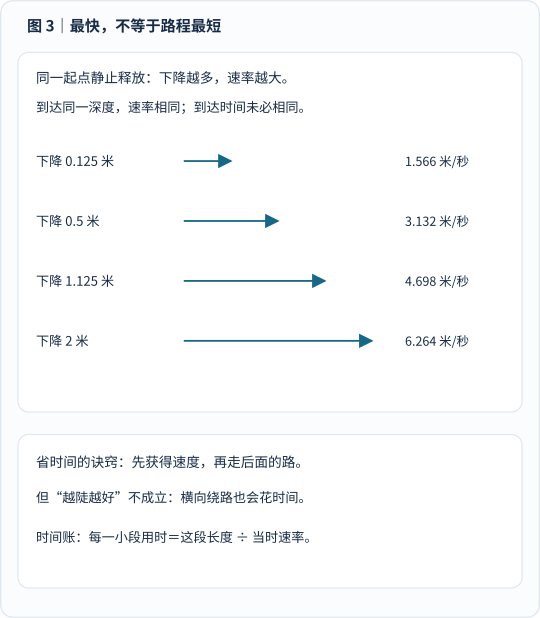
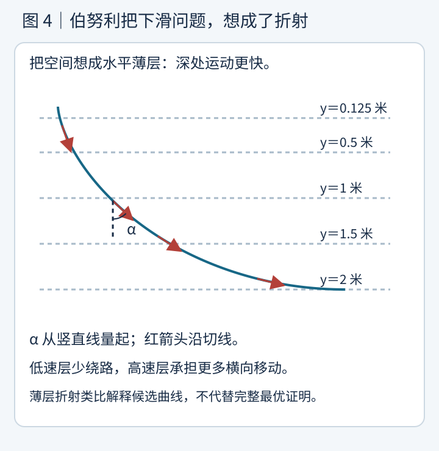
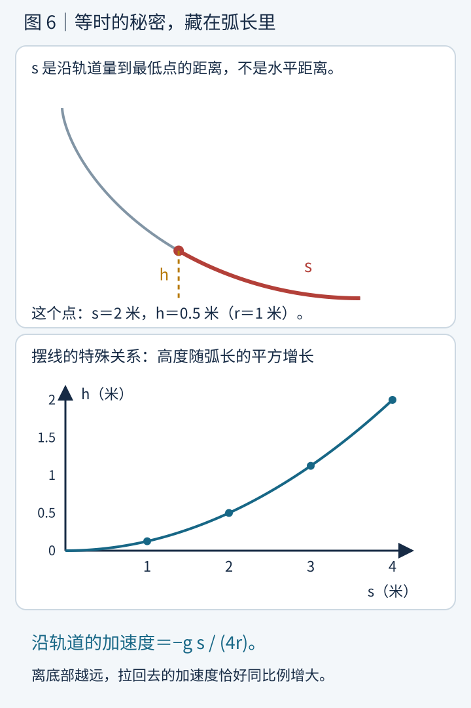
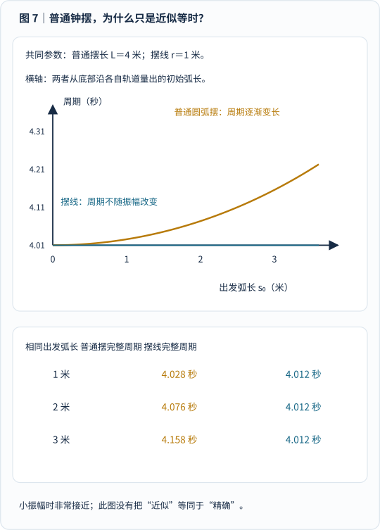
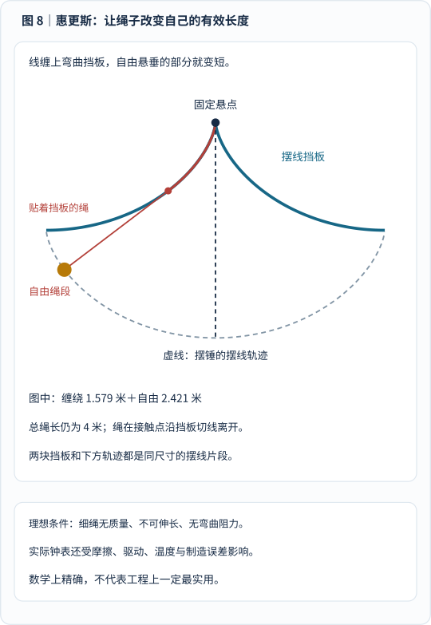

想象你要给一个小珠子修滑梯。

出发点在左上，终点在右下。没有发动机，也不给它推力，只让重力带着它滑下去。

你会怎么修？

第一反应大概是：**两点之间，直线最短。那就修直线！**

但有人偏偏修出一条先陡后缓的弯曲轨道。珠子走得更远，却先到终点。

你刚想说：“哦，原来高处先加速很重要。”

对方又把三颗珠子放到这条曲线的不同位置，同时松手。高处那颗要走很远，低处那颗就在终点旁边。

结果，它们居然 **同时到达最低点**。

这条曲线叫 **摆线**，英文是 *cycloid*。

它不是普通钟摆来回画出的圆弧，也不是一根松绳自然下垂形成的悬链线。名字容易让人联想到摆钟，是因为它确实与惠更斯研究摆钟的故事紧紧相连。

这一次，我们把它的两个本领拆开看：

> **最速降线：同一出发点，选择哪条轨道最快？**
>
> **等时线：同一条轨道，不同位置从静止出发，为什么同时到底？**

下面有八幅原创图，其中三幅带短动画。看动画之前，先约定一件很重要的事：我们研究的是 **理想物理模型**，不是宣称现实中的钢珠、滑梯或钟表一定能毫无误差地做到。

## 一、摆线竟然是一个圆“滚”出来的

在自行车轮胎边缘点一个红点，然后让轮子沿平地向前滚。

红点既跟着圆心前进，又绕着圆心转动。

它留下的轨迹，不是圆，也不是正弦波，而是一段段带尖点的拱形曲线。

这就是摆线。

_图 1 怎么看：盯住轮缘红点，而不是圆心。圆心匀速平移，红点还在转动；两种运动叠加成摆线。完整曲线与几个关键位置一直保留。动画一圈用 6 秒，仅是绘图演示，不是后面珠子的下滑时间。_

[单独打开滚动图解](/assets/images/cycloid/rolling-cycloid.svg)，刷新可重播。所有动画都只播放一次，并响应系统的减少动态效果设置。

这里有两个条件不能省略。

**红点必须在圆周上。** 如果点在圆内或圆外，会得到相关但不同的曲线，不要把它们都当成本篇的普通摆线。

**圆必须无滑动滚动。** 圆转过一个弧度，圆心就前进一个半径的距离。若轮胎一边转一边原地打滑，这个轨迹就变了。

设圆半径为 \(r\)，转角为 \(\theta\)，单位是弧度。

如果取地面为基线、竖直向上为正，可以写出：

$$
\begin{aligned}
x&=r(\theta-\sin\theta),\\
z&=r(1-\cos\theta).
\end{aligned}
$$

圆心先向前走了 \(r\theta\)，红点相对圆心还有一个横向偏移 \(-r\sin\theta\)。纵向高度则由圆心高度 \(r\) 与红点相对圆心的位置一起决定。

你不必立刻背公式。先记住：**往前走，加上绕圈转，留下了这条曲线。**

为了把它做成滑轨，我们把这段拱形曲线翻转，让尖点在上、光滑的最低点在下。后面统一用 \(y\) 表示 **从起点向下量的深度**，于是形式仍然是：

$$
\begin{aligned}
x&=r(\theta-\sin\theta),\\
y&=r(1-\cos\theta).
\end{aligned}
$$

式子长得一样，是因为纵轴方向也换了。不要一边使用“向上为正”的图，一边把 \(y\) 当作下降深度。

## 二、先比赛：直线为什么输给一条弯线？

我们安排一场公平的竞速。

所有珠子都从同一个 A 点静止出发，到同一个 B 点结束。水平方向相隔约 **3.142 米**，B 比 A 低 **2 米**。

准备三条轨道：

**一条直线，一段圆弧，一段摆线。**

为了让计时有明确意义，本篇采用这些假设：

- 珠子视为质点，只滑动，不考虑自身转动。
- 导轨光滑、固定，没有摩擦和空气阻力。
- 重力加速度处处相同，取 \(g=9.81\ \text{米/秒}^2\)。
- 珠子从静止释放，没有额外推力；导轨约束力不做功。

可以想象珠子穿在一根刚性导线上，始终沿轨道运动。这样就不必另外猜测它会不会从开放的轨道上脱离。

_图 2 怎么看：三幅小图采用相同长度比例、相同重力和同一时间尺度。大点是运动珠子，小灰点是各自全程用时的四分之一、二分之一、四分之三位置；灰点不是等距离分布。动画统一放慢四倍，不能按视频播放秒数当作实际下滑秒数。到 B 后停留只是结束演示，不表示珠子会自然刹停。_

[单独打开竞速动画](/assets/images/cycloid/descent-race.svg)，刷新可重播。

这场比赛的模型结果是：

| 轨道 | 路程约多少 | 从 A 到 B 的时间 |
| --- | --- | --- |
| 直线 | 3.724 米 | 1.189 秒 |
| 本图圆弧 | 4.432 米 | 1.028 秒 |
| 本图摆线 | 4.000 米 | 1.003 秒 |

**直线路程最短，却最慢。**

这里的圆弧也不是任意乱画的。它在 A 点的切线竖直，圆半径约 2.207 米，与另外两条轨道具有相同的 A、B；它略微下降到 B 以下，再回升到 B。我们把这一段的时间也计算在内，没有偷偷只比较某个好看的局部。

摆线使用 \(r=1\) 米，从 \(\theta=0\) 的上端尖点走到 \(\theta=\pi\) 的最低点。脚本按能量守恒算速度，再积分计时；圆弧还检查了加密积分后的收敛。

这张图能够验证 **这三条具体轨道的比较**，不能凭三条轨道的比赛，就宣称已经证明摆线胜过所有可能的曲线。一般性结论需要数学论证，后面我们会看它的思路。

## 三、时间账本里，路程只占了一半

为什么直线会输？

因为 **走多远** 和 **走多快**，是两件事。

直线一开始没有那么陡，珠子较慢地获得速度。摆线从上端附近近乎竖直地下降，先把高度迅速换成速度，再用较平缓的部分完成横向移动。

这像是两位骑手：

一位一直慢慢蹬，另一位先在下坡获得速度，再带着速度走后面的路。

但这个比喻还不是物理解释。真正的账本是能量守恒。

从同一高度静止释放，下降 \(y\) 后，重力势能的减少变成动能：

$$
\frac12 mv^2=mgy.
$$

两边的质量 \(m\) 消掉，得到：

$$
v=\sqrt{2gy}.
$$

其中 \(v\) 是沿轨道运动的 **速率**。

这告诉我们一个容易忽略的结论：

> 从同一起点静止释放，在这个理想模型中，只要到达相同深度，珠子的速率就相同，不管它之前走的是哪条轨道。

摆线的优势不是“同样深度下，它神秘地拥有更大的速度”，而是它对各段路程与各段速度作了更好的安排。

_图 3 怎么看：箭头长度代表速率。下降深度变成原来的四倍，速率才变成两倍，而不是四倍。同一深度的速率相同，不意味着到这一深度所用的时间相同。_

沿某一小段轨道，要花的时间是：

$$
dt=\frac{ds}{v}.
$$

\(ds\) 是一小段实际路程。把整条轨道的小时间加起来：

$$
T=\int\frac{ds}{\sqrt{2gy}}.
$$

这就是“最快”的评判标准。

你不能只减少 \(ds\)，也不能只想着增大 \(y\)。轨道太绕，同样会浪费时间。

所以 **先竖直掉下去，再一路平着滑** 并不是普遍最优的答案。它也付出横向路程和转向的代价；怎样分配，才是问题真正困难的地方。

以上模型与时间积分，可以对照田纳西大学的[最速降线讲义](https://web.math.utk.edu/~afreire/teaching/m231f08/m231f08brachistochrone.pdf)。这是实际读取过的教学资料，正文图像与时间表为重新计算的原创内容。

## 四、一封挑战书，把数学家都拉进了滑梯比赛

1696 年 6 月，约翰·伯努利在《学术纪事》上向数学家们提出了这个问题：

**给定竖直平面内两点，物体只受重力作用，从上方一点到达另一点，哪条曲线所用时间最短？**

他不是随口提问，而是在邀请同行展示自己方法的力量。

这让人想起帕斯卡与费马时代那些带着火药味的数学挑战。事实上，伯努利的挑战文字就提到了他们；帕斯卡此前也研究过摆线的面积、重心等问题。

问题后来得到约翰·伯努利、雅各布·伯努利、莱布尼茨、牛顿与洛必达等人的解答。不过，**解出来** 与 **当时发表** 不能混为一谈：圣安德鲁斯大学的 [MacTutor 专题](https://mathshistory.st-andrews.ac.uk/HistTopics/Brachistochrone/)介绍了不同解答的发表经过，洛必达的相关解答直到很晚才公开出版。

牛顿“一夜解题”的故事也很有名。MacTutor 引述其传记作者康杜伊特的记述：牛顿忙完造币厂事务后，回家继续思考直到凌晨。

把它当作有出处的历史记述即可，不必再添一句没有核查过的戏剧对白，让故事比证据跑得更快。

真正值得惊叹的是：大家发现，最快的轨道，居然就是那只滚动圆画出的 **摆线的一段**。

“最速降线”也不是说任何大小、任何位置的一段摆线，都自动连接你想要的两个点。必须调整生成圆的半径，并选取合适的曲段，使它经过 A 与 B。

本篇取终点恰好在最低点，是为了把第一场实验讲清楚。一般的终点可能在最低点之前，也可能要先降到比终点更低的位置，再回升到终点；如果另加“轨道不能低于 B”的限制，问题就改变了。

## 五、伯努利的妙招：把重力问题想成光的折射

在[费马的故事]()里，我们讨论过光怎样在不同传播速度的区域之间选择路径。

伯努利想到：可以把下滑空间切成一层层很薄的水平带。

越往下，珠子的速率越大。

于是，各层仿佛是一种“传播速度不同”的介质。

在速度慢的上层，横向多绕一点很贵；在速度快的下层，同样一段横向移动的时间成本更低。

这与折射中的路径分配有相似结构。

_图 4 怎么看：从上往下看红色切线箭头。上面接近竖直，下面逐渐承担更多横向移动。虚线只是数学分层的提示，不是真实存在的空气或液体界面；角 \(\alpha\) 从竖直线量起。_

按照薄层折射的思路，路径应满足：

$$
\frac{\sin\alpha}{v}=\text{常数}.
$$

这句话的几何直觉是：速度增加，切线可以更多地转向横向。

结合 \(v=\sqrt{2gy}\)，并用轨道斜率 \(y'=dy/dx\) 表示角度，得到：

$$
y\bigl(1+(y')^2\bigr)=2r.
$$

这里的 \(r\) 是由端点条件确定的长度参数，恰好可以解释为生成圆的半径。

前面摆线的参数方程满足这个关系。若想自己核对，可以利用：

$$
y'=\frac{\sin\theta}{1-\cos\theta},
$$

把它代入，再用 \(\sin^2\theta+\cos^2\theta=1\) 化简。

**但要留一个边界：** 这段介绍解释了怎样找到满足极值条件的候选曲线，并不是在几行式子里完成所有允许轨道上的全局最小证明。仅凭“满足一个微分方程”，不能对任何最优化问题都宣布“必然最小”。

历史上的完整结论是：在经典的光滑无摩擦、均匀重力、从静止出发的最速降线问题中，适当的摆线弧是答案。我们展示的是其推导主线，而不是假装用动画代替证明。

## 六、第二场实验：远一点出发，怎么反而不晚到？

现在把“换轨道”停下来。

保持 **同一条摆线槽**，在它的同一侧选三个不同位置。

所有珠子在各自的位置都从静止释放，也不互相碰撞或推动。

高处那颗走得远，低处那颗走得近。

这回的结果不是“高处更快到”，而是：

**它们同时到最低点。**

_图 5 怎么看：三幅小图是同一形状、同一尺寸轨道的副本，只为避免珠子重叠难读。它们的出发弧长和高度不同，到底部时间都约 1.003 秒。动画同样统一放慢四倍；底部停留仅是结束演示，实际无阻尼运动还会继续越过最低点。_

[单独打开等时动画](/assets/images/cycloid/tautochrone-race.svg)，刷新可重播。减少动态效果时显示全部轨道、起点标记与最终结果。

这叫 **等时性质**，对应的曲线叫 **等时线**，英文是 *tautochrone*。

“任意起点”也需要读完整：

我们指同一段摆线槽上、**不在最低点本身** 的位置，从静止释放，首次到达最低点的时间。直接把珠子放在最低点，它已经到了，所需时间当然是零，不能机械套用公式。

也不要在某个起点额外推它一把。那会改变初始条件。

发现这个性质的是惠更斯。MacTutor 的[最速降线专题](https://mathshistory.st-andrews.ac.uk/HistTopics/Brachistochrone/)将他的相关发现追溯到 **1659 年**；等时性的几何论证后来收入 **1673 年《摆钟论》**。发现与正式著作出版，是两个历史节点。

这比伯努利的最速降线挑战早了几十年。

同一条曲线，先在“准时”这件事上大放异彩，后来又赢得了“最快”的比赛。

## 七、等时不是巧合：它把重力变成了“弹簧式”的拉回

第一反应很容易是：

“高处走得远，但重力让它更快，正好抵消。”

这句话有一点直觉，却还解释不了 **为什么是恰好抵消**。

很多普通曲线也是高处更陡，并不等时。关键藏在摆线的 **弧长** 里。

### 1. 换一把尺：不量横向距离，沿着轨道量

设 \(s\) 是珠子沿轨道距离最低点的弧长，\(h\) 是它高于最低点的高度。

注意，这里的 \(h\) 与前面向下量的 \(y\) 不同：

$$
h=2r-y.
$$

在左半段摆线上，从位置 \(\theta\) 到最低点 \(\theta=\pi\)，弧长是：

$$
s=4r\cos\frac{\theta}{2}.
$$

高度则是：

$$
h=r(1+\cos\theta).
$$

把半角关系代进去，就出现一条特别漂亮的等式：

$$
\boxed{h=\frac{s^2}{8r}}.
$$

_图 6 怎么看：红色弯曲部分是到最低点的弧长 \(s\)，金色竖虚线是高度 \(h\)。下方图的横轴不是水平位置，而是弧长；纵横轴使用各自标度并标明单位。对 \(r=1\) 米的摆线，\(s=2\) 米的点恰好高出底部 0.5 米。_

这说明摆线的高度不是随弧长乱变，而是与弧长的平方成正比。

### 2. 它的恢复加速度，恰好与弧长成正比

把 \(s\) 朝远离底部的方向记为正。沿轨道方向，重力让珠子朝底部加速。

势能为 \(mgh\)，因此沿轨道的力是：

$$
F_s=-\frac{d(mgh)}{ds}
=-\frac{mg}{4r}s.
$$

除以质量：

$$
\frac{d^2s}{dt^2}=-\frac{g}{4r}s.
$$

别被二阶导数吓住。它只是在说：

> 距离底部的弧长变成两倍，朝底部拉回的加速度也恰好变成两倍。

这与理想弹簧的简谐运动，是同一种数学结构。

摆线不是偷偷装了弹簧，而是通过自身形状，安排了重力沿切线方向的分量。

### 3. 所有出发振幅，共用一只“内部时钟”

若从弧长 \(s_0\) 处静止释放，方程的解为：

$$
s(t)=s_0\cos(\omega t),
\qquad
\omega=\sqrt{\frac{g}{4r}}.
$$

\(s_0\) 可以不同，但是余弦的时间节奏 \(\omega\) 不变。

第一次到最低点时 \(s=0\)，所以：

$$
\omega t=\frac{\pi}{2}.
$$

于是：

$$
\boxed{t_{\text{到底}}=\pi\sqrt{\frac{r}{g}}}.
$$

式子里没有 \(s_0\)！

**这才是等时的原因。**

在本篇 \(r=1\) 米、\(g=9.81\ \text{米/秒}^2\) 的模型里，时间约为 **1.003 秒**。小一点的同形轨道到得更快，大一点的到得更慢，时间按 \(\sqrt r\) 缩放；“等时”并不是任何尺寸都同样用一秒。

高处释放的珠子到达底部时，速率也更大。它们只是 **到达时刻相同**，并不是速度相同，更不是整个途中始终排成一排。

这一解析关系可对照田纳西大学讲义中的等时积分，也可看[等时线条目](https://en.wikipedia.org/wiki/Tautochrone_curve)的弧长与简谐运动说明。动画用的就是这套解析运动，不是给三颗珠子分别手调速度，让它们看起来同时到达。

## 八、这两个性质，究竟有没有矛盾？

没有。它们问的是不同的问题。

| 问题 | 固定什么 | 改变什么 | 比较什么 |
| --- | --- | --- | --- |
| 最速降线 | 同一 A、B、重力和静止出发条件 | 轨道形状 | 哪条轨道的全程时间最短 |
| 等时线 | 同一条摆线及尺寸、同一重力 | 从轨道哪个位置静止出发 | 首次到最低点的时间 |

尤其注意第二行：低处珠子并不是高处珠子“滑到那里之后”的状态。

高处珠子经过那个位置时，已经拥有速度；低处珠子却是 **在那个位置重新从静止出发**。

它们的剩余路程虽然可以相同，剩余时间却没有理由相同。

还要留意另一件事：

**把起点移到摆线中间之后，那段剩余轨道的等时性质，不意味着它自动成为这个新起点到 B 的最速降线。**

经典最速降线从静止起步时，在出发点具有竖直切线；原摆线中间的切线通常不是竖直的。换了起点，再让所有轨道参赛，就需要重新求相应的最优曲线。

“这条曲线有两种性质”，不能偷换成“它从哪里出发都最快”。

## 九、普通钟摆不是也等时吗？惠更斯为何还要折腾？

中学常见的单摆周期公式是：

$$
T\approx2\pi\sqrt{\frac{L}{g}}.
$$

\(L\) 是摆长。

公式不含振幅，好像已经等时了。难道摆线是在重复一个没必要的工作？

关键是那个 **近似号**。

普通固定长度单摆的摆锤走圆弧。准确的角度方程是：

$$
\frac{d^2\varphi}{dt^2}
=-\frac{g}{L}\sin\varphi.
$$

只有小角度、并用弧度表示时，才能取：

$$
\sin\varphi\approx\varphi.
$$

这时才近似成为简谐运动。振幅大了，普通摆的周期会变长。

OpenStax 的[单摆教材](https://openstax.org/books/university-physics-volume-1/pages/15-4-pendulums)明确解释了小角度条件。它说某些小角度下近似已经不错，不等于从某个角度以下就突然变成“绝对精确”。

_图 7 怎么看：普通摆取 \(L=4\) 米，摆线取 \(r=1\) 米，使两者的小振幅周期相同。横轴是沿各自轨道量出的出发弧长，不把两种不同轨迹的角度混为一谈。普通摆用完整的周期积分计算，蓝线为摆线的完整周期；它们不是图 5 的单程到底时间。_

对理想摆线振动，完整来回一次的周期是：

$$
T_{\text{摆线}}=4\pi\sqrt{\frac{r}{g}}.
$$

从静止释放到最低点，只是一个完整振动的四分之一。

我们的“同时到底”实验，本质上就是几种振幅共用一个完整周期的前四分之一。

这让惠更斯看到了计时的可能性：如果钟摆越摆越小，却因此改变了周期，钟就会受到影响。能否让摆锤走一条真正等时的曲线，而不是只在小角度时近似等时的圆弧？

## 十、惠更斯的办法：在悬点旁边加两块弯曲挡板

固定长度的绳子绕固定悬点摆动，摆锤自然画圆弧。

要画摆线，就得改变这个约束。

惠更斯考虑在悬点两侧加入弯曲挡板。当绳子摆向一侧，它的一部分就贴着挡板缠上去。

总绳长没有变，但 **自由悬垂的那一段变短了**；绳子离开挡板的接触位置也改变了。

如果挡板形状合适，摆锤轨迹便可以成为摆线。

_图 8 怎么看：上方是固定悬点，蓝线为两侧挡板，红线是绳子，金点是摆锤。先沿红绳看它如何贴住挡板，再看自由绳段如何切向离开；下面灰虚线是摆锤轨迹。几何按统一长度比例计算，省略了完整钟表机构与绳的厚度。_

更漂亮的是：**挡板本身也可以由同尺寸的摆线片段构成。**

这涉及曲线的 **渐屈线** 与 **渐开线**。

不必先学术语。可以想象绷紧的绳子，从一条曲线边缘逐渐展开，绳端会画出另一条曲线。摆线在这个关系里有特殊的“同形”性质。

本图不是凭想象画两片叶子：

脚本使用摆锤轨迹的渐屈线计算挡板，核对自由绳段在接触点沿挡板切线离开，也核对“缠绕段＋自由段”的总长始终为 \(4r\)。

这是 **理想几何机制**，不是可直接拿去生产的钟表工程图。

至于为什么今天不让所有钟都这样摆，答案也是科学故事里很重要的一部分：

**数学上的精确，不一定等于工程上的最实用。**

绳子弯曲与接触带来实际问题，钟表还受摩擦、驱动、制造误差、温度等因素影响；普通摆用较小振幅工作，本身也能大幅减少圆弧带来的周期误差。

圣安德鲁斯大学的[惠更斯传记](https://mathshistory.st-andrews.ac.uk/Biographies/Huygens/)与[摆线专题](https://mathshistory.st-andrews.ac.uk/Curves/Cycloid/)都区分了等时理论的重要性与实际摆钟应用的局限。不要把“惠更斯给出了漂亮方案”写成“他已经消除了现实计时的全部误差”。

## 十一、摆线还把微积分，推向了“选一整条函数”

在[循序渐进的微积分文章]()里，我们讨论的是：

给定一个函数，求某处变化率，或者累积某段面积。

最速降线问得更进一步：

**函数还没有给你。你要从一整族可能的函数中，选出用时最短的那一个。**

对可以写成 \(y(x)\) 的轨道段，时间账本变成：

$$
T[y]=\frac{1}{\sqrt{2g}}
\int_0^X
\sqrt{\frac{1+(y')^2}{y}}\,dx.
$$

\(X\) 是 A、B 的水平距离。

\(T[y]\) 的意思是：输入一条轨道函数 \(y\)，输出一个总时间。

以前是改变一个数字，观察结果变大还是变小；现在是轻轻改变整条曲线，观察总时间怎样改变。

这就是 **变分法** 的重要出发点之一。

你可以想象，把轨道中间某处稍微向下压一点：

这可能让珠子提前获得更多速度，也可能增加后面的路程。整条曲线哪种调整才真正划算，需要把各段贡献一起比较。

伯努利的光学类比，以及后来的欧拉、拉格朗日等人的一般方法，把这样的思考组织成了系统理论。

最速降线因此不只是一道“猜滑梯”的趣题。它教人改变优化的对象：**不是选择一个数，而是选择一种形状、一条函数、一段运动方案。**

这里的时间积分在起点速率为零，看上去会出现除以零。处理方式不是删掉起点，也不是硬塞一个初速度，而是把它作为端点处的广义积分。

对从上端尖点出发的摆线：

$$
\begin{aligned}
ds&=2r\sin\frac{\theta}{2}\,d\theta,\\
v&=2\sqrt{gr}\sin\frac{\theta}{2}.
\end{aligned}
$$

于是对 \(0<\theta\leq\pi\)：

$$
dt=\sqrt{\frac{r}{g}}\,d\theta.
$$

取起点极限后，积分是有限的。一路走到最低点，又得到：

$$
T=\pi\sqrt{\frac{r}{g}}.
$$

这也解释了第一场动画为什么可以用随物理时间均匀增加的 \(\theta\) 来计算摆线珠子的位置：**不是沿路程匀速，更不是为了赢比赛调速。**

## 十二、自己做实验时，为什么可能看不到“完美同时”？

网上的钢珠轨道视频非常好看，但它们通常不完全等于上面的质点模型。

至少要检查几件事。

**球在滚，还是珠子在滑？**

有限大小的球会把一部分能量变成转动动能，接触点轨迹与球心轨迹也不同。如果想解释真实钢珠实验，就要加入转动惯量、接触几何和滚动条件，不能把 \(v=\sqrt{2gy}\) 原封不动套上去。

**轨道是准确的摆线，还是“看着差不多”的弧线？**

圆弧、抛物线、悬链线与摆线，都可能看起来像一个弯槽，但机制不同。拿一根软绳自然垂下，得到的通常是悬链线，不会自动拥有本篇摆线的两个性质。

**是否真正同时、从静止释放？**

某颗被推了一下，或者释放早了一点，都可能改变结果。

**有没有摩擦、空气阻力、振动或几何误差？**

现实里没有绝对光滑轨道。尤其最速降线理想起点的尖点，对应特殊的曲率行为；实际轨道需要加工、圆滑过渡和安全限制。不能把数学最优曲线直接当成人体滑梯或游乐设施的设计方案。

要做课堂演示，可以先观察不同曲线的趋势，但测量结果应该报告误差与条件，不要凭一次肉眼观察就宣布“已经证明了定理”。

## 最后：这条曲线，到底神秘在哪里？

它的出身很普通：一只圆滚过地面。

它的性格却很不普通。

同一起点出发，它可以让珠子 **绕远一点，却先到**。

换成同一条轨道，不同位置从静止出发，它又让珠子 **路程不同，却同时到底**。

前一个本领，来自对路程与速度的最佳安排；后一个本领，来自高度与弧长的平方关系，以及由此产生的简谐节奏。

从帕斯卡的曲线研究，到惠更斯的摆钟，再到伯努利的挑战和变分法，这条小小的摆线，把几何、物理与微积分接在了一起。

它不是“自然知道终点在哪”，更不是重力会偷偷照顾远处的珠子。

而是我们终于找到一种形状，让简单的重力规律，表现出意想不到的整齐。

> 最短的路，不一定最快。
>
> 最远的起点，也不一定最后到。
>
> 但每一句惊人的结论，背后都必须有完整的条件。

## 参考资料与图解说明

本文实际打开核对以下网页，并下载读取田纳西大学 PDF 讲义。来源支持的范围分别列出，不以搜索摘要代替正文核查。

| 资料 | 支持的内容 |
| --- | --- |
| [圣安德鲁斯大学 MacTutor：The brachistochrone problem](https://mathshistory.st-andrews.ac.uk/HistTopics/Brachistochrone/) | 1696 年挑战、各解答与发表经过、伯努利的折射方法、1659 年等时发现、变分法发展 |
| [MacTutor：Cycloid](https://mathshistory.st-andrews.ac.uk/Curves/Cycloid/) | 滚动圆定义、帕斯卡的相关挑战、摆线性质与等时理论；历史日期结合更具体专题区分 |
| [MacTutor：Christiaan Huygens](https://mathshistory.st-andrews.ac.uk/Biographies/Huygens/) | 《摆钟论》1673 年、等时理论、摆钟与渐屈线研究，以及实用性的限定 |
| [田纳西大学：The Brachistochrone Problem，PDF](https://web.math.utk.edu/~afreire/teaching/m231f08/m231f08brachistochrone.pdf) | 无摩擦滑珠模型、时间积分、欧拉—拉格朗日推导、摆线参数与等时积分；讲义也提醒极值存在性等严谨性问题 |
| [OpenStax：University Physics，15.4 Pendulums](https://openstax.org/books/university-physics-volume-1/pages/15-4-pendulums) | 普通单摆的准确角度方程、小角度近似与周期条件 |
| [Tautochrone curve](https://en.wikipedia.org/wiki/Tautochrone_curve) | 弧长变量、简谐运动和到底时间；其引用的《摆钟论》英译本书目信息仅作进一步阅读，不声称已读取该书全文 |
| [MathCurve：Cycloid](https://mathcurve.com/courbes2d.gb/cycloid/cycloid.shtml) | 无滑动滚动生成，以及摆线的渐屈线、渐开线同形关系；不转载其动画 |

八幅 SVG 都是原创教学图，资产位于 `assets/images/cycloid/`，生成脚本为 `tools/generate_cycloid_visuals.py`。

脚本核对滚动几何、相同端点、三轨计时、圆弧积分收敛、等时解析运动与能量守恒、高度—弧长关系，以及摆钟挡板的切向与总绳长约束。完整摆线的一拱弧长 \(8r\) 与拱下方面积 \(3\pi r^2\) 也作为生成器的独立几何检查，不把有限采样当作一般证明。

三幅动画分别解释滚动生成、同端点竞速与不同起点等时。下滑动画统一按上述模型计时并放慢四倍；默认播放一次，保留完整静态轨道、起点、数字与终态，支持 `prefers-reduced-motion: reduce`。不引入自动音频或外部动画依赖。
