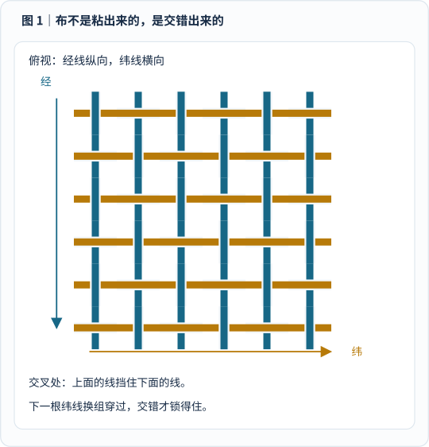
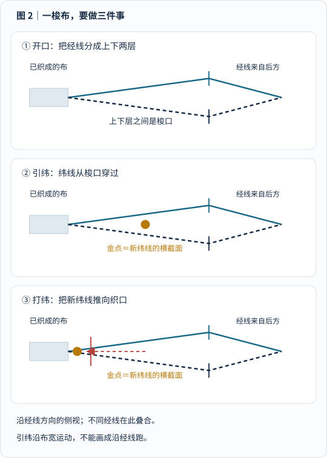
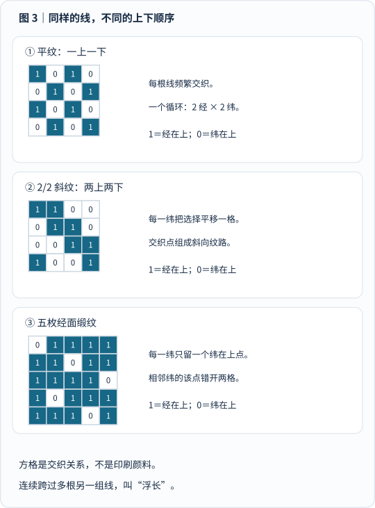
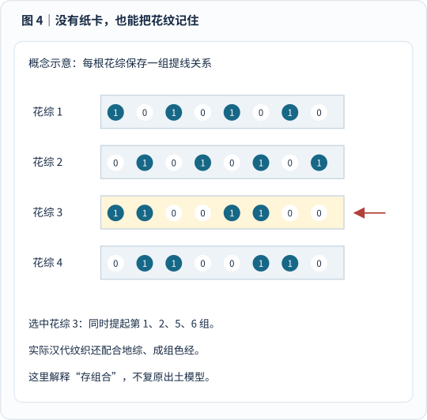
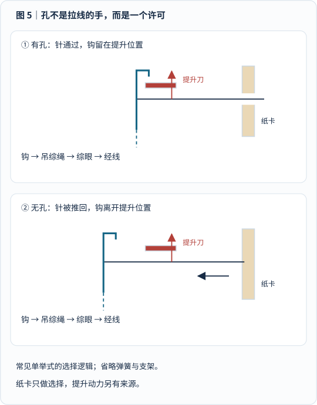
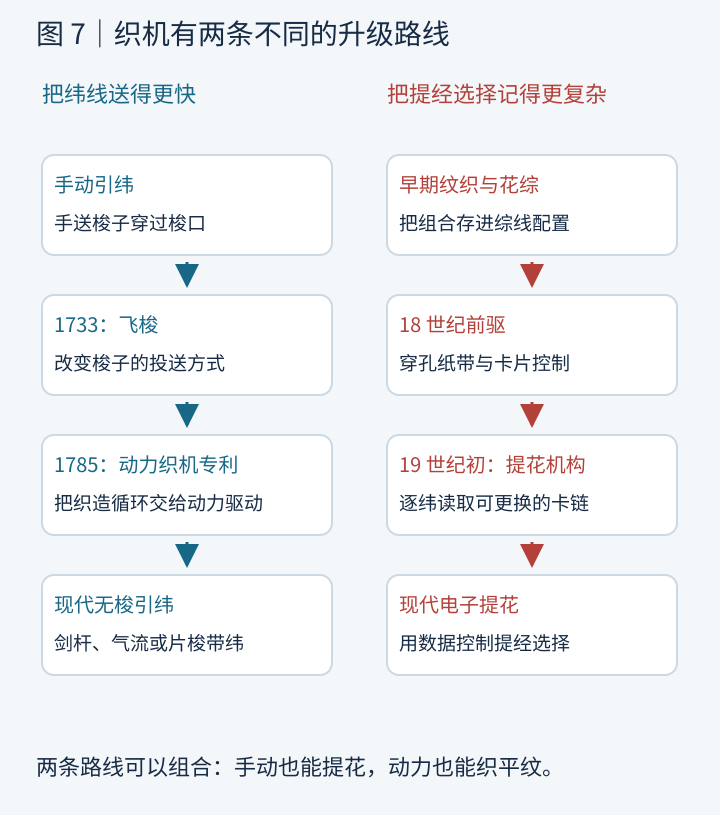
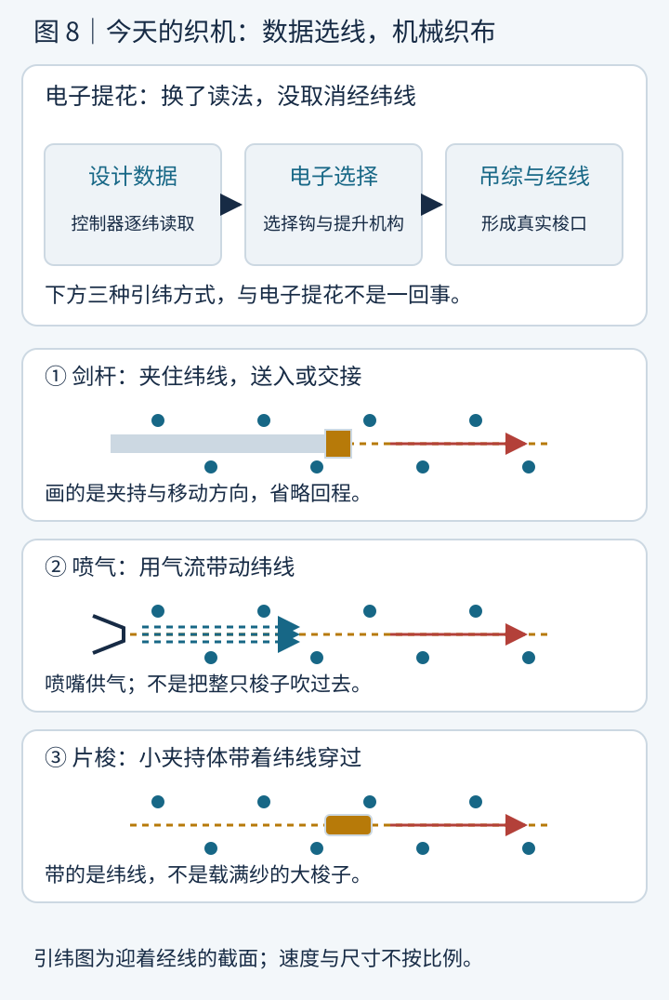

假如有人递给你一件有花纹的衣服，说：

“这朵花不是画上去的，也不是后来绣上去的。它在布诞生的那一刻，就已经长在里面了。”

你可能会回答：不就是用了不同颜色的线吗？

可是，把一堆彩色线交给你，你就能织出一朵花吗？

真正麻烦的问题是：**这一根线经过这里时，到底应该压在另一根线上面，还是藏到它下面？下一次，又该换哪些线？**

少选一根，多提一根，或者把某一步提前，花纹就可能错位。图案越复杂，需要记住的选择越多。

织布机发展史里最精彩的事，不只是“机器越来越快”，而是人类慢慢学会了两件事：

> 把交错的动作交给机构，把交错的顺序交给一种可以保存、读取和重复的“记忆”。

这篇文章就从一块最普通的布开始。看懂它，我们再去看提花机头顶那一长串纸卡，为什么能让人联想到计算机。

## 一、先别看机器：布究竟是什么？

把一块普通梭织布放大，你会看到两组彼此交错的线。

一组顺着织造时布前进的方向，叫 **经线**；另一组横向穿过它，叫 **纬线**。

“经线纵、纬线横”只是本篇图解的摆放方式：你把布转过来，经纬的名字不会交换。

_图 1 怎么看：挑一根横向纬线，从左往右追踪。它一会儿露在经线上面，一会儿藏到经线下面；下一根纬线换一组上下关系。图中空隙为讲解放大，不表示实际布料这么松。_

为什么不能让所有纬线都躺在经线上面？

因为那样只是两叠线，缺少把它们锁在一起的交错关系。拿起来，很容易散开。

最简单的 **平纹**，就是一上一下地穿，下一纬再交换：

- 第一纬：经线 1、3、5……在上，2、4、6……在下。
- 第二纬：经线 2、4、6……在上，1、3、5……在下。
- 第三纬：重复第一纬。

这不是打结，却能通过交错、摩擦和合适的密度，让线成为一片布。

这里说的是 **梭织**。针织主要靠线圈彼此套接，刺绣是在已有底料上加针线，印花是在材料上形成颜色或图案。它们都能做出美丽花纹，但机制不同。我们这一趟，先跟着“经纬交错”走。

美国国家公园管理局的[织造入门](https://www.nps.gov/articles/000/how-does-weaving-work.htm)用很直观的动作图说明了经纬与织造循环。下面的分步图依据这套基本机制原创绘制，不转载其动画。

## 二、一根纬线进去，织机到底忙了些什么？

如果你直接拿一根纬线，在几百根张紧的经线之间一上、一下地穿，确实能织，只是会非常慢。

聪明的改进是：**别让纬线自己逐根钻，把该在上面的经线先一起抬起来。**

上下两层经线之间就出现一个通道，叫 **梭口**。

一梭的主要动作可以拆成三步。

### 第一步：开口

织机按这一纬需要的组织，把经线分出上下层。

普通综框织机里，经线穿过 **综眼**；综眼随相应的综框升降，带动一组经线。你可以把它理解成一排排“替线举手”的小眼睛，但实际传力靠的是综丝与机构，不是魔法。

### 第二步：引纬

把一根纬线沿布宽送过梭口。

传统梭子可以携带纬纱，往返穿过。它不是针：它不需要在已有的布上戳洞，而是在尚未合拢的经线通道里通过。

### 第三步：打纬

刚送进去的纬线还没有紧贴已经织好的部分。

织机用 **筘**——可以先想成一把让经线穿过齿隙的梳子——把新纬线推向 **织口**，也就是成布的前沿。

_图 2 怎么看：先看上下两层经线张出的空隙，再看金色的纬线截面，最后看它被推到左侧织口。图是沿经线方向的侧视投影，许多经线叠合成两条轮廓；纬线实际沿布宽通过，因此这里看到的是一个点，而不是沿经线跑的梭子。_

“开口—引纬—打纬”只是主动作。机器还要把后方经线逐渐放出来，叫 **送经**；把前方织好的布收起来，叫 **卷取**。

一边供应，一边收走，中间保持适当张力。

张力失控、经线断了、纬线没有顺利通过，都会影响布面。因此，“能自动重复动作”和“能稳定织出好布”，从来不是一回事。

这几个名字不是背诵任务。只要记住：

> 先开门，让线进来，再把它推到位。与此同时，后面放线，前面收布。

## 三、牛仔裤的斜纹，和缎子的光滑，竟然是同一个问题

现在我们知道，织布时反复回答的就是“谁在上面”。

把每一个交叉处写成方格，就得到 **组织图**：

**本篇统一约定：1 表示经线在纬线上面，0 表示纬线在经线上面。行代表连续的纬，列代表经线。**

这不是颜色编码。即使用同色线织布，上下关系也能改变表面的纹理与反光。

CottonWorks 的[基础机织组织教材](https://cottonworks.com/learning-hub/weaving/basic-woven-fabric-designs/)分别解释了平纹、斜纹、缎纹及其变化。下面不是照搬教材截图，而是按这些交织规则重新生成的小方格。

_图 3 怎么看：逐行读，而不是把它当成一张彩色画。平纹频繁交换上下；2/2 斜纹把“两上两下”的选择每纬移一格；图中的五枚经面缎纹，则让少数纬在上点错开分散。这三种图只表示组织，不是成品照片。_

### 平纹：频繁握手

一上一下，一根经线经过每一纬都交换上下。

交织点密集，是非常基础的组织。至于最终是否结实、透气或柔软，还要看纤维、纱线粗细、密度和整理，不能只凭“平纹”两个字决定。

### 斜纹：把同一个选择挪一格

先让两根经线在上、两根在下，下一纬把这个排列平移一格。

一排排交织点就形成斜向纹路。

图里用的是便于看懂的 **2/2 斜纹**。常见牛仔布也使用斜纹，但不能把所有牛仔布都认作本图这一种；例如 3/1 经面斜纹就很常见。

斜纹的神奇不在于线是斜着拉进去的——经纬仍按它们的方向交错——而在于 **交织点的排列斜了**。

### 缎纹：让更多线段露在表面

图中的五枚经面缎纹，每一纬让四根经线在上，只留下一个纬线在上的点，并把这个点依次错开。

一根线连续跨过多根另一组线而不交织，这一段叫 **浮长**。

较长的浮线能让表面呈现不同的光泽与触感，但也要考虑勾丝等问题。丝绸的光泽还与纤维本身有关，不能把“缎纹”当成万能光滑开关。

这些基础组织和图案织造的关系，可以这样理解：

> 组织是上下交错的语法；花纹是在合适的语法和材料条件下，安排更大范围的变化。

## 四、机器还没读纸卡，人就已经会把花纹“存”起来

织布机不是某个人某一天突然造出来的。

张紧经线的方式可以不同：有人用身体保持张力，有人把线架在框上，也有人利用悬挂重物。支撑方式、开口方式与织造技巧，在不同地区形成了丰富的传统。

而且，复杂纹织也远早于欧洲工业革命。

一个尤其有趣的实物线索，来自成都 **老官山汉墓**。

2013 年，考古人员在那里发现了四件木制模型织机。研究者依据墓葬形制与出土钱币等信息，将墓葬年代判断为 **公元前 2 世纪后半叶**。

注意关键词：这是 **模型织机**，不是四台完整保留下来的真人尺寸生产设备。模型保留了重要机构，也存在省略或简化。不能直接用它们宣布“已经找到了人类第一台织布机”。

《Antiquity》发表的[研究论文](https://www.cambridge.org/core/journals/antiquity/article/earliest-evidence-of-pattern-looms-han-dynasty-tomb-models-from-chengdu-china/50DDD53B5889E6FF4C88FD75F0271C33)分析了模型的花综、踏板、选综与提综机构，并与出土汉代织物的组织相互比较。

让人吃惊的地方，不只是古人“会织复杂花纹”，而是他们已经懂得：

**把某一种提线组合，事先安排进综线连接里；织的时候，再按顺序选择它。**

_图 4 怎么看：每一横排代表一组预先安排的提线关系。选择花综 3，不是临时重新数线，而是调用已经存好的组合。本图使用八组线作概念说明，不是老官山模型的尺寸图、实测连接图，也不是汉代锦的完整织造配方。_

论文讨论的汉代锦，还有 **地综** 与 **花综** 的配合。

地综参与形成基础交织；花综配合成组的不同色经，选择哪些色经在表面显露。研究者给出的一个示例，把基础梭口与花纹梭口交替安排，而不是“一个花纹格子，简单等于一根彩色线”。

这说明，“把图案记住”有很多种技术路线。

它可以记在熟练织工的经验里，记在综线配置里，也可以由提花助手按要求拉动。

欧洲的传统提花织造中，织工和负责提线的助手需要协作。英国科学与工业博物馆介绍的 **draw boy**，承担的就是复杂图案中的提经选择工作。

后来，纸卡系统接手了其中一部分反复选择的劳动。但这不是说所有地区的纹织都来自同一条简单发明链，更不能凭相似的“存组合”思想，就断言汉代机构直接传到了某一位欧洲发明家手里。

## 五、飞梭解决“快一点”，提花解决“选得更复杂”

织机史特别容易被讲成：

手织机 → 飞梭 → 动力织机 → 提花机 → 电脑。

看似流畅，其实把不同问题揉成了一条线。

### 飞梭：让引纬更方便、更快

1733 年，约翰·凯的 **飞梭** 改变了投送梭子的方式。

此前织工用手把梭子送过、再接住；织很宽的布时，可能需要两个人配合。飞梭通过机械投送，使一个织工能够更方便地完成横向引纬。

德国博物馆在 [Google Arts & Culture 的馆藏说明](https://artsandculture.google.com/asset/webstuhl-mit-schnellsch%C3%BCtzen-0001/bwFhbcUORrqQbQ)中介绍了这个变化。这里的关键不是“梭子第一次会动”，而是 **梭子的投送方式变了**。

### 动力织机：让一整套动作协调重复

卡特赖特在 1785 年为早期动力织机取得专利。

这个年份标记的是专利节点，不是“从此手工织布突然消失”。早期机器仍有大量工程难题，实用化依赖后续发明者、制造者与工人的改进。[卡特赖特生平条目](https://en.wikipedia.org/wiki/Edmund_Cartwright)也明确区分了早期概念验证与后来的实用动力织机。

动力化要处理的是：怎样让开口、引纬、打纬等动作在正确时机重复发生，而不只是给梭子加个发动机。

### 提花机构：把复杂的提经选择保存下来

提花解决另一个问题：

每一纬，怎样选择不同的经线组合？

它 **不必等于动力织机**。手动织机也可以配提花机构；动力织机也可以只织普通平纹。

一台织机“由谁提供动力”，与“怎样决定提哪些经线”，是两项可以组合的设计。

## 六、提花机头顶为什么挂着一长串纸卡？

现在，真正的主角登场了：法国织工与发明者 **约瑟夫-玛丽·雅卡尔**。

英文 *Jacquard* 既是他的姓，也成为一类提花机构与织造方式的名称。

不过，他不是从零发明整个织布机的人，也不是第一位想到“用孔控制机构”的人。

计算机历史博物馆的[历史文章](https://computerhistory.org/blog/artifact-adopted-preserving-the-legend-of-j-m-jacquard/)介绍了几位前驱：布雄尝试穿孔纸带，法尔孔使用卡片系统，沃康松也改进过自动纹织机构。雅卡尔建立在这些工作之上，继续完善可用于复杂图案的控制。

关于他的机器，资料中常见 **1801、1804、1805** 几个年份。不要急着判其中某个一定“写错了”：

- 计算机历史博物馆的[存储史专题](https://www.computerhistory.org/storageengine/punched-cards-control-jacquard-loom/)提到 1801 年展示。
- 科学与工业博物馆的[提花机专题](https://www.scienceandindustrymuseum.org.uk/objects-and-stories/jacquard-loom)以 1804 年专利为节点。
- 计算机历史博物馆的历史文章还叙述了 1805 年的法国政府奖励与推广。

展示、改进、专利、推广，是不同事件；成熟设备也经历了继续改良。

最值得拆开的不是年份，而是头顶那一长串 **穿孔卡**。

### 把“下一步”搬到机器外面

想象每一纬开始前，织工都需要一张小纸条：

“这次抬 1、2、5、6。”

下一张：

“这次抬 2、3、6、7。”

如果机器能自己读纸条，织工就不必每次重新记忆、逐根选择。

穿孔卡把这份选择变成了机构能接触的物理区别：**有孔，或者没有孔。**

卡片按顺序连接。读取这一张，形成这一纬的梭口，完成引纬；再推进到下一张。需要重复的图案，可以让卡链按相应顺序重复运行。

“花纹记忆”就这样从人的不断操作中，部分移到了可更换的介质上。

### 纸卡不拉线：它只让某些钩被选中

这一步最容易被漂亮动画掩盖。

你看到“针穿过孔，经线就抬起来”，会不会误以为那根针直接穿过去、拽着经线往上跑？

不是。

在常见的简化单举式解释里：

1. 卡片靠近一排选择针。
2. 遇到孔的针能够通过，相关钩保持在可以被提升的位置。
3. 遇到实心卡面的针被推回，使相关钩偏离提升位置。
4. 提升机构带起被选中的钩。
5. 钩通过吊综绳、综眼等连接带起经线。

_图 5 怎么看：先看右侧纸卡有没有给针留下通道，再看蓝色钩是否处在红色提升刀的路径上。图解释常见单举式的选择逻辑，省略了弹簧、支架与完整传动，不能当制造图；不同提花机构的具体结构会有差异。_

**纸卡提供选择，不提供提升全部经线的动力。**

这就像门禁卡允许门打开，但门不是靠卡片里的那一点材料被推开的。

还有两个重要限定：

**第一，一孔不必永远等于一根实际经线。** 实际装造里，一个钩可以通过吊综连接图案重复中的多根经线。控制通道数、钩数和整幅布的经线数，不能一概画等号。

**第二，卡片上的物理孔位排成几行，不等于它控制几纬。** 制卡时可以把许多选择通道排成孔位矩阵；在这里介绍的传统逐卡选经方式中，一张卡对应一次纬向选择步骤。孔位的排版与织造时间的次序，是两个维度。

## 七、亲眼看一份选择，怎样变成一小块布

下面这张图，故意只用 **8 根经线、8 次引纬**。

左上是组织计划，右上是相应的八张教学卡，下面是交织后的放大示意。

本图保持同一个约定：

> 1＝经在上＝打孔并提经；0＝纬在上＝不打孔。

历史意匠图的涂色习惯并不一定这样。比如科学与工业博物馆介绍的一种制卡约定，是未涂色格打孔、涂色格不打孔。因此，不能把任何资料里的“黑格”“有孔”“某个颜色”不加说明地画等号。

_图 6 怎么看：选上方任意一行，核对右侧同编号卡的孔，再看下方同一纬中蓝色经线或金色纬线谁遮住谁。中心区域让斜向组织反向，形成局部纹理变化。动画按八纬顺序播放一次，最后保留完整结果；上方静态计划一直可读。演示时间不是实机速度。_

[单独打开逐纬图解](/assets/images/loom-history/cards-to-cloth.svg)。刷新可重播；若系统设置了减少动态效果，则直接显示完整结果，不需要追着动画读。

你可以先检查第一行：

`11001100`

也就是抬起第 1、2、5、6 根经线。纬线从这四根下面穿过，同时从另四根上面穿过。

接下来，读第二行的选择，再引下一纬。花纹不是最后覆盖到布上的，而是随着交织逐步形成。

这份小图有 64 个经纬交叉处。生成脚本逐一核对组织图、孔位和遮挡关系，还检查每根经线与每根纬线都参与了上下交织。在这个八行八列的循环教学组织里，最长浮长为跨过四根另一组线；这是本图的检查结果，不是所有织物的通用安全标准。

但它仍然是 **教学样片，不是可直接投产的织造文件**。实际设计还要考虑重复边界、浮长、布边、经纬密度、纱线强度与张力等；复杂色织、锦、毛巾等结构，往往还涉及多组经纬或专门的基础组织。

尤其不要拿一张心形黑白图片，直接把黑白变成“提或不提”，就宣布一定能织出结实的心形布。

一大片相同选择可能让线长距离浮在表面，甚至缺少合适的连接。**图案要经过织造设计，才是布的图案。**

## 八、更惊人的事：居然能把人的肖像织出来

掌握逐纬选择之后，图案就不必停留在格子和条纹。

通过更精细的组织、更多控制通道、更多纬向步骤，以及材料与光泽的安排，织物可以表现花叶，甚至人物与明暗层次。

计算机历史博物馆的[存储史页面](https://www.computerhistory.org/storageengine/punched-cards-control-jacquard-loom/)展示了一幅 **1839 年织成的雅卡尔丝织肖像**，并说明它使用了约 **24,000 张穿孔卡**。

值得点开原页看一眼：它像画像，但载体是织物。

这个数字说明控制序列可以多么长，不等于“画像宽度为 24,000 个像素”，也不等于有 24,000 根经线。卡片记录的是依次执行的纬向选择；画面效果还依赖实际织物结构。

博物馆的另一篇[藏品研究文章](https://computerhistory.org/blog/artifact-adopted-preserving-the-legend-of-j-m-jacquard/)介绍了织工米歇尔-玛丽·卡尔基亚及相关肖像织物。我们这里链接馆藏图，不直接转载许可尚未核实的图片。

到这一步，你会感觉织机做了一件很现代的事：

它把一个长而复杂的计划，拆成许多简单操作，再让简单操作按正确次序发生。

## 九、为什么巴贝奇看见织布机，会想到计算机？

在上一篇[计算器发展史]()里，我们看到帕斯卡与莱布尼茨等人，怎样把算术操作放进机械结构。

但“会算”还不是全部。

一台机器如果始终只按固定方式运转，换一种工作，可能就得重新设计它的机构。

提花系统展示了另一种思路：

> 机器的基本动作可以不变，但可以更换外部的操作计划。

同一个提花机构，换一串合适的卡片，就能改变逐纬选择。复杂图案不必全部固化成一套只能织这一种花的传动。

巴贝奇在设计 **分析机** 时，借鉴了穿孔卡控制的思想，把它用于输入数据与操作指令。计算机历史博物馆的[分析机介绍](https://www.computerhistory.org/babbage/engines/)明确讲述了这个联系，也强调分析机有计算、存储、条件分支和循环等更丰富的设计。

1843 年，阿达·洛夫莱斯写下了那个非常贴切的比喻：

> 分析机织出代数的图案，正如雅卡尔织机织出花朵与叶子。

但类比要到此处保持清醒：

**穿孔卡提花机不是一台通用计算机。**

“孔或无孔”可以表示两种选择状态，不等于设备已经拥有二进制算术、通用程序执行和现代存储体系。巴贝奇的分析机设计本身还是十进制数字机械，不能因为它也读卡，就一并说成“二进制电脑”。

提花机对计算史的重要启发，是 **可更换的控制介质、保存的操作序列，以及机器自动读取并执行**。分析机把这些思想推向了更一般的计算；它也没有在巴贝奇生前完整建成。

穿孔卡后来又被用于数据记录与统计处理，例如霍列瑞斯参与的 1890 年美国人口普查。那是另一种应用，不能把所有穿孔卡都理解成同一种“织花程序”。

## 十、机器变快之后，人就只剩下按按钮了吗？

技术史如果只盯着机器，就会漏掉真正和它生活在一起的人。

手工纹织需要记忆、配合和长时间的训练。卡片系统改变了提线选择的劳动分工；动力织机又改变了工作节奏和生产组织。

一部分重复动作被机构接手，但设计图案、制卡、装造、穿综穿筘、维护、处理断线和检验质量，仍需要知识与技能。

技术进步可以让某些布料更易生产、更容易被更多人买到，也可能让旧岗位消失，让人面对新的工作要求与劳动条件。

所以，“一位天才发明机器，从此所有人都轻松了”，不是完整的历史。

英国科学与工业博物馆引用的 1836 年《曼彻斯特卫报》，已经在讨论英国约 7,000—8,000 台提花织机。这是当地传播规模的历史报道，不是全球机器总数；但足以提醒我们：改变行业的，是设备、产业、技术人员和市场长期共同作用的结果。

_图 7 怎么看：左右两栏回答不同的问题，不是先走完左栏才能开始右栏。日期标记具体历史节点，箭头表示本篇梳理的改进方向，不代表全球所有地区都经历了相同的单线演化。_

## 十一、今天没有纸卡了，为什么还是叫提花？

今天，图案可以在软件中设计，转换为织造控制数据，通过电子控制器交给提花选择机构。

卡片不再逐张顶住针，选择仍然要落实到真实的钩、吊综和经线。经线不会因为屏幕上显示了“1”，就自动离开织机飞起来。

例如，Bonas 官方的 [Ji 电子提花资料](https://bonas.be/components/ji-jacquards)介绍了电子微选择机构、机械驱动和吊综，以及通过 USB 或网络传输图案的控制器。

厂商资料适合确认 **设备采用什么结构和接口**；“最快”“最高质量”等宣传语，则不能不经比较就当成客观结论。本篇也不把它列出的钩数直接等同于所有安装中的实际经线数。

与此同时，引纬方式也继续发展。

Itema 的[产品技术介绍](https://www.itemagroup.com/it-is-all-you-need-rx-2024/)列出剑杆、喷气和片梭三种引纬技术：

- **剑杆**：用夹持装置带纬线进入梭口；双剑杆形式可以在中间交接。
- **喷气**：由气流带动纬线通过，而不是让一个装满纱的大梭子往返。
- **片梭**：用小型夹持体携带纬线穿过。

它们各有合适的材料和应用条件，不能简单说某一种永远最快、最省能或能织所有东西。具体设备还要考虑织物宽度、纱线性质、质量要求与能源消耗。

_图 8 怎么看：上方看“怎样决定提哪些线”，下方看“怎样把纬线送过去”。三幅引纬图是迎着经线看的截面，蓝点表示经线截面，红箭头表示引纬方向；只画功能，不画实机尺寸与速度。_

当代提花的用途也不只是漂亮衣服。Bonas 的[应用介绍](https://bonas.be/)包括家用织物、服装和技术织物等方向。

“图案”有时不只是视觉花纹，也可能是对织物局部结构的安排。但不能由此推断每一块安全气囊、每一种工业织物都必须使用同样的提花机。

电子化让图案传输与选择更方便。最终产品，仍要经过纱线的强度、摩擦、张力和真实交织的考验。

## 十二、给孩子也能讲清楚的小实验

不需要先买一台织机。

剪四条稍宽的纸带并排放好，让它们充当经线。再拿四条另一颜色的纸带当纬线。

第一条纬纸带，一上一下地穿；第二条换组；第三、第四条再重复。

你会得到一块纸做的“平纹布”。

接下来，把每个交叉处记下来：经在上写 1，纬在上写 0。你已经画出了最简单的组织图。

再试试“两上两下”，并让每一条纬纸带的选择平移一格。先观察纹路怎样变，再讨论纸带会不会容易松开。不要为了漂亮把纸条全部粘住，否则就看不出交织本身的作用了。

最后，给旁边的人一张张写着提线编号的纸条，让他只按纸条操作。

这不是提花机的真实机械复原，却足以体验它最重要的思想：

**把“怎么做”的计划保存下来，让另一个执行者按顺序完成。**

## 最后：布里藏着一部机器记忆史

一根线，只有颜色和长度。

两组线，能彼此交错。

一套机构，能反复开口、引纬、打纬。

一份可以保存的选择计划，则让重复的动作长出复杂的花纹。

从古代花综，到穿孔卡，再到电子提花，人类一直在把“记得住”与“做得到”接到一起。

所以，提花机的神奇，不是它用纸卡凭空变出花朵。

而是它告诉我们：

> 把复杂的结果拆成简单步骤，再把步骤的选择与顺序记录下来，机器就可以替人重复完成一部分原本依赖记忆的工作。

有时候，通向计算机的线索，真的不是一条电线。

而是一根穿过梭口的纬线。

## 参考资料与图解说明

以下资料均实际打开核对。历史节点与机构说明分别靠近相关正文列出；参考图像只链接原页，没有把可访问误当成可转载。

| 资料 | 本文主要采用的内容 |
| --- | --- |
| [美国国家公园管理局：How Does Weaving Work?](https://www.nps.gov/articles/000/how-does-weaving-work.htm) | 经纬、开口、引纬、打纬，以及送经、卷取和张力 |
| [CottonWorks：Basic Woven Fabric Designs](https://cottonworks.com/learning-hub/weaving/basic-woven-fabric-designs/) | 平纹、2/2 与 3/1 斜纹、五枚缎纹、浮长与基本组织的区别 |
| [赵丰等：《Antiquity》，老官山汉代模型织机研究](https://www.cambridge.org/core/journals/antiquity/article/earliest-evidence-of-pattern-looms-han-dynasty-tomb-models-from-chengdu-china/50DDD53B5889E6FF4C88FD75F0271C33) | 出土模型、年代判断、选综提综机构、地综与花综配合；模型与实际织物研究的区别 |
| [德国博物馆：Loom with “Flying Shuttle”](https://artsandculture.google.com/asset/webstuhl-mit-schnellsch%C3%BCtzen-0001/bwFhbcUORrqQbQ) | 1733 年飞梭、此前手动投送和宽幅布的操作需求 |
| [Wikipedia：Edmund Cartwright](https://en.wikipedia.org/wiki/Edmund_Cartwright) | 1785 年专利节点，以及早期概念验证与后续实用化的区分；不是本文提花原理的依据 |
| [英国科学与工业博物馆：The Jacquard loom](https://www.scienceandindustrymuseum.org.uk/objects-and-stories/jacquard-loom) | 提花助手、卡链、针钩选择、1804 年专利、英国传播与阿达的比喻 |
| [计算机历史博物馆：Preserving the Legend of J. M. Jacquard](https://computerhistory.org/blog/artifact-adopted-preserving-the-legend-of-j-m-jacquard/) | 纸带和卡片前驱、雅卡尔的改进与推广、丝织肖像背景；经纬原理以织造专业资料为准 |
| [计算机历史博物馆：Punched cards control Jacquard loom](https://www.computerhistory.org/storageengine/punched-cards-control-jacquard-loom/) | 1801 年展示节点、1839 年肖像和约 24,000 张卡、穿孔卡后来的应用 |
| [计算机历史博物馆：The Engines](https://www.computerhistory.org/babbage/engines/) | 分析机借鉴提花卡、十进制机械计算、一般计算功能与未完整建成的历史边界 |
| [Bonas：Ji 电子提花](https://bonas.be/components/ji-jacquards)、[吊综](https://bonas.be/components/harnesses)、[应用](https://bonas.be/) | 电子选择与机械驱动、吊综、图案传输和现代应用；不采用未经比较的性能宣传 |
| [Itema：引纬技术介绍](https://www.itemagroup.com/it-is-all-you-need-rx-2024/)及[设备说明](https://www.itema-americas.com/weaving-machines.html) | 剑杆、喷气和片梭三类现代引纬技术；不据产品广告推断通用优劣 |

**进一步看真实机器：** [V&A 官方视频：How was it made? Jacquard weaving](https://www.youtube.com/watch?v=K6NgMNvK52A)。这条官方视频链接由科学与工业博物馆列为延伸资料，需要网络和视频平台支持；正文与原创分步图不依赖它才能看懂。

本文八幅 SVG 为原创教学图，生成脚本保留在 `tools/generate_loom_visuals.py`。组织矩阵按明确规则产生，脚本核对上下关系、64 个卡片选择、交织参与和循环浮长。图中孔卡为重新排布的八通道示意，不仿造具体历史卡片；汉代花综图、针钩图和现代引纬图均注明了结构简化或投影方式。

唯一短动画用于解释逐纬次序，播放一次并停留在完整结果，支持 `prefers-reduced-motion: reduce`；不声称表现真实机器的运动时长或纱线物理。
