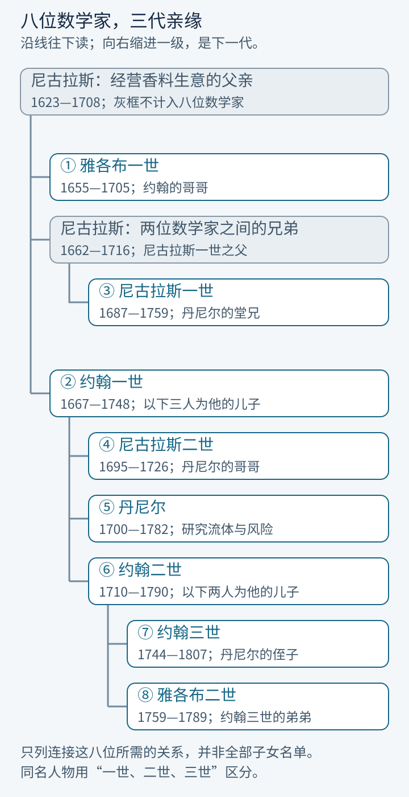
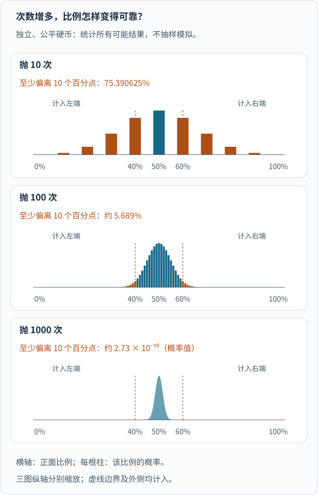
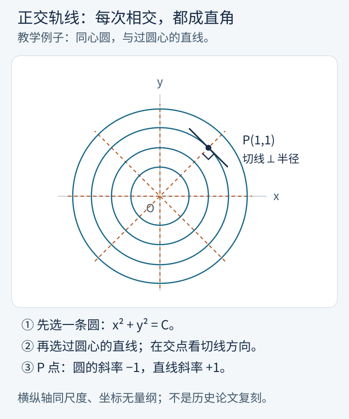
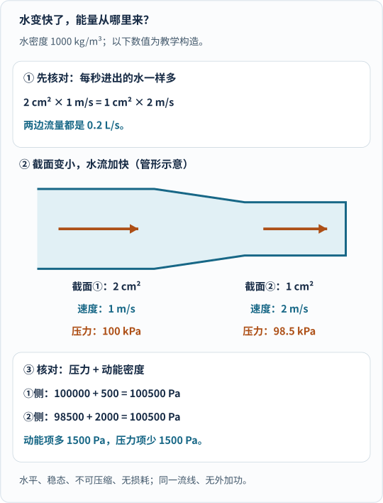
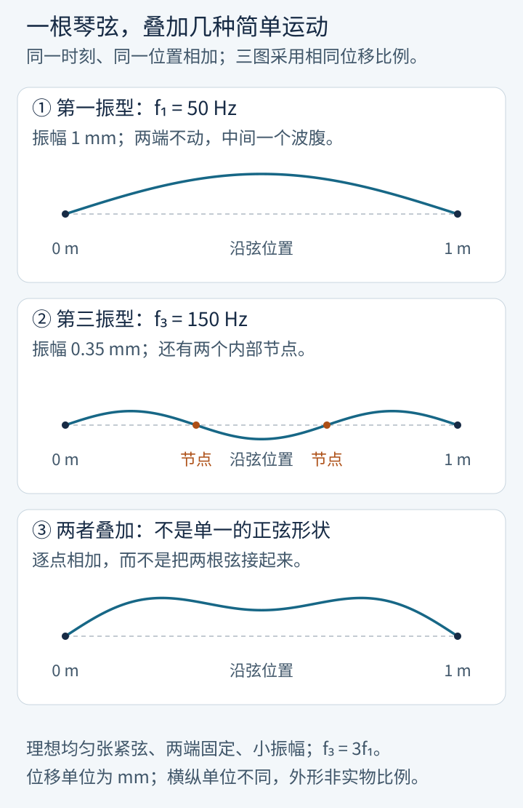
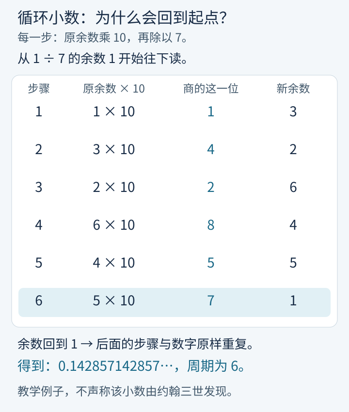
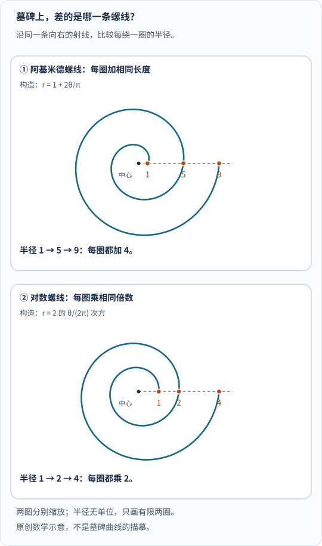

先把四样东西放在桌上：一枚硬币、一段小球滑轨、一根水管、一根琴弦。

它们看上去不太像一家人。

可如果问得细一点——**抛硬币的比例为什么会稳定？哪条轨道下滑最快？水流加速时压力怎样变？琴弦为什么有不同音高？**——你就会在数学史里反复遇到同一个姓：伯努利。

这个姓不只属于一位数学家。常见的数学史家谱里，三代人中有八位特别值得认识：有人为概率找到了可靠的根据，有人把新生的微积分变成解难题的工具，有人把工具带进流水、振动、光与机械，也有人通过期刊和书信让知识继续传播。

他们当然也会为名声争执，会对孩子的职业指手画脚；但要理解这个家族为什么重要，**首先要看他们究竟给数学和科学添了什么。**

## 先看家谱：八位分别是谁？

先放一张“认人地图”。不必背名字，读到重名时回来找就行。

_图 1：沿线向下读，向右缩进一级就是下一代。蓝框编号标出本文的八位数学家，灰框只帮助连接亲缘。这是简化家谱，不是全部子女名单；“一世、二世、三世”用于区分同名人物，不是王位顺序。尼古拉斯一世与丹尼尔是堂兄弟，不是父子或叔侄。[单独打开家谱](/assets/images/bernoulli/bernoulli-family-tree.svg)。_

所谓“八位”，是本文选取的这组常见数学史人物，**不是说这个家族一共只有八个研究数学的人，也不是八个人的成就完全相同。**

## 一、这家人的祖传生意，本来不是数学

先别把他们想成一个几百年来都在黑板前生活的家族。

伯努利家的祖辈来自安特卫普，因宗教迫害离开故乡，后来辗转落脚巴塞尔。到了雅各布和约翰的父亲尼古拉斯这一代，家里经营的是**香料生意**，父亲也参与当地公共事务。

这位父亲为孩子规划的道路，相当实际。

哥哥**雅各布一世**（Jacob / Jakob Bernoulli，1655—1705）被安排学习哲学和神学；比他小十二岁的**约翰一世**（Johann Bernoulli，1667—1748），十五岁时还真的在香料生意里干过一年。

问题是，两个人都没有沿着安排走到底。

雅各布拿到了神学资格，却一直在研究数学与天文学；后来即使有教会职位向他招手，他也没有改回原来的路线。约翰对经商既不喜欢，也没表现出父亲期待的本领，最后获准去大学——学医学。

于是，这个家出现了很有意思的一幕：**哥哥学神学，弟弟学医学，两个人却把精力放在了一起读数学论文上。**

这些经历可由[雅各布传记](https://mathshistory.st-andrews.ac.uk/Biographies/Bernoulli_Jacob/)和[约翰传记](https://mathshistory.st-andrews.ac.uk/Biographies/Bernoulli_Johann/)交叉核对。数学不是家族一开始就安排好的接班事业，恰恰是两个孩子偏离规划后走出来的路。

## 二、雅各布一世：让“多试几次就知道了”有了数学根据

认识①雅各布，先别看墓碑，先看硬币。

一枚公平硬币只抛十次，出现七次正面，奇怪吗？并不奇怪。但如果抛一百万次，仍有七成正面，我们就该认真怀疑“公平”这个前提了。

**做多少次实验，观察到的比例才值得相信？**这不是一句“次数够多就行”能回答的问题。

雅各布的重要贡献，是在独立、成功概率固定的重复试验中，证明样本中的成功比例会以概率意义趋近真实概率，并给出定量讨论。这是后来称作**大数定律**的重要早期成果。他的《猜度术》在 1713 年、去世八年后出版；侄子尼古拉斯一世参与了出版工作。[历史背景见雅各布传记](https://mathshistory.st-andrews.ac.uk/Biographies/Bernoulli_Jacob/)。

我们用现代二项分布，算一个具体例子：仍是各次独立的公平硬币，把“偏得比较远”规定为**正面比例不高于 40%，或者不低于 60%**。

_图 2：先横向看正面比例，再比较三幅图怎样向 50% 附近集中。边界及外侧的柱子都计入“至少偏离 10 个百分点”；纵轴分别缩放，不能跨图比较柱高。10 次时该概率约为 75.39%，100 次时约为 5.689%，1000 次时约为 $$2.73\times10^{-10}$$。这些是枚举二项分布得到的精确概率再取近似，不是挑一条幸运模拟轨迹，也不是雅各布当年的原始算例。_

大数定律不承诺比例每一步都更接近 50%，更不承诺“前面反面多，后面就得补正面”。它解释的是：**在模型成立时，大样本比例出现固定幅度偏差的可能性会趋近于零。**现代版本及条件可参看[概率教材中的大数定律](https://www.probabilitycourse.com/chapter7/7_1_1_law_of_large_numbers.php)。

这条桥梁很重要：它连接了“我们不知道真实概率”和“我们可以收集数据估计它”。抽样、统计推断后来发展出的完整理论当然不全是雅各布一人完成的，但这块基础不能绕过他。

他的另一份遗产是**伯努利数**。它们出现在《猜度术》关于幂和的讨论中：怎样不逐项相加，就算出 $$1^m+2^m+\cdots+n^m$$？

比如平方和可以写成 $$n(n+1)(2n+1)/6$$。重要的不只是这一条熟悉的公式，而是不同次幂的求和多项式之间出现了可以统一组织的系数。伯努利数后来在分析与数论中反复出现；不能把每个低次幂和公式都说成由他首次发现。

他还研究无穷级数、曲线和微分方程。**概率、级数、几何，是这个家族第一代搭起的几条主干，不只是“哥哥教过弟弟”这么简单。**

## 三、约翰一世：把微积分从新符号，变成解难题的本领

②约翰向哥哥学数学时，微积分还是一门新学问。读懂莱布尼茨的论文，再把它用于别人解不出的曲线和运动问题，本身就是重要工作。

约翰的贡献包括微分方程、积分方法与曲线研究。更容易看出它们分量的，是他在 1696 年公开提出的**最速降线问题**：从同一个高处起点，由静止滑到同一个低处终点，哪条光滑轨道最快？

_图 3：复用本站摆线文章的原图 2。三条轨道使用相同的起终点、重力和释放条件；质点只滑动，不计转动、摩擦与空气阻力。动画的共同时间轴按理想模型计算，不是为了让摆线获胜而人为调速；下滑时间与静态轨道始终保留。播放一次后停留，系统减少动态效果时直接显示结果。[单独打开，刷新可重播](/assets/images/cycloid/descent-race.svg)。_

**直线最短，为什么仍会输？**因为路程不是唯一变量。先陡降的曲线能让质点尽早获得速度，再用较高速度走后面的路。

约翰不只猜中了一段摆线。他采用了一条很漂亮的解题路线：把竖直平面切成许多薄层，每一层里近似看作速度固定，再借用光的折射与最短时间思想，寻找穿越各层的最佳路线。让层越来越薄，就通向连续曲线。

这里是把**局部的方向选择**连成**整条路线的时间最优**。它与哥哥雅各布的解法、后来双方讨论的带约束极值问题，一起成为变分法发展的重要前史。[MacTutor 专题](https://mathshistory.st-andrews.ac.uk/HistTopics/Brachistochrone/)给出了解法与历史；一般方法还要等欧拉、拉格朗日等人继续推进，不能把今天的变分法整套归给约翰。

他也参与了悬链线的求解：一根均匀柔绳只在重力下悬挂，为什么不恰好是一条抛物线？想细看这两条曲线，可以读[下垂的线怎样连接桥梁与电网]()。

约翰还是新方法的传播者。洛必达向他付费学习微积分，1696 年出版的《无穷小分析》大量依赖这些课程；今天所说的洛必达法则，也有约翰的关键贡献。1694 年通信中的报酬与传播约定，以及后来发现的课程抄本，见[哈佛收录的通信研究](https://people.math.harvard.edu/~knill/teaching/math1a_2011/exhibits/bernoulli/index.html)。洛必达并非完全不懂数学，这也不能简化为“买走一个公式”。

欧拉回忆，约翰让他自己读较难的书，读不懂的地方每周日下午来问。[这段教学经历见欧拉传记](https://mathshistory.st-andrews.ac.uk/Biographies/Euler/)。**发现方法、解出问题、把方法教出去**，三件事约翰都做过。

兄弟俩后来为成果和声望闹翻，确实是这段历史的一部分。但如果只剩争吵，我们就会错过他们真正推动的变化：微积分开始能处理“整条曲线应该怎样选”这样的问题。

## 四、尼古拉斯一世：把概率带进法律，也提出一个难倒直觉的游戏

③**尼古拉斯一世**（Nicolaus I Bernoulli，1687—1759）不是约翰的儿子，而是雅各布与约翰另一位兄弟的儿子。

他既跟叔伯们学数学，也学法律，1709 年的博士论文讨论把概率用于法律问题。这意味着，概率研究正在走出骰子和赌桌，进入现实中的不确定判断；并不意味着法律判决可以简单化成一个概率数值。

他后来到帕多瓦任教，研究几何与微分方程，再回巴塞尔教授逻辑与法律。他对正交轨线、黎卡提方程等问题的工作，也属于早期分析学的发展。这里的“正交轨线”，下一节就用一张图解释。

相比那两位爱公开交锋的长辈，他的不少成果藏在通信里。[他的传记](https://mathshistory.st-andrews.ac.uk/Biographies/Bernoulli_Nicolaus(I)/)提到，与蒙莫尔往来的信件中，就有后来叫作**圣彼得堡悖论**的问题。

我们用一版现代化、容易计算的规则来玩：

抛一枚公平硬币，各次独立。一直抛到第一次出现正面为止。第一次就出现，给你 2 元；第二次才出现，给你 4 元；第三次才出现，给你 8 元；以后每推迟一次出现，奖金再翻倍。

| 第一次正面出现在哪次 | 这种结局的概率 | 奖金 | 概率 × 奖金 |
|---|---:|---:|---:|
| 第 1 次 | 1/2 | 2 元 | 1 元 |
| 第 2 次 | 1/4 | 4 元 | 1 元 |
| 第 3 次 | 1/8 | 8 元 | 1 元 |
| 第 4 次 | 1/16 | 16 元 | 1 元 |
| …… | …… | …… | …… |

你会发现，**每一种结局对期望奖金的贡献，都是 1 元。**

假如游戏允许无限次抛掷，而且主办方真的能支付任何大的奖金，把这些贡献加起来，期望奖金就是无穷大。

但如果有人要你先交一套房子的钱，才准你玩一局，你大概不会因为那个“无穷大”就立刻点头。

这不是数学算错了，而是“钱数的期望”没有直接回答“这场风险对我值多少钱”。

后来，堂弟丹尼尔从财富的效用入手：对只剩十元的人和已经拥有一百万元的人，多一元钱的意义，并不相同。他提出的效用思路成为风险理论的重要一环。

这里也不能说“效用一出，所有问题都解决了”。具体愿付多少，仍取决于财富、采用的效用模型，以及现实中的支付上限。**无上限的理想游戏，与一个真能开门营业的赌场，不是同一回事。**

家里的接力很有意思：哥哥辈研究怎样从偶然中找规律，侄子提出一个刺破直觉的游戏，堂弟再追问，人到底怎样衡量风险。[丹尼尔的研究背景见传记](https://mathshistory.st-andrews.ac.uk/Biographies/Bernoulli_Daniel/)；[巴塞尔大学伯努利—欧拉中心](https://bez.unibas.ch/de/basler-mathematiker/daniel-bernoulli/)还列出了他风险论文的译本与后续研究。

## 五、尼古拉斯二世：寻找“处处直角相交”的曲线

④**尼古拉斯二世**（Nicolaus II Bernoulli，1695—1726）是约翰一世的儿子、丹尼尔的哥哥，与上一节的堂兄不是同一人。

他曾协助父亲处理牛顿与莱布尼茨争议中的通信；但他的学术工作不只是替父亲回信。他研究过一类很具体的几何问题：**给定一族曲线，能不能找另一族曲线，使它们每次相交都成直角？**

这叫**正交轨线问题**。他的论文目录中，有 1716 年研究与一族双曲线直角相交的曲线，以及 1718、1720 年关于轨线与正交轨线的文章；另有微分方程研究。[《科学家传记辞典》条目列出了这些论文](https://www.encyclopedia.com/science/dictionaries-thesauruses-pictures-and-press-releases/bernoulli-nikolaus-ii)。

先别碰双曲线，用一个更简单的教学例子：

_图 4：先选一条圆，再选一条过圆心的直线。它们在交点处的切线方向互相垂直；图中 P 点特别画出这个直角。横纵轴同尺度，坐标无量纲。同心圆例子用于解释“正交轨线”的含义，不冒充尼古拉斯二世论文中的双曲线构型。_

圆族写成 $$x^2+y^2=C$$，$$C$$ 是各个圆不同的常数。求导可得圆的切线斜率 $$y'=-x/y$$；在方向斜率有限且非零时，与它垂直的方向斜率就是 $$y/x$$，对应过原点的直线。

在 P 点 $$(1,1)$$，两个斜率是 $$-1$$ 和 $$1$$，乘积为 $$-1$$；碰到水平或竖直方向，则直接按几何意义判断，不能硬除以零。

**重要的是，这把“怎样画一条曲线”变成了“它每一点该朝哪个方向走”的微分方程。**尼古拉斯一世也研究过相关问题；这不是某一个伯努利独占的题目，而是一群数学家发展分析工具的现场。

1725 年，尼古拉斯二世与丹尼尔一同赴圣彼得堡，约八个月后因病去世，只有三十一岁。研究生涯虽短，他仍留下了具体的曲线与方程工作，而不只是“丹尼尔早逝的哥哥”这个身份。

## 六、丹尼尔：把流水、琴弦和风险放到可以计算的框架里

⑤**丹尼尔**（Daniel Bernoulli，1700—1782）年轻时也被父亲安排经商、学医学，最后拿到的博士学位研究呼吸的力学。医学中的血流、压力和运动，反而与他的数学物理兴趣接上了。

他在圣彼得堡与欧拉一起工作的时期，开展了大量流体、振动和力学研究。要记住他的贡献，可以抓住下面三条线。[生平与研究背景见丹尼尔传记](https://mathshistory.st-andrews.ac.uk/Biographies/Bernoulli_Daniel/)。

### 1. 流体：水变快了，能量从哪里来？

《流体动力学》（*Hydrodynamica*）于 1738 年出版，研究水从容器流出、压力、泵和水流机械等问题。丹尼尔的重要工作，是把流动问题与能量观点连接起来。

我们用现代课本的简化形式看一个例子。水平管内，水作稳态流动，近似不可压缩，忽略黏性损耗，比较同一流线上的两处，中间没有泵或涡轮做功。

_图 5：先看截面积，再用“面积×速度”核对每秒通过的水量，最后比较压力变化。水密度取 $$1000\ \mathrm{kg/m^3}$$。速度从 1 增到 $$2\ \mathrm{m/s}$$，动能密度增加 1500 Pa，对应压力降低 1.5 kPa。管形仅示意，不按实际截面比例绘制；数字是教学构造，不是真实测量。_

因为每秒流过的体积相同，面积减半，速度就要加倍。又因为两处高度相同：

$$
p_1+\frac12\rho v_1^2
=p_2+\frac12\rho v_2^2.
$$

$$p$$ 是压力，$$\rho$$ 是水的密度，$$v$$ 是速度；下标 1、2 标记两处。压力与动能密度的单位都可以写成 Pa，后者也等于 $$\mathrm{J/m^3}$$。

所以，流速从 1 变 2，**不是水凭空多了一份能量，而是压力项和动能项之间有收支关系。**高度不同要加上重力势能项；有损耗、泵或其他条件变化时也要重新建模。不能把它缩成一句到处适用的“快就压低”。现代条件和推导见[OpenStax 大学物理教材](https://openstax.org/books/university-physics-volume-1/pages/14-6-bernoullis-equation)；这里不是声称丹尼尔原书已经采用今天这套全部符号。

他还在书中讨论以微粒运动解释气体压力的早期思想。那是气体动理论发展中的一块重要路标，不等于现代统计物理已经全部建立。

### 2. 振动：一根琴弦，可以同时做几种简单运动

一根两端固定的琴弦，并不只能画出一个弯。它可以出现不同振型，也可以把振型叠加起来。

第一振型沿整根弦放下半个波长，第三振型则放下三个半波长。同一根理想弦上的波速相同，波长缩成三分之一，频率就变成三倍。节点是这个振型中始终不动的位置，不是照片里恰好经过平衡位置的点；现代模型可参看[OpenStax 的驻波与振型解释](https://openstax.org/books/university-physics-volume-1/pages/16-6-standing-waves-and-resonance)。

_图 6：先看第一幅的一个波腹，再看第二幅的三个波腹，最后逐点相加得到第三幅。同一位置的上下位移相加，不是把两根弦接起来。理想均匀、张紧、两端固定的小振幅弦，长度取 1 m，第一振型频率取 50 Hz，第三振型为 150 Hz；图画同一时刻，位移用 mm，三图同尺度，横纵单位不同所以外形不是实物比例。_

丹尼尔提出，用简单谐振动的叠加理解弦的复杂运动。这把“看起来乱动的一根弦”，变成了一组可以分别研究的简单运动：各振型的频率、振幅，再加上相位。

这种分解对后来的数学物理非常重要，也与[傅里叶怎样把温度拆成波]()形成呼应。但当年关于一般初始形状能否这样展开，仍有争论；不能说丹尼尔已经完成今天所有傅里叶展开的严密理论。

### 3. 风险：同样一元钱，对不同财富的人意义不同

回到前面的圣彼得堡游戏。丹尼尔把问题从“平均能拿多少钱”推进到“财富变化带来多少价值”，是期望效用思想的重要早期工作。

他研究的不是一句模糊的“人会害怕风险”，而是试着用具体规则衡量财富增加的价值，再按不同结果的概率加权。这条线后来进入经济学与风险理论；它与流体、振动一起，显示出他善于为物理和现实问题建立可计算模型的本领。

用他讨论的对数效用来举例，财富从 100 变成 200，与从 1000 变成 2000，效用的增量相同：重视的是翻倍的比例，不是绝对多出的钱数。这是一种具体模型，不是说每个人都必须如此评价财富。

父子间确实有令人遗憾的争执：1734 年共同获奖后关系破裂，后来又有流体著作的优先权风波，见[丹尼尔传记](https://mathshistory.st-andrews.ac.uk/Biographies/Bernoulli_Daniel/)与[约翰传记](https://mathshistory.st-andrews.ac.uk/Biographies/Bernoulli_Johann/)。但丹尼尔的科学地位，不是由这场冲突赋予的，而是由这些研究支撑的。

## 七、约翰二世：光怎样传播，船上的机械怎样工作？

⑥**约翰二世**（Johann II Bernoulli，1710—1790）是丹尼尔的弟弟。他研究数学物理、热与光，也把方法用到海事与机械问题。

只说“四次获得巴黎科学院奖”太抽象，不妨看[《科学家传记辞典》列出的获奖作品](https://www.encyclopedia.com/science/dictionaries-thesauruses-pictures-and-press-releases/bernoulli-johann-jean-ii)：

| 文献目录所列年份 | 研究题目 | 在问什么 |
|---|---|---|
| 1736 | 光的传播 | 怎样用物理和几何模型解释光的传递？ |
| 1737 | 船锚 | 锚的构造与作用怎样分析？ |
| 1741 | 绞盘 | 船上用于牵引、卷绳的机械怎样工作？ |
| 1743 | 磁体 | 怎样解释磁体的性质与作用？ |

这不是四项现代定律的清单，而是四份实际研究题目。他的光学模型也不能当作今天的电磁波理论，更不能把后来傅里叶的热方程归到他名下。

他的意义，是继续把分析和几何用于物理、机械问题。1748 年，他接任父亲在巴塞尔的数学教席，还通过教学、学术通信与出版父亲全集，维持了这个研究传统。[MacTutor 传记](https://mathshistory.st-andrews.ac.uk/Biographies/Bernoulli_Johann(II)/)记录了这些工作。

## 八、约翰三世：除了研究，数学也需要编辑、计算与资料

⑦**约翰三世**（Johann III Bernoulli，1744—1807）是约翰二世的儿子，十九岁已在柏林科学院任职。

他的工作涉及天文学、概率、方程理论和循环小数。[MacTutor 传记](https://mathshistory.st-andrews.ac.uk/Biographies/Bernoulli_Johann(III)/)也记载了他的天文任职与实际困难：不能把有天文职位，直接写成作出了划时代的观测发现。

“循环小数”听上去像小学知识，里面却藏着数论问题：为什么会循环？周期多长？它与分母有什么关系？

_图 7：从余数 1 开始，每次乘 10，再除以 7。读右边的新余数，下一行就从它继续。六步后余数回到 1，后面的操作与数字也会原样重复，所以 $$1/7=0.\overline{142857}$$。这张图解释他的研究领域，不是说 $$1/7$$ 的循环由他发现，更不是复刻他的某篇证明。_

如果一个分数的除法不终止，余数却只能从有限几个数中选，余数迟早会重复。研究再往前走，就要追问不同分母对应多长的周期、有什么结构；这里不把基础例子包装成约翰三世的独创定理。

他还有一项应当单独承认的贡献：**1776—1789 年编辑数学期刊，参与知识交流与资料传播。**他保存的家族书信后来流入斯德哥尔摩科学院，为研究这一家人的工作留下重要材料。

不是每位数学家都必须贡献一条家喻户晓的定理。研究、计算、编辑和保存资料，影响的形式并不相同，也不该为了家族整齐，就把每个人都写成同等分量的开创者。

## 九、雅各布二世：水流、弹性和弹道，不只是研究方向的标签

⑧**雅各布二世**（Jacob II Bernoulli，1759—1789）是约翰三世的弟弟。先学法律，再转向数学物理；他也曾申请伯父丹尼尔身后的教席，在包含抽签的任命程序中落选，后来赴圣彼得堡。

他的生命只有二十九年，但不是只留下一个早逝故事。[《科学家传记辞典》的著作目录](https://www.encyclopedia.com/science/dictionaries-thesauruses-pictures-and-press-releases/bernoulli-jakob-jacques-ii)可以把他的研究落到具体问题：

| 代表工作 | 具体在研究什么 | 为什么是数学物理问题 |
|---|---|---|
| 1782 年《论弹性的信》 | 物体变形与弹性 | 用数学描述形变与力学行为 |
| 《静水力学考察》 | 静止液体的力学问题 | 水不流动，也有压力与平衡可研究 |
| 1788 年水流经过可动管的论文 | 流水与可动管之间的运动、反作用 | 管与水相互作用，不能只盯水的速度 |
| 弹道仪理论及对欧拉撞击论文的阐释 | 测试弹丸运动、理解弹丸撞板 | 把运动、碰撞与可分析的机械过程联系起来 |

最后两个问题，可以与丹尼尔那根水管对照：上一节把管子当作固定不动的背景，雅各布二世的可动管研究却要把**管子也纳入运动系统**。这不是说今天的全部动量分析都由他创立，而是在说明他实际研究的对象比一个“流体力学”标签更具体。

他与欧拉家联姻，1789 年在涅瓦河游泳时意外溺亡，见[MacTutor 传记](https://mathshistory.st-andrews.ac.uk/Biographies/Bernoulli_Jacob(II)/)。短暂的人生限制了研究的延续，但不应遮住已经完成的工作。

## 十、八位数学家，究竟传下去了什么？

到这里，可以再回看一下认人地图：

| 图中编号 | 人物 | 主要贡献与工作 |
|---|---|---|
| ① | 雅各布一世 | 大数定律的早期证明，伯努利数、级数与曲线研究 |
| ② | 约翰一世 | 微积分、微分方程、最速降线与悬链线，教学传播 |
| ③ | 尼古拉斯一世 | 概率与法律、圣彼得堡问题、轨线与微分方程 |
| ④ | 尼古拉斯二世 | 正交轨线、曲线与微分方程的具体论文 |
| ⑤ | 丹尼尔 | 流体的能量观点、气体动理论先声、振动叠加、期望效用 |
| ⑥ | 约翰二世 | 光传播、船锚、绞盘与磁学研究，教学和全集出版 |
| ⑦ | 约翰三世 | 天文与数学研究，数学期刊编辑、书信资料保存 |
| ⑧ | 雅各布二世 | 弹性、静水力学、可动管中水流、弹道与撞击研究 |

这不是一张“天才基因得到证明”的表。

从这些传记与通信里，我们真正看得见的，是数学怎样传递：一个孩子不用独自面对所有难书，旁边有能教他的哥哥；一位青年遇到不懂的问题，可以在周日下午敲老师的门；一个人去世，侄子和后辈继续整理他的手稿。

这条接力留下的不只是姓氏，而是一种做学问的方式：**把眼前的现象，变成可以提问、可以计算、可以证明，也可以继续被修正的问题。**

## 尾声：连墓碑上的曲线，也值得分清楚

最后留一个有数学内容的小故事。雅各布一世喜欢对数螺线，希望墓碑上刻着它，再写上 *Eadem mutata resurgo*——大意是“虽经改变，我仍以原样再起”。结果后人刻成了阿基米德螺线。

为什么这不是“看着差不多就行”？

_图 8：先看中心向右的虚线，再读曲线连续三次穿过它时的半径。上图是 1、5、9，每圈加 4；下图是 1、2、4，每圈乘 2。两图分别缩放，数字为无量纲教学构造，不是墓碑描摹；曲线按方程计算，只画有限两圈。_

对数螺线的缩放与旋转之间有精确对应，这才是他看中的自相似性质。故事之所以有意思，不只是“数学家连墓碑都被刻错”，也因为顺着这个小错误，我们又认识了两个不同的数学对象。

错刻记述及实物照片见[MacTutor 墓碑专题](https://mathshistory.st-andrews.ac.uk/Extras/Bernoulli_tomb/)与[琳达·霍尔图书馆介绍](https://www.lindahall.org/about/news/scientist-of-the-day/jacob-bernoulli/)。本文配图为原创计算绘制，没有转载照片。

## 参考资料与史实说明

本文以八人的学术工作为主线，没有虚构对白。历史贡献与现代教学例子分别说明；图中的概率、坐标、流量、振型与除法步骤均可重新计算。具体论文题名与年份按以下人物条目及所附书目核对，不把现代教材公式当作当年原文。

- **家族最初两位数学家**：[MacTutor：雅各布](https://mathshistory.st-andrews.ac.uk/Biographies/Bernoulli_Jacob/)、[约翰](https://mathshistory.st-andrews.ac.uk/Biographies/Bernoulli_Johann/)。支持香料生意、教育安排、兄弟授课与争论、《猜度术》和《水力学》争议。雅各布的生年采用该档案所列的 1655 年。
- **最速降线的公开挑战**：[MacTutor 专题](https://mathshistory.st-andrews.ac.uk/HistTopics/Brachistochrone/)。支持 1696 年出题、1697 年解答发表与分层折射的解题方法。竞速图复用本站摆线文章的原创计算资产。
- **大数定律的现代解释**：[Pishro-Nik《概率、统计与随机过程导论》7.1.1 节](https://www.probabilitycourse.com/chapter7/7_1_1_law_of_large_numbers.php)。支持独立同分布条件下的频率／样本均值解释；图 2 为公平硬币二项分布的独立计算，不代替一般证明。
- **约翰与洛必达的约定**：[哈佛数学教学页面收录的 Truesdell 书评节选](https://people.math.harvard.edu/~knill/teaching/math1a_2011/exhibits/bernoulli/index.html)。包含 1694 年信件译文、付费与传播限制，以及 1922 年讲稿文献的讨论；[巴塞尔大学约翰文献目录](https://bez.unibas.ch/de/basler-mathematiker/johann-i-bernoulli/)列出课程与通信研究。
- **墓碑与两种螺线**：[MacTutor 墓碑专题](https://mathshistory.st-andrews.ac.uk/Extras/Bernoulli_tomb/)、[琳达·霍尔图书馆人物介绍](https://www.lindahall.org/about/news/scientist-of-the-day/jacob-bernoulli/)。支持碑文、错刻记述及实物照片；本文的两条螺线为重新计算绘制，并非转载照片。
- **尼古拉斯一世**：[MacTutor 传记](https://mathshistory.st-andrews.ac.uk/Biographies/Bernoulli_Nicolaus(I)/)。支持亲缘、概率与法律、通信中的圣彼得堡问题及整理雅各布著作的工作；文中的人民币游戏为现代教学改写。
- **尼古拉斯二世**：[MacTutor 传记](https://mathshistory.st-andrews.ac.uk/Biographies/Bernoulli_Nicolaus(II)/)、[《科学家传记辞典》条目与书目](https://www.encyclopedia.com/science/dictionaries-thesauruses-pictures-and-press-releases/bernoulli-nikolaus-ii)。支持研究经历及 1716、1718、1720 年轨线论文；圆与直线为本文另选的现代基础例子。
- **丹尼尔与欧拉**：[丹尼尔传记](https://mathshistory.st-andrews.ac.uk/Biographies/Bernoulli_Daniel/)、[欧拉传记](https://mathshistory.st-andrews.ac.uk/Biographies/Euler/)。支持呼吸力学、流体、气体动理论早期思想、弦振动叠加、风险研究与父子争议，以及欧拉的星期日请教回忆；[巴塞尔大学丹尼尔文献目录](https://bez.unibas.ch/de/basler-mathematiker/daniel-bernoulli/)提供作品与风险研究入口。琴弦图为理想小振幅模型的教学构造。
- **流体原理的适用边界**：[OpenStax《大学物理》14.6 节](https://openstax.org/books/university-physics-volume-1/pages/14-6-bernoullis-equation)。用于核对现代伯努利方程的条件，不把现代教材的完整表达当作丹尼尔当年原文。
- **弦的振型与频率**：[OpenStax《大学物理》16.6 节](https://openstax.org/books/university-physics-volume-1/pages/16-6-standing-waves-and-resonance)。用于核对两端固定弦的节点、驻波振型、谐波频率关系与叠加模型，不将这些现代教材表述都归为丹尼尔独创。
- **约翰二世**：[MacTutor 传记](https://mathshistory.st-andrews.ac.uk/Biographies/Bernoulli_Johann(II)/)、[《科学家传记辞典》书目](https://www.encyclopedia.com/science/dictionaries-thesauruses-pictures-and-press-releases/bernoulli-johann-jean-ii)。支持研究方向、教席、通信与全集出版，以及光传播、船锚、绞盘和磁学获奖作品及目录所列年份。
- **约翰三世**：[MacTutor 传记](https://mathshistory.st-andrews.ac.uk/Biographies/Bernoulli_Johann(III)/)。支持少年经历、天文工作、编辑期刊与书信流传。
- **雅各布二世**：[MacTutor 传记](https://mathshistory.st-andrews.ac.uk/Biographies/Bernoulli_Jacob(II)/)、[《科学家传记辞典》书目](https://www.encyclopedia.com/science/dictionaries-thesauruses-pictures-and-press-releases/bernoulli-jakob-jacques-ii)。支持弹性、静水力学、水流与可动管、弹道仪及撞击论文，以及求职和意外去世的经历。
