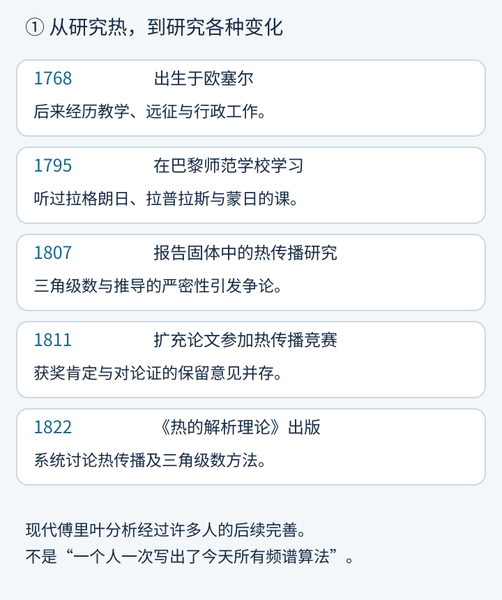
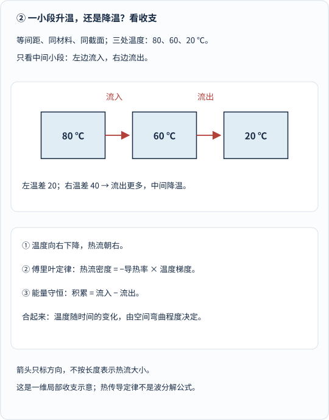
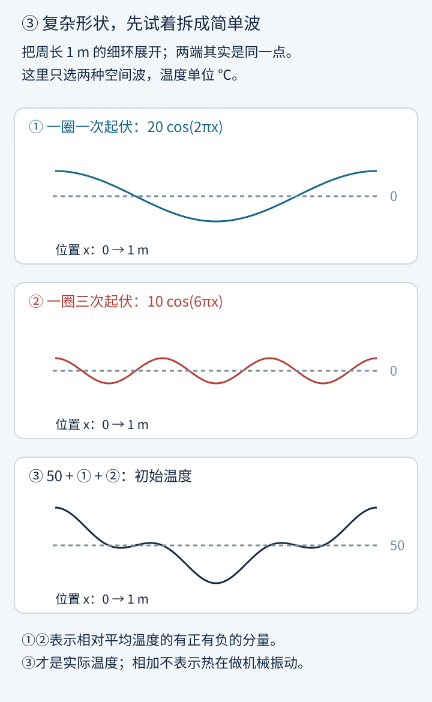
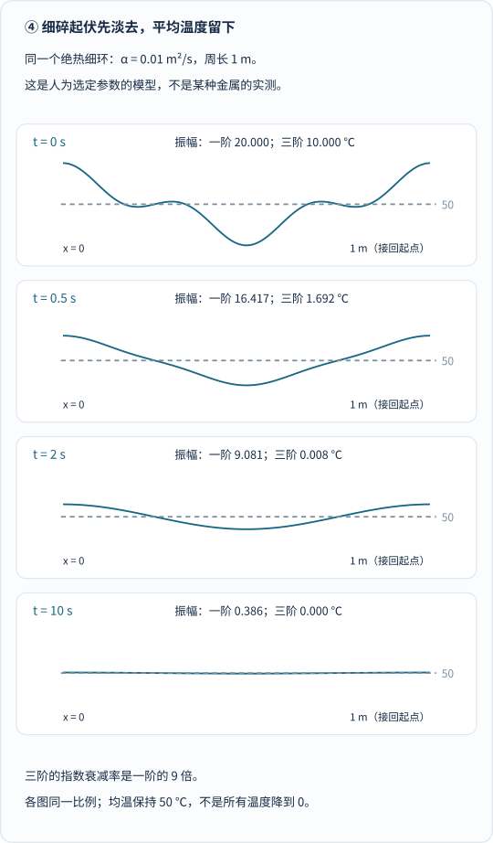
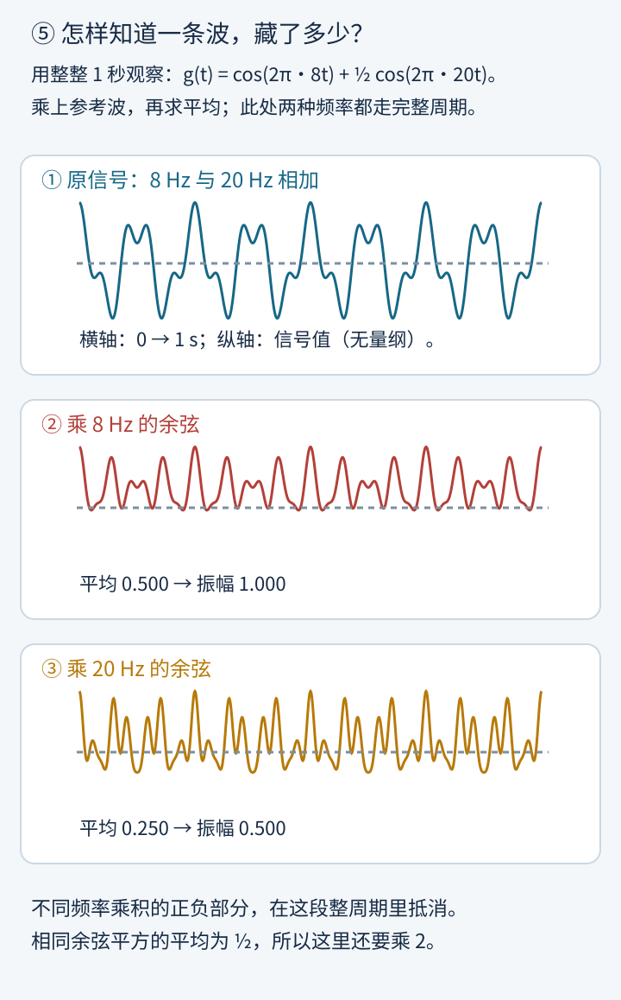
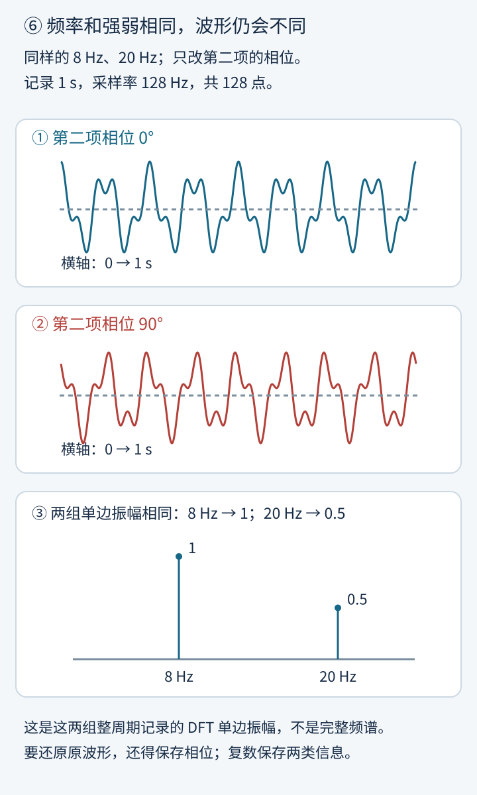
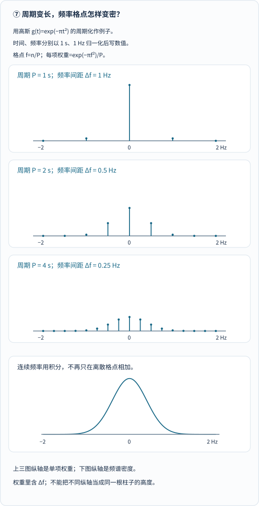
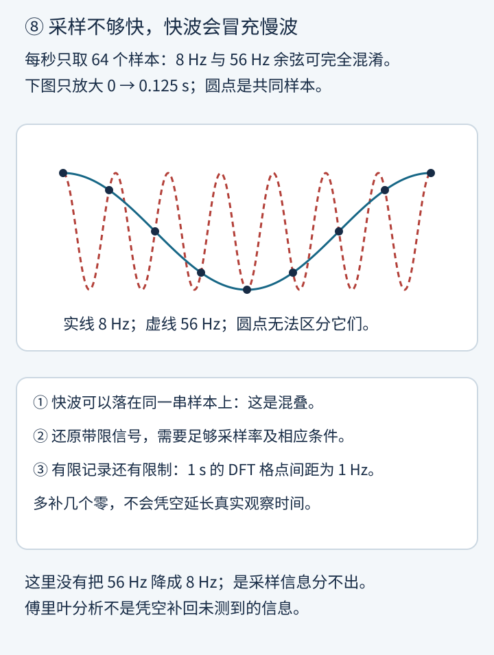

把一根铁棒的一端放进热水，另一端留在外面。

过一会儿，你会发现：热不肯老老实实待在原地。

可如果问得再细一点——**十秒以后，棒上每一个位置分别是多少度？**——“热会往冷的地方走”就不够用了。

这道看起来很生活的问题，后来竟然接上了另一组看似完全不相干的问题：

一段声音里有哪几个频率？一张图片里哪些变化是大轮廓，哪些是细纹理？为什么电脑里到处都有一个叫 FFT 的东西？

中间的关键人物，就是傅里叶。

他做了一件听起来有些离谱的事：

**为了算清温度怎样变化，先把温度的空间形状，拆成许多正弦和余弦。**

不是说铁棒在唱歌，也不是说热会像海浪一样上下振动。而是：有些复杂的问题，换一种“登记方式”，突然就容易了。

## 1. 上一篇的蒙日，居然真教过傅里叶

约瑟夫·傅里叶，1768 年出生于法国欧塞尔，1830 年去世。

他的一生并不是“关上书房门，专心推积分”那么平直：做过教师，参与过法国赴埃及的远征与学术工作，后来还到格勒诺布尔担任行政职务。重要的热理论研究，正是在这段行政工作时期发展起来的。[圣安德鲁斯大学的传记](https://mathshistory.st-andrews.ac.uk/Biographies/Fourier/)记录了这些经历。

更有意思的是，他和前几篇文章的人物真的相遇过。

1795 年，在巴黎师范学校学习时，傅里叶听过**拉格朗日、拉普拉斯与蒙日**的课。

上一位在研究怎样把空间投到纸上，这一位后来要研究：能不能把复杂的温度形状，投到一组简单函数上？

这是我们今天帮助理解的类比，不是说两种方法的历史来源完全相同。

_图 1：沿时间向下读，注意“报告”“参赛”“出版”不是同一个时点。傅里叶提出的方法曾引发严密性争论，现代分析理论与算法又经过许多人的发展，不能全部归给一个人。_

1807 年，傅里叶把固体热传播研究报告给巴黎学术界；1811 年，又扩充论文参加热传播竞赛。评审一方面肯定、授奖，另一方面仍认为某些推导的普遍性和严密性需要完善。1822 年，《热的解析理论》出版。

这里不是一个“天才一说，其他人立刻鼓掌”的故事。

把复杂函数展开成三角级数，在当时并不让所有人信服。傅里叶的工作推动了后续关于函数、收敛与分析基础的研究，但不能倒过来说：他当时已经证明了今天每一种版本的傅里叶定理。

这些阶段可由[传记](https://mathshistory.st-andrews.ac.uk/Biographies/Fourier/)核对；[剑桥出版社的书目与目录](https://www.cambridge.org/core/books/analytical-theory-of-heat/F6D4802336FABD1116DDA4AA3FE6EFAA)还区分了 1822 年法文原著与 1878 年 Freeman 英译本，原著也确实讨论了环中的热传播。

## 2. 先分清：傅里叶导热定律，不是傅里叶变换

它们同姓，却回答不同的问题。

**傅里叶导热定律回答：相邻位置有温差时，热往哪里流、流多少？**

在一维模型里，可以写成：

$$
q=-\kappa\frac{\partial T}{\partial x}.
$$

\(T\) 是温度，\(x\) 是位置；\(q\) 是沿 \(x\) 方向的热流密度，单位 \(\mathrm{W/m^2}\)；\(\kappa\) 是导热率，单位 \(\mathrm{W/(m\cdot K)}\)。

那个负号不是装饰：如果越往右越冷，温度梯度为负，热流就朝右，也就是从热处流向冷处。

但一个位置会升温还是降温，还不能只看它自己有多热。要看它的**收支**。

_图 2：先看中间的 60 ℃。同材料、同截面、等间距，并以相邻温差估算梯度：左侧温差 20，右侧温差 40，流出更多，因此中间降温。箭头只标方向，不用箭头长度假装实测热流。_

流入多于流出，就积累热能；流出更多，就减少。

把小段越取越短，再用微积分表达“收支”，对于均匀、截面恒定、侧面绝热、无内部热源的一维材料，就得到：

$$
\frac{\partial T}{\partial t}
=\alpha\frac{\partial^2T}{\partial x^2},
$$

其中

$$
\alpha=\frac{\kappa}{\rho c}.
$$

\(\rho\) 是密度，\(c\) 是比热容，\(\alpha\) 叫**热扩散率**，单位 \(\mathrm{m^2/s}\)。

左边说“这个位置的温度随时间变多快”，右边说“温度曲线在附近怎样弯”。一个局部凸起的热峰通常会降下去，低谷会被附近较热的部分填起来；真正起作用的是邻域中的差异，不是某一点凭空知道全棒平均温度。

这个推导见 [MIT Hancock 的一维热方程讲义第 1—2 页](https://ocw.mit.edu/courses/18-303-linear-partial-differential-equations-fall-2006/d11b374a85c3fde55ec971fe587f8a50_heateqni.pdf)。

微积分提供表达工具，但还得输入导热的物理定律。并不是单凭牛顿的 \(F=ma\)，就能把所有热现象直接算出来。

此外，方程还不够：**一开始各处多热？两端固定温度、绝热，还是接在一起？**这些初始、边界条件不同，答案就不同。

## 3. 为什么偏偏选正弦和余弦？

为了避免两端与环境交换热的干扰，接下来换一个清楚的教学模型：

**一根均匀细棒首尾相接成环，侧面绝热，没有内热源。**

环周长为 1 m。把它展开画在横轴上，\(x=0\) 与 \(x=1\) 实际是同一个位置。

现在给它一份初始温度：

$$
\begin{aligned}
T(x,0)={}&50+20\cos(2\pi x)\\
&+10\cos(6\pi x).
\end{aligned}
$$

这里 \(x\) 用米的数值代入；更一般的写法是把余弦里的 \(x\) 换成 \(x/L\)，其中周长 \(L=1\ \mathrm m\)。温度与振幅单位为 ℃。

它的意思并不神秘：

平均温度 50，加上一圈起伏一次、振幅为 20 的宽波，再加上一圈起伏三次、振幅为 10 的细波。

_图 3：先看①宽起伏，再看②细起伏，最后在同一个位置把它们加到 50 上，得到③。前两条是可正可负的温差分量，第三条才是实际温度；温度曲线并不表示环真的弯成了这种形状。_

那为什么这样拆就好算？

因为余弦对“求两次空间导数”这件事，特别省心。

$$
\frac{d^2}{dx^2}\cos(kx)
=-k^2\cos(kx).
$$

**形状没有换，只乘了一个数。**

所以，把一种余弦形状放进热方程后，我们不用时时重画整条未知曲线，只要追踪它的振幅：

$$
A'(t)=-\alpha k^2A(t).
$$

这个方程告诉我们：

$$
A(t)=A(0)e^{-\alpha k^2t}.
$$

原来需要追踪一整圈温度，现在可以分头登记：这一种起伏剩多少，那一种起伏剩多少。

热方程在这里是线性的，满足同一边界条件的解可以叠加。[MIT 讲义第 7—8 页](https://ocw.mit.edu/courses/18-303-linear-partial-differential-equations-fall-2006/d11b374a85c3fde55ec971fe587f8a50_heateqni.pdf)用固定温度端点的棒演示了相同思想；本文的环则选用周期边界，不把两套边界条件混起来。

## 4. 细波为什么先没？因为频率要被平方

对周长 \(L\) 的环，第 \(n\) 阶空间起伏的角波数是：

$$
k_n=\frac{2\pi n}{L}.
$$

注意，这里的 \(n/L\) 是**空间频率**，单位为每米多少圈，不是每秒多少次的 Hz。

三阶起伏的角波数是一阶的 3 倍，指数衰减率却是 **9 倍**。

它不是“走得快”，而是“淡得快”。

_图 4：按时刻从上往下看。曲线与数值都由解析解计算，各格比例相同；扩散率 0.01 m²/s 是人为选定的教学参数，不代表某种金属的实测冷却速度。三阶起伏先淡，均温始终是 50 ℃。_

在这组参数下，我们实际计算的是：

$$
\begin{aligned}
T(x,t)=50
&+20e^{-4\pi^2\alpha t}\cos(2\pi x)\\
&+10e^{-36\pi^2\alpha t}\cos(6\pi x).
\end{aligned}
$$

仍按 \(L=1\ \mathrm m\)、\(x,t,\alpha\) 分别以 m、s、\(\mathrm{m^2/s}\) 的数值代入。

这里有一个很容易说错的地方：

**温差在减小，不等于热能都跑出了系统。**

这个环没有与环境交换热，材料参数恒定，所以均温不变；以同一参考温度计算的总热能守恒。变小的是温度的不均匀程度，例如相对均温的温差平方平均值。

[Strang 的热方程讲义第 1—4 页](https://ocw.mit.edu/courses/18-086-mathematical-methods-for-engineers-ii-spring-2006/5db29e69494eb09a26f7224d43adc6f6_am54.pdf)同时讨论了总热量守恒、平方积分衰减以及高频起伏迅速平滑。不能把不同意义下的“能量”混成一句“热全没了”。

在有环境散热、端点被冷却的另一类问题里，均温当然也可能下降。不是热方程只准温度变平、不准降温，而是边界条件换了。

## 5. 已知一条复杂曲线，怎样知道里面有哪些波？

前面是我先告诉你配方，再把波相加。

现在倒过来：给你一条曲线，你怎么查出配方？

可以先想成一个“对暗号”的办法：

**把原曲线乘上一条参考波，再在一段合适的区间上求平均。**

频率不同，乘积会有正有负，往往互相抵消；如果频率对上了，就能留下可提取的分量。这种严格的正交关系，依赖选定区间与频率条件，不是随便截多长都自动抵消。

为了好数，换成一个随时间变化的无量纲信号：

$$
g(t)=\cos(2\pi\cdot8t)
+\frac12\cos(2\pi\cdot20t).
$$

\(t\) 以秒计，所以这里的 8 与 20 才是 Hz：每秒起伏 8 次与 20 次。

_图 5：先认①原信号，再看②③“乘参考波”后的正负起伏。这一秒里两种频率都走完整数个周期：乘 8 Hz 参考后平均为 0.5，乘 20 Hz 后为 0.25；余弦平方平均是 1/2，所以这里提取振幅还要乘 2。_

这与向量有点像。

你想知道一个向量在某个方向上有多少，就做投影；你想知道一个函数含某种波多少，就用相应的积分内积来提取。

[MIT 讲义第 7—8 页](https://ocw.mit.edu/courses/18-303-linear-partial-differential-equations-fall-2006/d11b374a85c3fde55ec971fe587f8a50_heateqni.pdf)明确用向量正交来类比函数正交，并由此求出展开系数。

不过，余弦参考还不是全部。

如果波起伏的起点挪了，也就是**相位变了**，还要配上一条正弦参考。否则，一条相差四分之一周期的波，可能被单独一条余弦参考“看漏”。

### 相位不是可以随便扔掉的附件

频率告诉你“起伏多快”，振幅告诉你“这一项多强”，相位告诉你“相对于时间原点，起伏走到了哪儿”。

_图 6：比较①②，第二项从 0° 改成 90°，波形确实变了；③的两根峰却没变。这里画的是这两组整周期记录的 DFT 单边振幅，不是完整复频谱。只有频率与振幅，未必能拼回原来的波形。_

复数在这里很有用：它能把余弦与正弦这两份投影一起保存，也就把强弱与相位一起保留下来。

所以，不必一见 \(i\) 就觉得“原来的真实信号变虚假了”。它是一种省事的记账方式。

## 6. 从傅里叶级数，到傅里叶变换

先分清两种场景。

**如果研究的是一个周期里怎样重复，就很自然地得到一串离散频率。**

例如周期为 \(P\)，频率格点是：

$$
f_n=\frac{n}{P}.
$$

周期 1 s，间距是 1 Hz；周期 2 s，间距为 0.5 Hz。

这就是傅里叶级数的典型舞台：一组离散的谐波，加上各自的系数。

如果我们想研究一次不重复的脉冲呢？

一个有帮助的桥梁是：先把它放进越来越长的周期里重复。重复之间越来越远，频率格点越来越密；在适当条件下，离散求和通向连续频率的积分。

_图 7：按 P=1、2、4 的顺序看，频率点越来越密，但单项权重还含有间距 Δf，不能只把柱子变多、原高度照搬。图用高斯的可计算例子，时间、频率分别以 1 s、1 Hz 归一化后写数值；上三格是离散权重，下格是连续频谱密度，纵轴含义不同。_

采用本文约定，连续傅里叶变换写作：

$$
\widehat g(f)=
\int_{-\infty}^{\infty}
g(t)e^{-i2\pi ft}\,dt.
$$

把它读成人话：

**拿每一种频率的余弦、正弦，去和整条信号对照，把匹配结果登记成一份复数频谱。**

在适当条件下，可以反过来：

$$
g(t)=
\int_{-\infty}^{\infty}
\widehat g(f)e^{i2\pi ft}\,df.
$$

这里不是列完第 1、2、3 根波就停，而是把连续频率上的贡献积分起来。

它改变的是**表示方式**，不是把物体、声音或热真的送进了另一个空间。

两条公式也有使用范围。普通积分版本需要可积性与相应反演条件；例如信号与其变换都绝对可积时，可在信号连续的点作这样的反演。永远重复、永不衰减的理想余弦，不满足前一个普通绝对可积条件，不能不加说明地塞进积分，当作得到了一根有限高度的普通函数柱子。

对于常见的分段光滑周期函数，级数在跳点趋向两侧极限的平均值；不能笼统说“随便什么函数，在每个点都能被正弦精确拼出”。[NIST 的级数条目](https://dlmf.nist.gov/1.8#ii)列出了相关收敛条件。更广义的理论会使用均方意义、分布等工具，这篇不把它们混进初学公式。

[NIST 数学函数数字图书馆的积分变换条目](https://dlmf.nist.gov/1.14)列出了定义、反演及相关条件。它采用的符号、归一化与本文不完全相同；不同教材中的正负号和 \(2\pi\) 位置可能变化，正反变换必须成套使用。

还有一个细节：连续频谱是密度式的表示，量纲会随积分变化。若 \(g\) 的单位是电压，\(\widehat g\) 在本文时间积分约定下就带上“电压×秒”；不要把它的纵轴，与某个软件显示的归一化单边振幅不加区别地比较。

## 7. 变换绕了一圈，怎样重新解决热问题？

现在可以看出傅里叶思路真正省力的地方。

前面在环上，我们逐个处理离散空间模态。若换成**无限长理想棒上的温差分布**，在合适的衰减与光滑条件下，就可以对空间 \(x\) 做连续变换。

注意，这次变换的是位置，不是时间；\(\xi\) 的单位是圈/m。这里用 \(u\) 表示相对固定背景的温差，避免把无限长棒上的非零均温当成一个普通可积信号。

空间求两次导数，在频域中变成乘一个数：

$$
\frac{\partial\widehat u}{\partial t}
=-4\pi^2\alpha\xi^2\widehat u.
$$

于是每一种空间频率，都只需自己按下面的倍率衰减：

$$
\widehat u(\xi,t)=
\widehat u(\xi,0)e^{-4\pi^2\alpha\xi^2t}.
$$

然后做反变换，拿回温差随位置的形状。

路线就是：**先拆开，分头演化，再拼回。**

这与 [Strang 讲义中的无限域热方程解法](https://ocw.mit.edu/courses/18-086-mathematical-methods-for-engineers-ii-spring-2006/5db29e69494eb09a26f7224d43adc6f6_am54.pdf)一致，只是本文使用每米圈数的频率约定，因此写出了相应的 \(2\pi\)。

热扩散本身像一个偏爱低空间频率的平滑器：宽缓变化留下得久，细碎变化淡去得快。

但它与“超过某频率就一刀删掉”的理想硬截止滤波，不是同一种倍率。热扩散是连续的指数衰减，不能把它画成任意切掉几根柱子，就声称完整模拟了热传导。

## 8. 动手：看热变平，也看频率被找出来

下面两个实验都在本站运行。手机上框内可以滚动，也可以[单独打开热与频谱实验室](/assets/interactive/fourier-lab.html)。

<iframe src="/assets/interactive/fourier-lab.html" title="傅里叶互动：绝热环热扩散动画与真实DFT频谱滤波" width="100%" height="1700" loading="lazy" sandbox="allow-scripts" style="border:1px solid #879baa;border-radius:12px;max-width:100%;"></iframe>

**实验一：热怎样变平。**

先停在 0 s，认出宽起伏与细起伏；拖到 0.5 s，再到 10 s，看看哪一项先减弱。改变扩散率后，曲线来自重新计算，不是为了显得“变快”而随便改动画速度。

播放一次用 8 秒演示 10 秒模型时间，标签显示的是模型时间，不是实际材料实验。可以暂停、拖动、重播；减少动态效果模式禁用连续播放，改为每次前进 1 秒。默认不自动播放，最后停在结果上。

**实验二：找出并筛选频率。**

默认生成 8 Hz 与 20 Hz 两项，实际取 128 个样本。程序对这些样本做 DFT 求和，保留指定频率以内的复系数与共轭对，再逆变换。

把截止设在 12 Hz，留下 8 Hz，删掉 20 Hz；调到 64 Hz，则完整保留，回到原样本，只有浮点舍入误差。

恢复默认后，再按“相位改成90°”：波形变了，两根振幅峰没有变。然后试“20.5 Hz”，频谱会散开——下一节解释这不是计算坏了。

这不是预先画两根柱子的演示。输入、完整频谱、低通结果与误差，都从同一组样本计算。互动需要 JavaScript；不加载互动，也能沿正文八幅静态图理解全部主线。

## 9. DFT、FFT，以及“为什么散到旁边去了”

电脑不能直接收进一条无限长、连续的信号。它往往拿到有限个离散样本。

**DFT，离散傅里叶变换，回答这组样本怎样表示成一组离散频率系数。FFT，则是更快计算同一个 DFT 的一类算法。**

FFT 不是比傅里叶变换更玄的另一种变换，也不是傅里叶在 1822 年已经为今天的电脑写好了代码。[NumPy 的官方说明](https://numpy.org/doc/stable/reference/routines.fft.html)区分了这几个概念，并给出了正、逆 DFT、频率排列、归一化与相位的约定；参考文献列有 Cooley 与 Tukey 的 1965 年论文。

这篇的小实验数据量很小，实际采用直接 DFT 求和，没有冒称它就是 FFT。

### 20.5 Hz 为什么没有老老实实站成一根柱子？

实验记录 1 s，采样率 128 Hz，共取 128 点。DFT 格点间距为：

$$
\Delta f=\frac{f_s}{N}=1\ \mathrm{Hz}.
$$

20 Hz 正好落在格点上，也在这段记录里走完 20 个周期；20.5 Hz 则不是。

对有限记录作周期解释时，截断窗口与接回处的差异会让能量分布到其他格点，这叫**频谱泄漏**。

不是现实里突然长出了几十个独立振源，也不是 DFT 无法分析非整数频率。它准确表达的是你交给它的那组有限样本；解读真实来源，还得考虑观察窗、时长、噪声及分析方法。

给记录末尾补零，可以把频谱画得更密，但不能凭空获得更长时间的观测。格点间距也不等于任何条件下都保证能区分的最小频率差。

### 采得太慢，还会把快波认成慢波

_图 8：先看圆点，再看穿过它们的两条不同曲线。横轴只放大 0～0.125 s；64 Hz 采样时，两条余弦在这些采样时刻完全相同。实线与虚线才是不同的连续波，圆点本身无法替你选择。_

这叫混叠。

对于严格带限的信号，要想按相应采样理论还原，需要足够高的采样率，并满足相应条件。现实采集还会使用抗混叠滤波，不能只背一句“两倍”就忽略所有前提。

这里最重要的不是再背一条规则，而是记住：

**傅里叶分析很擅长整理信息，却不能凭空补回从未测到的信息。**

## 10. 最初那根热铁棒，留下了一种怎样的眼光？

从热传导走到频谱，并不只是“一个数学家的名字被到处借用”。

背后有一条很连贯的路线：

先用物理定律建立方程；再找到求导时不乱变形的简单波；把复杂分布拆开，让每一项分别变化；最后重新合成。

这也是为什么类似方法会进入声音分析、图像平滑与许多科学计算。时间上的频率与空间上的频率不是同一种单位，但“变化得慢还是细碎、各占多少、相位在哪里”的问题，有共同的数学语言。

当然，滤掉高频也不是永远有益。声音中的细节、图片中的边缘都可能在高频里；噪声也未必只待在高频。实验里删掉一项，只是演示一个可核算的筛选动作，不代表现实信号可以如此简单地区分“有用”和“没用”。

回头看开头：傅里叶并不是想让一根铁棒唱歌。

他是在问，热怎样慢慢传开。

但为了回答这个问题，他帮助人们学会了另一种看变化的方式：

**不只看一条曲线在每个位置有多高，还问：它是由哪些简单变化，按怎样的强弱与相位，拼在一起的？**

## 参考资料与原创模型说明

以下资料均实际打开检查；两份 MIT PDF 阅读了相关正文，不以搜索摘要代替推导出处。全部插图与互动为原创计算，没有转载论文图、教材截图或外站程序。

- [MacTutor：Joseph Fourier](https://mathshistory.st-andrews.ac.uk/Biographies/Fourier/)：生平、1795 年师范学校学习、1807 年报告、1811 年竞赛及评审保留意见、1822 年出版。用于区分研究、报告、参赛和出版，不把争论讲成“当时已有今日完整证明”。
- [Cambridge University Press：The Analytical Theory of Heat](https://www.cambridge.org/core/books/analytical-theory-of-heat/F6D4802336FABD1116DDA4AA3FE6EFAA)：核对法文原著 1822 年、Freeman 英译 1878 年，以及目录中的环热传播等主题。本次检查的是出版社书目说明与目录，不宣称逐页校勘原著。
- [Matthew J. Hancock／MIT：The 1-D Heat Equation](https://ocw.mit.edu/courses/18-303-linear-partial-differential-equations-fall-2006/d11b374a85c3fde55ec971fe587f8a50_heateqni.pdf)：第 1—4 页的能量收支、导热率、热扩散率与初边值条件；第 7—9 页的线性叠加、正交性、系数提取与模态衰减。原讲义的固定端点示例不等同于本文的周期环模型。
- [Gilbert Strang／MIT：The Heat Equation and Convection-Diffusion](https://ocw.mit.edu/courses/18-086-mathematical-methods-for-engineers-ii-spring-2006/5db29e69494eb09a26f7224d43adc6f6_am54.pdf)：第 1—4 页的总热量守恒、平方积分衰减、空间变换、高频平滑及高斯热核。本文采用另一套明确标出的频率约定。
- [NIST DLMF §1.8：Fourier Series](https://dlmf.nist.gov/1.8)、[§1.14：Integral Transforms](https://dlmf.nist.gov/1.14)：级数系数与收敛、连续变换的定义、反演条件及不同符号约定。不能把普通可积函数的公式无条件用于所有周期信号或分布。
- [NumPy：Discrete Fourier Transform](https://numpy.org/doc/stable/reference/routines.fft.html)：DFT 与 FFT 的关系、正逆变换、实信号共轭对称、幅相信息、直流与奈奎斯特频率项、归一化及滤波背景。互动沿用其常见负指数正变换、正指数并除以 N 的逆变换约定，但未调用 NumPy，也未调用 FFT 库。

八幅 SVG 可由 `python tools/generate_fourier_visuals.py` 生成。互动位于 `assets/interactive/fourier-lab.html`，实际使用的 JavaScript 模型可用 `node tools/check_fourier_model.cjs` 检查。热模型有意只用两个解析模态；频谱模型只处理合成信号与有限样本，不是材料实验、录音分析或实际设备性能评测。
