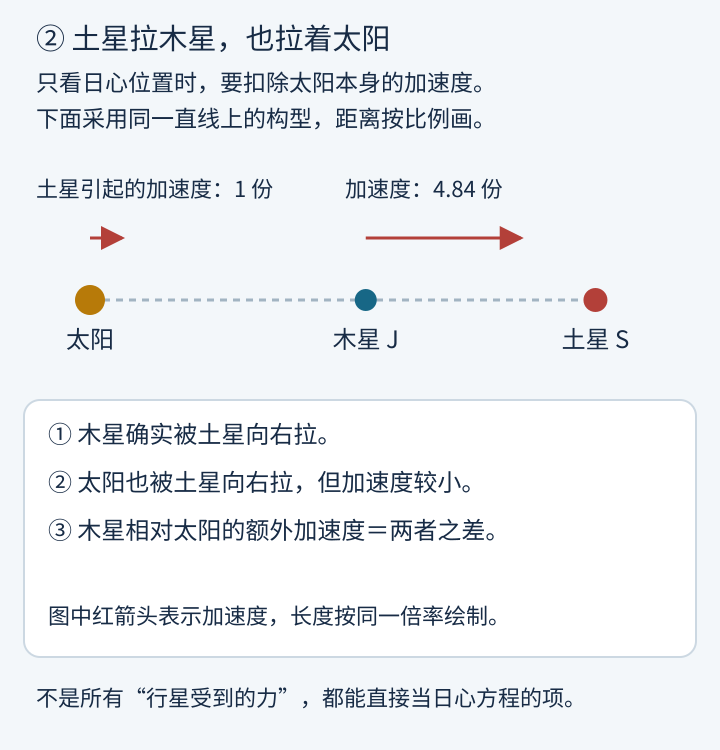
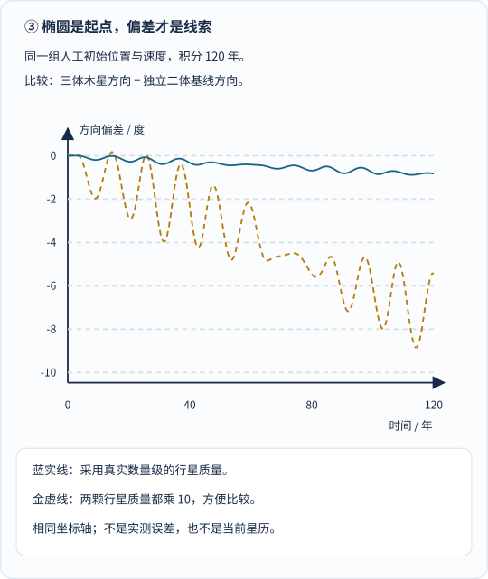
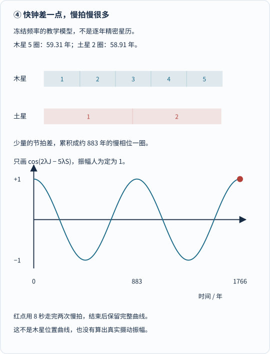
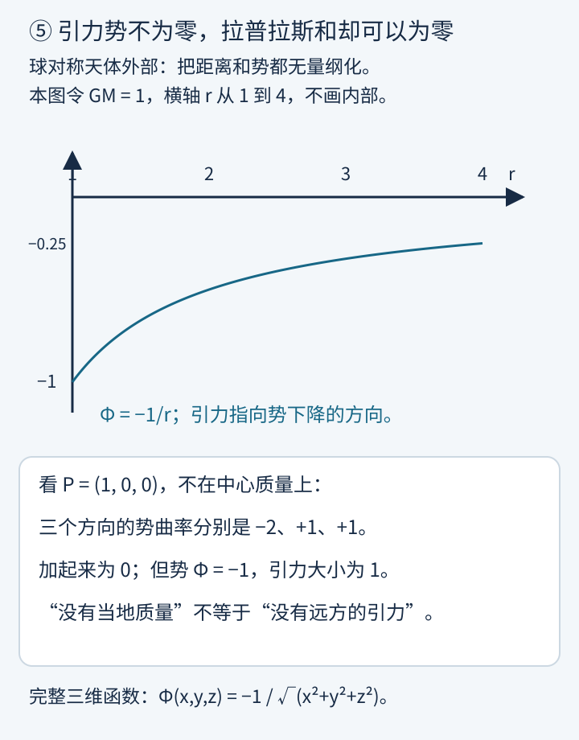

假如你是十八世纪的天文学家，手上有牛顿定律、几代人留下的观测记录，还有一支笔。

你给木星排了一张“未来行程表”。

过了一些年，木星似乎比表上写的更赶时间。另一边，土星却像是越来越拖拉。

麻烦不只是“算错了几分钟”。

**如果这种变化会一直累积下去，太阳系会不会根本不是一台走得准的钟？**

今天，我们习惯在手机里点一下，就知道某颗行星今晚在哪里。但在那时，把牛顿的引力定律变成一张足够可靠的天文表，是能消耗几代数学家心血的大工程。

拉普拉斯的故事，就藏在这道缝里：

**知道自然界的规律，和真的算出自然界接下来会怎样，是两回事。**

这篇沿两条路读都可以：先跟图与互动看懂，再回头读公式。我们会遇到一个反直觉的发现——木星和土星的“大麻烦”，有一部分竟然来自它们的节拍**差得太少**。

## 1. 牛顿已经有了，拉普拉斯还要做什么？

先认识一下主角。

皮埃尔－西蒙·拉普拉斯生于 1749 年，卒于 1827 年。他年轻时到巴黎，得到达朗贝尔的帮助，后来长期研究概率和天体力学。这里不把他写成独自完成一切的天才：欧拉、拉格朗日、勒让德，以及提供观测、编制天文表的人，都在这条路上留下了实实在在的工作。[圣安德鲁斯大学的传记](https://mathshistory.st-andrews.ac.uk/Biographies/Laplace/)也提醒读者，拉普拉斯的巨著吸收了不少前人和同行的方法。

_图 1：先看每个人面对的任务，再看时间。牛顿给出引力规律，后人要把许多天体同时代入，求出能与观测对照的运动；这不是简单地把同一个公式多抄几遍。_

1799 年，《天体力学》的前两卷出版，全书后来共五卷。

拉普拉斯在[原书前言的英译](https://mathshistory.st-andrews.ac.uk/Extras/Laplace_mechanique_celeste/)里，把目标说得很清楚：把散布在许多著作中的理论连成一个整体；问题的解决，既依赖观测的准确，也依赖分析方法的完善。

“天体力学”也不只是画行星轨道。

在他的计划中，天体的形状、自转、覆盖其表面的流体运动，以及行星、卫星和彗星的运动，都是引力和力学需要处理的对象。

可以把他面前的任务想成：

> 牛顿给出了一套交通规则。拉普拉斯要算出，一座所有车辆都会互相影响的城市，接下来怎样运行。

比喻到这里就停：行星之间不是靠看见红灯来反应，而是每时每刻都受彼此引力作用。

## 2. 最容易忽略的一点：太阳也在被拉

先把宇宙简化到只有太阳和一颗行星。

在孤立的、牛顿点质量二体模型中，相对运动可以解成圆锥曲线；束缚轨道是椭圆，圆是特殊情形。太阳并非钉在宇宙里的图钉，两个天体都绕共同质心运动。

现在放进第三个天体——土星。

木星不只受太阳吸引，也受土星吸引；而太阳也受土星吸引。

**如果我们画的是“木星相对太阳的位置”，就不能忘记太阳自己也动了。**

_图 2：先看两个红箭头，它们都是土星引起的加速度，不是速度。再以太阳为移动原点：要扣除太阳也向右加速的那一份。距离按同一尺度绘制，天体大小夸大；共线只用于解释，不是实际某天的位置。_

这就是**摄动**的入口。

“摄动”不是给定律打补丁，也不是宇宙里多了一种“摄动力”。它是把同一套引力作用重新分组：

**先解最主要、最容易的部分，再计算其余作用带来的偏差。**

### 不怕公式的话，看它怎样分组

设 \(\mathbf r\) 是木星相对太阳的位置，\(\mathbf R\) 是土星相对太阳的位置。暂时只保留这三个点质量，则精确的日心相对方程可以写成：

$$
\begin{aligned}
\ddot{\mathbf r}
&=-\frac{G(M_\odot+m_J)}{|\mathbf r|^3}\mathbf r
+\mathbf a_{\rm pert},\\
\mathbf a_{\rm pert}
&=Gm_S\left(
\frac{\mathbf R-\mathbf r}{|\mathbf R-\mathbf r|^3}
-\frac{\mathbf R}{|\mathbf R|^3}
\right).
\end{aligned}
$$

\(G\) 是万有引力常数，\(M_\odot,m_J,m_S\) 分别是太阳、木星、土星质量；上方两点表示对时间求二阶导数，即加速度。

第一行左边问“相对位置怎样弯”，右边先放太阳与木星的二体项，再放摄动项。

第二行括号中，前一项是土星对木星的直接作用，后一项扣掉土星对太阳的作用，常叫**间接项**。分母的三次方不是把平方反比改成了立方反比：分子向量还带一个距离，合起来的加速度大小仍按距离平方衰减。

完整计算还要给太阳、土星等天体同时列方程；并给出初始位置、初始速度。只写一个方程、不给初值，还没有指定哪一个太阳系。

## 3. “先算椭圆，再算偏差”，到底是什么意思？

回忆前一篇[变分法]()：我们关心的是一整条函数，而不是孤零零的一个数。

这里也一样，轨道是随时间变化的函数。

用符号表达，摄动近似的一种思路是：

$$
\mathbf r(t)
=\mathbf r_0(t)+\varepsilon\mathbf r_1(t)+\cdots.
$$

\(\mathbf r_0(t)\) 是已经会解的二体运动；\(\varepsilon\) 用来标记小作用的阶次；\(\mathbf r_1(t)\) 是第一阶修正。它不是凭画面感觉加上去的摆动，而要代回运动方程，由微分方程求出来。

另一种常见说法是：把轨道看成一条参数慢慢改变的椭圆。这个瞬间的椭圆匹配当前的位置和速度，但**不表示行星以后会永远沿这一条椭圆走**。

今天也可以直接用计算机，把所有天体的加速度一起积分。

为看清“偏差”长什么样，我们做一个简化实验：

用太阳、木星、土星的真实质量数量级，但把初始轨道设为共面近圆，初始夹角人为选成 60°。然后分别算“完整三体模型”和“互不干扰的独立二体基线”。

_图 3：先看横轴的 120 年，再看纵轴“度”，不要把它当成轨道形状。蓝实线是原质量数量级，金虚线把两颗行星质量都乘 10。二者不是实测数据，也不是当前木土位置；负值只表示相对所选基线落后，并不表示行星倒着走。_

在这个具体模型里，120 年时，木星方向的差分别约为 **−0.824°** 和 **−5.431°**。质量放大时，我们也重新给出了相应二体圆轨道的初速，因此不同档位并非只改一个力项、其他一概不动。

从图上能得出的结论是：

**即使轨道看上去仍然很圆，“何时走到哪里”也已经不同了。**

不能得出的结论是：“把这 120 年的趋势往后直线延长，就能知道几百万年后怎样。”摄动近似和数值模拟，都需要检查适用时段与误差。

## 4. 木星与土星：为什么“差一点”反而很要命？

历史上最著名的难题之一，是木星与土星的**大不等式**。

这里的“不等式”不是中学里的 \(a>b\)，而是天文语境中的周期性不均匀变化。较长时间的观测显示，单纯的椭圆表不能把它们的运动排得足够准。

欧拉等人已经计算过摄动，却没有立即解决这个问题。拉普拉斯在十八世纪八十年代的工作解释了其中重要的长周期部分。[MacTutor 收录的希尔 1890 年历史回顾](https://mathshistory.st-andrews.ac.uk/Extras/Hill_Jupiter_Saturn/)记述了这段过程，也记载了此后不断补项、纠错、改进天文表的工作。

关键线索藏在两个熟悉的小数里：

**木星一圈约 12 年，土星一圈约 30 年。木星 5 圈，几乎等于土星 2 圈。**

但不能在下一步计算中直接用 12 和 30：那会把“差一点”抹成“完全一样”，恰恰丢掉最重要的信息。

### 先听懂“慢拍”，再看公式

两只钟走得很快，却走得只差一点。

短时间看，每一只都转过很多圈；要等到它们的**相对节拍**完整错开再回来，却可能要很久。

木土问题里，值得留意的一个慢组合是：

$$
\psi=2\lambda_J-5\lambda_S.
$$

\(\lambda_J,\lambda_S\) 是两颗行星的平均经度，可先理解为描述长期公转节拍的角度。真实椭圆上的瞬时位置角并不匀速，别把两者混在一起。

令 \(T_J,T_S\) 是冻结频率模型中的周期，则：

$$
\begin{aligned}
\dot\psi
&=2\pi\left(\frac{2}{T_J}-\frac{5}{T_S}\right),\\
T_{\rm slow}
&=\frac{1}{\left|2/T_J-5/T_S\right|}.
\end{aligned}
$$

这里用弧度表示角度，周期单位取年。第二式只是问：**这个角度差走满一整圈需要多久？**

_图 4：先看上面五格与两格的终点差，再看下面被拉长的时间轴。下图只画 \(\cos\psi\)，振幅人为定为 1；它不是木星位置曲线，也没有算出真实大不等式的振幅。红点用 8 秒演示约 1766 年的模型时间，播放一次后停留；完整曲线始终可读。系统减少动态效果时不播放。[单独打开图，刷新可重播](/assets/images/laplace/near-resonance.svg)。_

图中从 [JPL 近似元素长时段表](https://ssd.jpl.nasa.gov/planets/approx_pos.html)取参考历元处的平均经度速率，再**人为冻结**频率，得到约 **883 年**的节拍。[NASA 1971 年的相关技术报告](https://ntrs.nasa.gov/api/citations/19710016021/downloads/19710016021.pdf)在引言中将大不等式的对应周期称为“约 900 年”。两者处在同一尺度，但本文的冻结频率实验不是重新完成了拉普拉斯的摄动理论，更不是把 JPL 的拟合表无限外推。

完整的共振角还会涉及近日点方向等缓慢变化的角度；真实摄动的幅度和相位，也需要引力展开与轨道偏心率等信息。只算出一个慢拍，不等于已经解释了全部观测。

### 为什么一点小力，可能留下明显的长周期影响？

看一个专门用来说明积分的模型，不把它当真实木土方程：

$$
\frac{dq}{dt}=A\cos(\omega t).
$$

若 \(\omega\ne0\)，积分得到：

$$
q(t)-q(0)=\frac{A}{\omega}\sin(\omega t).
$$

\(q\) 可以是某个待求修正量，\(A\) 的单位是“该量每单位时间”，\(\omega\) 是角频率。

**变化率里的小振幅，经过很慢的累积，未必只留下很小的总变化。**

这就是为什么“每一项看起来都很小”，不能自动保证“全部影响可以忽略”。摄动理论里，接近抵消的频率会形成麻烦的“小分母”。

但别把公式硬用到 \(\omega=0\)：此时原方程变成 \(dq/dt=A\)，在这个玩具模型中是线性增长；实际共振问题则需要重新组织近似，处理非线性等作用。不能因此宣布“真实轨道振幅无限大”。

拉普拉斯的漂亮之处，是把看似不断变坏的一部分趋势，辨认为一个很长的周期变化。

**看一小段缓慢起伏，很容易误以为自己看到的是永远上升或永远下降。**

## 5. 自己动手：先拨质量，再拨节拍

下面是本站原创互动。可以拖时间、暂停、回到起点、调参数；默认不自动播放。手机上框内可滚动，也可以[单独打开天体力学实验室](/assets/interactive/laplace-lab.html)，获得更大的画面。

<iframe src="/assets/interactive/laplace-lab.html" title="拉普拉斯天体力学互动：三体摄动与近五比二慢拍" width="100%" height="1450" loading="lazy" sandbox="allow-scripts" style="border:1px solid #879baa;border-radius:12px;max-width:100%;"></iframe>

**实验一：互相拉扯。** 先选原数量级，把时间拖到 120 年。实心点是三体积分，空心点是独立二体基线；读出角度差。再选 ×10，比较同一时刻。注意偏差图会自动调整纵轴，不能只比较线的高度。

它真的积分三体引力方程，太阳也参与运动；但初值是人工构造的，没有其他行星和相对论修正，**不是今天的太阳系，更不是完整的大不等式模拟**。

**实验二：慢节拍。** 改变土星钟的周期，靠近木星周期的 2.5 倍，观察慢拍怎样被拉长。再按“恰好 5∶2”：这个角度组合冻结了，行星可没有停止公转。

这个实验故意不算引力，只把“频率接近整数比”单独拎出来。把两个实验分开，正是为了不让“看见一条漂亮曲线”替代物理推导。

互动只使用本站 HTML 与 JavaScript，没有外部库、联网数据或追踪；需要浏览器允许 JavaScript。不加载互动，前面的静态图、数值与说明仍然完整。动画播放一遍后停止；减少动态效果模式下也不自动播放，仍可拖动时间，只有显式按播放才启动。

## 6. 为什么天体力学里还有“拉普拉斯方程”？

前面一直在谈轨道，怎么又冒出偏微分方程了？

因为引力还可以换一种记账方式：**先算每一点的引力势，再从势的空间变化求引力。**

在球对称天体外部，取无穷远的势为零：

$$
\Phi(r)=-\frac{GM}{r},
\qquad
\mathbf g=-\nabla\Phi.
$$

\(\Phi\) 是单位质量的引力势，单位为 \(\mathrm{m^2/s^2}\)；不是整颗行星的势能。质量为 \(m\) 的物体在此外场中的势能才是 \(m\Phi\)。\(\mathbf g\) 是引力加速度，\(\nabla\) 表示三个空间方向的一阶变化率组成的梯度。

“沿势下降方向走”，说的是负梯度方向；具体运动还取决于物体原有速度，并不是把势画成漏斗，行星就会自动顺着图上的坡滑下去。

在**没有当地质量分布的空间区域**，牛顿引力势满足：

$$
\nabla^2\Phi
=\frac{\partial^2\Phi}{\partial x^2}
+\frac{\partial^2\Phi}{\partial y^2}
+\frac{\partial^2\Phi}{\partial z^2}
=0.
$$

这就是引力势语境中的拉普拉斯方程。

有质量密度 \(\rho\) 的地方，则相应为泊松方程：

$$
\nabla^2\Phi=4\pi G\rho.
$$

它们不是另一条引力定律，而是牛顿引力场的另一种数学表达。具体求解还要指定质量分布、边界条件等；仅写下偏微分方程并不够。

_图 5：先看势曲线并不为零，再看下方三个方向的二阶变化率。例子把长度与势无量纲化，完整函数是 \(-1/\sqrt{x^2+y^2+z^2}\)；在 \(P=(1,0,0)\) 的三个坐标二阶偏导是 −2、+1、+1，和为零。不能只对一维的 \(-1/r\) 求两次导数，就声称完整的拉普拉斯算子不为零。_

这是特别容易误读的一句：

> **真空中的势满足拉普拉斯方程，不代表那里没有引力，而代表当地没有引力的质量源。**

远处太阳造成的引力，完全可以穿过这一片真空。

[拉普拉斯传记](https://mathshistory.st-andrews.ac.uk/Biographies/Laplace/)也特别提醒：这个方程虽然以他命名，相关形式在他之前已经为人所知。数学史上的名字，不等于独占的“首次发明证明”。

## 7. 那么，他证明太阳系永远稳定了吗？

如果把故事停在这里，最容易写出一句过头的话：

“拉普拉斯算出了所有行星的未来，证明太阳系永远稳定。”

**不能这样说。**

他与拉格朗日等人的摄动研究，说明在相应的小参数、展开阶次和模型条件下，许多看似会不断累积的变化可以理解成有界的周期或准周期变化。木土长周期问题的成功，是牛顿引力理论非常有力的胜利。

但“保留到某一阶没有失稳”，不等于“完整系统在无限时间里绝不失稳”。

甚至“稳定”也需要说清是哪一种：预测位置是否准确？轨道参数是否有界？会不会发生近距离相遇、碰撞或逃逸？这些不是同一道题。

庞加莱后来研究三体问题时，揭示了复杂轨道结构；其获奖论文的修订版于 1890 年发表。他的工作改变了人们对长期可预报性的理解。[MacTutor 的庞加莱传记](https://mathshistory.st-andrews.ac.uk/Biographies/Poincare/)记录了获奖、发现错误及修订的过程。

这里的“混沌”也不是引力定律突然随机掷骰子。

它是说：**在某些动力学条件下，初始状态的微小差异，会被运动放大。规律仍然确定，有限精度的初值却未必支撑任意久的精确预报。**

_图 6：沿五个步骤往下读，再看最后三句话。检验模型需要新观测；跑出一条没有碰撞的轨道，不足以证明其他允许初值、甚至无限未来也不会碰撞。_

2009 年，拉斯卡尔与加斯蒂诺研究了 **2500 多条**与当时太阳系知识相容的长期轨迹，模型包括广义相对论及月球贡献。在约 **1%** 的案例中，水星轨道的偏心率显著增大，出现可能导致与金星或太阳碰撞的演化。[巴黎天文台／IMCCE 的研究说明](https://perso.imcce.fr/jacques-laskar/obs-press-colli/colli.en.shtml)给出了模型、约五十亿年时段及结果背景。

这个“约 1%”应读成**该研究的模型、初值采样与时间范围下的统计结果**，不是宇宙颁发的一张精确概率票据，更不是“明天有百分之一的机会撞上”。

它也没有把拉普拉斯的工作变成白费力气。

科学的进步，往往不是把前人整本书划掉，而是把“在什么条件下成立、能回答多长时间的问题”说得更准确。

## 8. 今天的天体力学，是给望远镜和航天器指路

假如现代人只做十八世纪的方法，那当然不够。

但如果只把同一个公式交给更快的电脑，也不够。

[JPL 的 DE440／DE441 说明](https://ssd.jpl.nasa.gov/doc/de440_de441.html)明确写道：星历来自**数值积分轨道与地面、空间观测的拟合**。木星轨道的改进用到了朱诺号无线电测距和甚长基线干涉测量，土星轨道的改进用到了卡西尼号的数据。

于是，现代的工作链就不只是“已知力，积分两次”：

观测提供位置与距离的约束；物理模型解释作用；拟合估计初值与参数；残差暴露误差与遗漏；新的观测再回来检验预报。

想查真实的行星位置，可以使用 [JPL Horizons 官方系统](https://ssd.jpl.nasa.gov/horizons/app.html)。它需要网络，交互页面需要浏览器支持；输出还要选目标、观测地点、时段和坐标类型，不能把本文的人造初值实验当作它的替代品。[官方手册](https://ssd.jpl.nasa.gov/horizons/manual.html)说明了这些用途与选项。

再回头看拉普拉斯，最值得佩服的，就不只是“会算”。

他把一个看似玄妙的问题——**天上的世界会不会自己乱掉？**——拆成可以计算、比较、改进的具体任务。

先有一条简单的椭圆，再有其他天体造成的小偏差；从小偏差中认出慢节拍；把理论变成表，把表交给观测检验。

太阳系不是一台用齿轮锁死的钟。

但正因为每颗行星都在互相拉扯，我们才需要天体力学：**不是只给天空画一张漂亮的图，而是认真回答，那一点点偏差到底从哪里来，又会把我们带到哪里去。**

## 参考资料与模型说明

本文实际打开并阅读以下资料。配图均为原创计算或构造，没有转载馆藏图片、论文插图或外站程序。

- [MacTutor：Pierre-Simon Laplace](https://mathshistory.st-andrews.ac.uk/Biographies/Laplace/)：生平、与达朗贝尔及拉格朗日的联系、《天体力学》的内容与历史背景。其对“稳定”的概括应结合本文说明的近似条件理解，不作为永远稳定的证明。
- [MacTutor：Laplace’s *Mécanique Céleste*](https://mathshistory.st-andrews.ac.uk/Extras/Laplace_mechanique_celeste/)：前两卷 1799 年出版、全书五卷，以及鲍迪奇英译的作者前言；支持“综合理论、同时依赖观测与分析”的主线。
- [George William Hill：木星与土星新理论的历史回顾，1890](https://mathshistory.st-andrews.ac.uk/Extras/Hill_Jupiter_Saturn/)：大不等式从观测、早期摄动到拉普拉斯及后续改进的过程。本文不把回顾中“解决困难”的表述扩大成完整太阳系的无限时间稳定定理。
- [JPL：Approximate Positions of the Planets](https://ssd.jpl.nasa.gov/planets/approx_pos.html)：两套近似轨道元素、拟合时段、参考历元速率与适用警告。慢拍实验只使用长时段表的参考速率作为冻结频率素材；三体实验只借用短时段表中的两个半长轴数值设定人造初始半径。
- [JPL：Astrodynamic Parameters](https://ssd.jpl.nasa.gov/astro_par.html)：天文单位、儒略年、太阳引力参数、DE440 行星系统引力参数；用于三体教学模型的单位换算和质量比。
- [Peter Musen，NASA TN D-6279，1971](https://ntrs.nasa.gov/api/citations/19710016021/downloads/19710016021.pdf)：实际阅读报告正文第 1 页引言，核对木土近整数比与约 900 年周期；后文是专业摄动计算，不是本文互动模型的程序来源。
- [MacTutor：Henri Poincaré](https://mathshistory.st-andrews.ac.uk/Biographies/Poincare/)：三体研究、1890 年修订论文及长期动力学的历史转折。
- [IMCCE／巴黎天文台：Are planetary collisions possible?](https://perso.imcce.fr/jacques-laskar/obs-press-colli/colli.en.shtml)：拉斯卡尔与加斯蒂诺 2009 年工作的官方研究说明；支持长期混沌、采样研究与约 1% 案例的范围限定。
- [JPL：DE440 and DE441](https://ssd.jpl.nasa.gov/doc/de440_de441.html) 与 [Horizons 手册](https://ssd.jpl.nasa.gov/horizons/manual.html)：现代星历如何结合数值积分、观测拟合及航天器数据，以及官方查询工具的用途。

六幅 SVG 由 `tools/generate_laplace_visuals.py` 生成。脚本核对日心差分加速度、质量与时间换算、三体能量和质心、步长收敛、慢相位周期以及势的二阶偏导。互动文件位于 `assets/interactive/`；数值模型另可用 `node tools/check_laplace_model.cjs` 检查。原数量级的 120 年模型只是教学算例，不是历史大不等式的拟合、真实历元星历、长期稳定性证明或航天导航工具。
