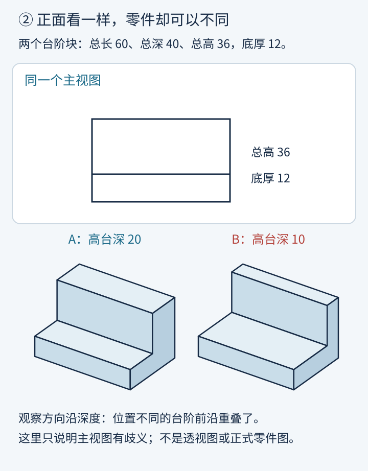
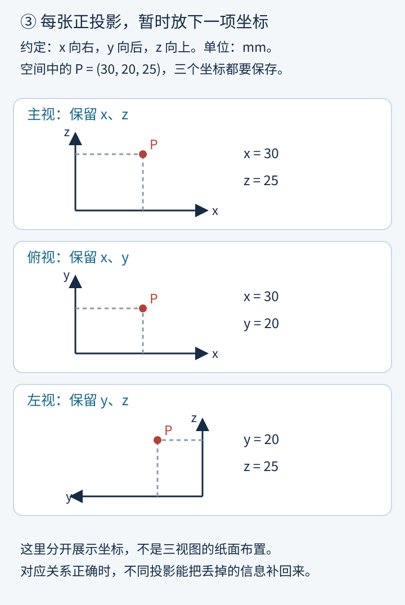
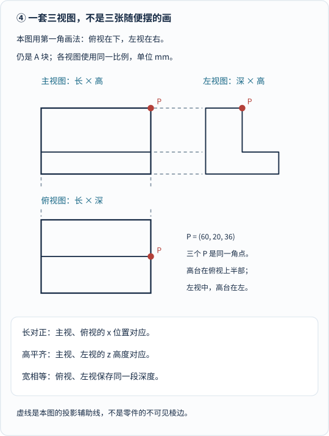
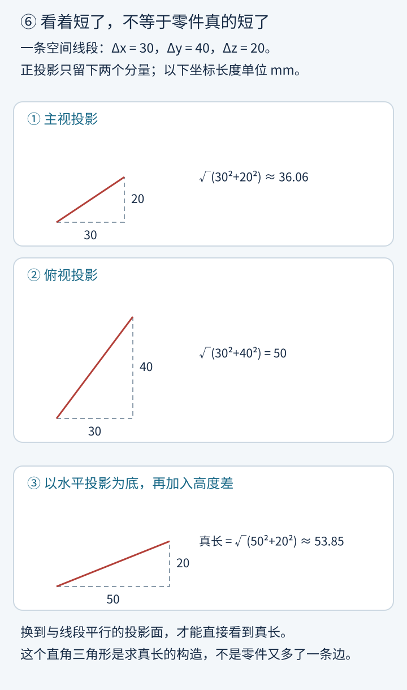
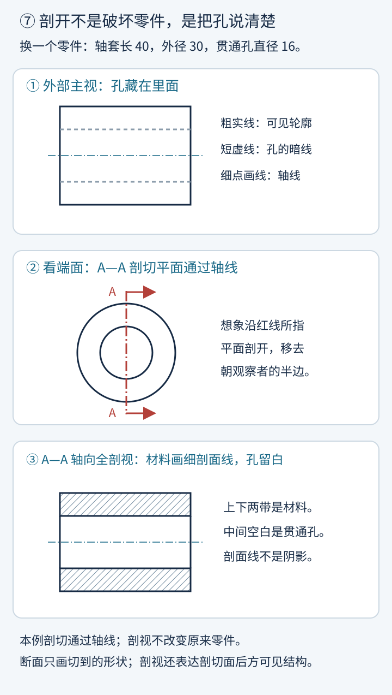
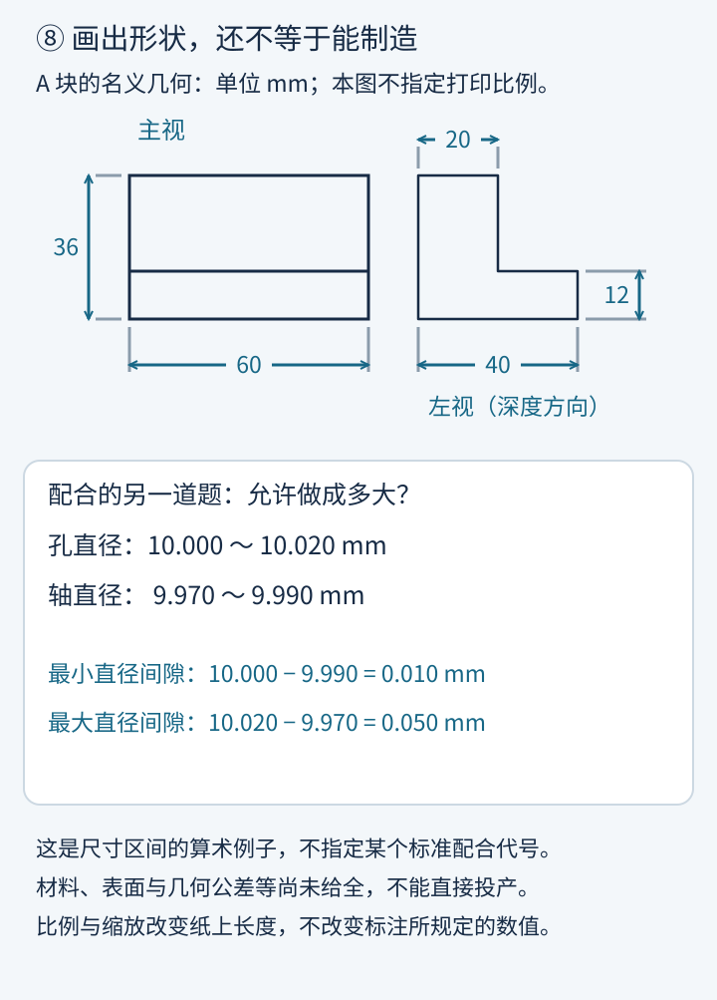

想象你在家设计了一个带台阶的小金属托架，在白纸上认认真真画好正面轮廓，拍照发给几百公里外的机加工师傅，还在旁边贴心地附了一句：“师傅，大概就长这样，麻烦照着车一个！”

三天后，快递到了。你把零件立在桌上一看正面——分毫不差，跟画里一模一样；可手指刚把它转过来九十度，你当场傻了眼：**“哎？后面这级台阶怎么薄得像刀片一样？！”**

电话那头的师傅比你还委屈：“你给我的正面图上，台阶往后缩 10 毫米还是缩 20 毫米，正对着看过去不都是同一条横线吗？你也没告诉我第三维有多深呀！”

这绝不是谁的空间想象力不够好，而是一道硬邦邦的几何学难题：**图纸和电脑屏幕天生只有长、宽两个维度（2D），而真实世界里的桥梁、齿轮、飞机发动机的每一个零件都实实在在占着长、宽、高三个维度（3D）。被压扁的那第三个维度，到底该用什么数学规矩存进纸面，才能让素未谋面的人一分不差地把它还原出来？**

两百多年前，法国数学家**加斯帕尔·蒙日（Gaspard Monge，1746–1818）**用一门曾被法国军方列为绝密长达三十年的学问——**画法几何（Descriptive Geometry）**——漂亮地回答了这个问题。今天我们就拿一块台阶铁块和一只带孔轴套，把整套“空间摊平术”与现代工程图纸语言一步一步拆解清楚。

---

## 一、被法国军方封存三十年的几何绝技：蒙日与梅济耶尔要塞难题

### 1. 十八岁的博讷城平面图与梅济耶尔工程学校（1764–1765）

1746 年，蒙日出生在法国勃艮第酒乡小城博讷（Beaune），父亲是一位磨刀兼营杂货的小商贩（生平细节据 [MacTutor 蒙日传记](https://mathshistory.st-andrews.ac.uk/Biographies/Monge/)）。蒙日从小展现出惊人的动手与数学天赋，16 岁去里昂求学，才 17 岁就被破格请上讲台代授物理学课程！

**1764 年夏天**，年仅 **18 岁**的蒙日回到家乡博讷，完全靠自己动手制作的简易测角与测距仪器，一街一巷实地勘测，亲手绘制出了一幅精度惊人的《博讷城大比例尺平面图》。这幅地图碰巧被法国最顶尖的军事工程学府——**梅济耶尔皇家工程学校（École Royale du Génie at Mézières）**的一位军官看到。军官大为赞叹，但因为当时法国军校军官名额只对贵族子弟开放，平民出身的蒙日只能于 **1765 年**以低等“绘图员兼石膏模型工（dessinateur）”的身份进校打杂。

### 2. 几小时顶替几星期苦算：要塞“遮蔽设计（défilement）”与三十年军事机密（1765–1794）

改变蒙日一生、也改写工程史的转折点，发生在进校大约一年后的一次实战作业里。

当时军事筑城学最头疼的核心难题叫**“要塞遮蔽设计（défilement）”**：假设要在起伏不平的山地和丘陵旁修筑一座星形棱堡，周围高地上到处可能是敌军架设火炮与观察哨的制高点——**要塞的外墙、胸墙与掩体到底要修多高、倾斜成什么角度，才能保证堡垒内部的火药库和士兵无论从城外哪座山头望过来，全都严严实实藏在敌军直射视线与炮火死角之下，同时又不浪费一车多余的土石方？**

在蒙日之前，法国皇家工程军官只能用笨重的纯算术表格法：把周围山头和城墙切成密密麻麻成百上千个离散点，逐条视线列算术比例式硬算高度，设计一座要塞动辄要耗费**好几个星期**的繁琐演算！

轮到年轻绘图员蒙日协助处理一份真实要塞方案时，他彻底抛开了那堆算术表格，改用自己在业余时间琢磨出的**双正交平面作图法**：把三维地形与视线同时投影到一张水平面和一张铅垂面上，用圆规和直尺在纸上画几条相交切线与辅助平面，**仅仅花了几个小时就把全套防炮遮蔽高度交了出来！**

负责审查的高级军官起初根本不肯看他的结果，训斥道：“我们算几个星期都算不完的工程，你几小时就交卷，肯定是在糊弄人！”等到军官耐着性子逐项核验，才惊愕地发现蒙日的几何作图结果不仅分毫不差，而且一眼看穿了全局最优边界！梅济耶尔校方当即破格提拔蒙日出任数学教席，同时由法国军方下达严令：**将蒙日这套“在平面图纸上直接求解三维空间几何难题”的方法列为国家军事机密，严禁向校外发表外泄！**

这一捂，就是将近 **30 年**！直到法国大革命爆发后的 **1794–1795 年**，蒙日参与筹建巴黎师范学校（École Normale）与著名的巴黎综合工科学校（École Polytechnique，年轻的傅里叶和后来的彭赛列都是这门课的传人！），这套绝密技艺才终于脱密走上公开讲台，并于 **1799 年**正式整理出版为经典名著**《画法几何》（*Géométrie descriptive*）**。

### 3. 画法几何的两大使命：纸面不只是照相机，更是一台几何计算器

_图 1：沿时间路标从上往下读：建筑与石匠的投影传统早已有之，蒙日的关键跨越在于 1765 年起把空间表示与图上精确求解熔铸成严密体系，1794–1799 年公开化和教材化，后世再逐步加上现代制图标准与公差语言。[单独打开大图](/assets/images/monge/history.svg)。_

在 1799 年《画法几何》开篇（英译节选可核查 [《数学史料选编》*Monge on the Purpose of Descriptive Geometry*](https://en.wikisource.org/wiki/A_Source_Book_in_Mathematics/Monge_on_the_Purpose_of_Descriptive_Geometry)），蒙日一锤定音地写下了这门学科的**双重使命**：

1. **第一使命（无歧义表达）**：用严格规定的方法，把一切具有确切几何定义的三维空间立体，准确无误地表示在只有二维的图纸平面上；
2. **第二使命（在纸上做三维推理与计算）**：反过来，单凭图纸上的二维投影，严密推演出三维形状与相对位置衍生出的一切几何真值——比如两个曲面相交会切出什么曲线？一根歪斜的房梁真实长度到底是多少毫米？两块钢板焊接夹角是多少度？

**看明白了吗？在蒙日手里，图纸绝不仅仅是一张“画得挺像”的记录画，而是一台零误差的二维几何计算机！**（当然也要分清历史边界：今天机械图纸上的线型国标、公差代号与表面粗糙度符号，是 19 至 20 世纪各国工业界接力标准化的成果，不能全部算在蒙日一人头上。）

---

## 二、为什么手机拍照不能直接下车间？透视失真 vs 平行正投影

### 1. 一张正面图藏得住两个不同零件：丢失的深度维度 $$y$$

先回到文章开头让加工师傅抓狂的那块台阶铁块。我们把 A、B 两个不同零件并排摆在桌面上对比：

- 两块零件的总长都是 $$60\ \mathrm{mm}$$，前后总深都是 $$40\ \mathrm{mm}$$，总高都是 $$36\ \mathrm{mm}$$，底座厚度都是 $$12\ \mathrm{mm}$$；
- 唯一的不同在于后方高台的深度：**A 块的高台厚实，前后深 $$20\ \mathrm{mm}$$；B 块的高台单薄，前后只深 $$10\ \mathrm{mm}$$！**

_图 2：先看顶部的共同正面轮廓（外框 $$60\times 36$$，在高度 $$12$$ 处有一条水平分界棱），再对比下方 A、B 两块立体示意图。正对着前面看过去时，前后方向（深度 $$y$$）整条视线被压成了一个点，$$20\ \mathrm{mm}$$ 与 $$10\ \mathrm{mm}$$ 的差别在单张正面图上彻底隐身了！[单独打开大图](/assets/images/monge/one-view-two-parts.svg)。_

### 2. 中心透视 vs 平行正投影：为什么“画得像人眼看到的”反而丢了尺度真值？

有人会问：“既然单张正面图看不出深浅，那我像图 2 下方那样斜着拍一张立体照片发给师傅，不就一眼看出 A 厚 B 薄了吗？”

如果是给客户看外观宣传册，立体透视图确实直观；**可一旦下车间开料车削，手机镜头和素描的“中心透视投影（Perspective projection）”立刻会惹出三大乱子**（关于透视投影怎样把长度和平行关系全搅乱、只留下交比不变，详见姊妹篇《[影子把长度全弄乱了，几何还剩什么？]()》）：

1. **近大远小篡改真实尺寸**：手机拍照是所有光线汇聚到镜头针孔一点（中心投影），屏幕成像大小正比于 $$\frac{f}{\text{距离}}$$。同一块零件前端一条 $$36\ \mathrm{mm}$$ 的竖棱，拍出来比后端同样 $$36\ \mathrm{mm}$$ 的竖棱长出一截！同样 $$\varnothing 10\ \mathrm{mm}$$ 的两个圆孔，离镜头近的大、离镜头远的小还压扁成椭圆。
2. **平行线相交、直角变钝角或锐角**：火车铁轨明明处处等宽平行，在照片里却聚向地平线上的“灭点”；长方体明明六个面全是 $$90^\circ$$ 直角，斜拍出来在纸面上没一个角还是 $$90^\circ$$！
3. **遮挡背面的台阶与内部盲孔**：斜着拍过去，背面凹槽多深、里面通孔还是盲孔，全被前脸挡得严严实实。

为了保住车间最看重的**度量真实性（Metric truth）**，蒙日与工程制图坚定选用了另一种投射规则——**平行正投影（Orthographic parallel projection）**（教学脉络可对照 [MIT 2.007 工程制图讲义](https://ocw.mit.edu/courses/2-007-design-and-manufacturing-i-spring-2009/pages/related-resources/drawing_and_sketching/)）：

- 想象光源退到了无穷远处，所有投射视线**彼此严格平行**，并且**笔直垂直（$$90^\circ$$）撞向投影平面**！
- 这样一来，彻底消灭了“近大远小”：凡是**与投影面平行的线段和平面**，无论离墙近还是离墙远，投到纸上都**100% 保持真实长度比例与真实夹角**；凡是垂直于投影面的线段，则干脆利落地缩成一个点。

---

## 三、把三维空间摊平在纸上：一步步推证“长对正、高平齐、宽相等”

### 1. 第一步：拆解空间点 $$P(x,y,z)$$ 的三张正交“坐标登记表”

既然单次正投影会把沿着视线方向的那一维坐标压扁归零，怎样才能一个数都不丢呢？答案非常简单：**摆三面互相垂直的投影墙，从正前、正上、正左三个正交方向各拍一张“平行光底片”！**

先别急着画整块复杂铁件，我们只盯住三维空间里的一个孤立角点（设 $$x$$ 朝右为**长**、$$y$$ 朝后为**深/宽**、$$z$$ 朝上为**高**，单位均为 $$\mathrm{mm}$$）：

$$
P = (30,\ 20,\ 25).
$$

_图 3：把三次正投影拆成三张独立登记表来读：①主视投影面 $$V$$ 摁扁深度 $$y$$，登记 $$(x,z)=(30,25)$$；②水平俯视面 $$H$$ 摁扁高度 $$z$$，登记 $$(x,y)=(30,20)$$；③侧面左视面 $$W$$ 摁扁左右长度 $$x$$，登记 $$(y,z)=(20,25)$$。单看任何一张都少一维，但任意两张合起来就把 $$(30,20,25)$$ 锁死了！[单独打开大图](/assets/images/monge/point-projections.svg)。_

用映射符号写出来，这三面正交墙（正立投影面 $$V$$、水平投影面 $$H$$、侧立投影面 $$W$$）做的事情一目了然：

$$
P(x,y,z) \;\longrightarrow\;
\begin{cases}
V\text{（主视图：前向后投）} = (x,\ z) & \text{——丢掉 } y\text{，保住长与高；} \\
H\text{（俯视图：上向下投）} = (x,\ y) & \text{——丢掉 } z\text{，保住长与深；} \\
W\text{（左视图：左向右投）} = (y,\ z) & \text{——丢掉 } x\text{，保住深与高。}
\end{cases}
$$

### 2. 第二步：把三面正交墙剪开摊平，用 $$45^\circ$$ 折转线严密推证九字口诀！

现在到了最精妙的一步：**三面投影墙 $$V, H, W$$ 在空间里像房间墙角一样互相垂直立着，怎样把它们摊平到同一张二维图纸上，还不让坐标乱套？**

跟着蒙日的“剪开折平”动作在脑海里做一遍，中学劳技课背得滚瓜烂熟的那句九字真言——**“长对正、高平齐、宽相等”**——当场就从死记硬背变成了严丝合缝的几何定理：

1. **不动正立面 $$V$$（主视图留在左上原地）**：纸面横轴向右记 $$x$$（长），纵轴向上记 $$z$$（高）。
2. **把脚下的水平面 $$H$$ 绕横轴 $$OX$$ 向下翻折 $$90^\circ$$（俯视图落到主视图正下方）**：
   翻折轴就是横轴 $$OX$$ 本身！因此在翻折过程中，点在左右方向的距离 $$x$$ 连半毫米都不会横移——主视图上的 $$x_V$$ 与正下方俯视图上的 $$x_H$$ 必定处在同一条铅垂线上（$$x_V = x_H$$），这就叫**“长对正”**！同时，原本伸向纸面后方的深度 $$y$$，翻下来后变成了在俯视图里**向下量取**的距离。
3. **把右侧的侧立面 $$W$$ 绕纵轴 $$OZ$$ 向右翻折 $$90^\circ$$（左视图落到主视图正右方）**：
   翻折轴就是纵轴 $$OZ$$ 本身！翻折过程中高度 $$z$$ 半毫米都不会上下挪动——主视图上的 $$z_V$$ 与正右方左视图上的 $$z_W$$ 必定处在同一条水平线上（$$z_V = z_W$$），这就叫**“高平齐”**！同时，原本伸向纸面后方的同一段深度 $$y$$，翻过去后变成了在左视图里**向右量取**的距离。
4. **用一条 $$45^\circ$$ 斜线（Miter line）免尺传递深度 $$y$$**：
   看清刚才第 2 步和第 3 步留下的结果了吗？同一份深度坐标 $$y$$，在下方俯视图 $$H$$ 里是**竖着往下走 $$y$$**，在右方左视图 $$W$$ 里是**横着往右走 $$y$$**（$$y_H = y_W$$），这就叫**“宽相等”**（制图口诀里的“宽”指的就是前后深度尺寸）！在右下角空白象限从原点引一条斜率恰好为 $$-1$$ 的 **$$45^\circ$$ 辅助折转斜线**，把俯视图的水平线向右引到 $$45^\circ$$ 斜线上，再折向上引回左视图——因为等腰直角三角形两直角边严格相等（$$\tan 45^\circ = 1$$），根本不用拿尺子量读数，就能把深度 $$y$$ 零误差拐个直角送到左视图里！

_图 4：在 A 台阶块（高台深 $$20\ \mathrm{mm}$$）的标准第一角三视图上实战检验角点 $$P=(60,20,36)$$：主视图与俯视图沿灰色竖直虚线严格对齐 $$x=60$$（长对正）；主视图与左视图沿水平虚线严格对齐 $$z=36$$（高平齐）；俯视图上半格深度 $$y=20$$ 与左视图左半格深度 $$y=20$$ 完全相等（宽相等），一下子就把高台深 $$10\ \mathrm{mm}$$ 的 B 块彻底区分开了！[单独打开大图](/assets/images/monge/aligned-three-views.svg)。_

### 3. 第三步：第一角画法（ISO / 中国 GB）vs 第三角画法（ASME）——别把左右搞反！

拿到一张跨国工厂发来的图纸时，千万留一个心眼：**为什么有的图纸把“左视图”画在主视图右边，有的美国图纸却把“左视图”画在主视图左边？**

这是因为国际上并行着两套完全合法、但绝对不能在同一张图里混用的投影展开标准（展开原理详见 [NPTEL 第一角讲义](https://archive.nptel.ac.in/content/storage2/courses/112103019/module2/lec15/1.html) 与 [第三角讲义](https://archive.nptel.ac.in/content/storage2/courses/112103019/module2/lec15/2.html)）：

_图 5：先看两栏顶部的空间排队顺序，再看下方展开后的视图位置。第一角画法把零件夹在“眼睛”与“墙面”之间，左眼往右照把影子打在右边墙上；第三角画法把透明玻璃板夹在“眼睛”与“零件”之间，隔着玻璃描摹，左边看到的面就留在左边。[单独打开大图](/assets/images/monge/first-third-angle.svg)。_

- **第一角画法（First-angle projection，欧洲 ISO 标准及中国国家标准 GB/T 默认采用）**：空间顺序是**“观察者 $$\longrightarrow$$ 物体 $$\longrightarrow$$ 投影面”**（物体放在第一分角象限，像打手电筒把影子投到物体身后的白墙上）。从左边往右看得到的左视图投在右墙上，摊平后**左视图在右、俯视图在下**（本文全部配图统一采用第一角画法）。
- **第三角画法（Third-angle projection，美国 ASME 标准、日本及北美供应链常用）**：空间顺序是**“观察者 $$\longrightarrow$$ 透明投影面 $$\longrightarrow$$ 物体”**（物体放在玻璃鱼缸一样的第三分角里，观察者隔着透明玻璃板直接描线）。摊平后**左视图在左、俯视图在上**。
- **工程防呆规矩**：正规工程图右下角标题栏里，都会印一枚小小的**圆台（截头圆锥）加同心圆识别符号**（大端圆和梯形哪边在前，一眼就标明是第一角还是第三角）——下刀加工前先看一眼标题栏符号，绝不会把零件做成左右镜像的废品！

---

## 四、动手实验室与蒙日直角三角形法：旋转、求真长与剖开暗孔

### 1. 在线互动：亲手改台阶深度、追角点 $$P$$ 与移动剖切刀面

下面这套原创互动实验室完全在本站本地按三维精确坐标实时投影。手机端可在框内滑动，也可[单独打开空间与图纸实验室](/assets/interactive/monge-lab.html)（禁用 JavaScript 不影响正文静态图阅读；“减少动态效果”模式下自动改为每次步进旋转 $$90^\circ$$）。

<iframe id="monge-lab-frame" src="/assets/interactive/monge-lab.html" title="蒙日画法几何互动：空间台阶块三视图与轴套断面" width="100%" height="2005" loading="lazy" sandbox="allow-scripts" style="border:1px solid #879baa;border-radius:12px;max-width:100%;display:block;"></iframe>

动手试完这三个小实验，前面三章的空间关系立刻在脑海里活过来：

1. **重现“师傅车浅了”的现场**：把高台深度从 $$20\ \mathrm{mm}$$ 拨到 $$10\ \mathrm{mm}$$——盯住右上方的主视图，它连一根像素都没动！而下方的俯视图和右方的左视图立刻跟着缩窄了一半。
2. **跨视图追踪红点 $$P$$**：切换不同的顶点 $$P$$，看它在左图三维模型与右图三张二维视图里如何始终严守“长对正、高平齐、宽相等”。
3. **切开空心轴套**：切换到第二个标签页“切到孔了吗”，把平行于轴线的剖切平面从正中心（$$0\ \mathrm{mm}$$）慢慢往外推到 $$10\ \mathrm{mm}$$，观察断面上的通孔空白为什么突然合拢消失了！

### 2. 蒙日“直角三角形法”：怎样在平纸上还原空间斜梁的精确真长？

现在来检验蒙日画法几何最硬核的“第二使命”——**用二维图纸当几何计算器**！

假设屋架或机架里有一根斜着架在空中的钢梁，在三维空间里既不平行于地面、也不平行于正墙和侧墙（一般位置直线），两端点的坐标差分别为：

$$
\Delta x = 30\ \mathrm{mm}, \qquad \Delta y = 40\ \mathrm{mm}, \qquad \Delta z = 20\ \mathrm{mm}.
$$

先看一个陷阱：**你在三视图的任何一张图上直接拿尺子量，量出来的全都不是真长（全都缩短了）！**

- 主视图丢了 $$\Delta y$$，投影出来的线段长度只有 $$L_{\mathrm{front}} = \sqrt{\Delta x^2 + \Delta z^2} = \sqrt{30^2 + 20^2} = \sqrt{1300} \approx 36.06\ \mathrm{mm}$$；
- 俯视图丢了 $$\Delta z$$，投影出来的水平线段长度是 $$L_{\mathrm{top}} = \sqrt{\Delta x^2 + \Delta y^2} = \sqrt{30^2 + 40^2} = 50\ \mathrm{mm}$$！

_图 6：按①②③三步跟读蒙日“直角三角形求真长法”：从①主视图量取两端高度差 $$\Delta z = 20\ \mathrm{mm}$$，从②俯视图量取水平投影长 $$L_{\mathrm{top}} = 50\ \mathrm{mm}$$，在③纸面旁把这两段拼成一个直角三角形，斜边自动给出三维空间精确真长 $$L \approx 53.85\ \mathrm{mm}$$！[单独打开大图](/assets/images/monge/true-length.svg)。_

在没有计算器的 18 世纪，蒙日教工兵军官怎样只用圆规和直尺在图纸上三秒钟画出精确真长？想象从空间斜梁两端向地面垂下两根铅垂线，围成一个竖直直角梯形——这个梯形的水平底边正是俯视图里现成的 **$$L_{\mathrm{top}} = 50\ \mathrm{mm}$$**，而两端竖直高差正是主视图里现成的 **$$\Delta z = 20\ \mathrm{mm}$$**，两者在空间里天生夹着严格的 **$$90^\circ$$ 直角**！

只需用圆规在俯视图投影线段的一端作垂线，截取主视图上的高度差 $$\Delta z = 20\ \mathrm{mm}$$，连起斜边——这个平摊在纸上的直角三角形斜边，就分毫不差等于三维斜梁的真实长度（同时斜边与 $$L_{\mathrm{top}}$$ 的夹角就是斜梁对水平面的真实倾角，辅助视图法详见 [LibreTexts 工程蓝图辅助视图章节](https://workforce.libretexts.org/Bookshelves/Manufacturing/Basic_Blueprint_Reading_(Costin)/01%3A_Chapters/1.06%3A_Auxiliary_Views)）：

$$
L = \sqrt{L_{\mathrm{top}}^2 + (\Delta z)^2} = \sqrt{50^2 + 20^2} = \sqrt{2900} \approx 53.85\ \mathrm{mm} !
$$

当年梅济耶尔要塞的斜坡胸墙、教堂穹顶的石块切割与铁皮漏斗的展开放样，全都是靠这套优雅的图上几何术迎刃而解的。

### 3. 剖视与剖面线规矩：只给“切到的实心肉”打斜线，空气孔留白！

搞定了外部台阶和斜梁，如果零件肚子里藏着看不见的通道、阶梯孔或内螺纹怎么办？拿一只长 $$40\ \mathrm{mm}$$、外径 $$\varnothing 30\ \mathrm{mm}$$、中心贯通内孔 $$\varnothing 16\ \mathrm{mm}$$ 的空心金属轴套来说，如果只画外轮廓矩形，里面是实心铁棒还是空心管子根本看不出来。

工程制图为此立下了两套严密的透视语言——**虚线（不可见轮廓线）**与**剖视图（Sectional view）**（规范详解见 [MIT 2.007 剖视章节](https://ocw.mit.edu/courses/2-007-design-and-manufacturing-i-spring-2009/pages/related-resources/drawing_and_sketching/#Sectioning)）：

_图 7：按①外部视图（短虚线画暗孔、细点画线标旋转轴线）$$\to$$ ②端面标明 `A-A` 假想剖切刀位与观察箭头 $$\to$$ ③下方 `A-A` 全剖视图依次对照。注意只有上下两条真正被假想锯片锯到的实心金属壁（总断面积 $$40\times(30-16)=560\ \mathrm{mm^2}$$）才画细斜剖面线，正中间的内孔空气通道必须留白！[单独打开大图](/assets/images/monge/section-and-hole.svg)。_

读剖视图时，牢记三条铁规矩就绝不会看走眼：

1. **剖面线（Hatching，常画成等间距 $$45^\circ$$ 细实线）不是素描阴影，只代表“这一刀实打实锯到了材料实体”！** 中间通孔没有材料，锯片悬空划过，因此保留空白（但孔后方可见的半圆桶内壁上下轮廓线变成了实线！这也是**剖视图**与只画切口截面的**断面图**的区别）。在装配图里如果一刀同时切过紧挨着的两个不同零件，两块零件的 $$45^\circ$$ 剖面线必须**一左倾、一右倾（或疏密错开）**，让人一眼分清零件边界；而实心螺栓、轴、加强筋纵向剖切时按惯例不打剖面线以免喧宾夺主。
2. **假想剖切，并没真把零件锯成两半！** 在主视图做了全剖，俯视图或左视图依然照常画完整未锯开的零件。
3. **看清“在哪儿下的刀”（`A-A` 剖切线）**：在上方互动实验室里，轴套外半径是 $$15\ \mathrm{mm}$$、内孔半径是 $$8\ \mathrm{mm}$$。当你把平行于轴线的切平面往外平移到距中心 **$$10\ \mathrm{mm}$$** 处时，因为 $$10 > 8$$，这一刀正好从内孔外侧的实心管壁肉里擦肩切过（切出宽度为 $$2\sqrt{15^2-10^2}\approx 22.36\ \mathrm{mm}$$ 的一整块实心矩形断面）——断面上没看到孔，不是孔消失了，而是下刀偏离了轴线！

---

## 五、从几何图形到车间制造语言：尺寸链与公差配合算术

### 1. 独立尺寸与基准：为什么图纸忌讳“封闭尺寸链”重复标注？

形状和内孔全画准了，就能直接发给机床开工了吗？还差最后、也最贴近真实物理世界的一步：**标尺寸（Dimensioning）与定公差（Tolerancing）！**

看图 8 上半部分 A 台阶块的五个独立名义尺寸：总长 $$60$$、总深 $$40$$、总高 $$36$$、底座厚 $$12$$、高台深 $$20$$（单位默认 $$\mathrm{mm}$$，机械图上无需每个数字后面都写 `mm`）。细心的读者可能会问：“左视图下面标了总深 $$40$$、上面标了高台深 $$20$$，为什么不顺手把右边低台阶那一段 $$20$$ 也标上去，凑齐 $$20 + 20 = 40$$ 呢？”

因为工程制图有一条大忌——**禁止随手标成“首尾咬死的封闭尺寸链”**（详见 [MIT 2.007 尺寸标注讲义](https://ocw.mit.edu/courses/2-007-design-and-manufacturing-i-spring-2009/pages/related-resources/drawing_and_sketching/#Dimensioning)）！一旦把三段全标死，真实加工每段都有微小误差：如果两段各偏大 $$0.03\ \mathrm{mm}$$，加起来总深就多出 $$0.06\ \mathrm{mm}$$，车间检验员拿着卡尺立刻左右为难——到底保两小段合格，还是保总长合格？留出最不关键的一环“开口”吸收累积误差，才是懂制造的好设计。

### 2. 一步步算懂公差配合：$$\varnothing 10\mathrm{H7/g6}$$ 间隙配合 vs 过盈配合

更深刻的问题在于：**世界上没有任何一台车床能把一根轴车成绝对数学意义上的 $$10.0000000\ \mathrm{mm}$$！** 如果你在孔和轴上都只孤零零写一个 `Ø10`，孔车成了 $$9.99\ \mathrm{mm}$$、轴车成了 $$10.01\ \mathrm{mm}$$，拿回来当场卡死装不进去！

_图 8：上半部分展示 A 块五个互不冗余的独立名义尺寸；下半部分用一个直观的区间算例演示配合加减法：孔允许 $$10.000\sim 10.020\ \mathrm{mm}$$、轴允许 $$9.970\sim 9.990\ \mathrm{mm}$$ 时，最紧直径间隙为 $$10.000 - 9.990 = 0.010\ \mathrm{mm}$$，最松直径间隙为 $$10.020 - 9.970 = 0.050\ \mathrm{mm}$$。[单独打开大图](/assets/images/monge/dimensions-and-fit.svg)。_

读懂了图 8 下半格的区间加减法，我们再往前跨一步，亲手破译真实工业蓝图上最常见的一行神秘国际密码——**ISO 286 / 中国国标 GB/T 1800 基孔制公差配合代号**（标准数值核对自 [ISO 286 6～10 mm 尺寸段公差配合表](https://www.trueprecisionmachining.com/engineering/cheat-sheets/fits-tolerances/)）：

1. **实例一：精密滑动“间隙配合” $$\varnothing 10\mathrm{H7/g6}$$（如精密导柱、滑移齿轮与钻套）**
   斜杠前面**大写字母管孔**，斜杠后面**小写字母管轴**；字母决定公差带离名义尺寸 $$10\ \mathrm{mm}$$ 偏多远，数字（IT 等级）决定公差带本身有多宽：
   - **孔 $$\varnothing 10\mathrm{H7}$$**：大写 `H` 代表基准孔下偏差严格为 $$0$$，7 级精度带宽为 $$+15\ \mu\mathrm{m}$$（即 $$+0.015\ \mathrm{mm}$$）$$\Longrightarrow$$ **合格孔径区间：$$10.000 \sim 10.015\ \mathrm{mm}$$**；
   - **轴 $$\varnothing 10\mathrm{g6}$$**：小写 `g` 把上偏差压在零线以下 $$-5\ \mu\mathrm{m}$$，6 级精度带宽为 $$9\ \mu\mathrm{m}$$（下偏差 $$-14\ \mu\mathrm{m}$$）$$\Longrightarrow$$ **合格轴径区间：$$9.986 \sim 9.995\ \mathrm{mm}$$**；
   - **极端装配对账**：
     - **最紧情况（最小孔配最大轴）**：$$S_{\min} = 10.000 - 9.995 = +0.005\ \mathrm{mm}$$（留出 $$5$$ 微米——约十分之一根头发丝厚的润滑油膜缝隙！）；
     - **最松情况（最大孔配最小轴）**：$$S_{\max} = 10.015 - 9.986 = +0.029\ \mathrm{mm}$$（仅 $$29$$ 微米，绝不松垮晃荡！）。
     哪怕孔在苏州加工、轴在慕尼黑加工，运到一起盲抽装配，**100% 既能丝滑转动，又精密定心**——这就是现代大规模互换性制造的魔法！

2. **实例二：死死抱紧的“过盈配合” $$\varnothing 10\mathrm{H7/p6}$$（如电机转轴压入轴承内圈、火车轮箍）**
   如果设计师不想让轴在孔里空转打滑，而是不加螺丝键槽就靠弹性抱紧力传递扭矩呢？保持孔 $$\varnothing 10\mathrm{H7}$$（$$10.000 \sim 10.015\ \mathrm{mm}$$）不变，把轴代号换成小写 **`p6`**：
   - 在 $$6\sim 10\ \mathrm{mm}$$ 尺寸段，**轴 $$\varnothing 10\mathrm{p6}$$** 的上下偏差是 $$+0.024 / +0.015\ \mathrm{mm}$$ $$\Longrightarrow$$ **合格轴径区间：$$10.015 \sim 10.024\ \mathrm{mm}$$**！
   - 你没看花眼：**轴竟然故意做得比孔还要粗！** 最松时 $$10.015 - 10.015 = 0$$，最紧时“孔减轴”等于 $$10.000 - 10.024 = -0.024\ \mathrm{mm}$$（即 **$$24\ \mu\mathrm{m}$$ 的过盈量**；若选更紧的 `s6` 轴 $$10.023\sim 10.032\ \mathrm{mm}$$，则处处过盈 $$8\sim 32\ \mu\mathrm{m}$$）！装配时根本不是用手塞进去，而是用液压机强行压入，或者利用热胀冷缩把孔件加热胀大（或用液氮把轴冻缩）套进去，恢复室温后金属弹性死死咬合为一体！（介于间隙与过盈之间、可能略松也可能略紧的 `H7/k6` 等则叫**过渡配合**。）

### 3. 三维 CAD 与 MBD 时代：屏幕能转着看了，蒙日的思想过时了吗？

今天打开 SolidWorks、CATIA 或 NX，鼠标一拖就能把三维零件在屏幕上 $$360^\circ$$ 转着看，很多人以为“三视图与画法几何早该进博物馆了”。

恰恰相反！[美国国家标准与技术研究院（NIST）关于基于模型的定义（MBD）研究](https://www.nist.gov/publications/promoting-model-based-definition-establish-complete-product-definition) 与 [PMI 语义验证项目](https://www.nist.gov/ctl/smart-connected-systems-division/smart-connected-manufacturing-systems-group/mbe-pmi-validation) 反复指出：一个光溜溜的三维网格模型（比如导出一个 STL 文件），只画出了名义理想表面，**并没有交代哪个平面是测量基准、哪两个孔必须同轴、哪段配合是 `H7/g6` 还是 `H7/p6`！** 哪怕在无纸化车间直接把三维产品制造信息（PMI）挂在 CAD 模型上，数控机床与三坐标测量机底层遵循的基准平面投影、最小二乘拟合与公差带几何定义，骨子里依然流淌着蒙日当年立下的那套严密空间几何血液。

---

## 六、一页收束：一张二维白纸怎样装下整座三维世界？

### 1. 画法几何与现代工程制图核心规则对照总表

合上图纸，用下面这张总对账表把空间投影、图上求真长、剖视规矩与公差算术一次梳理到位：

| 核心课题 | 几何构造 / 计算公式 | 解决了什么工程痛点？ | 最容易踩空的读图误区 |
| :--- | :--- | :--- | :--- |
| **平行正投影 vs 透视** | 平行视线垂直投向投影面；平行于投影面的线段 $$1:1$$ 保真 | 消除手机拍照“近大远小”与直角畸变，保住车间加工必需的**尺度真值** | 没有透视失真**不等于**所有边都保原长——倾斜离开投影面的斜边依然会按 $$\cos\theta$$ 缩短 |
| **三面展开与九字口诀** | $$P(x,y,z) \to V(x,z),\, H(x,y),\, W(y,z)$$ 加 $$45^\circ$$ 折转线 | **长对正**（$$x_V=x_H$$）、**高平齐**（$$z_V=z_W$$）、**宽相等**（$$y_H=y_W$$），彻底锁死三维坐标 | 机械口诀里的“宽相等”指的是**前后深度 $$y$$**，不是说三张图的左右宽度相等 |
| **第一角 vs 第三角画法** | 第一角（ISO/GB）：人$$\to$$物$$\to$$面（左视在右）；第三角（ASME）：人$$\to$$面$$\to$$物（左视在左） | 统一多面展开方位，配合标题栏截头圆锥符号实现跨国零误读 | 绝不能凭个人习惯盲猜左右方位，更不能在同一张图纸上混用两套角法 |
| **直角三角形真长与剖视** | $$L = \sqrt{L_{\mathrm{top}}^2 + (\Delta z)^2}$$；假想剖切 `A-A` 仅实体打 $$45^\circ$$ 剖面线 | 在二维纸上直接算出空间斜梁真长（如 $$\sqrt{50^2+20^2}\approx 53.85$$），清晰暴露内部暗孔 | 剖面斜线只代表切到实心材料而非光影；切平面偏离孔径外时断面上不显孔，不代表原件无孔 |
| **尺寸链与公差配合** | $$\varnothing 10\mathrm{H7/g6}$$ 间隙 $$+0.005\sim +0.029\ \mathrm{mm}$$；$$\mathrm{H7/p6}$$ 过盈 $$0\sim -0.024\ \mathrm{mm}$$ | 告别“绝对尺寸幻觉”，实现全球异地加工零件的**盲装互换、滑动润滑或过盈抱死** | 禁止乱标封闭尺寸链制造公差打架；绝不能直接拿尺子量打印图纸或屏幕像素当加工尺寸 |

### 2. 给远方师傅的那份确定性：跨越空间与时代的工程共同语言

再回头看文章开头那块做浅了的台阶铁块：真正让远方师傅不再猜谜、不再返工的，从来不是在微信里多发几句“你懂我意思吧”，而是把三维世界规规矩矩装进这套跨越两百多年的几何语言里——**从哪儿看、哪条线对哪条线、暗孔在哪儿剖开、名义尺寸多大、上下允许偏几微米。**

当一位设计师在纸上或屏幕上落下这几组线条与代号时，哪怕相隔万里、语言不通，地球另一端的工程师也能在脑海里拼出分毫不差的同一个三维零件。这就是蒙日留给现代工业文明最朴素、也最伟大的礼物。

---

## 参考资料与原创图说明

本文历史细节、投影几何构造、剖视标注规范与标准公差配合数值均实际打开核查自以下原始传记、大学工科讲义与工程标准参考页；全部八幅 SVG 配图与在线互动均为原创建模生成：

1. [MacTutor History of Mathematics：Gaspard Monge](https://mathshistory.st-andrews.ac.uk/Biographies/Monge/)——核对蒙日 1746 年生于博讷、1764 年测绘博讷城平面图、1765 年进入梅济耶尔皇家工程学校以几何作图法快速解决要塞遮蔽难题（défilement）、军事保密背景、1794–1795 年巴黎师范学校与综合工科学校公开讲授及 1799 年《画法几何》出版历程。
2. [Wikisource / *A Source Book in Mathematics*：*Monge on the Purpose of Descriptive Geometry*](https://en.wikisource.org/wiki/A_Source_Book_in_Mathematics/Monge_on_the_Purpose_of_Descriptive_Geometry)——核对蒙日在《画法几何》开篇提出的“二维纸面精确表征三维立体”与“由图推演空间精确几何关系”两大核心任务。
3. [MIT OpenCourseWare 2.007：*Engineering Drawing and Sketching*](https://ocw.mit.edu/courses/2-007-design-and-manufacturing-i-spring-2009/pages/related-resources/drawing_and_sketching/)——正投影与透视对比、多视图选择、剖视图与剖面线规范（Sectioning）以及独立尺寸与避免过定位重复标注（Dimensioning）。
4. [NPTEL Engineering Drawing：First-Angle Projection](https://archive.nptel.ac.in/content/storage2/courses/112103019/module2/lec15/1.html) 与 [Third-Angle Projection](https://archive.nptel.ac.in/content/storage2/courses/112103019/module2/lec15/2.html)——核对第一角画法与第三角画法的空间分角顺序及投影面展开排布。
5. [Ric Costin / LibreTexts Manufacturing：*1.6 Auxiliary Views*](https://workforce.libretexts.org/Bookshelves/Manufacturing/Basic_Blueprint_Reading_(Costin)/01%3A_Chapters/1.06%3A_Auxiliary_Views)——斜面与斜线正投影缩短机制及辅助投影求真长、真形原理。
6. [ISO 286 Fits & Tolerance Reference（over 6 through 10 mm nominal band）](https://www.trueprecisionmachining.com/engineering/cheat-sheets/fits-tolerances/)——核对 $$\varnothing 10$$ 尺寸段基孔制标准公差带：`H7`（$$+0.015/0\ \mathrm{mm}$$）、滑动间隙轴 `g6`（$$-0.005/-0.014\ \mathrm{mm}$$）与轻压入过盈轴 `p6`（$$+0.024/+0.015\ \mathrm{mm}$$）、`s6`（$$+0.032/+0.023\ \mathrm{mm}$$）。
7. [NIST：*Promoting Model-Based Definition to Establish a Complete Product Definition*](https://www.nist.gov/publications/promoting-model-based-definition-establish-complete-product-definition) 与 [MBE PMI Validation Project](https://www.nist.gov/ctl/smart-connected-systems-division/smart-connected-manufacturing-systems-group/mbe-pmi-validation)——从传统二维工程图迈向三维 MBD 模型定义时，几何基准与制造语义信息的完整传承。

> 说明：本文八幅原创 SVG 可由 `python tools/visuals.py build monge` 重新生成并自动校验三维投影坐标、斜线真长 $$\sqrt{30^2+40^2+20^2}\approx 53.85\ \mathrm{mm}$$、轴向全剖材料面积 $$560\ \mathrm{mm^2}$$ 及配合区间；在线互动位于 `assets/interactive/monge-lab.html`，几何投影与切平面求交模型可用 `node tools/check_monge_model.cjs` 独立检验。
{: .prompt-tip }
