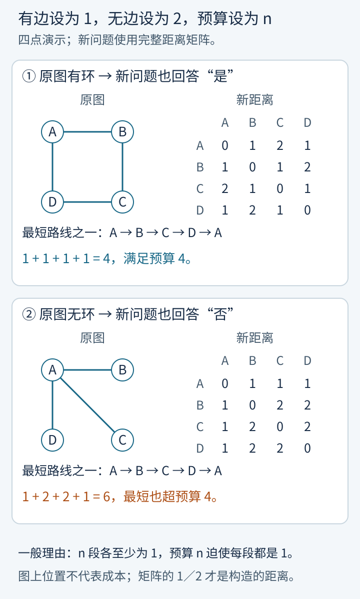
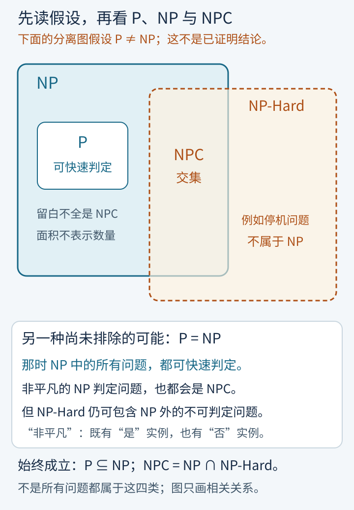
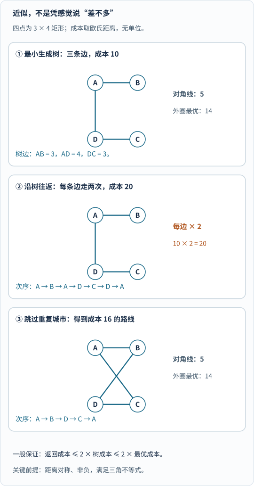

你给配送系统提了一个看起来不算过分的要求：

“这些地方都要送到，最后回到出发点，总路程别超过预算。”

系统想了很久，没交出路线。

这时同事递过来一张清单：“按这个顺序走，试试。”

你核对地点有没有遗漏、有没有重复，最后把各段距离加起来，很快就检查完了。

奇怪：**检查起来这么容易，找出来怎么会那么费劲？**

更奇怪的是，如果你把“别超过预算”换成“保证是所有路线里最短的”，即使同事给出了路线，核对工作也突然不一样了：算出它多长，不等于证明没有更短的。

P、NP、NP-Hard、NPC 讨论的，就是这类差别。这是这个系列的入门篇：先把四个名字和它们之间的箭头弄明白，再看工程上能怎么办。

但先记住一句底线：**我们还没有证明“容易检查”与“容易求解”一定是两回事。P 是否等于 NP，至今仍是未解决的问题。**[克雷数学研究所的官方问题页](https://www.claymath.org/millennium/p-vs-np/)将其列为未解难题。

## 一、先别背缩写：从桌上的五枚硬币开始

### 1. 凑出 17 元：核对一份清单为什么比自己找容易？

桌上有五枚硬币，面值分别是：

**`3`、`5`、`6`、`9`、`12`。每枚最多用一次，能不能恰好凑出 `17`？**

这里没有无限枚一元硬币给你找零，也不能把同一枚硬币重复拿两次。

- 如果同事递来一张纸条写着“选第 2 枚和第 5 枚”，我们低头一加：$$5 + 12 = 17$$，两秒钟核对通过！
- 如果同事递来“选第 1、3、4 枚”，我们一加：$$3 + 6 + 9 = 18 \neq 17$$，核对不通过。但请特别留心：**这一张纸条算出来不对，只能说明“这份组合错了”，绝不能说明“根本凑不出 17”！**

_图 1：先读顶部输入面值，再看别人交来的硬币编号清单，最后逐项核对“编号合法、没有重复使用、加总恰好等于目标”。这份编号清单在计算理论里叫**证书（Certificate / Witness）**。找到一份有效证书就能一锤定音确认“有解”；抓出一份无效证书却不能证明“无解”。[单独打开图片](/assets/images/p-np/certificate.svg)_

### 2. 子集和与候选爆炸：硬币从 5 枚变成 100 枚会发生什么？

这道凑硬币游戏在算法课本里有个正式名字，叫**子集和问题（Subset Sum）**：给定一组非负整数和一个目标值，问是否存在其中一个子集，加起来恰好等于目标。

五枚硬币时，每枚硬币都有“拿／不拿”两种选择，总共只有 $$2^5 = 32$$ 种组合，掰着手指也能试完。可一旦把物品数量往上推，候选空间就会按“每多一件就翻一倍”的速度失控：

_图 2：从上往下看物品数量，再读右边候选子集数怎样呈 $$2^n$$ 翻倍。假设电脑每秒能不喘气检查十亿（$$10^9$$）个候选子集：`30` 个物品约需 `1.07 秒`，`60` 个物品约需 `36.5 年`，到了 `100` 个物品竟飙升到约 $$4.02\times 10^{13}$$ 年（宇宙年龄的近三千倍）！这里还刻意忽略了单次加总的耗时，属于最乐观的穷举账。[单独打开图片](/assets/images/p-np/enumeration.svg)_

读完这张图，先踩一脚逻辑刹车：**候选组合有 $$2^{100}$$ 个，只说明“挨个死试一遍的笨办法”很慢，并不自动证明“世上绝不存在绕开穷举的聪明捷径”！** 比如在地图上找两座城市的最短路径，沿途岔路组合同样多如牛毛，但 Dijkstra 最短路算法根本不用把所有弯路走遍就能飞快算出最优解。

P 与 NP 真正追问的灵魂难点，恰恰是：**对于子集和、排班与旅行商这类问题，究竟存不存在像最短路那样彻底绕开指数穷举的通用多项式算法？** [康奈尔大学 CS4820 的子集和讲义](https://courses.cs.cornell.edu/cs4820/2018fa/lectures/subset_sum.pdf)既证明了子集和属于 NP，也剖析了它的 NP 完全性与动态规划边界——我们会在第八章解开这份看似矛盾的谜团。

---

## 二、这里的“快”，不是三秒钟，而是步数怎样随输入规模增长

### 1. 先立规矩：判定问题与“输入到底有多长”

为了用同一把数学尺子公平比较千差万别的题目，复杂性理论通常先把问题改写成只回答**“是／否”的判定问题（Decision Problem）**。

例如，我们先不直接让机器“输出最短路线”，而是给定一个明确预算 $$X$$ 提问：

> 给定 $$n$$ 座城市、两两之间的距离以及总预算 $$X$$，**是否存在**一条每座城市恰好访问一次、最后回到起点、且总路程不超过 $$X$$ 的闭合路线？

这里的预算 $$X$$ 是输入的一部分，这就是本文讨论的**旅行商判定问题（TSP Decision）**。

紧接着，我们必须量准**输入编码长度**（常记作 $$|x|$$）：它不光数有几座城市、几个物品，还要把写下距离、重量、目标值这些整数所占用的**二进制位数（$$\approx \log_2 W$$）**一并算进去！忽略这一条，后面看背包问题时就会掉进著名的“伪多项式陷阱”。

### 2. 一张账单看穿“多项式”与“指数 / 阶乘”的天壤之别

如果一个算法在最坏情况下的基本运算步数能被输入规模 $$n$$ 的某个固定次方（如 $$n^2$$、$$n^3$$）封顶，记为 $$O(n^k)$$，我们就叫它**多项式时间算法**；如果步数像 $$2^n$$ 或 $$n!$$ 那样增长，则属于指数或超指数阶。

光看字母不够直观，我们继续拿那台**每秒执行 $$10^9$$ 次（十亿次）基本操作**的电脑，亲手算一张从 $$n=10$$ 到 $$n=100$$ 的耗时对照表：

| 规模 $$n$$ | 平方阶 $$n^2$$ | 立方阶 $$n^3$$ | 指数阶 $$2^n$$ | 阶乘阶 $$n!$$（如全排列穷举路线） |
|---:|---:|---:|---:|---:|
| **10** | $$100$$ 次（$$0.1\ \mu\mathrm{s}$$） | $$1{,}000$$ 次（$$1\ \mu\mathrm{s}$$） | $$1{,}024$$ 次（$$1.02\ \mu\mathrm{s}$$） | $$3.63\times 10^6$$ 次（$$3.63\ \mathrm{ms}$$） |
| **30** | $$900$$ 次（$$0.9\ \mu\mathrm{s}$$） | $$2.7\times 10^4$$ 次（$$27\ \mu\mathrm{s}$$） | $$1.07\times 10^9$$ 次（**$$1.07\ \text{秒}$$**） | $$2.65\times 10^{32}$$ 次（**$$8.4\times 10^{15}\ \text{年}$$**） |
| **60** | $$3{,}600$$ 次（$$3.6\ \mu\mathrm{s}$$） | $$2.16\times 10^5$$ 次（$$0.22\ \mathrm{ms}$$） | $$1.15\times 10^{18}$$ 次（**$$36.5\ \text{年}$$**） | $$8.32\times 10^{81}$$ 次（**$$2.6\times 10^{65}\ \text{年}$$**） |
| **100** | $$10^4$$ 次（$$10\ \mu\mathrm{s}$$） | $$10^6$$ 次（$$1\ \mathrm{ms}$$） | $$1.27\times 10^{30}$$ 次（**$$4.02\times 10^{13}\ \text{年}$$**） | $$9.33\times 10^{157}$$ 次（**$$3.0\times 10^{141}\ \text{年}$$**） |

看最后两列有多震撼：当 $$n=100$$ 时，$$n^3$$ 算法眨眼不到一毫秒就跑完了；而 $$2^{100}$$ 需要四万倍于百亿年的漫长岁月，$$100!$$ 更是远超可观测宇宙里的基本粒子总数！即便明天人类造出快一百万倍的新芯片，也只能让 $$2^n$$ 在 1 秒内多往前挪区区 $$20$$ 个物品（$$2^{20}\approx 10^6$$）。

当然，把“多项式时间”口语化成“算得快”时，脑子里要留两个严谨注脚：

- 理论上 $$n^{100}$$ 也算多项式，工程上却根本没法用；反过来，指数级求解器遇到结构良好的真实业务小数据时也可能毫秒出结果；
- 复杂性分类瞄准的是**随着输入规模不断放大时的最坏情况渐近行为**，系统定义可参阅 Boaz Barak 的公开教材《理论计算机科学导论》[Barak 第 13 讲](https://introtcs.org/public/lec_13_Cook_Levin.html)。

---

## 三、P 和 NP：能直接算出来，与能快速核对“有解证据”

### 1. P 类问题：不用别人递小抄，自己就能在多项式时间内判对错

**P（Polynomial Time）是所有能在确定性多项式时间内直接给出“是／否”准确答案的判定问题集合。**

比如：给定一张包含 $$n$$ 个路口的城市道路图，问从起点 $$s$$ 能不能走到终点 $$t$$？用广度优先搜索（BFS）给走过的路口打上标记，每条路最多看一两遍，步数不超过 $$O(n + m)$$——能走到就报“是”，走不到也在有限步内干脆利落地报“否”，绝不瞎猜，也绝不卡死。

### 2. NP 类问题：如果答案是“是”，必有一份不超长、好核对的证书

**NP 的定义绝不是“很难算的问题”，而是“凡是答案为‘是’的实例，都存在一份多项式长度、且能在多项式时间内验证真伪的证书（Certificate）”。**

用形式化的验证器 $$V(x, w)$$ 来写，拿到原问题输入 $$x$$ 和别人递来的证书 $$w$$，必须同时过三关才算合格的 NP 验证：

1. **证书长度受控（$$|w| \le |x|^c$$）**：证书本身的长度不能随输入指数暴涨——否则有人交给你一卷需要读 $$2^n$$ 步才翻得完的“天书证明”，哪怕每行很好懂，也丧失了“快速核查”的意义；
2. **核查过程够快**：验证程序 $$V(x, w)$$ 必须在关于 $$|x|$$ 的多项式步数内停机并给出结论。比如核查一份 $$n$$ 城市的旅行商证书 $$w = (c_1, c_2, \ldots, c_n)$$：先花 $$O(n)$$ 步检查列表长度是否为 $$n$$ 且 $$1\sim n$$ 每座城市恰好出现一次，再查表把 $$n$$ 段路程加起来比对是否 $$\le X$$——全程轻快利落；
3. **单向不对称性（只保“有”，不自动保“无”）**：
   - 当原题真有解时，至少存在一份好证书 $$w$$ 让 $$V(x, w) = 1$$；
   - 当原题根本无解时，**无论骗子伪造什么证书 $$w$$ 递上来，验证器都必须识破并输出 $$V(x, w) = 0$$**！
   - 注意这种精妙的不对称：递来一条总长 `95 ≤ 100` 的合法路线，一秒钟就能铁证“有解”；但递来十万条超预算的路线，也证明不了“世上不存在 `≤ 100` 的路线”（讨论“无解也有短证书”的镜像集合叫 **coNP**，我们第七章马上会见到它的妙用）。

还有一处十个人里九个会背错的常识：**NP 的英文全称是 Nondeterministic Polynomial Time（非确定性图灵机多项式时间），绝不是“Non-Polynomial（非多项式时间）”！**

### 3. 为什么 $$\mathrm{P} \subseteq \mathrm{NP}$$ 板上钉钉，而反过来却悬赏百万美元？

既然 P 是“自己就能快速算出来”，那任何一道属于 P 的问题当然也属于 NP：当别人问你怎么验证时，你甚至可以连他递来的证书看都不看，直接亲手跑一遍多项式求解算法，算出来是“是”就通过！

因此，数学上早已百分百确定：

$$
\mathrm{P} \subseteq \mathrm{NP}.
$$

真正困住全人类半个多世纪、被克雷数学研究所列为七大千禧年大奖难题之首的未知悬念是反过来的另一半：**$$\mathrm{NP}$$ 里面到底有没有藏着真正在 $$\mathrm{P}$$ 之外的硬骨头（即 $$\mathrm{P} \stackrel{?}{=} \mathrm{NP}$$）？** 如果你把 NP 误背成“算不快的问题”，就等于把里面明明算得飞快的整个 P 家族给开除出籍了。

---

## 四、归约：我不会直接解 A，但能把它快速“翻译”给解 B 的机器

### 1. 什么是多项式时间多对一归约 $$A \leq_p B$$？

既然还没人能直接证出 $$\mathrm{P} \neq \mathrm{NP}$$，计算机科学家想出了一招借力打力的妙计——比一比两道题**“谁至少不比谁容易”**。

假设有一道老问题 $$A$$ 和一道新问题 $$B$$。如果我们能写一个**多项式时间运行的翻译程序 $$f$$**，把 $$A$$ 的任意输入实例 $$x$$ 转换成 $$B$$ 的一个输入实例 $$f(x)$$，并且严格满足双向保真：

$$
x \text{ 在问题 } A \text{ 中回答“是”} \iff f(x) \text{ 在问题 } B \text{ 中也回答“是”}
$$

（注意：“否”也必须严丝合缝翻成“否”，绝不能单边凑数！），我们就称 **$$A$$ 可在多项式时间内多对一归约到 $$B$$（Karp 归约）**，记作：

$$
A \leq_p B.
$$

_图 3：顺着箭头从上往下读——先把 $$A$$ 的输入快速翻译成 $$B$$ 的输入，再喂给假想的 $$B$$ 判定器，拿回来的同一个“是／否”直接就是 $$A$$ 的答案！图中描边动画依次扫过“转换 → 判定 → 返回”三步后定格，仅提示逻辑先后次序，不代表实际耗时比例；开启减少动态效果时直接静态显示。[单独打开，刷新可重播](/assets/images/p-np/reduction-flow.svg)。_

### 2. 千万别记反箭头方向：要证新题 $$B$$ 难，为什么必须把已知难题 $$A$$ 翻成 $$B$$？

这是初学者最容易拧麻花的一步，其实顺着不等号 `≤` 读一遍就永生难忘：

$$A \leq_p B$$ 的字面意思就是**“$$A$$ 的难度不超过 $$B$$”（即 $$B$$ 至少和 $$A$$ 一样难）**！为什么？

- 假如某天有人造出了一台多项式时间攻克 $$B$$ 的神仙机器，我们只需“先花多项式时间跑翻译器 $$f$$ + 再花多项式时间调 $$B$$ 机器”——多项式套多项式依然是多项式，老难题 $$A$$ 当场就被顺带攻克了！
- 反过来换位思考：**如果已知老问题 $$A$$ 是一块公认难啃的硬骨头，而你居然能把任何 $$A$$ 都快速翻译成新问题 $$B$$，那就铁证新问题 $$B$$ 至少也是同等硬度的硬骨头！**

所以请把下面两行口诀刻在脑海里（完整形式化论证见 [Barak 教材第 12 讲](https://introtcs.org/public/lec_12_NP.html)）：

> **想证明新问题 $$B$$ 很难：必须把“已知难题 $$A$$”翻译成 $$B$$（证 $$A \leq_p B$$）！**
>
> 如果你反过来把新问题 $$B$$ 翻译成了难题 $$A$$，就好比“杀鸡用了宰牛刀”——只能说明宰牛刀能顺手切菜，半点也证明不了切菜本身有多难！

同时记住一条防作弊铁律：**翻译器 $$f$$ 本身只许做机械快速的格式改写，绝不许在翻译器内部偷偷花指数时间把 $$A$$ 先硬解出来！**

---

## 五、亲手做一次真归约：从“一笔绕遍所有点”翻译成旅行商预算

### 1. 三条翻译规则：怎样把无权图变成 `1` 和 `2` 的城市距离表？

光讲抽象的 $$A$$ 和 $$B$$ 不过瘾，我们挽起袖子，亲手把一道图论难题完整翻译成旅行商判定问题！

起点选已知的 NP 完全问题——**哈密顿回路问题（Hamiltonian Cycle）**：

> 给定一张含 $$n$$ 个顶点（$$n \ge 3$$）的无向图 $$G=(V,E)$$，问能不能顺着图里原有的边走一圈，**每个顶点恰好经过一次，最后回到起点**？

现在，我们连一眼都不去猜图里到底有没有环，只按下面三条傻瓜式机械规则，把图 $$G$$ 翻译成一份旅行商判定实例：

1. **造城市**：把原图里的 $$n$$ 个顶点原封不动变成 $$n$$ 座城市；
2. **填路程表**：检查任意两座不同城市 $$u, v$$ 在原图里有没有直接连边——
   - **原图有边** $$(u,v)\in E$$：设两城距离 $$d(u,v) = 1$$；
   - **原图没边** $$(u,v)\notin E$$：设两城距离 $$d(u,v) = 2$$；
3. **定总预算**：把旅行商允许的最大总路程预算设为 $$X = n$$。

_图 4：上下两组对照看翻译效果。上组原图本身是个四点环（有哈密顿回路），右边填出的距离矩阵沿环走一圈总成本 $$1+1+1+1=4 \le 4$$，回答“是”；下组原图是星形图（叶节点度数只有 1，不可能绕成环），被迫至少借道两次成本为 `2` 的虚构边，最短闭合路线总长 $$6 > 4$$，回答“否”。矩阵里的 `1` 和 `2` 是构造出的抽象成本，不是纸面几何尺量长度。[单独打开图片](/assets/images/p-np/hamilton-to-tsp.svg)_

### 2. 双向等价核验：为什么原图有环 $$\iff$$ 旅行商总长 $$\le n$$？

检查一次归约成不成立，必须老老实实跑完三项体检（对照[南卡罗来纳大学 CSCE750 讲义](https://cse.sc.edu/~fenner/csce750/OKane-Fall-2020/notes-npcomplete.pdf)标准框架）：

1. **翻译够快吗？** 填满一张 $$n\times n$$ 距离表只需逐对查一次邻接关系，耗时尚不到 $$O(n^2)$$，妥妥的多项式时间；
2. **正向保真（原图有环 $$\implies$$ 预算 $$\le n$$）**：若原图存在一条哈密顿回路，旅行商直接顺着这条回路走完 $$n$$ 段，每段都是原图真边（成本 `1`），总路程恰好等于 $$n \times 1 = n \le X$$，判定为“是”；
3. **反向保真（预算 $$\le n$$ $$\implies$$ 原图有环）**：反过来，若旅行商找到了一条总成本 $$\le n$$ 的闭合路线，因为闭合路线一共包含 $$n$$ 段，且我们的距离表里最小正整数就是 `1`（没边全是 `2`），要想 $$n$$ 个数加起来不超过 $$n$$，**哪怕混进一段 `2` 都会超标到 $$\ge n+1$$**！因此这 $$n$$ 段被迫全都是成本为 `1` 的原图真边——原封不动就是原图里的一条哈密顿回路！

至此，我们用不到十行字完成了严格证明：

$$
\text{哈密顿回路} \leq_p \text{旅行商判定问题}.
$$

顺手留一个伏笔：你看上面构造出的 `{1, 2}` 距离表，任意三点直走最多花 `2`，绕道第三点至少花 `1 + 1 = 2`，天然满足**三角不等式**！这意味着哪怕把旅行商限制在满足三角不等式的“度量空间”里，它的精确判定依然是一等一的硬骨头。

---

## 六、NP-Hard 与 NPC：一个是难度门槛，一个是双重身份枢纽

### 1. 拆清两个名字：$$\mathrm{NPC} = \mathrm{NP} \cap \mathrm{NP\text{-}Hard}$$

攒齐了 NP 和归约两件武器，最容易混淆的两个缩写终于可以一次理清了：

- **NP-Hard（NP 困难）**：只要 **NP 里的每一个问题 $$A$$** 都能在多项式时间内归约到问题 $$H$$（即对一切 $$A\in\mathrm{NP}$$ 都有 $$A \leq_p H$$），$$H$$ 就叫 **NP-Hard**。注意：它只规定了“难度至少不低于整个 NP”，**并没有要求 $$H$$ 自己也住在 NP 圈子里**（它甚至可以是一个优化输出题，或者压根不可判定的问题！）。
- **NP-Complete（NP 完全，简称 NPC）**：同时拿到两张入场券——**第一，它自己本身属于 NP（有解时好核查）；第二，它又是 NP-Hard（全村 NP 问题都能快速翻译给它）**：

$$
\mathrm{NPC} = \mathrm{NP} \cap \mathrm{NP\text{-}Hard}.
$$

正因为归约关系具有传递性（$$A \leq_p B$$ 且 $$B \leq_p C \implies A \leq_p C$$），整个 NPC 家族里的几千道经典难题——布尔可满足性 SAT、子集和、0/1 背包判定、图着色、哈密顿回路、旅行商判定——就像用钢筋焊在同一张渔网中心结上的锁扣：**只要明天有人为其中任意一道 NPC 题找到了多项式时间精确算法，整片 NP 就会顺着翻译网一并坍缩进 P（$$\mathrm{P}=\mathrm{NP}$$）；反过来，只要 $$\mathrm{P}\neq\mathrm{NP}$$，这几千道题就一个也别想拥有通用的多项式精确算法！**

### 2. 第一块多米诺骨牌是谁推倒的？库克—列文定理与 SAT

细心的读者一定会追问一个“鸡生蛋、蛋生鸡”的问题：第五章我们证旅行商是 NPC，靠的是已知哈密顿回路是 NPC；那人类历史上**第一道** NPC 题，在没有任何前辈可借力的情况下，是怎么证出来的？

答案是 **1971 年史蒂芬·库克（Stephen Cook）与列昂尼德·列文（Leonid Levin）独立证明的库克—列文定理（Cook–Levin Theorem）**[Barak 第 13 讲](https://introtcs.org/public/lec_13_Cook_Levin.html)！

他们选中的第一块枢纽叫 **SAT（布尔可满足性问题）**：给定一串由布尔变量（真／假）通过“与（$$\land$$）、或（$$\lor$$）、非（$$\neg$$）”拼成的逻辑公式，问存不存在一组真假赋值让整条公式为真？

库克和列文做了一件石破天惊的事：既然任何一道 NP 问题 $$A$$ 的定义都是“有一台验证图灵机 $$V(x,w)$$ 能在多项式步数 $$T$$ 内检查完证书”，他们就直接用一張 $$T \times T$$ 的时空网格布尔变量，把验证机每一步“读写头在哪一格、处于什么状态、纸带符号怎样按规则演变、最后一步是否亮起通过绿灯”全部硬编码成一长串布尔逻辑子句！**验证机存在一份通过检查的证书 $$w$$，当且仅当这串翻译出来的布尔公式可满足！**

第一块枢纽 SAT 一旦钉死，Karp 在 1972 年一口气顺藤摸瓜归约出了 21 道著名组合难题，整座现代计算复杂性大厦就此拔地而起。

---

## 七、复杂性版图最容易画错的三个角落：未知重合、中间地带与停机越界

### 1. 两种可能的世界地图，以及为什么停机问题是 NP-Hard 却不在 NP 里

网上很多科普图随手画两个套在一起的圆圈就当作定论，其实最严谨的画法必须把**“假设 $$\mathrm{P}\neq\mathrm{NP}$$”与“假设 $$\mathrm{P}=\mathrm{NP}$$”两种尚未裁决的可能世界**分开摆放：

_图 5：先看上半幅（绝大多数科学家倾向但尚未证出的 $$\mathrm{P}\neq\mathrm{NP}$$ 世界）：P 与 NPC 互不相交，中间还留有非 P 也非 NPC 的地带；再看下半幅（倘若 $$\mathrm{P}=\mathrm{NP}$$ 成立的世界）：整个 NP 圈与 P 圈合二为一，但右侧伸出圈外的 NP-Hard 依然包含不可判定问题！图形面积不代表问题数量。[单独打开图片](/assets/images/p-np/complexity-map.svg)_

对照下面这张四类对比表，特别留意最后一行：

| 复杂性类别 | 能否多项式时间精确判定？ | “是”实例是否有短证书可快检？ | 核心边界提醒 |
|---|---|---|---|
| **P** | 能 | 能（直接重算即可） | $$\mathrm{P}\subseteq\mathrm{NP}$$ 已严格证出 |
| **NP** | 其中 P 部分能；其余未知 | **能（定义本身）** | 千万别把 NP 当成“非多项式”或“难题”的同义词 |
| **NPC** | 尚无已知多项式算法；攻克任一则 $$\mathrm{P}=\mathrm{NP}$$ | 能 | $$\mathrm{NP}\cap\mathrm{NP\text{-}Hard}$$，NP 内部的归约最高峰 |
| **NP-Hard** | 若能，则 $$\mathrm{P}=\mathrm{NP}$$；反之不保证 | **不要求！** | 可跨出 NP 圈外，甚至包含根本无解算法的不可判定问题 |

为什么 **停机问题** 会落在“是 NP-Hard，却不属于 NP”的区域里？

- **为什么它是 NP-Hard？** 拿到任意一个 SAT 布尔公式 $$\varphi$$，我们花几毫秒写一段包裹程序 $$P_\varphi$$：“按字典序枚举所有布尔变量赋值，一旦试到某组赋值让 $$\varphi$$ 为真就立刻 `return` 停机；如果全部试完都不满足，就跳进 `while True` 死循环。”显然，$$P_\varphi$$ 会停机 $$\iff$$ $$\varphi$$ 可满足！于是 $$\mathrm{SAT} \leq_p \text{停机问题}$$，停机问题稳拿 NP-Hard 资格；
- **为什么它不在 NP 里？** 因为所有 NP 问题至少还能花指数时间把有限长度的证书全穷举一遍给出判决（可判定）；而一般停机问题连有限步判定算法都不存在（详见[Barak 教材不可计算性章节](https://introtcs.org/public/lec_08_uncomputability.html)及本站《[这是世界上增长最快的数列]()》）——哪怕明天突然证出了 $$\mathrm{P}=\mathrm{NP}$$，停机问题也依然算不出来！

### 2. 夹在 P 与 NPC 之间的神秘地带：大整数质因数分解为什么很特殊？

再看图 5 上半幅里，P 圈外头、NPC 冠冕底下那片留白区域——难不成只要 $$\mathrm{P}\neq\mathrm{NP}$$，NP 里的每一道题不是归 P 就是归 NPC 吗？

**绝不是！** 1975 年理查德·拉德纳（Richard Ladner）证明了著名的**拉德纳定理（Ladner's Theorem）**：只要 $$\mathrm{P}\neq\mathrm{NP}$$，在 P 与 NPC 之间就必然存在无穷多个既不属于 P、也不属于 NPC 的**“NP 中间问题（NP-Intermediate）”**！

而全人类每天刷信用卡、连 HTTPS 网站都在依赖的**大整数分解判定问题**（“给定正整数 $$N$$ 和界限 $$M$$，问 $$N$$ 是否存在小于 $$M$$ 的非平凡因子？”），正是疑似住在这片神秘中间地带的头号明星：

1. **它属于 NP**：如果答案是“有”，别人给你一个因子 $$d < M$$，你做一次小学长除法算余数是不是 `0`，瞬间验证完毕；
2. **神奇的是，它同时还属于 coNP（即 $$\mathrm{NP}\cap\mathrm{coNP}$$）！** 如果答案是“没有”，别人把 $$N$$ 的完整素因子分解式 $$N = p_1^{a_1}\cdots p_k^{a_k}$$ 递给你——得益于素性判定本身属于 P（2002 年 AKS 算法已严格证明可在确定性多项式时间内检验一个大数是不是素数！），你可以逐个验明 $$p_i$$ 全是真素数、乘起来确实等于 $$N$$，且里头确实凑不出小于 $$M$$ 的因子！也就是说，“有解”和“无解”**两边都有好检查的短证书**！
3. **为什么学界普遍认为它大概不是 NPC？** 因为一旦某个 $$\mathrm{NP}\cap\mathrm{coNP}$$ 里的问题被证成是 NPC，整片 NP 就会跟着获得“无解短证书”，导致 $$\mathrm{NP} = \mathrm{coNP}$$——而绝大多数复杂性学者认为 $$\mathrm{NP} \neq \mathrm{coNP}$$（正如一般没人知道怎样用短短几行证据证明一张百城地图“绝对不存在预算内的路线”）。此外，在量子计算模型下，1994 年 Shor 算法已经能在多项式时间内分解大整数，却至今没能攻克任何一道 NPC 问题！

---

## 八、旅行商、背包与 SAT：题目名字一样，换个问法性质大变

### 1. 判定、求最优值与验证“天下最短”不是同一件事

日常开会时工程师随口说一句“帮我解一下旅行商问题”，里面其实混着好几种难度截然不同的任务：

| 具体问法 | 机器要干的活 | 复杂性地位与证书边界 |
|---|---|---|
| 存不存在总长 $$\le X$$ 的旅行商闭合路线？ | 输出“是／否” | **NPC**（有解时交出路线即可快检） |
| 找出一条全局最短的旅行商闭合路线 | 输出完整最优路线 | **NP-Hard 优化问题**（输出并非是／否，故不直接放进判定类 NP） |
| 检查同事递来的路线是否合法且总长 $$\le X$$ | 算一遍加法比大小 | **多项式时间轻松搞定** |
| 检查同事递来的路线是不是**所有路线里最短的** | 排除其余全部更短可能 | **不能靠算一遍长度完成！**（牵涉 coNP 侧无更优解证明） |
| 能否在总重 $$\le W$$ 下装出总价值 $$\ge V$$ 的物品？ | 0/1 背包判定版（二进制输入） | **NPC** |

看清第三行和第四行的反差，就再也不会把“NP 答案好检查”误解成“别人交来一条路线，我一秒钟就能看穿它是不是天下第一短”了！

### 2. 0/1 背包明明有动态规划，为什么它还是 NPC？（揭秘“伪多项式时间”）

学过算法课的朋友读到上表最后一行常常跳起来抗议：*“不对啊！0/1 背包问题我大二就写过动态规划代码，填一张 $$m \times W$$ 的二维表就做完了，复杂度 $$O(mW)$$ 明明没有指数符号，怎么还是 NPC？”*

这正是检验第二章“**怎么量输入长度**”的试金石！

在电脑里写下整数背包容量 $$W$$，用的不是画 $$W$$ 道正字笔画，而是**二进制数位**，长度只有 $$b = \lfloor \log_2 W \rfloor + 1$$ 位。把 $$W \approx 2^b$$ 代回动态规划的填表工作量 $$O(mW)$$ 里看一眼：

$$
O(m W) = O(m \cdot 2^b) \quad \text{——相对于输入位数 } b\text{，它其实是不折不扣的指数时间！}
$$

举个一眼看穿的数字对比：

- 当背包容量 $$W = 1{,}024$$（约 $$2^{10}$$，二进制仅 `11` 位）时，表格只有一千列，电脑一眨眼填完；
- 当把容量改成 $$W = 10^{18}$$（二进制也才区区 **`60` 位数字**，键盘敲两秒钟就输完了！）时，表格宽度瞬间膨胀到**一百亿亿列**，全球内存加起来也塞不下！

这种“对数值大小 $$W$$ 是多项式、但对二进制输入位数 $$\log_2 W$$ 仍是指数”的算法，叫做**伪多项式时间算法（Pseudo-polynomial Time）**[康奈尔讲义](https://courses.cs.cornell.edu/cs4820/2018fa/lectures/subset_sum.pdf)。它一点也没推翻背包问题的 NP 完全性，同时又解释了为什么在实际工程中只要金额或重量刻度不大，动态规划依然超级好用！

---

## 九、工程师实战指南：不是绕过数学定理，而是改写交付契约

假设你在负责物流派单、排课或芯片布线，业务方绝不会接受一句“因为克雷研究所还没发奖金，所以今天快递不派了”。

先立第一条工程守则：**别看什么都往脸上贴 NPC 标签！** 二分图人员匹配、网络最大流、最小生成树、线性规划全都有真正的多项式算法；只有确认业务约束确实落入 NP-Hard 之后，再从下面三条成熟工程路线里挑武器：

### 1. 路线一：坚持要精确最优解，靠剪枝与现代求解器吃透真实结构

最坏情况是指数级，不代表真实业务数据处处都是最坏情况！小规模直接上动态规划或状态压缩；中大规模交给现代工业级混合整数规划（MIP）或 SAT 求解器——它们靠线性松弛下界、分支定界（Branch and Bound）与冲突子句剪枝，常常能一刀砍掉 99.99% 根本不可能更优的搜索分支，在真实排班数据上算出精确最优解并附赠数学下界证明。

### 2. 路线二：退半步换速度——带严格误差上界证明的“近似算法”

如果规模大到精确求解器超时，又不允许质量失控，就可以设计**有数学保底的近似算法**。

以城市距离满足对称性与三角不等式的**度量旅行商问题（Metric TSP）**为例，跟着图 6 走完三步，就能在线性对数级或平方级时间内拿到一条**保证绝不超过最优路程 2 倍**的路线：

_图 6：按 $$3:4$$ 矩形真实欧氏比例绘制（对角线长 $$5$$）。① 左格先找最小生成树连起四城，总成本 $$3+4+3=10$$；② 中格顺着树边来回描一圈，每条边走两次，总长 $$20$$；③ 右格遇到已去过的城市直接抄直线跳过（$$B\to D$$ 走对角线 $$5$$），得到闭合路线 $$A\to B\to D\to C\to A$$，总长 $$16$$（全局最优外圈为 $$14$$，满足 $$16 \le 2\times 14$$）。[单独打开图片](/assets/images/p-np/double-tree.svg)_

这可不是拿四个点碰运气凑出来的，背后是放之四海而皆准的三行不等式证明（详见 [MIT 6.046J 近似算法讲义](https://ocw.mit.edu/courses/6-046j-design-and-analysis-of-algorithms-spring-2015/9233649044c6d4308f0c6ffe4752b9f5_MIT6_046JS15_Recitation9.pdf)）：

1. **生成树下界**：把未知的最优闭合路线 $$\mathrm{OPT}$$ 随便剪断一条边，剩下的就是一棵连通全城的生成树；因此最小生成树成本 $$\mathrm{MST} \le \mathrm{OPT}$$；
2. **双倍树往返**：沿着最小生成树每条边往返各走一次，总长度恰好等于 $$2\cdot\mathrm{MST}$$；
3. **三角不等式抄近道**：把往返途中重复经过的城市直接跳过改走直线，由三角不等式保证路程只减不增：

$$
\text{输出路线总长} \leq 2\cdot\mathrm{MST} \leq 2\,\mathrm{OPT}.
$$

这就叫 **2-近似算法**（若进一步把奇数度顶点做最小权完美匹配，即著名的 Christofides 算法，还能把保底上界压紧到 $$1.5\,\mathrm{OPT}$$！）。但请注意：**一旦去掉三角不等式（比如机票打折导致转机比直飞便宜得多），在 $$\mathrm{P}\neq\mathrm{NP}$$ 假设下，一般旅行商甚至连任何常数倍近似算法都不存在！**

### 3. 路线三：限定时间预算的启发式搜索，与诚实的工程状态报告

在超大规模工业物流（例如 Google [OR-Tools 路由引擎](https://developers.google.com/optimization/routing/routing_options)）中，工程师还会大量使用贪心构造 + 局部边交换（如 2-opt：把图 6 右格交叉的两条边一拆一换，长度当场从 `16` 降回最优的 `14`！）、模拟退火或禁忌搜索等**启发式算法（Heuristics）**：它们不提供最坏情况定理保底，但往往能在 5 秒倒计时内搜出极高质量的实用方案。

一个成熟的工程系统，交给老板和下游的绝不该只是一句含糊的“算完了”，而应把下面五种客观状态分得清清楚楚：

| 求解器交付指标 | 它真正代表什么工程承诺 |
|---|---|
| **已找到可行解（Feasible）** | 满足全部硬性派单约束，但尚未证明没有更省钱的排法 |
| **当前最佳上界 $$U$$** | 目前搜到的最低实际成本，全局最优值 $$\mathrm{OPT} \le U$$ |
| **已证明数学下界 $$L$$** | 由松弛模型严格证出任何合法方案都不可能低于 $$L$$（从而算出最优性间隙 $$\frac{U-L}{L}$$） |
| **已证最优 / 已证无解** | 上下界完全闭合或穷尽逻辑分支，板上钉钉（绝不等于“时间跑完了没搜到”） |
| **到达时限（Timeout）** | 10 秒闹钟响了提前收工；若此时未找到解，代表“尚不知有无解”，绝不能谎报“无解” |

---

## 十、收束全局：把四个缩写装进一句最好懂的话

### 1. 四个核心概念的一句话对照

走完全程，如果你不想背任何形式化符号，只需记住这场“找答案 vs 查答案”游戏里的四张身份牌：

1. **P**：不用别人递线索，电脑自己就能在多项式时间内算完“是或否”；
2. **NP**：只要答案真是“有”，就一定存在一份长度不超标、电脑能快速核查无误的短证书；
3. **NP-Hard**：全村所有 NP 问题都能在多项式时间内保真翻译成它——它至少和整个 NP 一样难，甚至可以难到不可判定；
4. **NPC（NP 完全）**：既住在 NP 里（好检查），又扛着 NP-Hard 的担子（最难枢纽）——牵一发而动全身。

### 2. 留给好奇心的未解悬念

归约网告诉我们，凑硬币、排课表、修电路、送快递、折蛋白质，几千件表面风马牛不相及的难事，在数学底层竟然栓在同一根绳子上；而工程实践则教会我们，看清边界之后，怎样在精确、近似与时间预算之间做出最诚实的取舍。

计算机并不是在偷懒。最迷人的地方恰恰在于，直到今天全人类依然不知道：**“一眼能看懂好答案”与“亲手找出好答案”之间那堵看不见的墙，究竟是宇宙铁律，还是只差一把尚未被人类发现的巧钥匙？**

## 参考资料与图解说明

本文中的硬币、四点归约与矩形路线均为原创教学构造，不是实测业务数据。配图及其生成脚本保留在仓库中；候选数、证书求和、小规模归约、最小生成树与路线长度均由程序核对。数值检查辅助发现错误，不代替文中的一般性证明。

- **问题是否解决**：[克雷数学研究所：P vs NP](https://www.claymath.org/millennium/p-vs-np/)。支持 P／NP 问题的直观表述与未解状态。
- **定义、短证书、P⊆NP、NP 完全性与两种可能**：[Boaz Barak《Introduction to Theoretical Computer Science》：NP 与库克—列文定理](https://introtcs.org/public/lec_13_Cook_Levin.html)。也支持不能将 NP 理解成“非多项式”，以及不能把 NP 中 P 以外的区域全部当成 NPC。
- **归约的精确定义与方向**：[同书：多项式时间归约](https://introtcs.org/public/lec_12_NP.html)。支持多对一转换、保留是／否答案、多项式时间组合与归约传递性。
- **NP 完全性证明怎么分两步**：[南卡罗来纳大学 CSCE750 算法课程讲义](https://cse.sc.edu/~fenner/csce750/OKane-Fall-2020/notes-npcomplete.pdf)。支持哈密顿回路的题目定义、证书验证、NP-Hard 的归约方向及 SAT 的 NP 完全性。
- **子集和、背包与输入编码**：[康奈尔大学 CS4820：Subset Sum is NP-complete](https://courses.cs.cornell.edu/cs4820/2018fa/lectures/subset_sum.pdf)。支持子集和的 NP 完全性、它作为背包特例的关系，以及 mW 动态规划为何是伪多项式。
- **不可判定性不是“慢一点”**：[Barak 教材：Universality and uncomputability](https://introtcs.org/public/lec_08_uncomputability.html)。支持一般停机问题不可判定。正文另外写明 SAT 到停机问题的程序构造，避免仅凭“很难”就认定 NP-Hard。
- **有条件的近似保证**：[MIT 6.046J：旅行商近似算法](https://ocw.mit.edu/courses/6-046j-design-and-analysis-of-algorithms-spring-2015/9233649044c6d4308f0c6ffe4752b9f5_MIT6_046JS15_Recitation9.pdf)。支持度量条件、最小生成树下界、往返与跳点的 2-近似证明。本文区分优化任务与判定类，不沿用部分讲义中把两者简称为同一个 TSP 的宽泛措辞。
- **工程搜索的能力与状态**：[Google OR-Tools：Routing Options](https://developers.google.com/optimization/routing/routing_options)。支持启发式、搜索时限，以及“未找到”“超时”“已证无解”等状态不能混同；不将某个策略名称当作自动附带理论近似保证。
