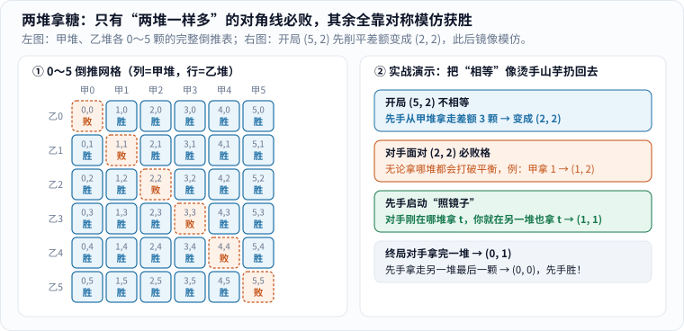
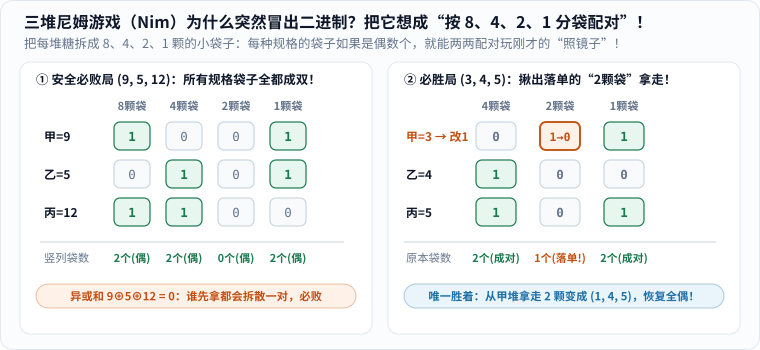
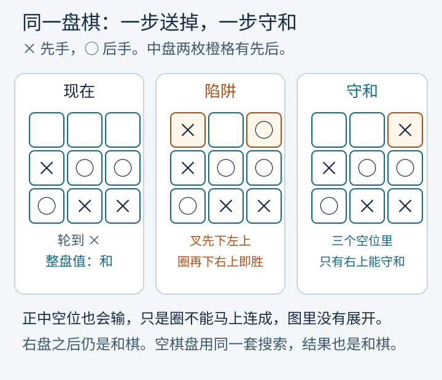
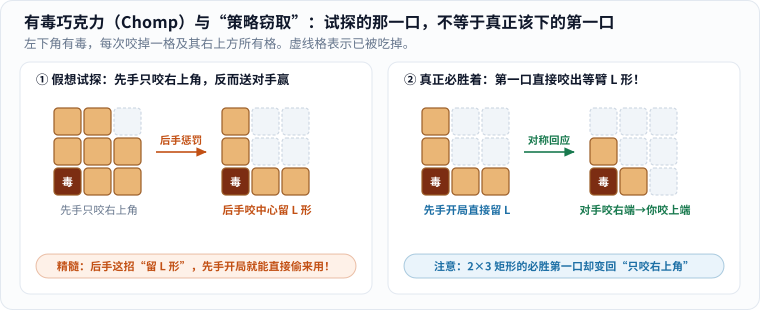
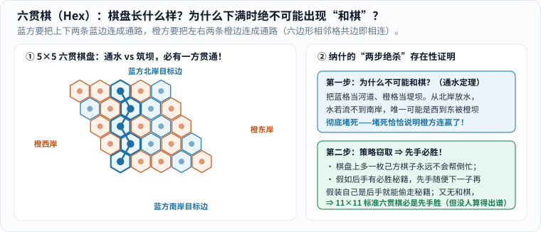
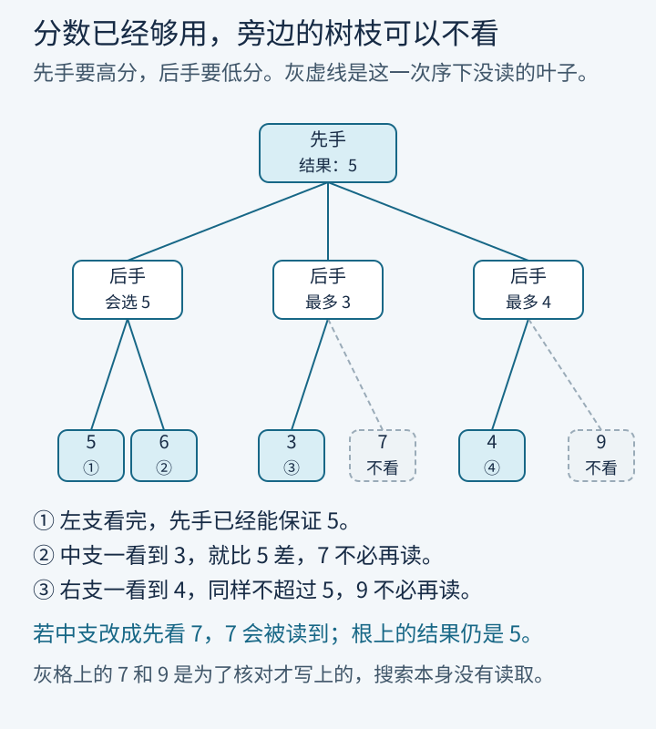

桌上有 50 颗糖。两人轮流拿，每次只能拿 1 颗、2 颗或 3 颗，拿到最后一颗的人赢。你先拿。

可以先背一句“抢 4 的倍数”。先别背。我们从一颗糖都不剩的时候往回看。口诀会自己冒出来，而且你能看见它在哪一步成立、改一条规则后又会在哪里失效。

这条从终局倒推的路，借自漫士的视频[《游戏背后的数学，如何在游戏中必胜？》](https://www.bilibili.com/video/BV1eGZSB6EnL)。糖、两堆和有毒巧克力的形状沿用了那个讲法。下面的格子、步数和证明边界，按规则重新算过，并核对到论文实际写到的地方。

## 一、先把 0 颗标成必败：单堆拿糖与逆向归纳

### 1. 从 0 颗倒推到 8 颗：为什么 0、4、8 全是“无好手”？

规则要先说死，否则同一堆糖会算出两张截然不同的胜负表：

- 两人轮流拿，每次只能拿 $$1$$ 颗、$$2$$ 颗或 $$3$$ 颗，不能弃权跳过；
- **拿走最后一颗的人赢**——也就是说，桌上已经 $$0$$ 颗糖时，轮到走的那个人无糖可拿，当场判输；
- 两人都能清楚看见桌上还剩几颗，没有骰子，也没有藏在手心里的暗牌。

现在把 $$50$$ 颗糖暂时放一边，从终点 $$0$$ 颗开始，一格一格往回贴标签：

- **剩 $$0$$ 颗（终局）**：上一手已经把最后一颗糖拿走了。现在轮到走的人无路可走，所以 **$$0$$ 是必败格**（组合博弈里常记作 $$\mathcal{P}$$ 态，意指“上一手刚走完的人赢、当前轮到走的人必败”，而且即便后面每一步都走得最聪明也救不回来）。
- **剩 $$1$$、$$2$$ 或 $$3$$ 颗**：一步就能全拿光，把 $$0$$ 颗留给对手！只要存在哪怕一种走法能把对手推进必败格，当前这一格就是**必胜格**（常记作 $$\mathcal{N}$$ 态，当前轮到走的人赢）。
- **剩 $$4$$ 颗**：你只有三种合法选择——拿 $$1$$ 留 $$3$$，拿 $$2$$ 留 $$2$$，拿 $$3$$ 留 $$1$$。往回一查，$$3$$、$$2$$、$$1$$ 这三格**全都是对手的必胜格**！你没有任何第四种拿法能逃出去，所以 **$$4$$ 又是必败格**。
- **剩 $$5$$、$$6$$、$$7$$ 颗**：出路重新打开！$$5$$ 颗拿 $$1$$ 留 $$4$$，$$6$$ 颗拿 $$2$$ 留 $$4$$，$$7$$ 颗拿 $$3$$ 留 $$4$$——全都能精准踩进 $$4$$ 这个必败格。再往后到 **$$8$$ 颗**，拿 $$1, 2, 3$$ 只能留下 $$7, 6, 5$$，三格又是对手全胜，所以 **$$8$$ 再次落入必败格**。

_图 1：从左往右读，先定 $$0$$，再看哪一步能把对方留在虚线格。虚线格写着“无好手”（必败格），实线格的“拿 1”“拿 2”“拿 3”是唯一能走到必败格的胜着。橙框沿格子走一遍后消失，只提示次序；减少动态效果时不显示橙框，字一直都在。[单独打开，刷新可重播](/assets/images/game-value/candy-row.svg)。_

### 2. 数学归纳法锁死通解：50 颗糖的第一手与“凑 4 配对”

图只画到 $$8$$，但规律已经呼之欲出。用数学归纳法三段话就能把任意颗数 $$n$$ 彻底证完：

> **单堆拿糖定理**：设桌上剩 $$n$$ 颗糖，在双方都走最优策略的前提下：
> - 若 $$n$$ 是 $$4$$ 的倍数（$$n = 4k$$），当前轮到走的人**必败**；
> - 若 $$n$$ 不是 $$4$$ 的倍数（$$n = 4k + r$$，余数 $$r \in \{1, 2, 3\}$$），当前轮到走的人**必胜**，且**唯一**的必胜着法是拿走余数 $$r$$ 颗。

证明分两步核验：

1. **归纳基准与 $$n=4k$$ 的死局**：$$n=0$$ 已经核实为必败。假设所有小于 $$n$$ 的颗数都满足定理；当 $$n = 4k\ (k\ge 1)$$ 时，合法拿走 $$1, 2, 3$$ 颗后分别剩下 $$4k-1, 4k-2, 4k-3$$ 颗，除以 $$4$$ 分别余 $$3, 2, 1$$，没有一个是 $$4$$ 的倍数。按归纳假设，这三格全是对手必胜。所有出口全堵死，故 $$4k$$ 必败。
2. **$$n=4k+r$$ 的唯一生路**：当 $$n = 4k + r\ (r \in \{1,2,3\})$$ 时，直接拿走 $$r$$ 颗就留下 $$4k$$ 颗，一步把对手送进必败格！要是贪心或手滑拿了别的颗数 $$r'\neq r$$，剩下的 $$4k + r - r'$$ 就不是 $$4$$ 的倍数，反而把必胜格拱手让给对手。因此胜着存在且唯一。

现在回到开篇的 **$$50$$ 颗糖**：做带余除法 $$50 = 4\times 12 + 2$$，余数是 $$2$$。

- **第一手（抢占节拍）**：先手必须拿 **$$2$$ 颗**，留下 $$48$$ 颗；
- **后续循环（凑 $$4$$ 保守）**：此后每一轮，不管对手拿 $$x$$ 颗（$$x \in \{1,2,3\}$$），你就紧跟着拿 **$$4 - x$$ 颗**——每经过一个回合，糖果总数恰好净减 $$4$$ 颗：$$48 \to 44 \to 40 \to \cdots \to 4 \to 0$$，第 $$50$$ 颗糖稳稳落在先手掌心！

脚本把 $$0$$ 到 $$50$$ 的每一格都按“穷举全部拿法”倒推核对了一遍，与公式分毫不差。注意规则只要微调半句，整张表就会平移：假如改成**“吃到最后一颗糖（辣椒糖）的人输”**，那么 $$1$$ 颗就变成了躲不开的必败格，必败序列整体右移一格变成 $$1, 5, 9, \dots, 4k+1$$——面对 $$50 = 4\times 12 + 2$$ 颗糖时，先手第一手就得改拿 **$$1$$ 颗**留下 $$49$$！下文若不特别说明，一律讨论“拿走最后一颗者赢”的标准规则。

这种从终局出发、逐层往回贴“必胜 / 必败”标签的方法，就叫**逆向归纳（backward induction）**。标签衡量的不是“谁这一盘运气好”，而是轮到走的人手里是否存在一套铁律，使得**无论对手怎么挣扎**，都逃不出预设的轨道。

## 二、两堆一样多时，模仿就够了

### 1. 二维网格倒推：必败格为什么全落在对角线 $$(k,k)$$ 上？

把规则升一级：糖分成甲、乙两堆。每次只能挑选**其中一堆**，从中拿走**至少 $$1$$ 颗**（不设上限，允许一口气整堆端走），拿到全场最后一颗的人赢。

状态从一维数字变成了二维坐标 $$(a, b)$$。我们照样从终局 $$(0, 0)$$ 往外倒推：

- **$$(0, 0)$$ 是终局必败格**；
- **坐标轴上的 $$(n, 0)$$ 与 $$(0, n)$$（$$n\ge 1$$）全是必胜格**：只剩一堆有糖时，一口气整堆端走就能留给对手 $$(0, 0)$$；
- **来到 $$(1, 1)$$**：你只能拿成 $$(1, 0)$$ 或 $$(0, 1)$$，两格都是对手一口气清盘的必胜格，所以 **$$(1, 1)$$ 是必败格**！
- **凡是 $$a\neq b$$ 的非对角线格（如 $$(2, 1)$$、$$(5, 2)$$）**：总能从多的那一堆里削掉差额，一步踩进对角线上的 $$(1, 1)$$ 或 $$(2, 2)$$。把 $$0$$ 到 $$5$$ 的所有格子全部标完，必败格不偏不倚排成了主对角线！

_图 2：列是甲堆，行是乙堆，格里先写甲、再写乙。实线格必胜，虚线格必败。下方的例子从 $$5:2$$ 拿到 $$2:2$$；若对方再把甲堆拿成 $$1$$，就从乙堆拿 $$1$$，回到 $$1:1$$。$$0$$ 到 $$5$$ 的每一格都由完整倒推得到。_

### 2. 照镜子策略：为什么先抹平差额就能稳拿最后一颗？

对角线为什么百战百胜？根本不需要把网格画到 $$100\times 100$$，直接把策略写成一面**镜子**：

- **当对手面对两堆相等 $$(k, k)$$ 时**：规则不允许跳过，也不允许同时动两堆，所以对手无论从哪一堆拿走 $$t$$ 颗（$$1\le t\le k$$），两堆必定变成一多一少，绝不可能停留在对角线上。
- **轮到你回应时**：对手刚才从左边拿走 $$t$$ 颗，你就照镜子从右边也拿走 $$t$$ 颗，瞬间把局面按回新的相等状态 $$(k-t, k-t)$$！因为每回合至少少掉 $$2$$ 颗糖，糖数不可能无限减小，迟早有一天对手被迫把某一堆拿成 $$0$$，你紧跟着端走另一堆的剩余糖果，稳稳收下最后一颗。

于是开局若摆着两堆各 $$100$$ 颗 $$(100, 100)$$，先手还没动就已经输定了——后手只需全程照镜子模仿。反过来，若开局是 $$(100, 97)$$，先手第一手从 $$100$$ 里拿走 $$3$$ 颗造出 $$(97, 97)$$，就把那面必胜的镜子抢到了自己手里！

对比一下前两节：单堆靠“凑 $$4$$ 保余 $$0$$”，两堆靠“照镜子保相等”。两套必胜法背后其实共享同一个骨架——**找到一族“自己绝不会死在里面、对手一动必掉出来、而你总能一步推回去”的安全局（必败格集合）！**

## 三、三堆糖为什么突然冒出二进制？尼姆和（$$\oplus$$）三步证明

### 1. 从“照镜子失灵”到二进制分袋：把糖装进 8、4、2、1 颗的小袋子

一旦桌上摆出**三堆糖**，上一节的左右照镜子当场失灵：比如三堆各 $$1$$ 颗 $$(1, 1, 1)$$，你拿走任意一堆变成 $$(1, 1, 0)$$，反而把“两堆相等”的大礼送给了对手，对手照镜子稳赢！

1901–1902 年，哈佛大学数学家查尔斯·布顿（Charles L. Bouton）在《数学年刊》上彻底解开了任意多堆拿糖的通解，并正式给它起名 **Nim（尼姆游戏）**。他的结论第一次听像天外飞仙：**把每一堆的颗数写成二进制，竖着对齐按位相加但不进位（现代记作按位异或 / 尼姆和 $$\oplus$$，规则是 `0⊕0=0, 1⊕0=1, 1⊕1=0`）；如果最终算出的尼姆和等于 $$0$$（即每一竖列的 `1` 都是偶数个），这就是轮到谁走谁必败的安全局！**

很多读者第一次看到这里都会纳闷：**好端端拿糖果，凭什么跟计算机的二进制扯上关系？**

其实一点都不玄妙——把每堆糖按 **$$8$$ 颗、$$4$$ 颗、$$2$$ 颗、$$1$$ 颗**（$$2$$ 的幂）的规格分装进小袋子，三堆尼姆瞬间就变回了上一节的“两两配对照镜子”！

- 任何非负整数都能**唯一**拆成不同规格的 $$2$$ 的幂之和。比如布顿论文里的经典例子 **`(9, 5, 12)`**：
  - 甲堆 $$9 = 8 + 1$$（一袋 $$8$$、一袋 $$1$$，二进制 `1001`）；
  - 乙堆 $$5 = 4 + 1$$（一袋 $$4$$、一袋 $$1$$，二进制 `0101`）；
  - 丙堆 $$12 = 8 + 4$$（一袋 $$8$$、一袋 $$4$$，二进制 `1100`）。
- 看图 3 左表，把同规格的袋子竖着对齐一数：**$$8$$ 颗袋正好 $$2$$ 只（成一对！），$$4$$ 颗袋正好 $$2$$ 只（成一对！），$$1$$ 颗袋也正好 $$2$$ 只（成一对！）**。全场没有任何一只袋子落单，异或和 $$9 \oplus 5 \oplus 12 = 0$$！

_图 3：把二进制每一位看作 `8、4、2、1` 颗规格的小糖袋。左图 `(9, 5, 12)` 每种袋子都成双成对（列和全偶，异或和为 $$0$$），谁先动都会拆散至少一对，必败；右图 `(3, 4, 5)` 里 $$4$$ 颗袋成对、$$1$$ 颗袋成对，唯独甲堆多出一只落单的 **$$2$$ 颗袋**——把这 $$2$$ 颗拿走变成 `(1, 4, 5)`，所有袋子重新成双成对！[单独打开图片](/assets/images/game-value/three-piles.svg)_

### 2. 严丝合缝的三步证明：为什么异或和为 0 就是必败格？

光有比喻还不够，我们用严丝合缝的三步逻辑，证明任意 $$k$$ 堆尼姆游戏中“异或和 $$a_1 \oplus a_2 \oplus \cdots \oplus a_k = 0$$”就是且仅是必败格：

1. **第一步（终局基准：全空异或和为 $$0$$）**：游戏结束时所有糖堆全空 $$(0, 0, \dots, 0)$$，每一位上全是 `0`，异或和 $$0 \oplus 0 \oplus \cdots \oplus 0 = 0$$。没有任何其他终局。
2. **第二步（身处 $$0$$ 态：动任意一堆，异或和必变成非 $$0$$）**：假设当前局面满足 $$a_1 \oplus a_2 \oplus \cdots \oplus a_k = 0$$（每一竖列都有偶数个 `1`）。规则只允许你挑**某一堆** $$a_i$$ 拿糖，把它变成严格更小的 $$a_i' < a_i$$。既然 $$a_i' \neq a_i$$，两者的二进制写法**至少在某一位上不相同**（`0` 变 `1` 或 `1` 变 `0`）；而其余 $$k-1$$ 堆一颗未动，于是那一竖列里 `1` 的总数必然从偶数变成**奇数**！新局面的异或和绝对不可能还是 $$0$$。换句话说，面对 $$0$$ 态的人怎么走都是在替对手“拆散配对”。
3. **第三步（身处非 $$0$$ 态：总能挑出一堆，一步把异或和压回 $$0$$）**：假设当前异或和 $$s = a_1 \oplus a_2 \oplus \cdots \oplus a_k \neq 0$$。怎样精准找到该拿哪一堆、拿几颗？只需按固定配方操作：
   - **找最高位落单列**：看 $$s$$ 的二进制写法中**最左边（最高位）的那个 `1`**（设它在第 $$d$$ 位，代表 $$2^d$$ 颗糖袋）。既然 $$s$$ 在第 $$d$$ 位是 `1`，说明全场在第 $$d$$ 位拥有 `1` 的堆共有**奇数个**（至少有 $$1$$ 堆！）。我们就选定这样的一堆 $$a_i$$（它的第 $$d$$ 位是 `1`）。
   - **算目标颗数 $$a_i' = a_i \oplus s$$**：把这堆糖的目标剩余颗数设为 $$a_i' = a_i \oplus s$$。先验**新异或和是否归零**：由于异或满足交换结合律且任意数自己异或自己得 $$0$$（$$x \oplus x = 0$$），把 $$a_i$$ 换成 $$a_i \oplus s$$ 相当于给全场总异或和再异或一个 $$s$$，结果是 $$s \oplus s = 0$$，所有列瞬间全部配成偶数！
   - **验合法性（为什么 $$a_i'$$ 一定比 $$a_i$$ 严格小，绝不会变成往里添糖？）**：在高于第 $$d$$ 位的左边各列，$$s$$ 全是 `0`，异或后 $$a_i'$$ 与 $$a_i$$ 分毫不差；在关键的**第 $$d$$ 位**上，$$a_i$$ 是 `1`、$$s$$ 也是 `1`，`1 ⊕ 1 = 0`，这一位直接从 `1` 降成了 **`0`**（砍掉了整整 $$2^d$$ 颗糖）！哪怕第 $$d$$ 位右边的所有低位全都从 `0` 翻成了 `1`，补回来的糖最多也只有 $$2^{d-1} + \cdots + 2 + 1 = 2^d - 1$$ 颗，严格小于刚砍掉的 $$2^d$$ 颗！因此必有 **$$0 \le a_i' < a_i$$**，你只需从第 $$i$$ 堆合法拿走 $$a_i - a_i'$$ 颗糖即可！

有了这三步，对手每拆散一次配对（$$0 \to \text{非 }0$$），你就用 $$a_i \oplus s$$ 把它重新锁回 $$0$$（$$\text{非 }0 \to 0$$）；糖果总数单调递减，最终被迫面对 $$(0,0,\dots,0)$$ 的一定是对手！

### 3. 实战手算表：三堆 `(3, 4, 5)` 怎么一秒算出唯一必胜第一手？

我们拿最经典的开局 **`(3, 4, 5)`** 亲手列一张表，把上面的通用算法跑一遍，顺便看清为什么不能乱动另外两堆：

| 对象 / 操作 | 十进制颗数 | `4` 颗袋位（$$2^2$$） | `2` 颗袋位（$$2^1$$） | `1` 颗袋位（$$2^0$$） | 解读与合法性校验 |
| :--- | :---: | :---: | :---: | :---: | :--- |
| **甲堆 $$a_1$$** | $$3$$ | `0` | **`1`** | `1` | 含一袋 $$2$$、一袋 $$1$$（**最高落单列为 `1`，可选！**） |
| **乙堆 $$a_2$$** | $$4$$ | `1` | `0` | `0` | 含一袋 $$4$$（在 `2` 颗袋位为 `0`，不可选） |
| **丙堆 $$a_3$$** | $$5$$ | `1` | `0` | `1` | 含一袋 $$4$$、一袋 $$1$$（在 `2` 颗袋位为 `0`，不可选） |
| **尼姆和 $$s = 3\oplus 4\oplus 5$$** | **$$2 \neq 0$$** | `0`（偶） | **`1`（奇！）** | `0`（偶） | 先手必胜！最高位 `1` 出现在 **`2` 颗袋列** |
| **正确着法：改甲堆 $$3\oplus 2$$** | **$$1 < 3$$** | `0` | `0` | `1` | **合法！从甲堆拿走 $$3 - 1 = 2$$ 颗，留 `(1, 4, 5)`** |
| *反例：若硬改乙堆 $$4\oplus 2$$* | *$$6 > 4$$* | `1` | `1` | `0` | *非法（变成往乙堆倒贴 $$2$$ 颗糖）！* |
| *反例：若硬改丙堆 $$5\oplus 2$$* | *$$7 > 5$$* | `1` | `1` | `1` | *非法（变成往丙堆倒贴 $$2$$ 颗糖）！* |

这张表把第三步证明照得透亮：因为 $$s = 2$$（二进制 `010`）的最高位 `1` 在中间的 `2` 颗袋列，全场只有甲堆（`011`）在这一列有 `1`，所以全场**唯一**的必胜第一手就是从甲堆拿走 $$2$$ 颗变成 `(1, 4, 5)`（此时 $$1\oplus 4\oplus 5 = 0$$）！顺便看一眼上一节的“两堆相等 $$(k, k)$$”：因为任意整数 $$k \oplus k = 0$$，两堆相等本来就是尼姆和等于 $$0$$ 在两堆时的特例。

## 四、井字棋小到可以搜完：胜、负与和棋的三值倒推

### 1. 把和棋加进倒推表：一个空位走错就送命的残局

拿糖游戏没有平局，而棋盘游戏往往会出现**和棋（Draw）**。井字棋（Tic-Tac-Toe）用的还是同一套逆向归纳，只是状态从“剩几颗糖”换成了“九宫格长什么样”，标签从两种扩充到了三种：

- `×` 先下，`○` 后下；谁先在横、竖、斜任意一条线上连成三子谁立刻获胜；若下满 $$9$$ 格仍无人三连，则判为**和棋**。
- 从所有已结束的终局（`×` 胜、`○` 胜、和棋）往回倒推时，当前轮到走棋的一方按“最优选大”贴标签：
  1. **必胜**：至少存在一步走法，能让自己当场三连，或把对手推进“对手必败”的子局面；
  2. **必败**：所有合法的下一步，全都把对手送进“对手必胜”的子局面；
  3. **和棋**：既没有任何一步能必胜，但至少存在一步能走进“和棋”子局面（保住不败）。

把整棵井字棋变化树从底往上标到最顶端的**空棋盘**，算出来的确切标签是：**和棋**。只要双方都不犯浑，谁也没法强逼对手输棋。

在搜索过程中还能清晰看到，“理论值是和棋”与“随便下也和棋”完全是两码事。看图 4 这个已经下了 $$6$$ 子的残局，现在轮到 `×` 落子，棋盘上还剩左上、上中、右上三个空位，走错一步当场暴毙：

_图 4：左盘轮到 `×`，完整搜索的值是和棋。中盘的两枚橙格有先后：`×` 若贪图省事占左上，`○` 反手占右上，右上—正中—左下三枚圆圈瞬间斜连成线，`○` 绝杀！上边正中那个空位同样会输（只是 `○` 晚两步杀）。右盘 `×` 唯独抢占右上角，才能堵死斜线并把和棋稳稳守住。_

### 2. 255,168 条对局路径与空棋盘的值：为什么“赢的条数多”不等于先手必胜？

很多人喜欢数“总共有多少种赢法”，但**数路径条数**和**算博弈值**是两本完全不能混为一谈的账。

脚本严格按规则统计（一旦有人连成三子对局立即终止，不再往空位里填废棋）：从空棋盘出发，合法可达的不同棋盘局面共有 **$$5,478$$ 个**；完整的对局路径共有 **$$255,168$$ 条**，其中：

- 先手 `×` 获胜的路径：**$$131,184$$ 条**（约占 $$51.4\%$$）；
- 后手 `○` 获胜的路径：**$$77,904$$ 条**（约占 $$30.5\%$$）；
- 下满九格握手言和的路径：**$$46,080$$ 条**（约占 $$18.1\%$$）。
（若无视胜负已分、强行规定每盘都把 $$9$$ 个格子填满，末端排列数就是 $$9! = 362,880$$，里面混入了大量胜负已定后的无效落子。）

看到 $$131,184 > 77,904$$，能不能说“井字棋先手必胜”？**绝对不能！** 先手赢的路径条数多，仅仅说明在双方蒙着眼睛乱下（随机游走）时，多下一子的先手更容易撞上三连；但在理性博弈中，后手根本不会往那 $$131,184$$ 条坑里跳，只需沿着守和分支精准应对，就能把结果死死锁在和棋上。甚至连那 $$46,080$$ 条和棋路径里，也有一大半是双方中途互相漏看了绝杀好棋、歪打正着凑出来的“菜鸡互啄式和棋”。

井字棋就像一只可以完整托在手心里的透明标本：状态有限、终局明确、电脑不到一秒就能把 $$5,478$$ 个局面全部倒推完毕。国际象棋与围棋跟它的唯一差别，只在于最后那四个字——**“跑不完毕”**。

## 五、开局可以已有定论：策梅洛定理到底证明了什么？

### 1. 有限步博弈的逆向归纳证明：四条前提怎样锁死开局定论？

现在把井字棋的贴标签过程提炼成一条普遍定理。只要一个双人游戏同时满足以下**四条前提**：

1. **轮流且分支有限**：甲、乙两人交替行动，任何局面下的合法着法都只有有限多种；
2. **完全信息且无随机性**：棋盘状态对双方完全公开透明，没有掷骰子、洗牌或暗棋；
3. **有限步必结束**：存在一个有限步数上限（或每条合法对局路径都在有限步内终止，不会无限兜圈子）；
4. **零和三结果**：终局由规则明确判为甲胜、乙胜或和棋；双方都把“己胜”排第一、“和棋”排第二、“己负”排最后。

那么**包括空棋盘在内的每一个合法局面，在第一颗棋子落下之前就已经唯一确定地属于以下三类之一**：

- **先手（甲方）存在必胜策略**（无论乙方怎么应，甲方都能强制赢下比赛）；
- **后手（乙方）存在必胜策略**（无论甲方怎么走，乙方都能强制赢下比赛）；
- **双方各自都存在守和（不败）策略**（甲能保证自己至少不输，乙也能保证自己至少不输，双方最优碰撞必然和棋）。

证明依然是对“距离终局最多还能走多少步 $$N$$”做数学归纳：$$N=0$$ 时终局已由规则直接盖章；假设最多剩 $$N-1$$ 步的所有子局面都已归入三类之一，那么在最多剩 $$N$$ 步的当前局面，若存在一步通向“对手必败”则当前必胜；若所有步都通向“对手必胜”则当前必败；若前两者皆非，则必无获胜步但至少有一步通向“双方守和”的子局面，走过去并延续子局面的不败策略即可守住和棋。注意**“有限步终止”是整座归纳大厦的地板**——一旦允许局面无限循环，不存在“还剩 $$0$$ 步”的地板，逆向归纳就无处落脚。

### 2. 历史真相核查：策梅洛 1913、柯尼希 1927 与卡尔马 1928/29 各自写到了哪里？

今天很多科普文章与教材把上面这句“先手胜、后手胜、双方守和三选一”统称为**策梅洛定理（Zermelo's Theorem，1913）**。但数学史学者施瓦尔贝与沃克（Schwalbe & Walker，2001）逐字核对了德文原稿后指出，真实的历史分工比这句口号精细得多：

- **策梅洛（Ernst Zermelo，1913）**：在 1912 年剑桥国际数学家大会提交的短文《论集合论在国际象棋理论中的一项应用》中，他确实以国际象棋为例研究了双人完全信息无运气博弈，但他**允许对局无限下下去**（把无限不结束的对局定义为和棋），而且他真正追问的核心问题是：**如果某一方已经处于能强制获胜的局面，他最少需要多少步就能赢？有没有一个上限？** 策梅洛断言这个步数上限不超过棋盘合法局面的总数。此外，1913 年原文用的是集合论式的反证分析，**并没有使用今天教科书里标准的“从终局逐层逆向归纳”**。
- **柯尼希（Dénes Kőnig，1927）与卡尔马（László Kalmár，1928/29）**：匈牙利数学家柯尼希在 1927 年发现策梅洛关于“步数不超过局面总数”的原证明有一处漏洞，引入图论中的柯尼希引理加以推进，策梅洛本人也在柯尼希论文附录里补上了一份修正证明；紧接着卡尔马在 1928–1929 年把允许无限长的博弈树彻底推广，清晰划分出甲方必胜、乙方必胜与双方皆可避免失败的三分格局；至于把有限树上的“逆向归纳法”打磨成现代博弈论标准工具，则是冯·诺依曼与摩根斯坦（1944）及库恩（Kuhn，1953）之后的事。

### 3. 国际象棋与围棋想套用定理，必须先补上哪块拼图？

想把国际象棋和围棋塞进“有限步必结束”的框子里，光靠棋盘格子有限还不够，必须靠**反循环规则**把无限兜圈子的退路剪断：

- **国际象棋**：两只王在空棋盘上来回踱步本可以走到天荒地老。香农在 1950 年讨论下棋程序时就专门点出，正是因为规则里有**五十步规则**（连续 $$50$$ 回合没有吃子也没有动兵即可判和；现行 FIDE 规则还配有三次重复局面申请和棋，以及更严格的七十五步与五次重复强制自动和棋条款），整棵博弈树才被强行截断为有限深度。
- **围棋**：因为有“提子”和“打劫”，棋盘理论上可能反复回到以前出现过的形状（例如罕见的“三劫循环”）。如果在规则里写死**全局同形禁着（Superko）**——严禁下出让全盘黑白子分布回到历史任意时刻的着法——那么由于 $$19\times 19$$ 棋盘的合法状态总数有限（最多不超过 $$3^{361}$$），对局就绝不可能无限持续下去；反之，若规则对多劫循环不做禁手而判“无胜负重赛”，那就得先把“无胜负”归并进平局语义才能套用三分定理。

更重要的是：**定理只证明“空棋盘头顶上悬着一个唯一确定的答案”，却对这个答案姓甚名谁守口如瓶！** 直到今天，全世界没有任何一位数学家或超级计算机知道：双方绝对完美对弈时，国际象棋究竟是白胜、黑胜还是和棋？19 路围棋贴 $$6.5$$ 目或 $$7.5$$ 目时究竟是黑胜还是白胜？“围棋之神在落第一子前早已看穿胜负”只是一个逻辑存在性比喻，不是人类手里真有一本写好的生死簿。

## 六、不把树算完，有时也能证明先手不会输：策略窃取及其边界

### 1. 有毒巧克力（Chomp）：正方形的 L 形对称解 vs 盖尔的非构造性反证

既然大棋盘搜不完，数学家有没有办法**连一棵完整树都不搜，光靠逻辑推理就提前锁定“先手必胜”**？还真有一招绝技，名叫**策略窃取论证（strategy-stealing argument）**。我们先拿大卫·盖尔（David Gale）1974 年在《美国数学月刊》上发表的**有毒巧克力（Chomp）**游戏，看清“写出必胜走法”与“只证明必胜存在”的天壤之别。

一块 $$m\times n$$ 方格巧克力，**左下角那一小格涂了剧毒**。两人轮流选定一块还没被吃掉的格子，把它连同它**正上方、正右方及右上方**所有还在的格子一口气全部吃掉；谁被迫吃下左下角那块毒巧克力谁就输（终局 $$1\times 1$$ 只剩毒块，轮到吃的人必败）。

先看**正方形 $$n\times n$$ 巧克力**（图 5 画的是 $$3\times 3$$），我们可以直接给出具体必胜招式：

- 先手第一口直接咬掉 `(2, 2)` 及其右上方整块正方形，给后手留下一个**两臂等长的“L 形”拐尺**（底边一整行 + 左边一整列，拐角就是毒块）；
- 此后无论后手在底边咬掉几格，先手就在左边竖臂对称地咬掉几格（反之亦然），永远把等臂 L 形还给后手，直到后手把两臂全啃光、只剩左下角毒块留给自己！

_图 5：在 $$3\times 3$$ 巧克力上，第一行展示若先手贪小便宜只咬右上角一格，后手立刻咬成等臂 L 形反杀先手；第二行展示正确的先手策略——开局直接咬出等臂 L 形，此后按对角线镜像对称回应，稳操胜券（脚本已在边长 $$2, 3, 4$$ 正方形上全状态核验）。_

但如果巧克力不是正方形，而是任意长方形（比如 $$8\times 13$$），等臂 L 形对称瞬间失效，谁也不知道第一口该咬哪格！然而盖尔只用了短短一段反证法，就证明了**任意大于 $$1\times 1$$ 的矩形巧克力，永远都是先手必胜**：

1. **反证假设**：假设先手没有必胜策略。因为巧克力格数有限且没有和棋，按上一节的有限博弈定理，**后手必定握有一套百战百胜的应对秘籍**。
2. **投石问路（轻咬右上角）**：现在让先手第一口只轻轻咬掉**最右上角那一小格**。既然我们假设后手能必胜，后手翻开秘籍，必然存在一步绝妙的回应——咬出某个残局形状 $$P$$，使先手面对 $$P$$ 时必败！
3. **当场窃取**：慢着！仔细想一想巧克力的吃法规则——任何一口只要不是单咬右上角，在顺带吞掉“右上方区域”时，本来就会把最右上角那一格一块儿吞进肚子里！这意味着，后手花两步才造出来的必胜残局 $$P$$，**先手在开局第一口本来就可以直接一口咬出来！**
4. **导出矛盾**：假如真有这样一套后手秘籍，先手根本不用轻咬右上角，开局第一口直接咬出形状 $$P$$，然后把后手那本秘籍抢过来自己照着下，先手反而赢定了！这与“后手必胜”正面冲突，故假设不成立——**后手绝无必胜策略，先手必定获胜！**

品味一下这段推理的狡猾之处：它借“轻咬右上角”做了一块探路石，却根本不知道这块石头本身是好棋还是臭棋！在 $$3\times 3$$ 巧克力上，轻咬右上角恰恰是一步送命臭棋（真正的好棋是咬成 L 形）；而在 $$2\times 3$$ 巧克力上，脚本穷举发现**唯一**的好第一口偏偏就是轻咬右上角！同一段十行证明，锁死了所有矩形的结局，却对第一口的具体坐标守口如瓶——这就是典型的**非构造性存在证明**。

### 2. 六贯棋（Hex）：多一子无害 + 绝无和棋 = 先手必胜

把同一招“借壳偷秘籍”搬到连通棋盘上，就诞生了博弈论史上最著名的传奇之一——**六贯棋（Hex）**。这款棋先由丹麦科学家皮特·海因（Piet Hein）于 1942 年发明，约 1949 年又被普林斯顿博士生约翰·纳什（John Nash，电影《美丽心灵》原型）独立重新发明。

_图 6：六贯棋盘由正六边形格子拼成对称菱形（国际标准为 $$11\times 11$$，左图画 $$5\times 5$$ 便于看清）。蓝方执先，目标是把上下两条蓝岸连成不断开的桥；橙方执后，目标是把左右两条橙岸连成桥。右图总结纳什证明“任意尺寸对称六贯棋先手必胜”的双环逻辑链。[单独打开图片](/assets/images/game-value/hex-board.svg)_

双方轮流往空六边形里放子，落子生根，不移动也不吃子。纳什连一盘棋谱都没展开算，只扣紧两道铁环，就证出了**任意 $$n\times n$$ 对称六贯棋必定先手必胜**：

- **第一环（多一子绝不坏事 $$\Rightarrow$$ 后手不可能必胜）**：在六贯棋里，棋盘上白白多送你一枚己方棋子，只会帮你架桥，绝不可能妨碍你获胜。假如后手握有必胜秘籍，先手第一手随便找个角落瞎放一子，然后假装这颗“幽灵子”不存在、把自己当成后手，每一步照抄对手的对称秘籍（万一秘籍指示你正好下在刚才那颗幽灵子所在的格子里，这说明你早就占好便宜了，随便另挑任意一格空位落子继续当新的幽灵子即可）。这样先手就能完美偷走必胜权，矛盾！因此**后手绝无必胜策略**。
- **第二环（六贯棋定理：绝对不可能出现和棋！）**：注意第一环只排除了“后手必胜”，万一像井字棋那样只是“双方守和”呢？海因与纳什指出了六贯棋最神奇的拓扑性质——**哪怕乱下把整个棋盘填得满满当当，也必定恰好有一方连通了对岸，绝无可能两家同时断路！** 用人人能懂的“北水南调”直觉就能看穿：把蓝格想成低洼河道，橙格想成高耸堤坝。从北岸往蓝格里放水，水流要么一路畅通抵达南岸（蓝方已胜）；要么在半途被彻底堵死——而紧贴着水潭最外缘挡住去路的那一串陆地格，必定首尾相接构成一道从西岸一直横贯到东岸、滴水不漏的橙色大坝（橙方已胜）！（大卫·盖尔在 1979 年进一步严格证明，六贯棋无和棋定理在数学上与代数拓扑里的**布劳威尔不动点定理**完全等价！）

“后手不能必胜”加上“绝无和棋”，两环合拢直接锁死**先手必胜**！但正因为用的是策略窃取，直到今天，计算机最多只解出了 $$10\times 10$$ 以下的小尺寸六贯棋，面对标准 **$$11\times 11$$ 六贯棋**，全人类依然写不出一张完整的先手必胜应着表。

### 3. 为什么策略窃取在五子棋、连珠、象棋和围棋里不能随便套？

很多初学者学会策略窃取后，恨不得逢棋就喊“多一子总没坏处，所以先手必胜！”——慢着，只要踩中以下任意一颗暗雷，策略窃取立刻失效：

1. **有和棋存在时，最多只能证“先手不败”**：比如无禁手五子棋，棋盘完全可能下满 $$225$$ 子仍无人五连（和棋）。就算策略窃取走得通，也只能推出“后手不能必胜”，区分不开“先手必胜”与“双方守和”。
2. **规则让“多一子反而坏事”**：五子棋还分三种细则——**自由规则（free-style，六连及以上长连也算赢）**下，多一枚己方子确实永远无害；**标准规则（standard，必须恰好五连才算赢，六连不算赢）**下，多出来的一枚己方子可能把原本赢定的五连撑成六连，反而把胜利搞丢了！到了职业**连珠（Renju）**规则，黑棋（先手）更有严厉的“三三、四四、长连禁手”，白白多送黑方一子甚至可能让黑方直接触犯禁手判负！荷兰学者阿利斯（L. Victor Allis）在 1993–1994 年证明 $$15\times 15$$ 自由五子棋与标准五子棋都是**先手必胜**（最快 $$35$$ 手绝杀），靠的是极其精巧的**威胁空间搜索（Threat-Space Search）计算机硬核求解**，绝不是靠一句轻飘飘的策略窃取口号！（职业有禁手连珠后来也由瓦格纳等学者通过大规模计算机搜索另行攻克。）
3. **象棋与围棋里的“迫移（Zugzwang）”**：在国际象棋、中国象棋和围棋里，多一枚子有可能堵死自己王的逃生通道、塞住自己大龙的眼位（自紧气）；反过来，被迫多走一步棋更经常让人从安全变成惨败（回忆第一节单堆剩 $$4$$ 颗糖：谁被迫动谁就死，象棋术语叫**迫移 / Zugzwang**）。“多一子绝不会更糟”这条单调性前提一旦崩塌，策略窃取就寸步难行。

## 七、答案存在，不代表谁拿得出：从宇宙原子数到剪枝与蒙特卡洛搜索

### 1. 香农数 $$10^{120}$$ 与围棋 $$2.082\times 10^{170}$$ 个合法局面：为什么整棵树背不下来？

回到第五节的追问：既然有限步博弈的答案在理论上早就写死在树根上了，拿超级计算机把整棵树倒推一遍不就完了吗？

信息论之父香农（Claude Shannon）早在 1950 年开创计算机下棋领域的奠基论文里，就亲手算过这笔令人绝望的指数账（并严格区分了**“合法局面总数”**与**“对局变化路径条数”**这两个常被混淆的大数）：

- **国际象棋的对局变化树（香农数）**：典型局面下平均约有 $$30$$ 种合法走法，一回合（白走一步 + 黑应一步）就有 $$30\times 30 = 900 \approx 10^3$$ 种组合；一盘棋平均约下 $$40$$ 个回合（$$80$$ 手），整棵变化树的叶子数量级高达 $$(10^3)^{40} = \mathbf{10^{120}}$$（若不把 $$900$$ 粗入成 $$10^3$$，直接算 $$30^{80}\approx 10^{118.2}$$；阿利斯 1994 年按分支因子 $$35$$、平均 $$80$$ 手重估约为 $$10^{123}$$）。香农顺手算了笔时间账：哪怕一台神级机器每微秒（$$10^{-6}$$ 秒）就能审完一条完整对局，算清第一步棋也要花掉约 $$3\times 10^{106}$$ 年（香农原文保守写作“超过 $$10^{90}$$ 年”），而宇宙诞生至今不过 $$1.38\times 10^{10}$$ 年！至于国际象棋的棋盘局面数，香农用摆子粗算式 $$64!/(32!(8!)^2(2!)^6) \approx 4.6\times 10^{42}$$ 估作 $$10^{43}$$ 量级（现代剔除王相邻等非法状态后，合法局面确界约为 $$4.8\times 10^{44}$$）。
- **19 路围棋的天文规模**：围棋每步平均约有 $$250$$ 个可选空点，一盘约 $$150$$ 手，典型博弈树高达 $$250^{150}\approx \mathbf{10^{360}}$$！而围棋的**合法棋盘局面总数 $$L(19,19)$$**，由计算机科学家约翰·特龙普（John Tromp）在 2016 年算出了精确到个位的 $$171$$ 位整数——约为 **$$2.082\times 10^{170}$$**（在全部涂成黑、白、空的 $$3^{361}\approx 1.74\times 10^{172}$$ 种图案中，每块棋都有气的合法局面约占 $$1.2\%$$）。
- **拿全宇宙的原子做参照**：根据普朗克卫星 2015 年测定的宇宙学重子密度参数换算，整个可观测宇宙里的原子总数总共才约 **$$5\times 10^{79}$$ 个**（常说 $$10^{80}$$ 量级）。就算把全宇宙每一颗原子都改造成存一个局面的寄存器，也连 $$19$$ 路围棋合法局面的**一亿亿亿亿亿亿亿亿分之一**都装不下！无论人类还是机器，永远不可能靠“提前背下所有局面的标准答案表”来下大棋。

### 2. 极小化极大（Minimax）与 α-β 剪枝：怎么不看冤枉路？

既然整棵树读不完，计算机只能在有限步数（搜索深度）内向下张望，给半途的叶子局面打一个经验评估分（**先手 MAX 方追求最高分，后手 MIN 方专挑最低分来坑你**），再用**极小化极大（Minimax）**往回倒推。而想在同样时间内看得更深，第一门必修绝活就是 **α-β 剪枝（Alpha-Beta Pruning）**——在不漏掉任何真正最优解的前提下，把注定没戏的歪脖子树枝整根砍掉！

跟着图 7 的六片叶子从左往右走一遍，你一分钟就能彻底学会 α-β 剪枝：

_图 7：顶层先手（MAX）挑最大，次层后手（MIN）挑最小。① 先搜左支：翻开 `5` 和 `6`，后手选较小的 `5`，于是先手手里已经稳稳揣着**保底分 $$\alpha = 5$$**。② 再搜中支：刚翻开第一片叶子就是 **`3`**！因为中支归后手管，后手专挑小数，不管旁边没翻开的那片叶子是 `7` 还是 `100`，中支最终交上来的分数**绝不可能超过 `3`**！既然顶破天只有 `3` 分，比手头的保底 `5` 分还烂，先手绝不会走中支——旁边的 `7` **连看都不用看，当场一刀剪掉**！③ 再搜右支：第一片翻开 `4 < 5`，同理当场剪掉旁边的 `9`！[单独打开图片](/assets/images/game-value/alpha-beta.svg)_

你看，只读了 $$4$$ 片叶子就拿到了和读完 $$6$$ 片叶子**完全一模一样的精确根值 `5`**！算法大师高德纳与摩尔（Knuth & Moore，1975）严格证明：如果每次都能优先搜索最犀利的好棋（理想着法排序），α-β 剪枝能把有效分支因子 $$b$$ 直接砍成平方根 **$$\sqrt{b}$$**——原本看 $$4$$ 层的算力，现在一口气能看穿 **$$8$$ 层**！

### 3. 从深蓝到 AlphaZero，以及一张组合博弈全景对照表

即便有了 α-β 剪枝，只要没搜到真正的终局，树叶上的“评估分”终究只是近似猜测——估分一旦看走眼，倒推回根部也会跟着看走眼。

- **1997 年击败卡斯帕罗夫的“深蓝（Deep Blue）”**，走的是极致硬件算力 + 人类大师手工特征估分 + 带选择性延伸的 **α-β 搜索**路线，每步棋在几分钟内狂扫约 **$$200$$ 亿到 $$400$$ 亿个局面**；但放在 $$10^{120}$$ 面前，这依然只是沧海一粟。
- **2016–2018 年横扫围棋与象棋的 AlphaGo / AlphaZero**，面对分支因子高达 $$250$$、α-β 剪枝难以施展的围棋，彻底换了一条赛道：放弃手工评估函数与 α-β 树，改用深度神经网络（策略网络指路 + 价值网络估胜率）引导**蒙特卡洛树搜索（MCTS）**，通过千万盘左右互搏自我进化。它同样没有背下那张 $$10^{170}$$ 的神之表，而是学会了在浩瀚迷雾里只往最有希望的几条窄路上深挖。

最后，让我们把整趟旅程走过的八种游戏收进一张**组合博弈全景对照表**，一眼看清“完全解出”、“非构造存在证明”与“启发式近似搜索”的三重境界：

| 游戏名称 | 状态 / 树规模量级 | 双方最优下的理论结局 | 核心数学武器 | 人类 / 计算机是否握有完整必胜（守和）招法表？ |
| :--- | :--- | :--- | :--- | :--- |
| **单堆拿糖（50 颗，限拿 1–3）** | $$51$$ 个状态 | **先手必胜**（首手拿 $$2$$） | 一维逆向归纳、模 $$4$$ 同余 | **完全握有**（公式 $$n\bmod 4$$ 秒算） |
| **双堆拿糖 $$(a,b)$$** | $$(a+1)(b+1)$$ | $$a\neq b$$ 先手胜；$$a=b$$ 后手胜 | 二维逆向归纳、对角线镜像模仿 | **完全握有**（削平差额后照镜子） |
| **多堆尼姆游戏（Nim）** | 任意有限堆 | 尼姆和 $$\neq 0$$ 先手胜；$$=0$$ 后手胜 | 二进制分袋配对、按位异或 $$\oplus$$（Bouton 1901） | **完全握有**（最高落单列 $$a_i \oplus s$$ 秒算） |
| **井字棋（$$3\times 3$$）** | $$5,478$$ 个合法状态 | **双方守和** | 三值（胜/负/和）全状态逆向归纳 | **完全握有**（瞬间搜完 $$255,168$$ 条路径） |
| **有毒巧克力（Chomp，$$m\times n$$）** | 随 $$m,n$$ 指数增长 | **先手必胜**（$$m\times n > 1$$） | 策略窃取反证法（Gale 1974） | 正方形握有 L 形对称解；一般大矩形**仅知存在、无通用首口公式** |
| **六贯棋（Hex，$$11\times 11$$）** | 约 $$10^{57}$$ 级状态 | **先手必胜** | 策略窃取 + 无和棋拓扑定理（Nash / Gale） | $$10\times 10$$ 以下已计算机攻克；**$$11\times 11$$ 至今无完整招法表** |
| **五子棋（$$15\times 15$$ 无禁/标准）** | 树约 $$10^{70}\text{–}10^{105}$$ | **先手必胜** | 威胁空间搜索与数据库证明（Allis 1994） | **计算机已搜索攻克**（非靠策略窃取单句口号） |
| **国际象棋 / 19 路围棋** | 象棋树 $$\sim 10^{120}$$；围棋合法态 $$2.08\times 10^{170}$$ | 反循环规则下**开局已有确定值**，但具体未知 | 有限博弈定论（Zermelo–Kőnig–Kalmár）；实战靠 α-β 或 MCTS | **全人类与超算均未知理论真值**，AI 靠剪枝与神经网络逼近 |

回到最初那 $$6$$ 颗糖的小桌子：唯一的胜着是拿 $$2$$ 留 $$4$$。这一手本身只是推开了必胜的大门，门后真正支撑胜利的，是“对手拿 $$1$$ 我拿 $$3$$、对手拿 $$2$$ 我拿 $$2$$、对手拿 $$3$$ 我拿 $$1$$”的完整应对树。在数学家的词典里，只有推开这样一扇“后面每一条分支都已彻底算穿”的大门，才配叫真正的必胜手；而在人类与 AI 激战的 $$19$$ 路围棋盘上，人们惊叹的“神之一手”，其实是在谁也看不见海底的深渊里，比对手多看清了半步礁石的微光。

开局的答案或许早已静静躺在宇宙之外的柏拉图账本上；而博弈真正的迷人之处，恰恰在于我们永远翻不到最后一页，却依然能用理性与想象力，一次次向深处多照亮一寸。

## 参考资料与图解说明

配图与生成脚本 `python tools/visuals.py build game-value` 一并保存在仓库中。单堆 0 到 50、两堆 0 到 8、三堆 0 到 8 的完整倒推，井字棋全状态搜索，$$3\times 3$$ 与 $$2\times 3$$ 有毒巧克力及边长 2 到 4 的正方形镜像验证，$$5\times 5$$ 六贯棋连通校验，以及 α-β 剪枝读叶顺序，均由该脚本自动断言核对（脚本用于保证图例数值无误，不替代正文中的一般性证明）。

- **启发来源**：[漫士《游戏背后的数学，如何在游戏中必胜？》](https://www.bilibili.com/video/BV1eGZSB6EnL)。支持本文的问题线索：从终局倒推、两堆模仿、有毒巧克力和“开局已有定论”的讲法。文中的数值、历史界限和五子棋的证明类型，不把视频当作出处。
- **尼姆游戏**：[Bouton, *Nim, a game with a complete mathematical theory*](https://paradise.caltech.edu/ist4/lectures/Bouton1901.pdf)，*Annals of Mathematics*，2nd series，第 3 卷（1901–1902），第 35–39 页。支持规则、二进制列和为偶数的安全组合、9／5／12 这个例子，以及“安全局面走不出安全局面、不安全局面总能走回安全局面”。
- **国际象棋的两个大数与倒推为何不实用**：[Shannon, *Programming a Computer for Playing Chess*](https://people.math.harvard.edu/~knill/various/queengambit/shannon_chess.pdf)，*Philosophical Magazine* 第 41 卷（1950），第 256–275 页。支持从终局倒推在原则上可以判定胜负和，五十步规则使对局结束，$$10^{120}$$ 条变化，约 $$10^{43}$$ 的局面粗算，以及每微秒一条仍要超过 $$10^{90}$$ 年。正文另给了不舍入时的 $$30^{80}$$ 和那个阶乘式的计算结果。
- **策梅洛、柯尼希、卡尔马各自证明到哪里**：[Schwalbe 与 Walker，*Zermelo and the Early History of Game Theory*](https://people.math.harvard.edu/~elkies/FS23j.03/zermelo.pdf)。支持 1913 年论文允许无限对局、主要问题是获胜步数的上限、原文没有使用后来的逆向归纳，以及柯尼希 1927、卡尔马 1928/29 的分工。策梅洛原文为 *Über eine Anwendung der Mengenlehre auf die Theorie des Schachspiels*，第五届国际数学家大会论文集，剑桥大学出版社，1913，第 501–504 页。
- **有毒巧克力**：[Zeilberger 对盖尔证明的公开讲解](https://sites.math.rutgers.edu/~zeilberg/mamarim/mamarimPDF/chomp.pdf)，其中引用 Gale，*A curious Nim-type game*，*American Mathematical Monthly* 第 81 卷（1974），第 876–879 页。支持矩形上先手必胜的存在性证明，以及证明不指出第一口。正文的 $$3\times 3$$、$$2\times 3$$ 和正方形镜像由脚本另算。
- **六贯棋不能和棋，以及先手胜却没有着法表**：[麻省理工学院 SP.268 讲义 *Hex*](https://web.mit.edu/sp.268/www/hex-notes.pdf)。支持策略窃取、多一子无害、不能和棋才把“后手不能胜”推进成“先手必胜”，以及 $$11\times 11$$ 没有列全的策略。讲义将不能和棋与布劳威尔不动点定理的等价归于 Gale，*The game of Hex and the Brouwer fixed-point theorem*，*American Mathematical Monthly* 第 86 卷（1979），第 818–827 页。
- **15×15 五子棋**：[Allis，*Searching for solutions in games and artificial intelligence*](https://cris.maastrichtuniversity.nl/ws/portalfiles/portal/588458/guid-36b5cf0a-cf06-4602-afdb-1af04d65c23b-ASSET1.0.pdf)，林堡大学博士论文，1994。支持 free-style（长连算赢）与 standard（恰好五连）的区分、多一子在 free-style 中无害、两种规则都被纳入解题，以及围棋 $$10^{360}$$（分支因子 250、约 150 手）和国际象棋 $$10^{123}$$（分支因子 35、约 80 手）这两份估计。执先必胜的程序结论，同时参看 [Allis、van den Herik 与 Huntjens，*Go-Moku solved by new search techniques*](https://aaai.org/papers/0001-fs93-02-001-go-moku-solved-by-new-search-techniques/)，AAAI 技术报告 FS-93-02，1993。
- **围棋合法局面的精确个数**：[Tromp，*Number of legal Go positions*](https://tromp.github.io/go/legal.html)，2016 年 1 月 20 日公布的 $$L(19,19)$$。支持 171 位精确值、约 $$2.081681994\times 10^{170}$$，以及这是局面数而不是对局条数。计数方法见 [Tromp 与 Farnebäck，*Combinatorics of Go*](https://tromp.github.io/go/gostate.pdf)。
- **α-β 在理想次序下的分支因子**：[Knuth 与 Moore，*An analysis of alpha-beta pruning*](https://kodu.ut.ee/~ahto/eio/2011.07.11/ab.pdf)，*Artificial Intelligence* 第 6 卷（1975），第 293–326 页。支持理想着法次序下，有效分支因子大约是原分支因子的平方根。正文的六片叶子是单独构造的例子。
- **深蓝与 AlphaZero 的搜索不同**：[Campbell、Hoane 与 Hsu，*Search control methods in Deep Blue*](https://aaai.org/papers/0004-ss99-07-004-search-control-methods-in-deep-blue/)。支持深蓝使用带选择延伸的 α-β，并且每步大约查看两百亿到四百亿个局面。系统总述见 Campbell、Hoane 与 Hsu，*Deep Blue*，*Artificial Intelligence* 第 134 卷（2002），第 57–83 页。[Silver 等，*Mastering chess and shogi by self-play*](https://arxiv.org/pdf/1712.01815)，预印本；期刊版为 *Science* 第 362 卷（2018），第 1140–1144 页。支持 AlphaZero 使用蒙特卡洛树搜索，而不是 α-β。
- **原子数目的数量级**：[用普朗克 2015 年参数估计可观测宇宙原子数的计算](https://physics.stackexchange.com/questions/322880/what-paper-can-i-cite-for-the-estimated-number-of-atoms-in-the-observable-universe)。参数来自 Planck Collaboration，*Planck 2015 results. XIII.*，*Astronomy & Astrophysics* 第 594 卷，A13（2016），[arXiv:1502.01589](https://arxiv.org/abs/1502.01589)。支持大约 $$5\times 10^{79}$$ 这一换算；正文只用它做数量级对照。
