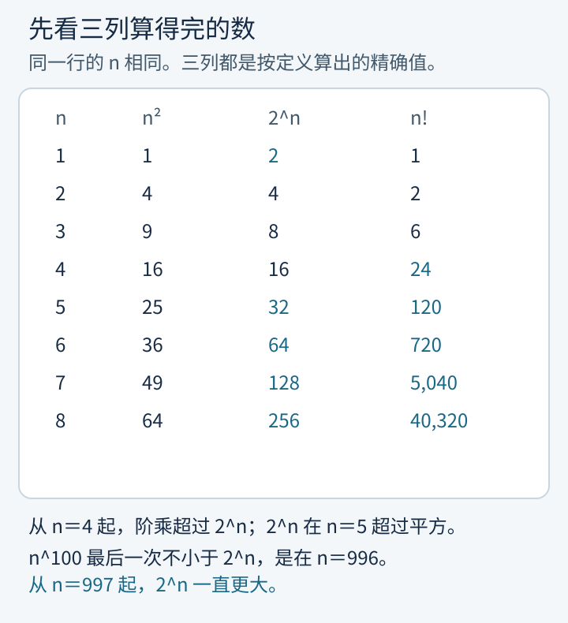
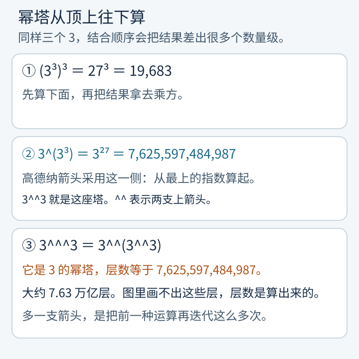
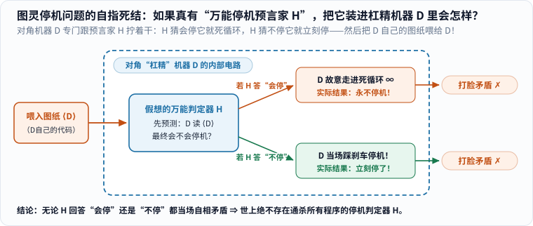

想找“增长最快的数列”，得先规定比赛规则。规则是：数列的每一项都要由一套事先写好的计算流程算出来，而且对每一个正整数，这套流程都会在有限步内停下并给出答案。满足这一点的函数，叫做可计算函数。

在这条规则里，多项式、指数、阶乘、固定层数的高德纳箭头，以及下面要写的葛立恒序列，全都算得出。它们可以比普通人能写下的任何具体数字都大，但彼此之间仍有快慢。真正站在规则外面的，是忙碌海狸的步数函数 \(S(n)\)：它的每一项都是一个确定的有限整数，却不存在一台图灵机能把所有项都算出来。而且对任何一个可计算函数 \(f\)，都存在一个起点，从那里开始 \(S(n)\) 一直大于 \(f(n)\)。

这篇的由头是漫士 2026 年 4 月的视频《这是世界上增长最快的数列，不服来战》。下面的数和证明按原始定义重算、重述，视频只提供问题，不充当出处。

## 先把三种算得出的增长放在一张表上

取正整数 \(n\)。平方 \(n^2\) 是多项式的样品，\(2^n\) 是指数，\(n!\) 是阶乘，也就是 \(1\times 2\times \cdots \times n\)。

_图 1：三列都是按定义算出的精确值。从 \(n=4\) 起阶乘大于 \(2^n\)，从 \(n=5\) 起 \(2^n\) 大于平方。\(n^{100}\) 最后一次不小于 \(2^n\) 是在 \(n=996\)；从 \(n=997\) 起，指数一直更大。_

\(n=1\) 时 \(2^1=2\)，而 \(1^{100}=1\)，指数暂时领先。随后 \(n^{100}\) 会反超。要确认 \(997\) 之后不再反超，看对数 \(\,n\ln 2 - 100\ln n\,\)。它的变化率是 \(\ln 2 - 100/n\)。\(n>145\) 以后这个变化率一直为正，所以对数一直在上升。它在 \(n=996\) 时还没变成正的，在 \(n=997\) 时已经是正的，之后就一直是正的。平方、一百次方，都只是“\(n\) 的固定次方”。固定的次数再大，指数最终也会超过它。

阶乘从 \(n=4\) 起超过 \(2^n\)，因为 \(24>16\)，而且此后每增加 \(1\)，阶乘乘上的是 \(n+1\)，指数只乘 \(2\)。把阶乘里的每个因数都换成 \(n\)，得到 \(n^n\)，那一列又会超过 \(n!\)。这些比较都还在“写得出计算流程”的范围里。

## 箭头是在重复上一种运算

高德纳在 1976 年用上箭头把“重复”本身写成运算。一支箭头是乘方：

\[
a\uparrow b = a^b.
\]

两支箭头是把乘方再重复。规定 \(a\uparrow\uparrow 1=a\)，以及

\[
a\uparrow\uparrow (k+1) = a^{(a\uparrow\uparrow k)}.
\]

幂塔从最上边算起。同样是三个 \(3\)，\((3^3)^3=27^3=19683\)，而 \(3^{(3^3)}=3^{27}=7625597484987\)。箭头用的是第二种。因此

\[
3\uparrow\uparrow 3 = 3^{27} = 7625597484987.
\]

三支箭头再把双箭头重复一遍：\(3\uparrow\uparrow\uparrow 3 = 3\uparrow\uparrow(3\uparrow\uparrow 3)\)。也就是一座底数全是 \(3\) 的幂塔，层数恰好是 \(7625597484987\)，大约 \(7.63\) 万亿层。

_图 2：两个三层组合的精确值，以及三支箭头的层数。图里的 `^^` 是两支上箭头，`^^^` 是三支。层数是算出来的，图上没有画出那 \(7.63\) 万亿层。_

箭头的支数一旦固定，运算就有一套有限的递归定义。输入再大，计算流程的写法并不变长。下一节才让“重复多少层”本身跟着输入走。

## 阿克曼函数仍然算得出

1928 年，威廉·阿克曼构造了一个增长极快、但仍然可以按规则计算的函数，用来说明“可计算”比“原始递归”更宽。原始递归大致是：每一层循环在进入之前，循环次数已经由手头已有的数限定。下面用罗莎·彼得整理后的二元形式。它好算，也足够看见层级：

\[
\begin{aligned}
A(0,n) &= n+1,\\
A(m,0) &= A(m-1,1),\\
A(m,n) &= A(m-1, A(m,n-1))\quad (m>0,\, n>0).
\end{aligned}
\]

小表可以直接算完。\(A(1,n)=n+2\)，\(A(2,n)=2n+3\)。用这两条可以归纳出 \(A(3,n)=2^{n+3}-3\)：\(A(3,0)=5\)，而

\[
A(3,n+1)=A(2,A(3,n))=2(2^{n+3}-3)+3=2^{n+4}-3.
\]

于是 \(A(4,0)=A(3,1)=13\)，\(A(4,1)=A(3,13)=2^{16}-3=65533\)。再往下，\(A(4,2)=A(3,65533)=2^{65536}-3\)。这个数写得完定义，十进制展开则长得无法在这里列出。它仍是可计算的：上面三条规则就是程序。

葛立恒数是这一层里一个被单独起了名字的整数。1971 年，罗纳德·葛立恒和布鲁斯·罗斯柴尔德证明：把 \(n\) 维立方体的所有顶点两两连线，再用两种颜色给这些边染色，只要维数足够大，就一定会出现四个共面的点，它们之间的六条边同色。这样的最小维数是有限的。马丁·加德纳在 1977 年的《科学美国人》上介绍了一个便于讲解、但更松的上界，也就是今天说的葛立恒数。用箭头写是

\[
g_1 = 3\uparrow\uparrow\uparrow\uparrow 3,\qquad
g_{k}=3\uparrow^{g_{k-1}} 3,\qquad
G=g_{64}.
\]

这里 \(\uparrow^{m}\) 表示 \(m\) 支箭头。\(g_n\) 作为 \(n\) 的函数仍有计算流程：第 1 项用四支箭头，后面每一项的箭头数等于前一项的值，算到第 64 项停止。\(G\) 是这套流程的一个输出，不是一个不可计算的对象。

后来这个几何拉姆齐问题的上界被大幅压低。米哈伊尔·拉夫罗夫、米切尔·李和约翰·麦基证明，它小于 \(2\uparrow\uparrow\uparrow 6\)。下界方面，杰罗姆·巴克利在 2008 年证明至少是 \(13\)。葛立恒数远大于今天已知的上界。它留下的教训是：一个数可以大到无法逐位写出，同时仍然是某个会停的计算流程的输出。

## 一台会停、一台不停

图灵机是把“计算流程”说死的一种模型。纸带向两边无限延伸，每一格是 \(0\) 或 \(1\)，开始时全是 \(0\)。机器有有限个状态，外加一张表：读到当前格的符号，就写下新符号，向左或向右移动一格，并进入下一个状态。若这一格、这一状态没有写明规则，机器停机。

两状态就够做一个能亲手跟完的例子。状态叫 A、B，从 A 出发。

- A 读到 \(0\)：写 \(1\)，向右，进入 B。A 读到 \(1\)：写 \(1\)，向左，进入 B。
- B 读到 \(0\)：写 \(1\)，向左，进入 A。B 读到 \(1\)：写 \(1\)，向右，停机。

_图 3：每一行是该步结束时的纸带。橙格是读写头所在的位置。橙框沿六行各停一次，最后留在停机行；刷新图片可以重看。减少动态效果时，框直接停在最后一行，六行数字都还在。单独打开这张图：[/assets/images/busy-beaver/beaver.svg](/assets/images/busy-beaver/beaver.svg)。_

六步之后纸带上有四个 \(1\)。这台机器说明：两状态时，至少有一台会停的机器走了 \(6\) 步、留下 \(4\) 个 \(1\)。下面会看到，这两项恰好就是两状态的最大值。

也很容易做出永不停的机器。例如只有一条规则：在 A 读到 \(0\) 时写 \(0\)、向右、回到 A。它会一直向右走。对某一台写定的机器，把前一百步模拟出来，往往就能看见它停了或者进了圈。没有一种对所有机器都有效的办法，能在模拟之前先回答“它到底停不停”。

## 停机问题

1936 年，艾伦·图灵写成、1937 年发表的论文证明：没有一台机器能判定另一台任意机器会不会无休止地输出一个无穷的数字序列，并由此证明希尔伯特的“判定问题”没有通解。今天课本把同一类不可判定性说成停机问题：没有程序能判定任意一台图灵机在给定输入上会不会停。两种说法可以互相归约。下文用停机这种说法，因为它直接对着忙碌海狸的定义。

证明是反证。假定存在判定器 \(H\)。用它做一个对角机器 \(D\)：把某台机器的说明书交给 \(D\)，\(D\) 先问 \(H\)，这台机器读到自己的说明书时会不会停。若 \(H\) 说会停，\(D\) 就进入死循环；若 \(H\) 说永不停，\(D\) 立刻停机。

然后把 \(D\) 自己的说明书交给 \(D\)。若 \(D\) 这时停下，\(H\) 本应回答“会停”，于是 \(D\) 按构造应该死循环。若 \(D\) 这时不停，\(H\) 本应回答“永不停”，于是 \(D\) 按构造应该停下。两种可能都和构造相反。所以一开始的判定器不存在。

_图 4：四步都写在图上。矛盾出现在把对角机器用于它自己的说明书时。_

这个论证只否定“一个程序判定所有机器”。它不否定我们把某一台具体机器分析到底。五状态的忙碌海狸后来就是被一台一台排除掉的。

## 忙碌海狸：有限集合里的最大步数

1962 年，蒂博尔·拉多把这个游戏写成两个函数。只考虑 \(n\) 个状态、符号只有 \(0\) 和 \(1\)、纸带开始全为 \(0\) 的图灵机。停机不算进那 \(n\) 个状态，它是“这条规则没有定义”。在所有最终会停的这类机器里：

- \(S(n)\) 是最长的步数，停机那一步也算；
- \(\Sigma(n)\) 是停机时纸带上最多能留下多少个 \(1\)。

步数冠军和“\(1\)”的冠军可以不是同一台机器。每写下一个还留到最后的 \(1\)，至少用了一步，所以 \(S(n)\ge \Sigma(n)\)。现在常把 \(S(n)\) 叫作 \(\mathrm{BB}(n)\)。拉多原文里，比赛的得分是 \(\Sigma\)，步数是伴随的另一个极值。本文的“忙碌海狸数列”指步数 \(S(n)\)，因为视频里的 \(1,6,21,107,47176870\) 正是这一列。

为什么每一项都是有限整数？\(n\) 个状态的机器只有有限台。其中至少有会停的，比如读到第一个 \(0\) 就停。会停的那些，每台的步数都是一个正整数。有限个正整数里有一个最大的。这个最大的就是 \(S(n)\)。存在，和“有一个程序能对每个 \(n\) 把它算出来”，是两件事。

| \(n\) | \(S(n)\) | \(\Sigma(n)\) | 步数的证明 |
| --- | --- | --- | --- |
| 1 | 1 | 1 | 直接检查 |
| 2 | 6 | 4 | 拉多，1962 |
| 3 | 21 | 6 | Shen Lin，1963 |
| 4 | 107 | 13 | 布雷迪，1983 |
| 5 | 47,176,870 | 4,098 | Coq 证明，2024 年宣布 |

五状态是四十年后第一次确定的新值。1989 年，海纳·马克森和于尔根·邦特罗克找到一台走了 \(47176870\) 步的机器，于是 \(S(5)\) 至少有这么大。2024 年 7 月 2 日，Busy Beaver Challenge 宣布这个下界就是准确值，证明由合作者 mxdys 用 Coq 写成。论文给出的未经对称化简的机器数是

\[
(4n+1)^{2n}\Big|_{n=5}=21^{10}=16679880978201,
\]

大约 \(1.668\times 10^{13}\)，也就是大约 \(16.7\) 万亿。每条规则有 \(4n\) 种“写哪个符号、往哪边走、进入哪个状态”，再加一种“不定义，读到就停”，五个状态各看 \(0\) 和 \(1\)，所以是 \(10\) 条规则。证明没有把这 \(16.7\) 万亿台都跑一遍。树状枚举丢掉走不到的规则和重复的状态编号之后，实际处理 \(181385789\) 台，并对每一台给出会停或永不停的证明。同一项工作还证明 \(\Sigma(5)=4098\)。

六状态的准确值仍未知。2022 年 5 月 30 日，帕维尔·克罗皮茨找到一台会停的六状态机器，步数超过一座 \(15\) 层的 \(10\) 的幂塔，也就是大于 \(10\uparrow\uparrow 15\)。2025 年 6 月，mxdys 找到更大的机器。2026 年 10 月底的忙碌海狸维基仍把这台列为步数纪录：超过 \(10\uparrow\uparrow 10\uparrow\uparrow 10\uparrow\uparrow 8\) 这一量级，并写明还有数百台机器没有被判定是否停机。箭头从右边结合，所以这不是“四个 \(10\) 叠成的幂塔”，而是一座 \(10\) 的幂塔，塔的高度本身又是 \(10\uparrow\uparrow(10\uparrow\uparrow 8)\) 那个量级。维基给出的是近似下界，不是已经展开的十进制。另外，2024 年分离出来的一台名为 Antihydra 的机器，把“会不会停”绑在一个类似科拉茨猜想的问题上。要确定 \(S(6)\) 等于多少，至少得先解决这类问题。

## 知道 \(S(27)\)，会连带判定哥德巴赫猜想

哥德巴赫猜想说：每个大于 \(2\) 的偶数都是两个素数之和。它仍然没有被证明或推翻。斯科特·阿伦森在 2020 年的综述里记录了一台公开构造的 \(27\) 状态机器：它从空白纸带出发，逐个检查大于 \(2\) 的偶数，一旦找到不能写成两个素数之和的偶数就停机。因此，在这台机器确实做这件事的前提下，它停机当且仅当猜想为假。

若它会停，步数不超过 \(S(27)\)，因为 \(S(27)\) 是所有会停的 \(27\) 状态机器里的最大步数。于是原则上可以把它模拟 \(S(27)\) 步：中途停了，就找到反例；一步都没停，它就永远不会停，猜想为真。这不是一条可行的计算道路。\(S(5)\) 已经是四千多万步，\(S(6)\) 的已知下界都无法逐位写出，\(S(27)\) 只更大。

方向也只是单向的。知道 \(S(27)\)，就能判定这台机器，从而判定猜想。只证明猜想，给不出 \(S(27)\) 的数值，因为这个数还同时记下了其他所有 \(27\) 状态机器的最长运行。

黎曼猜想有一台类似的机器。尤里·马蒂亚塞维奇、斯特凡·奥雷尔和阿伦森给出一台 \(744\) 状态的机器，它停机当且仅当黎曼猜想为假。知道 \(S(744)\)，就能用同一种“模拟到上限”的办法判定它。同样，这是原则上的归约，不是计算方案。

## 为什么它最终压过每一个算得出的函数

先看一个较弱、但很好用的事实。假如有一个可计算函数 \(f\)，对每个 \(n\) 都满足 \(f(n)\ge S(n)\)，那么停机问题就有解法：把任意一台 \(n\) 状态的机器模拟 \(f(n)\) 步，还不停，它就永远不停。上一节已经说明这样的通用判定器不存在。所以没有任何可计算函数能在所有 \(n\) 上都当 \(S\) 的上界。这已经推出 \(S\) 本身不可计算，也推出它会在无穷多个 \(n\) 上超过任何一个给定的可计算 \(f\)。

“从某一项开始一直超过”要再构造一次。下面按阿伦森综述里的讲法，把开销写清楚。

设 \(f\) 可计算。先把它换成不下降的

\[
F(n)=\max\{f(0),f(1),\ldots,f(n)\}.
\]

\(F\) 仍可计算，而且 \(F(n)\ge f(n)\)。计算 \(F\) 的图灵机有某个固定的状态数 \(c\)。对每个 \(n\)，再造一台从空白纸带出发的机器：用大约 \(\log_2 n\) 个状态把 \(n\) 写成二进制，模拟那台计算 \(F\) 的机器，然后空转，步数超过 \(F(n)\)。空转多少步，用刚刚算出的 \(F(n)\) 来控制，不必把这个巨大的数预先写进状态表。

记合成机器的状态数为 \(k(n)=c+O(\log n)\)。它会停，步数又大于 \(F(n)\)，所以 \(S(k(n))>F(n)\)。精确的常数取决于计算 \(F\) 的程序怎样编译成图灵机。多出来的状态只随 \(n\) 的位数增长，不随 \(F(n)\) 的数值膨胀。

\(S\) 还会随着状态变多而增加。给一台已经走了 \(S(n)\) 步的 \(n\) 状态机器再加一个状态，让它在原先停机的地方多走一步然后停下，就得到 \(n+1\) 个状态、步数为 \(S(n)+1\) 的机器。因此 \(m\ge k\) 时，\(S(m)\ge S(k)\)。

\(n\) 足够大以后，\(k(n)\le n\)。于是

\[
S(n)\ge S(k(n))>F(n)\ge f(n).
\]

从这一项开始，不等式对更大的自变量一直成立。超过一次不够，是从某个起点起每一项都更大。

_图 5：三步对应上面的构造。图上的 \(O(\log n)\) 是状态开销的量级，不是某一台具体机器的状态表。_

葛立恒序列 \(g_n\) 也在被超过的名单里。它有计算流程，所以上面的定理用在它身上照样成立：存在一个起点，从那里开始 \(S(n)>g_n\)。\(g_{64}\) 已经是一个难以想象的具体整数。超过它的 \(S(n)\) 更大。我们没有、也不可能有一个程序把那个 \(S(n)\) 的十进制写出来。

拉多在原文里特别指出：这个不可计算的对象来自“非空有限的正整数集合必有最大元”。每一项的存在都不依赖对角论证。不可计算性出现在你想对所有 \(n\) 找出那个最大元的时候。

## 读完可以留下的三句话

可计算函数没有“最快”的那一个。你写出 \(f\)，就有人能在 \(f\) 外面再套一层，得到一个仍然会停、但最终更快的函数。阿克曼函数就是沿着“层数跟着输入增加”做出的例子。

\(S(n)\) 把“层数”换成“所有 \(n\) 状态里最长的一次会停的运行”。因为会停的机器只有有限台，这个最大步数存在，而且是有限的。因为停机问题没有通用算法，没有任何可计算函数能从某一项开始一直压住它。

五状态的 \(47176870\) 说明：个别的项可以被证明出来，甚至可以用证明助手逐台核对。六状态已经同时碰上幂塔级的下界和尚未解决的类科拉茨问题。\(27\) 和 \(744\) 则说明，这些整数里编码着哥德巴赫猜想和黎曼猜想的真假，编码方式是一台具体机器会不会停。

## 参考资料

- 漫士：《这是世界上增长最快的数列，不服来战》，2026 年 4 月 30 日，[Bilibili BV1cf9YBhET1](https://www.bilibili.com/video/BV1cf9YBhET1/)。本文的问题来自这里；数值和定理以下列文献为准。
- Donald E. Knuth, “Mathematics and Computer Science: Coping with Finiteness”, *Science* 194 (1976), 1235–1242。上箭头的定义。
- Wilhelm Ackermann, “Zum Hilbertschen Aufbau der reellen Zahlen”, *Mathematische Annalen* 99 (1928), 118–133。可计算但极快的函数。二元形式是后来的整理，文中的小表和 \(A(3,n)=2^{n+3}-3\) 按该递推重新证明。
- R. L. Graham and B. L. Rothschild, “Ramsey’s Theorem for \(n\)-Parameter Sets”, *Transactions of the American Mathematical Society* 159 (1971), 257–292。维数足够大时单色共面四点存在。
- Martin Gardner, “Mathematical Games”, *Scientific American* 237, no. 5 (1977), 18–28。\(g_{64}\) 的普及定义。
- M. Lavrov, M. Lee, and J. Mackey, “Graham’s Number is Less Than \(2\uparrow\uparrow\uparrow 6\)”, arXiv:1304.6910，期刊版 *European Journal of Combinatorics* 42 (2014), 135–144。上界小于三支箭头的 \(2\uparrow\uparrow\uparrow 6\)。
- Jerome Barkley, “Improved lower bound on an Euclidean Ramsey problem”, arXiv:0811.1055。同一问题的下界 \(13\)。
- A. M. Turing, “On Computable Numbers, with an Application to the Entscheidungsproblem”, *Proceedings of the London Mathematical Society* (2) 42 (1936–37), 230–265。判定问题没有通解；正文里的停机表述是与之等价的现代说法。
- Tibor Radó, “On Non-Computable Functions”, *Bell System Technical Journal* 41 (1962), 877–884。\(\Sigma\) 与步数极值，以及它们最终超过可计算函数。
- Scott Aaronson, “The Busy Beaver Frontier”, *SIGACT News* 51, no. 3 (2020), 32–54。[PDF](https://scottaaronson.com/papers/bb.pdf)。\(S(n)\) 最终支配每个可计算函数的构造、\(27\) 状态的哥德巴赫机器和 \(744\) 状态的黎曼机器。\(\Sigma(3)=6\)、\(\Sigma(4)=13\) 采用该综述所引的 Shen Lin 与布雷迪的结果。
- The bbchallenge Collaboration, “Determination of the fifth Busy Beaver value”, arXiv:2509.12337。2024 年 7 月 2 日宣布，Coq 证明 \(S(5)=47176870\)，并证明 \(\Sigma(5)=4098\)。机器计数 \(21^{10}=16679880978201\) 与枚举规模 \(181385789\) 都来自该文。
- Shawn Ligocki, “BB(6, 2) > \(10\uparrow\uparrow 15\)”, 2022 年 6 月 21 日，[sligocki.com](https://www.sligocki.com/2022/06/21/bb-6-2-t15.html)。克罗皮茨 2022 年 5 月 30 日那台六状态机器的下界。
- Busy Beaver Wiki, “BB(6)”，2026 年 10 月 30 日仍列出的纪录与未判定机器数，[wiki.bbchallenge.org/wiki/BB(6)](https://wiki.bbchallenge.org/wiki/BB(6))。\(10\uparrow\uparrow 10\uparrow\uparrow 10\uparrow\uparrow 8\) 是该页给出的近似下界，不是已展开的十进制。

文中的平方、阶乘、\(3^{27}\)、阿克曼小表、两状态机器的六步，以及 \(21^{10}\)，由 `tools/generate_busy_beaver_visuals.py` 复核。脚本不代替“最终超过一切可计算函数”的一般证明，那一部分写在正文里。这台机器没有安装 Ruby 和 Bundler，所以没有做整站构建。五张图已按实际尺寸在浏览器里看过。
