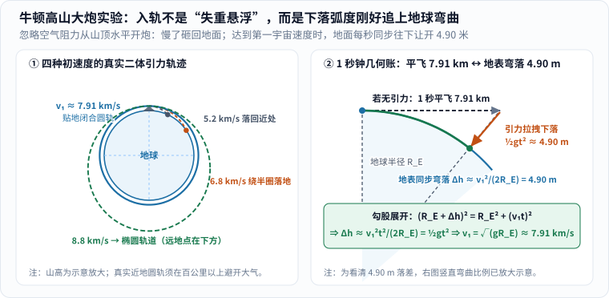
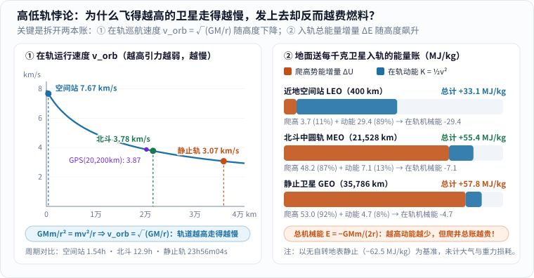
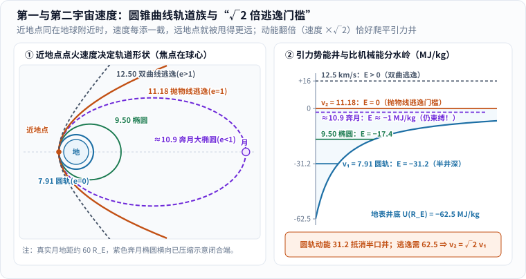
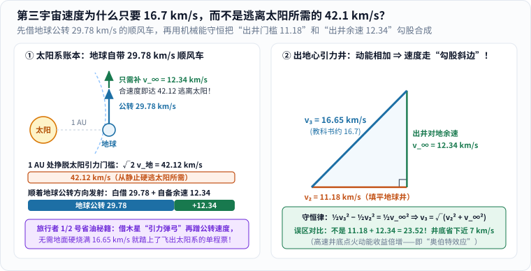
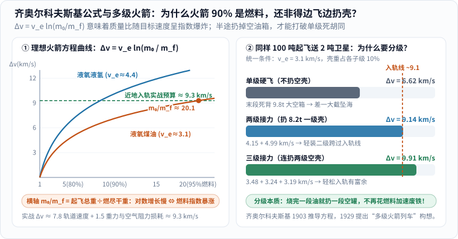

几乎每个人在中学物理课上都背过那组神圣的数字——**三大宇宙速度：`7.9 km/s`、`11.2 km/s`、`16.7 km/s`**。

背口诀只要十秒钟，可一旦你去看真实的航天直播参数，脑子里马上会冒出一连串“对不上账”的问号：

1. **高低轨速度悖论**：课本明明写着第一宇宙速度 $$7.9\ \mathrm{km/s}$$ 是人造卫星的**“最小发射速度”**，又是**“最大环绕速度”**——怎么一会儿最小、一会儿最大？更离谱的是，飞在 $$400\ \mathrm{km}$$ 高空的中国空间站和国际空间站，巡航速度只有 $$7.67\ \mathrm{km/s}$$；飞在 $$21{,}528\ \mathrm{km}$$ 的北斗中圆轨道卫星降到了 $$3.78\ \mathrm{km/s}$$；而挂在 $$35{,}786\ \mathrm{km}$$ 高空的地球静止气象卫星，更是慢悠悠地只走 **$$3.07\ \mathrm{km/s}$$**！既然高轨卫星走得这么慢，为什么发射高轨卫星反而需要推力猛得多的大火箭？
2. **奔月速度之谜**：嫦娥探测器与当年的阿波罗飞船去往 $$38.4$$ 万公里外的月球，近地点加速完只有 **$$10.8\sim 10.9\ \mathrm{km/s}$$**，压根没跨过第二宇宙速度 $$11.2\ \mathrm{km/s}$$，怎么也出去了？
3. **逃离太阳系之谜**：在地球轨道位置挣脱太阳引力，明明需要 **$$42.1\ \mathrm{km/s}$$** 的天价速度，为什么第三宇宙速度只要 **$$16.7\ \mathrm{km/s}$$**？

这几个问题看似零散，背后其实全栓在同一根绳子上：**把“在轨跑多快（向心力平衡）”和“从地面爬上去要交多少买路钱（引力势能井与机械能守恒）”混成了一件事。**

先把三大宇宙速度的底牌摊在桌上（全部按 NASA/JPL DE440 行星历表常数与地球赤道半径 $$R_E = 6{,}378.137\ \mathrm{km}$$ 精确复算 [3][4]），我们顺着火箭升空的真实脚印，一关一关把账算平：

| 名称 | 精确值（赤道基准） | 课本常取 | 它真正回答的物理门槛 | 对应轨道形状与总机械能 $$E$$ |
| --- | --- | --- | --- | --- |
| **第一宇宙速度 $$v_1$$** | $$7.905\ \mathrm{km/s}$$ | $$7.9\ \mathrm{km/s}$$ | 贴着地表水平射出、刚好不掉回地面的**环绕门槛** | 正圆（$$e = 0$$，对地 $$E < 0$$） |
| **第二宇宙速度 $$v_2$$** | $$11.180\ \mathrm{km/s}$$ | $$11.2\ \mathrm{km/s}$$ | 彻底挣脱地球引力井、飞到无穷远恰停下的**逃逸门槛** | 抛物线（$$e = 1$$，对地 $$E = 0$$） |
| **第三宇宙速度 $$v_3$$** | $$16.649\ \mathrm{km/s}$$ | $$16.7\ \mathrm{km/s}$$ | 借地球公转顺风车，先出地球井再挣脱太阳引力的**星际门槛** | 对地双曲线（$$e > 1$$），对日抛物线 |

> **为什么不同书上末位差一点点？**
> 如果改用地球体积平均半径 $$6{,}371.0\ \mathrm{km}$$ 代入，算出的是 $$v_1 = 7.910\ \mathrm{km/s}$$、$$v_2 = 11.186\ \mathrm{km/s}$$ [4]；物理公式分毫不差，只是所取参考半径差了 $$7\ \mathrm{km}$$。下文统一以赤道半径 $$R_E = 6{,}378.137\ \mathrm{km}$$ 核算。

---

## 一、什么叫“入轨”？牛顿高山大炮与每秒弯落 4.90 米的地面

### 1. 400 公里高空仍有近九成重力：入轨不是飞进“无引力区”

在之前的[《如何能实现飞行》]()里我们聊过：飞机靠机翼拨动空气，一旦飞出大气层就没了升力；而卫星能在几百公里高空成年累月地转圈，既没有空气托着它，也**不是因为太空没有地球引力**。

不妨算一下 $$400\ \mathrm{km}$$ 高空（空间站轨道）的重力加速度：地球半径 $$R_E \approx 6{,}378\ \mathrm{km}$$，爬高 $$400\ \mathrm{km}$$ 只不过把到地心的距离从 $$6{,}378\ \mathrm{km}$$ 拉到了 $$6{,}778\ \mathrm{km}$$。按万有引力反平方律：

$$
g(400\ \mathrm{km}) = g_0 \left(\frac{R_E}{R_E + 400\ \mathrm{km}}\right)^2 \approx 9.80 \times \left(\frac{6378}{6778}\right)^2 \approx 8.68\ \mathrm{m/s^2}
$$

也就是说，**空间站里的重力足足还有地面的 $$88.6\%$$** [1][2]！航天员之所以飘在舱里，不是失去了重力，而是他和整个空间站正在一起做**永不触地的自由落体**。

### 2. 勾股定理推算第一宇宙速度：每秒下落 4.90 米恰追平地球曲率

这件事最早被牛顿在 1687 年《自然哲学的数学原理》里用一门假想的**高山大炮**画得明明白白 [2]（见图 1）：

_图 1：左图对牛顿二体引力方程直接做数值积分——山顶水平射出的炮弹，在 $$5.2\ \mathrm{km/s}$$ 和 $$6.8\ \mathrm{km/s}$$ 时都会砸回地面；一旦加到 $$v_1 \approx 7.91\ \mathrm{km/s}$$，下坠轨迹正好咬合成贴地正圆；再加到 $$8.8\ \mathrm{km/s}$$，就会甩出一条远地点在对面的椭圆。右图把 $$1$$ 秒钟的运动放大：炮弹水平飞出 $$7.91\ \mathrm{km}$$ 的同时，在引力下拉落 $$4.90\ \mathrm{m}$$，而圆弧形的地球表面也恰好往下弯开了 $$4.90\ \mathrm{m}$$！[单独打开图片](/assets/images/cosmic-velocities/newton-cannon-freefall.svg)_

看图 1 右半边的直角三角形，你甚至不需要微积分就能分三步算出第一宇宙速度：

1. 假设没有地球引力，炮弹从山顶水平飞出 $$t = 1\ \mathrm{s}$$，走过的切线距离是 $$v_1 t$$。
2. 但地球是个半径为 $$R_E$$ 的球！沿着切线横走出 $$v_1 t$$ 之后，脚下的球面已经顺着曲率往下“缩”了一截高度 $$\Delta h$$。由勾股定理 $$(R_E + \Delta h)^2 = R_E^2 + (v_1 t)^2$$，展开后略去极小的 $$(\Delta h)^2$$ 项（毕竟 $$4.9\ \mathrm{m}$$ 相比 $$6{,}378\ \mathrm{km}$$ 小了一百万倍），得到地表弯落量：

$$
2 R_E \Delta h \approx v_1^2 t^2 \quad\Longrightarrow\quad \Delta h \approx \frac{v_1^2}{2 R_E}\,t^2
$$

3. 要想炮弹离地高度永远不变，**1 秒钟自由落体掉下去的距离 $$\frac{1}{2}gt^2$$，必须分毫不差地等于地面往下弯让开的距离 $$\Delta h$$**：

$$
\frac{1}{2} g t^2 = \frac{v_1^2}{2 R_E}\,t^2 \quad\Longrightarrow\quad v_1 = \sqrt{g R_E} = \sqrt{\frac{GM_E}{R_E}} \approx 7.905\ \mathrm{km/s}
$$

把数字代进去验算：在地面附近，1 秒钟自由落体下落 $$\frac{1}{2}\times 9.80\times 1^2 = 4.90\ \mathrm{m}$$；而地球表面每水平延伸 $$7.905\ \mathrm{km}$$，恰好向下弯曲 $$7905^2 / (2\times 6.378\times 10^6) \approx 4.90\ \mathrm{m}$$！**卫星一直在往下掉，只是它横着跑得太快，地球表面一秒钟让开 $$4.90$$ 米，它一秒钟掉下 $$4.90$$ 米，永远砸不中地面——这就是“环绕”的全部秘密。**

---

## 二、解开第一大悖论：为什么飞得越高的卫星走得越慢，发上去却越费劲？

搞懂了贴地圆轨，马上就会撞上开头那个让无数人抓狂的悖论：

> 既然 $$7.91\ \mathrm{km/s}$$ 是发射卫星的“最小门槛”，为什么 $$400\ \mathrm{km}$$ 的空间站只飞 $$7.67\ \mathrm{km/s}$$，$$35{,}786\ \mathrm{km}$$ 的静止卫星更是慢到只有 **$$3.07\ \mathrm{km/s}$$**？难道把卫星送到 $$3.6$$ 万公里高空，比送到 $$400$$ 公里还省劲吗？

恰恰相反！送一颗静止轨道卫星所需的能量，比近地轨道高出一大截。之所以觉得矛盾，是因为课本里那句“最小发射速度，最大环绕速度”把**在轨巡航速度**和**发射注入总能量**压缩到了同一句话里。只要像图 2 这样把两本账拆开，迷雾一秒钟就散了：

_图 2：左图算的是卫星**已经在轨以后**的巡航速度 $$v_{\text{orb}}=\sqrt{GM_E/r}$$——越高地球拉得越松，维持圆轨所需的横移速度越慢；右图算的是把 $$1\ \mathrm{kg}$$ 卫星从静止地面送上去**总共要掏多少能量**——高度越高，虽然蓝色的“在轨动能”变小了，但橙色的“爬引力井势能”暴涨了十多倍，总账单一路飙升！[单独打开图片](/assets/images/cosmic-velocities/speed-energy-paradox.svg)_

### 1. 第一本账：在轨运行速度（越高引力越弱，当然走得越慢！）

当卫星已经在距离地心 $$r = R_E + h$$ 的圆轨道上平稳巡航时，万有引力刚好充当向心力 [2]：

$$
\frac{GM_E m}{r^2} = \frac{m v_{\text{orb}}^2}{r} \quad\Longrightarrow\quad v_{\text{orb}}(r) = \sqrt{\frac{GM_E}{r}}
$$

分母是轨道半径 $$r$$！离地心越远，地球引力越微弱，不需要跑那么急就能维持圆轨；反之，贴着地表（$$h \to 0, r \to R_E$$）是所有圆轨道里半径最小的一圈，所以 $$v_1 = \sqrt{GM_E/R_E} \approx 7.91\ \mathrm{km/s}$$ 是**所有圆轨道中最大的环绕速度**——没有任何一颗圆轨卫星比贴地圆轨跑得更快！

这里还藏着轨道力学里一个极反直觉的**“踩油门减速悖论”**（NASA 在卫星轨道手册里专门提醒过新手操作员 [5]）：假如你在空间站里想追上前方的飞船，顺着飞行方向猛踩一脚油门（点火加速），会发生什么？你会被甩进一条**更高的轨道**，而到了高处之后，你的巡航速度反而变得**更慢**，被前船越落越远！真正的追赶操作，反而是朝前喷气“轻踩一脚刹车”，落入略低一点的内圈快车道，抄近道超车后再抬轨。

### 2. 第二本账：发射总机械能（爬井费远大于动能省下的零头！）

那为什么把卫星送上高轨反而更费燃料？因为火箭从地面出发时，不仅要发给卫星最后的**在轨动能 $$K$$**，还要替它支付一路往上爬的**引力势能买路钱 $$\Delta U$$** [1][2]！

取无穷远处引力势能为 $$0$$，距离地心 $$r$$ 处的引力势能是负数（就像待在一口深井里）：

$$
U(r) = -\frac{GM_E m}{r}
$$

对于任意半径为 $$r$$ 的圆轨道，刚算出的动能是 $$K(r) = \frac{1}{2}m v_{\text{orb}}^2 = +\frac{GM_E m}{2r}$$——注意这个绝妙的比例：**圆轨道的动能，永远恰好等于当地引力势能绝对值的一半**！把两者相加，在轨总机械能就是 [2]：

$$
E_{\text{orb}}(r) = K(r) + U(r) = \frac{GM_E m}{2r} - \frac{GM_E m}{r} = -\frac{GM_E m}{2r}
$$

而在发射前，静静躺在地面（暂不计微小的自转动能）的卫星动能为 $$0$$，势能处在井底 $$U(R_E) = -\frac{GM_E m}{R_E} \approx -62.50\ \mathrm{MJ/kg}$$（每千克负 $$6250$$ 万焦耳）。因此，火箭要把 $$1\ \mathrm{kg}$$ 卫星送进半径 $$r$$ 的圆轨道，至少要往里硬塞这么多机械能：

$$
\Delta E(r) = E_{\text{orb}}(r) - U(R_E) = \frac{GM_E m}{R_E} - \frac{GM_E m}{2r} = \frac{GM_E m}{R_E}\left(1 - \frac{R_E}{2r}\right)
$$

盯住括号里的 $$1 - \frac{R_E}{2r}$$！当 $$r$$ 越大（飞得越高），$$\frac{R_E}{2r}$$ 越小，需要火箭注入的总能量 $$\Delta E$$ **单调递增**！把四条代表性轨道列成账单，一眼就能看穿全部真相 [2][5][6]：

| 目标圆轨道 | 离地高度 $$h$$ | 在轨速度 $$v_{\text{orb}}$$ | 绕地一圈周期 $$T$$ | 爬高势能 $$\Delta U$$ | 在轨动能 $$K$$ | **需注入总能量 $$\Delta E$$** | 折算地面单次理想初速 $$\sqrt{2\Delta E/m}$$ |
| --- | --- | --- | --- | --- | --- | --- | --- |
| 贴地极限圆轨 | $$0\ \mathrm{km}$$ | **$$7.91\ \mathrm{km/s}$$** | $$84.5\ \mathrm{min}$$ | $$0.0\ \mathrm{MJ/kg}$$ | $$31.2\ \mathrm{MJ/kg}$$ | **$$31.2\ \mathrm{MJ/kg}$$**（最低！） | **$$7.91\ \mathrm{km/s}$$** |
| 空间站近地轨 LEO | $$400\ \mathrm{km}$$ | $$7.67\ \mathrm{km/s}$$ | $$92.6\ \mathrm{min}$$ | $$3.7\ \mathrm{MJ/kg}$$ | $$29.4\ \mathrm{MJ/kg}$$ | $$33.1\ \mathrm{MJ/kg}$$ | $$8.14\ \mathrm{km/s}$$ |
| GPS 半同步轨 MEO | $$20{,}200\ \mathrm{km}$$ | $$3.87\ \mathrm{km/s}$$ | $$11\ \mathrm{h}\ 58\ \mathrm{m}$$ | $$47.5\ \mathrm{MJ/kg}$$ | $$7.5\ \mathrm{MJ/kg}$$ | $$55.0\ \mathrm{MJ/kg}$$ | $$10.49\ \mathrm{km/s}$$ |
| 北斗中圆轨 MEO | $$21{,}528\ \mathrm{km}$$ | $$3.78\ \mathrm{km/s}$$ | $$12\ \mathrm{h}\ 53\ \mathrm{m}$$ | $$48.2\ \mathrm{MJ/kg}$$ | $$7.1\ \mathrm{MJ/kg}$$ | $$55.4\ \mathrm{MJ/kg}$$ | $$10.52\ \mathrm{km/s}$$ |
| 地球静止轨 GEO | $$35{,}786\ \mathrm{km}$$ | **$$3.07\ \mathrm{km/s}$$** | $$23\ \mathrm{h}\ 56\ \mathrm{m}\ 04\ \mathrm{s}$$ | $$53.0\ \mathrm{MJ/kg}$$ | $$4.7\ \mathrm{MJ/kg}$$ | **$$57.8\ \mathrm{MJ/kg}$$**（最高！） | **$$10.75\ \mathrm{km/s}$$** |

这张表把两句绕口令彻底翻译成了大白话：
- 送空间站去 $$400\ \mathrm{km}$$ 近地轨道时，爬高只花了 $$3.7\ \mathrm{MJ/kg}$$（占 $$11\%$$），**高达 $$89\%$$ 的能量全砸在了攒出 $$7.67\ \mathrm{km/s}$$ 的横移狂飙上** [1][2]！（顺便也就明白了为什么探空火箭竖着蹿上 $$400\ \mathrm{km}$$ 很容易，入轨却难十倍。）
- 送静止卫星去 $$35{,}786\ \mathrm{km}$$ 时，在轨动能虽然缩水到了区区 $$4.7\ \mathrm{MJ/kg}$$，但**往引力井外硬爬三万六千公里花掉了惊人的 $$53.0\ \mathrm{MJ/kg}$$**，总账单涨到 $$57.8\ \mathrm{MJ/kg}$$！
- 而在所有高度中，贴地圆轨（$$r = R_E$$）需要的总能量最低（$$31.25\ \mathrm{MJ/kg}$$），折算成地面发射初速度正是 $$7.91\ \mathrm{km/s}$$——这就是为什么 $$7.9\ \mathrm{km/s}$$ 同时顶着**“最小发射速度”**与**“最大环绕速度”**两顶帽子的真正原因！

---

## 三、从 `7.91` 到 `11.18 km/s`：为什么逃逸速度恰好是 `√2` 倍？奔月为什么要不了 `11.2`？

既然在地球附近点一把火，给到 $$7.91\ \mathrm{km/s}$$ 是正圆轨道，那如果油门不松、继续往上加到 $$9.5\ \mathrm{km/s}$$、$$10.9\ \mathrm{km/s}$$、$$11.2\ \mathrm{km/s}$$ 甚至 $$12.5\ \mathrm{km/s}$$，轨道会怎样变形？

在[《从开普勒到牛顿：行星为什么不会掉进太阳》]()和[《微积分怎样算出天体的路》]()里我们见过，反平方引力场下的所有轨道都属于同一个数学家族——**圆锥曲线** [7]。图 3 左半边把这五种速度下的真实轨迹画在了同一个地心焦点上，右半边则标出了它们在引力势能井里的台阶高度：

_图 3：左图在同一个近地点水平点火——速度从 $$7.91$$ 增加到 $$11.18\ \mathrm{km/s}$$ 之前，轨道始终是闭合椭圆，只是远地点越甩越远；一旦触及 $$11.18\ \mathrm{km/s}$$，椭圆右端彻底豁开变成抛物线，从此一去不返。右图在 $$U(r)=-GM_E/r$$ 引力井中展示原因：圆轨动能（$$31.2\ \mathrm{MJ/kg}$$）刚好填平半口井，想填满整口井（$$62.5\ \mathrm{MJ/kg}$$）让总能量达到 $$E=0$$，动能只需翻一倍，速度自然乘上 $$\sqrt{2}$$！[单独打开图片](/assets/images/cosmic-velocities/conic-velocity-ladder.svg)_

### 1. 两行公式看懂神奇的 `√2 ≈ 1.414`

很多人背书时觉得 $$7.9$$ 和 $$11.2$$ 是两个毫无关系的孤立数字，其实它们之间只隔着一个干净利落的 **$$\sqrt{2}$$** [1][2]！

什么叫刚好逃离地球（第二宇宙速度 $$v_2$$）？就是探测器从地表 $$r = R_E$$ 出发，一路逆着地球引力往外滑行、越飞越慢，直到飞抵无穷远处（$$r \to \infty$$，引力势能 $$U \to 0$$）时，最后一点动能也恰好耗尽（$$v_\infty = 0$$）。按机械能守恒，无穷远处的总能量 $$E = 0 + 0 = 0$$，因此出发瞬间的总机械能也必须恰好等于 $$0$$ [1]：

$$
\frac{1}{2} m v_2^2 - \frac{GM_E m}{R_E} = 0 \quad\Longrightarrow\quad v_2 = \sqrt{\frac{2 GM_E}{R_E}} = \sqrt{2}\,\sqrt{\frac{GM_E}{R_E}} = \sqrt{2}\,v_1
$$

算一下：$$7.9054 \times 1.41421 \approx 11.180\ \mathrm{km/s}$$（取平均半径则为 $$11.186\ \mathrm{km/s}$$，四舍五入就是课本上的 $$11.2\ \mathrm{km/s}$$）！
更妙的是，**这条 $$\sqrt{2}$$ 定律在任何高度、绕任何天体都永远成立** [2]：只要你当前正处在一个圆轨道上，不管脚下是地球、月球还是太阳，把当前圆轨速度乘上 $$\sqrt{2}$$（动能翻一倍），就是从该位置彻底逃逸的门槛！

### 2. 嫦娥与阿波罗去月球，为什么不到 `11.2 km/s` 就够了？

看一眼图 3 里的紫色虚线（$$\approx 10.9\ \mathrm{km/s}$$），开头第二个谜团就迎刃而解了：

**月球并不在无穷远处，它依然待在地球引力井里！**

月地平均距离约为 $$384{,}400\ \mathrm{km}$$，差不多是 **$$60$$ 个地球半径（$$60\,R_E$$）** [4]。要把探测器甩到月球轨道高度，并不需要把总机械能拉到 $$E = 0$$（开口抛物线），只需要拉出一条**近地点在近地停泊轨道、远地点刚好摸到 $$60\,R_E$$ 的大扁椭圆**（$$E \approx -1.0\ \mathrm{MJ/kg} < 0$$）！

我们来核对真实工程数据：假如飞船先停在 $$200\sim 330\ \mathrm{km}$$ 高的近地停泊圆轨（距离地心 $$r_p \approx 6{,}578\sim 6{,}708\ \mathrm{km}$$），此处当地的逃逸速度本来就已经降到了 $$\sqrt{2 GM_E / r_p} \approx 10.90\sim 11.01\ \mathrm{km/s}$$；再因为远地点只需抵达 $$r_a = 384{,}400\ \mathrm{km}$$（半长轴 $$a = \frac{1}{2}(r_p + r_a)$$），由椭圆活力公式（机械能守恒）算出地月转移点火（TLI）所需的速度：

$$
v_{\text{TLI}} = \sqrt{GM_E\left(\frac{2}{r_p} - \frac{1}{a}\right)} \approx 10.81\sim 10.92\ \mathrm{km/s}
$$

1969 年阿波罗 11 号在停泊轨道上第二次点燃土星五号第三级（S-IVB）奔向月球时，加速终了的对地速度正是 **约 $$10.82\ \mathrm{km/s}$$** [8]——既省下了宝贵的推进剂，甚至还能巧妙设计成“自由返回轨道”：万一中途发动机故障不刹车，飞船绕过月球背面后还会顺着这条闭合大椭圆自动滑回地球！

---

## 四、真实火箭怎么把卫星送上 3.6 万公里高轨？程序转弯 + 霍曼两次变轨

读到这里你可能会问：既然贴地飞有空气，那真实火箭发射高轨卫星（比如 $$35{,}786\ \mathrm{km}$$ 的北斗/风云静止轨道卫星）时，到底是怎么飞上去的？总不能在地面横着飙到 $$10.75\ \mathrm{km/s}$$ 吧？

当然不能！如果在海平面稠密大气（密度 $$1.22\ \mathrm{kg/m^3}$$ [4]）里横着飞出二十多倍音速，火箭一瞬间就会像流星一样烧成火球。真实航天工程用的是**“穿云拐弯 + 停泊过渡 + 两次点火变轨”**的精妙组合拳（见图 4）：

_图 4：左图精确算出了从 $$200\ \mathrm{km}$$ 停泊轨前往 $$35{,}786\ \mathrm{km}$$ 地球静止轨道的**霍曼转移（Hohmann Transfer）**全过程（动画演示一次橙色转移半椭圆滑行，静态与减少动态效果下均保留完整轨迹与数值）；右图展示起飞阶段的程序转弯，以及为什么靠近赤道的海南文昌发射场能白借更多自转速度。[单独打开图片，刷新可重播](/assets/images/cosmic-velocities/hohmann-geo-transfer.svg)_

### 1. 第一步：先竖着刺穿稠密大气，再向东“程序转弯”借自转顺风车

每次看火箭发射直播，点火头十几秒火箭都是笔直往上蹿的——目的是用最短路程赶紧逃出底部最稠密的对流层大气，减小气动阻力与最大动压（Max-Q）[9]。一旦爬升到十几公里以上空气变稀，制导系统就会微偏一个极小的角度，让火箭顺着重力自然向水平方向倾斜（**程序转弯 / 重力转弯**），到一二百公里高空关机时，箭体已经几乎完全水平，把推力尽数攒成环绕速度 [9]。

而且地球上绝大多数顺行轨道火箭，拐弯时都默契地**朝东拐**！原因很简单：地球本身正自西向东自转，赤道周长约 $$40{,}075\ \mathrm{km}$$，自转真正转满 $$360^\circ$$ 的周期是一个**恒星日 $$T_{\text{sid}} = 86{,}164.09\ \mathrm{s}$$**（$$23$$ 小时 $$56$$ 分 $$04$$ 秒，比太阳日 $$24$$ 小时短约 $$4$$ 分钟，因为地球还在绕太阳公转 [3][5]）。由此算出纬度 $$\varphi$$ 处的地表自转线速度：

$$
v_{\text{自转}}(\varphi) = \frac{2\pi R_E}{T_{\text{sid}}}\cos\varphi \approx 465.1 \cos\varphi\ \ (\mathrm{m/s})
$$

看图 4 右下角的对比条：
- 在赤道（$$0^\circ$$，如法属圭亚那库鲁发射场附近 $$5.2^\circ\mathrm{N}$$），火箭还没点火就已经白白揣着约 **$$463\sim 465\ \mathrm{m/s}$$** 的向东初速度 [1][5]；
- 在我国最南端的**海南文昌发射场（$$19.6^\circ\mathrm{N}$$）**，向东发射能白借 **$$438\ \mathrm{m/s}$$**，比甘肃酒泉（$$41.0^\circ\mathrm{N}$$，$$351\ \mathrm{m/s}$$）多蹭将近 $$90\ \mathrm{m/s}$$；
- **更关键的第二重红利在轨道倾角**：地球静止轨道（GEO）必须严格套在赤道正上方（倾角 $$0^\circ$$）[5]。从纬度 $$19.6^\circ\mathrm{N}$$ 发出的转移轨道天生倾角只有约 $$19.6^\circ$$，远地点把轨道面“掰平”到赤道面所需的侧向变轨燃料，比高纬度发射场省下一大截！

### 2. 第二步：霍曼转移——为什么在远地点“不补第二脚油门”就会掉回来？

1925 年，德国土木工程师瓦尔特·霍曼（Walter Hohmann）算出了在两条共面圆轨道之间切换最省燃料的路线——**双脉冲相切椭圆变轨（霍曼转移）** [7]。我们跟着图 4 左半边，把卫星从 $$200\ \mathrm{km}$$ 近地停泊圆轨（$$r_1 = 6{,}578.1\ \mathrm{km}$$，初速 $$7.78\ \mathrm{km/s}$$）送往地球静止轨道（周期等于一个恒星日 $$86{,}164.09\ \mathrm{s}$$，由 $$T = 2\pi\sqrt{r_2^3 / GM_E}$$ 反解出 $$r_2 = 42{,}164.2\ \mathrm{km}$$，即离赤道地面 **$$35{,}786\ \mathrm{km}$$** [3][5]）：

1. **近地点第 ① 次点火（搭桥上椭圆）**：转移椭圆的半长轴是 $$a_{\text{tr}} = \frac{1}{2}(r_1 + r_2) = 24{,}371.2\ \mathrm{km}$$。在近地点点一把火，把速度从 $$7.78\ \mathrm{km/s}$$ 猛推到 $$v_p = \sqrt{GM_E(2/r_1 - 1/a_{\text{tr}})} = 10.24\ \mathrm{km/s}$$，速度增量 **$$\Delta v_1 = +2.46\ \mathrm{km/s}$$**。
2. **无动力爬坡 5 小时 16 分**：关掉发动机！卫星顺着橙色转移半椭圆往外甩，用动能一步步换取高度势能，耗时半个椭圆周期 $$\pi\sqrt{a_{\text{tr}}^3 / GM_E} \approx 5.26\ \mathrm{h}$$ 爬到 $$35{,}786\ \mathrm{km}$$ 的最高点（远地点）。
3. **远地点第 ② 次点火（圆化定轨）**：爬到最高点时，卫星的动能几乎被榨干，速度跌到了可怜的 **$$v_a = 1.60\ \mathrm{km/s}$$**！注意：**如果这时不点火，$$1.60\ \mathrm{km/s}$$ 撑不住 $$3.6$$ 万公里处的向心力，卫星会顺着图中的灰色虚线原路掉回 $$200\ \mathrm{km}$$！** 因此远地点发动机必须准时点第二把火，补上 **$$\Delta v_2 = 3.07 - 1.60 = +1.48\ \mathrm{km/s}$$**，把椭圆“撑圆”成 $$3.07\ \mathrm{km/s}$$ 的正圆静止轨道！（若同时在此处修正文昌的 $$19.6^\circ$$ 倾角，矢量合成后远地点点火约为 $$1.58\ \mathrm{km/s}$$，正是为何倾角改向一定要放在速度最慢的远地点做！）

> **留心一个超酷的彩蛋：为什么 $$7.78 + 2.46 + 1.48 = 11.72\ \mathrm{km/s} > 11.18\ \mathrm{km/s}$$，卫星却没逃逸？**
> 细心的读者把三次加速一加，居然超过了第二宇宙速度 $$11.18\ \mathrm{km/s}$$！怎么没飞出地球？
> 秘密在于动能公式 $$\Delta\left(\frac{1}{2}v^2\right) \approx v\,\Delta v$$：同样喷出 $$1.48\ \mathrm{km/s}$$ 的速度增量，如果在近地点高速（$$v \approx 10\ \mathrm{km/s}$$）时一口气加上，换来的机械能增量高达 $$\sim 15\ \mathrm{MJ/kg}$$；但霍曼变轨的第二把火是在 $$3.6$$ 万公里高空低速（$$v \approx 1.6\ \mathrm{km/s}$$）时才补上的，换来的机械能只有 $$3.5\ \mathrm{MJ/kg}$$！**速度越快、引力井越深的地方点火，同样一公斤燃料换来的机械能越多**——这就是深空探测著名的**奥伯特效应（Oberth Effect）**，它马上要在第三宇宙速度里大显身手！

---

## 五、第三宇宙速度为什么只要 `16.7 km/s`，而不是逃离太阳所需的 `42.1 km/s`？

### 1. 第一重红利：顺着地球公转方向出井，白借 29.78 km/s 顺风车

现在把视野拉远到整个太阳系：地球在距离太阳 $$1\ \mathrm{AU} \approx 1.496\times 10^8\ \mathrm{km}$$ 的轨道上绕日公转 [3]。按前面刚学过的圆轨公式与 $$\sqrt{2}$$ 逃逸定律，把中心质量换成太阳（$$GM_\odot \approx 1.327\times 10^{11}\ \mathrm{km^3/s^2}$$ [3]），一算吓一跳：

$$
v_{\oplus} = \sqrt{\frac{GM_\odot}{1\ \mathrm{AU}}} \approx 29.785\ \mathrm{km/s}, \qquad v_{\odot,\text{esc}} = \sqrt{2}\,v_{\oplus} \approx 42.122\ \mathrm{km/s}
$$

在地球轨道位置想挣脱太阳引力，对日速度必须达到 **$$42.12\ \mathrm{km/s}$$** [1]！那为什么课本上的第三宇宙速度不是 $$42.1$$，甚至也不是 $$42.1 - 29.8 + 11.2 = 23.5$$，而是区区 **$$16.7\ \mathrm{km/s}$$**？

看图 5 的左右两步拆解，这是天体力学里最让人拍案叫绝的一笔省钱账：

_图 5：左图第一步“借顺风车”——地球自己正以 $$29.78\ \mathrm{km/s}$$ 绕太阳狂奔，顺着公转方向发射，钻出地球引力井后只需保留 $$42.12 - 29.78 = 12.34\ \mathrm{km/s}$$ 的对地剩余速度；右图第二步“勾股合成”——在地球引力井底一次点足火，守恒的是动能 $$\frac{1}{2}v^2$$ 而不是速度 $$v$$，因此 $$v_3 = \sqrt{11.18^2 + 12.34^2} = 16.65\ \mathrm{km/s}$$，白白比算术相加省下近 $$7\ \mathrm{km/s}$$！[单独打开图片](/assets/images/cosmic-velocities/third-cosmic-vector.svg)_

我们本来就站在地球这趟高速列车上！只要挑选合适的发射窗口与入轨方位，让探测器**钻出地球引力作用范围（约 $$92$$ 万公里的希尔球）之后，正好沿着地球绕太阳公转的切线方向飞出**，地球公转的 $$29.785\ \mathrm{km/s}$$ 就全额白送给了探测器 [1]。它只需要在远离地球后，相对于地球还剩下一截“双曲超额速度”：

$$
v_\infty = v_{\odot,\text{esc}} - v_{\oplus} = 42.122 - 29.785 = 12.337\ \mathrm{km/s}
$$

### 2. 第二重红利：机械能守恒走“勾股斜边”，外加木星引力弹弓接力

很多同学接下来会顺手把“逃出地球的 $$11.18$$”和“出井后还要剩的 $$12.34$$”直接算术相加，算成 $$23.52\ \mathrm{km/s}$$——错啦！如果你在地表引力井底一口气加速到 $$v_3$$，对地球列机械能守恒（地面动能减去地球引力井深 $$GM_E m/R_E = \frac{1}{2}m v_2^2$$，等于飞出地球井后剩下的动能 $$\frac{1}{2}m v_\infty^2$$）：

$$
\frac{1}{2}m v_3^2 - \frac{1}{2}m v_2^2 = \frac{1}{2}m v_\infty^2 \quad\Longrightarrow\quad v_3 = \sqrt{v_2^2 + v_\infty^2}
$$

它竟然严格满足**勾股定理**！代入精确数值：

$$
v_3 = \sqrt{11.180^2 + 12.337^2} = \sqrt{124.99 + 152.21} = \sqrt{277.20} \approx 16.649\ \mathrm{km/s}
$$

四舍五入保留一位小数，正是教科书上雷打不动的 **$$16.7\ \mathrm{km/s}$$**！

而且真实的星际探测器连 $$16.7\ \mathrm{km/s}$$ 都舍不得在地面硬烧完：1977 年发射的**旅行者 1 号和 2 号**（目前均已飞越日球层顶进入星际空间 [10]），当年只加速到够飞抵木星轨道（约 $$5.2\ \mathrm{AU}$$）的椭圆速度，然后从高速公转的木星侧后方擦身掠过——在木星看来探测器只是弹性拐了个弯、来去速率相等；但在太阳看来，探测器狠狠“蹭”走了一截木星的公转速度（**引力弹弓 / Gravity Assist**）[1][10]，一脚跨过了太阳逃逸门槛！

---

## 六、终极工程关：为什么火箭 90% 以上全是燃料，还必须一节节扔壳子？

### 1. 动量微元积分：齐奥尔科夫斯基公式与“指数质量墙”

算完了天上的轨道，最后回到发射台上的工程现实：汽车加满一箱油（不到车重的 $$4\%$$）就能跑七八百公里；为什么一枚几百吨甚至几千吨重的运载火箭，**超过 $$90\%$$ 的体重全是推进剂**，顶端的卫星却往往只占 $$1\%\sim 4\%$$ [11]？而且为什么非要做成两级、三级，飞一截就扔掉一大截箭体？

罪魁祸首是火箭推进无法回避的宿命：**汽车蹬的是脚下不动的柏油马路，飞机扒的是身边取之不尽的空气，唯有火箭进入太空无处借力，必须自己背着所有的喷射工质往上飞——为了加速最后那一秒钟喷出的燃料，你前面几分钟不得不花海量燃料去搬运这批“还没轮到烧的燃料”！**

1897–1903 年间，俄国航天先驱康斯坦丁·齐奥尔科夫斯基（Konstantin Tsiolkovsky）用动量守恒积分出了统治人类航天史的**理想火箭方程** [11]：当总质量为 $$M$$ 的火箭向后以相对速度 $$v_e$$（有效喷气速度）喷出微元质量 $$-\mathrm{d}M$$ 时，$$M\,\mathrm{d}v = -v_e\,\mathrm{d}M$$，从起飞初始总质量 $$m_0$$ 积分到燃尽后的干重 $$m_f$$，得到火箭获得的最大速度增量：

$$
\Delta v = v_e \ln\left(\frac{m_0}{m_f}\right) \quad \Longleftrightarrow \quad \frac{m_0}{m_f} = e^{\Delta v / v_e}
$$

把公式倒过来写成右边那个指数形式，航天工程师常说的**“火箭方程的暴政（Tyranny of the Rocket Equation）”**就扑面而来了（见图 6）：

_图 6：左图画出理想火箭方程的对数天花板——加上起飞重力损耗与大气阻力后，送卫星进近地轨道实际需要约 $$9.1\sim 9.5\ \mathrm{km/s}$$ 的设计 $$\Delta v$$；对液氧煤油发动机（$$v_e \approx 3.1\ \mathrm{km/s}$$）而言，质量比 $$m_0/m_f$$ 必须冲到 $$e^3 \approx 20.1$$（即 $$95\%$$ 全是燃料！）。右图用同一枚 $$100$$ 吨火箭送 $$2$$ 吨卫星算清“多级接力”的威力：单级硬飞只能到 $$6.62\ \mathrm{km/s}$$ 坠海，半途扔掉空油箱的两级与三级火箭则轻松冲上 $$9.14$$ 和 $$9.91\ \mathrm{km/s}$$！[单独打开图片](/assets/images/cosmic-velocities/rocket-staging-curve.svg)_

### 2. 为什么单级火箭会被自己的空油箱拖死？

在真实地球发射中，火箭不可能在零秒内瞬间点完火：爬升头几分钟地球重力一直在往下拽它（重力损耗约 $$1.1\sim 1.4\ \mathrm{km/s}$$），再加上稠密大气阻力损耗（约 $$0.1\sim 0.3\ \mathrm{km/s}$$），要把卫星送进 $$7.8\ \mathrm{km/s}$$ 的近地轨道，火箭实际必须掏出 **$$\Delta v \approx 9.1\sim 9.5\ \mathrm{km/s}$$** 的总速度预算 [9][11]。

偏偏化学燃料的喷气速度 $$v_e$$ 被分子键能锁得很死：主力**液氧煤油**发动机约为 $$v_e \approx 3.0\sim 3.4\ \mathrm{km/s}$$，性能最高的**液氧液氢**发动机也不过 $$v_e \approx 4.3\sim 4.5\ \mathrm{km/s}$$ [11]。

看图 6 右半边的实打实算例：假设我们造一枚 **$$100$$ 吨起飞总重**的液氧煤油火箭（$$v_e = 3.1\ \mathrm{km/s}$$），要把一颗 **$$2$$ 吨重的卫星**送上天；受限于铝合金/碳纤维贮箱与发动机泵阀强度，每级箭体空壳结构占该级总重（壳+油）的 **$$10\%$$** [12]：

- **如果做成“单级大油桶”不扔壳**：除掉 $$2$$ 吨卫星，剩下 $$98$$ 吨里有 $$9.8$$ 吨是巨型油箱和发动机空壳，$$88.2$$ 吨是燃料。烧到最后一滴油时，发动机还在拼命推着那 **$$9.8$$ 吨早就装空了的大铁桶**！燃尽干重 $$m_f = 2 + 9.8 = 11.8\ \mathrm{t}$$，算出：

$$
\Delta v_{\text{单级}} = 3.1 \times \ln\left(\frac{100}{11.8}\right) \approx 6.62\ \mathrm{km/s}
$$

连 $$7.9\ \mathrm{km/s}$$ 的边都摸不到，更别提 $$9.1\ \mathrm{km/s}$$ 的实战门槛，百分之百掉进大海！

### 3. 齐奥尔科夫斯基的破局妙计：“烧完一节，就扔一节空罐头！”

1929 年，齐奥尔科夫斯基在《宇宙火箭列车》里给出了破局钥匙——**多级火箭（Staging）** [9][12]。完全不换新材料（壳重比照旧 $$10\%$$），也不换新发动机（$$v_e$$ 照旧 $$3.1\ \mathrm{km/s}$$），只把刚才那 $$98$$ 吨箭体拆成上下两级（一级 $$82$$ 吨含 $$8.2$$ 吨壳 + $$73.8$$ 吨油；二级 $$16$$ 吨含 $$1.6$$ 吨壳 + $$14.4$$ 吨油，顶着 $$2$$ 吨卫星）：

1. **第一级点火**：把整枚火箭从 $$100$$ 吨烧到 $$26.2$$ 吨，贡献 $$\Delta v_1 = 3.1\times\ln(100/26.2) = 4.15\ \mathrm{km/s}$$；
2. **一二级分离**：爆炸螺栓咔嚓一声，**把重达 $$8.2$$ 吨的一级空油箱和大推力发动机直接抛掉**！
3. **第二级轻装点火**：此时起飞总重只剩 $$16 + 2 = 18$$ 吨，烧光 $$14.4$$ 吨燃料后干重仅 $$3.6$$ 吨，贡献 $$\Delta v_2 = 3.1\times\ln(18/3.6) = 4.99\ \mathrm{km/s}$$！

两段相加，总速度增量跃升到 **$$\Delta v_{\text{两级}} = 4.15 + 4.99 = 9.14\ \mathrm{km/s}$$**；如果再细分成三级接力（$$75\ \mathrm{t} + 18\ \mathrm{t} + 5\ \mathrm{t}$$），更是冲到 **$$9.91\ \mathrm{km/s}$$**——同样 $$100$$ 吨起飞送 $$2$$ 吨卫星，只因半途扔掉了不再装油的空铁皮，就凭空多榨出了 **$$2.5\sim 3.3\ \mathrm{km/s}$$** 的速度，一举撞开了太空大门！

---

## 七、收束全局：一张纸收好“发射卫星与三大宇宙速度”

### 1. 五条核心物理脉络一次复盘

下次再有人问你“为什么静止卫星每秒只飞 $$3$$ 公里，发射它却比每秒 $$7.7$$ 公里的空间站难得多”，你只需把这五条脉络递给他：

1. **第一宇宙速度 $$v_1 = \sqrt{GM_E/R_E} \approx 7.91\ \mathrm{km/s}$$** 是贴地正圆轨道速度：每秒平飞 $$7.91\ \mathrm{km}$$，地球弧面刚好往下让开 $$4.90\ \mathrm{m}$$，与 $$1$$ 秒自由落体完美追平。
2. **巡航速度看半径，发射难度看总机械能**：在轨圆周速度 $$v_{\text{orb}} = \sqrt{GM_E/r}$$ 越高越慢；但圆轨总机械能 $$E = -GM_E m/(2r)$$ 越高越大（负得越少），爬引力井省不下半分钱。
3. **第二宇宙速度 $$v_2 = \sqrt{2}\,v_1 \approx 11.18\ \mathrm{km/s}$$** 对应总机械能 $$E = 0$$ 的抛物线逃逸门槛；去月球（$$60\,R_E$$）只需大扁椭圆，在近地停泊轨加到 $$10.8\sim 10.9\ \mathrm{km/s}$$ 足矣。
4. **上高轨靠霍曼两次变轨**：先竖穿稠密大气、再向东程序转弯借地球自转（文昌可借 $$438\ \mathrm{m/s}$$）进入停泊圆轨；近地点点第一把火拉出大椭圆，滑到远地点必须点第二把火补速圆化，否则原路掉回近地。
5. **第三宇宙速度 $$v_3 = \sqrt{v_2^2 + (v_{\odot,\text{esc}} - v_\oplus)^2} \approx 16.65\ \mathrm{km/s}$$** 先白借地球 $$29.78\ \mathrm{km/s}$$ 公转顺风车，再靠机械能守恒走“勾股斜边”出地球井。

### 2. 从牛顿高山大炮到多级火箭：理想定律与工程智慧的交响

回望整条链条，天上的轨道规律其实异常简洁——从近地空间站到旅行者号飞越日球层顶，全都写在一行向心力公式与一行机械能守恒里；真正让人类殚精竭虑的，是站在地球引力井底与稠密大气底部，如何用向东程序转弯、霍曼双脉冲变轨、行星引力弹弓与“边飞边扔空油箱”的多级火箭，一克燃料掰成两半花，一步步跨过齐奥尔科夫斯基方程的指数高墙。

---

## 参考资料与核查来源

1. **OpenStax 大学物理教材（引力势能、总能量与逃逸速度）**：William Moebs, Samuel J. Ling, Jeff Sanny, *University Physics Volume 1*, Section 13.3: [Gravitational Potential Energy and Total Energy](https://openstax.org/books/university-physics-volume-1/pages/13-3-gravitational-potential-energy-and-total-energy) —— 支持引力势能积分 $$U = -GM_E m/r$$、$$E = 0$$ 导出地球逃逸速度 $$11.2\ \mathrm{km/s}$$ 与 $$1\ \mathrm{AU}$$ 处太阳逃逸速度 $$42.1\ \mathrm{km/s}$$、赤道自转与地球公转顺风车以及木星引力弹弓原理。
2. **OpenStax 大学物理教材（卫星轨道、周期与机械能悖论）**：*University Physics Volume 1*, Section 13.4: [Satellite Orbits and Energy](https://openstax.org/books/university-physics-volume-1/pages/13-4-satellite-orbits-and-energy) —— 支持牛顿《原理》高山大炮思想实验、圆轨道速度 $$v_{\text{orbit}} = \sqrt{GM_E/r}$$、$$400\ \mathrm{km}$$ 空间站速度 $$7.67\ \mathrm{km/s}$$、圆轨总能量 $$E = -GM_E m/(2r)$$ 以及入轨动能远大于低轨爬高势能的定量核算。
3. **NASA 喷气推进实验室（JPL）天体动力学常数表**：Jet Propulsion Laboratory, Solar System Dynamics, [Astrodynamic Parameters (DE440)](https://ssd.jpl.nasa.gov/astro_par.html) —— 本文与配图脚本全部核心引力常数来源：$$GM_E = 398{,}600.435507\ \mathrm{km^3/s^2}$$、$$GM_\odot = 1.3271244\times 10^{20}\ \mathrm{m^3/s^2}$$、天文单位 $$\mathrm{AU} = 149{,}597{,}870{,}700\ \mathrm{m}$$（IAU 2012）及平均恒星日 $$86{,}164.09054\ \mathrm{s}$$。
4. **NASA 地球与月球物理参数档案（NSSDCA）**：Dr. David R. Williams, NASA Goddard Space Flight Center, [Earth Fact Sheet](https://nssdc.gsfc.nasa.gov/planetary/factsheet/earthfact.html) 与 [Moon Fact Sheet](https://nssdc.gsfc.nasa.gov/planetary/factsheet/moonfact.html) —— 支持地球赤道半径 $$6{,}378.137\ \mathrm{km}$$、体积平均半径 $$6{,}371.000\ \mathrm{km}$$、逃逸速度 $$11.186\ \mathrm{km/s}$$、公转均速 $$29.78\ \mathrm{km/s}$$、地表大气密度 $$1.217\ \mathrm{kg/m^3}$$ 及月地平均距离 $$384{,}400\ \mathrm{km}$$。
5. **NASA 地球观测站《地球卫星轨道图谱》**：Holli Riebeek & Robert Simmon, NASA Earth Observatory, [Catalog of Earth Satellite Orbits](https://science.nasa.gov/earth/earth-observatory/catalog-of-earth-satellite-orbits/) —— 支持低/中/高三类轨道划分、地球静止轨道 $$42{,}164\ \mathrm{km}$$ 地心距（$$23$$ 小时 $$56$$ 分 $$04$$ 秒周期）、GPS 半同步轨道 $$20{,}200\ \mathrm{km}$$、卫星在轨“加速升轨反而变慢”的反直觉机制，以及近赤道发射借自转与省倾角能量的工程逻辑。
6. **欧洲航天局（ESA）北斗卫星导航空间段技术档案**：ESA Navipedia, [BeiDou Space Segment](https://gssc.esa.int/navipedia/index.php/BeiDou_Space_Segment) —— 支持北斗系统 GEO/IGSO/MEO 混合星座架构与中圆地球轨道（MEO）标称轨道半径参数。
7. **OpenStax 大学物理教材（圆锥曲线轨道族与霍曼转移）**：*University Physics Volume 1*, Section 13.5: [Kepler's Laws of Planetary Motion](https://openstax.org/books/university-physics-volume-1/pages/13-5-keplers-laws-of-planetary-motion) —— 支持二体问题圆锥曲线极坐标通解（圆 $$e=0$$、椭圆 $$0<e<1$$、抛物线 $$e=1$$、双曲线 $$e>1$$）、椭圆总能量 $$E=-GMm/(2a)$$ 及瓦尔特·霍曼 1925 年提出的双切点转移椭圆方法。
8. **NASA 阿波罗 11 号任务官方实录**：NASA History / Mission Pages, [Apollo 11 Mission Overview](https://www.nasa.gov/missions/apollo/apollo-11/apollo-11-mission-overview/) —— 支持阿波罗 11 号先进入近地停泊轨道，绕飞一圈半后二次点燃土星五号 S-IVB 级切入地月转移大椭圆（自由返回轨道）的真实飞行时序。
9. **NASA 格伦研究中心《入轨飞行与多级分离》**：NASA Glenn Research Center, Beginner's Guide to Aeronautics, [Flight To Orbit](https://www1.grc.nasa.gov/beginners-guide-to-aeronautics/flight-to-orbit/) —— 支持运载火箭垂直起飞快速脱离底部稠密大气、随后俯仰转入水平加速以及中途抛弃空级（Staging）的标准入轨剖面。
10. **NASA 旅行者号星际任务概览**：NASA Science, [Voyager Mission Overview](https://science.nasa.gov/mission/voyager/mission-overview/) —— 支持 1977 年发射的旅行者 1 号、2 号借木星与外行星引力助推（Gravity Assist）跨越太阳逃逸速度，并分别于 2012 年、2018 年进入星际空间的任务史实。
11. **NASA 格伦研究中心《理想火箭方程》**：NASA Glenn Research Center, [Ideal Rocket Equation](https://www1.grc.nasa.gov/beginners-guide-to-aeronautics/ideal-rocket-equation/) —— 支持齐奥尔科夫斯基公式 $$\Delta u = V_{\text{eq}}\ln(m_f/m_e) = I_{\text{sp}}g_0\ln(\mathit{MR})$$ 的动量微分推导，以及单级入轨燃料占比超过 $$90\%$$、有效载荷仅占起飞重量极小比例的量级核算。
12. **NASA 格伦研究中心《火箭质量比与结构系数》**：NASA Glenn Research Center, [Mass Ratios](https://www1.grc.nasa.gov/beginners-guide-to-aeronautics/mass-ratios/) —— 支持推进剂质量比、有效载荷比 $$\lambda$$ 与箭体结构系数 $$\epsilon = m_s / (m_p + m_s)$$ 的工程定义。

> 说明：本文六幅配图均为原创计算 SVG，已注册纳入本站统一配图工具包 `tools/visuals/mechanics_sky.py`，可通过 `python tools/visuals.py build cosmic-velocities` 一键重算生成；脚本基于 JPL DE440 与 WGS84 常数严格断言核验了三大宇宙速度、高低轨速度—机械能关系、霍曼变轨两次点火速度增量及齐奥尔科夫斯基多级火箭质量比。
{: .prompt-tip }
