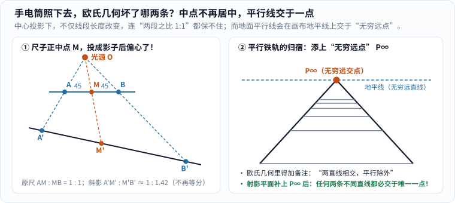
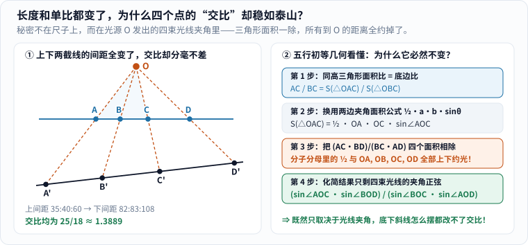
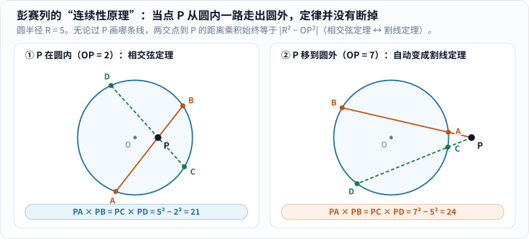
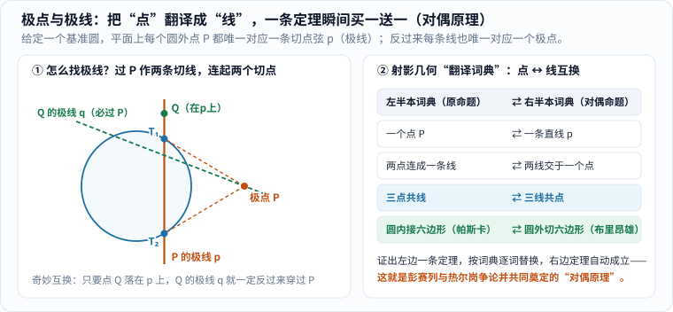

晚上关掉客厅顶灯，打开手机手电筒斜照向桌面上的圆形茶杯口。你轻轻转动手腕：墙上的影子先拉长成椭圆；再把手电筒压低到一个微妙的角度，影子一端突然豁开缺口，化作抛物线甚至双曲线的一支。

盯着墙上的影子，你大概会嘀咕一句：**影子最不讲武德了——原本一样长的线段被拉得一长一短，原本 $$90^\circ$$ 的直角被挤成锐角或钝角，就连地面上永不相交的两根平行铁轨，拍进相机底片里都会在天边撞到同一个点上！**

欧几里得教了人类两千多年的“全等、长度、平行、夹角”，被一束普通灯光冲得七零八落。那么问题来了：

> **当一切长度、比例和角度都被透视投影彻底搅乱之后，几何图形里到底还有什么是打不碎、偷不走的？**

把这个问题从画家的透视技巧锻造成一门恢弘现代数学分支的人，是一位在俄国冰原上差点冻死、在战俘营里连半本参考书都没有的年轻法国工程军官——**让-维克多·彭赛列（Jean-Victor Poncelet，1788–1867）**。[1]

今天，我们顺着彭赛列从雪地战俘营一路走到工业水轮车间的传奇人生，用初等代数与相似三角形，把射影几何最核心的五件法宝——**无穷远点与齐次坐标、交比、连续性原理、极点极线对偶、以及彭赛列闭合定理**——一步不跳地拆解得清清楚楚。

---

## 一、雪地里捡回一条命的战俘，没有书怎么搞数学？

现代课本常常一上来就甩出一堆公理，好像数学家天生坐在温暖书房里推公式。但射影几何的诞生现场，却是十九世纪初欧洲最残酷的一场寒冬（史实据圣安德鲁斯大学 MacTutor 数学史档案核查 [1]）。

### 1. 从巴黎综合工科学校到克拉斯诺伊雪原：差点冻死在 1812 年寒冬

1788 年 7 月 1 日，彭赛列出生于法国梅斯。童年寄养在乡间家庭时，他就对机械着了迷，曾拆装一只买给他的钟表研究得废寝忘食。1807 年，19 岁的彭赛列考入当时全欧洲最顶尖的理工殿堂——**巴黎综合工科学校（École Polytechnique）**，直接受教于画法几何宗师**蒙日**（详见本站姊妹篇《[蒙日怎样把空间画在纸上]()》）、拉扎尔·卡诺（Lazare Carnot）、布里昂雄（Charles Brianchon）与安培等大师，1810 年毕业成为陆军工程兵中尉。[1]

1812 年 6 月，刚在荷兰完成一处泥炭地堡垒抢建任务的彭赛列，被紧急征调随拿破仑 60 万大军远征俄国。8 月斯摩棱斯克战役中，他顶着俄军对岸炮火，用声东击西计策在第聂伯河上架起浮桥；10 月法军从莫斯科溃退，严冬降临。**1812 年 11 月 19 日**，在斯摩棱斯克附近的**克拉斯诺伊战役**中，彭赛列率工兵纵队冲锋时战马中弹倒毙，他本人身负重伤倒在尸横遍野的雪地里，被撤退的法军当成死人遗弃在战场上。[1]

万幸的是，打扫战场的俄军士兵发现这名年轻军官还有微弱呼吸，觉得或许能审出情报，便将他俘虏。随后是常人难以想象的炼狱：在零下几十度的极寒与饥饿中，彭赛列被迫徒步跋涉近**五个月**穿越冰封草原，直到 **1813 年 3 月**才被押入伏尔加河畔的**萨拉托夫（Saratov）战俘营**，一关就是一年零三个月。[1]

### 2. 萨拉托夫牢房里的炭笔墙面：忘掉琐碎公式，反而抓住了几何骨架

刚进战俘营时，彭赛列冻饿交加，连集中精力思考的力气都没有。直到四月春光透进铁窗（他在回忆录里深情称之为“灿烂的四月骄阳”），为了不让精神在漫长囚禁中崩溃，这位 24 岁的年轻人做了一个惊人的决定：**既然手头连一本数学书、一张演算表都没有，那就拿炉灰炭条在牢房墙上，凭记忆从零推导自己学过的全部几何学！**[1]

没想到，“没有参考书”反而促成了数学史上一次因祸得福的飞跃：

- 在平时备考和做题时，学生脑子里塞满了繁琐的三角恒等式、坐标展开和孤立的辅助线技巧；而在牢房里，那些细枝末节的死算公式全忘了，留在彭赛列脑海最深处的，反而是蒙日画法几何里的**空间投影**、卡诺关于图形连续变形的直觉，以及布里昂雄定理背后的对称美感。
- 他不再一题一题抠死板的边长与角度，而是追问：**如果把一个复杂的椭圆或双曲线看作“一个普通圆在中心投影下的影子”，能不能先在最简单的圆上把定理一眼看穿，再顺着投影光线一口气搬回所有圆锥曲线？**[1]

这批写在战俘营里的手稿后来被称为著名的**“萨拉托夫笔记”**。1814 年 6 月俄法和约签署后彭赛列获释返法，经过八年打磨，于 **1822 年**正式出版巨著《论图形的射影性质》（*Traité des propriétés projectives des figures*）——今天全世界通用的**“射影几何（projective geometry）”**一词，正是从这部著作的书名里诞生的（几乎同一时期，法国数学家热尔岗 Joseph Gergonne 也在独立开拓这一新天地）。[1]

---

## 二、先看影子捣了什么乱，再看“无穷远点”与“交比”凭什么稳如泰山

要读懂彭赛列的武器库，我们先做两个小实验，亲眼看看中心投影到底破坏了什么，又被迫催生出了什么新秩序。

### 1. 中点偏心与铁轨相交：给平行线正式补发“无穷远点”

很多初学者凭直觉猜：“手电筒斜照一把刻度尺，虽然影子整体被拉长了，但尺子**正中间**那个中点刻度 $$M$$，投到影子里总该还是正中间吧？”

大错特错！请看图 1 左半边的精确几何作图：

_图 1：左图里水平尺上 $$AM = MB = 45$$，$$M$$ 是严格中点；但经点光源 $$O$$ 斜投到下方纸面后，右半段光线斜得更远，影子变成 $$A'M' : M'B' \approx 1 : 1.42$$，中点彻底偏心！右图里两条平行铁轨和等距枕木，在透视画布上越远越密，最终交汇于地平线上的“无穷远点 $$P_\infty$$”。[单独打开图片](/assets/images/poncelet/shadow-vanishing.svg)_

你看，在点光源 $$O$$ 的中心投影下，不仅单段长度 $$AB$$ 保不住，连**两段共线线段的长度比 $$AM / MB$$** 也彻底失守了！这就是为什么图 1 右半边明明等间距铺设的铁路枕木，拍进透视照片里却越往远处挤得越密。

顺着两条铁轨往天边望去，彭赛列（继承文艺复兴透视画派与十七世纪德萨格的思想）替几何学干了第一件痛快淋漓的大事：**给每一组互相平行的直线，正式补发一个公共的“无穷远点 $$P_\infty$$”**；同一平面内不同方向平行线各自的无穷远点，肩并肩排成一条**“无穷远直线（即透视画里的地平线）”**。[1]

别小看这一个补充！在传统欧氏几何里，每当你说“平面上两条不同直线必相交于一点”时，总得憋屈地加个括弧——“**平行线除外**”。一旦把欧氏平面扩充成添上无穷远直线的**射影平面**，所有恼人的但书瞬间清零：**任何两条不同的直线，都毫无例外地相交于唯一一点！** 普通直线交在有限远处，平行直线交在无穷远处，投影变换可以把无穷远直线随手拉回眼前变成普通直线（就像铁轨的无穷远点投在照片里，变成了画布正中央触手可及的灭点）。

### 2. 齐次坐标 $$[X : Y : Z]$$：用四行初等代数算清平行线怎样交于地平线

听到“平行线在无穷远处相交”，爱较真的读者心里多半会犯嘀咕：“这不会只是文学修辞吧？在初中代数里联立两条平行线 $$y = mx + b_1$$ 和 $$y = mx + b_2$$（$$b_1 \neq b_2$$），相减明明得出 $$0 = b_2 - b_1$$ 的矛盾无解，怎么可能真算出一个不矛盾的交点坐标来？”

问到了最关键的命门上！就在彭赛列著作问世几年后，德国数学家莫比乌斯（1827）与普吕克（约 1830）发明了**齐次坐标（homogeneous coordinates）$$[X : Y : Z]$$**，用四行初中生都能看懂的代数，把“无穷远交点”算得清清楚楚、半点矛盾都没有！

先建立一个超级直观的三维画面：**把你的眼睛放在三维空间原点 $$(0, 0, 0)$$，在头顶高度 $$Z = 1$$ 处水平架起一块无限大的透明玻璃画布**——

1. **普通点怎样编码？** 玻璃画布 $$Z = 1$$ 上的每一个普通平面点 $$(x, y)$$，在三维空间里坐标是 $$(x, y, 1)$$。顺着眼睛 $$(0,0,0)$$ 射向 $$(x, y, 1)$$ 的**整条三维直线（除原点外）**，上面的点形如 $$(\lambda x,\, \lambda y,\, \lambda)$$（$$\lambda \neq 0$$）。既然同一束视线上所有点投到玻璃画布上都是同一个点，我们就把这束视线记成连比符号 **$$[X : Y : Z]$$**（不全为零，且约定 $$[X : Y : Z]$$ 与 $$[\lambda X : \lambda Y : \lambda Z]$$ 代表**完全同一个射影点**！）。只要 $$Z \neq 0$$，同除以 $$Z$$ 就能还原回玻璃画布上的普通点：

$$
x = \frac{X}{Z},\qquad y = \frac{Y}{Z}\qquad (Z \neq 0).
$$

2. **水平视线去哪儿了？** 如果从眼睛 $$(0,0,0)$$ 射出的一束视线**完全水平（即高度分量 $$Z = 0$$）**呢？它与高度 $$Z = 1$$ 的水平玻璃画布平行，在有限远处永远撞不上画布——它指的正正好好就是远方的**地平线方向**！因此在齐次坐标里，**$$Z = 0$$ 的点 $$[X : Y : 0]$$ 就是无穷远点**，而全体满足方程 $$Z = 0$$ 的点构成的直线，就是**无穷远直线（地平线）**！

现在，让我们把两条斜率同为 $$m$$、截距不同（$$b_1 \neq b_2$$）的平行直线放进这套坐标里，分四行联立求解：

1. **写出普通笛卡尔方程**：

$$
y = mx + b_1,\qquad y = mx + b_2\qquad (b_1 \neq b_2).
$$

2. **代入 $$x = X/Z,\ y = Y/Z$$ 并两边同乘 $$Z$$“齐次化”**（每一项次数都变成一次）：

$$
mX - Y + b_1 Z = 0,\qquad mX - Y + b_2 Z = 0.
$$

3. **两式直接相减**：$$mX$$ 和 $$-Y$$ 消去，剩下 $$(b_1 - b_2)Z = 0$$。因为 $$b_1 \neq b_2$$，两边除以 $$(b_1 - b_2)$$ 毫不矛盾地解出：

$$
Z = 0\quad (\text{交点必然住在地平线上！}).
$$

4. **把 $$Z = 0$$ 代回任一方程**：得到 $$mX - Y + 0 = 0 \implies Y = mX$$。取 $$X = 1$$（记住按比例缩放 $$[\lambda : \lambda m : 0]$$ 都是同一个射影点），唯一交点干脆利落地跳了出来：

$$
\boxed{P_\infty = [1 : m : 0].}
$$

没有任何除以零的违规操作，也没有任何逻辑矛盾！更妙的是，仔细品味 $$[1 : m : 0]$$ 这三个数字：

- 它只跟斜率 $$m$$ 有关，跟截距 $$b_1, b_2$$ 完全无关——哪怕再添第三条、第一百条斜率为 $$m$$ 的平行线 $$y = mx + b_3$$，它照样穿过**同一个无穷远点 $$[1 : m : 0]$$**！
- 如果换一组斜率为 $$m'$$（$$m' \neq m$$）的平行线，它们就交在另一个无穷远点 $$[1 : m' : 0]$$（至于竖直平行线 $$x = c$$，齐次化为 $$X - cZ = 0$$，交于 $$[0 : 1 : 0]$$）。所有不同方向的无穷远点整整齐齐排在直线 $$Z = 0$$ 上，跟你在图 1 右图铁轨尽头看到的地平线严丝合缝！

### 3. 四个点的“比的比”：五行三角形面积约分证出交比不变性

解决了平行线，我们回头处理刚才更棘手的问题：既然三个共线点连单比 $$AM / MB$$ 在投影下都保不住，那直线上到底有没有投影扯不坏的定量关系？

答案是：**三个点不够，凑齐四个点就突然锁死了！**

在直线上取四个点 $$A, B, C, D$$，我们先算点 $$C$$ 分线段 $$AB$$ 所成的单比 $$AC / BC$$，再除以点 $$D$$ 分线段 $$AB$$ 所成的单比 $$AD / BD$$（计有向线段），整理成“比的比”：

$$
(A, B; C, D) = \frac{AC / BC}{AD / BD} = \frac{AC \cdot BD}{BC \cdot AD}.
$$

这个量叫作四点的**交比（cross-ratio）**，萌芽于古希腊亚历山大城的帕普斯（Pappus），经拉扎尔·卡诺（1803）与彭赛列发扬光大，成为整个射影几何的第一基石。[1][3]

先拿图 2 左半边的真实数值验算一次：上方水平直线上相邻三段间距依次是 $$AB = 35,\ BC = 40,\ CD = 60$$，因此 $$AC = 35 + 40 = 75$$，$$BD = 40 + 60 = 100$$，总长 $$AD = 35 + 40 + 60 = 135$$。代入交比公式：

$$
(A, B; C, D) = \frac{75 \times 100}{40 \times 135} = \frac{7500}{5400} = \frac{25}{18} \approx 1.3889.
$$

经点光源 $$O$$ 投到下方歪斜的直线上后，相邻间距变成了面目全非的约 $$82 : 83 : 108$$；可只要把 $$A', B', C', D'$$ 代进同一个交比公式，算出来的数字竟然**分毫不差还是 $$25/18$$**！

_图 2：左图上线相邻间距为 $$35:40:60$$，投到斜线后变成约 $$82:83:108$$，单比彻底变样，但两者的交比都精确等于 $$25/18 \approx 1.3889$$。右图揭开谜底：把线段比翻译成以 $$O$$ 为顶点的同高三角形面积比，换用夹角正弦公式后，所有光线长度上下全部约光！[单独打开图片](/assets/images/poncelet/cross-ratio.svg)_

为什么单比会坏，“比的比”却像焊死了一样？跟着图 2 右栏走四步初等几何，你一辈子都不会忘：

1. **第一步（底边比换成同高三角形面积比）**：看以光源 $$O$$ 为公共顶点的 $$\triangle OAC$$ 与 $$\triangle OBC$$。它们的底边 $$AC$$ 和 $$BC$$ 躺在同一条直线上，从顶点 $$O$$ 向这条直线作垂线，高 $$h$$ 完全相同！由三角形面积等于“二分之一底乘高”，公共高 $$h$$ 上下约去，得：

$$
\frac{AC}{BC} = \frac{\frac{1}{2} AC \cdot h}{\frac{1}{2} BC \cdot h} = \frac{S_{\triangle OAC}}{S_{\triangle OBC}},\qquad \text{同理}\quad \frac{BD}{AD} = \frac{S_{\triangle OBD}}{S_{\triangle OAD}}.
$$

2. **第二步（换用两边夹角正弦面积公式）**：同一个三角形的面积，还可以写成从 $$O$$ 出发的两条光线长乘以夹角正弦的一半，例如：

$$
S_{\triangle OAC} = \frac{1}{2}\, OA \cdot OC \cdot \sin\angle AOC.
$$

3. **第三步（四个面积相乘相除，光线长度全军覆没！）**：把四个正弦面积式代进交比：

$$
(A, B; C, D) = \frac{S_{\triangle OAC} \cdot S_{\triangle OBD}}{S_{\triangle OBC} \cdot S_{\triangle OAD}} = \frac{\left(\frac{1}{2}\, OA \cdot OC \cdot \sin\angle AOC\right)\left(\frac{1}{2}\, OB \cdot OD \cdot \sin\angle BOD\right)}{\left(\frac{1}{2}\, OB \cdot OC \cdot \sin\angle BOC\right)\left(\frac{1}{2}\, OA \cdot OD \cdot \sin\angle AOD\right)}.
$$

   睁大眼睛看分子和分母：两个 $$\frac{1}{2}$$ 约掉了！$$OA$$ 与 $$OA$$ 约掉了！$$OB$$ 与 $$OB$$ 约掉了！$$OC$$ 与 $$OC$$ 约掉了！$$OD$$ 与 $$OD$$ 也约掉了！（这也是为什么三个点的单比约不干净——三个点只有两个面积相除，会剩下一截 $$OA / OB$$ 约不掉；凑够四个点排成对角相乘，四条光线刚好每条在分子出现一次、在分母出现一次，完美对砍清零！）
4. **第四步（只剩纯角度不变量）**：化简之后，交比变成了纯粹的四束光线夹角正弦之比：

$$
\boxed{(A, B; C, D) = \frac{\sin\angle AOC \cdot \sin\angle BOD}{\sin\angle BOC \cdot \sin\angle AOD}.}
$$

谜底彻底揭晓！**交比的数值根本不住在那把尺子上，而是住在光源 $$O$$ 发出的那四束光线的夹角里！** 不管你在底下横着截一刀（得 $$A, B, C, D$$），还是斜着截一刀（得 $$A', B', C', D'$$），截到的都是同一捆光线，夹角分度未改，算出来的交比当然稳如泰山！[3]

---

## 三、连续性原理：把点推出圆外，甚至推向“看不见的交点”

在萨拉托夫战俘营的墙面上，彭赛列还提炼出了第二件让十九世纪数学界既惊叹又争论不休的武器——**连续性原理（principle of continuity）**：如果一个几何图形通过连续平滑的变形变成另一个同样一般的图形，那么前一个图形上成立的度量或位置定律，在越过边界后理应继续成立，不需要推倒重证一遍！[1]

### 1. 从圆内相交弦到圆外割线：圆幂 $$OP^2 - R^2$$ 的平滑跨越

拿初中课本里被拆成两节讲的两个圆定理来做最直观的检验（图 3）：

_图 3：圆半径 $$R = 5$$。左图点 $$P$$ 在圆内（$$OP = 2$$），过 $$P$$ 任作两条弦 $$AB$$ 与 $$CD$$，两段之积恒为 $$5^2 - 2^2 = 21$$；右图把 $$P$$ 连续拖出圆外（$$OP = 7$$），弦自动变成割线，而 $$PA \times PB = PC \times PD = 7^2 - 5^2 = 24$$ 照常成立。[单独打开图片](/assets/images/poncelet/chord-secant.svg)_

传统欧氏几何得画两张图：在圆内连 $$AD, BC$$ 用同弧圆周角证 $$\triangle PAD \sim \triangle PCB$$，得“相交弦定理”；等点 $$P$$ 跑到圆外，又得重画割线再证一次“割线定理”。

彭赛列却直接把它们看成同一部连续播放的电影：过点 $$P$$ 作那条穿过圆心 $$O$$ 的特殊直径直线，它与圆交于距离 $$P$$ 分别为 $$|R - OP|$$ 和 $$R + OP$$ 的两点，两段乘积永远是 $$|R^2 - OP^2|$$（若引入有向线段，无论 $$P$$ 在圆内还是圆外，有向乘积 $$\overrightarrow{PA}\cdot\overrightarrow{PB}$$ 恒等于**点 $$P$$ 对圆的幂** $$OP^2 - R^2$$）！

- 当 $$OP = 2 < 5$$（圆内）：有向积为 $$2^2 - 5^2 = -21$$（反向两段长度积为 $$21$$）；
- 当 $$P$$ 滑到圆周上（$$OP = 5$$）：一段缩为 $$0$$，乘积平滑过渡为 $$5^2 - 5^2 = 0$$；
- 当 $$P$$ 继续滑到圆外（$$OP = 7 > 5$$）：有向积平滑变为 $$7^2 - 5^2 = +24$$（同向两段割线积为 $$24$$，且当割线转到与圆相切使 $$A, B$$ 重合于切点 $$T$$ 时，自动给出切割线定理 $$PT^2 = 24$$）！

一条定律从圆心一路走到无穷远，中间没有任何断裂。

### 2. 两圆不交，公共弦去哪儿了？根轴与无穷远虚圆点

更让人拍案叫绝的是，彭赛列敢于追着这条连续线索，一直走进**肉眼看不见的复数交点（“虚交点”）**里去！[1]

试想平面上有两个相交的圆：

$$
C_1:\ x^2 + y^2 + D_1 x + E_1 y + F_1 = 0,\qquad C_2:\ x^2 + y^2 + D_2 x + E_2 y + F_2 = 0.
$$

两圆相交于两个实点 $$U, V$$ 时，把两个方程直接相减，二次项 $$x^2 + y^2$$ 瞬间抵消，留下一条干净利落的**一次直线方程**：

$$
(D_1 - D_2)x + (E_1 - E_2)y + (F_1 - F_2) = 0\qquad (\text{两圆圆心不重合}).
$$

因为交点 $$U, V$$ 同时满足两个圆方程，自然也满足相减后的直线方程——这就是连接两交点的**公共弦所在直线**。

现在，我们慢慢把这两个圆往两边拉开，直到它们在实平面上**彻底分离、连一个肉眼可见的交点都没有**！请问：刚才那条实系数直线方程消失了吗？

**完全没有！** 系数 $$D_1 - D_2,\ E_1 - E_2,\ F_1 - F_2$$ 全是实实在在的实数，那条直线依然稳稳画在白纸中央（它叫两圆的**根轴 radical axis**，其上每一点向两圆所引切线段长度严格相等）！从代数上看，拉开两圆只是让联立二次方程的两个实数解 $$U, V$$ 连续变成了一对**共轭复数解**，而连接一对共轭复数点的直线，系数依然是纯实数！

彭赛列甚至顺手发现了平面几何里一个惊天大秘密：**把全平面任何一个圆 $$(x - a)^2 + (y - b)^2 = R^2$$ 换成第二章的齐次坐标 $$(X - aZ)^2 + (Y - bZ)^2 = R^2 Z^2$$，再令 $$Z = 0$$ 去看它与无穷远直线的交点**——所有圆心 $$a, b$$ 和半径 $$R$$ 统统乘以 $$0$$ 消失了，只剩下：

$$
X^2 + Y^2 = 0 \implies Y = \pm i X!
$$

也就是说，**平面上大大小小所有的圆，在无穷远直线上全都偷偷穿过同一对固定的虚交点 $$I = [1 : i : 0]$$ 与 $$J = [1 : -i : 0]$$（无穷远虚圆点）！**[1] 这一下彻底解开了困扰前人的谜团：两条一般二次曲线（如两个椭圆）最多能有 $$2 \times 2 = 4$$ 个交点，为什么两个不同的圆在纸面上永远最多只有 **$$2$$ 个**交点？因为另外 **$$2$$ 个**交点名额，早就被无穷远处的 $$I$$ 和 $$J$$ 永久占满了！

### 3. 1820 年柯西的警告与现代复射影几何的裁决

不难想象，在 19 世纪 20 年代还没有严格复代数簇理论的年代，彭赛列这种“看不见交点也照样连线推定理”的大胆作风，把以严谨分析著称的大数学家**柯西（Augustin-Louis Cauchy）**吓了一跳。

**1820 年 6 月 5 日**，柯西代表法国科学院审查彭赛列呈交的论文时，写下了一份颇为严厉的评语，警告说如果不加严格限制地使用这种连续性原理，“很容易导致显而易见的错误”（颇具戏剧性的是，据 MacTutor 史料记载，柯西为了驳倒彭赛列当场举出的那个几何反例，反倒是柯西自己弄错了 [1]）。

站在两百年后的今天公正评判，这场交锋没有输家：柯西的警觉完全正当——在普通实函数分析里（例如含绝对值或分段非解析的情形），盲目外推确实会翻车；而彭赛列研究的恰恰是由**多项式方程定义的代数图形**！后来十九至二十世纪的数学家建立起严格的**复射影代数几何（$$\mathbb{CP}^2$$）**，证明了多项式系统的根与重数在复射影空间里确实连续守恒（贝祖定理），替彭赛列在萨拉托夫墙面上燃起的那盏几何探照灯补上了坚不可摧的逻辑地基。

---

## 四、极点与极线：买一送一的“对偶翻译机”

如果说交比和连续性已经够精彩，射影几何里最像变魔术的绝活，当属让定理数量直接翻倍的**对偶原理（principle of duality）**。

点明明是零维的圆点，直线明明是一维的长线，怎么可能把一个“点”一对一翻译成一条“线”，而且连“谁在谁上面”的关系都不乱？彭赛列找到的这台物理翻译机，就是关于基准圆（或一般圆锥曲线）的**极点与极线（pole and polar）**。[1]

### 1. 用一对相似直角三角形，亲手算出 $$OP \cdot OH = R^2$$

先看图 4 左半边：在平面上固定一个圆心为 $$O$$、半径为 $$R$$ 的基准圆。对于圆外任意一点 $$P$$，过 $$P$$ 向圆引两条切线，切点记作 $$T_1, T_2$$，把两个切点连成直线 $$p = T_1T_2$$——我们就把点 $$P$$ 叫作**极点**，把切点弦直线 $$p$$ 叫作点 $$P$$ 的**极线**。

_图 4：左图在圆外取极点 $$P$$，两条切线的切点连线 $$p = T_1T_2$$ 即 $$P$$ 的极线；在 $$p$$ 上任取一点 $$Q$$，按同样规则作出 $$Q$$ 的极线 $$q$$（绿色虚线），它必定反过来精准穿过点 $$P$$！右图是由此建立的“点 ↔ 线对偶翻译词典”。[单独打开图片](/assets/images/poncelet/pole-polar.svg)_

如果点 $$P$$ 移进圆内，作不出实切线了，极线 $$p$$ 又在哪儿？别急，我们连接 $$OP$$ 交切点弦 $$T_1T_2$$ 于垂足 $$H$$，只用三步初中**相似直角三角形**，立刻算出 $$H$$ 的精确位置：

1. **找两个直角**：因为 $$OT_1 = OT_2 = R$$ 且切线长 $$PT_1 = PT_2$$，对称轴 $$OP$$ 垂直平分切点弦 $$T_1T_2$$，故 **$$\angle OHT_1 = 90^\circ$$**；与此同时，圆的半径垂直于过切点的切线，故 **$$\angle OT_1P = 90^\circ$$**！
2. **证直角三角形相似**：对比小直角三角形 $$\mathrm{Rt}\triangle OHT_1$$（直角在 $$H$$）与大直角三角形 $$\mathrm{Rt}\triangle OT_1P$$（直角在 $$T_1$$）：它们除了各有一个 $$90^\circ$$ 直角外，还共享同一个锐角 **$$\angle T_1OP$$**！由两角对应相等立得：

$$
\mathrm{Rt}\triangle OHT_1 \sim \mathrm{Rt}\triangle OT_1P.
$$

3. **列对应边比例**：在小三角形里“短直角边除以斜边”是 $$OH / OT_1$$；在大三角形里“对应短直角边除以斜边”是 $$OT_1 / OP$$。令二者相等并交叉相乘：

$$
\frac{OH}{OT_1} = \frac{OT_1}{OP} \implies \boxed{OP \cdot OH = OT_1^2 = R^2,\quad \text{且 } p \perp OP \text{ 于点 } H.}
$$

看！这个公式漂亮极了：

- 当极点 $$P$$ 在圆外（$$OP > R$$）时，$$OH = R^2 / OP < R$$，极线 $$p$$ 是穿过圆内部的切点弦；
- 当极点 $$P$$ 落在圆周上（$$OP = R$$）时，$$OH = R$$，极线 $$p$$ 就是过 $$P$$ 的圆切线；
- 当极点 $$P$$ 钻进圆内（$$0 < OP < R$$）时，无需实切线，只需在射线 $$OP$$ 上量取 $$OH = R^2 / OP > R$$，过圆外的 $$H$$ 作 $$OP$$ 的垂线，就是圆内点 $$P$$ 唯一确定的极线 $$p$$！（再往上推：当 $$P \to O$$ 趋近圆心时，$$OH = R^2 / OP \to \infty$$，**圆心 $$O$$ 的极线刚好就是第二章那条无穷远直线**！整个射影平面除点线一一对应、严丝合缝！）

### 2. 拉伊尔互反律（La Hire 定理）：为什么 $$Q$$ 在 $$p$$ 上等价于 $$P$$ 在 $$q$$ 上？

光有“点变线”还不算魔术，真正让极点极线变成“定理翻译机”的灵魂，是图 4 左图展示的**互反律（reciprocity，又称拉伊尔定理）**：

> **点 $$Q$$ 落在点 $$P$$ 的极线 $$p$$ 上 $$\Longleftrightarrow$$ 点 $$P$$ 必定落在点 $$Q$$ 的极线 $$q$$ 上！**

很多科普文章只让你“看图相信它真的过了 $$P$$”，其实证明它同样只需要**再画一对相似直角三角形**，四行搞定：

1. 假设点 $$Q$$ 落在 $$P$$ 的极线 $$p$$ 上。既然刚才证过 $$p \perp OP$$ 于垂足 $$H$$，只要 $$Q \neq H$$，连接 $$OQ$$，则 $$\triangle OHQ$$ 是一个以 $$\angle OHQ = 90^\circ$$ 为直角的直角三角形；
2. 现在我们要检验“点 $$P$$ 在不在 $$Q$$ 的极线 $$q$$ 上”。为此，过点 $$P$$ 向直线 $$OQ$$ 作一条垂线，设垂足为 $$K'$$，于是得到第二个直角三角形 $$\mathrm{Rt}\triangle OK'P$$（直角在 $$K'$$，即 $$\angle OK'P = 90^\circ$$）；
3. 对比 $$\mathrm{Rt}\triangle OHQ$$ 与 $$\mathrm{Rt}\triangle OK'P$$：它们都有一个 $$90^\circ$$ 直角，而且共享同一个顶角 **$$\angle HOQ = \angle K'OP$$**（若为钝角则共享对顶角）！因此两直角三角形必然相似：

$$
\mathrm{Rt}\triangle OHQ \sim \mathrm{Rt}\triangle OK'P \implies \frac{OH}{OK'} = \frac{OQ}{OP} \implies OQ \cdot OK' = OP \cdot OH.
$$

4. 别忘了第 1 节刚算出的 $$OP \cdot OH = R^2$$！代进去立刻得到 **$$OQ \cdot OK' = R^2$$**！可是按极线定义，点 $$Q$$ 的极线 $$q$$ 恰恰就是“在射线 $$OQ$$ 上取满足 $$OQ \cdot OK = R^2$$ 的点 $$K$$ 所作的 $$OQ$$ 垂线”——所以垂足 $$K'$$ 跟 $$K$$ **根本就是同一个点**，而垂线 $$PK'$$ 本身就是点 $$Q$$ 的极线 $$q$$！因此，极线 $$q$$ 百分之百穿过点 $$P$$！

### 3. 点线词典实战：从帕斯卡内接六边形秒得布里昂雄外切六边形

一旦握住了“$$Q \in p \iff P \in q$$”这把互反律尚方宝剑，奇迹就发生了：

- 原图里有三个点 $$A, B, C$$ **共线**（全落在同一条直线 $$l$$ 上）$$\iff$$ 按互反律，它们翻译过去的三条极线 $$a, b, c$$ 必定**共点**（全都穿过直线 $$l$$ 的极点 $$L$$）！
- 原图里连接两点 $$A, B$$ 的**连线** $$\iff$$ 翻译成两条极线 $$a, b$$ 的**交点**！
- 原图里顶点落在圆上的**圆内接多边形**（圆周点的极线是圆的切线！）$$\iff$$ 翻译成每条边都与圆相切的**圆外切多边形**！

拿着图 4 右栏这本**对偶词典**，全世界的射影几何定理立刻开始“买一送一”！最震撼的一对双胞胎就在我们博客里：

- **左半本（1640 年，16 岁的帕斯卡发现的神秘六边形定理）**：圆锥曲线的任意**内接六边形**，三双对边的三个**交点**必定**三点共线**（详见本站《[帕斯卡神秘六边形]()》）；
- **右半本（1806 年，彭赛列的学长布里昂雄发现的对偶定理）**：查词典逐字替换——“内接”换“外切”，“边”换“顶点”，“交点”换“连线”，“三点共线”换“三线共点”——立刻免费收获：**圆锥曲线的任意外切六边形，三双对顶点的三条连线必定三线共点！**

令人唏嘘的是，这件本该共享荣光的杰作，却引发了一场长达两年半的学术伤心事：**1826 年 12 月至 1829 年 5 月**，彭赛列与主编《数学年刊》的热尔岗（随后普吕克也加入混战）围绕“谁拥有对偶原理优先权”爆发了激烈笔仗——彭赛列早在萨拉托夫笔记与 1822 年专著中就用极点极线跑通了整套几何对偶机制，而热尔岗提炼了“对偶（duality）”这一术语并首创了左栏印原定理、右栏并排印对偶定理的经典双栏格式（普吕克后来又用齐次线坐标给出了完美的代数解释：在方程 $$uX + vY + wZ = 0$$ 中，固定 $$[u:v:w]$$ 看 $$[X:Y:Z]$$ 是点在直线上，固定 $$[X:Y:Z]$$ 看 $$[u:v:w]$$ 就是直线过定点，二者天然对称！）。[1] 连绵不断的优先权争吵与早年柯西的冷遇，让心灰意冷的彭赛列在 1830 年前后渐渐告别纯粹几何，转身投入了轰轰烈烈的工业力学革命。[1]

---

## 五、彭赛列闭合定理：要么永远合不上，要么处处都能合上！

在跟随彭赛列转战工程界之前，我们绝不能错过他在 1822 年专著里留下的皇冠明珠——让两百年来的几何学家一见倾心的**彭赛列闭合定理（Poncelet's closure theorem / porism）**。[2]

### 1. 弹球画线实验与查普尔—欧拉公式：手算 $$R = 5,\ r = 2$$ 的黄金间距

来玩一个纸上画线折返游戏：画一个半径为 $$R$$ 的大圆（外圆）和一个包在它肚子里的半径为 $$r$$ 的小圆（内圆），两圆圆心相距 $$d$$。

我们在外圆圆周上随便点一个出发点 $$A_0$$：

- **第 1 步**：从 $$A_0$$ 出发紧贴内圆作一条切线，延长出去撞到外圆上的新点 $$A_1$$；
- **第 2 步**：从 $$A_1$$ 出发紧贴内圆另一侧作下一条切线，撞到外圆上的 $$A_2$$；
- **第 3 步**：再从 $$A_2$$ 出发紧贴内圆作第三条切线，撞到外圆上的 $$A_3$$。

如果 $$A_3$$ 分毫不差撞回最初的起点 $$A_0$$，这三条切线就围成了一个既**内接于大圆**、又**外切于小圆**的“双心三角形（bicentric triangle）”。

_图 5：两图外圆与内圆大小比例完全相同（$$R : r = 5 : 2$$），仅改变了两圆圆心距 $$d$$。左图随意摆放（不满足欧拉公式），从 $$A_0$$ 连走三步后终点 $$A_3$$ 与 $$A_0$$ 错开一大截；右图将圆心距精准调到 $$d = \sqrt{R^2 - 2Rr}$$，不仅蓝色实线 $$A_1 \to A_2 \to A_3 \to A_1$$ 三步严丝合缝闭合（动画演示一次描边过程，静态与减少动态效果下均保留完整三角形），把起点挪到外圆另一处的 $$B_1$$（绿色虚线），竟然照样三步精准闭合！[单独打开图片，刷新可重播](/assets/images/poncelet/poncelet-porism.svg)_

先看图 5 左图：**如果你随手画两个圆，99.99% 的情况下走完三步根本合不上**，$$A_3$$ 与 $$A_0$$ 之间会留下一道尴尬的缺口！

那两圆圆心距 $$d$$ 调到多少才能合上呢？早在 **1746 年**英国数学家威廉·查普尔（William Chapple）和 **1765 年**大数学家欧拉（Leonhard Euler），就已经独立算出了双心三角形必须满足的黄金关系——**查普尔—欧拉公式**：[2]

$$
\boxed{d^2 = R^2 - 2Rr.}
$$

让我们拿图 5 采用的整数半径比 **$$R = 5,\ r = 2$$** 亲手代进去算一算，看看这串数字有多神奇：

1. **算出唯一合法的圆心距 $$d$$**：

$$
d^2 = 5^2 - 2 \times 5 \times 2 = 25 - 20 = 5 \implies d = \sqrt{5} \approx 2.236!
$$

   只要两圆圆心距哪怕偏到 $$2.5$$ 或 $$1.8$$，你在大圆上把起点找破头，也画不出**任何一个**双心三角形！
2. **一旦调准 $$d = \sqrt{5} \approx 2.236$$，亲手验证两个截然不同的起点都能合上！**
   把外圆圆心放在坐标原点 $$O(0, 0)$$（圆方程 $$x^2 + y^2 = 25$$），把内圆圆心放在 $$y$$ 轴负半轴上的 $$I(0, -\sqrt{5})$$（半径 $$r = 2$$）：
   - **起点一（从最顶端 $$A_1(0, 5)$$ 出发画瘦高对称三角形）**：底边水平紧贴内圆下缘，故底边纵坐标为 $$y = -\sqrt{5} - 2 \approx -4.236$$（稳稳落在外圆 $$[-5, 5]$$ 内！），交外圆于左右两点 $$A_2, A_3$$，其横坐标满足 $$x_0^2 = 25 - (2 + \sqrt{5})^2 = 16 - 4\sqrt{5}$$。算一算内圆心 $$I(0, -\sqrt{5})$$ 到斜边 $$A_1A_2$$ 的垂直距离！斜边长平方为 $$x_0^2 + (5 - y)^2 = (16 - 4\sqrt{5}) + (7 + \sqrt{5})^2 = 70 + 10\sqrt{5}$$；由面积法，$$I$$ 到斜边距离的平方等于：

$$
\frac{(5 + \sqrt{5})^2 \cdot x_0^2}{70 + 10\sqrt{5}} = \frac{(30 + 10\sqrt{5})(16 - 4\sqrt{5})}{70 + 10\sqrt{5}} = \frac{280 + 40\sqrt{5}}{70 + 10\sqrt{5}} = 4 \implies \text{距离} = \sqrt{4} = 2 = r!
$$

     斜边真的分毫不差紧贴半径为 $$2$$ 的内圆，三步完美闭合！
   - **起点二（换到正下方最底端 $$B_1(0, -5)$$ 出发画扁宽对称三角形）**：这次底边水平紧贴内圆**上缘**，纵坐标 $$y = -\sqrt{5} + 2 \approx -0.236$$，横坐标满足 $$x_1^2 = 25 - (\sqrt{5} - 2)^2 = 16 + 4\sqrt{5}$$，斜边长平方为 $$(16 + 4\sqrt{5}) + (7 - \sqrt{5})^2 = 70 - 10\sqrt{5}$$。再算内圆心 $$I(0, -\sqrt{5})$$（距 $$B_1$$ 为 $$5 - \sqrt{5}$$）到新斜边的距离平方：

$$
\frac{(5 - \sqrt{5})^2 \cdot x_1^2}{70 - 10\sqrt{5}} = \frac{(30 - 10\sqrt{5})(16 + 4\sqrt{5})}{70 - 10\sqrt{5}} = \frac{280 - 40\sqrt{5}}{70 - 10\sqrt{5}} = 4 \implies \text{距离} = \sqrt{4} = 2 = r!
$$

     根号五自动消得干干净净，距离还是精确的 $$2$$！不仅这两个极端位置能闭合，你把起点沿着半径 $$5$$ 的外圆连续滑动一整圈，三角形时而瘦长、时而扁平、时而歪斜，每一帧都是严丝合缝的双心三角形！

### 2. 为什么 $$r > R/2$$ 永远包不住双心三角形？欧拉不等式的几何死线

盯着刚才的查普尔—欧拉公式 $$d^2 = R^2 - 2Rr = R(R - 2r)$$，还能一眼揪出一条铁律：

既然 $$d$$ 是两个圆心之间的真实欧氏距离，它的平方必须非负（$$d^2 \geq 0$$）。因为 $$R > 0$$，这就强迫括号里满足 $$R - 2r \geq 0$$，即著名的**欧拉不等式**：

$$
\boxed{R \geq 2r \qquad \left(\text{即内切圆半径 } r \leq \frac{R}{2}\right).}
$$

**为什么一旦内圆半径 $$r$$ 超过外圆半径的一半（比如 $$R = 5,\ r = 3$$），全世界就再也画不出哪怕一个内接于大圆、外切于小圆的三角形了？**

除了代数上算出 $$d^2 = 25 - 30 = -5 < 0$$ 无实数解之外，我们还可以用最直观的**圆心角账本**一眼看穿：

- **恰达天花板 $$r = R / 2$$ 时**：$$d^2 = 0 \implies d = 0$$，大小两圆必须**同心**！此时大圆里任何一条与半径 $$R/2$$ 同心小圆相切的弦，它到圆心的距离都是 $$R/2$$，由 $$\cos\theta = \frac{R/2}{R} = \frac{1}{2}$$ 知半圆心角 $$\theta = 60^\circ$$，即**每一条切线弦跨过的圆心角刚好是 $$2 \times 60^\circ = 120^\circ$$**！连走三步，$$120^\circ \times 3 = 360^\circ$$，不多不少绕满一圈，围出一个标准的**等边三角形**！
- **一旦越界 $$r > R / 2$$ 时（例如 $$R = 5,\ r = 3$$）**：先试着把小圆放在最公平的正中心（$$d = 0$$）。因为小圆太胖了，贴着它画出的每一条外圆弦都被挤到了外圆边缘，每步跨过的圆心角只剩 $$2\arccos(r/R) < 2\arccos(1/2) = 120^\circ$$（对 $$r=3, R=5$$ 只有 $$2\arccos 0.6 \approx 106.26^\circ$$）！连走三步加起来总共才转过 $$3 \times 106.26^\circ \approx 318.8^\circ < 360^\circ$$——**手太短，连大圆一圈都抱不满，怎么可能首尾闭合？！** 如果你把胖小圆往旁边偏心挪动（$$d > 0$$），窄缝那一侧的弦虽然能跨过稍大一点的角度，但宽缝另一侧被挤得更扁，严格凸函数不等式（或直接反用 $$d^2 = R^2 - 2Rr < 0$$）决定了三步总转角依然永远够不到 $$360^\circ$$！

### 3. 从两圆推广到任意圆锥曲线：椭圆曲线上的“等步长散步”

查普尔和欧拉只算了“两个圆 + 三角形（$$n=3$$）”；彭赛列在战俘营和 1822 年专著里用射影几何投下了一颗重磅炸弹——把圆换成**任意两条圆锥曲线**（比如一个大椭圆套一个小椭圆，甚至双曲线），把三步换成**任意 $$n$$ 步**（四边形、五边形、一百边形），定律照样成立：[2]

> **彭赛列闭合定理**：设 $$C$$ 和 $$D$$ 是平面上任意两条圆锥曲线。哪怕你只凭运气找到了**一个**顶点全落在 $$C$$ 上、每条边都与 $$D$$ 相切的 $$n$$ 边形——那么这样的 $$n$$ 边形立刻就有**无穷多个**！你在外圈 $$C$$ 上闭着眼睛任选一点出发连作切线，走满 $$n$$ 步后百分之百自动咬回起点！

“要么一个都没有，只要有一个就处处都是”——这种性质在古希腊语里叫 **Porism（不定命题）**。为什么起点再怎么换都破坏不了闭合性？

1828 年雅可比（Carl Gustav Jacobi）以及现代代数几何学家揭开了这魔术背后最深邃的底牌：在复射影空间里，“站在外曲线位置 $$P$$，并且手里攥着过 $$P$$ 的两条内曲线切线之一”这个状态空间，几何上并不是一个普通的圆，而是一条光滑的**椭圆曲线（拓扑上像一个甜面圈环面）**！每走一步切线折返，在这条椭圆曲线群上精确等价于**往前平移一个完全固定的常量步长 $$\tau$$**：

$$
x_0 \longrightarrow x_0 \oplus \tau \longrightarrow x_0 \oplus 2\tau \longrightarrow \cdots \longrightarrow x_0 \oplus n\tau.
$$

你看！如果某一个起点 $$x_0$$ 走满 $$n$$ 步回到了原地（$$x_0 \oplus n\tau = x_0$$），两边消去 $$x_0$$ 就意味着**步长本身满足 $$n\tau = 0$$**！既然 $$n\tau$$ 已经等于零元了，你把起点 $$x_0$$ 换成环面上任何别的点 $$y_0$$，走 $$n$$ 步后算出来的 $$y_0 \oplus n\tau = y_0 \oplus 0 = y_0$$ 当然也百分之百回到起点！[2] 一道初等画图题，就这样直通现代数论与密码学里的椭圆曲线群。

---

## 六、从牢房里的几何学家，到把水轮效率翻倍的工程师

1824 年 5 月，在法国科学院院士阿拉戈（François Arago）的极力敦促下，一直在梅斯兵工厂负责机械制造的彭赛列答应出任梅斯应用军事学院力学教授（1825 年 1 月正式履职）。[1] 当一位看惯了“连续平滑过渡”与“曲线切线”的顶级几何大师低头审视工业革命早期的水力磨坊时，机械工程史上的一座丰碑诞生了。

### 1. 旧式平板下射水轮为什么浪费了七成能量？碰撞损耗的物理账

在十九世纪初的欧洲，许多架在平缓河道或低落差水渠上的工厂使用传统的**平板下射式水轮（undershot waterwheel）**：水轮底部伸出一排笔直的径向平板叶片，打开闸门让急流直接冲撞底部平板推动轮子旋转。这种水轮造价便宜、转速快，但实测机械效率低得可怜——**水流蕴含的动能里，足足有 70% 左右白白浪费掉了，实际效率只有约 25%～30%！**

钱到底亏在哪儿了？我们用三行高中动量与动能公式算一笔硬账：

设河道射出的水流速度为 $$v$$，水轮底部平板叶片向前的线速度为 $$u$$（$$0 < u < v$$），每秒冲上叶片的水流质量为 $$\dot{m}$$：

1. **第一刀损耗（进口硬碰撞，白烧掉相对动能！）**：速度为 $$v$$ 的快水一头撞在速度为 $$u$$ 的硬木平板上，被迫瞬间减速与平板同速前进——这是一次典型的**完全非弹性碰撞**！碰撞瞬间，相对动能 $$\frac{1}{2}\dot{m}(v - u)^2$$ 直接化作漫天飞溅的水花、剧烈漩涡噪声和热能耗散掉了！
2. **第二刀损耗（出口带残速，水揣着动能跑了！）**：水推完平板离开水轮流向下游时，身上还带着与叶片相同的向前速度 $$u$$，这就又把 $$\frac{1}{2}\dot{m}u^2$$ 的动能白白扔进了尾水渠里！
3. **算出平板水轮的理论死刑天花板**：水流给平板的冲击推力为 $$F = \dot{m}(v - u)$$，平板提取的机械功率为 $$P = F u = \dot{m}(v - u)u$$；而输入水流原本的总动能功率为 $$P_0 = \frac{1}{2}\dot{m}v^2$$。一除即得理想效率：

$$
\eta_{\text{平板}} = \frac{\dot{m}(v - u)u}{\frac{1}{2}\dot{m}v^2} = \frac{2u(v - u)}{v^2} = \frac{1}{2} - 2\left(\frac{u}{v} - \frac{1}{2}\right)^2 \leq 50\%!
$$

   看清这个残酷的不等式了吗？哪怕没有半点轴承摩擦和漏水，当轮速取最优值 $$u = \frac{1}{2}v$$ 时，平板碰撞注定要扔掉 $$25\%$$、尾水残速注定又要扔掉 $$25\%$$，**平板下射水轮的物理极限永远过不了 50%**；再加上真实漏水与湍流，工厂里能拿到 **25%～30%** 就谢天谢地了！

### 2. 1824 年彭赛列曲面水轮：“进水无冲击，出水无残速”怎样突破 60%？

早在 1767 年，法国力学家博尔达（Jean-Charles de Borda）就指出过高效水轮的终极理想准则：**“水流必须毫无冲击地进入水轮，并且毫无残余速度地离开水轮（entrer sans choc et sortir sans vitesse）”**。可在不提高水坝落差的前提下，下射水轮怎么可能做到这两点？

**1823–1824 年**，彭赛列用他最拿手的**相切几何学**给出了惊艳全欧洲的答案（论文获 1825 年法国科学院力学大奖，1826 年扩充出版）[1]——他把原本笔直的平板叶片，全部换成了**凹面迎向水流的圆弧曲面叶片（彭赛列水轮）**，同时把进水闸门倾斜压低到紧贴水轮底部：

1. **消灭第一刀（相切滑入 = 进水无冲击！）**：水流从倾斜闸门贴地射出时，彭赛列精心设计了曲面叶片底唇的**切线倾角**，使得水流相对于运动叶片的相对速度方向，**刚好与叶片前缘弧面严格相切**！水流不再像撞墙一样砸在木板上，而是像滑板手滑上弧形坡道一样平顺贴上凹面，非弹性碰撞水花瞬间消失！
2. **消灭第二刀（爬坡折返 = 出水无残速！）**：设叶片同样以最佳线速度 $$u \approx \frac{1}{2}v$$ 向前跑。水流在叶片参考系里带着向前的相对速度 $$v_{\text{相}} = v - u \approx \frac{1}{2}v$$ 顺着光滑弯曲的叶片向上爬坡，一路把动能转化成重力势能并持续紧压叶片做功；爬到最高点速度归零后，水又顺着同一片弧面**原路向后滑落**，离开叶片下缘时，相对于叶片的速度方向已经**彻底反转了 $$180^\circ$$**，变成向后的 $$-(v - u) \approx -\frac{1}{2}v$$！
3. **切回地面参考系算总账**：叶片本身正以 $$+u$$ 往前走，水流相对于叶片正以 $$-(v - u)$$ 往后退，两者叠加，离开水轮的水流相对于河岸地面的真实绝对速度变成了：

$$
v_{\text{出水}} = u + \bigl[-(v - u)\bigr] = 2u - v!
$$

   代入 $$u = \frac{1}{2}v$$——**$$v_{\text{出水}} = 2\left(\frac{1}{2}v\right) - v = 0$$！**

算出来的那一刻简直让人起鸡皮疙瘩：水流把一身水平动能干干净净全交给了水轮，最后像脱力一样垂直滴落进下方尾水渠里！在真实工厂测试中，彭赛列曲面水轮一举把下射水轮的实测机械效率从不足 **30% 直接拉升到了 60%～65% 以上**，整整翻了一倍有余，在蒸汽机尚未全面普及的年代为法国成百上千座纺织厂、面粉厂和冶铁厂省下了巨额动力成本，更为后来近代反击式水轮机（涡轮机）的设计铺平了道路。[1]

### 3. 工业力学与一生回望：四把从影子里带走的几何钥匙

此后的彭赛列在工程与科学教育界一路高歌猛进：1831 年起他与挚友莫兰（Arthur Morin）开展系统的滑动摩擦实验并发明旋转测功机，大力推动用“**功（travail / work，力乘距离）**”作为评价一切工业机器的通用货币；1834 年当选法国科学院力学部院士；1848 年出任母校巴黎综合工科学校校长，1851 年率法国科学代表团出席伦敦首届万国工业博览会。[1] 晚年到了 1862 年，74 岁的老人终于把五十年前在伏尔加河畔萨拉托夫牢房里写下的青春手稿整理进《分析与几何应用》正式付梓。[1]

合上这段跨越冰雪战火与工业浪潮的传奇，彭赛列留给我们普通读者的，其实是四把随时能拿出来看世界的几何钥匙：

1. **穿透表象抓不变量（交比）**：手电筒的影子把长度和中点全弄歪了，但光源四束夹角锁定的“比的比” $$(A,B;C,D)$$ 任凭风吹浪打岿然不动；
2. **扩充边界消去例外（无穷远点与齐次坐标 $$[X:Y:Z]$$）**：添上一条地平线 $$Z = 0$$，平行线从此大大方方交于 $$[1 : m : 0]$$，圆、椭圆、抛物线、双曲线化作同一个圆在透视下的不同化身；
3. **动态连续看统一（连续性原理）**：从圆内相交弦到圆外割线，从两圆公共弦到不相交两圆的根轴，把孤立定理连成一部平滑演化的电影；
4. **互换角色看对称（极点极线与彭赛列闭合定理）**：借 $$OP \cdot OH = R^2$$ 的相似直角三角形把“点”和“线”自由互译，证一条帕斯卡定理白送一条布里昂雄定理；而一旦两条圆锥曲线对上了一次 $$d^2 = R^2 - 2Rr$$ 的节拍，外圈上每一个点就全都在这支永恒闭合的圆舞曲里。

---

## 参考资料

1. MacTutor History of Mathematics Archive（圣安德鲁斯大学），*Jean-Victor Poncelet* 传记：生平、1812 年克拉斯诺伊战役与 1813–1814 年萨拉托夫战俘营笔记、1822 年《论图形的射影性质》、连续性原理与 1820 年柯西审查报告、1826–1829 年与热尔岗的对偶优先权争论，以及 1823–1826 年曲面叶片水轮与工业力学贡献。<https://mathshistory.st-andrews.ac.uk/Biographies/Poncelet/>
2. Wikipedia，*Poncelet's closure theorem*：一般圆锥曲线闭合定理表述、1746 年查普尔（William Chapple）与 1765 年欧拉的双心三角形公式 $$d^2 = R^2 - 2Rr$$、欧拉不等式 $$R \geq 2r$$ 及椭圆曲线群平移解释。<https://en.wikipedia.org/wiki/Poncelet's_closure_theorem>
3. Wikipedia，*Cross-ratio* & *Homogeneous coordinates*：交比定义、帕普斯与 1803 年卡诺的历史渊源、基于光线夹角正弦的投影不变性，以及莫比乌斯（1827）与普吕克建立齐次坐标 $$[X:Y:Z]$$ 严格刻画无穷远直线 $$Z = 0$$ 的代数框架。<https://en.wikipedia.org/wiki/Cross-ratio>
4. Jean-Victor Poncelet (1825/1826), *Mémoire sur les roues hydrauliques à aubes courbes, mues par-dessous*（《论底部驱动的曲面叶片水轮》）：应用博尔达“进水无冲击、出水无残速”准则将传统平板下射水轮效率由约 25%–30% 提升至 60% 以上的经典工程文献。

> 说明：本文五幅配图均为原创 SVG，由 `python tools/visuals.py build poncelet` 生成，脚本自动断言验证了中点投影偏心比例、交比在截线与光线正弦公式下的一致性、相交弦与割线乘积、极点极线互反律（La Hire 定理），以及彭赛列三角形在欧拉条件下的相切与精确闭合。
{: .prompt-tip }
