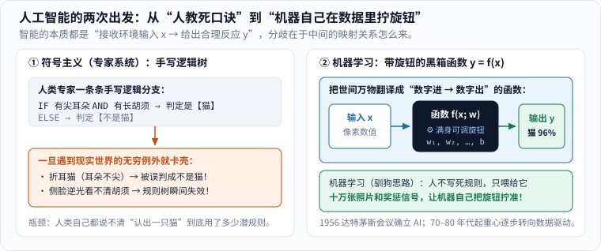
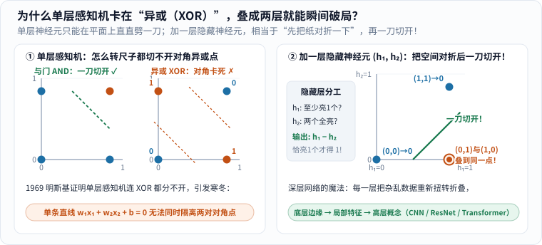
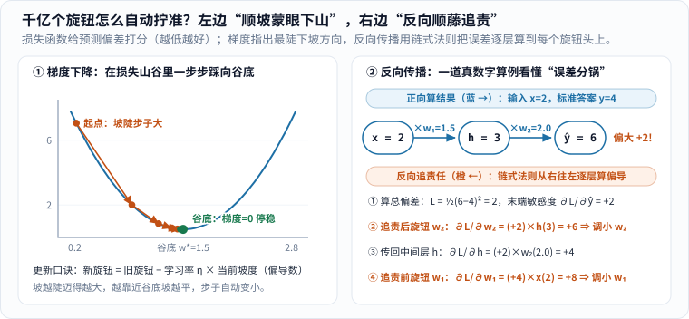

看到手机一秒钟认出照片里的猫、ChatGPT 对答如流、视频模型凭一句话生成街景时，很多没有编程背景的朋友都会有一种割裂感：

一方面，你知道电脑底层只是一堆只会算加减乘除的硅片；另一方面，它表现出来的反应又太像“开窍了”。**从死板的算术到看似聪明的反应，中间到底隔着哪几层窗户纸？**

这篇文章的梳理灵感来自漫士沉思录的 90 分钟科普长片[《一口气看明白人工智能和神经网络》](https://www.youtube.com/watch?v=LF9sd-2jCoY)。在保留其清晰主线的同时，我把里面的关键历史节点核对到了原始文献，并用刚建好的配图工具集亲手算出了 **6 幅分步图解**——不堆砌吓人的矩阵黑话，只用加减乘除和几何直觉，带你从头走完人工智能七十年的进化路。

---

## 一、智能的本质：别管它有没有灵魂，先看“输入 → 输出”

1956 年夏天，麦卡锡（John McCarthy）、明斯基（Marvin Minsky）、罗切斯特（Nathaniel Rochester）和香农（Claude Shannon）在美国达特茅斯学院组织了一场为期约两个月的暑期研讨会，正式确立了**“人工智能（Artificial Intelligence）”**这个名字。[1]（更早的 1950 年，图灵已经在论文里提出了著名的“模仿游戏”，也就是今天说的**图灵测试**：如果隔着屏幕聊天，人类分不清对面是人还是机器，就不妨承认它表现出了智能。）

如果先把哲学争论放一放，从最朴素的生物学往回看：草履虫碰到盐水会退开，小狗听到“坐下”会蹲好，老司机看到前车亮红灯会踩刹车。剥掉复杂的表象，一切智能行为都在干同一件事——

> **收集环境送来的信息（输入 $$x$$），做出针对性的合理反应（输出 $$y$$）。**

用初中数学的语言说，**人工智能找的就是一个庞大的函数 $$y = f(x)$$**：

- **识图函数**：输入 $$x$$ 是一张照片上成千上万个像素的明暗数值，输出 $$y$$ 是“猫：96%，狗：3%”；
- **对话函数**：输入 $$x$$ 是你刚敲进去的前半句话，输出 $$y$$ 是最合理的下一个词；
- **驾驶函数**：输入 $$x$$ 是摄像头和雷达画面，输出 $$y$$ 是方向盘转几度、刹车踩多深。

问题只剩下一个：**这个极其复杂的函数 $$f(x)$$，到底怎么造出来？** 为此，科学家走出了两条截然不同的路。

---

## 二、两条路线之争：手写“死口诀”，还是像训小狗一样调旋钮？

在 AI 诞生的头二三十年里，占统治地位的是**符号主义（Symbolism）**。它的想法非常符合直觉：既然人类是靠逻辑推理思考的，那就把人类专家脑子里的经验一条条写成 `如果 A 且 B，那么 C` 的规则库（也就是当年红极一时的**专家系统**）。

比如教电脑认猫，程序员手写规则：“如果有两只尖耳朵，而且有长胡须，而且有毛茸茸的尾巴，就是猫。”

结果一上真实照片就傻眼了（看图 1 左）：遇到一只天生耳朵耷拉的折耳猫怎么办？侧着脸看不见另一只耳朵怎么办？逆光拍糊了胡须怎么办？你补一千条“例外规则”，现实世界就能冒出一万零一种新意外——**因为连人类自己都写不出“认出一只猫”究竟动用了多少条潜意识规则。**

_图 1：左图是早期的符号主义路线——规则由人类手写，上限被人类能说清的经验锁死；右图是机器学习路线——不写死判断分支，而是造一个满身“可调旋钮（参数 $$w,b$$）”的通用函数盒，靠海量例题和奖惩信号自己把旋钮拧准。[单独打开图片](/assets/images/ai-neural-nets/rules-vs-function.svg)_

于是另一派研究者换了个活法——**机器学习（Machine Learning）**（图 1 右）。

你想想我们是怎么教小狗接飞盘的？你绝对不会给小狗讲空气动力学公式，而是让它反复试：接住了给肉干（奖励），跑偏了不给（惩罚），试上几百次，小狗脑子里的神经连接自己就调准了。

机器学习干的正是这件事：程序员只搭一个装满**可调旋钮（数学上叫参数或权重 $$w$$、偏置 $$b$$）**的空白函数架子，然后把十万张标好答案的猫狗照片喂进去。猜对了表扬，猜错了就微调旋钮——**规则不再由人类灌输，而是从数据里自己“长”出来。**

---

## 三、从一颗人造神经元到深度学习：为什么一道“异或题”冻住了二十年？

### 1. 感知机：模仿大脑神经元的“加权投票器”

那这个“装满旋钮的函数盒”到底长什么样？连接主义学派把目光投向了人类大脑：大脑由几百亿个神经元连成网，每个神经元接收上游传来的电信号，攒够了强度就“啪”地往下游放电。

**1957–1958 年**，心理学家罗森布拉特（Frank Rosenblatt）造出了第一个引起轰动的人工神经元模型——**感知机（Perceptron）**。[2] 它的算术简单到小学生都能算：

假设你要决定周末去不去郊游，看两个输入条件：天气好不好 $$x_1$$（好记 `1`，差记 `0`）、有没有同伴 $$x_2$$（有记 `1`，无记 `0`）。你给两个条件分配不同的重要程度（权重 $$w_1, w_2$$），加在一起跟心里的门槛（阈值，或写成偏置 $$b$$）比大小：

$$
\text{总分} = w_1 x_1 + w_2 x_2 + b.
$$

总分大于 $$0$$ 就出发（输出 `1`），否则宅家（输出 `0`）。放到平面坐标纸上看，分界线 $$w_1 x_1 + w_2 x_2 + b = 0$$ 其实就是**在平面上直直劈下一刀**！

### 2. AI 寒冬与破局：切不开的时候，就把纸“对折”一下！

当时媒体兴奋地宣称感知机很快就能认图、下棋甚至造出意识。[2] 然而在 **1969 年**，明斯基与帕佩特出版了《感知机》（*Perceptrons*）一书，用严格的几何证明浇下了一盆冰水：单层感知机连最简单的**异或问题（XOR：两个输入一真一假才输出 `1`，全真或全假都输出 `0`）**都永远解不出来！[2]

为什么解不出来？看图 2 左半边，一眼就明白了：

_图 2：左图里，“与门”只有一个橙点 `(1,1)`，一条绿虚线轻松切开；而“异或门”的两个橙点在左上 `(0,1)` 和右下 `(1,0)`，两个蓝点在左下 `(0,0)` 和右上 `(1,1)`——你在纸上怎么转直尺，都不可能一刀把两对对角点分开！右图加了一层包含两个神经元 $$h_1,h_2$$ 的隐藏层，相当于把左上和右下两个橙点**对折叠到了同一个位置 `(1,0)`**，从此一刀就能切开！[单独打开图片](/assets/images/ai-neural-nets/perceptron-xor.svg)_

这里要补一个常被误传的历史细节：明斯基和帕佩特其实知道“如果叠成多层网络就能表示异或”，当时真正卡住整个学界、让神经网络经费骤减陷入低谷的难题是——**加了中间隐藏层之后，一旦算错了，谁也不知道中间那几层的旋钮该怎么调！**[2][3]

直到多层网络与反向传播训练彻底打通（**多层感知机 MLP**），连接主义才满血复活。这里藏着一个初学者最容易忽略的灵魂细节：**为什么每层神经元算完加权和之后，非要套一个“激活函数”（比如把负数一律归零、正数原样保留的 $$\operatorname{ReLU}(z)=\max(0,z)$$）不可？**

不妨算笔初中代数账：如果中间不加这个“折弯”动作，第 1 层是直线变换 $$h = W_1 x + b_1$$，第 2 层还是直线变换 $$y = W_2 h + b_2$$，代入一展开：

$$
y = W_2(W_1 x + b_1) + b_2 = (W_2 W_1)x + (W_2 b_1 + b_2).
$$

合并同类项之后，**居然还是一条笔直的线！** 也就是说，不加非线性激活函数，哪怕硬叠一千层神经元，效果跟单层感知机完全一样，照样切不开异或对角点。正是每一层末尾那一下看似简单的“折弯”（$$\max(0,z)$$），才让多层网络真正拥有了把平面折叠、捏出任意复杂曲面的能力：第 1 层认亮暗边缘，第 2 层拼出眼睛耳朵，第 3 层组合成“猫脸”。

> **动手试一试**：Google 官方做了一个零代码可视化实验室 **[TensorFlow Playground](https://playground.tensorflow.org/)**（需联网并开启浏览器 JavaScript）。点进去选右侧四角异或（XOR）数据集，先把隐藏层设为 `0`，你会亲眼看到一条直线怎么转都切不开；接着加 `1` 层隐藏层、选 `ReLU` 激活点播放，几秒钟就能看见边界“折弯”把橙蓝点干净分开——再把激活函数改成 `Linear`（纯线性），哪怕叠满 6 层也会瞬间退化成一条直线！

### 3. 三次关键进化：从 CNN、ResNet 到大模型心脏 Transformer

不过，如果真让每一层的每个神经元都跟上一层“全员连线”（全连接），很快又会撞上三堵南墙：看高清图时旋钮多到算不动、叠到几十层信号传丢、读长文章时前后忘词。于是研究者接力完成了三次漂亮的架构改造（图 3）：

_图 3：现代深度学习的三座架构里程碑——① **CNN** 用 $$3\times 3$$ 滑窗全图复用同一套旋钮找局部轮廓；② **ResNet** 架起 $$y = F(x) + x$$ 跨层高架桥，哪怕新层学成 $$0$$ 梯度也能顺畅回传；③ **Transformer** 让全句任意两个词直接算相关性连线，一眼锁定“它”指代开头的“小狗”。[单独打开图片](/assets/images/ai-neural-nets/architecture-evolution.svg)_

1. **卷积神经网络（CNN，专攻视觉）**：认一只猫耳朵，根本不需要同时盯住整张照片的每一个角落。CNN 改用一个 $$3\times 3$$ 的小放大镜滑遍全图，所有位置**共享同一套旋钮**——参数量骤降上百倍，还天生不怕小猫在画面里左右平移。
2. **残差网络（ResNet，打通百层深度）**：网络叠到二三十层后，反向传播的误差信号在连乘中越传越微弱（梯度消失），反而越叠越笨。2015 年何恺明团队想出一招妙棋：在每几层旁边修一条**“原样抄送高架桥”**，让输出变成 $$y = F(x) + x$$。哪怕中间新加的层暂时什么都没学会（$$F(x)=0$$），求导时至少还有高架桥送来的 $$+1$$ 保底，网络一下子就能轻松叠到上百层甚至上千层！
3. **Transformer（2017，当今大模型统一底座）**：早期处理文字的模型像“击鼓传花”，必须从第 1 个字挨个往后传，句子一长前面就忘光了。2017 年 Google 团队发表《Attention Is All You Need》，彻底扔掉了排队传话，改用**自注意力机制（Self-Attention）** [4]：读到“小狗追不上兔子，因为**它**太累了”时，词元“它”直接发出查询信号，跟全句所有词同时算匹配度，瞬间把 76% 的注意力连回开头的“小狗”（如果改成“因为**它**跑太快”，注意力就会切给“兔子”）！更重要的是，整段话可以交给显卡**一并并行计算**，直接推开了千亿参数大模型的大门。

---

## 四、机器到底怎么“学”？蒙眼下山与反向追责

现在假设我们搭好了一座拥有**一千亿个旋钮**的神经网络。一开始所有旋钮都是瞎拧的，喂一张小猫照片进去，它胡猜“卡车：80%”。机器到底靠什么魔法，把一千亿个旋钮一步步拧到正确位置？

全靠微积分里的三兄弟：**损失函数、梯度下降、反向传播**（想复习微积分底子的读者，可同看本站《[微积分到底在算什么]()》）。

### 1. 损失函数与梯度下降：浓雾里蒙眼下山

首先得有一把尺子量一量“猜得有多离谱”——这就是**损失函数（Loss Function）**：猜得越准，损失分越接近 `0`；猜得越歪，损失分越高。于是“学习”这件事，在数学上就等价于**拧动所有旋钮，站到损失山谷的最低点去**！

可旋钮有一千亿个，人眼看不见这么高维的山谷，怎么办？想象你蒙着眼睛站在半山腰（图 4 左）：

1. 用脚往前后左右探一探，算出脚下哪个方向坡最陡——这个“最陡上坡方向”在微积分里就叫**梯度（Gradient，由各个旋钮的偏导数组成）**；
2. 既然要下山，就朝着**梯度的反方向**迈出一小步：$$\text{新旋钮} = \text{旧旋钮} - \text{步长}\times\text{坡度}$$；
3. 如此一步步往下踩，坡陡时步子大，到了谷底附近坡变平，步子自动缩小，稳稳停在谷底！

_图 4：左图是梯度下降——每次沿负梯度方向微调参数，把损失一步步压向谷底；右图是反向传播——用一个极简两层链条（输入 $$x=2$$，旋钮 $$w_1=1.5, w_2=2.0$$，结果算成 $$6$$ 而标准答案是 $$4$$），把“链式法则怎么给每层旋钮分锅”算得明明白白。[单独打开图片](/assets/images/ai-neural-nets/gradient-backprop.svg)_

### 2. 反向传播：一道算术题看懂“顺藤摸瓜分锅”

新的麻烦来了：如果有一千亿个旋钮，难道要挨个拧一下重跑一遍网络来测坡度吗？那样算一步就得算到天荒地老！

**1986 年**，鲁梅尔哈特（Rumelhart）、辛顿（Hinton）与威廉姆斯（Williams）在《自然》杂志上系统阐发了**反向传播算法（Backpropagation）**，用微积分的**链式法则**完美破解了这个算力死结。[3]

别怕公式，看图 4 右边的三节点真数字账本，十秒钟就能算懂：

- **正向算结果（蓝箭头 →）**：输入 $$x=2$$，经过前排旋钮 $$w_1=1.5$$ 变成中间量 $$h = 3$$；再经过后排旋钮 $$w_2=2.0$$ 算出预测值 $$\hat{y} = 6$$。对比标准答案 $$y = 4$$，**偏大了 $$+2$$**（损失 $$L = \frac12(6-4)^2 = 2$$）。
- **反向追责任（橙箭头 ←）**：现在从结果端往回倒查“谁该为这 $$+2$$ 的偏差负责”：
  1. **先查最后一棒 $$w_2$$**：它手里攥着中间量 $$h=3$$，$$w_2$$ 每往上调 1 个单位，最终输出就会放大 3 倍；乘上末端偏差 $$+2$$，它的责任（偏导数）就是 $$(+2)\times 3 = +6$$ —— 正数说明**把 $$w_2$$ 往小拧**！
  2. **把锅往前传给中间层 $$h$$**：因为 $$h$$ 后面乘了 $$w_2=2.0$$，所以 $$h$$ 的敏感度是 $$(+2)\times 2.0 = +4$$；
  3. **再查第一棒 $$w_1$$**：它手里攥着输入 $$x=2$$，乘上刚传回来的 $$+4$$，它的责任就是 $$(+4)\times 2 = +8$$ —— **把 $$w_1$$ 也往小拧**！

看见有多神了吗？哪怕网络有一百层、一千亿个旋钮，**只需要正向算一遍结果、再从尾到头反向传一遍误差信号，全身上下每一个旋钮的坡度就一次性全算完了！**[3]

---

## 五、举一反三的“泛化”，与机器犯傻的两个死穴

靠反向传播练出来的神经网络，为什么没见过的猫也能认出来？因为它不是把训练照片一张张存进硬盘，而是画出了一条顺滑的趋势曲线，学会了**举一反三（泛化，Generalization）**（图 5 左）。如果模型旋钮太多、训练过度，把数据里的偶然误差噪点也死记硬背下来（橙色虚线），就会变成“刷原题满分、一上考场全懵”的**过拟合**。

但即便泛化得很好，今天的深度神经网络依然有两个与人类截然不同的底层软肋（图 5 右）：

_图 5：左图展示恰当拟合（绿实线，能答对新考题）与死记噪点的过拟合（橙虚线）；右图复现 Goodfellow 等人 2015 年揭示的“对抗样本”账本——每个像素只做肉眼不可见的 0.02 微调，1000 个维度同向累加就能把模型彻底骗倒。[单独打开图片](/assets/images/ai-neural-nets/generalize-pitfalls.svg)_

1. **只认统计相关性，不懂物理因果**：如果训练集里的狼都在雪地里、哈士奇都在草地上，网络很容易偷懒把“背景有白雪”当成“狼”的铁证；遇到蜷缩成一团、烤得焦黄圆润的柴犬和吐司面包，也会因为局部纹理统计特征太像而傻傻分不清。
2. **高维空间的“对抗样本（Adversarial Examples）”**：2014–2015 年，Szegedy 与 Goodfellow 等人发现了一件毛骨悚然的事——给一张熊猫照片加上一层人眼完全看不出来的细微雪花，顶级神经网络竟会以 99% 的把握指认它是“长臂猿”！[5] 图 5 右下算清了这笔账：单个像素只改动 `0.02`（肉眼毫无察觉），但图片有成千上万个像素，只要黑客顺着模型的梯度方向让 **1000 个像素朝着同一个方向齐心协力各推一小把**（$$1000 \times 0.05 \times 0.02 = +1.00$$），累加起来的推力就足以把判断结果硬生生推过悬崖！

---

## 六、大语言模型（GPT）：把“完形填空”做到极致会发生什么？

理解了神经网络怎样拧旋钮，再看今天掀起巨浪的 ChatGPT 等大语言模型，神秘面纱一下子就揭开了。

人类说话写文章，通常是先在脑子里想好大意和逻辑骨架，再组织字句；而 **GPT（生成式预训练 Transformer）**的底层动作却出奇地朴素——它先把文字切成颗粒度介于字与词之间的**词元（Token）**并映射成高维向量，然后变身一台超级**“接话尾（预测下一个词元 Next-Token Prediction）”机器**（图 6 左）：[4]

_图 6：左图是自回归生成——输入“窗前明月”，模型给词表里所有候选词打概率分（“光”占 78.3%），采样选出“光”拼回末尾变成“窗前明月光”，再继续猜下一个字；右图是从“海量续写器”蜕变为“对话助手”的训练阶梯，以及为什么它会一本正经编造假话。[单独打开图片](/assets/images/ai-neural-nets/llm-next-token.svg)_

1. **第一阶段：万亿词“完形填空”预训练**。不用人工一条条标答案，直接把互联网上几万亿词的书籍、百科、代码遮住最后一个词，让拥有上千亿参数的 Transformer 去猜“下一个词是谁”。为了把这个看似简单的完形填空猜准，模型被迫在内部自发摸索出了语法结构、各国语言翻译、历史常识甚至代码逻辑（比如上文写“侦探发现凶手不在场，因此真正的嫌疑人是___”，不懂前面人物关系的模型根本猜不准最后一个名字！）。
2. **第二阶段：微调与人类反馈强化学习（RLHF）**。刚做完完形填空的基座模型只是一台“续写机”——你问它“怎么修电脑？”，它可能会顺嘴替你续写一句“怎么修电视？怎么修冰箱？”（因为它以为你在列问题清单！）。于是研究者再用高质量问答做指令微调，并让人类评审员给模型的多个回答排好坏、训练奖励模型（RLHF），才把它校准成今天懂礼貌、守底线的对话助手。
3. **为什么大模型会“一本正经胡说八道（幻觉）”？** 视频里借用了古希腊哲学家柏拉图著名的**“洞穴比喻”**：从小被锁在山洞里的囚徒，一辈子只见过火光投在石壁上的影子，从未摸过真实的苹果与火焰。纯文本大模型也是如此——它只统计过人类文字之间的共现概率，缺乏真实物理世界的亲身检验；一旦问到它的知识盲区，它的本能依然是**挑一串读起来最通顺、最像标准答案的词往下接**，于是就编出了惟妙惟肖的假论文编号或假法条。这也顺手解释了为什么纯靠接话尾的模型以前总数不清 `strawberry` 里有几个 `r`（因为它看到的是一整块词元编码，而不是逐个字母看字形），直到后来让它学会“先打草稿再作答”或调用代码工具，准确率才大幅跃升。

---

## 七、扩散模型与视频生成：把散开的墨水“倒放”成高清画面

文字可以一个词接一个词往下蹦，那 AI 画画（如 Stable Diffusion、DALL·E）和生成视频（如 Sora、Veo）又是怎么无中生有的？

这里用到了物理学里一个极美的直觉——**扩散模型（Diffusion Models）**。[6]

往一杯清水里滴一滴蓝墨水，墨水分子做布朗运动向四面八方散开，最后整杯水变成均匀混沌的浅蓝色——这个**正向扩散**过程再自然不过。反过来，如果让一杯均匀浑水里的分子自己聚回一滴清晰的墨水，现实里绝不可能发生；**但如果训练一个神经网络，专门记住墨水散开时每一步的逆向退路呢？**

看图 7 左右两栏的配合，你就看懂了 AI 生图的全部秘密：

_图 7：左图展示正向扩散（往清晰原图 $$x_0$$ 里一步步掺入高斯噪声直到变成纯随机雪花 $$x_{100}$$）与逆向去噪生成；右图在二维截面上真实计算出 5 个噪声起点顺着“评分函数 $$\nabla_x \log p(x)$$”指南针，穿越无意义的雪花荒漠、精准落回绿色“真实图像流形（金矿脉）”的轨迹。[单独打开图片](/assets/images/ai-neural-nets/diffusion-manifold.svg)_

- **高维空间里的“金矿脉”（流形假设）**：想象一张 $$1000\times 1000$$ 像素的图片。如果你拿骰子给每个像素随机填颜色，99.9999% 得到的都是毫无意义的电视雪花！所有人类看得懂的真实照片（小猫、晚霞、街景），在浩瀚的高维像素荒漠里只挤在一条极窄极薄的**“金矿脉”**上——数学上称为**低维流形（Manifold）**（关于高维空间与流形假设的严格几何推导，强烈推荐连起来读本站《[从高维球到 Embedding：维数灾难、流形假设与 AI 的几何直觉]()》）。
- **评分函数（Score Function）当指南针**：训练时，我们把亿万张真实照片一步步加噪推离金矿脉，让神经网络学会在荒漠的任何位置指出**“往哪个方向走，真实图像的概率密度最高”**（即评分函数 $$\nabla_x \log p_t(x)$$ [6]）。到了画图时，随便抓一团随机电视雪花当起点，跟着这枚指南针一步步剔除噪声，雪花就会像时光倒流一样凝聚成一张从未存在过的逼真照片！
- **从单张画到视频（Sora 的时空积木与物理短板）**：2024 年 2 月 OpenAI 在预览文生视频模型 **Sora** 的技术报告中展示了同一思路的升维——不再只切二维图像块，而是把视频沿着“长 × 宽 × 时间”切成一颗颗三维的**时空补丁（Spacetime Patches）**，交给 Diffusion Transformer 统一去噪。[7] 因为同时看顾前后许多帧的时空积木，它在镜头平移、人物被遮挡后重新出现时的**长程一致性**令人惊艳；但报告本身也坦承了它的软肋：**它学到的是视频画面的统计演化，而非真正的牛顿力学方程**，因此面对玻璃摔碎飞溅、吹灭蜡烛火焰、咬一口饼干留下精确牙印这类不可逆的**物理因果突变**时，依然容易露出破绽。[7]

---

## 八、尾声：当机器越来越会“接话”和“画图”，留给人的位置在哪？

把七十年的技术底牌全部摊开之后，我们面对 AI 既不必盲目恐慌，也不必轻视。

从上面的数学原理能清楚看到两件事：

1. **凡是规则固定、历史数据极其充沛、容错成本低的重复性环节**——比如套路化的公文摘录、初级翻译润色、常规模板代码、简单商业配图——正好落在函数拟合与自回归分布最擅长的舒适区里，工作方式必然会被重塑。
2. **但统计拟合的天花板，恰恰标出了人类最不可替代的领地**（关于工具进步与人的选择，也可同读本站随笔《[人工智能对人的影响]()》）：
   - **真实物理世界的复杂交互与临场应变**：走出屏幕的数据温室，进入充满意外摩擦与长尾突发状况的现实世界；
   - **区分“统计相关”与“真实因果”的判断力与责任承担**：AI 可以一秒列出十个看似通顺的方案，但核查真伪、权衡价值、为现实后果签字负责的只能是人；
   - **走出已有数据流形之外的原创破局与真实情感联结**：模型擅长在人类已有的“金矿脉”上做精妙插值，而第一次提出“相对论”或第一次用真挚的经历打动人心，依然源于真实活着的人。

在日常工作与学习里，最聪明的用法正是把 AI 当成**“不知疲倦的草稿员与发散副驾”**，而把**“提对真问题 + 交叉核验关键事实 + 拍板担责”**牢牢握在自己手里。看懂黑箱里那排旋钮是怎么转的，我们才不会把工具当成神明，而是稳稳握住方向盘的人。

## 参考资料

1. Wikipedia，*Dartmouth workshop*：1956 年达特茅斯人工智能暑期研究项目的四位发起人（麦卡锡、明斯基、罗切斯特、香农）与学科命名背景。<https://en.wikipedia.org/wiki/Dartmouth_workshop>
2. Wikipedia，*Perceptrons (book)*：1957–1958 年罗森布拉特的感知机模型，以及 1969 年明斯基与帕佩特对单层感知机无法计算异或（XOR）与连通性谓词的证明及历史影响。<https://en.wikipedia.org/wiki/Perceptrons_(book)>
3. Wikipedia，*Backpropagation*：链式法则反向自动微分原理，以及 1986 年 Rumelhart、Hinton 与 Williams 对多层神经网络特征学习与反向传播的推广。<https://en.wikipedia.org/wiki/Backpropagation>
4. Wikipedia，*Transformer (deep learning)*：2017 年 Vaswani 等人提出的注意力架构、词元（Token）嵌入与上下文并行建模。<https://en.wikipedia.org/wiki/Transformer_(deep_learning_architecture)>
5. Wikipedia，*Adversarial machine learning*：高维梯度扰动与对抗样本（逃逸攻击）机理。<https://en.wikipedia.org/wiki/Adversarial_machine_learning>
6. Wikipedia，*Diffusion model*：2015 年非平衡热力学启发、正向高斯加噪、逆向去噪与评分函数（Score-based）生成模型。<https://en.wikipedia.org/wiki/Diffusion_model>
7. Wikipedia，*Sora (text-to-video model)*：2024 年 2 月技术预览与报告背景、文生视频发展脉络及物理模拟局限。<https://en.wikipedia.org/wiki/Sora_(text-to-video_model)>
8. Google，*TensorFlow Playground*：浏览器端交互式神经网络与激活函数可视化实验室。<https://playground.tensorflow.org/>
9. 启发视频：漫士沉思录 Meditation Math，《【漫士科普】90分钟深度！一口气看明白人工智能和神经网络》，YouTube。<https://www.youtube.com/watch?v=LF9sd-2jCoY>

> 说明：本文七幅配图均为原创 SVG，已注册纳入本站统一配图工具包 `tools/visuals/algebra_logic.py`，可通过 `python tools/visuals.py build ai-neural-nets` 一键重算生成；脚本自动断言验证了异或隐藏层空间折叠、CNN/ResNet/Attention 参数与梯度关系、反向传播链式法则与有限差分的一致性、高维对抗扰动累加、Softmax 概率归一，以及评分函数梯度场向低维流形的收敛轨迹。
{: .prompt-tip }
