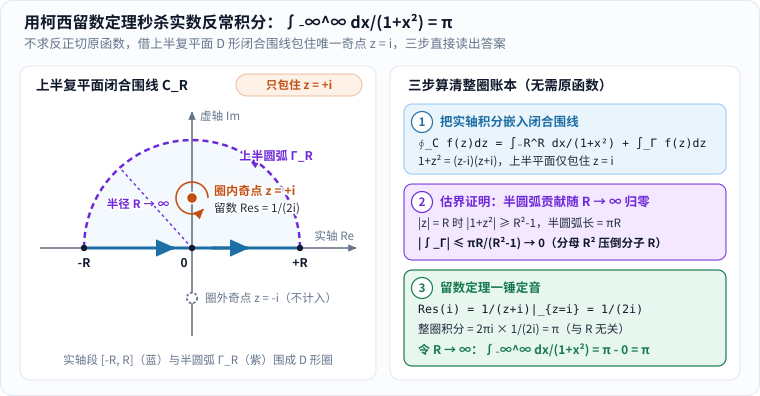

牛顿和莱布尼茨发明微积分之后的一百多年里，物理学家和天文学家拿它算行星轨道、算大炮弹道、算悬链线桥梁受力，几乎百发百中；可只要有人较真追问一句底层逻辑，最顶尖的数学家也会陷入一阵尴尬的沉默。

站出来给这座摇摇晃晃的宏伟大厦重打地基的人，叫**奥古斯丁-路易·柯西（Augustin-Louis Cauchy，1789–1857）**。[1] 今天任何一本大学《高等数学》翻开前三章——极限、连续、收敛判别法、柯西列、定积分——你读到的整套思维秩序，几乎都是这位法国工程师在两百年前亲手立下的规矩；而到了复变函数里，他又摇身一变，教我们用“绕着奇点画个圈”的神仙手法，三步秒杀实数世界里算断笔杆的定积分。

甚至连他一生中最著名的一次“翻车”，也意外催生了现代数学分析最细腻的核心概念——**一致收敛**。今天我们就顺着具体的数字攻防战，一步步拆解柯西到底改写了什么。

---

## 一、微积分的地基危机，与凌晨四点起床修港口的年轻工程师

### 1. 贝克莱主教的毒舌追问：“已死量的鬼魂”与发散级数乱象

早年微积分的尴尬到底出在哪里？拿最简单的例子来说：求抛物线 $$y = x^2$$ 在点 $$x$$ 处的瞬时变化率（切线斜率）。18 世纪的标准计算分两步走：

1. **第一步（坚称 $$\Delta x \neq 0$$）**：给自变量加一点点增量 $$\Delta x$$，算割线的平均斜率：

$$
\frac{(x+\Delta x)^2 - x^2}{\Delta x} = \frac{2x\Delta x + (\Delta x)^2}{\Delta x} = 2x + \Delta x.
$$

请注意，这一步之所以敢把分子分母里的 $$\Delta x$$ 上下约掉，**绝对前提是 $$\Delta x \neq 0$$**——因为在算术里，拿 $$0$$ 作除数是当场出局的低级错误！

2. **第二步（转脸又令 $$\Delta x = 0$$）**：约分墨迹还没干，下一行紧接着宣布：“由于 $$\Delta x$$ 无穷小、可以忽略不计，抹掉它，斜率正好等于 $$2x$$！”——**前一秒为了做除法赌咒发誓它不是 $$0$$，后一秒为了甩掉尾巴又把它当成 $$0$$！**

1734 年，英国主教乔治·贝克莱（George Berkeley）出版了一本辛辣至极的小册子《分析学家》（*The Analyst*），矛头直指牛顿的“流数”与莱布尼茨的“无穷小”：你们数学家总嘲笑神学家轻信教条，可你们自己在同一道题里把同一个量一会儿当非零、一会儿当零，这算哪门子严密逻辑？这些无穷小量难道不是**“已死量的鬼魂（ghosts of departed quantities）”**吗？[3]

更让人头疼的还有无穷级数。当时许多学者毫无顾忌地像摆弄有限多项式一样摆弄无穷和。比如面对格兰迪级数：

$$
1 - 1 + 1 - 1 + 1 - 1 + \cdots
$$

- 甲两两配对括起来：$$(1-1) + (1-1) + (1-1) + \cdots = 0 + 0 + 0 + \cdots = 0$$；
- 乙留出排头的 $$1$$ 再括：$$1 - (1-1) - (1-1) - \cdots = 1 - 0 - 0 - \cdots = 1$$；
- 丙设总和为 $$S$$，写出 $$S = 1 - (1 - 1 + 1 - \cdots) = 1 - S$$，移项解出 $$S = \frac{1}{2}$$！

同一串加减法，居然能算出 $$0$$、$$1$$、$$\frac{1}{2}$$ 三个互相打架的答案。没人说得清谁合法、谁犯规。

### 2. 从瑟堡军港工地到巴黎讲台：先做工程师，再立数学铁律

受不了这笔糊涂账的柯西，并不是一开始就坐在象牙塔里的纯数学教授（生平据 MacTutor 传记 [1]）：

- **动荡童年与大师嘱托**：1789 年柯西生于法国大革命爆发后的巴黎。恐怖统治时期全家逃往乡下阿尔克伊避难，他在信里回忆最艰苦时全家每天连半磅面包都分不到。邻居恰好是拉普拉斯和拉格朗日两位大数学家。拉格朗日很早就看出小柯西惊人的数学天分，特地警告他父亲：“在十七岁前千万别让他碰一本高等数学书！先给他打好古典文学和语言的底子，否则他会变成只会算账却不会写文章的匠人。”
- **海港工地上的凌晨四点**：1805 年柯西以全国第二名考入巴黎综合工科学校（École Polytechnique），随后进入桥梁公路学校。1810 年，21 岁的他作为土木工程师被派往英吉利海峡边的瑟堡海港，为拿破仑舰队督建防波堤与港池。他的行李箱里只装了四本书：维吉尔诗集、《效法基督》、拉普拉斯的《天体力学》和拉格朗日的《解析函数论》。面对家人担心他累坏身体的来信，他回信写道：“我每天凌晨四点起床，从早忙到晚……繁重的工作非但没让我疲惫，反而让我精神百倍。”
- **789 篇论文的高产奇迹**：工地闲暇里，他在 1811 年顺手证明了困扰几何学界两千年的**欧几里得凸多面体刚性定理**（用硬纸板粘好的凸多面体，哪怕所有棱边都是活页铰链，只要每个面的形状固定，整个立体就绝对捏不歪）。1812 年回到巴黎后，他全力投入数学研究，一生发表了惊人的 **789 篇论文**，身后编纂的《柯西全集》足足 **27 大卷**，论文总数在数学史上仅次于欧拉。曾有段时间他每周都往巴黎科学院塞长篇巨稿，逼得科学院专门出台规定限制每期《院刊》单篇论文不得超过四页！[1]

正是那段既要算准海浪冲击力、又要保证堤坝绝不坍塌的工程师经历，锻造了柯西骨子里的执念：**公式不仅要“算得快”，更必须清楚交代它在什么边界内绝对可靠。**

---

## 二、极限与柯西列：把“无限接近”变成零死角的攻防规矩

### 1. 永远别除以 0：用 $$f(x)=x^2$$ 在 $$x=3$$ 处打一场真刀真枪的 $$\varepsilon$$–$$\delta$$ 攻防战

**1821 年**，柯西为巴黎综合工科学校编写出版了里程碑式的讲义《分析教程》（*Cours d'analyse*），在序言里庄严宣告：微积分必须抛弃似是而非的“代数一般性”，拥有“像欧氏几何一样的全部严格性”。[2]

怎么把贝克莱嘲笑的“鬼魂”彻底请出微积分？先看图 1 左右两边的对照：

_图 1：左图是 18 世纪微积分的两处逻辑硬伤；右图是柯西的改造——永远不需要令 $$\Delta x=0$$，而是把“极限”改写成一场“对手任意指定误差窄带 $$L\pm\varepsilon$$，我负责把变量永久关进带内”的可验证挑战。[单独打开图片](/assets/images/cauchy/calculus-crisis.svg)_

柯西在《分析教程》第一章一锤定音地改写了“极限”与“无穷小”的身份：[2]

> **当同一变量依次所取的值无限逼近某个固定值，最终与它的差能够“想多小就多小（小于任意给定的正数）”时，这个固定值就叫做它的极限。** 而所谓“无穷小量”，根本不是什么既像 $$0$$ 又不是 $$0$$ 的幽灵微粒，**仅仅是一个以 $$0$$ 为极限的普通变量**！[2]

后来魏尔斯特拉斯（Karl Weierstrass）把柯西的这段话打磨成了今天无懈可击的 **$$\varepsilon$$–$$\delta$$（伊普西龙—德尔塔）攻防博弈**。很多人初学大学高数时被满屏希腊字母吓住，其实只要亲手打赢一局具体的数字决斗，你立刻就能尝到“零糊弄”的爽快感！

**实战决斗：证明当 $$x \to 3$$ 时，$$x^2$$ 的极限严格等于 $$9$$。**

游戏规则是**对手先出招，我们后接招**：

- **第 1 步（挑剔的对手划定目标窄带 $$\varepsilon$$）**：对手不信 $$x^2$$ 能任意贴近 $$9$$，拍桌子要求：“我只允许函数值跟 $$9$$ 相差不到百分之一！也就是必须保证 $$|x^2 - 9| < 0.01$$（这里 $$\varepsilon = 0.01$$）。你敢不敢在 $$3$$ 附近给出一个明确的控制半径 $$\delta$$，使得只要 $$0 < |x - 3| < \delta$$，函数值就**百分之百**落在 $$(8.99,\,9.01)$$ 里面？”
- **第 2 步（拆解误差，揪出讨厌的浮动因子）**：我们把目标差距因式分解：

$$
|x^2 - 9| = |x - 3|\cdot |x + 3|.
$$

看清难点了吗？我们手里能直接控制的是 $$|x - 3|$$，但它旁边还粘着一个会随 $$x$$ 晃动的因子 $$|x + 3|$$！怎么给 $$|x + 3|$$ 封顶？

- **第 3 步（先套一道粗篱笆，锁死浮动因子）**：我们自己先主动立第一条规矩——先要求 $$x$$ 离 $$3$$ 的距离不超过 $$1$$，即令 $$|x - 3| < 1$$。那么 $$x$$ 就被关进了区间 $$(2,\,4)$$ 里；两边同加 $$3$$，立刻得到 $$5 < x + 3 < 7$$，也就是说浮动因子被死死按住了：**$$|x + 3| < 7$$**！
- **第 4 步（收紧细篱笆，交出精确的 $$\delta$$）**：既然 $$|x + 3| < 7$$，那么只要再让 $$7\cdot |x - 3| \le 0.01$$，即 $$|x - 3| \le \frac{0.01}{7} = \frac{1}{700}$$，乘积就必定小于 $$0.01$$！为了同时满足粗篱笆（$$< 1$$）和细篱笆（$$< \frac{1}{700}$$），我们取两者中更严苛的那个：

$$
\delta = \min\!\left(1,\ \frac{0.01}{7}\right) = \frac{1}{700} \approx 0.001428.
$$

- **第 5 步（当场验货，滴水不漏）**：把 $$\delta = \frac{1}{700}$$ 拍回对手桌上！随便拿一个满足 $$0 < |x - 3| < \frac{1}{700}$$ 的数来试，比如 $$x = 3.001$$（距离 $$0.001 < 0.001428$$）：算出 $$3.001^2 = 9.006001$$，与 $$9$$ 的误差是 $$0.006001 < 0.01$$，稳稳命中窄带！更妙的是，哪怕对手下一轮把 $$\varepsilon$$ 缩到 $$10^{-100}$$，我们也只需按同一套配方交出 $$\delta = \frac{\varepsilon}{7}$$，永远立于不败之地！

再回头看刚才求导的 $$2x + \Delta x$$：在柯西的规则下，**$$\Delta x$$ 从头到尾都规定满足 $$0 < |\Delta x| < \delta$$（严格不等于 $$0$$！）**，所以第一步上下约掉 $$\Delta x$$ 合情合理；第二步要让 $$|(2x + \Delta x) - 2x| = |\Delta x| < \varepsilon$$，只需直接交出 $$\delta = \varepsilon$$ 即可——既没除以 $$0$$，也没请任何“鬼魂”帮忙，困扰数学界近百年的贝克莱悖论当场烟消云散！

顺手，$$1 - 1 + 1 - 1 + \cdots$$ 的争吵也一槌定音：柯西规定，无穷级数的和**只能定义为前 $$n$$ 项部分和 $$S_n$$ 的极限**。这串级数的部分和依次是 $$1, 0, 1, 0, 1, 0, \dots$$，当对手设下窄带宽度 $$\varepsilon = 0.2$$ 时，没有任何一个固定值 $$L$$ 能同时把 $$0$$ 和 $$1$$ 装进 $$(L-0.2,\,L+0.2)$$ 里——**它根本不收敛，没有和**，乱加括号凑出的 $$1/2$$ 在普通收敛意义下纯属违规操作！

### 2. 柯西列与 $$\sqrt{2}$$ 迭代：连终点在哪都看不见，为什么有效数字每一轮翻倍？

解决了“验证一个已知终点 $$L$$”，紧接着就撞上了一个更现实、更刁钻的工程难题：**很多时候我们手头只有一台不断吐出近似值的迭代机器，事先根本不知道终点的精确公式长什么样——甚至终点在当前数系里还是个“不存在的空洞”，怎么断定这串计算一定有归宿？**

拿古巴比伦泥板就记载过、后来归入牛顿切线法的求 $$\sqrt{2}$$ 配方来亲手算一遍（图 2 左）：我们要找面积等于 $$2$$ 的正方形边长。

_图 2：左图解释迭代公式 $$x_{n+1}=\frac{1}{2}(x_n + 2/x_n)$$ 的几何来历——面积固定为 $$2$$ 的长方形，每次把宽和高取平均就迅速变方；右图把数轴区间 $$[1.4138,1.4170]$$ 放大 150 倍，所有分数项越挤越紧，但它们聚拢的中心 $$\sqrt{2}$$ 在“只有有理数”的数轴上却是一个空心针眼。[单独打开图片](/assets/images/cauchy/cauchy-sequence.svg)_

规则简单到小学生都会算：如果当前猜的宽 $$x_n$$ 偏小，那高 $$\frac{2}{x_n}$$ 就一定偏大；**把宽和高加起来除以 2 取平均**，当作下一轮的新宽：

$$
x_{n+1} = \frac{1}{2}\left(x_n + \frac{2}{x_n}\right) = \frac{x_n^2 + 2}{2x_n}.
$$

这台小机器跑得有多快？我们不需要猜，只需把上式两边平方再减去 $$2$$，三行初等代数就能把它的**误差缩减引擎**拆得一清二楚：

$$
x_{n+1}^2 - 2 = \frac{(x_n^2 + 2)^2}{4x_n^2} - 2 = \frac{x_n^4 + 4x_n^2 + 4 - 8x_n^2}{4x_n^2} = \frac{(x_n^2 - 2)^2}{4x_n^2} !
$$

盯着最右边那个平方号 **$$(x_n^2 - 2)^2$$** 看！它意味着：**下一轮的面积误差，等于上一轮误差的平方再除以约 $$8$$！** 如果这一步误差是 $$10^{-3}$$（精确到小数点后 3 位），下一步误差直接变成 $$\sim 10^{-6}$$（6 位），再下一步变成 $$\sim 10^{-12}$$（12 位）——这叫**二次收敛（quadratic convergence）**，每算一步，正确的小数位数直接**翻一倍**！

列成账单核对前 5 步（从整数 $$x_1 = 1$$ 起步）：

| 步数 $$n$$ | 精确分数 $$x_n = p_n/q_n$$ | 小数近似（下划线为已锁死正确的位） | 面积误差 $$x_n^2 - 2$$（注意分子恒为 $$1$$！） |
| :---: | :---: | :--- | :--- |
| $$1$$ | $$1/1$$ | $$\underline{1}.000000000000$$ | $$-1$$ |
| $$2$$ | $$3/2$$ | $$\underline{1}.500000000000$$ | $$+\dfrac{1}{4} = 0.25$$ |
| $$3$$ | $$17/12$$ | $$\underline{1.41}6666666667$$ | $$+\dfrac{1}{144} \approx 6.94\times 10^{-3}$$ |
| $$4$$ | $$577/408$$ | $$\underline{1.41421}5686275$$ | $$+\dfrac{1}{166464} \approx 6.01\times 10^{-6}$$ |
| $$5$$ | $$665857/470832$$ | $$\underline{1.41421356237}4$$ | $$+\dfrac{1}{221682772224} \approx 4.51\times 10^{-12}$$ |

短短算到第 5 步（只做了四次取平均），分数 $$\frac{665857}{470832}$$ 就已经跟真值 $$\sqrt{2} \approx 1.414213562373\dots$$ 对齐了整整 **11 位小数**！（顺便欣赏一个数论彩蛋：从第 2 步起，分子 $$p_n$$ 和分母 $$q_n$$ 永远满足佩尔方程 $$p_n^2 - 2q_n^2 = 1$$！）

现在盯住图 2 右下的 150 倍放大镜，体会柯西最精彩的一个转身：**哪怕我事先根本不知道 $$\sqrt{2}$$ 这个符号，只要看队伍内部的成员彼此之间是不是越抱越紧，就能判定它在收敛！**

具体来说，如果对任意给定的微小间距 $$\varepsilon > 0$$，都能找到某一项 $$N$$，使得**第 $$N$$ 项往后的任意两项 $$x_m, x_n$$ 之间的距离都满足 $$|x_m - x_n| < \varepsilon$$**，这串数就叫做**柯西列（Cauchy sequence）**。[1]

这一招不仅给了分析学“不看终点判收敛”的尚方宝剑（**柯西收敛准则**），还一针见血地揭穿了“有理数”与“实数”的根本区别：

- 上表里的 $$1,\, \frac{3}{2},\, \frac{17}{12},\, \frac{577}{408},\, \dots$$ 每一项分子分母全是整数，**百分之百是有理数（分数）**，而且它们毫无疑问构成一串柯西列；
- 可它们拼命聚拢过去的中心 $$\sqrt{2}$$ 却不是分数！也就是说，在“只有分数”的有理数轴 $$\mathbb{Q}$$ 上，这串柯西列瞄准的靶心竟然是一个**漏风的针眼空洞**（有理数轴不完备）！
- 半个世纪后，康托尔（Georg Cantor）正是顺着柯西的脚印，把“每一串有理数柯西列瞄准的归宿”直接定义为实数，彻底把数轴上无穷无尽的无理数针眼补得严丝合缝，造出了**完备的实数轴 $$\mathbb{R}$$**（关于用有理数筛子夹逼无理数的另一种视角，可参看本站姊妹篇《[无理数怎么比较]()》）。

---

## 三、把微积分搬上复平面：绕圈数角度，怎样秒杀硬算不出的实数积分？

如果柯西只整理了实数微积分，他已经足够青史留名；但他另一半更具魔幻色彩的功绩，是几乎凭一己之力开辟了**复变函数论**——1814 年提交复平面定积分长篇论文，1825 年确立复围线积分定理，1826 年正式创立**留数演算（calculus of residues）**。[1]

### 1. “站桩转脖子”看懂 $$\oint \frac{dz}{z-a} = 2\pi i$$：为什么距离全抵消，只剩净转角？

很多读者第一次见到复平面围线积分公式 $$\oint_C \frac{dz}{z-a} = 2\pi i$$ 时都会一头雾水：“在带虚数 $$i$$ 的平面上积分是什么意思？为什么不管圈画得多大、多扁，算出来永远蹦出圆周率 $$\pi$$ 乘 $$2i$$？”

其实只要把它翻译成**“站桩盯小狗转脖子”**的几何画面，三分钟就能彻底看透（图 3）：

_图 3：在复平面（横轴为实部，纵轴为虚部 $$i$$）上，把橙色奇点 $$a$$ 想成站在原地的人，蓝色闭合圈是小狗 $$z$$ 逆时针跑的一圈路线。左图人站在圈内，眼睛跟着小狗跑完一圈，脖子必须逆时针转满 $$+360^\circ$$（即 $$+2\pi$$ 弧度），积分恒为 $$2\pi i$$；右图人站在圈外，视线最多往上偏 $$40^\circ$$、再往下偏 $$40^\circ$$，回到起点时净转角严格为 $$0^\circ$$，积分恒为 $$0$$！[单独打开图片](/assets/images/cauchy/residue-circle.svg)_

为什么这个积分恰恰是在“量转头角度”？我们把从奇点 $$a$$ 指向动点 $$z$$ 的向量，用**距离 $$r$$** 和**方向角 $$\theta$$** 写成极坐标形式 $$z - a = r(\cos\theta + i\sin\theta) = r e^{i\theta}$$。当动点 $$z$$ 往前迈出微小一步 $$dz$$ 时，由乘法求导法则 $$dz = e^{i\theta}dr + i r e^{i\theta}d\theta$$，两边同除以 $$z - a = r e^{i\theta}$$，奇迹出现了——复指数 $$e^{i\theta}$$ 当场约得干干净净：

$$
\frac{dz}{z-a} = \frac{dr}{r} + i\,d\theta = d(\ln r) + i\,d\theta !
$$

原来每走一小步，$$\frac{dz}{z-a}$$ 干的活儿刚好拆成互不干扰的两半：**实部 $$d(\ln r)$$ 记录离 $$a$$ 远近的对数变化，虚部 $$i\,d\theta$$ 记录视线方向角的变化！** 现在沿着**任意一条不穿过 $$a$$ 的闭合圈 $$C$$** 走完一圈，精准回到出发点：

1. **实部账单（看远近）永远归零**：不管中途跑远了还是跑近了，既然终点和起点是同一个点，最终距离 $$r_{\text{终}}$$ 严格等于初始距离 $$r_{\text{始}}$$，因此 $$\ln r_{\text{终}} - \ln r_{\text{始}} = 0$$——**实部首尾彻底抵消，一分不剩！**
2. **虚部账单（看净转角）只看包没包住 $$a$$**：
   - **当奇点 $$a$$ 被包在圈里面（图 3 左）**：不管这条闭合曲线是标准圆、扁椭圆还是歪歪扭扭的土豆圈，只要逆时针绕了 $$a$$ 一整圈回到原地，你的脖子就实打实逆时针转满了 $$360^\circ$$，方向角净增 **$$\Delta\theta = +2\pi$$** 弧度！乘上前面的 $$i$$，积分雷打不动就是 **$$2\pi i$$**！
   - **当奇点 $$a$$ 落在圈外面（图 3 右）**：函数 $$\frac{1}{z-a}$$ 在圈肚子里处处光滑完好（没有分母为 $$0$$ 的爆炸点）。人站在圈外盯小狗跑一圈，脖子先往左偏 $$40^\circ$$，再往右偏到 $$-40^\circ$$，最后乖乖回正，**一去一回净转角 $$\Delta\theta = 0$$**，积分严格等于 **$$0$$**！

这就是**柯西积分定理**与**柯西留数定理**的灵魂：如果一个复变函数 $$f(z)$$ 在闭合围线内除了几个孤立的“爆炸奇点” $$a_1, a_2, \dots$$ 之外处处解析（可微），那么所有不含 $$\frac{1}{z-a_k}$$ 的普通幂次项绕一圈统统抵消成 $$0$$，**整条复杂围线的积分，只等于 $$2\pi i$$ 乘以圈内所有奇点处 $$\frac{1}{z-a_k}$$ 那一项的系数之和**——这个系数被柯西起名为**留数（Residue，意为“其他项全抵消后唯一留下来的余孽”）**！[1]

### 2. 实战演练：不背反正切公式，用上半圆围线三步算出 $$\int_{-\infty}^{\infty}\frac{dx}{1+x^2}=\pi$$

你可能会问：“实数世界里的定积分，跟虚数平面绕圈有什么关系？”——这恰恰是留数定理最震撼的杀手锏：**实数轴本来就是复平面横轴的那条边！当一道实数积分在实轴上找不出初等原函数（比如 $$\frac{\cos x}{1+x^2}$$、$$\frac{\sin x}{x}$$）时，只要往上半平面借一段半圆弧拼成闭合圈，就能不求原函数直接“隔空取物”！**

我们拿大家熟悉的经典反常积分 $$\int_{-\infty}^{\infty} \frac{dx}{1+x^2}$$ 做一次完整拆解——假装你把微积分课本里的反正切函数 $$\arctan x$$ 忘得一干二净，看柯西怎样只凭代数因式分解，三步把它算成 $$\pi$$（对照图 4）：

_图 4：先看左图的 D 形闭合路径——沿实轴从 $$-R$$ 走到 $$+R$$（蓝线），再沿上半圆弧 $$\Gamma_R$$ 逆时针绕回 $$-R$$（紫虚线），圈内恰好只包住上半平面的奇点 $$z=+i$$，把下半平面的 $$z=-i$$ 关在门外；再顺着右图 ①→②→③ 走完三步推演。[单独打开图片](/assets/images/cauchy/semicircle-residue-eval.svg)_

- **第 ① 步（借桥成圈，清点奇点）**：把被积函数里的实数 $$x$$ 换成复数 $$z$$，写成 $$f(z) = \frac{1}{1+z^2}$$。在实数轴上，$$1+x^2 \ge 1$$ 永远不为 $$0$$，看不出哪里藏着圆周率 $$\pi$$；可一旦升到复平面，分母立刻分解成：

$$
1 + z^2 = (z - i)(z + i).
$$

原来在虚轴上下各藏着一颗奇点：上半平面的 **$$z = +i$$** 和下半平面的 **$$z = -i$$**！我们取一个大于 $$1$$ 的大半径 $$R$$，把实轴线段 $$[-R, R]$$ 和上半圆弧 $$\Gamma_R$$（$$|z|=R,\ \operatorname{Im}z \ge 0$$）逆时针拼成一条 **D 形闭合围线 $$C_R$$**（图 4 左）。整圈积分自然拆成两段之和：

$$
\oint_{C_R} \frac{dz}{1+z^2} = \int_{-R}^{R} \frac{dx}{1+x^2} + \int_{\Gamma_R} \frac{dz}{1+z^2}.
$$

- **第 ② 步（放半径 $$R \to \infty$$，证明半圆弧那一段自动归零）**：借来的紫色半圆弧 $$\Gamma_R$$ 会不会添乱？我们来估一下它的绝对上限：在半径为 $$R$$ 的圆弧上，$$|z| = R$$，由三角不等式，分母模长至少是 $$|1 + z^2| \ge |z|^2 - 1 = R^2 - 1$$，所以圆弧上每一点的被积函数大小都不超过 $$\frac{1}{R^2 - 1}$$；再乘上半圆弧的总长度 $$\pi R$$，立刻锁死上限：

$$
\left|\int_{\Gamma_R} \frac{dz}{1+z^2}\right| \le \frac{1}{R^2 - 1}\times \pi R = \frac{\pi R}{R^2 - 1}.
$$

分子是一次方 $$R$$，分母是二次方 $$R^2$$！比如 $$R=100$$ 时它不到 $$0.032$$，$$R=10^6$$ 时不到 $$3.2\times 10^{-6}$$——当半径 $$R \to \infty$$ 推向无穷远时，**半圆弧上的积分严格趋于 $$0$$**！

- **第 ③ 步（捡圈内唯一留数，答案当场落袋）**：回头看 D 形圈肚子里，下半平面的 $$z = -i$$ 在圈外根本不用管，**圈内从始至终只包住了唯一一颗一阶奇点 $$z = +i$$**！把 $$f(z)$$ 写成 $$\frac{1/(z+i)}{z - i}$$，在 $$z = i$$ 附近，分子 $$\frac{1}{z+i}$$ 就是那个平滑系数，直接代入 $$z = i$$ 读出留数：

$$
\operatorname{Res}(f,\, i) = \left.\frac{1}{z + i}\right|_{z = i} = \frac{1}{2i}.
$$

套上留数定理，无论 $$R$$ 是 $$2$$ 还是 $$10^{100}$$，整条 D 形圈的积分恒定不变：

$$
\oint_{C_R} \frac{dz}{1+z^2} = 2\pi i \times \operatorname{Res}(f,\, i) = 2\pi i \times \frac{1}{2i} = \pi !
$$

虚数单位 $$i$$ 上下约掉，消失得无影无踪！最后令 $$R \to \infty$$，第 ① 步等式里的半圆弧归零，实轴线段铺满整个 $$(-\infty, +\infty)$$，当场收获：

$$
\int_{-\infty}^{\infty} \frac{dx}{1+x^2} = \pi.
$$

连求导的逆运算都没碰一下，纯靠复平面包住 $$z=i$$ 转了一圈，圆周率 $$\pi$$ 就自己跳了出来！如果把分子换成 $$\cos x$$（实部来自 $$e^{ix}$$，在上半平面 $$e^{i(x+iy)} = e^{ix}e^{-y}$$ 衰减得更快！），用完全相同的三步，瞬间就能算出实微积分极难下手的傅里叶积分 $$\int_{-\infty}^{\infty}\frac{\cos x}{1+x^2}dx = \frac{\pi}{e}$$。这就是为什么物理学家费曼等人总感慨：有时候连接两个实数真理的最短路径，偏偏要穿过复平面！

---

## 四、大师也会马失前蹄：1821 年的著名疏忽与“一致收敛”的诞生

讲到这里，柯西仿佛是一台永不犯错的逻辑机器。但数学史最迷人的地方恰恰在于：**就连这位亲手给微积分立规矩的严密性宗师，也在自己最得意的《分析教程》里栽过一个著名的跟头——而正是这个跟头，把分析学推向了真正的成熟。**

### 1. 柯西的“显然成立”与年轻阿贝尔的锯齿波反例（1826）

在 **1821 年**《分析教程》第六章里，柯西写下并“证明”了一条看上去无比顺眼的定理：[2][4]

> **柯西当年的断言**：如果无穷级数 $$u_1(x) + u_2(x) + u_3(x) + \cdots$$ 的每一项 $$u_k(x)$$ 都是连续光滑的函数，并且级数在区间上每一点都收敛于和函数 $$S(x)$$，那么和函数 $$S(x)$$ 也必定是连续函数。

凭直觉想，这简直太对了吧？有限个光滑波浪叠在一起当然还是光滑波浪，无穷多个光滑波浪叠在一起，难道还能凭空撕裂出一道垂直断崖不成？

**5 年后的 1826 年**，年仅 24 岁的挪威数学家尼尔斯·亨利克·阿贝尔（Niels Henrik Abel）在研究二项式级数论文的脚注里，轻轻放上了一个让全欧洲数学家倒吸一口凉气的反例（源自傅里叶热传导研究中的正弦级数，详见本站《[傅里叶怎样把温度拆成波]()》）：[4]

$$
S(x) = \sin x - \frac{\sin 2x}{2} + \frac{\sin 3x}{3} - \frac{\sin 4x}{4} + \cdots = \sum_{k=1}^{\infty} (-1)^{k+1}\frac{\sin(kx)}{k}.
$$

来检查一下阿贝尔这串级数的“体检报告”（对照图 5 左）：

1. **每一项都光滑无比**：第 $$k$$ 项 $$(-1)^{k+1}\frac{\sin(kx)}{k}$$ 是正弦曲线，在整个实轴上处处连续、任意阶可导，连一个棱角都没有；
2. **每一个点 $$x$$ 上都实打实收敛**：无论你代入哪个实数 $$x$$，这串无穷和都有唯一确定的有限极限值；
3. **但在 $$x = \pi$$ 处，和函数当场摔断成两截！** 在 $$(-\pi, \pi)$$ 内部，这串正弦波叠加的精确极限是笔直的斜坡 $$S(x) = \frac{x}{2}$$，所以当 $$x$$ 从左边逼近 $$\pi$$ 时，高度一路爬向 **$$+\frac{\pi}{2} \approx +1.571$$**；由 $$2\pi$$ 周期性，当 $$x$$ 从右边逼近 $$\pi$$ 时，高度却是 **$$-\frac{\pi}{2} \approx -1.571$$**；而正巧站在 $$x = \pi$$ 这一点上时，因为每一项 $$\sin(k\pi) = 0$$，前 $$N$$ 项和 $$S_N(\pi) = 0 + 0 + \cdots + 0 = 0$$ 永远被死死钉在 **$$0$$** 上！

![左图精确绘制交错正弦级数前 1、3、15 项部分和在 [0, 2π] 上逼近锯齿线并在 x=π 处形成 ±π/2 跳跃间断；右图分三步解释柯西疏忽、阿贝尔反例与魏尔斯特拉斯一致收敛判据](/assets/images/cauchy/pointwise-vs-uniform-sum.svg)
_图 5：左图精确画出前 1 项（灰）、前 3 项（蓝）、前 15 项（橙）部分和 $$S_N(x)$$：每条有限部分和曲线都是光滑穿过 $$(\pi,0)$$ 的连续波浪，可随着项数增加，$$x=\pi$$ 处的斜坡被越拉越陡，无穷极限最终撕裂成从 $$+\pi/2$$ 跳到 $$-\pi/2$$ 的绿色垂直断崖！右图拆解漏洞根源与魏尔斯特拉斯的补丁。[单独打开图片](/assets/images/cauchy/pointwise-vs-uniform-sum.svg)_

阿贝尔在脚注里礼貌却犀利地写道：“看来，柯西先生在他出色的《分析教程》第 131 页给出的那条定理，容许若干例外（suffers exceptions）。”[4]

### 2. 漏洞到底藏在哪一行？魏尔斯特拉斯分清“逐点收敛”与“一致收敛”

奇了怪了！柯西明明是用他最拿手的 $$\varepsilon$$ 窄带法写的证明，漏洞究竟是怎样从他眼皮底下溜过去的？

我们把柯西当年的三项拆解摆到显微镜下：把无穷和拆成“前 $$N$$ 项有限和 $$S_N(x)$$”加上“尾巴余项 $$R_N(x)$$”。要比较 $$x$$ 与邻近点 $$x+h$$ 处的总和差距，三角不等式给出：

$$
|S(x+h) - S(x)| \le \underbrace{|S_N(x+h) - S_N(x)|}_{\text{有限项连续，靠缩 }h\text{ 控制}} + \underbrace{|R_N(x)|}_{\text{靠加大 }N\text{ 控制}} + \underbrace{|R_N(x+h)|}_{\text{漏洞藏在这里！}}.
$$

柯西心想：先把 $$N$$ 取得足够大，让后面两个尾巴都小于 $$\varepsilon/3$$；固定这个 $$N$$ 后，$$S_N$$ 只是有限个正弦波相加，当然连续，再把步长 $$h$$ 取得足够小，第一项也小于 $$\varepsilon/3$$，加起来小于 $$\varepsilon$$，证毕！

**慢着！再盯一眼第三项 $$|R_N(x+h)|$$！**

在图 5 左图的断崖点 $$x = \pi$$ 处，$$R_N(\pi) = 0$$ 确实一秒达标；可是当你考察旁边的点 $$x' = \pi - h$$（离 $$\pi$$ 非常近）时，$$\sin(kx')$$ 在前几十项里全都微弱得接近 $$0$$！为了把微弱的波浪一点点垒到 $$+\frac{\pi}{2}$$ 附近，**点 $$x'$$ 离 $$\pi$$ 越近，它把尾巴 $$|R_N(x')|$$ 压进 $$\varepsilon/3$$ 所需要的项数 $$N(\varepsilon, x')$$ 就飙升得越恐怖**（比如 $$x' = \pi - 0.001$$ 需要上万项，$$x' = \pi - 10^{-9}$$ 需要几十亿项）！无论你事先选好多大的固定项数 $$N$$（哪怕 $$N = 100$$ 万），只要 $$h$$ 往 $$0$$ 靠拢，$$x' = \pi - h$$ 就会闯进那个“100 万项还远远没收敛完”的滞后区，导致第三项 $$|R_N(\pi - h)|$$ 瞬间反弹到接近 $$\frac{\pi}{2}$$！

直到 19 世纪 40 年代，斯托克斯（Stokes）、赛德尔（Seidel）与**魏尔斯特拉斯**才彻底抓住了那两个顺序不能颠倒的词，给柯西定理打上了千古流传的补丁：[4]

- **逐点收敛（Pointwise convergence）**——**“各跑各的，先后撞线”**：先固定某一个位置 $$x$$，再针对这个 $$x$$ 去找够用的项数 $$N(\varepsilon, x)$$。阿贝尔的锯齿波级数就属于这一类，越靠近 $$\pi$$ 跑得越慢，队伍被拉断成了悬崖；
- **一致收敛（Uniform convergence）**——**“全员齐步，同时进带”**：对给定的误差窄带 $$\varepsilon$$，能找到**同一个公共项数 $$N(\varepsilon)$$，同时管住区间上所有位置 $$x$$**（即 $$\sup_x |R_N(x)| < \varepsilon$$）！只有满足**一致收敛**，无穷个连续函数的和才保证依然连续，积分号与求和号也才允许放心交换顺序。[4]（1853 年，64 岁的柯西本人也发表短文承认并修正了 1821 年的这条疏漏。）

### 3. 固执、流亡与被压在抽屉里的手稿：真实历史里满身棱角的柯西

如果把柯西写成温良谦恭的圣人，那就违背了真实历史。MacTutor 传记保存了大量信件与同代人回忆，记录了一个性格极度固执、偏执，甚至常常令同行抓狂的柯西：[1]

- **家门口冷落彭赛列**：1820 年柯西撰文严厉批评彭赛列射影几何里的“连续性原理”缺乏分析证明。彭赛列特地上门拜访想当面沟通，结果正赶上柯西出门去圣苏尔皮斯教堂望弥撒，柯西边走边冷淡地挥手打发他：“去看我即将出版的《分析教程》吧！”（这段学术恩怨详见《[影子把长度全弄乱了，几何还剩什么？]()》）。
- **把阿贝尔与伽罗瓦的旷世手稿弄丢或压箱底**：1826 年秋，贫病交加的阿贝尔怀揣毕生心血《论一类非常广泛的超越函数的一般性质》（巴黎论文）呈交巴黎科学院，主审人正是柯西。柯西把这叠厚稿带回家后，竟随手压进成堆的草稿里忘得一干二净！直到 1829 年 26 岁的阿贝尔在挪威贫病交加去世，审稿报告也没写出来；更糟的是，几年后年轻的伽罗瓦呈交的方程论手稿，也在柯西建议他“拿回去合并重写以参加大奖赛”后阴差阳错遗失在科学院秘书傅里叶去世后的遗物里。[1] 尽管饱受冷遇，眼光毒辣的阿贝尔在给友人的信里依然留下了数学史上最公允的一句叹息：

> **“柯西疯了，而且拿他一点办法也没有；尽管如此，眼下只有他一个人真正懂得数学应该怎么做。”**（*Cauchy is mad and there is nothing that can be done about him, although, right now, he is the only one who knows how mathematics should be done.*）[1]

- **宁丢饭碗不低头的八年流亡**：1830 年法国爆发七月革命，波旁王朝查理十世倒台。作为狂热的正统保王党人和虔诚天主教徒，柯西宁死拒绝向新国王路易-菲利普宣誓效忠，一夜之间被革除巴黎综合工科学校、法兰西学院与索邦大学三处教席，抛下妻儿自我流亡瑞士与意大利整整八年！在都灵大学用生硬意大利语讲课时，学生梅纳布雷亚（后来成为意大利首相、翻译巴贝奇分析机论文的学者）回忆说：“他的课堂跳脱混乱，常常像一团团晦涩难懂的乌云，却不时劈下纯粹天才的闪电——全班报名的三十个人里，最后只有我一个人活着坚持听完了全程。”[1]

---

## 五、一页收束：柯西怎样重塑现代数学分析？

### 1. 五大核心贡献与底层逻辑对照总表

合上两百年前那本泛黄的《分析教程》，我们可以用一张总账单看清柯西到底为现代科学立下了哪些规矩：

| 核心课题 | 柯西之前的糊涂账 / 痛点 | 柯西（及后继者）立下的硬规矩 | 具体算例与科学威力 |
| :--- | :--- | :--- | :--- |
| **极限与导数** | $$\Delta x$$ 先当非零除数约分，下一秒又令 $$\Delta x = 0$$（“已死量的鬼魂”） | **$$\varepsilon$$–$$\delta$$ 误差窄带攻防**：$$\Delta x$$ 始终非零，只要 $$0<|x-x_0|<\delta$$ 就锁进 $$L\pm\varepsilon$$ | 验 $$x^2\to 9$$（$$\varepsilon=0.01$$）：因式分解交出 $$\delta = 1/700$$，零死角验算 |
| **无穷级数收敛** | 发散级数乱加括号：$$1-1+1-\cdots$$ 算出 $$0, 1, 1/2$$ | 级数和定义为**前 $$n$$ 项部分和 $$S_n$$ 的极限**；极限不存在即判发散 | 终结无意义的代数变形，给出根值法、比值法等收敛判据 |
| **柯西列与实数** | 迭代近似不知终点在哪；有理数轴到处是无理数针眼空洞 | **内部聚拢准则**：任意后项间距 $$|x_m - x_n| < \varepsilon$$；填平空洞造出完备实数轴 $$\mathbb{R}$$ | $$\sqrt{2}$$ 迭代误差 $$x_{n+1}^2-2 = \frac{(x_n^2-2)^2}{4x_n^2}$$，第 5 步对准 11 位小数 |
| **复围线积分与留数** | 许多实数定积分找不出初等原函数，实轴硬算束手无策 | **绕圈只数奇点净转角 $$2\pi i$$**：$$\oint f(z)dz = 2\pi i\sum \operatorname{Res}$$ | 借上半平面 D 形圈包住 $$z=i$$，三步算出 $$\int_{-\infty}^\infty \frac{dx}{1+x^2} = \pi$$ |
| **函数项级数连续性** | 柯西 1821 年误以为“连续函数逐点收敛之和必连续” | 阿贝尔锯齿波反例报警 $$\to$$ 魏尔斯特拉斯区分**逐点收敛 vs 一致收敛** | $$\sum (-1)^{k+1}\frac{\sin kx}{k}$$ 在 $$x=\pi$$ 处撕裂成 $$\pm\pi/2$$ 断崖 |

### 2. 从“能算对就行”到现代分析：为什么工程师更离不开这套护栏？

有人或许会问：牛顿和欧拉当年没有 $$\varepsilon$$–$$\delta$$，造桥、算行星轨道不也算得好好的吗？为什么非要像柯西这样把每一步抠得死死的？

答案其实就写在今天的高科技工程里：只要算的是低维光滑玩具题，直觉往往够用；可一旦进入湍流偏微分方程数值解、有限元网格收敛、雷达信号傅里叶级数截断（吉布斯现象）或控制系统复频域稳定性判据（奈奎斯特围线其实就是柯西幅角原理的工程化身！），“差不多就行”的直觉随时会把发散伪装成收敛、把震荡伪装成平滑。

下次你在课本或工程手册里看到 `lim`、$$\varepsilon$$–$$\delta$$、柯西不等式或者复平面留数时，不必再把它们当成数学家故意刁难学生的繁琐教条。那是一位凌晨四点在瑟堡海港吹过冷风的工程师，为了保证人类写下的每一行微积分公式像海堤一样万年不塌，一砖一石砌出来的安全护栏。

---

## 参考资料

1. MacTutor History of Mathematics，*Augustin-Louis Cauchy* 传记：早年阿尔克伊经历与拉格朗日赠言、瑟堡海港工程、凸多面体刚性定理、789 篇论文与 27 卷全集、1814–1829 年复变函数与留数创立过程、与彭赛列及阿贝尔的往来、都灵流亡轶事。<https://mathshistory.st-andrews.ac.uk/Biographies/Cauchy/>
2. Wikipedia / Bradley & Sandifer 英译导读，*Cours d'analyse*：1821 年《分析教程》导言、极限与无穷小量的原始定义，以及第六章关于连续函数级数和的原始命题。<https://en.wikipedia.org/wiki/Cours_d%27Analyse>
3. Wikipedia，*The Analyst*：1734 年乔治·贝克莱主教对牛顿流数与莱布尼茨无穷小“先作非零除数后又置零”的逻辑批判及“已死量的鬼魂”原文典故。<https://en.wikipedia.org/wiki/The_Analyst>
4. Jahnke, H. N. (Ed.), *A History of Analysis*（及 Wikipedia *Uniform convergence* 词条）：1826 年阿贝尔在克雷尔杂志二项式级数论文脚注中提出的傅里叶正弦锯齿波反例，以及斯托克斯、赛德尔、魏尔斯特拉斯建立一致收敛概念与柯西 1853 年修正论文的完整脉络。<https://en.wikipedia.org/wiki/Uniform_convergence>

> 说明：本文五幅配图均为原创 SVG（含 `calculus-crisis.svg`、`cauchy-sequence.svg`、`residue-circle.svg`、`semicircle-residue-eval.svg` 与 `pointwise-vs-uniform-sum.svg`），由仓库可视化脚本生成并经数值校验（含阻尼序列落入 $$\varepsilon$$ 窄带、$$\sqrt{2}$$ 精确分数迭代与误差界、复平面单位圆内外奇点围线积分、上半圆围线积分 $$\int_{-\infty}^{\infty} dx/(1+x^2)=\pi$$ 数值积分与弧段上界，以及交错正弦级数 $$S_1,S_3,S_{15}$$ 部分和波形）。
{: .prompt-tip }
