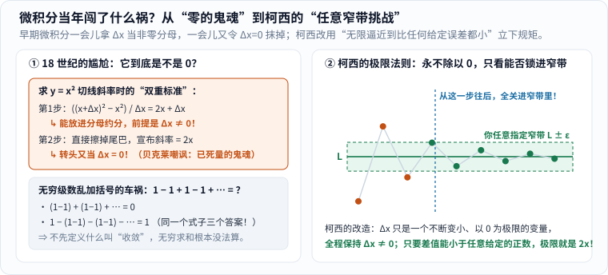
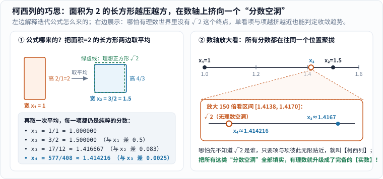
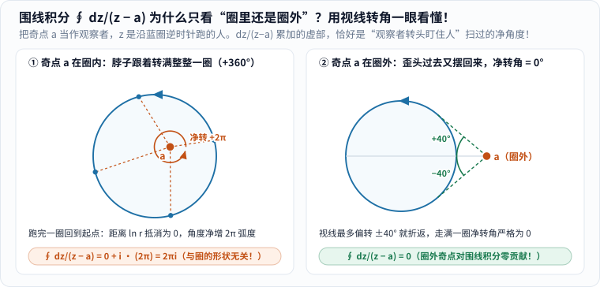

牛顿和莱布尼茨发明微积分之后的一百多年里，物理学家和天文学家拿它算行星轨道、算桥梁受力，百发百中；可只要有人较真问一句底层逻辑，数学家就会陷入一阵尴尬的沉默。

尴尬出在哪里？算抛物线 \(y = x^2\) 在点 \(x\) 处的瞬时变化率（切线斜率）时，当年的标准动作分两步：

1. 先给 \(x\) 加一点点增量 \(\Delta x\)，算平均斜率：\(\dfrac{(x+\Delta x)^2 - x^2}{\Delta x} = \dfrac{2x\Delta x + (\Delta x)^2}{\Delta x} = 2x + \Delta x\)。注意，这一步能把 \(\Delta x\) 放进分母上下约掉，**前提是 \(\Delta x\) 绝不能等于 0**（否则就是除以 0 的低级错误）！
2. 约分刚做完，紧接着下一句又宣布：“因为 \(\Delta x\) 无穷小，忽略不计，所以斜率正好等于 \(2x\)！”——**转脸又把 \(\Delta x\) 当成了 0**！

1734 年，英国主教乔治·贝克莱写了一本辛辣的小册子《分析学家》（*The Analyst*），当面挖苦这套先假定有增量、算完又假定没增量的把戏，嘲笑无穷小量简直是**“已死量的鬼魂（ghosts of departed quantities）”**。[3]

更乱的还有无穷级数：算 \(1 - 1 + 1 - 1 + 1 - \cdots\) 时，有人括成 \((1-1)+(1-1)+\cdots = 0\)，有人括成 \(1 - (1-1) - (1-1) - \cdots = 1\)，还有人算出 \(1/2\)。到底谁说了算？

站出来给这座摇摇晃晃的大厦重打地基的人，叫**奥古斯丁-路易·柯西（Augustin-Louis Cauchy，1789–1857）**。[1]

---

## 一、凌晨四点起床修港口的年轻工程师

柯西并不是一开始就坐在象牙塔里的纯数学教授（生平据 MacTutor 传记 [1]）：

- 1789 年他生于法国大革命爆发后的巴黎，童年跟着家人躲避动荡，信里回忆最苦的时候全家每天连半磅面包都分不到。数学大师拉格朗日是柯西父亲的朋友，很早就看出这孩子的锋芒，特意叮嘱他父亲：“千万别让他太早碰高等数学，先打好文学和古典语言的底子。”
- 1805 年柯西以全国第二名考入巴黎综合工科学校，随后进入桥梁公路学校。1810 年，21 岁的他被派往瑟堡海港，给拿破仑舰队修筑港口工程，行李箱里揣着拉普拉斯的《天体力学》和拉格朗日的《解析函数论》。他在家信里写：“我每天凌晨四点起床，从早忙到晚……工作非但没让我疲惫，反而让我精神百倍。”
- 工地之余，他在 1811 年证明了困扰几何学界很久的**凸多面体刚性定理**（用硬纸板粘好的凸多面体，哪怕接缝是活页铰链，只要每个面的形状不变，整个立体就捏不歪）。1812 年回到巴黎后，他彻底转向数学，一生写下惊人的 **789 篇论文**，全集足足编了 **27 大卷**，数量在数学史上仅次于欧拉。[1]

---

## 二、极限与柯西列：把“无限接近”变成可检验的硬规矩

### 1. 永远别除以 0：改玩“你画窄带，我进范围”

工程师出身的柯西受够了模棱两可的“代数一般性”。**1821 年**，他在巴黎综合工科学校出版讲义《分析教程》（*Cours d'analyse*），立誓要让微积分拥有“像欧氏几何一样的全部严格性”。[2]

怎么赶走贝克莱嘲笑的“鬼魂”？看图 1 左右两边的对照：

_图 1：左图是 18 世纪的两处逻辑漏洞；右图是柯西的改造——永远不需要令 \(\Delta x=0\)，而是看变量能否闯进并留在对手任意指定的窄误差带 \(L\pm\varepsilon\) 里。[单独打开图片](/assets/images/cauchy/calculus-crisis.svg)_

柯西在书里彻底改写了“极限”和“无穷小”的身份：[2]

> **当一个变量依次取的值无限逼近某个固定值，最终与它的差距能够“想多小就多小（小于任意给定的数）”时，这个固定值就叫它的极限。** 而所谓“无穷小”，不再是一个既像 0 又不是 0 的神秘幽灵，**仅仅是一个以 0 为极限的普通变量**！[2]

再回头看 \(2x + \Delta x\)：在柯西眼里，**\(\Delta x\) 从头到尾都严格不等于 0**，所以第一步约分光明正大、毫无瑕疵！接下来根本不需要硬把 \(\Delta x\) 改成 0，而是玩一场挑战赛（图 1 右）：无论挑剔的对手画出多窄的一条误差带（比如要求与 \(2x\) 相差不到 \(0.001\)，或者不到 \(10^{-100}\)），只要我把非零的 \(\Delta x\) 取得足够小，\(2x+\Delta x\) 就能稳稳钻进这条窄带里再也不出来——所以那个唯一的极限目标值就是 **\(2x\)**！（后来魏尔斯特拉斯等人进一步把柯西的这段话提炼成了今天大学课本里的 \(\varepsilon\)–\(\delta\) 符号语言。）

顺手，\(1-1+1-1+\cdots\) 的闹剧也终结了：前 \(n\) 项部分和一直在 \(1,0,1,0,\dots\) 之间原地蹦迪，当你把窄带设成宽度 \(0.2\) 时，它永远安静不下来——**它根本不收敛，没有和**！

### 2. 柯西列：连终点在哪都不知道，怎么断定“一定在收敛”？

解决了“靠近已知终点 \(L\)”，马上又冒出一个更刁钻的问题：**如果我手头有一串算出来的近似值，事先根本不知道它的终点公式长什么样，甚至终点在当前数系里还是个“空洞”，我怎么判断它没有白忙活？**

拿古巴比伦人就会、后来归入牛顿迭代法的求 \(\sqrt{2}\) 配方来做实验（图 2 左）：我们要找一个面积等于 \(2\) 的正方形边长。

1. 先猜宽 \(x_1 = 1\)。面积要是 \(2\)，高就得是 \(2/1 = 2\)——这长方形太瘦太高了；
2. 怎么让它更方？**把宽和高加起来取平均**：\(x_2 = \frac{1}{2}\left(1 + \frac{2}{1}\right) = \frac{3}{2} = 1.5\)！这时新长方形宽 \(1.5\)，高 \(2/1.5 = \frac{4}{3}\approx 1.333\)，一下就接近正方形了；
3. 继续取宽和高的平均 \(x_{n+1} = \frac{1}{2}\left(x_n + \frac{2}{x_n}\right)\)，立刻蹦出一串**纯分数**：
   \[
   1,\quad \frac{3}{2}=1.5,\quad \frac{17}{12}\approx 1.416667,\quad \frac{577}{408}\approx 1.414216,\quad \dots
   \]

_图 2：左图解释迭代公式的几何来历——面积固定为 2 的长方形，每次把宽和高取平均就迅速变方；右图把数轴区间 \([1.4138,1.4170]\) 放大 150 倍，所有的分数项都在越挤越紧，但它们聚拢的中心 \(\sqrt{2}\) 在“只有分数”的世界里却是一个空心圆洞。[单独打开图片](/assets/images/cauchy/cauchy-sequence.svg)_

现在盯住图 2 右下的放大镜，品味柯西最聪明的转身：**既然看不见终点，那就别看终点了，改看队伍里的成员彼此之间是不是越挤越紧！**

如果一串数往后走，无论你指定多小的间距 \(\varepsilon\)，从某一项之后，**后面任意两项 \(x_m\) 与 \(x_n\) 之间的距离都小于 \(\varepsilon\)**（不再四散乱跑，而是抱成越来越紧的一团），这串数就叫做**柯西列（Cauchy sequence）**。[1]

这件事还顺手揭开了“有理数”和“实数”的本质区别：图 2 里算出来的每一项（\(3/2, 17/12, 577/408\dots\)）分子分母全是整数，**百分之百都是分数**；可它们拼命挤过去的目标 \(\sqrt{2}\) 偏偏是无理数！也就是说，在“只有分数”的数轴上，这串柯西列瞄准的地方是个**漏风的针眼空洞**；而后来康托尔等人正是用“把所有柯西列瞄准的空洞全部填实”的办法，严格造出了不漏一针的**实数轴**（关于无理数与分数的关系，也可同看本站《[无理数怎么比较]()》）。

---

## 三、把微积分搬上复平面：绕着圈走一步，为什么只数“转了几圈”？

如果柯西只整理了实数微积分，他已经足够青史留名；但他另一半更炫目的魔法，是几乎凭一己之力开创了**复变函数论**——1814 年奠基定积分理论，1826 年创立**留数演算（calculus of residues）**，1829 年正式定义复变量的复函数。[1]

很多没学过复变函数的读者一看到围线积分符号 \(\oint \frac{dz}{z-a} = 2\pi i\) 就头皮发麻：“在虚数里积分是什么鬼？为什么答案突然冒出圆周率 \(\pi\) 和虚数单位 \(i\)，而且跟圈画得大不大还没关系？”

其实只要把符号翻译成**“站桩转脖子”**的画面，初中生也能一秒钟看懂（图 3）：

_图 3：在复平面（横轴为实数，纵轴为虚数 \(i\)）上，把橙色奇点 \(a\) 想成站在地上的人，蓝色圆圈是小狗 \(z\) 逆时针跑的一圈路线。左图人站在圈里，眼睛盯住小狗跑完一圈，脖子必须原地转满 \(+360^\circ\)（即 \(+2\pi\) 弧度），积分就是 \(2\pi i\)；右图人站在圈外，眼睛最多往上偏 \(40^\circ\)、再往下偏 \(40^\circ\)，最后回到正前方，净转角为 \(0^\circ\)，积分严格为 \(0\)！[单独打开图片](/assets/images/cauchy/residue-circle.svg)_

为什么积分会等于“转头角度”？在复平面上，从点 \(a\) 指向点 \(z\) 的箭头，可以用“距离 \(r\)”和“方向角 \(\theta\)”表示成 \(z - a = r(\cos\theta + i\sin\theta) = r e^{i\theta}\)。当你沿着 \(\frac{1}{z-a}\) 走一小步时，算出来的变化量恰好分成两份：

\[
\frac{dz}{z-a} = (\text{距离对数的微小变化 } d\ln r) + i\cdot(\text{方向角的微小变化 } d\theta).
\]

现在沿着**任何一条闭合圈**走一圈，最后**回到出发点**：

1. **实部（看远近）**：不管中途离 \(a\) 远了还是近了，既然最后回到了同一个起点，终点距离等于起点距离，距离变化首尾彻底抵消，**实部永远是 \(0\)**！
2. **虚部（看转角）**：
   - **如果点 \(a\) 被包在圈里面（图 3 左）**：不管这个圈是正圆、椭圆还是歪歪扭扭的土豆形，只要逆时针绕了 \(a\) 一整圈才回来，你的视线方向角 \(\theta\) 就实打实累加了一整圈——也就是 **\(+2\pi\) 弧度**！乘上前面的 \(i\)，答案雷打不动就是 **\(2\pi i\)**！
   - **如果点 \(a\) 在圈外面（图 3 右）**：函数 \(\frac{1}{z-a}\) 在圈内处处完好无损（没有除以 0 的爆炸点）。人站在圈外看小狗跑一圈，脖子先往右上歪 \(40^\circ\)，再往左下摆到 \(-40^\circ\)，最后乖乖回正，**一去一回净转角严格等于 \(0\)**，所以积分就是 **\(0\)**！

这就是柯西积分定理与留数定理最迷人的物理灵魂：**算一整圈复杂的曲线积分，根本不用一步步硬算路径，只需要像点人头一样，数一数圈肚子里包住了几个“漩涡奇点 \(a\)”，把每个奇点的强度（留数）加起来乘以 \(2\pi i\) 就收工了！** 今天信号处理里的傅里叶逆变换、量子场论与流体力学里无数硬算不出来的实数定积分，全靠去复平面“画个圈捡留数”秒杀。[1]

---

## 四、既是宗师，也是让同行头疼的“刺头”

如果把柯西写成完美无瑕的圣人，那就违背了真实历史。MacTutor 传记保留了大量一手信件与回忆，展示了一个性格极其固执、甚至常常令人难堪的柯西：[1]

- **傲慢地打发彭赛列**：1820 年柯西撰文批评彭赛列的连续性原理。彭赛列特地上门想当面解释，结果柯西正要出门，边走边冷淡地把他打发走，丢下一句“去看我即将出版的讲义吧”（详见上一篇《[影子把长度全弄乱了，几何还剩什么？]()》）。
- **耽搁阿贝尔与伽罗瓦的手稿**：1826 年挪威天才阿贝尔把心血论文交给巴黎科学院，落到柯西手里审稿，竟被压在抽屉里石沉大海，直到 1829 年阿贝尔贫病早逝都没等来正式报告（阿贝尔在信里苦笑写道：“**柯西疯了，拿他一点办法也没有；但眼下只有他一个人真正懂得数学该怎么做。**”）[1]
- **政治流亡与混乱课堂**：1830 年法国七月革命后，效忠旧王室的柯西宁死拒绝向新政权宣誓，丢下巴黎所有教席自我流放了八年。在都灵教书时，学生梅纳布雷亚回忆他的课“跳脱混乱，像一团团晦涩的乌云，却不时劈下纯粹天才的闪电——同班报名的三十个人里，只有我一个坚持听到了最后”。[1] 甚至去布拉格给流亡小王子当家庭教师时，脾气急躁的柯西还会对着对数理毫无兴趣的王子大喊大叫，王后只能微笑着劝他：“小声点，别这么大声。”[1]

阿贝尔那句评价，或许是对柯西最精准的盖棺定论：**在为人处世上他固执、偏狭甚至失职；但在“数学究竟该怎样做到滴水不漏”这件事上，他是那个时代当之无愧的引路人。**

## 小结

- **极限与无穷小**：不再让 \(\Delta x\) 一会儿非零、一会儿等于零，而是用“能否永久关进任意窄的误差带 \(L\pm\varepsilon\)”给微积分立下了铁律；
- **柯西列**：不用事先看见终点，只看项与项之间是否无限聚拢，帮数学家看清并填平了有理数轴上的无理数空洞；
- **复变围线积分与留数**：把沿圈积分变成了“数圈里包住几个奇点、视线转了几整圈 \(2\pi i\)”，让最棘手的积分迎刃而解。

## 参考资料

1. MacTutor History of Mathematics，*Augustin-Louis Cauchy* 传记：早年工程经历、789 篇论文与 27 卷全集、1814–1829 年复变函数与留数创立过程、与彭赛列及阿贝尔的往来、流亡轶事。<https://mathshistory.st-andrews.ac.uk/Biographies/Cauchy/>
2. Wikipedia，*Cours d'analyse*：1821 年《分析教程》导言及极限、无穷小量的原始定义译文（Bradley & Sandifer 英译本）。<https://en.wikipedia.org/wiki/Cours_d%27Analyse>
3. Wikipedia，*The Analyst*：1734 年贝克莱主教对早期微积分“先除以增量再令增量为零”的批评及“已死量的鬼魂”典故。<https://en.wikipedia.org/wiki/The_Analyst>

> 说明：本文三幅配图均为原创 SVG，由 `python tools/visuals.py build cauchy` 生成，脚本自动校验了阻尼序列落入 \(\varepsilon\) 窄带、求 \(\sqrt{2}\) 精确分数迭代及间距递减，以及复平面单位圆内外奇点围线积分与视线摆角数值。
{: .prompt-tip }
