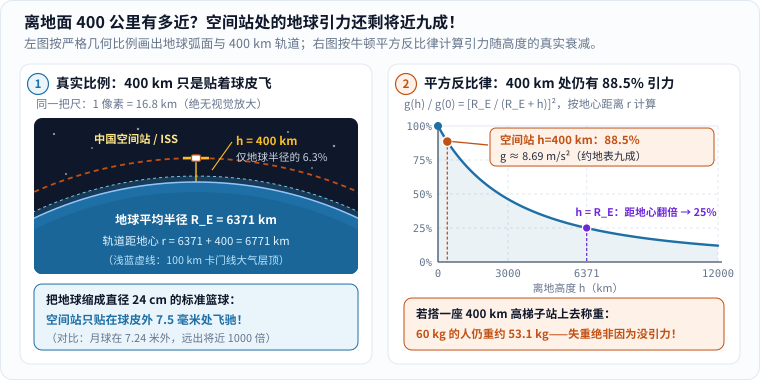
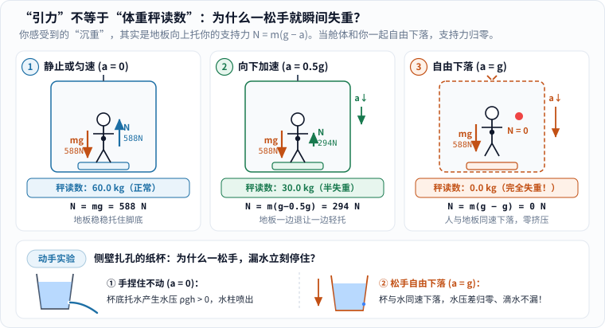
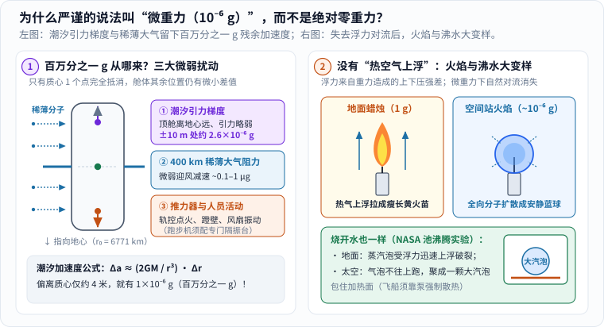
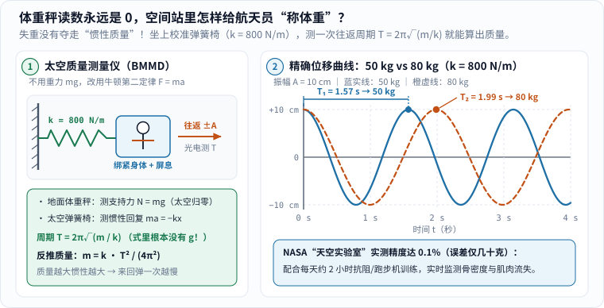

每次看“天宫课堂”或国际空间站的直播，最让人着迷的画面总是这一幕：

航天员松开手，一颗晶莹的水球就安安静静悬在鼻尖前；轻轻一推舱壁，整个人像鱼一样横着飘过十几米长的实验舱。

这时候如果问身边的朋友（甚至问不少大人）：**“空间站里为什么会失重？”**

十个人里往往有八个会脱口而出：**“那还用说？飞到太空里，离地球太远，脱离地球引力了呗！”**

这个回答听起来特别顺耳，但它恰恰是物理学里流传最广的一个错觉。今天我们不动用高深术语，只拿一把尺子、一台电梯体重秤和一只扎了孔的纸杯，一层层揭开空间站“失重”的真正底牌。

---

## 一、先破第一大错觉：把地球缩成篮球，空间站只贴在球皮外 7.5 毫米！

觉得空间站“离地球很远”，是因为日常示意图为了把飞船画清楚，几乎都把轨道高度夸大了十倍以上。

我们来算一笔严格按比例缩小的账：

- 根据 NASA 地球参数表，地球的平均半径约为 $$R_E = 6371\ \mathrm{km}$$（直径约 $$12742\ \mathrm{km}$$）[1]；
- 中国空间站（“天宫”，运行高度约 $$340\text{～}450\ \mathrm{km}$$）与国际空间站（ISS，运行高度约 $$370\text{～}460\ \mathrm{km}$$），日常都巡航在离地面约 **$$h = 400\ \mathrm{km}$$** 的近地轨道上 [2][3]。

$$400\ \mathrm{km}$$ 大概只是北京到济南、或者上海到合肥的高铁距离。如果把整颗地球按比例缩小成一只**直径 $$24\ \mathrm{cm}$$（半径 $$120\ \mathrm{mm}$$）的标准篮球**，空间站飞在多高的地方？

$$
h_{\text{篮球比例}} = 120\ \mathrm{mm} \times \frac{400}{6371} \approx 7.5\ \mathrm{mm}
$$

**只有 $$7.5$$ 毫米！** 还不到你小拇指指甲盖的宽度——几乎就是紧贴着篮球表面的颗粒皮纹在飞！相比之下，同比例下的月球（平均距离约 $$38.44\ \text{万公里}$$ [1]）远在 **$$7.24\ \text{米}$$** 之外，差不多隔开了整间客厅。

既然离地面这么近，那里的地球引力到底还剩多少？千万别忘了牛顿万有引力定律最关键的一条规矩：**距离 $$r$$ 要从“地心”算起，而不是从地面算起！** 在 $$h = 400\ \mathrm{km}$$ 高空，空间站到地心的距离是：

$$
r = R_E + h = 6371 + 400 = 6771\ \mathrm{km}
$$

只比站在地面上远了 $$6.3\%$$。代入平方反比定律，高空引力加速度 $$g(h)$$ 与地表引力加速度 $$g(0)$$ 的比值为：

$$
\frac{g(h)}{g(0)} = \left(\frac{R_E}{R_E + h}\right)^2 = \left(\frac{6371}{6771}\right)^2 \approx 88.5\%
$$

如果直接代入 JPL 公布的地球引力常数 $$GM_E \approx 3.986 \times 10^{14}\ \mathrm{m^3/s^2}$$ [4]，算出 $$400\ \mathrm{km}$$ 轨道处的引力加速度高达：

$$
g(400\ \mathrm{km}) = \frac{GM_E}{(R_E + h)^2} \approx 8.69\ \mathrm{m/s^2}
$$

（若与剔除地球自转影响前的标准重力加速度 $$g_0 = 9.80665\ \mathrm{m/s^2}$$ [1] 相比，比例约为 $$88.6\%$$。）

_图 1：先看左图的真实几何比例——把地球画成蓝色弧面后，400 公里的空间站轨道只是紧贴表面的一层薄边（缩成篮球仅距球皮 7.5 毫米）；再看右图的平方反比衰减曲线，空间站处依然保留着地表 88.5% 的地球引力，要飞到离地 6371 公里（地心距翻倍）引力才会降到 25%。[单独打开图片](/assets/images/space-weightless/gravity-still-89pct.svg)_

换句话说，假设我们真的在赤道或地面上盖起一座 **$$400\ \mathrm{km}$$ 高的通天铁塔**，你拎着家里的体重秤爬到塔顶站定，一个在地面重 $$60\ \mathrm{kg}$$ 的人，在塔顶低头看秤，指针依然会稳稳指向 **$$53.1\ \mathrm{kg}$$** 左右 [5]！

谜题这下彻底摆在桌面上了：**既然将近九成的地球引力分毫未减地拽着航天员，为什么空间站里偏偏一点“重量”都感觉不到？**

---

## 二、“有引力”为什么会“没重量”？把体重秤搬进电梯，再扎破一只纸杯

破案的关键，在于把日常口语里混为一谈的两个词彻底拆开 [6]：

1. **实际受到的地球引力（重力 $$mg$$）**：地球隔空拉拽你身体每一个原子的万有引力；
2. **你感觉到的“沉重感”（视重 = 支持力 $$N$$）**：地板、椅面或体重秤向上硬托住你脚底的接触力。

仔细体会一下就会发现：**人体其实根本没有直接感知“万有引力场”的器官！** 你之所以觉得自己“重”，是因为引力把你往下拉，而坚硬的地面不让你往下掉，于是地板狠狠顶住你的脚底板，你的小腿骨顶住膝盖，脊椎一节节顶住脑袋，内耳里的耳石压在感觉毛细胞上。**我们感受到的“重量”，全都是支撑物向上挤压身体的支持力 $$N$$。**

一旦支撑物不再死死顶住你，而是一边往下退让一边托你呢？把体重秤搬进一部升降电梯里，设你的质量 $$m = 60\ \mathrm{kg}$$，地面重力加速度取 $$g = 9.8\ \mathrm{m/s^2}$$（地球对你的向下拉力始终是 $$mg = 588\ \mathrm{N}$$）。当电梯以向下的加速度 $$a$$ 运动时，由牛顿第二定律 $$mg - N = ma$$ 可得脚底支持力：

$$
N = m(g - a)
$$

看图 2 上半部分的三个瞬间，答案呼之欲出：

- **① 电梯静止或匀速运动（$$a = 0$$）**：地板寸步不让，$$N = mg = 588\ \mathrm{N}$$，体重秤忠实显示 `60.0 kg`。（反过来，如果电梯向上加速，或火箭发射时以 $$2g\text{～}3g$$ 向上猛冲，支持力变成 $$N = m(g + a_{\text{上}}) > mg$$，整个人像被按在座椅上，这就是**超重**。）
- **② 电梯刚启动向下加速（比如 $$a = 0.5g = 4.9\ \mathrm{m/s^2}$$）**：地板一边往下撤一边托你，支持力瞬间砍半成 $$N = 294\ \mathrm{N}$$，秤读数跳成 `30.0 kg`！坐过山车翻过坡顶俯冲时胃里那种“一空”的失重感，就来自这里 [5][7]。
- **③ 假想电梯钢缆断开，完全自由下落（$$a = g = 9.8\ \mathrm{m/s^2}$$）**：电梯地板下落的加速度跟你的身体一模一样！地板既不托你，你也不压体重秤：

$$
N = m(g - g) = 0\ \mathrm{N}
$$

此时地球对你的拉力**依然是实打实的 $$588\ \mathrm{N}$$**，但体重秤读数直接归零，你手里松开的苹果也会稳稳停在你眼前——因为你们仨正以完全相同的加速度往下掉 [5][7]！

_图 2：先对比上面三间电梯里橙色向下的引力箭头（始终是 588 N 从未变短！）与右侧向上的支持力箭头（随向下加速度增大直到归零）；再看底部在家就能试的扎孔水杯实验。[单独打开图片](/assets/images/space-weightless/elevator-apparent-weight.svg)_

> **在家花 1 分钟就能验证的“自由落体止漏杯”**（建议在水槽上方或户外草地操作）：
> 拿一只一次性纸杯或空矿泉水瓶，在靠近底部的侧壁扎一个小孔。用手指堵住孔装满水，先用手稳稳捏住杯口移开堵孔的手指——因为杯底托住了水，上层水压着下层水产生静水压强 $$\Delta p = \rho g h > 0$$，水立刻从侧孔滋出一道抛物线。
> 接着，**直接松手让整只纸杯自由落向水槽！** 在松手下坠的那半秒钟里，你会亲眼看到侧孔外的水柱**瞬间收住、一滴也不往外漏了**——因为水和杯子一起以加速度 $$g$$ 自由下落，杯内水层之间不再互相挤压（有效水压差 $$\Delta p = \rho(g - g)h = 0$$），整杯水已经进入了货真价实的失重状态！

事实上，科学家在地面做微重力实验，用的正是同一种办法：NASA 格伦研究中心的“零重力研究设施”挖了一口约 $$145\ \text{米}$$（约 $$500\ \text{英尺}$$）深的抽真空竖井，把实验舱扔下去获得刚过 **$$5\ \text{秒}$$** 的纯净自由落体；宇航员训练常坐的“抛物线飞机”则飞出一段段上抛再俯冲的弧线，每次能在弧顶换来 **$$20\text{～}30\ \text{秒}$$** 的失重体验 [5][7]。

---

## 三、既然每秒都在往下掉，空间站为什么永远砸不到地面？

读到这里，最犀利的追问马上就来了：

**“落塔 5 秒钟就撞底了，抛物线飞机 25 秒就得拉起来，可航天员在空间站里一住就是半年！如果空间站一直在自由下落，它怎么没砸到地上？”**

牛顿在《自然哲学的数学原理》里用一门假想的**高山大炮**给出了跨越三百年的绝妙回答 [5][8]（关于牛顿怎样用几何与微积分统一苹果与天体轨道，可以连起来读本站《[从开普勒到牛顿：行星为什么不会掉进太阳？]()》与《[月亮一直在下落？微积分怎样算出天体的路]()》）：

空间站当然在往下掉，而且每一分每一秒都在往地球上掉；**但与此同时，它还拥有极高的水平切向速度！**

多快才够？要让空间站在半径 $$r = 6771\ \mathrm{km}$$ 的圆轨道上绕地球运动，地球引力必须刚好充当它拐弯所需的向心力 [8]：

$$
\frac{GM_E m}{r^2} = m \frac{v^2}{r} \implies v = \sqrt{\frac{GM_E}{r}}
$$

代入数据一算：

$$
v = \sqrt{\frac{3.986 \times 10^{14}\ \mathrm{m^3/s^2}}{6.771 \times 10^6\ \mathrm{m}}} \approx 7673\ \mathrm{m/s} \approx 7.67\ \mathrm{km/s}
$$

折合时速约 **$$2.76\ \text{万公里/小时}$$**——差不多是出膛步枪子弹速度的 9 倍，每 **$$92.4\ \text{分钟}$$** 就能绕地球整整一圈，航天员一天能看将近 16 次日出日落 [3][8]！

为什么偏偏是 $$7.67\ \mathrm{km/s}$$ 这个速度能让它“一直掉却永远撞不上”？我们把镜头放大，只盯着**短短 $$1\ \text{秒钟}$$（$$\Delta t = 1\ \mathrm{s}$$）**里发生的三件事（看图 3 右侧）：

1. **横着飞出了多远？** 如果此刻突然关掉地球引力，空间站会沿水平切线直直飞出 $$x = v \Delta t \approx 7.67\ \mathrm{km}$$。
2. **被地球引力往下拽掉了多少？** 在 $$g(400\ \mathrm{km}) \approx 8.694\ \mathrm{m/s^2}$$ 的引力拉扯下，这 $$1\ \text{秒}$$ 内它偏离水平切线、朝地心自由下落了：

$$
\Delta y_{\text{自由下落}} = \frac{1}{2} g(h) (\Delta t)^2 \approx \frac{1}{2} \times 8.694 \times 1^2 \approx 4.35\ \mathrm{m}
$$

（若按教材常用的标准重力折算 $$g(400\ \mathrm{km}) \approx 8.68\ \mathrm{m/s^2}$$，则约为 $$4.34\ \mathrm{m}$$——大约是一层半住宅楼的高度。）

3. **圆球形的地球表面往下“弯走”了多少？** 别忘了地球是个圆球！当你沿着水平切线往前走出 $$x = 7.67\ \mathrm{km}$$ 时，半径 $$r = 6771\ \mathrm{km}$$ 的圆弧相比水平直线往下弯曲的矢高（下沉量）恰好是：

$$
\Delta y_{\text{曲率退让}} = \sqrt{r^2 + x^2} - r \approx \frac{x^2}{2r} = \frac{(7672.6\ \mathrm{m})^2}{2 \times 6.771 \times 10^6\ \mathrm{m}} \approx 4.35\ \mathrm{m}
$$

**分毫不差，也是 $$4.35\ \mathrm{m}$$！**（如果用精确勾股根号跟 $$\frac{1}{2}gt^2$$ 硬碰硬比对，两者在 $$1\ \text{秒}$$ 内的误差还不到 **$$3\ \text{微米}$$**，比一根头发丝的二十分之一还细！）

这绝不是数字巧合——把环绕速度平方 $$v^2 = GM_E / r$$ 代入曲率公式 $$\frac{(v\Delta t)^2}{2r}$$，立刻就能看到 $$\frac{1}{2}\left(\frac{GM_E}{r^2}\right)(\Delta t)^2 = \frac{1}{2}g(h)(\Delta t)^2$$。

_图 3：左图按开普勒方程画出从高山水平发射的轨迹分岔（轨道高度已示意放大；橙色圆点自动演示一圈匀速圆轨道运动并停在终点，刷新页面可重播，开启系统“减少动态效果”时直接显示静态全貌）；右图把 1 秒钟切开对比——自由下落量与地球曲率退让量严丝合缝同为 4.35 米，离地高度永远锁在 400 公里。[单独打开图片](/assets/images/space-weightless/falling-around-earth.svg)_

更妙的是，回头看轨道速度公式 $$v = \sqrt{GM_E / r}$$ 和引力加速度 $$g(h) = GM_E / r^2$$——**被拉物体自己的质量 $$m$$ 在等式两边直接约掉了！**[8]

这意味着什么？意味着不管是几百吨重的空间站舱体、$$65\ \mathrm{kg}$$ 重的航天员，还是航天员嘴边吐出的一颗 $$0.5\ \text{克}$$ 小水珠，只要它们在同一个轨道位置以同样的 $$7.67\ \mathrm{km/s}$$ 并肩飞行，地球引力给它们算出来的下落圆弧就**完完全全重合**：

- 第 1 秒，舱体往下掉 $$4.35\ \mathrm{m}$$，航天员往下掉 $$4.35\ \mathrm{m}$$，水珠也往下掉 $$4.35\ \mathrm{m}$$；
- 地面同时往下弯走 $$4.35\ \mathrm{m}$$；
- 下一秒，大家换了一个方向继续掉 $$4.35\ \mathrm{m}$$……

这就跟民航客机形成了鲜明对比（关于机翼升力原理可延伸阅读本站《[如何能实现飞行]()》）：客机飞在约 $$10\ \mathrm{km}$$ 高空，速度只有约 $$0.25\ \mathrm{km/s}$$，远不够追平地球曲率，必须靠机翼推开空气产生向上的气动升力 $$L = mg$$ 托住机身，再由机舱地板向上托住乘客，所以飞机上端杯喝水跟地面毫无区别。而空间站不靠空气托举，全舱上下都在同步“绕着地球摔跟头”——既然谁也不挡谁的路，地板自然不需要托你的脚，失重就这样日复一日持续下去了。

---

## 四、为什么科学家偏要叫“微重力”，而不叫“零重力”？

如果你仔细看中国载人航天、NASA 或欧洲空间局（ESA）的官方科学报告，会发现科学家几乎不用“零重力（Zero-g）”这个词，而是严谨地称之为**“微重力（Microgravity）”**——“微（micro-）”代表百万分之一，因为空间站舱内其实还残留着大约 **$$10^{-6}\ g$$（百万分之一地表重力）** 量级的微小加速度 [5][7]。

既然大家都在一起自由落体，这百万分之一的“小尾巴”又是从哪冒出来的？主要有三个来源（图 4 左）：

1. **潮汐力（重力梯度效应）** [9]：
   前面说“轨道向心力与地球引力完美抵消”，严格讲**只对空间站的“质心”那唯一一个几何点成立**！可真实的空间站是个庞然大物（例如国际空间站桁架宽达 $$108\ \mathrm{m}$$，单个实验舱也有十几到二十米长 [3]）。
   假设有一个沿地心连线竖直摆放、长 $$20\ \mathrm{m}$$ 的舱段：靠近地球的底端离地心近了 $$10\ \mathrm{m}$$，受到的地球引力比质心略强一点点，总想往更低更快的轨道掉；背向地球的顶端离地心远了 $$10\ \mathrm{m}$$，受到的引力比质心略弱一点点，又被全舱统一的轨道速度甩得想往高处飘。对万有引力公式求一阶导数，就能算出偏离质心 $$\Delta r$$ 处的潮汐拉伸加速度：

$$
\Delta a_{\text{潮汐}} \approx \frac{2GM_E}{r^3}\,\Delta r
$$

   代入 $$r = 6771\ \mathrm{km}$$，每偏离质心 $$1\ \mathrm{m}$$ 就会产生约 $$2.57 \times 10^{-6}\ \mathrm{m/s^2}$$（约 $$0.26 \times 10^{-6}\ g$$）的微弱加速度；**只要离开空间站质心约 $$4\ \text{米}$$，残余加速度就达到了货真价实的 $$1 \times 10^{-6}\ g$$**（$$\pm 10\ \mathrm{m}$$ 处约为 $$2.6 \times 10^{-6}\ g$$；若空间站保持对地定向姿态每圈翻转一周，叠加上旋转离心梯度甚至可达 $$\frac{3GM_E}{r^3}\Delta r \approx 0.39 \times 10^{-6}\ g/\mathrm{m}$$）！如果你在偏离质心几米处松开一颗绝对静止的小钢珠，过上几分钟再来看，它会悄悄朝舱顶或舱底漂走。

2. **$$400\ \mathrm{km}$$ 处的稀薄大气阻力** [10]：
   $$400\ \mathrm{km}$$ 虽然早已越过 $$100\ \mathrm{km}$$ 卡门线，但仍处于地球热层大气中，极稀薄的氧原子和氮分子不断迎面撞在巨大的太阳能帆板上，给外壳施加约 $$10^{-7}\text{～}10^{-6}\ g$$ 的微弱迎风减速（舱内漂浮物却不受风吹，于是相对舱壁极其缓慢地往前漂）。也正因为这股阻力，空间站每天轨道高度都会自然衰减几十到上百米，每隔一段时间就得启动推进器“抬轨”——1979 至 1980 年正逢太阳活动峰年，强烈的极紫外辐射加热高层大气使其膨胀，美国第一座空间站“天空实验室（Skylab）”就是因为大气阻力骤增又没赶上航天飞机救援，最终于 1980 年 7 月提前再入大气层烧毁 [10]。

3. **轨控推力器、飞轮与人员活动振动** [11]：
   姿态控制发动机点火、通风风扇运转、航天员蹬一下舱壁或者在跑步机上奔跑，都会在舱体结构上传出 $$10^{-5}\text{～}10^{-3}\ g$$ 的瞬态抖动。因此空间站上的精密晶体生长炉和跑步机，全都装有专门的隔振系统。

---

## 五、没有“轻重上下”的奇妙日常：蓝球火焰、抱团沸水与太空弹簧称重

把有效重力降到百万分之一 $$g$$ 之后，许多我们在地球上司空见惯、以为天经地义的自然现象，到了空间站里全都露出了本来面目。

### 1. 蜡烛火焰变成安静的蓝球，睡觉还必须开风扇！

在地面点一根蜡烛，火苗为什么总是尖尖朝上、黄灿灿地跳动？

因为地面有重力，就会有**浮力对流** [12]：火焰把周围空气烤热，热燃气膨胀、密度变小（“变轻”），立刻被周围更冷更重的空气往上挤；新鲜氧气源源不断从火苗底部卷进来，把火焰拉成瘦长的泪滴形，没来得及烧透的微小碳烟颗粒被烧得通红发亮，就成了温暖的黄色火光。

可进了微重力的空间站，**“热空气比冷空气轻”这句话突然失效了！** 没有支持力就没有上下压强差，热气不知道该往哪儿“浮”，自然对流彻底停摆。氧气只能靠分子热运动从四面八方慢吞吞、均匀对称地往烛芯**扩散**，燃烧产物也对称地往外扩散。结果如 NASA 国际空间站燃烧集成机柜（CIR）实验所拍到的那样 [12]：**火焰不再往上蹿，而是缩成了一颗安静、暗淡、近乎完美的蓝色圆球！**（充分缓慢的扩散减少了碳烟生成，火焰呈纯净的蓝色；NASA 甚至还在微重力液滴燃烧实验 FLEX 中首次稳定观测到了肉眼看不见后仍继续低温反应的“冷焰 Cool Flames”[12]。）

同一个道理还关乎航天员的性命：**空间站睡觉区绝对不能停通风风扇！** 在地球上你躺在床上呼出温热的二氧化碳，它会自己浮向天花板；而在空间站里一旦没有风扇强制吹风，呼出的二氧化碳就会像一团隐形棉被一样停留在鼻孔周围越攒越厚，睡着的人很快就会缺氧窒息。

### 2. 烧开水不冒串串气泡，反而聚成一颗“大汽球”

平时在厨房烧水，壶底刚冒出小水泡就会“咕嘟咕嘟”往上浮，冷水顺势补到壶底继续受热。

但在 NASA 的微重力池沸腾实验（Pool Boiling）里 [13]，加热板烧开液体后，产生的小蒸汽泡根本不会往上跑，而是在表面张力支配下互相吞并，最后**聚合成一颗巨大的蒸汽泡死死趴在加热板上**（图 4 右下）！蒸汽导热极差，这颗大汽泡就像给发热器裹了一层隔热棉被，稍不留神就会把航天器散热管烧穿——所以飞船上的热控与沸腾换热系统，全都必须靠水泵强制推动液体流动，把气泡硬冲走。

_图 4：左图拆解百万分之一 g 残余加速度的三大来源（偏离质心约 4 米即产生 1 微 g 潮汐拉伸）；右图对比地面与空间站里的蜡烛火焰及池沸腾——抽掉重力造成的浮力对流后，瘦长黄火苗变成了全向分子扩散的安静蓝球，沸水小气泡则聚成一颗大汽泡包住热源。[单独打开图片](/assets/images/space-weightless/microgravity-residuals.svg)_

### 3. 体重秤读数永远是 `0`，怎么给航天员“称体重”？

既然人站上普通体重秤读数永远是 `0.0 kg`，医生又必须严密监控航天员在轨几个月有没有消瘦、肌肉有没有流失，这该怎么称？

回想牛顿力学的基石：失重只让“视重 $$N$$”归了零，却丝毫没有改变你身体里那几十公斤原子带来的**惯性质量 $$m$$**！在太空中推走一块 $$100\ \mathrm{kg}$$ 的大设备，虽然它飘着不往下掉，但你想让它突然加速或急停，照样得使出吃奶的力气（$$F = ma$$）[5]。

于是工程师把地面体重秤换成了**太空质量测量仪**（从早期“天空实验室”的振荡椅 BMMD，到今天空间站使用的线性加速测质量仪 SLAMMD [10]）。原理就是物理课本上最经典的**弹簧振子简谐运动** [14]：

让航天员坐在一张连着校准弹簧（设总劲度系数 $$k = 800\ \mathrm{N/m}$$）的滑椅上，把椅子拉开一小段距离（比如振幅 $$A = 10\ \mathrm{cm}$$）后松手。弹簧的回复力 $$F = -kx$$ 推动人与座椅来回振动，由牛顿第二定律 $$m a = -kx$$ 可直接导出往返一次的振动周期 $$T$$ [14]：

$$
T = 2\pi\sqrt{\frac{m}{k}} \implies m = \frac{k T^2}{4\pi^2}
$$

睁大眼睛看这个公式：**里面压根就没有重力加速度 $$g$$！** 无论是在地面、月球表面还是完全失重的空间站里，同一个质量连在同一根弹簧上，来回弹一次的时间分毫不差（图 5）：

- 若总振动质量为 **$$50\ \mathrm{kg}$$**，惯性较小，弹簧拉得快，周期 $$T_1 = 2\pi\sqrt{50 / 800} = \frac{\pi}{2} \approx 1.57\ \mathrm{s}$$；
- 若总振动质量为 **$$80\ \mathrm{kg}$$**，惯性变大，来回摆动明显变慢，周期拉长到 $$T_2 = 2\pi\sqrt{80 / 800} \approx 1.99\ \mathrm{s}$$！

（实际工程测量时，算出的总质量 $$m$$ 再减去已知的空座椅质量，就是航天员的净质量。）NASA 在“天空实验室”M172 实验中发现了一个非常可爱的细节 [10]：因为人体不是一块僵硬的铁疙瘩，肚子里晃荡的水、甚至一次深呼吸都会干扰弹簧周期；所以航天员每次测质量前必须掏空口袋、用绑带把全身死死勒紧在座椅框架上、双手握紧横杆**屏住呼吸**数完 3 个来回——只要动作规范，这套弹簧椅在太空测出的人体质量误差**不超过 $$0.1\%$$（仅仅几十克）**！

_图 5：左图是太空弹簧质量测量仪（BMMD）的力学原理——不用重力支持，改测惯性振荡；右图精确算出 k = 800 N/m 下 50 kg（蓝实线，周期 1.57 秒）与 80 kg（橙虚线，周期 1.99 秒）的位移曲线，光电计时器只需测几个来回就能把人体质量精确到几十克。[单独打开图片](/assets/images/space-weightless/space-mass-spring.svg)_

### 4. 每天雷打不动锻炼 2 小时：与“太舒服”的失重拔河

为什么要把航天员的质量和身体指标盯得这么紧？因为地球生命在 $$1\ g$$ 重力场里演化了数十亿年（可同读本站《[为什么地球能孕育生命]()》），一旦撤掉地板向上的支撑力，身体就会迅速启动“偷懒模式” [11][15]：

- **体液往头上涌（“胖脸鸟腿”综合征）**：在地面上重力把血液往下拉，腿部血管需要用力往上挤；到了空间站，重力不再往脚底拉扯血液，体液大批涌向胸腔和头部——刚入轨头几天航天员脸会浮肿、鼻腔充血像患了重感冒，两条腿反而变细，颅内与眼部压力变化还可能影响视力 [10][15]。
- **骨骼与肌肉迅速“拆家”**：人体骨骼遵循“用进废退”法则。没有了体重负荷，负责建造新骨的成骨细胞开始怠工，负责分解旧骨的破骨细胞却照常拆迁——NASA 医学统计表明，如果不采取对抗措施，航天员的承重骨骼在太空**平均每个月会流失约 $$1\%\text{～}1.5\%$$ 的骨密度**（速度堪比地面严重骨质疏松患者的十倍），拆下来的钙排进尿液还会推高肾结石风险 [11][15]。

为了赢下这场与失重的拔河，今天空间站里的航天员平均**每天必须锻炼约 2 个小时** [11]：跑步时要用弹力肩带把自己狠狠“往下拽”在跑步机（如 T2）上才跑得起来；举重更不能用普通杠铃片（几百斤的杠铃片在太空一根手指就能拨走），而是改用真空圆筒活塞制造拉力的**高级抗阻训练器（ARED）**做深蹲和硬拉，把地面上原本免费附赠的“负重感”，一锤一锤重新锻造回骨骼和肌肉里 [11]。

---

## 六、一张表带走全部核心真相

下次再有人指着电视里飘浮的航天员说“太空里没有地球引力”，你就可以把这四句话稳稳讲给他听了：

| 常见追问 | 一句话物理真相 | 关键数量级（$$h = 400\ \mathrm{km}$$） |
| --- | --- | --- |
| 空间站脱离地球引力了吗？ | **完全没有！** 缩成篮球只离球皮 $$7.5\ \mathrm{mm}$$ | 引力仍高达地表的 **$$88.5\%$$**（$$\approx 8.69\ \mathrm{m/s^2}$$） |
| 既有引力，为什么会飘起来？ | 失重不是没引力，而是舱与人自由下落使**支持力归零** | $$N = m(g - a) = 0$$（如同松手下落的扎孔水杯） |
| 一直在掉，怎么没砸到地面？ | 横向飞得太快，**每秒掉下的高度刚好等于地球弯曲退让量** | 横飞 $$7.67\ \mathrm{km/s}$$，每秒同掉 **$$4.35\ \mathrm{m}$$**，$$92.4\ \text{分钟}$$ 一圈 |
| 为什么科学上叫“微重力”？ | 潮汐引力梯度、稀薄大气阻力与振动留下微小残余加速度 | 约 **$$10^{-6}\ g$$**；无浮力对流，测体重改靠弹簧周期 $$T = 2\pi\sqrt{m/k}$$ |

原来，空间站从来不是逃离了地球的怀抱；恰恰相反，**正是地球那还剩将近九成的引力，像一根看不见的长绳牢牢牵住每秒狂奔 $$7.67\ \text{公里}$$ 的飞船，才把一场原本会坠地的自由下落，变成了一支永不落地的圆周华尔兹。**

---

## 参考资料

1. NASA Goddard Space Flight Center，*Earth Fact Sheet*：地球平均体积半径 $$R_E = 6371.0\ \mathrm{km}$$、赤道半径 $$6378.1\ \mathrm{km}$$、标准重力加速度 $$g_0 = 9.80665\ \mathrm{m/s^2}$$ 及地月平均距离数据。<https://nssdc.gsfc.nasa.gov/planetary/factsheet/earthfact.html>
2. 中国载人航天工程官方网站（CMSA），《中国空间站轨道参数》公告栏目：中国空间站近地轨道运行高度范围（约 $$340\text{～}450\ \mathrm{km}$$，常态约 $$400\ \mathrm{km}$$）与轨道根数发布说明。<https://www.cmse.gov.cn/gfgg/202202/t20220212_49299.html>
3. European Space Agency (ESA)，*ISS: International Space Station*：国际空间站尺寸（宽 $$108\ \mathrm{m}$$、质量约 $$450\ \text{吨}$$）、轨道高度（$$370\text{～}460\ \mathrm{km}$$）与轨道速度（$$7.6\text{～}7.7\ \mathrm{km/s}$$）。<https://www.esa.int/articles/iss-international-space-station>
4. NASA Jet Propulsion Laboratory (JPL)，*Astrodynamic Parameters (DE440)*：地球引力常数 $$GM_E = 398600.435507\ \mathrm{km^3/s^2}$$。<https://ssd.jpl.nasa.gov/astro_par.html>
5. NASA Glenn Research Center，*What is Microgravity?*：近地轨道引力强度（约地表 $$89\%$$）、牛顿高山大炮思想实验、微重力（$$1 \times 10^{-6}\ g$$）定义、5 秒真空落塔与抛物线飞行。<https://www.nasa.gov/centers-and-facilities/glenn/what-is-microgravity/>
6. OpenStax，*University Physics Volume 1 — 5.4 Mass and Weight*：质量 $$m$$ 与重力 $$w = mg$$ 的物理区分，以及太空失重与自由落体的关系。<https://openstax.org/books/university-physics-volume-1/pages/5-4-mass-and-weight>
7. NASA STEM，*What Is Microgravity? (Grades 5-8)*：空间站爬梯子称重思想实验、真空自由落体同加速度原理及地面微重力模拟。<https://www.nasa.gov/learning-resources/for-kids-and-students/what-is-microgravity-grades-5-8/>
8. OpenStax，*University Physics Volume 1 — 13.4 Satellite Orbits and Energy*：圆轨道速度 $$v = \sqrt{GM_E / r}$$、周期 $$T = 2\pi\sqrt{r^3 / GM_E}$$ 推导及 $$400\ \mathrm{km}$$ 空间站实例计算（Example 13.9）。<https://openstax.org/books/university-physics-volume-1/pages/13-4-satellite-orbits-and-energy>
9. OpenStax，*University Physics Volume 1 — 13.6 Tidal Forces*：万有引力空间梯度产生潮汐拉伸力机理及远近端引力差推导。<https://openstax.org/books/university-physics-volume-1/pages/13-6-tidal-forces>
10. NASA Goddard (*From Stargazers to Starships*)，*(17a) Mass Measurements Aboard Space Station Skylab*：太阳活动峰年高层大气膨胀致“天空实验室”轨道衰减再入史实，以及 M172 弹簧振荡椅测质量流程、屏息固定要求与 $$0.1\%$$ 测量精度。<https://pwg.gsfc.nasa.gov/stargaze/Sskylab.htm>
11. NASA，*Counteracting Bone and Muscle Loss in Microgravity*：失重环境下成骨/破骨细胞失衡、每月约 $$1\%$$ 骨密度流失，以及空间站每天平均 2 小时跑步机与 ARED 抗阻训练方案。<https://www.nasa.gov/missions/station/iss-research/counteracting-bone-and-muscle-loss-in-microgravity/>
12. NASA，*Studying Combustion and Fire Safety*：微重力下浮力对流消失形成球形扩散火焰，以及燃烧集成机柜（CIR）、FLEX 冷焰发现与 ACME 实验。<https://www.nasa.gov/missions/station/iss-research/studying-combustion-and-fire-safety/>
13. NASA，*Pool Boiling – 1g vs Microgravity*：常重力气泡上浮与微重力下气泡在加热表面聚合成单颗大蒸汽泡的实验对比。<https://www.nasa.gov/image-article/pool-boiling-1g-vs-microgravity/>
14. OpenStax，*University Physics Volume 1 — 15.1 Simple Harmonic Motion*：胡克定律简谐运动方程与弹簧振子周期公式 $$T = 2\pi\sqrt{m/k}$$（与重力加速度无关）的严格推导。<https://openstax.org/books/university-physics-volume-1/pages/15-1-simple-harmonic-motion>
15. NASA Human Research Program，*The Human Body in Space*：长期驻留太空的体液向头部转移、承重骨每月 $$1\%\text{～}1.5\%$$ 矿物质流失、视觉与心血管适应及防护对策。<https://www.nasa.gov/humans-in-space/the-human-body-in-space/>

> 说明：本文五幅配图均为原创计算 SVG，已注册纳入本站统一配图工具包 `tools/visuals/mechanics_sky.py`，可通过 `python tools/visuals.py build space-weightless` 一键重算生成；脚本内置物理断言，自动核验了 $$400\ \mathrm{km}$$ 轨道引力衰减比例、篮球缩尺模型厚度、圆轨道 $$1\ \text{秒}$$ 自由下落量与地球曲率矢高的恒等关系、电梯视重支持力、潮汐重力梯度以及弹簧振子测质量周期曲线。
{: .prompt-tip }
