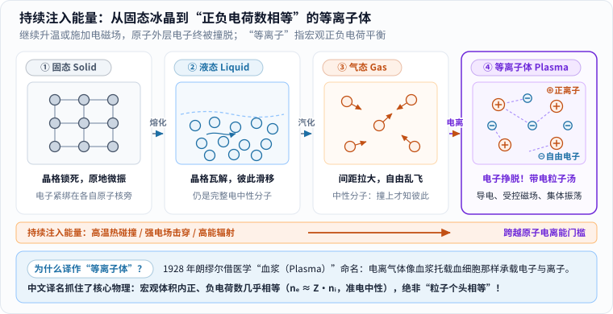
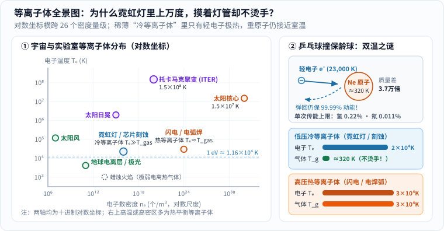
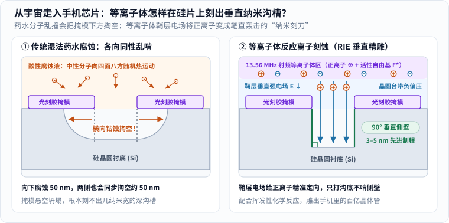

小时候背自然科学课本，世界总是被整整齐齐地分成三格：**固态**的石头与冰块、**液态**的江河湖海、**气态**的空气与水蒸气。

这种分类太符合地球表面的生活经验了，以至于很多人第一次听说“**宇宙中约 99% 的可见普通物质既不是固体、液体，也不是普通气体，而是第四态——等离子体（Plasma）**”时，第一反应往往是怀疑：真有这么多？那我平时怎么几乎没见过？[1][2]

答案其实就在你抬头看见的太阳与星空里。地球表面之所以被固、液、气三态统治，只是因为我们恰好住在一颗温度温和、引力适中、大气稠密的岩石行星“温室”里；一旦走出这层薄薄的大气壳，从太阳核心、日冕、太阳风，到绚丽的星云和广袤的星系际介质，到处都是温度更高或紫外辐射更强、原子外层电子早已挣脱束缚的世界。[1][2]

更奇妙的是，等离子体并不仅仅远在天边——街头闪烁却摸着不烫手的霓虹灯、雷雨夜劈开天空的闪电，乃至**你此刻手里这部智能手机的 3 纳米／5 纳米芯片**，全都离不开它。今天我们顺着四个最让人好奇的追问，用五幅亲手计算绘制的图解，把这神秘的“物质第四态”彻底拆明白。

---

## 一、从一块冰继续往下烧：水蒸气再加热，原子会发生什么？

### 1. 跨越第四道门槛：把外层电子从原子身上“撞下来”

理解等离子体最直观的办法，是在脑海里做一场“一路升温”的思想实验（看图 1 上半部分）：

1. **固态（Solid，$$< 0\,^\circ\mathrm{C}$$）**：水分子被分子间作用力锁在整齐的冰晶格子里，只能待在原地瑟瑟发抖；
2. **液态（Liquid，$$0\text{–}100\,^\circ\mathrm{C}$$）**：继续加热，热运动抖散了死板的晶格，水分子开始彼此滑移流动，但谁也没离开群体；
3. **气态（Gas，$$> 100\,^\circ\mathrm{C}$$）**：再加热，水分子彻底挣脱邻居拉扯，变成水蒸气四散乱飞。不过请注意，哪怕加热到一两千摄氏度把水分子 $$\mathrm{H_2O}$$ 拆成单独的氢原子 $$\mathrm{H}$$ 和氧原子 $$\mathrm{O}$$，**每个原子核外面的电子依然老老实实绑在自己家里**（想复习原子核外电子层结构的读者，可同看本站《[同一张元素周期表，为什么俄罗斯的看起来不一样？]()》），整颗原子对外不显电性；
4. **等离子体（Plasma，几千至上万度以上，或强电磁场下）**：如果我们还不罢休，继续往气体里猛灌能量——无论是加热到几千、几万开尔文让原子剧烈互撞，还是加上高压强电场、用高能紫外线／X 射线轰击——一旦碰撞能量跨过原子的**电离能**门槛（比如氢原子约 $$13.6\,\mathrm{eV}$$），**原本围着原子核转的外层电子就会被硬生生撞脱出来！**[1][2]

这一脱钩，整个体系的脾气就彻底变了：原本互不搭理的中性气体分子，碎成了一锅由**带负电的自由电子（$$e^-$$）**和**失去电子后带正电的离子（$$\oplus$$）**共同翻滚的“带电粒子汤”——这就是**物质第四态：等离子体**。

_图 1：先从左往右读四张状态卡片，观察电子何时脱离原子核束缚；再看下方橙色能量条与蓝色词源框。图中粒子尺寸与间距为物理机制示意，并非真实原子比例（真实原子核直径仅约原子整体的十万分之一）。[单独打开图片](/assets/images/plasma-state/four-states-ladder.svg)_

需要留心一个细节：固态变液态、液态变气态通常有清晰的相变温度（如标准大气压下 $$0\,^\circ\mathrm{C}$$ 熔化、$$100\,^\circ\mathrm{C}$$ 沸腾）；而**从普通气体过渡到等离子体是一个连续渐变的过程**，并没有某一度“咔哒一声突然相变”的绝对分界线——随着温度或电场升高，电离度 $$\alpha = n_i / (n_i + n_n)$$（已电离离子数占总重粒子数的比例）会从百万分之一平滑爬升到 $$100\%$$ 完全电离。[2]

### 2. 为什么英文叫“血浆（Plasma）”，中文却译成“等离子体”？

很多读者查字典时会大吃一惊：英文里的 `Plasma`，在医院里明明是**“血浆”**的意思！带电发光的物质第四态，怎么会跟血管里的淡黄色血浆同名？

这段科学史有据可查。早在 **1879 年**，英国物理学家克鲁克斯（William Crookes）在研究低压放电管时就敏锐意识到，管内发光的电离介质性质迥异于普通气体，称之为“第四态物质（radiant matter）”。[2] 到了 **1927–1928 年**，美国通用电气研究实验室的物理化学家**朗缪尔（Irving Langmuir，1932 年诺贝尔化学奖得主）**与同事在研究汞蒸气电弧放电时，发现除了紧贴电极的薄层（他命名为“鞘层 Sheath”）之外，中间大片均匀区域里正离子与电子数量几乎平衡，托载着高速电子、离子与杂质分子一起运动。[3][4]

据助手莫特-史密斯（Harold Mott-Smith）回忆，朗缪尔觉得这种“均匀基底流体托载着各类带电粒子游走”的景象，像极了**血液里的血浆（blood plasma）托载着红细胞、白细胞和细菌**！[4] 于是在 **1928 年 8 月**发表于《美国国家科学院院刊》（*PNAS*）的经典论文《电离气体中的振荡》里，朗缪尔正式写下了这个名字：[3]

> “除了靠近电极、几乎没有电子的鞘层之外，电离气体包含数量大致相等的离子与电子，因此净空间电荷极小。我们将用 **plasma** 一词来描述这一包含平衡的正负电荷的区域。”

这也顺带解开了中文译名的巧思：港台地区常按字面直译作**“电浆”**，保留了朗缪尔当年“带电流体／血浆”的比喻；而大陆物理学界定名的**“等离子体”**，则精准抓住了朗缪尔论文定义里的核心物理定律——

> **误区澄清**：“等离子”绝不是说里面的粒子大小或质量相等（电子质量只有质子的约 $$1/1836$$，轻得像尘埃比铅球！），而是指在足够大的宏观体积里，**自由电子携带的负电荷密度与正离子携带的正电荷密度几乎严格相等**！

用公式写出来，设自由电子数密度为 $$n_e$$、正离子数密度为 $$n_i$$、每个正离子平均失去的电子数为 $$\langle Z \rangle$$，则有：

$$
n_e \approx \langle Z \rangle n_i
$$

内部明明满是狂奔的正负电荷，整体对外却几乎不显净电性——物理学上把这条铁律叫做**准电中性（Quasi-neutrality）**。[2][3]

---

## 二、不就是“带电的热气体”吗？凭什么单列成第四态？

看到这里，爱动脑筋的朋友一定会追问一句：**既然它没有固定形状也没有固定体积，叫“电离气体”不就完了吗？物理学家干嘛非要大张旗鼓封它做“第四态”？**

美国能源部科学办公室和等离子体物理教科书给出了明确答案：把等离子体仅仅当成“热一点的气体”会产生根本性的误导。[1][2]

在普通中性气体（比如空气）里，氮气和氧气分子都是电中性的“瞎子台球”——两个分子相隔哪怕只有几纳米也互不理睬，只有迎头撞上的那一瞬间才改变方向，平时既不导电，拿磁铁靠近也毫无反应。

而一旦电子脱缰变成等离子体，支配粒子运动的就换成了长程的**库仑电磁力**（与距离平方 $$1/r^2$$ 成反比）：**每一颗粒子一动，周围成千上万颗带电粒子都会隔空同时感受到拉扯！** 这直接赋予了等离子体两项普通气体做梦都没有的“超能力”。

### 1. 超能力一：德拜屏蔽与“一呼百应”的集体振荡

先想一个看似矛盾的问题：既然库仑力传得那么远，为什么一团等离子体内部不会乱成一锅粥，对外还能保持“准电中性”？

假设你往等离子体正中央突然塞进一颗带正电的测试小球 $$+Q$$（看图 2 左半边）。周围原本均匀游荡的自由电子又轻又快，立刻会被 $$+Q$$ 吸引聚拢过来，而带正电的离子则被轻轻推开一点点。结果，测试电荷 $$+Q$$ 周围瞬间裹上了一层薄薄的“净负电荷云”——从外面远远看去，这团负电云刚好把里面的 $$+Q$$ 抵消掉了！[5]

这层“电子防护罩”有多厚？荷兰物理化学家彼得·德拜（Peter Debye）算出了它的特征半径，称为**德拜长度（Debye length，记作 $$\lambda_D$$）**：[5]

$$
\lambda_D = \sqrt{\frac{\varepsilon_0 k_B T_e}{n_e e^2}}
$$

别被根号吓到，看清分子和分母就能一眼读懂它的脾气（式中 $$\varepsilon_0$$ 是真空介电常数，$$k_B$$ 是玻尔兹曼常数，$$e$$ 是基本电荷）：

- **电子温度 $$T_e$$ 在分子上**：电子越热、跑得越疯，就越不肯乖乖聚在 $$+Q$$ 身边当盾牌，屏蔽罩就会变厚（$$\lambda_D$$ 变大）；
- **电子数密度 $$n_e$$ 在分母上**：周围能来帮忙的自由电子越密集，三两层就把电场堵死了，屏蔽罩就会变薄（$$\lambda_D$$ 变小）。比如稀薄的地球电离层里 $$\lambda_D$$ 大约有几毫米，托卡马克聚变装置里约 $$0.08\,\mathrm{mm}$$，而在极度稠密的太阳核心里 $$\lambda_D$$ 只有约 $$0.03\,\mathrm{nm}$$！

经过这层电子云的屏蔽，距离 $$+Q$$ 为 $$r$$ 处的电势 $$\Phi(r)$$，不再是真空里缓慢下降的裸库仑势 $$\propto 1/r$$，而是多乘了一项急速下坠的指数衰减因子（又称**德拜—汤川势**）：[5]

$$
\Phi(r) = \frac{Q}{4\pi\varepsilon_0 r} \exp\!\left(-\frac{r}{\lambda_D}\right)
$$

看图 2 右半边的精确计算曲线：仅仅走出 **$$1$$ 倍德拜长度（$$r = \lambda_D$$）**，电势就被削减到了真空值的 $$1/e \approx 36.8\%$$；走出 **$$3\lambda_D$$** 以外，残余电势连真空值的 **$$5\%$$** 都不到（$$e^{-3} \approx 0.0498$$）！

_图 2：先看左图蓝虚线围出的“德拜球”——半径 $$\lambda_D$$ 内电子密集围拢，把中央 $$+Q$$ 的电场锁在局部，球外依旧保持准电中性；再看右图无量纲精确曲线，实线在 $$r = \lambda_D$$ 处已跌至橙色虚线的 $$36.8\%$$。光线高亮动画仅播放一次，静态底图包含完整数值。[单独打开，刷新可重播](/assets/images/plasma-state/debye-shielding-curve.svg)_

与此同时，如果你把等离子体里的一片电子轻轻往右拉偏一点再松手，正离子会把它们猛拉回来；电子冲过头又被反向拉回，于是整片电子海洋就会像果冻一样以**等离子体频率** $$\omega_{pe} = \sqrt{n_e e^2 / (\varepsilon_0 m_e)}$$ 齐刷刷地集体往复振荡——这正是朗缪尔 1928 年论文发现的现象。[2][3]（顺便一提：地球高空电离层的特征频率刚好在几兆赫到十几兆赫之间，低于这个频率的**短波无线电广播**撞上电离层，电子来得及集体振荡把电磁波像镜子一样反射回地面，所以短波能跨洋传播；而频率高达千兆赫的**手机卫星和 GPS 信号**太快，电子来不及响应，就能径直穿透电离层！）

### 2. 顺手破个迷思：拿三条硬判据验身，蜡烛火焰算不算等离子体？

网上常有人争论“火是不是等离子体”。有了上面的物理标尺，我们就不用靠吵架，而是拿等离子体物理学的**三条硬判据**直接验明正身：[2]

1. **尺度够大（$$\lambda_D \ll L$$）**：屏蔽罩半径 $$\lambda_D$$ 必须远小于这团物质的整体尺寸 $$L$$，内部才有大片准电中性空间；
2. **帮手够多（$$N_D = \frac{4}{3}\pi n_e \lambda_D^3 \gg 1$$）**：每个德拜球里必须装有成百上千颗自由电子，统计屏蔽才成立；
3. **电磁压倒碰撞（$$\omega_{pe} \tau_{en} > 1$$）**：电子完成一次集体振荡前，不能先被周围的中性空气分子撞得晕头转向（$$\tau_{en}$$ 为电子与中性分子的平均碰撞间隔）。

拿一朵普通蜡烛火焰来算笔账：烛焰温度约 $$1{,}400\,\mathrm{K}$$（约 $$1{,}100\,^\circ\mathrm{C}$$），在标准大气压下，每立方米挤着约 $$5\times 10^{24}$$ 个中性空气与燃烧产物分子，而靠燃烧化学反应和热运动撞出来的自由电子往往只有 $$10^{13}\text{–}10^{14}\,\mathrm{m^{-3}}$$ 量级——**每几百亿个中性分子里才混着一颗电子！** 电子每秒钟要跟中性空气分子猛撞上千亿次，集体电磁振荡还没抬头就被撞没了，而且 $$\lambda_D$$（毫米级）也快赶上火焰薄层的厚度了。

因此严格来说：**普通蜡烛火焰绝大部分只是含有极微量离子的炽热中性气体**（尽管因为混有这点微量离子，把烛焰放进上万伏强电场里确实能看到火焰被拉偏）；只有温度飙升到数千乃至三万开尔文的**闪电通道、电焊电弧、极光、霓虹灯辉光和恒星**，才是货真价实的等离子体！[1][2]

### 3. 超能力二：听磁场的指挥——造一只装“一亿度火球”的隐形瓶子

普通热空气根本不理会磁铁；但等离子体里的每一颗粒子都带着电荷 $$q$$，只要一跑起来，就会受到电磁场的**洛伦兹力（Lorentz force）**：

$$
\mathbf{F} = q(\mathbf{E} + \mathbf{v} \times \mathbf{B})
$$

仔细看后面那项叉乘 $$q(\mathbf{v} \times \mathbf{B})$$：它的方向**永远严格垂直于粒子的运动速度 $$\mathbf{v}$$**！这意味着磁场不增减粒子的动能，却像一根无形的栓马索，时刻把试图横穿磁力线的粒子往圆心拽，逼着它以**拉莫尔半径（Larmor radius）** $$r_L = \frac{m v_\perp}{|q|B}$$ 绕着磁力线打转，同时允许它顺着磁力线方向自由滑行。[2]

合在一起看（图 3 左半边），**带电粒子就像穿在铁丝上的算盘珠一样，紧紧缠绕着磁力线走出一条三维螺旋线**：电子质量轻、带负电，绕着磁力线高频小圈右旋；正离子质量大、带正电，绕着同一根磁力线低频大圈反向左旋！

_图 3：先看左图上下两根绿色磁力线——电子（蓝）圈小频高，正离子（橙）圈大频低且旋向相反，两者都被磁场锁住横向去路；再看右图托卡马克（Tokamak），环向场线圈（蓝）与中心螺线管激发的极向场合成扭曲闭合磁力线（紫），把上亿度聚变芯部悬空隔离在真空室外壁之内。[单独打开，刷新可重播](/assets/images/plasma-state/magnetic-helix-bottle.svg)_

大自然和人类工程师把这条规律玩出了三大奇迹：

- **太阳日珥与冕环**：太阳没有固体表面（光球约 $$5{,}500\,^\circ\mathrm{C}$$，外层日冕高达约 $$200\text{ 万}\,^\circ\mathrm{C}$$ [8]；关于太阳核心如何产能，详见本站《[太阳的光是怎么来的]()》）。天文照片上那些比地球还大几十倍的壮丽火拱门，正是炽热等离子体顺着太阳表面拱形磁力线列队奔流画出的磁力线轮廓！
- **地球南北极的极光**：太阳风吹来的高能带电粒子撞上地球磁层后，被地球磁力线一路引导滑向南北两极高空，轰击大气原子发光——在 $$100\text{–}200\,\mathrm{km}$$ 高度撞击氧原子发出最常见的**绿光**，在 $$200\,\mathrm{km}$$ 以上激发氧原子发**红光**，撞击氮分子则添上蓝紫与低空粉红裙边。[9]
- **托卡马克（Tokamak）核聚变“隐形磁瓶”**：人类想在地球上模仿太阳做氘—氚受控核聚变，缺少太阳那样的巨无霸引力高压，就必须把等离子体加热到约 **$$1.5\text{ 亿}\,^\circ\mathrm{C}$$（$$1.5\times 10^8\,\mathrm{K}$$，太阳核心温度的 10 倍！）**。[6][7] 地球上最耐热的金属钨到 $$3{,}422\,^\circ\mathrm{C}$$ 就化了——什么瓶子能装一亿五千万度的燃料？答案就是**不碰瓶壁的磁场笼子**！可如果磁力线是直管，粒子顺着磁力线一溜烟就从两头漏光了；1950 年代苏联物理学家想出绝招，把螺线管首尾相接弯成一只“甜甜圈”（环形室），再用外圈环向场磁铁配合中心螺线管感应出的兆安培级等离子体电流，把磁力线拧成图 3 右侧那样的闭合麻花（消除单纯环形场里的上下漂移），让密度只有空气百万分之一的亿度聚变等离子体稳稳悬在半空！[6][7]

---

## 三、反直觉之谜：既然电子上万度，为什么霓虹灯管摸着不烫手？

讲到这里，细心的读者一定会抓出一个巨大的破绽：

> **“慢着！你前面刚说气体要几千、上万度才能撞脱电子变成等离子体，那街边亮着的霓虹灯管、家里的老式日光灯管和科技馆里的闪电魔球，里面装的也是等离子体——为什么玻璃管不但没烧化，停电一摸甚至只有点温热？！”**

问到点子上了！这正是等离子体物理里最迷人、也最容易让人卡壳的**“双温悖论”（冷等离子体 vs 热等离子体）**。

解开这个谜团，可以顺着微观动力学一步步拆成三小节：

### 1. 微观“温度”的真义：只看单颗粒子的平均动能，不看总热量

在热力学与统计物理中，某种粒子的温度 $$T$$，本质上是**该类粒子无规则热运动平均平动动能的标尺**（平均动能 $$= \frac{3}{2} k_B T$$；等离子体物理习惯直接用能量单位电子伏特 $$\mathrm{eV}$$ 报温度，换算关系为 $$1\,\mathrm{eV} = e / k_B \approx 11{,}605\,\mathrm{K}$$）。[2]

它衡量的是“单颗粒子跑得多欢”，而不是整团物质一共存了多少总热量——就像除夕夜烟花棒溅出一颗上千度的铁火星落到手背上不会烫伤你，而一大盆 $$80\,^\circ\mathrm{C}$$ 的热水却会严重烫伤一样，粒子稀薄时总热容量极低。

### 2. 乒乓球撞保龄球：轻电子单次正撞最多只传出万分之一动能

但霓虹灯不烫手还有一个更深层的原因：**在低压稀薄放电管里，电子和重原子根本不在同一个温度上！**[1][2]

霓虹灯管里的气压通常被抽到只有大气压的千分之一到百分之一左右。通电后，电场同时推着带负电的自由电子和带正电的氖离子加速。电子质量 $$m_e$$ 极轻，一脚油门就被电场加速到了 $$1\text{–}3\,\mathrm{eV}$$，折算成**电子温度高达 $$T_e \approx 10{,}000\text{–}30{,}000\,\mathrm{K}$$**！这么高的动能，足够把沿途氖原子的核外电子撞上激发态，跃迁发出鲜艳的橙红霓虹光。

那为什么上万度的电子，没把周围的氖原子和灯管壁也烤成上万度呢？不妨用高中动量守恒与动能守恒，算一算质量为 $$m_e$$ 的轻电子迎头弹性正撞一颗质量为 $$M$$ 的静止重粒子时，**单次最多能传过去多少比例的动能**：

$$
\eta_{\max} = \frac{4 m_e M}{(m_e + M)^2} \approx \frac{4 m_e}{M} \quad (m_e \ll M)
$$

把真实质量代进去一看，答案惊人（看图 4 右半边）：

- 就算撞最轻的氢离子（单颗质子，$$M = m_p \approx 1836\,m_e$$），电子单次正撞最多也只能交出 **$$0.218\%$$** 的动能；
- 如果撞的是一颗氖原子（$$\mathrm{Ne}$$，质量约为电子的 **$$3.7\text{ 万倍}$$**），电子迎头撞上去，单次最多只能传过去 **$$0.011\%$$（万分之一）** 的能量，剩下 **$$99.989\%$$** 的动能全跟着电子自己弹回来了！

这就好比你抓起一把高速飞行的**乒乓球（电子）**去砸地上的**保龄球（氖原子）**：乒乓球满屋子乱飞（$$T_e \approx 23{,}000\,\mathrm{K}$$），保龄球却纹丝不动、懒洋洋地待在室温附近（**气体与离子温度 $$T_{\text{gas}} \approx T_i \approx 300\text{–}400\,\mathrm{K}$$，也就是三四十摄氏度**）！因为灯管内气压低、碰撞次数少，乒乓球永远来不及把保龄球捂热——物理学家把这种 $$T_e \gg T_{\text{gas}}$$ 的非热平衡状态，贴切地叫做**低温等离子体（或冷等离子体，Cold / Non-thermal Plasma）**。[1][2]

_图 4：先看左图对数全景坐标（横轴跨越 26 个密度量级，纵轴跨越 6 个温度量级），找到蓝色圆点“霓虹灯／芯片刻蚀”与橙色圆点“闪电／电弧焊”——两者电子温度都在两三万开尔文上下，电子密度却相差一亿倍！再看右图碰撞账本：低压稀薄时电子传能效率仅万分之一，造就“电子滚烫、气体温和”的冷等离子体；高压稠密时每秒碰撞亿万次，强行把气体也拉到三万度，变成瞬间熔化金属的热等离子体。[单独打开图片](/assets/images/plasma-state/plasma-map-cold-hot.svg)_

### 3. 密度决定冷热分水岭：从温和霓虹灯到劈断大树的闪电热等离子体

反过来，如果来到标准大气压下的**闪电通道**或**电弧焊枪**（图 4 左下方橙点，$$n_e \sim 10^{24}\,\mathrm{m^{-3}}$$，比霓虹灯稠密一亿倍），情况就彻底反转了：虽然单次碰撞还是只传万分之一的能量，架不住气体密度太高、每秒钟碰撞成百上千亿次，“蚊子腿攒成山”，硬是在微秒内把重离子和中性气体也烧到了跟电子一模一样的三万开尔文（**$$T_e \approx T_i \approx T_{\text{gas}} \approx 30{,}000\,\mathrm{K}$$**）！这种全员滚烫的热平衡状态叫做**热等离子体（Thermal Plasma）**——闪电劈断大树、瞬间加热膨胀空气炸出雷鸣，以及等离子焊枪切开厚钢板，靠的就是它。[1][2]

---

## 四、从深空走入指尖：等离子体正在你口袋里干什么活？

弄懂了“集体电磁响应”与“冷热双温调控”，你就能立刻看明白，为什么今天最尖端的三大硬核工程全在围着等离子体转。

### 1. 手机里的 3 纳米芯片：用等离子体当“垂直纳米刻刀”

你此刻看文章用的手机或电脑处理器里，指甲盖大小的硅晶圆上挤着**上百亿颗晶体管**（想了解这些晶体管怎样搭成加法器与 CPU，可同看本站《[计算机是如何工作的]()》）。光刻机负责把电路图纸印在硅片表面的光刻胶掩模上；但真正把图纸变成硅片上一道道深沟槽与纳米鳍片的，是紧接着的**刻蚀（Etching）**工序。[1][11]

早期微电子厂直接把硅片泡进氢氟酸等化学药水里腐蚀（**湿法腐蚀**，看图 5 左半边）。可到了纳米时代，这招彻底失灵了：液体里的酸分子做无规则热运动，毫无方向感（**各向同性**）——药水往下咬进硅片 $$50\,\mathrm{nm}$$ 深的同时，也会顺着光刻胶底下往左右两侧各掏空 $$50\,\mathrm{nm}$$（称为**横向钻蚀 Undercut**）！你想刻一道 $$5\,\mathrm{nm}$$ 宽的高墙，药水一泡，墙根直接被掏空塌掉了。

_图 5：先看左图湿法腐蚀——酸液分子朝四面八方乱撞，在虚线目标壁外侧掏出大段悬空弧坑；再看右图反应离子刻蚀（RIE）——晶圆台累积负偏压形成薄薄的“鞘层垂直强电场”，把正离子变成垂直向下的纳米凿子，只轰击沟底不啃侧壁，实现 $$90^\circ$$ 垂直侧壁刻蚀。[单独打开图片](/assets/images/plasma-state/chip-plasma-etching.svg)_

救场的正是前面刚讲过的**低压冷等离子体**——**反应离子刻蚀（Reactive-Ion Etching, RIE）**（图 5 右半边）：[10][11]

1. 在真空腔室里通入六氟化硫（$$\mathrm{SF_6}$$）或四氟化碳（$$\mathrm{CF_4}$$）等反应气体，用 $$13.56\,\mathrm{MHz}$$ 射频电磁场激发成冷等离子体——因为气体本身接近室温，晶圆上精密的光刻胶根本不会被烤化；
2. 轻快的电子率先撞向绝缘隔离的晶圆托盘，使晶圆台自动攒出几百伏负电压，在晶圆表面上方几毫米内形成朗缪尔当年发现的**德拜鞘层（Sheath）**，里面竖着一道笔直向下的强电场；
3. 等离子体里的正离子一旦漂到鞘层边缘，立刻被这道垂直电场像子弹一样**呈 $$90^\circ$$ 笔直向下加速轰击沟槽底部**（不碰两侧竖壁！），把沟底硅原子的化学键撞松，配合氟自由基（$$\mathrm{F^*}$$）迅速生成挥发性气体 $$\mathrm{SiF_4}$$ 被真空泵抽走！[11]

更有一段鲜为人知的跨界佳话：1990 年代半导体行业想用射频波进一步缩小芯片线宽时，一度被多频率电压耦合失控难住；正是美国橡树岭国家实验室（ORNL）长期研究**磁约束核聚变射频加热**的等离子体物理学家出手相助，把聚变诊断与射频控制技术迁移进晶圆厂，帮人类推开了今天智能手机轻薄芯片的大门！[10]

### 2. 深空探测器的蓝色尾焰：霍尔等离子体推进器

传统化学火箭靠剧烈燃烧喷火，喷气速度上限通常只有 $$3\text{–}4.5\,\mathrm{km/s}$$，去一趟深空光燃料就要占掉火箭发射总重的九成以上。

而像中国天宫空间站、SpaceX“星链”卫星，以及 NASA 于 2023 年 10 月发射飞往金属小行星的**“灵神星号”（Psyche）探测器**，尾部喷出的都是一束幽蓝色的等离子体羽流——**霍尔效应推进器（Hall-effect Thruster）**。[12][13] 它用太阳能电池板的电力把惰性气体氙（$$\mathrm{Xe}$$）或氪电离成等离子体，先靠径向磁场锁住电子，再用强轴向电场把氙离子加速到惊人的 **$$15\text{–}30\,\mathrm{km/s}$$** 高速喷出！[13]

虽然“灵神星号”单台推进器的推力最大只有约 $$240\,\mathrm{mN}$$——**差不多只相当于你手心托起一节五号电池的重量** [12]——但在毫无阻力的外太空里，它能不间断连喷几个月甚至几年，只消耗很少一点推进剂，就把近三吨重的飞船加速送往数十亿公里外的小行星带。

### 3. 点亮未来的终极能源：受控核聚变

最后回到人类能源皇冠上的明珠——受控核聚变。无论是以国际热核聚变实验堆 **ITER**（由中国、欧盟、美国、俄罗斯、日本、韩国、印度七方共建，目标输入 $$50\,\mathrm{MW}$$ 加热功率产生 $$500\,\mathrm{MW}$$ 聚变功率，实现 $$Q=10$$ 燃烧等离子体 [7]）、欧洲 **JET**（2021 年创下 $$59\,\mathrm{MJ}$$ 聚变能量纪录 [6]）以及中国全超导托卡马克 **EAST**、**中国环流三号（HL-3）**为代表的**磁约束路线**，还是用百路超强激光在十亿分之一秒内向内压缩靶丸实现聚变点火的**惯性约束路线** [1][6]，本质上都是在解答同一道终极考题：**怎样把一团上亿度的等离子体驯服得更稳、更久？**

---

## 五、收拢全局：一张速查表与生活中的观察清单

### 1. 四条底层逻辑速查表

下次再抬头看太阳、夜晚看霓虹灯或低头划手机屏幕时，不妨用下面这张速查表在脑海里回放一遍等离子体的四条底层逻辑：

| 核心追问 | 一句话物理本质 | 典型实例 |
| :--- | :--- | :--- |
| **它是什么？** | 原子外层电子脱离束缚，由自由电子与正离子组成的**准电中性（$$n_e \approx Z n_i$$）**带电粒子汤 | 恒星、星云、太阳风、闪电、极光 |
| **跟普通气体差在哪？** | 长程库仑力带来**德拜屏蔽（$$\lambda_D$$）**与**集体振荡（$$\omega_{pe}$$）**；普通烛焰电离极弱，严格算热气体 | 电离层反射短波广播；德拜屏蔽截断电场 |
| **怎么把它关进瓶子？** | 洛伦兹力 $$q(\mathbf{v}\times\mathbf{B})$$ 逼粒子绕磁力线走**拉莫尔螺旋**，环形扭曲磁笼可隔空悬浮燃料 | 太阳冕环、地球极光通道、托卡马克（$$1.5\times 10^8\,\mathrm{K}$$） |
| **为什么霓虹灯不烫手？** | 低压稀薄时“乒乓球撞保龄球”单次传能仅万分之一，**$$T_e \sim 2\times 10^4\,\mathrm{K} \gg T_{\text{gas}} \approx 320\,\mathrm{K}$$** | 霓虹灯、手机芯片 **RIE 等离子体垂直刻蚀** |

### 2. 带孩子逛科技馆时的安全观察指南

周末带孩子去科技馆站在**等离子体闪电球（魔球）**前时，现在可以一步步指给他看了：玻璃球里抽成低压并充入氖、氩、氙等惰性气体，中央高频高压电极激发出几道绚丽的低温等离子体细丝；当你把手掌贴上玻璃球外壁，人体与大地构成更好的电容通路，局部电场增强，那束发光的电子—离子通道就会像听话的触手一样汇聚到你的指尖下方——而因为球内是 $$T_e \gg T_{\text{gas}}$$ 的低压冷等离子体，隔着玻璃摸上去既明亮又温和（注意：只可在正规科技馆密封完好的展示球外短暂触摸，远离起搏器等精密电子设备，切勿自行拆改高压电源）。从这颗手掌大的玻璃球往外望去，整片璀璨星空其实都在上演同一套电磁与粒子的协奏曲。

---

## 参考资料与延伸阅读

1. U.S. Department of Energy (DOE) Office of Science，*DOE Explains...Plasma*：等离子体占宇宙可见物质约 99%、电子脱离中性原子电离机制、高温完全电离等离子体与室温部分电离低温等离子体对比，以及核聚变与半导体制造应用。<https://www.energy.gov/science/doe-explainsplasma>
2. Wikipedia，*Plasma (physics)*：物质第四态研究史（1879 年克鲁克斯、1928 年朗缪尔）、与中性气体的三大本质差异、理想等离子体三判据（德拜近似、体相互作用 $$\lambda_D \ll L$$、无碰撞集体振荡）及冷热等离子体参数范围。<https://en.wikipedia.org/wiki/Plasma_(physics)>
3. Irving Langmuir (1928)，*Oscillations in Ionized Gases*，*Proceedings of the National Academy of Sciences (PNAS)*，14(8): 627–637：朗缪尔首次在学术文献中正式引入“Plasma（等离子体）”与电极附近“Sheath（鞘层）”概念，并推导电子等离子体振荡。<https://pmc.ncbi.nlm.nih.gov/articles/PMC1085653/>
4. ITER Organization (Robert Arnoux, 2013)，*Why "plasma"?*：详述 1927 年通用电气实验室汞弧放电研究与莫特-史密斯（Harold M. Mott-Smith）1971 年《自然》来信回忆，还原朗缪尔以医学“血浆托载血细胞”类比命名等离子体的历史细节。<https://www.iter.org/node/20687/why-plasma>
5. Wikipedia，*Debye length*：泊松—玻尔兹曼方程线性化推导德拜长度 $$\lambda_D = \sqrt{\varepsilon_0 k_B T / (n q^2)}$$ 与点电荷德拜—汤川指数屏蔽势 $$\Phi(r) = \frac{Q}{4\pi\varepsilon_0 r}e^{-r/\lambda_D}$$。<https://en.wikipedia.org/wiki/Debye_length>
6. U.S. Department of Energy (DOE) Office of Science，*DOE Explains...Tokamaks* 与 *DOE Explains...Plasma Confinement*：环形场线圈、中心螺线管与极向场合成扭曲磁力线原理，1958 年苏联 T-1 托卡马克、2021 年欧洲 JET 装置 $$59\,\mathrm{MJ}$$ 聚变能量纪录及磁约束／惯性约束对比。<https://www.energy.gov/science/doe-explainstokamaks> 、<https://www.energy.gov/science/doe-explainsplasma-confinement>
7. ITER Organization，*In a Few Lines* 与 *Making it work*：氘—氚聚变三大条件（约 $$1.5\times 10^8\,^\circ\mathrm{C}$$ 高温、密度与约束时间）、等离子体密度约为空气百万分之一，以及 ITER $$Q=10$$（$$50\,\mathrm{MW}$$ 输入产生 $$500\,\mathrm{MW}$$ 聚变功率）设计目标。<https://www.iter.org/few-lines> 、<https://www.iter.org/fusion-energy/making-it-work>
8. NASA Science，*Our Sun: Facts*：太阳等离子体结构、核心温度约 $$1{,}500\text{ 万}\,^\circ\mathrm{C}$$、光球层约 $$5{,}500\,^\circ\mathrm{C}$$ 及外层日冕高达 $$200\text{ 万}\,^\circ\mathrm{C}$$ 的观测数据。<https://science.nasa.gov/sun/facts/>
9. NASA Science，*Auroras*：太阳风带电粒子沿地球磁力线注入极区高层大气，在不同高度激发氧原子（绿光 $$100\text{–}200\,\mathrm{km}$$、红光 $$>200\,\mathrm{km}$$）与氮分子（蓝光与 $$<100\,\mathrm{km}$$ 粉紫光）产生极光的机制。<https://science.nasa.gov/sun/auroras/>
10. U.S. Department of Energy (DOE) Office of Science，*Fusion Research Ignites Innovation*：橡树岭国家实验室（ORNL）核聚变射频等离子体加热与控制技术如何迁移协助半导体产业攻克微纳刻蚀难题。<https://www.energy.gov/science/articles/fusion-research-ignites-innovation>
11. Wikipedia，*Reactive-ion etching*：$$13.56\,\mathrm{MHz}$$ 射频反应离子刻蚀（RIE）原理、晶圆台负自偏压鞘层电场定向加速离子与各向异性垂直纳米刻蚀对比湿法各向同性腐蚀。<https://en.wikipedia.org/wiki/Reactive-ion_etching>
12. NASA Science，*Psyche Spacecraft*：NASA“灵神星号”探测器搭载四台太阳能霍尔效应推进器电离喷射氙等离子体（蓝光羽流，单台最大推力约 $$240\,\mathrm{mN}$$，约合一节五号电池重量）的工程参数。<https://science.nasa.gov/mission/psyche/spacecraft/>
13. Wikipedia，*Hall-effect thruster*：霍尔推进器正交电磁场束缚电子、加速离子原理及 $$15\text{–}30\,\mathrm{km/s}$$ 典型喷气速度范围。<https://en.wikipedia.org/wiki/Hall-effect_thruster>

> 说明：本文五幅配图均为原创计算 SVG，已注册纳入本站统一配图工具包 `tools/visuals/science_tech.py`，可通过 `python tools/visuals.py build plasma-state` 一键重算生成并运行全站排版审计；脚本内置物理断言严格核验了太阳核心、聚变堆、芯片放电与电离层的德拜长度量级、德拜球粒子数 $$N_D \gg 1$$、汤川屏蔽势 $$e^{-r/\lambda_D}/r$$ 衰减比、正负粒子拉莫尔回旋反向性与洛伦兹加速度正交守恒，以及电子碰撞氢核／氖原子的最大弹性传能比例。
{: .prompt-tip }
