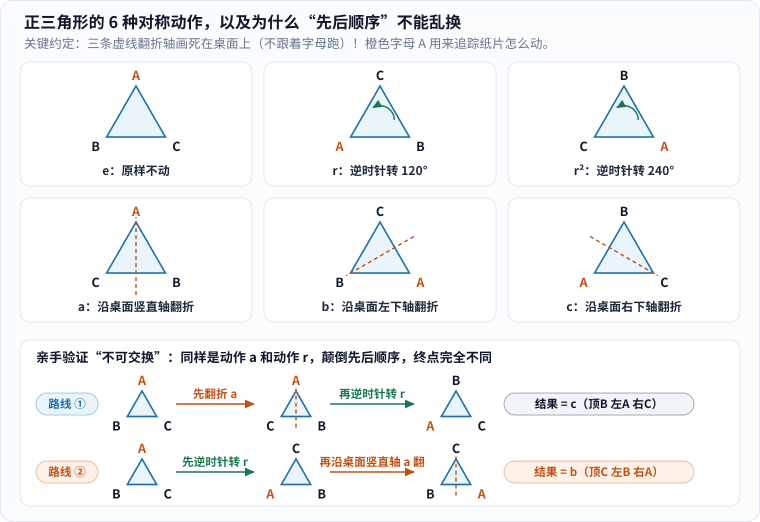
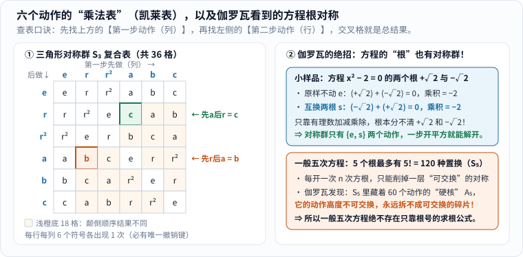
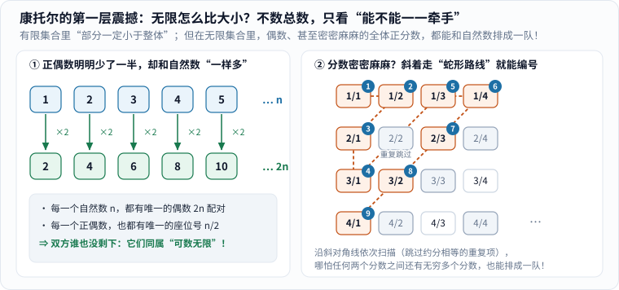
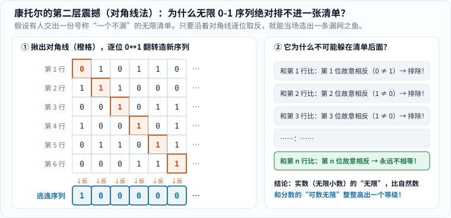

在进入任何公式之前，我们先在桌面上做两个不用算术的小实验。

**实验一（转动纸片）**：剪一张正三角形硬纸片，在桌上沿着它的轮廓轻轻画一个框，再把纸片的三个角标上 A、B、C。现在闭上眼，让朋友把纸片转一下或翻个面，重新放回桌面框里。睁开眼时，三角形严丝合缝，外观跟刚才一模一样——只有 A、B、C 换了座位。

**实验二（点名排队）**：假设有一座住满客人的“无限旅馆”，或者有一张写满 0 和 1 无限序列的名单。你想给所有对象挨个发号码牌：1 号、2 号、3 号……结果你会撞上一件怪事：密密麻麻的全体分数居然能一个不漏发完号码牌；可一旦换成无限 0-1 序列，无论谁交出多么完整的名单，你都能在十秒内当场造出一个不在名单上的“逃犯”。

这两件看似毫不相干的小事，恰恰推开了现代数学最重要的两扇门：

- 第一扇门叫**群论（group theory）**：它不关心图形长多高、面积多大，专门研究**“怎样动一动，某种结构保持不变”**，以及这些动作叠在一起有什么脾气。
- 第二扇门叫**集合论（set theory）**：它研究最底层的动作——**“把确定的对象装进同一个袋子”**，以及当袋子里的东西变成无限多时，“一样多”到底是什么意思。

推开这两扇门的人，是一群命运跌宕的 19 世纪数学家：决斗前夜还在整理手稿的 20 岁法国青年伽罗瓦、靠当律师谋生却业余写了近千篇论文的凯莱、因为把“无限”分成三六九等而饱受攻击的康托尔，以及被一个“理发师”式自指难题逼着重打地基的罗素与策梅洛。

---

## 一、什么是群：给“对称动作”做一张乘法表

### 1. 先在桌面上画死三条线，再动三角形

回到实验一。怎样移动那张正三角形纸片，才能让它落回桌面原来的轮廓框里？数一数，一共只有 **6 种动作**：

- **3 种旋转**：原样不动（记作 \(e\)）、逆时针转 \(120^\circ\)（记作 \(r\)）、逆时针转 \(240^\circ\)（记作 \(r^2\)）；
- **3 种翻折**：这里有个特别容易踩坑的细节——**请把三条虚线镜面轴画死在桌面上**（一条竖直穿过上角框，一条穿过左下角框，一条穿过右下角框，分别记作动作 \(a,b,c\)），而**不要**让镜面轴跟着纸片上的字母跑！

为什么这个约定这么要紧？我们看图 1 下半部分的动手对比实验：

_图 1：上方 6 张卡片是正三角形的全部对称动作（橙色虚线是画死在桌面上的固定翻折轴，绿色弯箭头是逆时针旋转）。下方两条路线用同样的两个动作 \(a\) 和 \(r\)，只颠倒先后顺序，终点就从 \(c\) 变成了 \(b\)。[单独打开图片](/assets/images/group-set/triangle-symmetries.svg)_

跟着图 1 下方的两条路线走一遍（盯着橙色字母 **A** 去哪儿了）：

- **路线 ①（先翻折 \(a\)，再逆时针转 \(r\)）**：初始状态顶 A、左 B、右 C。先沿桌面竖直轴翻折 \(a\)，左右互换变成（顶 A、左 C、右 B）；再逆时针转 \(120^\circ\)，顶上的 A 转到左下角，变成**（顶 B、左 A、右 C）**——对照上方图卡，这正好等于单做一次右下轴翻折 **\(c\)**！
- **路线 ②（先逆时针转 \(r\)，再翻折 \(a\)）**：先把初始纸片逆时针转 \(120^\circ\)，变成（顶 C、左 A、右 B）；接下来做动作 \(a\)——注意，桌面竖直轴还在正中央（此时穿过顶上的 C），左右一翻，左边的 A 和右边的 B 互换，变成**（顶 C、左 B、右 A）**——对照上方图卡，这变成了左下轴翻折 **\(b\)**！

你看，两个动作接连做完，效果总是等价于这 6 个动作里的某一个；所以**“接连做动作”本身就是一种运算**。但它跟我们从小熟知的数字乘法（\(3\times 5 = 5\times 3\)）有一个根本区别：**动作的先后顺序不能随便换！**（生活中穿鞋袜也一样：先穿袜子再穿鞋，和先穿鞋再套袜子，结果天差地别。）

### 2. 把 6 个动作排成“乘法表”，四条规矩自己浮出来

把所有“先做谁、后做谁”的 36 种搭配全算出来，就得到图 2 左侧的 **6×6 复合表（凯莱表）**：

_图 2：左表查法——先在顶行找到第一步动作（列），再在左列找到第二步动作（行），交叉格即合成结果（绿框与橙框即刚才验证的两条路线）。右图用二次方程与五次方程对比，展示伽罗瓦为什么能用群看穿求根公式的极限。[单独打开图片](/assets/images/group-set/s3-table.svg)_

盯着左表看十秒钟，你会发现这张表有四条雷打不动的秩序——后来数学家把满足这四条规矩的“集合 + 运算”统称为一个**群（group）**：[2]

1. **封闭性**：格子里填来填去，永远只出现 \(\{e,r,r^2,a,b,c\}\) 这六个老熟人，绝不会蹦出第七种怪动作；
2. **结合律**：连做三个动作时，先把前两个打包成一个动作，还是先把后两个打包，总效果完全一样；
3. **单位元（不动键）**：有一个什么都不干的动作 \(e\)，谁跟它组合都保持原样；
4. **逆元（撤销键）**：任何动作都能被撤销——翻折再翻一次就复原（\(a\cdot a=e\)），逆时针转 \(120^\circ\) 再转 \(240^\circ\) 也复原（\(r^2\cdot r=e\)）。反映在表格上，就是像数独一样，**每一行、每一列里六个动作都恰好各出现一次**！

注意：四条规矩里**故意没有要求交换律**。表里那 18 个浅橙色格子，全都是颠倒顺序会变结果的组合（如果一个群恰好满足交换律，数学家会专门叫它“交换群”或“阿贝尔群”）。魔方的拧动、晶体分子的对称、密码学里的椭圆曲线点加法，底层全都是同一套“群”骨架。

---

## 二、伽罗瓦、凯莱与约当：解方程怎么会扯上“对称”？

### 1. 伽罗瓦的顿悟：原来方程的“根”也有对称群！

初中我们背过一元二次方程求根公式 \(\frac{-b\pm\sqrt{b^2-4ac}}{2a}\)。16 世纪的意大利数学家又相继攻克了三次、四次方程的求根公式。按理说，五次方程的公式只是更长一点吧？结果整整两百多年，所有人都撞了南墙。

挪威青年阿贝尔先证明了一般五次方程没有根式求根公式；而法国青年**埃瓦里斯特·伽罗瓦（Évariste Galois，1811–1832）**干了一件更彻底的事：他给出了**任意一个方程到底能不能用根号解出来的充要判据**——而钥匙竟然就是我们刚刚看到的“对称群”！[1]

很多读者听到这里最困惑的是：**三角形有形状所以能转能翻，干巴巴的代数方程，哪来的“对称”？**

看图 2 右上角的极简例子，三行算式就能捅破这层窗户纸：考虑方程 \(x^2 - 2 = 0\)，它的两个根是 \(+\sqrt{2}\) 和 \(-\sqrt{2}\)。假设你手里目前只有**有理数**（整数和分数）以及加减乘除：

- 两根相加：\((+\sqrt{2}) + (-\sqrt{2}) = 0\)；
- 两根相乘：\((+\sqrt{2}) \times (-\sqrt{2}) = -2\)。

现在，你悄悄把 \(+\sqrt{2}\) 和 \(-\sqrt{2}\) **互换位置**——和还是 \(0\)，积还是 \(-2\)，所有能用有理数写出来的关系式**全都纹丝不动**！换句话说，站在有理数的视角看过去，\(+\sqrt{2}\) 和 \(-\sqrt{2}\) 长得一模一样、根本分不清彼此——**“不动”与“互换两根”就构成了这个方程的对称群**（只有 2 个动作）。每当你允许用一次“开方 \(\sqrt{\cdot}\)”，就相当于打破一层“可交换”的对称。

再看图 2 右下角的一般五次方程：5 个根之间最多有 \(5! = 120\) 种互换方式（构成置换群 \(S_5\)）。伽罗瓦顺着群的内部结构往里拆，发现 \(S_5\) 肚子里藏着一块由 **60 种偶置换组成的“铁板硬核”（交错群 \(A_5\)）**——它的动作像我们刚才的三角形一样高度不可交换，而且没法再拆成一层层可交换的小碎片！既然开根号只能一层层削掉可交换的对称，面对这块敲不碎的 60 元硬核，任何只靠加减乘除和开根号的公式都注定束手无策。[1][2]

令人唏嘘的是，伽罗瓦的命运比他的数学更像悲剧：1830 年他投给巴黎科学院的手稿，随着评审人傅里叶去世而遗失；1831 年重写再投，评审人泊松觉得写得太简略、看不懂而退回。1832 年 5 月 30 日清晨，伽罗瓦在一场决斗前夜拼命把思想浓缩在信纸上托付给朋友，次日伤重离世，年仅 20 岁。直到 1846 年，刘维尔才看懂并公开发表了这份遗产。[1][2]

### 2. 从“置换表”磨成真正的抽象概念

也要注意一个历史分寸：**伽罗瓦当年手里拿的是具体的“根的置换”，并没有写出今天教科书里那四条抽象公理。**[2]

- **凯莱（Arthur Cayley）**：这位在伦敦当了十四年律师、靠业余时间写下近千篇论文的英国数学家，在 **1854 年**第一次尝试撇开具体的图形和方程根，把群纯粹定义成一张符号复合表（就是图 2 左侧的凯莱表），并明确指出 \(\theta\phi\) 不必等于 \(\phi\theta\)。[2]
- **约当（Camille Jordan）**：当时凯莱的超前抽象并没有立刻流行开；直到 **1870 年**约当出版《置换与代数方程论》，系统阐发伽罗瓦理论，“群”才真正成为全欧洲通用的核心数学语言。[2]

**伟大的数学概念很少是一夜之间从天上掉下来的完美石碑，它往往是几代人接力打磨才露出的锋芒。**

---

## 三、集合论：当康托尔决定给“无限”比大小

讲完“动作”，我们再看底下的“袋子”——**集合（set）**。把一些明确区分的对象归拢在一起，就是一个集合：比如 \(\{1,2,3\}\)，比如刚才正三角形的 6 个对称动作，比如全体自然数 \(\{1,2,3,4,\dots\}\)。

有限的袋子比大小很容易：倒出来数一数，5 个苹果比 3 个苹果多。可如果两个袋子里装的都是**无穷多个数**，怎么比谁多谁少？难道只要是“无限”，就全都一模一样大吗？

19 世纪 70 年代，德国数学家**格奥尔格·康托尔（Georg Cantor，1845–1918）**提出了一把看似幼稚、实则威力无穷的尺子：**不用数总数，只看能不能“一对一牵手配对”！**[4]

想象礼堂里坐满了人，你不用数清有几千把椅子、几千个人，只要喊一声“每人坐一把椅子”——如果既没有空椅子，也没有人站着，人和椅子就**一样多**。

### 1. 第一重颠覆：少了一半的偶数，和密密麻麻的分数，居然都和自然数一样多！

把这把尺子伸进无限世界，直觉立刻碎了一地（看图 3）：

_图 3：左图让每个自然数 \(n\) 牵手正偶数 \(2n\)，一个不落完成一一配对；右图把正分数排成二维方阵，顺着橙色虚线斜向蛇形扫描（遇到 \(2/2=1/1\) 这类相等分数就跳过），给所有分数发出了自然数座位号。[单独打开图片](/assets/images/group-set/countable-pairing.svg)_

- **正偶数 vs 自然数（图 3 左）**：表面上看，正偶数 \(2,4,6,8,\dots\) 删掉了所有奇数，明明只剩自然数的一半。可一旦让 \(1\leftrightarrow 2\)、\(2\leftrightarrow 4\)、\(3\leftrightarrow 6\)、……、\(n\leftrightarrow 2n\) 两两牵手，每一个自然数都有搭档，每一个正偶数也都有座位号！在无限世界里，“部分”完全可以和“整体”一一对应。凡是能像这样排成第 1 个、第 2 个、第 3 个……跟自然数一一配对的无限集合，就叫**可数无限**。
- **全体有理数（分数）呢？（图 3 右）** 数轴上任意两个分数之间还挤着无穷多个分数，看起来比孤零零的整数稠密无数倍，总该排不进一列队伍了吧？**1873 年**，康托尔证明连全体分数（甚至全体代数方程的根）居然也是可数的！[4] 秘诀就在图 3 右侧的**蛇形斜线**：别顺着第一行横着走到底（那样永远回不了头），而是按“分子 + 分母 = 2、3、4、5……”一层层斜着扫过去，遇到 \(2/2=1/1\) 这种已经点过名的就跳过——任何一个分数 \(\frac{p}{q}\)，迟早都会在第 \(p+q-1\) 条斜线上领到自己的号码牌！

### 2. 第二重颠覆（对角线法）：真正的庞然大物，永远抓不进名单

既然连稠密的分数都能排成一队，那是不是所有无限集合都一样大？

仅仅一年后的 **1874 年**，康托尔发表了震撼数学史的证明：**全体实数（无限小数）不可数——无限并不是只有一种，而是分等级的！**[4] 后来他又给出了极其漂亮的**对角线证法**[5]，我们用最干净的“无限 0-1 序列”就能十秒复现（图 4）：

_图 4：假设有人交出一份号称包含全部无限 0-1 序列的名单。只看橙色对角线（第 1 行第 1 位、第 2 行第 2 位……），把 0 全改成 1、1 全改成 0，拼成下方的蓝色逃逸序列——它在第 \(n\) 位必然与第 \(n\) 行唱反调，因此绝不可能出现在名单的任何一行。[单独打开图片](/assets/images/group-set/cantor-diagonal.svg)_

跟着图 4 走完这四步反证法：

1. 假设有人拍胸脯说：“我已经把所有无限长的 0-1 序列，一个不漏排成了第 1 行、第 2 行、第 3 行……的无限名单！”
2. 我们根本不用通读整张表，只沿着左上到右下的**橙色对角线**走，专门跟每一行“唱反调”：第 1 行第 1 位是 `0`，我们就写 `1`；第 2 行第 2 位是 `1`，我们就写 `0`……一路把 0 和 1 颠倒过来，造出底下的**蓝色新序列**。
3. 请问这条蓝色序列在名单的第几行？如果在第 1 行，可它们的第 1 位明明相反；如果在第 100 行，可它们的第 100 位也故意写反了；不管你指认第 \(n\) 行，它在**第 \(n\) 位**上都跟第 \(n\) 行不一样！
4. 所以这张“完整名单”从一开始就不可能存在——**无限 0-1 序列（以及数轴上的全体实数）比自然数多得多，多到连无限长的号码牌都不够发！**

这不是“我们试了几次没排好”，而是从逻辑根源上封死了排成一队的可能。（顺便一提，几十年后图灵证明计算机“停机问题不可判定”、哥德尔思考形式系统的局限，用的全都是康托尔这条“对角线唱反调”的绝技！）

---

## 四、理发师的胡子与集合论大地震：给“袋子”立家法

康托尔打开了“无限乐园”，也意外引爆了一场地震。

早期的“朴素集合论”默认了一条看似天经地义的直觉：**只要你说出一个明确的条件，所有满足条件的东西就能自动装进一个集合里。**[6]

为了看清这里藏着什么雷，可以先听一个后来流传很广的**理发师谜题**（1918 年罗素在演讲中提到有人向他建议过这个通俗比喻 [7]）：

> 村里有一位理发师挂出招牌：“**我只给村里所有不自己刮胡子的人刮胡子，而且一个不落。**”
> 请问：**这位理发师该不该给自己刮胡子？**

- 如果他**给自己刮**，那他就属于“自己刮胡子的人”，按招牌规定，他**不该**给自己刮；
- 如果他**不给自己刮**，那他就成了“不自己刮胡子的人”，按招牌规定，他又**必须**给自己刮！

左也是错，右也是错。不过罗素本人特意提醒过一件事：**理发师谜题本身只说明“村里根本不可能存在夸下这种海口的理发师”，并不会把逻辑学炸塌**；可放到当时的朴素集合论里，情况就真要命了——因为朴素集合论**事先保证了任何条件都能造出合法集合**！[6][7]

**1901 年前后**，英国哲学家、数学家**伯特兰·罗素（Bertrand Russell）**把手术刀精准扎进了这个死穴：[6]

> 有些集合不属于自己（比如“全体猫的集合”本身不是一只猫）。现在，设 \(R\) 是**“所有不属于自身的集合”组成的集合**。请问：**\(R\) 属不属于 \(R\) 自己？**

一旦 \(R \in R\)，按定义它就必须不属于自己（\(R \notin R\)）；一旦 \(R \notin R\)，它又刚好符合入袋条件，必须属于自己（\(R \in R\)）！这一次不能再靠“没有这个理发师”逃跑了，因为朴素集合论允许无限制地造集合，结果当场撞出了自相矛盾（**罗素悖论**）。[6]

怎么救场？不能把整个集合论扔掉，只能**给“什么能装进袋子”立规矩**。**1908 年**，德国数学家**恩斯特·策梅洛（Ernst Zermelo）**发表了第一个集合论公理系统：不再允许凭一句话凭空圈出“所有满足某某条件的对象”，而是规定只能**从已有的安全集合里，挑出满足条件的元素**来造新集合，一步步像搭积木一样往上建（后来经弗兰克尔等人补充，成为现代数学通用的 ZFC 公理体系）。[3]“袋子太大把袋子自己装进去”的漏洞被堵上，康托尔的无限大厦才终于稳稳立住。

---

## 五、两条线怎样汇成现代数学的底座？

现在退后一步，把这两门看似一动一静的学问放在一起对照：

| 维度 | 群论（Group Theory） | 集合论（Set Theory） |
|---|---|---|
| **核心追问** | 怎样变化，核心结构却保持不变？ | 什么能算作一个整体？无限怎么比大小？ |
| **手头工具** | 对称动作的复合、逆元（撤销）、子群拆解 | 一一对应、对角线构造、公理化造集规则 |
| **关键人物** | 伽罗瓦、柯西、凯莱、约当 | 康托尔、罗素、策梅洛 |

它们在今天早已融为一体：**任何一个“群”，底层首先是一个由集合论保证合法的“集合”，再在上面装配一套满足四条规矩的对称运算**。集合论给现代数学提供了统一的砖块，群论则教我们在千变万化里一眼认出对称的骨架。

而且它们的诞生史同样迷人：无论是 20 岁决斗身亡却多年无人读懂的伽罗瓦，还是顶着偏见给无限分级的康托尔，乃至罗素捅出的惊天漏洞——**数学从来不是神仙写好扔给人类的标准答案，而是一群真实的人在碰壁、争吵和修补中一点点凿出来的路。**

## 参考资料

1. MacTutor History of Mathematics，*Évariste Galois* 传记：生平、两次向巴黎科学院投稿的波折、五次方程根式可解性判据与 1846 年刘维尔发表手稿。<https://mathshistory.st-andrews.ac.uk/Biographies/Galois/>
2. MacTutor History of Mathematics，*The abstract group concept*：群的四条公理、伽罗瓦与柯西的置换群、1854 年凯莱的抽象群定义及 1870 年约当著作的推广。<https://mathshistory.st-andrews.ac.uk/HistTopics/Abstract_groups/>
3. Stanford Encyclopedia of Philosophy，*Zermelo’s Axiomatization of Set Theory*：1908 年策梅洛公理系统的动机与限制概括原则的思路。<https://plato.stanford.edu/entries/zermelo-set-theory/>
4. MacTutor History of Mathematics，*Georg Cantor* 传记：一一对应思想、1873 年有理数与代数数可数、1874 年实数不可数证明。<https://mathshistory.st-andrews.ac.uk/Biographies/Cantor/>
5. Stanford Encyclopedia of Philosophy，*Russell’s Paradox*（第 2.2 节）：康托尔对角线论证及其与自指构造的关联。<https://plato.stanford.edu/entries/russell-paradox/>
6. 同上（第 1 节）：朴素概括原则与 1901 年罗素悖论 \(R=\{x\mid x\notin x\}\) 的严格推导。<https://plato.stanford.edu/entries/russell-paradox/>
7. Wikipedia，*Barber paradox*：理发师谜题的表述，以及罗素在 1918 年《逻辑原子主义哲学》中指出它与严格集合悖论的区别。<https://en.wikipedia.org/wiki/Barber_paradox>

> 说明：本文四幅配图均为原创 SVG，由 `python tools/visuals.py build group-set` 生成，脚本自动断言验证了正三角形 6 个对称动作的群公理与不可交换路线、有理数蛇形去重编号，以及对角线翻转序列逐行相异的性质。
{: .prompt-tip }
