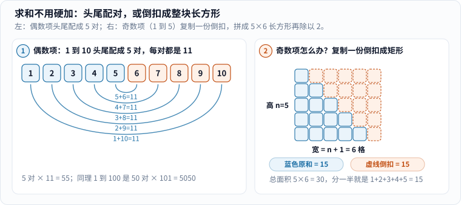
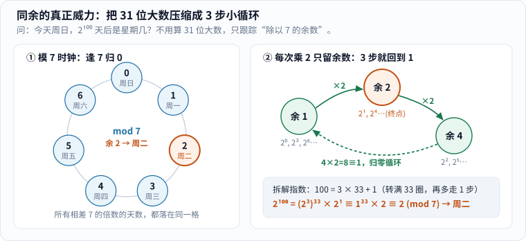
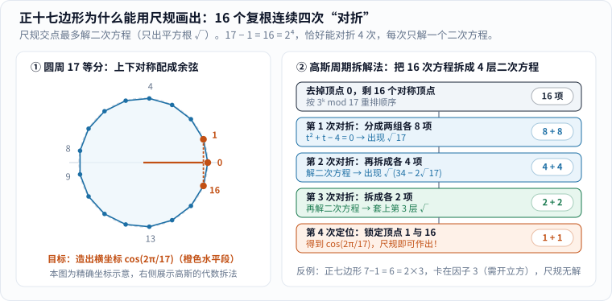
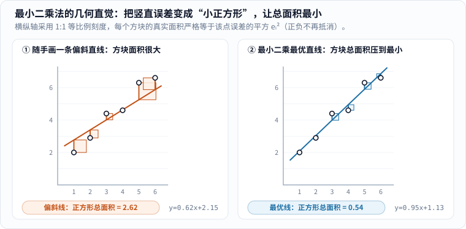
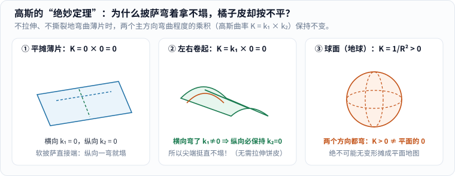

几乎每个人都听过那个小学教室里的故事：老师为了清静一会儿，让全班把 $$1$$ 到 $$100$$ 一个个加起来，结果七岁的**卡尔·弗里德里希·高斯**（Carl Friedrich Gauss，1777–1855）转眼就把石板正面朝下扣在讲台上，上面只端端正正写了一个数：**5050**。

据圣安德鲁斯大学 MacTutor 数学史档案记载，当时的老师 Büttner 和年轻助教 Bartels 大吃一惊——全班同学都在苦哈哈算 $$1+2=3$$、$$3+3=6$$、$$6+4=10$$，唯独小高斯根本没往里硬加，而是一眼看出这串数可以头尾配成 **50 对**，每一对的和都雷打不动等于 **101**。[1]

关于这道题的具体公差细节后世流传过不同版本，等差数列求和也并非高斯首创。但这个故事之所以值得当成整座数学殿堂的入口，是因为高斯一生中最震撼科学界的几件大事，用的几乎都是同一个起手式：

> **当所有人都在埋头硬算的时候，他先退后一步，把藏在乱麻底下的对称和结构揪出来。**

今天我们不列干巴巴的头衔清单，就挑他一生最经典的五件代表作，把每一步“卡在哪儿、他怎样四两拨千斤拆开”一笔一笔算得明明白白。

---

## 一、从 1 加到 100 出发：如果项数是奇数，或者全都带平方呢？

### 1. 偶数项配对与奇数项“复制倒扣”

头尾配对的想法非常直观：$$1+100=101$$，$$2+99=101$$，$$3+98=101$$，……一直到 $$50+51=101$$，一共 $$50$$ 对，所以总和是 $$50\times 101=5050$$。

但很多爱动脑筋的孩子第一次自己套用这招时，马上会卡在一个小疙瘩上：**如果项数是奇数——比如把 $$1$$ 加到 $$5$$，或者 $$1$$ 加到 $$99$$——正中间那个数孤零零没人配对，公式会不会坏掉？要不要分奇偶背两套公式？**

看一眼图 1 右半边的积木拼法，这个顾虑一秒钟就消失了：


_图 1：先看左图，$$1$$ 到 $$10$$ 头尾相连配成 $$5$$ 对；再看右图，哪怕是奇数项（$$1$$ 到 $$5$$），根本不需要给中间那一项找搭档，只要把整座蓝色阶梯**原样复制一份**（橙色虚线），上下颠倒扣在一起，总能严丝合缝拼成一个宽 $$n+1$$、高 $$n$$ 的实心长方形！[单独打开图片](/assets/images/gauss/sum-pairs.svg)_

把 $$S_1 = 1+2+3+4+5$$ 想成五层台阶。不管总层数 $$n$$ 是偶数还是奇数，只要**拿两份一模一样的台阶上下倒扣**：

- 第一层：左 $$1$$ 格 + 右 $$5$$ 格 $$= 6$$ 格；
- 第二层：左 $$2$$ 格 + 右 $$4$$ 格 $$= 6$$ 格；
- 第三层（原本落单的正中间！）：左 $$3$$ 格 + 右 $$3$$ 格 $$= 6$$ 格！

每一层都整整齐齐变成 $$n+1$$ 格，共 $$n$$ 层，总方块数就是长方形面积 $$n(n+1)$$。既然这是**两份台阶**拼出来的，原来那一份自然就是：

$$
1 + 2 + 3 + \cdots + n = \frac{n(n+1)}{2}.
$$

把 $$n=99$$ 代进去，$$99\times 100 \div 2 = 4950$$，根本不用去管谁落单。注意这里蕴含的第一个数学绝招：**一个不对称的半边图形不好算，复制一份拼成对称整体，答案自己就蹦出来了。**

### 2. 再进一步：平方和 $$1^2+2^2+\cdots+n^2$$ 也能靠旋转拼出来吗？

一旦尝到了“复制倒扣”的甜头，顺着往下追问一句：**如果把每一项都平方，算 $$S_2 = 1^2 + 2^2 + 3^2 + \cdots + n^2$$，两份倒扣拼不平了，还能不能变魔术？**

能！这次不用两份，改拿 **3 份一模一样的数字三角形**！拿 $$n = 4$$（算 $$1^2 + 2^2 + 3^2 + 4^2$$）在桌面上摆一次：

- 先把 $$1^2$$ 想成顶上写 $$1$$ 个 `1`，$$2^2$$ 想成第二行写 $$2$$ 个 `2`，$$3^2$$ 想成第三行写 $$3$$ 个 `3`，$$4^2$$ 想成底行写 $$4$$ 个 `4`——整座三角形里所有数字加起来，恰好就是 $$S_2$$，而且这座三角形一共占了 $$1+2+3+4 = \frac{n(n+1)}{2} = 10$$ 个格子！
- 现在把这座三角形**复制三份**，第一份正着放，第二份逆时针转 $$120^\circ$$，第三份逆时针转 $$240^\circ$$：

```text
   正放三角形            转 120° 三角形          转 240° 三角形          三张叠在同一格相加！
       1                      4                      4                      9
     2   2                  3   4                  4   3                  9   9
   3   3   3              2   3   4              4   3   2              9   9   9
 4   4   4   4          1   2   3   4          4   3   2   1          9   9   9   9
```

把三张表同一个位置上的数字加起来——天哪，**10 个位置上的和，整整齐齐清一色全是 $$9$$（也就是 $$2n + 1$$）！**

为什么每个位置加起来都恒等于 $$2n+1$$？因为你在三角形里每往下走一行、或往斜下挪一格，三个方向的数字此消彼长（两个方向减 $$1$$ 或加 $$1$$ 恰好互相抵消），总和跟站在三个角顶端的 $$1 + n + n = 2n+1$$ 分毫不差！既然一共有 $$\frac{n(n+1)}{2}$$ 个格子，每格总和都是 $$2n+1$$，三份加起来就是 $$\frac{n(n+1)}{2}\cdot(2n+1)$$，除以 $$3$$ 就拿到了千古名式：

$$
1^2 + 2^2 + 3^2 + \cdots + n^2 = \frac{n(n+1)(2n+1)}{6}.
$$

代入 $$n=4$$ 验算：$$\frac{4\times 5\times 9}{6} = 30 = 1 + 4 + 9 + 16$$，分毫不差！从“两份翻转 $$180^\circ$$”到“三份旋转 $$120^\circ$$”，**对称性就是最高级的巧算器**——带着这双眼睛，我们正式走进成年高斯的数学世界。

---

## 二、《算术研究》与同余：3 秒心算 31 位大数

1798 年完稿、1801 年正式付梓的《算术研究》（*Disquisitiones Arithmeticae*），是高斯年仅 21 岁时写完的传世巨著。在此之前，费马、欧拉、拉格朗日虽然发现了许多漂亮的整数性质，但散落在各处像一堆珍珠；高斯全书七章一气呵成，第一章第 1 页就先发明了一套今天所有程序员、密码学家须臾不离的符号——**同余（congruence）**。[2]

### 1. 同余的“可拆包”法则：为什么可以先砍倍数再相乘？

光看定义，同余朴素得像小学除法：**两个整数 $$a$$ 和 $$b$$ 除以同一个正整数 $$m$$（称为模），如果余数相同——等价于它们的差 $$a - b$$ 能被 $$m$$ 整除——就把它们归为“同一类”，记作 $$a \equiv b \pmod m$$。**[2]

比如一星期有 $$7$$ 天，今天是星期日（记为 $$0$$），$$100$$ 天后是星期几？因为 $$100 = 7\times 14 + 2$$，余数是 $$2$$，写作 $$100 \equiv 2 \pmod 7$$，效果跟只过 $$2$$ 天完全一样，落在**星期二**。

如果你觉得“这不就是换个三横线符号写余数吗，至于惊动数学史？”，请马上试着心算下面这道题：

> **今天是星期日，请问 $$2^{100}$$ 天之后是星期几？**

$$2^{100}$$ 展开是一个足足 **31 位的天文数字**（$$1\,267\,650\,600\,228\,229\,401\,496\,703\,205\,376$$）。要是老老实实把它乘出来再列竖式除以 $$7$$，算错一位就全盘皆输。

高斯创立同余算术的核心威力在于证明了**“余数运算的封闭可拆包性”**：假设 $$A = 7k + r$$，$$B = 7m + s$$，把它们相乘展开：

$$
A \times B = (7k + r)(7m + s) = 7\cdot(7km + ks + mr) + r\cdot s.
$$

看清了吗？前面那一大坨天生带着因子 $$7$$，除以 $$7$$ 余数永远是 $$0$$！**决定乘积最终余数的，100% 只有两个小尾巴 $$r \times s$$！** 换句话说，在加、减、乘的每一步中途，你都可以随时像扔垃圾袋一样，把所有 $$7$$ 的倍数当场砍掉，只揣着个位数的余数轻装前进！

### 2. 三步循环秒杀 $$2^{100} \bmod 7$$，以及“同余除法”为什么有时会失灵？

有了“随时砍掉 $$7$$ 的倍数”的特权，我们跟着图 2 右侧的箭头走三步：


_图 2：左图把无限延伸的整数卷到 $$0\sim 6$$ 的七格时钟圆盘上；右图追踪 $$2^k \bmod 7$$ 的轨迹——从 $$1$$ 出发，连乘三次 $$2$$ 变成 $$8 \equiv 1$$，精准撞回起点形成周期为 $$3$$ 的小循环。[单独打开图片](/assets/images/gauss/mod-clock.svg)_

- $$2^1 \equiv 2 \pmod 7$$；
- $$2^2 \equiv 4 \pmod 7$$；
- $$2^3 = 8 = 7 + 1 \equiv \mathbf{1} \pmod 7$$ —— **撞回 $$1$$ 了！**

一旦余数撞回 $$1$$，后面再乘多少个 $$2$$，都只是在 $$1 \to 2 \to 4 \to 1$$ 的三步小圆环上原地兜圈！既然 $$100 = 3\times 33 + 1$$（转满 $$33$$ 整圈，再多迈 $$1$$ 步），答案三秒钟出炉：

$$
2^{100} = (2^3)^{33}\times 2^1 \equiv 1^{33}\times 2 = 2 \pmod 7 \quad \Longrightarrow \quad \text{星期二！}
$$

更进一步，高斯还追问了一个直击现代抽象代数心脏的问题：**同余世界里能随便做加、减、乘，那能不能做“除法”呢？**

这要看你的时钟圆盘有几格！拿**质数模 $$7$$** 和**合数模 $$6$$** 做个对比，高下立判：

- **在模 $$7$$（质数）时钟上，非零余数 $$1\sim 6$$ 人人都有唯一的“倒数”（乘法逆元）**：$$1\times 1\equiv 1$$，$$2\times 4 = 8\equiv 1$$，$$3\times 5 = 15\equiv 1$$，$$6\times 6 = 36\equiv 1 \pmod 7$$。你想解方程 $$3x \equiv 2 \pmod 7$$（相当于算“$$2\div 3$$”），两边同乘 $$3$$ 的倒数 $$5$$，立刻得出唯一解 $$x \equiv 10 \equiv 3 \pmod 7$$！这样加减乘除俱全的有限数字小宇宙，就是现代密码学与编码论天天在用的**有限域 $$\mathbb{F}_p$$**（模幂如何支撑现代加密，详见《[费马的故事]()》）。
- **在模 $$6$$（合数）时钟上，除法当场爆雷！** 因为 $$2\neq 0$$，$$3\neq 0$$，可它们一相乘居然得 $$2\times 3 = 6 \equiv 0 \pmod 6$$（两个非零数乘出了零，称为**零因子**）！结果解方程 $$2x \equiv 4 \pmod 6$$ 时，$$x=2$$ 和 $$x=5$$ 居然都成立（解不唯一）；而解 $$2x \equiv 1 \pmod 6$$ 时，左边永远是偶数，减去 $$1$$ 绝不可能是 $$6$$ 的倍数（根本无解）！

顺着这条路，19 岁的高斯在《算术研究》第四章攀上了初等数论的珠穆朗玛峰——他独立发现并首次严格证明了欧拉与勒让德苦攻未果的**二次互反律（Law of Quadratic Reciprocity）**，激动地称之为算术里的**“黄金定理（Theorema Aureum）”**。[1][2] 它回答的是“方程 $$x^2 \equiv q \pmod p$$ 到底有没有解？”：比如你想知道模大质数 $$13$$ 下有没有谁的平方余 $$3$$，不用把 $$1^2\dots 12^2$$ 挨个试一遍，互反律允许你直接把两个奇质数**掉个个儿**，改看极小的模 $$3$$ 下有没有平方余 $$13 \equiv 1 \pmod 3$$（显然 $$1^2 \equiv 1$$ 有解！由于 $$13$$ 除以 $$4$$ 余 $$1$$，翻转完全不变号，立判原方程必有解，一验果然 $$4^2 = 16 \equiv 3 \pmod{13}$$）！高斯一生对这颗明珠痴迷到先后给出了 **8 种截然不同的证明**，为后世近世代数与代数数论埋下了整片森林的种子。[1][2]

---

## 三、正十七边形：打破两千年僵局的“四次对折”

古希腊几何学家留下过一道悬置两千多年的难题：**只用一把没有刻度的直尺（只能连线）和一个圆规（只能画圆），究竟能精确作出哪些正 $$n$$ 边形？**

早在欧几里得《几何原本》时代，人们就会作正三角形（$$3$$）、正方形（$$4$$）、正五边形（$$5$$）、正十五边形（$$3\times 5$$），以及不断平分弧长翻倍出的 $$6,8,10,12\dots$$ 边形。[4] 但在那之后整整两千年里，面对正七边形（$$7$$）、正九边形（$$9$$）、正十一边形（$$11$$）、正十三边形（$$13$$），无数几何好手折戟沉沙，普遍默认“质数边的正多边形到 $$5$$ 就封顶了”。

直到 **1796 年 3 月 29 日**清晨，还差一个月才满 19 岁的高斯在起床前突然看穿了谜底：**正十七边形（$$17$$ 条边！）完全可以用直尺和圆规一丝不苟地画出来！** 他在这一天开始记下著名的《数学日记》，第一条就郑重写下了这项让他最终决心弃文从理的突破（后收入《算术研究》第七章）。[1][4]

很多科普文章直接把高斯算出的那串吓人的四层嵌套根号拍在读者脸上：

$$
\cos\frac{2\pi}{17}=\frac{1}{16}\left(-1+\sqrt{17}+\sqrt{34-2\sqrt{17}}+2\sqrt{17+3\sqrt{17}-\sqrt{34-2\sqrt{17}}-2\sqrt{34+2\sqrt{17}}}\right).
$$

别被根号吓跑！只要一步步揭开下面**三层机关**，普通读者也能亲手算出第一层 $$\sqrt{17}$$ 是怎么蹦出来的：

### 1. 为什么“直尺和圆规”只认平方根 $$\sqrt{\cdot}$$？

把尺规搬进笛卡尔坐标系里翻译成代数方程，真相一目了然（详见本站《[一把直尺一个圆规能画出什么]()》）：

- **直尺连线**：方程是 $$ax + by = c$$（**一次方程**）；
- **圆规画圆**：方程是 $$(x - x_0)^2 + (y - y_0)^2 = r^2$$（**二次方程**）。

尺规作图的每一步新交点，无非是求“直线与直线”“直线与圆”或“圆与圆”联立方程的解。无论你画多少步，代数上永远只涉及**加、减、乘、除**和**解一元二次方程**——而求根公式 $$\frac{-B\pm\sqrt{B^2-4AC}}{2A}$$ 里唯一能造出新无理数的操作，就是**开平方根 $$\sqrt{\cdot}$$**！反过来，只要线段长度 $$\cos\frac{2\pi}{17}$$ 能纯粹用有理数的四则运算和有限次开平方表示（因为 $$\sqrt{a}$$ 可以用直角三角形射影定理轻松尺规作出），正十七边形就**铁定尺规可作**！[4]

### 2. 高斯怎么把 17 拆成四次“对折”？亲手验算第一刀 $$t^2+t-4=0$$

在复平面单位圆上，正十七边形的 $$17$$ 个顶点恰好是方程 $$z^{17} - 1 = 0$$ 的 $$17$$ 个根：最右边是 $$z_0 = 1$$，其余 $$16$$ 个对称顶点记作 $$\zeta^1, \zeta^2, \dots, \zeta^{16}$$（其中 $$\zeta = \cos\frac{2\pi}{17} + i\sin\frac{2\pi}{17}$$，我们的终极猎物就是顶点 $$1$$ 与顶点 $$16$$ 相加所得的实数 $$2\cos\frac{2\pi}{17} = \zeta^1 + \zeta^{16}$$）。

因为 $$17$$ 个顶点均匀分布在单位圆周上，它们的重心必在圆心 $$0$$，所以全部 $$17$$ 个根加起来严格等于 $$0$$。移走排头的 $$1$$，立刻拿到一条免费的总和铁律：

$$
\zeta^1 + \zeta^2 + \zeta^3 + \cdots + \zeta^{16} = -1.
$$

接下来就是高斯神来之笔的时刻（对照图 3）：剩下的根一共是 **$$17 - 1 = 16 = 2^4$$ 个**——$$16$$ 恰好是 $$2$$ 的四次方，天生可以按 $$16 \to 8 \to 4 \to 2 \to 1$$ 连续对折四次！可如果按自然顺序 $$1,2,3\dots 16$$ 乱切两半，乘积会乱成一锅粥；怎么切才能让两半高度对称？


_图 3：左图在单位圆上标出 $$17$$ 等分点，顶点 $$1$$ 与 $$16$$ 的横坐标即为 $$\cos(2\pi/17)$$；右图展示高斯的降维路线——借模 $$17$$ 下原根 $$3$$ 的幂次重排 $$16$$ 个根，按 $$16\to 8\to 4\to 2\to 1$$ 连续对折四次，每折一次只解一个二次方程，恰好套上一层平方根。[单独打开图片](/assets/images/gauss/heptadecagon.svg)_

高斯请出了上一章的**模算术**！他在模 $$17$$ 下找出了一个能跑遍全场的“原根” **$$3$$**，把 $$3^0, 3^1, 3^2, \dots, 3^{15} \pmod{17}$$ 的余数依次列成一排：

```text
次幂 k ： 0   1   2   3   4   5   6   7   8   9  10  11  12  13  14  15
3^k 模17： 1,  3,  9, 10, 13,  5, 15, 11, 16, 14,  8,  7,  4, 12,  2,  6
```

看，$$1$$ 到 $$16$$ 一个不落、绝无重复地排成了一条项链！现在高斯下**第一刀对折（$$16 \to 8$$）**——按次幂 $$k$$ 的偶奇，隔一个挑一个分成两队（称为“高斯周期” $$\eta_0, \eta_1$$）：

$$
\begin{aligned}
\eta_0 &= \zeta^1 + \zeta^9 + \zeta^{13} + \zeta^{15} + \zeta^{16} + \zeta^8 + \zeta^4 + \zeta^2 \quad (\text{偶次幂，共 8 项}), \\
\eta_1 &= \zeta^3 + \zeta^{10} + \zeta^5 + \zeta^{11} + \zeta^{14} + \zeta^7 + \zeta^{12} + \zeta^6 \quad (\text{奇次幂，共 8 项}).
\end{aligned}
$$

我们来算 $$\eta_0$$ 和 $$\eta_1$$ 的**和**与**积**——不用硬算 64 次乘法，两句话直接看穿：

1. **两数之和**：$$\eta_0 + \eta_1$$ 刚好拼齐了 $$\zeta^1$$ 到 $$\zeta^{16}$$ 全部 $$16$$ 个根，由刚才的重心铁律，**$$\eta_0 + \eta_1 = -1$$**！
2. **两数之积**：把 $$8$$ 项的 $$\eta_0$$ 乘上 $$8$$ 项的 $$\eta_1$$，一共展开成 $$8\times 8 = 64$$ 项 $$\zeta^{a+b}$$。首先，会不会撞出 $$\zeta^{17} = 1$$？不可能！因为 $$a+b \equiv 0 \pmod{17}$$ 意味着 $$b \equiv -a \equiv 16a \equiv 3^8 a \pmod{17}$$，$$a$$ 和 $$b$$ 的指数奇偶性必然相同（比如 $$1$$ 和 $$16$$ 都在 $$\eta_0$$ 里），分属两队的项相加绝不会等于 $$17$$！其次，把整个乘积里的每个角标都乘以 $$3 \pmod{17}$$，只不过是把 $$\eta_0$$ 和 $$\eta_1$$ 互换位置，乘积 $$\eta_0\eta_1$$ 纹丝不动！这意味着 $$\zeta^1$$ 到 $$\zeta^{16}$$ 这 $$16$$ 个根在展开式里地位完全平等，谁也不能偏心多占——$$64$$ 项平分给 $$16$$ 个根，**每一个根都整整齐齐恰好出现 $$64 \div 16 = 4$$ 次**！于是：

$$
\eta_0 \cdot \eta_1 = 4\times(\zeta^1 + \zeta^2 + \cdots + \zeta^{16}) = 4\times(-1) = -4 !
$$

和是 $$-1$$，积是 $$-4$$！由韦达定理，$$\eta_0, \eta_1$$ 就是一元二次方程 **$$t^2 + t - 4 = 0$$** 的两个根，解出来当场蹦出**第一层平方根 $$\sqrt{17}$$**：

$$
\eta_0 = \frac{-1 + \sqrt{17}}{2}, \qquad \eta_1 = \frac{-1 - \sqrt{17}}{2}.
$$

万事大吉！接下来完全照葫芦画瓢：

- **第二刀对折（$$8 \to 4$$）**：把 $$\eta_0$$ 里的 $$8$$ 项再隔一个挑一个拆成两半 $$\beta_0, \beta_1$$（各 $$4$$ 项），$$\eta_1$$ 拆成 $$\beta_2, \beta_3$$，它们的和与积只依赖刚算出的 $$\eta_0, \eta_1$$，解二次方程套上**第二层根号**；
- **第三刀对折（$$4 \to 2$$）**：把 $$\beta_0 = (\zeta^1 + \zeta^{16}) + (\zeta^4 + \zeta^{13})$$ 拆成两对余弦弦长，解二次方程套上**第三层根号**；
- **第四刀对折（$$2 \to 1$$）**：最后拆开 $$\zeta^1$$ 与 $$\zeta^{16}$$（或者直接取实部除以 $$2$$），稳稳拿到 $$2\cos\frac{2\pi}{17}$$（完整推导四层根号）！

这也顺手彻底判了正七边形的死刑：对于 $$p=7$$，去掉顶点 $$0$$ 后剩 $$7 - 1 = 6 = 2\times 3$$ 个根，对折一刀变成 $$3$$ 个一组就折不动了，非解三次方程开立方根 $$\sqrt[3]{\cdot}$$ 不可，直尺圆规当场卡死！

### 3. 为什么高斯墓碑想刻正十七边形，石匠却犯了难？

高斯进一步证明（并在 1837 年由旺泽尔补全必要性证明，合称**高斯—旺泽尔定理**）：一个质数边的正 $$p$$ 边形能用尺规作图，当且仅当 $$p - 1$$ 全是 $$2$$ 的幂，即 $$p$$ 形如**费马素数 $$F_k = 2^{2^k} + 1$$**！[4] 人类至今只找到过 **5 个**费马素数：

$$
F_0 = 3,\quad F_1 = 5,\quad F_2 = 17,\quad F_3 = 257,\quad F_4 = 65537.
$$

这里有两桩极有趣的数学史轶事：

1. **石匠分不清的正十七边形**：高斯晚年一直把 19 岁发现正十七边形视作毕生最珍爱的初恋果实，曾向友人流露希望像阿基米德墓碑刻“球与外切圆柱”那样，在自己墓碑上刻一个正十七边形。结果负责修纪念碑的石匠犯了愁——正十七边形每个内角高达 $$158.8^\circ$$，凿在石头上肉眼看过去跟一个普通圆圈几乎毫无区别！后来人们在高斯家乡不伦瑞克（Braunschweig）竖立的高斯纪念碑底座侧面，机智地改刻了一颗棱角分明的**十七角星**。[1][4]（若想在纸上真用圆规画一个正十七边形，英国数学家里士满 H. W. Richmond 在 1893 年给出了一套十分简洁紧凑的尺规画法。[4]）
2. **装满一整只大木箱的正 65537 边形手稿**：既然理论上 $$65537$$ 边形也能尺规作图（$$65537 - 1 = 2^{16}$$，需要对折 $$16$$ 次！），真有人去硬算过吗？真有！德国学者约瑟夫·古斯塔夫·赫尔姆斯（Johann Gustav Hermes）足足花了 **10 年光阴**（1879–1889），把正 $$65537$$ 边形的完整代数作图步骤算了出来，手稿厚达两百多页，装在一只特制的大手提箱里，至今仍静静保存在哥廷根大学数学研究所里供后人瞻仰！[4]

---

## 四、谷神星与最小二乘：为什么非要把误差“平方”？

### 1. 皮亚齐的 9 度孤弧：为什么牛顿之后还会跟丢一颗小行星？

如果说《算术研究》让高斯在纯数学圈封神，那么真正让他一夜之间名震全欧洲科学界与大众媒体的，是一场**宇宙大海捞针**。

1801 年 1 月 1 日（19 世纪的第一个夜晚），意大利巴勒莫天文台台长皮亚齐（Giuseppe Piazzi）在金牛座意外捕捉到一颗暗弱的移动星点——人类发现的第一颗小行星**谷神星（Ceres）**。[1] 不巧的是，皮亚齐只跟踪记录了 41 天，谷神星在天球上刚刚挪过短短 **9 度弧长**（还不到整圈轨道 $$360^\circ$$ 的四十分之一！），皮亚齐就病倒了，紧接着谷神星钻进耀眼的太阳眩光背后彻底失踪。

你可能奇怪：牛顿万有引力定律都发表一百多年了，怎么还会跟丢？因为以往算彗星轨道，天文学家习惯先假定轨道接近抛物线（离心率 $$e\approx 1$$）来简化方程；而谷神星既不肯透露离心率，留下的观测弧段又短得可怜，还混杂着大气折射和仪器读数误差，整整 6 个未知轨道根数搅在高度非线性的方程里。大天文学家们凑出的预报位置彼此差出好几度，入秋后全欧洲望远镜在夜空里苦找了几个月一无所获。

关键时刻，24 岁的高斯出手了。他不做任何先验轨道形状假设，把改进的轨道几何确定法与自己手里的秘密武器——**最小二乘法（Method of Least Squares）**——结合起来，在短短几周内寄出了精确星历表。**1801 年 12 月 7 日与 31 日**，天文学家冯·扎克（von Zach）与奥伯斯（Olbers）把望远镜对准高斯指出的陌生天区，失踪近一年的谷神星几乎分毫不差地停在视场中央！[1]

### 2. 三种误差标尺的PK：为什么偏偏选“平方”？

抽掉复杂的天体坐标，我们回到最小二乘法最朴素、最核心的问题：假设你在实验室测了 $$6$$ 个数据点 $$(x_i, y_i)$$，理论上它们应该排在一条直线 $$y = kx + b$$ 上，但因为每次读数都有微小抖动，没有任何一条直线能同时穿过全部 $$6$$ 个点。记第 $$i$$ 个点的真实高度与直线预测高度之差为残差 $$e_i = y_i - (kx_i + b)$$，**究竟怎样定义“总体误差最小”，才能挑出最公道的那条直线？**

历史上科学家认真比拼过三把标尺：

1. **方案一：让所有误差直接相加等于零（$$\sum e_i = 0$$）——当场否决！** 因为高出的正误差 $$+10$$ 和低出的负误差 $$-10$$ 会互相抵消成 $$0$$！哪怕你画一条跟数据垂直十字交叉的荒唐废线，只要穿在中心点上，正负一抵消照样得 $$0$$ 分，滔天大错全被藏起来了。
2. **方案二：取绝对值相加最小（$$\sum |e_i|$$，拉普拉斯曾深入研究）——能用，但极其难算！** 绝对值虽然消除了正负抵消，但函数 $$|e|$$ 在 $$e=0$$ 处有一个尖锐的 **V 字形折角**，导数在这里发生突变，没法直接用微积分求导列平滑方程；面对谷神星 6 个耦合参数和几十组观测点，手算时代简直是噩梦。
3. **方案三（高斯的最小二乘）：把每个误差都平方再相加（$$\sum e_i^2$$，古汉语“自乘一次”即称“二乘”）——一举三得！**
   - **彻底杜绝抵消**：无论正偏还是负偏，平方之后统统变成非负数；
   - **重罚离谱大错**：误差大 $$3$$ 倍，平方惩罚变成 $$9$$ 倍，迫使直线优先照顾整体大局，绝不敢让某几个点偏得没边；
   - **光滑如碗、求导变线性**：二次函数 $$e^2$$ 是一只圆润光滑的抛物线大碗，有且仅有一个碗底极小值，而且**求一次导数恰好降成一次线性方程组**，手算消元就能解！

把横纵坐标按 1:1 等比例画出来，“最小二乘”在几何上直观得像拼图游戏——**每一点的竖直误差 $$e_i$$ 都长出一块边长为 $$|e_i|$$ 的真正方形，调节直线的斜率和高度，就是在压缩所有小正方形的总面积**（图 4）：


_图 4：左右两图使用完全相同的 6 个演示测量点，横纵坐标严格 1:1 等比例，每块彩色方块的几何面积就是误差平方 $$e_i^2$$。左图随手画的偏斜直线让方块总面积高达 $$2.62$$；右图经最小二乘法锁定的最优直线（$$y\approx 0.95x+1.13$$）把方块总面积死死压到了极限最小值 $$0.54$$。[单独打开图片](/assets/images/gauss/least-squares.svg)_

### 3. 亲手推一次最优直线，以及勒让德与高斯的优先权公案

口说无凭，我们花一分钟亲手对总面积函数 $$S(k,b) = \sum_{i=1}^n (y_i - kx_i - b)^2$$ 求一次偏导，看看碗底方程有多干净！

- **第一步（拧截距旋钮 $$b$$，对 $$b$$ 求导令其为 $$0$$）**：

$$
\frac{\partial S}{\partial b} = \sum_{i=1}^{n} 2(y_i - kx_i - b)\cdot(-1) = 0 \quad \Longrightarrow \quad \sum_{i=1}^{n} y_i = k\sum_{i=1}^{n} x_i + n b.
$$

两边同除以点数 $$n$$，记平均值为 $$\bar{x} = \frac{1}{n}\sum x_i$$、$$\bar{y} = \frac{1}{n}\sum y_i$$，立刻蹦出一条极漂亮的物理结论：

$$
\bar{y} = k\bar{x} + b !
$$

它的几何意思是：**最优直线必定精准穿过全体数据点的“重心” $$(\bar{x}, \bar{y})$$！**

- **第二步（以重心为支点拧斜率旋钮 $$k$$，对 $$k$$ 求导令其为 $$0$$）**：把 $$b = \bar{y} - k\bar{x}$$ 代回原式，变成 $$\sum [(y_i - \bar{y}) - k(x_i - \bar{x})]^2$$，对 $$k$$ 求导令其等于 $$0$$，一行移项直接给出最优斜率公式：

$$
k = \frac{\sum_{i=1}^{n} (x_i - \bar{x})(y_i - \bar{y})}{\sum_{i=1}^{n} (x_i - \bar{x})^2}.
$$

代入图 4 里的 6 个点一算，$$k \approx 0.95$$，$$b \approx 1.13$$，残差方块总面积 $$0.54$$，没有任何一条别的直线能比它更省面积！（今天人工智能训练线性回归、神经网络最常用的均方误差损失 MSE，老祖宗正是这口两百多年前的抛物线大碗，详见《[机器到底是怎么学会思考的：从一条直线到大模型]()》。）

> **科学史公案：勒让德与高斯到底谁先发明了最小二乘？**
> 法国数学家**勒让德（Adrien-Marie Legendre）**在 **1805–1806 年**出版的《测定彗星轨道的新方法》附录中，历史上**第一个公开发表**了这套方法，并亲自起名“最小二乘法（méthode des moindres carrés）”。然而 **1809 年**高斯出版天体力学名著《天体运动论》时，不仅从**正态误差分布（高斯钟形曲线）**的最大似然概率反推出了最小二乘法，还淡定写下一句“这套原则我自 1795 年（18 岁）起就已经在使用了”，气得年长的勒让德写信抗议高斯“明明自己已经名满天下，还要抢别人的发明”。[3] 后世史学家核查高斯早期笔记与 1801 年谷神星计算通信后达成共识：**勒让德无可争议拥有首次公开发表权与命名权；高斯确实更早独立发现并实战应用了它，更把它与正态概率分布深度融为一体。**[1][3]
{: .prompt-info }

---

## 五、从丈量大地到端披萨：高斯的“绝妙定理”

### 1. 主曲率 $$k_1, k_2$$：马鞍薯片、球面橘子皮与圆柱卷纸

1818 年起，年过四旬的高斯受命主持汉诺威王国的大地三角测量工程，常年顶着烈日骑马奔波在山丘与沼泽之间，还顺手发明了借反射太阳光对准几十公里外测绘塔的“回光仪（Heliotrope）”。[1]

地球表面是弯的，测绘地图却是平的。这段泥腿子测绘经历，把高斯引向了一个看似日常、实则敲开现代微分几何与爱因斯坦广义相对论大门的终极追问：**生活在二维曲面上的一只小蚂蚁（不能飞到三维高空俯瞰，只能在曲面内部量距离、量角度），能不能单靠脚下的测量，识破自己脚下的大地到底是弯的还是平的？**

为了给“弯曲”打分，先站在曲面某一点上，用垂直于切平面的刀片绕一圈切下去，找出截痕最弯和最平（或反向最弯）的两个正交主方向，记它们的弯曲率为**主曲率 $$k_1, k_2$$**（弯曲半径为 $$R$$ 则曲率为 $$1/R$$，平直直线曲率为 $$0$$；朝同一侧弯取同号，一上一下朝反侧弯取异号）。高斯把两个主曲率**直接相乘**，定义为**高斯曲率 $$K = k_1 \times k_2$$**：[5]

- **平桌面 / 平纸片**：横竖全平，$$k_1 = 0,\ k_2 = 0 \implies K = 0\times 0 = \mathbf{0}$$；
- **卷成圆筒的纸 / 瓦楞铁皮**：横向弯成圆弧（$$k_1 = 1/R \neq 0$$），纵向母线却笔直（$$k_2 = 0$$）$$\implies K = k_1 \times 0 = \mathbf{0}$$！
- **篮球表面 / 橘子皮**：横竖都朝球心同一侧弯（$$k_1 = k_2 = 1/R$$）$$\implies K = \mathbf{+1/R^2 > 0}$$（正曲率）；
- **马鞍面 / 双曲桶装薯片**：前后往上翘（$$k_1 > 0$$），左右往下垂（$$k_2 < 0$$）$$\implies K = k_1 k_2 \mathbf{< 0}$$（负曲率）。

### 2. 吃披萨的力学奇迹与球面三角形“内角和超载”

仔细看上面第二行：卷成圆筒的纸明明在三维空间里弯了，为什么它的乘积 $$K$$ 却跟平纸片一样等于 $$0$$？

**1827 年**宣读（1828 年正式刊印）的曲面论经典论文里，高斯证明了一条连一向惜字如金的他自己都忍不住在拉丁文里感叹起名为 **Theorema Egregium（“绝妙定理”）** 的几何铁律：[1][5]

> **高斯的绝妙定理**：只要不把薄片材料拉长、压短或撕裂（即保持曲面上每条曲线的弧长不变，称为**等距变换**），无论你在三维空间里怎么揉折弯曲它，曲面上每一点的高斯曲率乘积 **$$K = k_1\times k_2$$ 都绝对保持不变**！[5]

这条高冷的微分几何定理，在你的餐桌和书桌上处处显灵（看图 5）：


_图 5：高斯曲率 $$K = k_1\times k_2$$ 在不拉伸材料时严格守恒。平放披萨 $$0\times 0=0$$；手指把饼边左右捏成 U 形槽（强制 $$k_1\neq 0$$），为了守住乘积 $$K=0$$，前后方向被几何铁律锁死为 $$k_2=0$$，芝士尖端立刻笔直挺立！而地球球面 $$K=1/R^2>0$$，永远无法无拉伸摊成 $$K=0$$ 的平面地图。[单独打开图片](/assets/images/gauss/pizza-curvature.svg)_

1. **端薄底披萨为什么“左右一捏就不塌”？** 刚出炉的软薄披萨原本平摊在盘子里，$$K = 0\times 0 = 0$$。直接托起饼底，左右还是平的（$$k_1 = 0$$），由于 $$0 \times k_2 = 0$$ 对 $$k_2$$ 毫无约束，披萨尖端在重力下哗啦往下耷拉（$$k_2 \neq 0$$），芝士撒一身！可只要你用大拇指把饼皮**左右轻轻捏成一道 U 形弧槽（强制令 $$k_1 \neq 0$$）**——既然面饼没被拉长撕裂，绝妙定理规定乘积必须死守 $$k_1\times k_2 = 0$$！既然 $$k_1 \neq 0$$，**前后方向唯一的活路就是 $$k_2 = 0$$**——整块披萨瞬间顺着纵向硬挺如尺，稳稳送进嘴里！木匠手里的薄钢卷尺做成微微内凹的弧槽能悬空伸出两米不折，建筑屋顶做成波浪瓦楞壳，靠的全是同一个 $$k_1 k_2 = 0$$！
2. **不飞出地球，二维小蚂蚁怎么量出地球 $$K > 0$$？靠三角形内角和！** 高斯同步证明，在曲率恒为 $$K$$ 的曲面上，由最短路径（测地线）围成的三角形，三个内角 $$\alpha,\beta,\gamma$$ 加起来**不再等于 $$180^\circ$$（$$\pi$$ 弧度）**，多出来的“角盈”恰好正比于三角形面积 $$A$$：

$$
\alpha + \beta + \gamma - \pi = K \cdot A.
$$

我们在地球仪上亲手走一个最好算的大三角形验证它：从赤道与本初子午线交点出发，先沿赤道向东走 $$1/4$$ 圈（到东经 $$90^\circ$$），原地左转 **$$90^\circ$$** 正北直奔北极点，在北极点左转 **$$90^\circ$$** 沿本初子午线南下回到赤道起点（与赤道夹角又是 **$$90^\circ$$**）！看：

- 三个内角之和：$$90^\circ + 90^\circ + 90^\circ = \mathbf{270^\circ}$$（足足比平面三角形超载了 $$90^\circ = \frac{\pi}{2}$$ 弧度！）；
- 这块球面三角形刚好占了北半球的四分之一、全球表面积 $$4\pi R^2$$ 的八分之一，即面积 $$A = \frac{\pi R^2}{2}$$；
- 代入高斯的公式：$$\frac{\pi}{2} = K \cdot \frac{\pi R^2}{2} \implies K = \frac{1}{R^2}$$！地面上的小蚂蚁根本不需要飞上太空，只要拿经纬仪在地上量一个大三角形的内角和与面积，就能当场算出脚下星球的弯曲度！这也从根源上判了“完美平面世界地图”的死刑：球面 $$K = 1/R^2 > 0$$，纸面 $$K = 0$$，不把橘子皮撕裂或把高纬度大陆硬拉大，永远摊不平（详见《[墨卡托怎样把地球摊平]()》）。[5]

### 3. 一张总账单：高斯五大代表作里的同一个“抓不变量”动作

回望从 7 岁小学课堂到 50 岁汉诺威旷野的这五座里程碑，你会发现“数学王子”毕生其实都在示范同一种四两拨千斤的思维动作：

| 代表作与年代 | 硬算派遇到的死胡同 | 高斯揪出来的“对称 / 不变量结构” | 落袋的核心结果 |
| :--- | :--- | :--- | :--- |
| **等差与幂和配对**（童年启蒙） | 挨个连加费时易错；奇数项正中间落单 | 两份阶梯 $$180^\circ$$ 倒扣拼长方形（平方和用三份旋转 $$120^\circ$$） | $$S_1 = \frac{n(n+1)}{2}$$，$$S_2 = \frac{n(n+1)(2n+1)}{6}$$ |
| **同余算术与二次互反律**（1801《算术研究》） | $$2^{100}$$ 长达 31 位；大质数下试平方余数大海捞针 | 随时砍掉模 $$m$$ 倍数，抓有限时钟上的乘法循环与质数对偶翻转 | $$2^{100} = (2^3)^{33}\cdot 2 \equiv 2\pmod 7$$；奠基有限域与近世代数 |
| **尺规作正十七边形**（1796 日记首条） | 两千年无人作出新质数边；直接解 17 次方程撞墙 | 借模 $$17$$ 原根 $$3^k$$ 重排 $$16$$ 个根，按 $$16\to 8\to 4\to 2\to 1$$ 对折四刀 | 第一刀 $$t^2+t-4=0$$ 出 $$\sqrt{17}$$，连解四次二次方程尺规可作 |
| **谷神星与最小二乘法**（1801 预测 / 1809 刊印） | 仅 9 度观测弧含误差；直接求和正负抵消，绝对值折角难导 | 把竖直残差变成正方形面积 $$\sum e_i^2$$，求导化为穿过重心的线性方程 | 失踪近一年的谷神星按预报位置精准寻回；现代回归与统计基石 |
| **曲面绝妙定理**（1827/1828 测地学论文） | 三维空间弯曲千变万化，不知何时能无拉伸铺平 | 抓住等距弯曲下绝不改变的内蕴乘积 $$K = k_1 k_2$$ 与球面角盈 $$KA$$ | 解释捏弯披萨为何挺立不塌、任何平面世界地图为何必然失真 |

真正的数学巧思，从来不是脑子转得像计算器一样快，而是在动手列竖式之前先安静问自己一句：**这团乱麻背后，什么东西在变，什么结构从头到尾一直没变？**

---

## 参考资料

1. MacTutor History of Mathematics，*Carl Friedrich Gauss* 传记：1 到 100 配对故事、1796 年 3 月 29 日数学日记与正十七边形、1801《算术研究》与二次互反律、1801 年谷神星轨道预测、汉诺威大地测量与 1827/1828 年曲面论文。<https://mathshistory.st-andrews.ac.uk/Biographies/Gauss/>
2. Wikipedia，*Disquisitiones Arithmeticae*：全书七章结构、同余符号定义、原根与二次互反律“黄金定理”及对近世代数的影响。<https://en.wikipedia.org/wiki/Disquisitiones_Arithmeticae>
3. MacTutor History of Mathematics，*Adrien-Marie Legendre* 传记：1805/1806 年彗星著作附录首次发表并命名最小二乘法，以及 1809 年后与高斯的优先权争议。<https://mathshistory.st-andrews.ac.uk/Biographies/Legendre/>
4. Wikipedia，*Heptadecagon* 及 *Constructible polygon*：尺规可作性与二次根式扩张的等价性、高斯周期对折推导 $$\cos(2\pi/17)$$、费马素数判据（高斯—旺泽尔定理）、1893 年里士满作图法及赫尔姆斯十年手算正 65537 边形轶事。<https://en.wikipedia.org/wiki/Heptadecagon>
5. Wikipedia，*Theorema Egregium*：主曲率乘积（高斯曲率 $$K=k_1k_2$$）在等距弯曲下的内蕴不变性、球面测地三角形角盈公式及地图投影必有变形的推论。<https://en.wikipedia.org/wiki/Theorema_Egregium>

> 说明：本文五幅配图均为原创 SVG，由仓库可视化脚本生成并校验数值（含配对求和、$$2^{100}\bmod 7$$ 循环、高斯周期二次方程 $$t^2+t-4=0$$ 与 $$\cos(2\pi/17)$$ 精度、1:1 比例最小二乘残差平方和，以及高斯曲率不变量）。
{: .prompt-tip }
