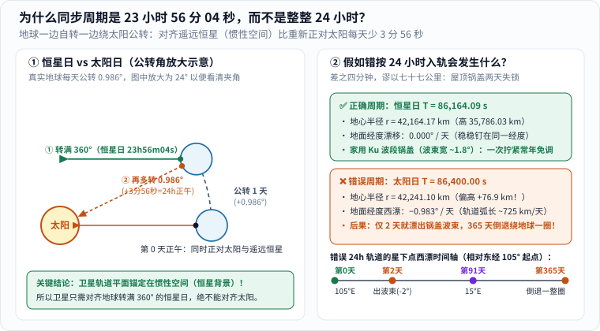
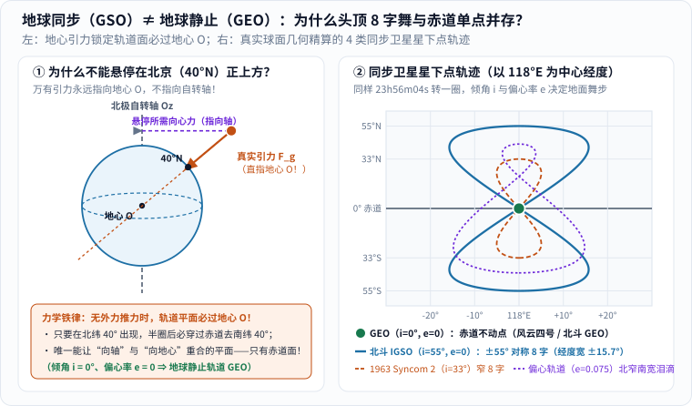
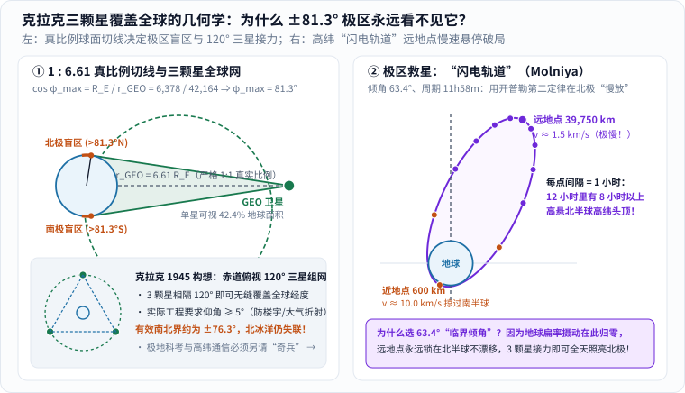
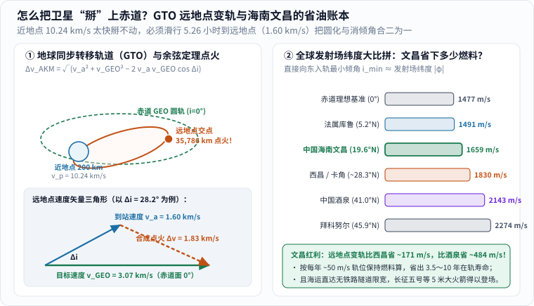
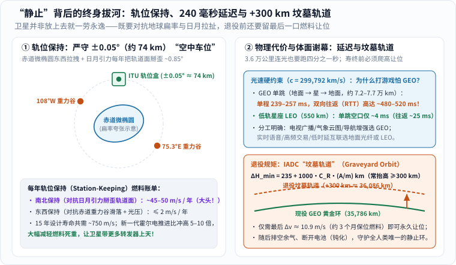

小时候回老家，很多人都在平房屋顶或院墙角见过一口灰扑扑的金属“小锅盖”——卫星电视接收天线。

安装师傅爬上梯子，拿扳手对准偏南方的天空调好仰角和方位角，把膨胀螺丝死死拧紧，从此这口锅盖风吹日晒十几年纹丝不动，屋里的电视却每天都能稳稳收到天上的信号。再打开每晚七点半的天气预报，动态卫星云图里的冷空气和台风眼，也像被一台架在太空中一动不动的“高空监控探头”（比如我国的风云四号气象卫星 [6]）连续延时摄影拍下来的一样。

可要是你刚读过咱们前两篇聊太空的文章——[《空间站为什么会失重？》]()和[《飞得越高反而越慢？从发射卫星读懂三大宇宙速度》]()——脑子里马上就会警铃大作：

1. **怎么可能“悬停”不掉下来？** 太空中没有空气浮力，也没有柱子撑着；任何卫星只要真的在太空里“刹停”，地球引力立刻就会把它笔直拽回地面摔碎！
2. **为什么偏偏都在 $$3.6$$ 万公里高空？** 空间站在 $$400\ \mathrm{km}$$ 飞得好好的，为什么所有能让锅盖“免追踪”的通信、广播和静止气象卫星，全世界不管哪个国家发射，全都挤在赤道上空 **$$35{,}786\ \mathrm{km}$$** 这一条窄窄的圆环上，高一点、低一点都不行？
3. **为什么中国屋顶的锅盖全都朝南歪，不能把卫星直接“钉”在北京正头顶？** 还有新闻里常说的“地球同步轨道（GSO）”“地球静止轨道（GEO）”和北斗导航的“倾斜地球同步轨道（IGSO）” [7]，到底是一回事还是三回事？

答案说穿了既浪漫又硬核：**天上根本没有“停着不动”的卫星，只有一场分秒不差的角速度追逐战。** 那颗看起来像钉子一样钉在天上的卫星，此刻正以 **$$3.075\ \mathrm{km/s}$$**（约 $$11{,}069\ \mathrm{km/h}$$，相当于音速的 $$9$$ 倍、出膛步枪子弹的 $$3$$ 倍多）在真空中狂飙 [1][2]——只不过它绕地心转一圈的角速度，恰好和脚下地球自转的角速度严丝合缝地锁死了！

先把太空中四类常见“常驻户口”的核心参数摊在桌上（全部按 WGS84 地球引力常数 $$\mu = GM_\oplus = 3.986004418 \times 10^{14}\ \mathrm{m^3/s^2}$$ 与赤道半径 $$R_E = 6{,}378.137\ \mathrm{km}$$ 精确复算 [1][5]），我们顺着物理直觉一步步拆开这场太空魔术：

| 轨道类型与代表航天器 | 距赤道高度 $$h$$ | 巡航线速度 $$v$$ | 绕地周期 $$T$$ | 地面抬头看它的样子 |
| --- | --- | --- | --- | --- |
| **近地轨道（LEO）**：中国空间站 | $$\approx 400\ \mathrm{km}$$ | $$7.67\ \mathrm{km/s}$$ | $$\approx 92.6\ \text{分钟}$$ | 几分钟就从西往东划过天际，一天绕地 $$15.5$$ 圈 |
| **中圆轨道（MEO）**：北斗三号全球星 [7] | $$21{,}528\ \mathrm{km}$$ | $$3.78\ \mathrm{km/s}$$ | $$12\ \text{小时}\ 53\ \text{分}$$ | 缓缓横穿天空，地面需要全向天线或多星接力 |
| **倾斜同步轨道（IGSO）**：北斗三号亚太星 [7] | $$35{,}786\ \mathrm{km}$$ | $$3.075\ \mathrm{km/s}$$ | $$23\ \text{小时}\ 56\ \text{分}\ 04\ \text{秒}$$ | 不东漂也不西跑，每天在固定经度上下走出一个“8”字 |
| **地球静止轨道（GEO）**：风云四号 / 北斗 GEO [6][7] | $$35{,}786\ \mathrm{km}$$ | $$3.075\ \mathrm{km/s}$$ | $$23\ \text{小时}\ 56\ \text{分}\ 04\ \text{秒}$$ | **稳稳“钉”在天球固定一点**，屋顶锅盖拧紧常年免调 |

---

## 一、不是“悬停”是“同频狂奔”：开普勒第三定律锁死的唯一高度

### 1. 旋转木马外圈的追逐：飞太低会超车，飞太高会掉队

先别急着列方程，想象你坐在一座巨大的旋转木马上，木马正逆时针匀速转动（就像从北极上空俯视自西向东自转的地球）。你手里举着一支激光笔，笔尖直直指向正外方，想照亮木马外围跑道上奔跑的一位朋友。

怎样才能让你的激光笔**不用左右摆动**，却始终照在他身上？

只有一个办法：**他在外圈跑一整圈花的时间，必须和你随旋转木马转一整圈的时间一模一样**——物理上叫作**角速度相等**（$$\omega_{\text{星} } = \omega_\oplus$$）。

但在太空里，卫星不是踩着橡胶跑道自己决定快慢的，它的速度完全由地球万有引力说了算 [1][2]：

- **离地球越近，引力拽得越猛，不仅线速度 $$v$$ 更快，跑一圈的路程 $$2\pi r$$ 还更短**。比如 $$400\ \mathrm{km}$$ 高的空间站，$$92.6$$ 分钟就刷完一圈 [1]；你手里的“激光笔”（地面天线）刚随地球转了不到 $$23^\circ$$，它已经从头顶一溜烟蹿到东边地平线底下去了。
- **离地球越远，引力迅速衰减，不仅线速度 $$v$$ 变慢，跑一圈的周长 $$2\pi r$$ 还大幅拉长**。最极端的现成例子就是 $$38.44$$ 万公里外的月球：它也是地球的卫星，绕地线速度只有 $$1.02\ \mathrm{km/s}$$，转完一圈要花 $$27.32$$ 天！地球自己一天就转完一圈了，所以月球远远跟不上地球自转，我们每天晚上才会看到月亮像太阳一样“东升西落”（被自西向东转的地球甩在身后）。

你看：$$400\ \mathrm{km}$$ 嫌太快（一天转 $$15.5$$ 圈），$$384{,}400\ \mathrm{km}$$ 又嫌太慢（一个月才转 $$1$$ 圈）。既然周期 $$T$$ 随着轨道半径 $$r$$ 连续、单调地变长，根据微积分里最朴素的介值直觉，**在空间站和月球之间，必定存在且只存在唯一一个“黄金半径”**，能让卫星转一圈的时间分秒不差地等于地球自转一周的时间！

### 2. 三行公式算出 35,786 公里：为什么 39 公斤小星与 8 吨重星挤在同一条环上？

现在我们把这个“黄金半径”亲手算出来。设卫星质量为 $$m$$，到**地心**的距离（轨道半径）为 $$r$$，地球自转角速度为 $$\omega_\oplus = \frac{2\pi}{T_{\text{sid} } }$$。卫星做匀速圆周运动所需的向心力，100% 由地球万有引力提供 [1][5]：

$$
\frac{GM_\oplus m}{r^2} = m\,\omega_\oplus^2 r
$$

先看最奇妙的第一件事：**等式两边的卫星质量 $$m$$ 直接约掉了！**

这意味着，不管你是 1963 年人类第一颗地球同步卫星“辛康 2 号”（入轨干重仅 **$$39\ \mathrm{kg}$$**，比一个成年人还轻 [3]），还是今天重达 **$$5\sim 8\ \text{吨}$$** 的大型高通量通信卫星，只要想和地球保持同步，谁也没有特权选别的高度——它们必须老老实实排在同一条半径 $$r$$ 上，以完全相同的速度并肩飞行。

把上式整理出 $$r^3$$，再代入 $$\omega_\oplus = \frac{2\pi}{T_{\text{sid} } }$$，就得到了牛顿版的**开普勒第三定律**（如果忘了开普勒怎样发现 $$T^2 \propto r^3$$，可以回看[《从开普勒到牛顿：行星为什么不会掉进太阳》]()）：

$$
r^3 = \frac{GM_\oplus}{\omega_\oplus^2} = \frac{GM_\oplus \, T_{\text{sid} }^2}{4\pi^2}
\quad \Longrightarrow \quad
r = \left(\frac{GM_\oplus \, T_{\text{sid} }^2}{4\pi^2}\right)^{1/3}
$$

下面我们把经过天文大地测量千锤百炼的真实常数代进去逐项验算 [1][5]：

- **地心引力常数**：$$\mu = GM_\oplus = 3.986004418 \times 10^{14}\ \mathrm{m^3/s^2}$$（注：天体力学里直接测 $$GM_\oplus$$ 乘积的精度高达百亿分之一，比单独测万有引力常数 $$G$$ 准得多 [5]）；
- **地球自转真正周期（恒星日）**：$$T_{\text{sid} } = 86{,}164.0905\ \mathrm{s}$$（即 $$23\ \text{小时}\ 56\ \text{分}\ 04.09\ \text{秒}$$，下一节马上揭秘为什么不是 $$86{,}400\ \mathrm{s}$$！）。

先算括号里的分子除以 $$4\pi^2$$：

$$
r^3 = \frac{\left(3.986004418 \times 10^{14}\ \mathrm{m^3/s^2}\right) \times \left(86{,}164.0905\ \mathrm{s}\right)^2}{4 \times 3.1415926536^2}
\approx 7.49602 \times 10^{22}\ \mathrm{m^3}
$$

开三次方根，地心同步轨道半径立刻跳了出来：

$$
r_{\mathrm{GEO} } = \left(7.49602 \times 10^{22}\right)^{1/3}\ \mathrm{m} \approx 4.216417 \times 10^7\ \mathrm{m} = 42{,}164.17\ \mathrm{km}
$$

这大约是地球赤道半径的 **$$6.61\ \text{倍}$$**。请注意，$$42{,}164.17\ \mathrm{km}$$ 是从**地心**算起的半径；我们平时说“飞得多高”，指的是离脚下赤道海平面的高度 $$h_{\mathrm{GEO} }$$，减去地球赤道半径 $$R_E = 6{,}378.14\ \mathrm{km}$$：

$$
h_{\mathrm{GEO} } = r_{\mathrm{GEO} } - R_E = 42{,}164.17 - 6{,}378.14 = 35{,}786.03\ \mathrm{km}
$$

这就是教科书和航天控制大厅里那个出镜率极高的数字——**$$35{,}786\ \mathrm{km}$$**（常简记为 $$3.6$$ 万公里）[1][2]！顺手还能算出它此时的圆轨道线速度与当地重力加速度：

$$
v_{\mathrm{GEO} } = \frac{2\pi r_{\mathrm{GEO} } }{T_{\text{sid} } } \approx 3.0747\ \mathrm{km/s}, \qquad
g_{\mathrm{GEO} } = \frac{GM_\oplus}{r_{\mathrm{GEO} }^2} \approx 0.2242\ \mathrm{m/s^2}
$$

虽然 $$3.6$$ 万公里高空的地球引力只剩地表的 **$$2.29\%$$**（对比 $$400\ \mathrm{km}$$ 空间站还剩 $$88.5\%$$），但千万别小看这 $$0.224\ \mathrm{m/s^2}$$ 的微弱拉力：正是它一秒不停地把每秒飞出 $$3.075$$ 公里的卫星往地心拽弯，经过 $$23\ \text{小时}\ 56\ \text{分}\ 04\ \text{秒}$$ 刚好掰成一个周长 $$26.49$$ 万公里的完美大圆！

*图 1：怎么看这张图——**先看左栏（北极俯视严格 1 : 6.61 真比例）**：设 $$t=0$$ 时地面锅盖与三颗不同高度的卫星同时从正右方（虚线起点）逆时针出发；经过 $$6$$ 个恒星时（动画自动单次播放 $$6.4$$ 秒后停在终态，[单独打开图片](/assets/images/geosync-orbit/angular-chase-sweetspot.svg)刷新可重播），地球赤道上的锅盖转过 $$90^\circ$$ 朝上，$$35{,}786\ \mathrm{km}$$ 的 GEO 卫星也分毫不差转过 $$90^\circ$$，始终死死卡在绿色虚线视线正上方；而 $$21{,}528\ \mathrm{km}$$ 的北斗 MEO 已超前到 $$167.3^\circ$$，$$400\ \mathrm{km}$$ 的空间站更是狂飙了 $$3.88$$ 圈（$$1{,}396^\circ$$）！（注：空间站真实半径仅比地球大 $$6.3\%$$，左图橙色内环略向外留缝以便分辨。）**再看右栏**：蓝色开普勒曲线单调上升，与“地球恒星日 $$23\text{h }56\text{m }04\text{s}$$”水平绿线在宇宙间只有唯一交点 $$h = 35{,}786\ \mathrm{km}$$。*

---

## 二、差四分钟谬以七十七公里：为什么对齐“恒星日”而不是 24 小时？

细心的读者刚才肯定注意到了一个反直觉的细节：一天不是 $$24\ \text{小时}$$（$$86{,}400\ \text{秒}$$）吗？为什么我们在算同步卫星高度时，代入的却是 **$$23\ \text{小时}\ 56\ \text{分}\ 04.09\ \text{秒}$$**（$$86{,}164.09\ \text{秒}$$）[1][2]？每天凭空少掉的那 **$$3\ \text{分}\ 56\ \text{秒}$$** 去哪儿了？

### 1. 绕着桌子自转一周：每天那 3 分 56 秒去哪儿了？

你在客厅里就能花十秒钟做完这个实验：在房间正中央放一盏台灯当“太阳”，选远处北墙上的一幅画当“遥远的恒星”（距离无穷远，视线彼此平行）。

1. **起点（第 0 天正午）**：你站在台灯右边，面朝正左方——此时你的鼻子**既正对着台灯（太阳），也正对着远处的墙画（恒星）**。
2. **一边自转，一边绕台灯公转**：现在请你逆时针绕着台灯往前走一小步（模拟地球每天绕太阳公转一天的路程），同时身体逆时针自转。
3. **转满 $$360^\circ$$ 的瞬间（恒星日）**：当你的鼻子重新指回远处墙上那幅画时，你在惯性空间里已经**结结实实转满了一整圈（$$360.000^\circ$$）**！但请你瞄一眼台灯——因为你刚才往斜上方跨了一步，台灯此刻还在你鼻尖偏左下方一点点！你必须**再多拧一点点身子**，才能重新正对台灯迎来“第二天正午”。

地球每天干的就是这件事！地球绕太阳公转一圈（$$360^\circ$$）大约需要 $$365.2564$$ 个恒星年天数，所以地球每天在公转轨道上往前挪动的角度是：

$$
\Delta\phi = \frac{360^\circ}{365.2564} \approx 0.9856^\circ
$$

我们的手表和作息对齐的是太阳——从今天正午太阳最高，到明天正午太阳最高，叫作一个**平太阳日（$$24\ \text{小时} = 86{,}400\ \text{秒}$$）**，这期间地球其实自转了 **$$360^\circ + 0.9856^\circ = 360.9856^\circ$$**！那么地球纯粹在惯性空间里转满 $$360^\circ$$（叫作一个**恒星日**）需要多久呢？按比例一除就出来了：

$$
T_{\text{sid} } = 86{,}400\ \mathrm{s} \times \frac{360^\circ}{360.9856^\circ} \approx 86{,}164.09\ \mathrm{s} = 23\ \text{小时}\ 56\ \text{分}\ 04.09\ \text{秒}
$$

中间相差的 $$86{,}400 - 86{,}164.09 = 235.91\ \mathrm{s}$$（**$$3\ \text{分}\ 55.91\ \text{秒}$$**），正是地球为了追上自己公转步伐、重新把脸转回太阳方向所多花的时间！

而人造卫星绕地球飞行的轨道平面，受惯性定律支配，**锚定的是遥远恒星所在的惯性空间，而不是跟着太阳方向每天自己转 $$0.9856^\circ$$**。因此，卫星要想死死咬住地球上的同一条经线，必须对齐地球在惯性空间转满 $$360^\circ$$ 的真周期——**恒星日 $$23\ \text{小时}\ 56\ \text{分}\ 04\ \text{秒}$$** [1][2]！

### 2. 算错周期的反例实验：偏高 76.9 公里，屋顶锅盖两天失联

假如一位粗心的工程师真的把手表上的 $$T_{\text{sol} } = 86{,}400\ \mathrm{s}$$ 填进了开普勒公式，会发生什么灾难？我们来算一笔反例账：

$$
r_{\text{误} } = \left(\frac{GM_\oplus \times 86{,}400^2}{4\pi^2}\right)^{1/3} \approx 42{,}241.10\ \mathrm{km}
$$

对比正确半径 $$42{,}164.17\ \mathrm{km}$$，这颗卫星会被打高 **$$+76.93\ \mathrm{km}$$**！

别看 $$77$$ 公里在 $$4.2$$ 万公里面前只占 $$0.18\%$$，后果却立竿见影：地球每过 $$23\ \text{小时}\ 56\ \text{分}\ 04\ \text{秒}$$ 就已经在惯性空间转完 $$360^\circ$$ 了，而这颗打高了的卫星要慢吞吞等到满 $$24\ \text{小时}$$ 才转完 $$360^\circ$$。于是地面观测者每天都会看到它**向西倒退 $$0.9856^\circ$$**（在静止轨道高度相当于每天横移 **$$725\ \mathrm{km}$$**）！

家用屋顶卫星电视锅盖（常用 Ku 波段，直径 $$0.6\sim 0.75\ \mathrm{m}$$）的主波束半功率张角通常只有 **$$1.6^\circ\sim 2.0^\circ$$**。也就是说，如果按 $$24$$ 小时周期入轨，**仅仅过 $$2$$ 天**，卫星就会彻底漂出屋顶锅盖的接收视野，电视画面直接黑屏；满一年 $$365.25$$ 天，这颗“假同步卫星”会沿着赤道从东往西倒退着绕地球溜达整整一圈！

*图 2：怎么看这张图——**左栏**从黄道北极俯视（为看清微小夹角，将地球每天真实公转角 $$0.986^\circ$$ 放大画成 $$26^\circ$$）：第 0 天正午地面黑点同时正对太阳与左方无穷远恒星；第 1 天地球先转满 $$360^\circ$$ 重新平行指回遥远恒星（绿色实线，即恒星日 $$23\text{h }56\text{m }04\text{s}$$），随后还需额外转过橙色夹角 $$0.986^\circ$$（多花 $$3\text{m }56\text{s}$$）才能重新正对太阳。**右栏**对比正确周期与误用 $$24\ \text{小时}$$ 周期的定量后果：偏高 $$76.9\ \mathrm{km}$$ 会导致星下点每天西漂近 $$1^\circ$$，两天内就会脱离固定抛物面天线的波束。*

---

## 三、“同步”不等于“静止”：为什么北京头顶挂不住星，北斗却在天上画“8”字？

搞懂了高度和周期，接下来是最多人卡壳的第二个大弯：**既然能跟地球同速转，能不能发射一颗卫星，让它一天 24 小时永远停在北京（北纬 $$40^\circ$$）的正头顶？**

如果你留心观察过中国北方小区或农村屋顶的卫星锅盖，就会发现一个铁打的事实：**没有一口锅盖是朝天平躺的，它们清一色全都朝正南或偏南方向斜着仰起头！** 这背后藏着一条不可违抗的力学铁律。

### 1. 万有引力只认地心不认自转轴：非赤道悬停的力学禁令

假设我们硬把一颗无动力卫星放在北纬 $$40^\circ$$ 的正上方，想让它跟着北京一起绕**地球自转轴 $$Oz$$** 画一个悬在北半球的水平圆圈（纬度圈）。

先看它做这个圆周运动需要什么方向的向心力：**必须水平指向北半球的自转轴 $$Oz$$**（图 3 左栏紫色虚线箭头）。

再看地球真正给它的万有引力 $$\vec{F}_g$$ 指向哪里：**直挺挺地指向地球球心 $$O$$**（图 3 左栏橙色实线箭头）！

把这股指向球心 $$O$$ 的引力 $$\vec{F}_g$$ 正交分解，问题立刻暴露了：

- **水平指向自转轴的分力** $$F_g \cos 40^\circ$$：确实可以充当绕轴旋转的向心力；
- **竖直向南（平行于自转轴向下）的分力** $$F_g \sin 40^\circ$$：**没有任何力跟它抵消！**

除非卫星肚子里装一台永不熄火的发动机，一秒不停地往北喷火硬顶住这股向南的分力（哪怕只顶几天，全世界最大的燃料箱也会烧得精光），否则一旦关机靠惯性飞行，这股向南的分力立刻就会把卫星往赤道拽下去——穿过赤道后继续冲到**南纬 $$40^\circ$$**，下半圈再从南半球爬回北纬 $$40^\circ$$！

用几何语言总结成一句话：**在中心引力场中，任何不喷火的开普勒轨道平面，都必须严格切过地球球心 $$O$$** [1][5]。

而地球上所有平行纬度圈里，**圆心恰好就是地球球心 $$O$$ 的纬度圈只有一个——赤道（纬度 $$0^\circ$$）！**

所以，要想让卫星在天空中真正纹丝不动，光满足“周期等于恒星日（$$a = 42{,}164\ \mathrm{km}$$）”还远远不够，必须同时集齐三把钥匙 [1][5]：

1. **周期同步**：半长轴 $$a = 42{,}164.17\ \mathrm{km}$$，顺行（自西向东）周期精确等于 $$23\ \text{小时}\ 56\ \text{分}\ 04\ \text{秒}$$；
2. **圆轨道（偏心率 $$e = 0$$）**：如果轨道是椭圆，根据开普勒第二定律，卫星在近地点跑得比地球自转快（向东超前），在远地点跑得比地球自转慢（向西落后），地面看起来就会每天东西来回晃悠；
3. **零倾角（轨道倾角 $$i = 0^\circ$$）**：轨道平面与地球赤道平面完全重合，彻底消灭南北摆动。

只有三把钥匙全齐，才叫**地球静止轨道（Geostationary Orbit，简称 GEO）**；而只要满足第一条（周期等于恒星日），不管有没有倾角和偏心率，统称**地球同步轨道（Geosynchronous Orbit，简称 GSO）** [1]。也就是说：**“地球静止轨道 GEO”只是“地球同步轨道 GSO”家族里最特殊、最规矩的赤道正圆特例！**

> **顺手算算：你在北京抬头找正南方的静止卫星，锅盖该仰起多少度？**
> 设观测者刚好在卫星同一条经线上、地理纬度为 $$\phi = 40^\circ\mathrm{N}$$。由球心、观测者与赤道上空 $$r_{\mathrm{GEO} } = 6.6107\,R_E$$ 卫星构成的平面三角形，容易导出仰角 $$\mathrm{El}$$ 公式：
>
> $$
> \tan\mathrm{El} = \frac{\cos\phi - R_E / r_{\mathrm{GEO} } }{\sin\phi} = \frac{\cos 40^\circ - 0.15127}{\sin 40^\circ} \approx \frac{0.76604 - 0.15127}{0.64279} \approx 0.9564
> $$
>
> 解得 $$\mathrm{El} \approx 43.7^\circ$$！越往南走（比如广州 $$\phi \approx 23.1^\circ\mathrm{N}$$），仰角越高（$$\approx 62.9^\circ$$）；到了新加坡或基多（赤道 $$\phi \approx 0^\circ$$），锅盖就真的仰面朝天直指头顶 $$90^\circ$$ 了！

### 2. 倾斜同步轨道（IGSO）的“8”字舞步：北斗三号为什么要混搭三种轨道？

既然倾斜的同步轨道（$$i > 0^\circ$$）没法让家用小锅盖偷懒，航天工程师是不是唯恐避之不及？恰恰相反——**我国的北斗卫星导航系统，偏偏把倾斜地球同步轨道（IGSO）玩成了独步全球的杀手锏** [7][8]！

先看一颗圆轨道（$$e = 0$$）、轨道倾角 $$i = 55^\circ$$ 的北斗 IGSO 卫星，地面星下点（卫星与地心连线在地球表面的交点）每天会走出什么图案。设卫星从赤道升交点出发经过相位角 $$u = \omega_\oplus t$$，由球面直角三角形立刻给出星下点纬度 $$\phi(u)$$ 与相对中心经线的经度差 $$\Delta\lambda(u)$$：

$$
\sin\phi(u) = \sin i \sin u, \qquad
\Delta\lambda(u) = \operatorname{atan2}(\cos i \sin u,\, \cos u) - u
$$

为什么会左右拐出“8”字腰身？

- 当卫星刚跨过赤道往东北方向斜冲时（$$u \approx 0^\circ$$），它速度在东西方向的分量只有 $$v\cos 55^\circ \approx 0.574\,v$$，**比赤道自转角速度慢**，所以星下点暂时往**西**落后（最大西偏约 $$-15.7^\circ$$）；
- 当卫星爬到最北端北纬 $$55^\circ$$ 附近时（$$u \approx 90^\circ$$），北纬 $$55^\circ$$ 的地面纬度圈周长缩水成了赤道的 $$\cos 55^\circ$$ 倍，此时卫星纯向东飞，角速度反过来**猛超地面自转**，于是星下点从西向**东**横穿中心经线，在北半球画出一个圆润的北环（最大东偏 $$+15.7^\circ$$），随后南下穿过赤道交点，再去南半球对称地画出下半个环！

美国的 GPS、俄罗斯的 GLONASS 和欧洲的伽利略导航系统，主力全都是清一色的中圆轨道（MEO）星座；唯独我国 2020 年全面建成的**北斗三号（BDS-3）全球系统**，独创了 **“$$24\ \text{颗 MEO} + 3\ \text{颗 IGSO} + 3\ \text{颗 GEO}$$”** 的三轨混合星座 [7][8]！为什么要费劲多打这 $$6$$ 颗 $$3.6$$ 万公里高的同步星？

1. **专治城市“高楼峡谷”遮挡**：刚才我们算过，赤道上的 GEO 卫星在北京看仰角只有 $$43.7^\circ$$，如果北边正好立着一栋三十层写字楼，信号就被挡死了；而 $$3$$ 颗 $$i = 55^\circ$$ 的北斗 IGSO 卫星轮流沿着东经 $$118^\circ$$ 附近的“8”字北环爬到北纬 $$55^\circ$$，在中国及亚太上空始终保持**极高的头顶仰角（$$60^\circ\sim 85^\circ$$）**，哪怕你走在摩天大楼夹缝或深山峡谷里，头顶也总有几颗北斗星垂直往下照！
2. **GEO 星提供全天候双向短报文与精密增强**：定点在赤道 $$80^\circ\mathrm{E}$$、$$110.5^\circ\mathrm{E}$$、$$140^\circ\mathrm{E}$$ 等轨位的北斗 GEO 卫星 [7]，24 小时一步不离地俯瞰整个中国疆域与周边海域，不仅播发星基精密单点定位改正数，还撑起了北斗独有的**卫星短报文通信**——渔民在没有手机基站的远海遇险、登山队在无人区失联，手机直连天上那颗“钉”住不动的北斗 GEO 卫星就能发出求救短信！
3. **如果再加一点偏心率（$$e > 0$$）还能变魔术**：日本准天顶系统（QZSS）故意给倾斜同步轨道加上约 $$e \approx 0.075$$ 的偏心率并把远地点放在北半球（图 3 右栏紫色虚线），利用远地点飞得慢的特性，把对称“8”字捏成**“北窄慢、南宽快”的不对称泪滴形**，让卫星每天在北半球多待几个小时！

*图 3：怎么看这张图——**左栏**解释力学禁令：若想在北纬 $$40^\circ$$ 上空绕自转轴 $$Oz$$ 水平悬停，所需向心力指向轴（紫色虚线），但真实万有引力 $$\vec{F}_g$$ 永远直指地心 $$O$$（橙色实线），未抵消的南向分力必然把无动力卫星拉过赤道去往南纬 $$40^\circ$$。**右栏**用球面三角与开普勒方程精确绘制四类地球同步轨道星下点：绿色圆点为 $$i=0^\circ, e=0$$ 的真静止卫星（GEO）；橙色虚线为 1963 年人类首颗同步星 Syncom 2（$$i=33^\circ$$）；蓝色实线为北斗 IGSO（$$i=55^\circ$$，经度宽 $$\pm 15.7^\circ$$）；紫色点线为带偏心率的不对称泪滴轨迹。*

---

## 四、从科幻手稿到奥运直播：三颗星照亮地球，极地盲区怎么办？

今天我们习以为常的跨洋直播和天基通信，在不到一百年前还被当作痴人说梦。把这段历史里的关键节点理清楚，你会发现工程突破比科幻小说还跌宕起伏。

### 1. 波托奇尼克、克拉克与罗森：从纸面狂想到 39 公斤的“辛康”奇迹

在科学史上，我们必须严格区分“最早算出静止轨道”“最早提出全球通信网构想”和“真正造出工程卫星”这三个里程碑：

- **1928 年底（印行标 1929 年）：赫尔曼·波托奇尼克（Herman Potočnik，笔名 Hermann Noordung）首次算清静止轨道与无线电联络**。这位前奥匈帝国工程师在柏林出版的德文著作《太空航行问题：火箭发动机》（*Das Problem der Befahrung des Weltraums*）中，第一次明确推算出在赤道上空约 $$35{,}900\ \mathrm{km}$$ 处空间站可与地面保持相对静止，并设想用无线电与地面通信 [5]。
- **1945 年 10 月：阿瑟·克拉克（Arthur C. Clarke）提出“三颗星覆盖全球”蓝图**。当时二战刚结束，海底电缆容量有限，短波无线电又受电离层扰动极不稳定。年仅 27 岁的英国皇家空军雷达军官（后来写出《2001：太空漫游》的科幻大师）克拉克，在英国《无线电世界》（*Wireless World*）杂志发表了那篇载入史册的短文《地球外中继——火箭站能实现全球无线电覆盖吗？》[5]。他在文中画出一个极其漂亮的几何构想：**只要在赤道静止轨道上等距放 $$3$$ 颗相隔 $$120^\circ$$ 的中继站，就能覆盖除南北两极外的整个地球！** 因此，地球静止轨道后来也被国际天文学界亲切地称为**“克拉克轨道（Clarke Orbit）”** [2][5]。
- **1963–1964 年：哈罗德·罗森（Harold Rosen）团队用陀螺自旋突破减重死结**。克拉克当年以为静止轨道太高，得等几十年后建起载人大型空间站才能换真空管。没想到晶体管问世后，美国休斯飞机公司的工程师哈罗德·罗森在 1959–1961 年想出了绝妙的极简方案：让圆柱形小卫星像陀螺一样每分钟自转百余圈来稳定姿态，整星干重压到了惊人的 **$$39\ \mathrm{kg}$$**（直径仅 $$71\ \mathrm{cm}$$、高 $$39\ \mathrm{cm}$$，跟一只大号帽盒差不多）[3]！
  - **1963 年 7 月 26 日**，NASA 发射 **“辛康 2 号”（Syncom 2）**，受限于当时火箭运力未能完全抹平倾角，进入 $$i = 33^\circ$$ 的倾斜地球同步轨道（GSO），在大西洋上空画着“8”字完成了肯尼迪总统与尼日利亚总理的历史性跨大西洋卫星通话——这是人类**第一颗地球同步卫星** [3]；
  - **1964 年 8 月 19 日**，升级火箭助推的 **“辛康 3 号”（Syncom 3）** 精准切入赤道上空 $$180^\circ$$ 国际日期变更线附近（倾角压低至 $$0.1^\circ$$ 以下），成为人类**第一颗真正的地球静止卫星（GEO）**，并在同年 10 月把 **1964 年东京奥运会**的电视实况画面第一次实时传过了浩瀚的太平洋 [4]！

### 2. 切线锁死的 ±81.3° 极区盲区，以及前苏联“闪电轨道”的开普勒妙计

克拉克当年为什么说“最少要 $$3$$ 颗星”，而且诚实地注明“两极除外”？拿初中学过的圆切线画个直角三角形，三秒钟就能见分晓！

在图 4 左栏的严格真比例截面里，地心为 $$O$$，地球半径为 $$R_E = 6{,}378.14\ \mathrm{km}$$，赤道正右方 $$r_{\mathrm{GEO} } = 42{,}164.17\ \mathrm{km}$$ 处挂着一颗静止卫星 $$S$$。从 $$S$$ 向地球球面引上下两条视线切线，切点为 $$T_N$$ 和 $$T_S$$。因为半径垂直于切线（$$\angle O T_N S = 90^\circ$$），切点对应的最高地理纬度 $$\varphi_{\max}$$ 直接满足：

$$
\cos\varphi_{\max} = \frac{R_E}{r_{\mathrm{GEO} } } = \frac{6{,}378.14}{42{,}164.17} \approx 0.15127
\quad \Longrightarrow \quad
\varphi_{\max} = \arccos(0.15127) \approx 81.30^\circ
$$

顺手还能用球冠表面积公式算出单颗静止卫星一眼能看到的地球表面积占比：

$$
\frac{A_{\text{可视} } }{4\pi R_E^2} = \frac{1}{2}\left(1 - \frac{R_E}{r_{\mathrm{GEO} } }\right) = \frac{1}{2}(1 - 0.15127) \approx 42.44\%
$$

这组几何数字把静止卫星的天赋和软肋算得明明白白 [2][5]：

1. **为什么 $$2$$ 颗星不够、$$3$$ 颗星刚好？** 单颗星经度张角是 $$2 \times 81.3^\circ = 162.6^\circ < 180^\circ$$，两颗对立的星中间一定会留下两道盲缝；而 $$3$$ 颗星每隔 $$120^\circ$$ 排成正三角形，相邻两星覆盖区大幅重叠，刚好把中低纬全球经度无缝包圆！
2. **为什么北极科考站和俄罗斯北部没法指望 GEO？** 理论上高于**南北纬 $$81.3^\circ$$** 的极冠区，赤道静止卫星永远躲在地平线底下，连一缕电磁波都照不到 [5]；而在真实工程里，天线如果贴着 $$0^\circ$$ 地平线看，信号会被树木、山丘、海浪遮挡并遭受严重的大气折射衰减，通常要求**最低通信仰角 $$\mathrm{El} \ge 5^\circ$$**。代入仰角公式 $$\varphi_{5^\circ} = \arccos\!\left(\frac{R_E}{r_{\mathrm{GEO} } }\cos 5^\circ\right) - 5^\circ$$，可靠覆盖边界立刻退缩到 **$$\pm 76.3^\circ$$** 左右！

前苏联国土大片横跨高纬度乃至北极圈，西伯利亚北部看赤道静止卫星仰角低得可怜。苏联轨道力学家没有跟几何切线硬碰硬，而是反手借用了**开普勒第二定律（等面积定律）**，在 1965 年发明了大名鼎鼎的**“闪电轨道”（Molniya Orbit）** [5]：

- 他们把轨道捏成一个极扁的大椭圆：**近地点在南半球仅约 $$600\ \mathrm{km}$$，远地点高高抛在北半球近 $$40{,}000\ \mathrm{km}$$**（偏心率 $$e \approx 0.74$$），半长轴调到周期刚好等于**半个恒星日（$$11\ \text{小时}\ 58\ \text{分}$$）**；
- 图 4 右栏每隔 **$$1\ \text{小时}$$** 标出了一个精确计算的卫星位置圆点：你会亲眼看到，卫星在南半球近地点以 $$10.0\ \mathrm{km/s}$$ 呼啸掠过，只待了短短一两个小时；而爬上北半球高空远地点后，速度骤降到 $$1.5\ \mathrm{km/s}$$ 左右——**整整 $$12$$ 个小时里，有 $$8$$ 个多小时密密麻麻地扎堆“慢放”在北半球高纬度正头顶！**
- 更绝的是轨道倾角精准选在 **$$i = 63.4^\circ$$（临界倾角）**：由于地球赤道鼓包引起的近地点进动率正比于 $$5\cos^2 i - 1$$，令 $$5\cos^2 i - 1 = 0$$ 恰好解得 $$i = \arccos(1/\sqrt{5}) \approx 63.43^\circ$$！在这个神奇倾角上，椭圆的远地点永远锁死在北半球不往南漂移。只要发 $$3$$ 颗闪电轨道卫星轮班接力，北极冰原全年 24 小时头顶都有一颗高仰角卫星值班！

*图 4：怎么看这张图——**左栏上方**严格按 $$1 : 6.61$$ 真实比例绘制地球子午截面与赤道静止卫星视线切线：切点锁定在南北纬 $$\pm 81.3^\circ$$（橙色极冠为永久盲区，考虑 $$5^\circ$$ 工程最低仰角后有效边界约为 $$\pm 76.3^\circ$$）；**左栏下方**为赤道俯视的克拉克 $$120^\circ$$ 三星全球中继构型。**右栏**求解开普勒方程画出 $$i=63.4^\circ$$ 闪电轨道上 $$12$$ 个等时间间隔（每 $$1\ \text{小时}$$ 一点）的真实位置：北半球远地点圆点密集扎堆，直观呈现“在头顶慢放 $$8$$ 小时以上”的高纬破局方案。*

---

## 五、怎么把卫星“掰”上赤道？远地点合成变轨与海南文昌的省油账

弄清了轨道几何，我们再来看看火箭发射直播里最刺激的一关：**中国的发射场都不在赤道上（酒泉北纬 $$41.0^\circ$$、西昌 $$28.2^\circ$$、海南文昌 $$19.6^\circ$$），怎么把一颗卫星最终塞进倾角 $$i = 0^\circ$$ 的赤道平面里？**

### 1. 地球同步转移轨道（GTO）：为什么要滑行 5 小时 15 分再去远地点拐弯？

我们在上一节刚讲过，不喷火的轨道平面必过地心 $$O$$。如果你从北纬 $$\phi$$ 的发射场正东方向点火入轨，地心 $$O$$ 与发射场连线本身就和赤道面成 $$\phi$$ 角——这意味着**不靠中途侧向拐弯，直接入轨能拿到的最小轨道倾角就是发射场纬度 $$i_{\min} = |\phi|$$** [5]！（要是往东南或东北偏着打，倾角只会比 $$|\phi|$$ 更大。）

那能不能在 $$200\ \mathrm{km}$$ 高的近地停泊轨道上，直接横着点一把火把轨道面“掰平”到赤道？

千万使不得！在轨道力学里，“掰弯轨道平面”就像在冰面上让一颗高速滑行的冰球急转弯——原来跑得越快，掰转同样角度 $$\Delta i$$ 要烧掉的速度增量 $$\Delta v = 2v\sin(\Delta i/2)$$ 就越恐怖！

我们在[《从发射卫星读懂三大宇宙速度》]()里算过，火箭先把卫星送入一条 $$200\ \mathrm{km} \times 35{,}786\ \mathrm{km}$$ 的大椭圆搭桥轨道——**地球同步转移轨道（GTO）** [5]：

- **在 $$200\ \mathrm{km}$$ 近地点**：椭圆速度高达 **$$v_p = 10.24\ \mathrm{km/s}$$**！如果在这里硬掰 $$28.2^\circ$$ 倾角，光拐弯就要烧掉 $$2 \times 10.24 \times \sin 14.1^\circ \approx 4.99\ \mathrm{km/s}$$，火箭当场就得破产；
- **无动力滑行半圈（$$5\ \text{小时}\ 15\ \text{分}$$）爬到 $$35{,}786\ \mathrm{km}$$ 远地点（且让远地点正好落在赤道交线上）**：此时动能几乎全换成了引力势能，卫星慢得像散步一样，速度跌到了区区 **$$v_a = 1.60\ \mathrm{km/s}$$**！

等卫星慢悠悠晃到远地点穿过赤道面的那一刻，星上的**远地点发动机（AKM）**斜着喷出一股火，把**“提速圆化（$$1.60 \to 3.075\ \mathrm{km/s}$$）”**和**“抹平倾角（$$\Delta i \to 0^\circ$$）”**两件事合二为一！根据余弦定理（图 5 左栏矢量三角形），这次“一箭双雕”所需的合成速度增量是：

$$
\Delta v_{\mathrm{AKM} }(\Delta i) = \sqrt{v_a^2 + v_{\mathrm{GEO} }^2 - 2\,v_a\,v_{\mathrm{GEO} }\cos\Delta i}
$$

比起“先加速圆化、再单独拐弯”分两步走，斜向合成点火白白省下了三角形两边之和大于第三边的那一大截燃料！

### 2. 纬度就是真金白银：从酒泉、西昌到海南文昌与法属库鲁

把世界各大航天发射场的纬度代进上面的余弦定理公式（同时顺手算上地面向东发射借到的地球自转线速度 $$v_{\text{借} } = 465.1\cos\phi\ \mathrm{m/s}$$），一张决定卫星寿命的“省油总账”瞬间一目了然：

| 航天发射场 | 地理纬度 $$\lvert\phi\rvert$$ | 发射白借自转初速 | 远地点合成变轨 $$\Delta v_{\mathrm{AKM} }$$ | 相比赤道多付的变轨代价 |
| --- | --- | --- | --- | --- |
| **赤道理想海上平台** | $$0.0^\circ$$ | $$465\ \mathrm{m/s}$$ | **$$1{,}478\ \mathrm{m/s}$$** | $$0\ \mathrm{m/s}$$（理论下限） |
| **欧洲法属圭亚那库鲁** [2] | $$5.2^\circ\mathrm{N}$$ | $$463\ \mathrm{m/s}$$ | **$$1{,}491\ \mathrm{m/s}$$** | 仅多 $$+13\ \mathrm{m/s}$$ |
| **中国海南文昌发射场** | $$19.6^\circ\mathrm{N}$$ | $$438\ \mathrm{m/s}$$ | **$$1{,}656\ \mathrm{m/s}$$** | $$+178\ \mathrm{m/s}$$ |
| **中国西昌 / 美国卡纳维拉尔角** | $$28.2^\circ\text{–}28.5^\circ\mathrm{N}$$ | $$409\ \mathrm{m/s}$$ | **$$1{,}831\text{–}1{,}838\ \mathrm{m/s}$$** | $$+353\text{–}360\ \mathrm{m/s}$$ |
| **中国酒泉发射场** | $$41.0^\circ\mathrm{N}$$ | $$351\ \mathrm{m/s}$$ | **$$2{,}159\ \mathrm{m/s}$$** | $$+681\ \mathrm{m/s}$$ |
| **哈萨克斯坦拜科努尔** | $$45.9^\circ\mathrm{N}$$ | $$324\ \mathrm{m/s}$$ | **$$2{,}302\ \mathrm{m/s}$$** | $$+824\ \mathrm{m/s}$$ |

看看这张表，你就彻底明白为什么欧洲航天局宁可万里迢迢把阿丽亚娜火箭船运到南美洲赤道边的**库鲁（$$5.2^\circ\mathrm{N}$$）** [2]，以及我国为什么要专门在海南建设**文昌航天发射场（$$19.6^\circ\mathrm{N}$$）**了：

1. **省下的每一米每秒，都是实打实的卫星寿命**：从文昌打地球静止卫星，光远地点消倾角这一锤子买卖，就比西昌少烧约 **$$175\sim 180\ \mathrm{m/s}$$** 的星上推进剂（比酒泉更是少烧 **$$503\ \mathrm{m/s}$$**）！下一节我们马上会看到，一颗静止卫星在轨维持位置一年大约只需消耗 $$50\ \mathrm{m/s}$$ 燃料——**文昌省下的这笔推进剂，直接就能给卫星多续上 $$3.5\sim 10$$ 年的工作寿命！**
2. **海运解放火箭腰围，向东坠落更安全**：内陆发射场靠铁路运输，受隧道涵洞宽度限制，箭体直径卡死在 $$3.35\ \mathrm{m}$$；而文昌紧靠大海，天津造好的 $$5\ \mathrm{m}$$ 大直径重型火箭（长征五号、长征七号等）直接装船海运到码头，而且火箭起飞向东越过的是茫茫太平洋，助推器残骸落区远离内陆居民点 [5]。

*图 5：怎么看这张图——**左栏上方**展示带倾角的橙色 GTO 椭圆在远地点（$$35{,}786\ \mathrm{km}$$）穿过赤道平面，**左栏下方**按真实速度比例画出余弦定理矢量三角形：蓝色到站速度 $$1.60\ \mathrm{km/s}$$ 经橙色发动机脉冲一脚拐入绿色赤道圆轨速度 $$3.07\ \mathrm{km/s}$$。**右栏**对比全球代表发射场纬度对应的远地点所需 $$\Delta v_{\mathrm{AKM} }$$，直观算清海南文昌相比中高纬发射场省下的数百米每秒速度增量。*

---

## 六、“钉住”背后的代价与谢幕：轨位保持、光速延迟与“坟墓轨道”

把卫星千辛万苦送进赤道 $$35{,}786\ \mathrm{km}$$ 圆轨后，地面测控中心是不是就可以泡杯茶放假了？恰恰相反——**真正的“隐形拔河”从入轨第一天起要连打十五年**，直到它体面退役的那一刻。

### 1. 赤道上的两个“重力谷”与日月拉扯：每年 50 m/s 的终身保位战

我们前面推导公式时，把地球理想化成了一个孤立、均匀的完美正球体。但真实宇宙里有两股捣乱的力量，每时每刻都在把静止卫星往“车位”外面拽 [5]：

1. **南北方向：月球与太阳引力的“掰盘子”效应（大头，每年约 $$45\sim 50\ \mathrm{m/s}$$）**。月球轨道面和地球黄道面都不在地球赤道面上，日月引力联手对静止卫星轨道环施加力矩，如果放任不管，轨道倾角最初每年会被掰歪约 **$$0.85^\circ$$**（约 $$26.5$$ 年后倾角最高飙到 $$15^\circ$$，约 $$53$$ 年完成一轮进动周期）[5][9]！卫星一旦歪出倾角，就会重新在天上画起“8”字。因此地面每隔一两周就要指令南北推力器点火，把轨道面硬压回赤道——这叫**南北位置保持（NSSK）**，吃掉了卫星一生 **$$90\%$$ 以上**的保位燃料。
2. **东西方向：赤道其实是个“微椭圆”，藏着两个重力谷（每年 $$\le 2\ \mathrm{m/s}$$）**。地球赤道截面并不是绝对正圆，长轴与短轴半径差了约 $$65\sim 70\ \mathrm{m}$$！这点极其微弱的质量不对称，在静止轨道上挖出了两个稳定的引力势能低谷——分别位于**印度洋上空东经 $$75.3^\circ\mathrm{E}$$** 和**东太平洋上空西经 $$108^\circ\mathrm{W}$$**（以及 $$165.3^\circ\mathrm{E}$$、$$14.7^\circ\mathrm{W}$$ 两个不稳定鞍点）[5]。任何停在其他经度的静止卫星，如果不加干预，都会像放在斜坡上的弹珠一样，慢悠悠滑向最近的那口“重力谷”聚成一堆（再加上太阳光压吹拂偏心率），所以还需定期做微小的**东西位置保持（EWSK）**。

因为全世界只有这一条长约 $$26.5$$ 万公里的赤道静止黄金环，相邻同频段卫星靠太近就会互相串台干扰。为了避免各国抢车位吵架（1976 年 8 个赤道国家甚至曾签署《波哥大宣言》声称头顶静止轨道归本国主权，未获国际公认 [5]），联合国下属的**国际电信联盟（ITU）**把整条环划成一个个严格的“空中停车位” [5]：现代静止卫星必须把自己死死关在经纬度各不超过 **$$\pm 0.05^\circ\sim \pm 0.1^\circ$$**（边长仅约 **$$74\sim 148\ \mathrm{km}$$**）的狭小立方体盒子里！

为了省下这每年约 $$50\ \mathrm{m/s}$$、15 年累计约 $$750\ \mathrm{m/s}$$ 的保位燃料死重，近年来中美欧新一代大型静止通信卫星纷纷换上了我们在[《等离子体到底是什么？》]()里聊过的**霍尔电推进（等离子体推进器）** [5]——喷气速度比传统化学燃料高出 $$5\sim 10$$ 倍，一下子省下上吨推进剂重量，全换成赚钱的通信转发器！

### 2. 连光都要跑四分之一秒的延迟，以及退居 +300 公里的体面谢幕

最后，静止卫星还有两个普通人也能切身感知的“物理边界”：一个是**光速延迟**，一个是**退役归宿**。

先算**延迟账**：真空光速 $$c = 299{,}792.458\ \mathrm{km/s}$$ 听起来快得不可思议，可 $$35{,}786\ \mathrm{km}$$ 实在太远了！你在北京拨通一个经由静止卫星中继的电话（中纬度斜距单程约 $$37{,}500\sim 38{,}500\ \mathrm{km}$$）：

- 你的声音变成电磁波：**地面发信站 $$\to$$ 卫星 $$\to$$ 对方地面站**，光单向“一跳”就要跑约 $$7.5$$ 万公里，耗时 **$$t_{\text{单跳} } \approx 240\sim 257\ \mathrm{ms}$$**（四分之一秒）[5]；
- 等对方听见、开口回答再原路传回你耳朵，光在路上来回纯飞行的**往返物理下限（RTT）就高达 $$480\sim 520\ \mathrm{ms}$$（半秒钟）**，算上地面编解码路由往往超过 $$600\ \mathrm{ms}$$！

这就是为什么看跨洋体育直播、收气象云图、发应急短报文用静止卫星爽得不得了（单向广播不在乎晚半秒），但如果你拿传统静止卫星网络打实时竞技网游或抢答电话，总会觉得对方慢半拍；而飞在 $$500\sim 1{,}200\ \mathrm{km}$$ 的**低轨互联网星座（LEO）**虽然每颗星几分钟就飞走、需要成千上万颗星和复杂相控阵天线接力，却能把空口往返延迟压到 **$$20\sim 30\ \mathrm{ms}$$**。高低轨从来不是谁淘汰谁，而是各司其职的黄金搭档！

再看**谢幕账**：$$400\ \mathrm{km}$$ 高的空间站和低轨卫星退役时，可以踩一脚刹车借稀薄大气阻力再入烧毁；但在 $$35{,}786\ \mathrm{km}$$ 的高空，真空纯净到几乎没有半点大气摩擦——如果从这里点火减速再入地球，需要烧掉约 $$1{,}500\ \mathrm{m/s}$$ 的天价燃料，根本不现实；可要是任由报废卫星瘫在静止环上，不出几十年，全人类唯一的一条克拉克黄金环就会塞满失控游荡的钢铁僵尸 [5][9]！

为此，**机构间空间碎片协调委员会（IADC）**与各国航天监管机构立下了一条铁规矩 [9]：每颗地球静止卫星在燃料耗尽前，必须省下最后一口救命燃料，把自己**往上抬高**，搬进比静止轨道高出约 **$$300\ \mathrm{km}$$** 的**“坟墓轨道”（Graveyard Orbit，高度约 $$36{,}086\ \mathrm{km}$$）**！IADC 给出的最低抬升高度公式非常精巧 [9]：

$$
\Delta H_{\min} = 235\ \mathrm{km} + 1000 \cdot C_R \cdot \frac{A}{m}\ \mathrm{km}
$$

式中的 $$200\ \mathrm{km}$$ 是静止轨道法定保护区，$$35\ \mathrm{km}$$ 留给日月引力摄动余量，最后一项根据卫星太阳光压反射系数 $$C_R$$ 与面质比 $$A/m$$（单位 $$\mathrm{m^2/kg}$$）留出光压吹扁轨道的安全垫，合起来通常抬高 **$$250\sim 300\ \mathrm{km}$$** [9]。用霍曼转移算一下把半径从 $$42{,}164\ \mathrm{km}$$ 抬高 $$300\ \mathrm{km}$$ 所需的总速度增量：

$$
\Delta v_{\text{坟墓} } \approx \frac{1}{2}\,v_{\mathrm{GEO} }\,\frac{\Delta r}{r_{\mathrm{GEO} } } = 0.5 \times 3{,}074.7 \times \frac{300}{42{,}164.2} \approx 10.9\ \mathrm{m/s}
$$

区区 **$$11\ \mathrm{m/s}$$**——只相当于平时在轨维持 **$$2.5\sim 3\ \text{个月}$$** 的燃料！爬进坟墓轨道后，卫星每天比地球慢约 $$3.8^\circ$$ 缓缓西漂，永远不再下穿现役静止环；随后工程师发出最后几条指令：排空贮箱余气、断开蓄电池充电回路（防止多年后短路爆炸产生碎片，行话叫**“钝化 Passivation”**）[9]，最后关闭发射机，向地面深深鞠躬谢幕。（2023 年 10 月，美国联邦通信委员会 FCC 就曾因老卫星 EchoStar-7 燃料留少了、只抬高了 $$122\ \mathrm{km}$$ 未达承诺坟墓轨道，开出了人类历史上第一张太空碎片罚单 [9]！）

*图 6：怎么看这张图——**左栏**拆解“静止”背后的推进剂账单：赤道微椭圆（扁率放大示意）在 $$75.3^\circ\mathrm{E}$$ 与 $$108^\circ\mathrm{W}$$ 形成两个稳定重力谷，叠加日月引力每年把轨道面掰歪约 $$0.85^\circ$$，迫使卫星每年消耗约 $$50\ \mathrm{m/s}$$ 速度增量才能守住 $$\pm 0.05^\circ$$（约 $$74\ \mathrm{km}$$）的 ITU 轨位盒。**右栏上方**对比 GEO 往返约 $$480\sim 520\ \mathrm{ms}$$ 光速延迟与 LEO 低延迟分工；**右栏下方**展示退役前仅花 $$\Delta v \approx 11\ \mathrm{m/s}$$ 爬升 $$\ge 300\ \mathrm{km}$$ 进入坟墓轨道并钝化的国际空间环保准则。*

---

下次路过老院子看到屋顶那口朝南仰望的小锅盖，或者在手机上点开实时台风卫星云图时，不妨对着南方天空会心一笑：

在离你头顶三万五千七百八十六公里的深邃黑暗里，并没有什么神奇的太空挂钩——只有牛顿万有引力、开普勒第三定律、地球 $$23\ \text{小时}\ 56\ \text{分}\ 04\ \text{秒}$$ 的恒星自转，以及每隔几天轻轻点亮的一簇等离子体羽流，正合奏着人类工程史上最精准的一曲同频圆舞。

---

## 参考资料

1. NASA Earth Observatory, [*Catalog of Earth Satellite Orbits*](https://science.nasa.gov/earth/earth-observatory/catalog-of-earth-satellite-orbits/) —— 核查地球同步轨道（GSO）与地球静止轨道（GEO）定义区分、地心半径 $$42{,}164\ \mathrm{km}$$、赤道高度 $$35{,}786\ \mathrm{km}$$、恒星日 $$23\ \text{小时}\ 56\ \text{分}\ 04\ \text{秒}$$ 及气象卫星监测机制。
2. European Space Agency (ESA), [*Types of Orbits*](https://www.esa.int/Enabling_Support/Space_Transportation/Types_of_orbits) —— 核查地球静止轨道自西向东顺行条件、$$\approx 3\ \mathrm{km/s}$$ 巡航速度、$$3$$ 颗等距卫星全球覆盖几何及法属圭亚那库鲁发射场近赤道优势。
3. NASA Space Science Data Coordinated Archive (NSSDCA), [*Syncom 2 (1963-031A)*](https://nssdc.gsfc.nasa.gov/nmc/spacecraft/display.action?id=1963-031A) —— 核查人类首颗地球同步通信卫星发射日期（1963-07-26）、$$39\ \mathrm{kg}$$ 在轨干重、$$33^\circ$$ 倾角“8”字星下点轨迹及美尼首脑跨洋通话史实。
4. NASA Space Science Data Coordinated Archive (NSSDCA), [*Syncom 3 (1964-047A)*](https://nssdc.gsfc.nasa.gov/nmc/spacecraft/display.action?id=1964-047A) —— 核查人类首颗赤道地球静止卫星发射日期（1964-08-19）、$$<0.1^\circ$$ 零倾角定点及 1964 年 10 月东京奥运会跨太平洋电视实况转播。
5. Wikipedia (Good Article & cited primary monographs), [*Geostationary orbit*](https://en.wikipedia.org/wiki/Geostationary_orbit)（含 Herman Potočnik / Noordung 1929 *Das Problem der Befahrung des Weltraums*、Arthur C. Clarke 1945 *Wireless World* 原文参数与 Vallado / Wertz *Space Mission Analysis and Design* 轨道力学推导）—— 核查 $$\pm 81.3^\circ$$ 切线纬度极限、$$75.3^\circ\mathrm{E}/108^\circ\mathrm{W}$$ 赤道重力谷、日月摄动每年 $$\approx 0.85^\circ$$ 倾角漂移与 $$\approx 50\ \mathrm{m/s}$$ 轨位保持预算、ITU 轨位分配及闪电轨道（Molniya）对比。
6. 中国气象局国家卫星气象中心（NSMC / CMA）, [*FY-4 Geostationary Meteorological Satellite Series*](https://www.nsmc.org.cn/nsmc/en/satellite/FY4.html) —— 核查我国第二代地球静止轨道气象卫星风云四号（FY-4A / FY-4B）三轴稳定平台、$$15$$ 分钟全圆盘云图扫描及高频区域灾害监测参数。
7. ESA Navipedia, [*BeiDou Space Segment*](https://gssc.esa.int/navipedia/index.php/BeiDou_Space_Segment) 及 [*BeiDou Navigation Satellite System*](https://en.wikipedia.org/wiki/BeiDou) —— 核查北斗系统 GEO + IGSO（$$i = 55^\circ$$，中心交点 $$118^\circ\mathrm{E}$$ 附近）+ MEO（$$21{,}528\ \mathrm{km}$$）混合星座构型及亚太高仰角抗遮挡优势。
8. 中国卫星导航系统管理办公室，《新时代的中国北斗》白皮书与北斗三号星座公报 —— 核查北斗三号全球系统 $$24\ \text{MEO} + 3\ \text{IGSO} + 3\ \text{GEO}$$ 标称组网与精密定位/短报文服务机制。
9. Inter-Agency Space Debris Coordination Committee (IADC) Space Debris Mitigation Guidelines & [*Graveyard orbit*](https://en.wikipedia.org/wiki/Graveyard_orbit)（含 NASA *US Government Orbital Debris Standard Practices*）—— 核查静止轨道退役抬升公式 $$\Delta H_{\min} = 235 + 1000\,C_R(A/m)\ \mathrm{km}$$、$$\ge 300\ \mathrm{km}$$ 坟墓轨道惯例、$$\Delta v \approx 11\ \mathrm{m/s}$$ 燃料成本、在轨钝化要求及 2023 年 EchoStar-7 首张太空碎片罚单。
