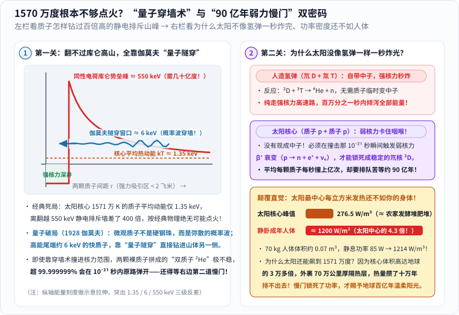
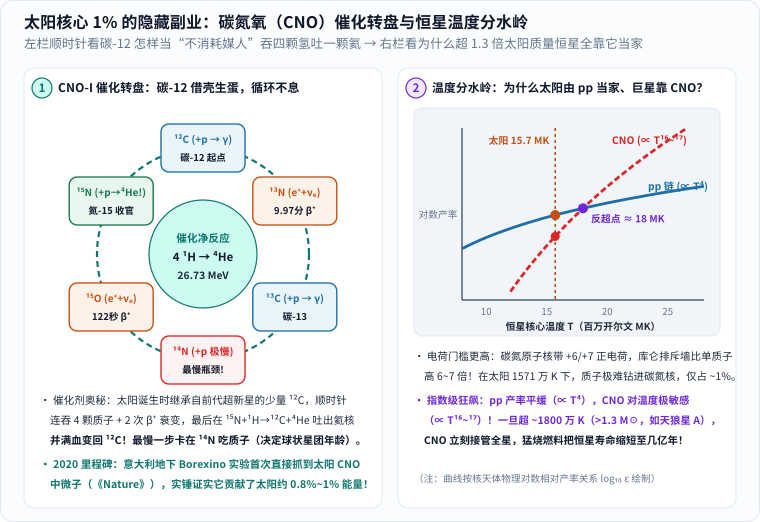
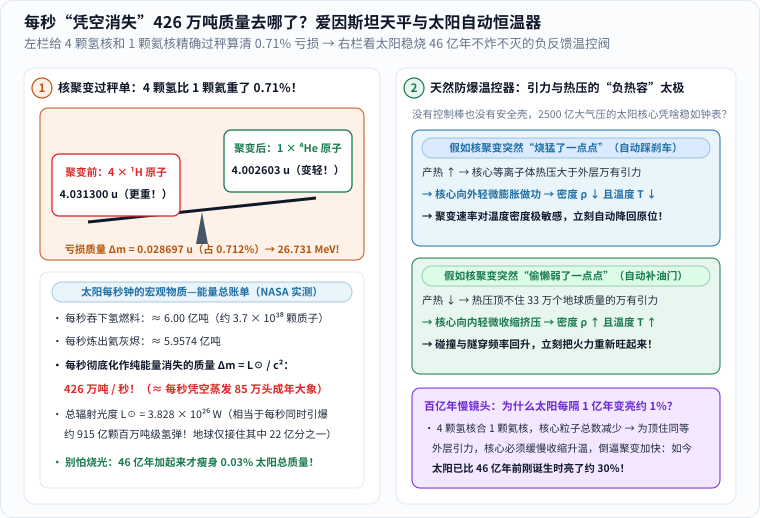
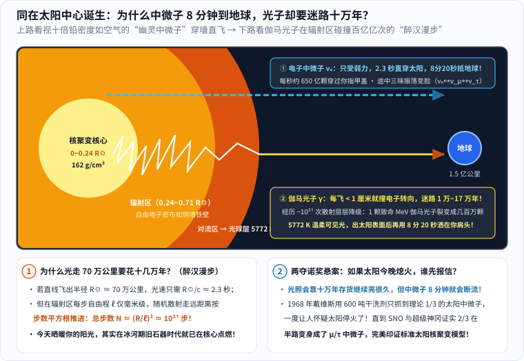

如果让你猜一猜宇宙里最狂暴的“发热机器”长什么样，绝大多数人脑海里第一个蹦出来的画面一定是**太阳核心**——毕竟它每秒钟都在太空里同时引爆相当于 **900 多亿颗百万吨级氢弹**的能量，隔着 $$1.5\text{ 亿公里}$$ 还能把夏天的柏油马路晒得滚烫。

但假如你能切下一立方米太阳最正中心、温度高达 **$$1571\text{ 万开尔文}$$** 的核反应堆等离子体，把它端回实验室测一测它的实时产热功率，测量结果会把所有人都惊掉下巴：

**这一整立方米太阳核心的核聚变发热功率，只有区区 $$276.5\text{ 瓦}$$！**

这是什么概念？农村院子里堆一堆正在发酵腐烂的落叶和湿草（堆肥堆），每立方米的生物发热功率差不多就是 $$250\text{–}300\text{ 瓦}$$；而此时此刻安安静静靠在椅背上看这篇文章的你（假设体重 $$70\text{ kg}$$，体积约 $$0.07\text{ m}^3$$，基础代谢功率约 $$85\text{ W}$$），**你身体每立方米的发热功率高达约 $$1200\text{ 瓦}$$——竟然是太阳最中心核聚变炉膛的 4 倍多！**

反常识的怪事还不止这一桩：
1. **本来根本点不着：** 按经典物理学一算，太阳中心 $$1571\text{ 万度}$$ 的温度太“凉”了，质子的平均热运动动能连冲破同性正电荷排斥墙所需能量的 **四百分之一** 都不到，太阳按理说根本不可能点火；
2. **点着了居然不爆炸：** 地球上造出来的氢弹百万分之一秒就炸得灰飞烟灭，太阳肚子里塞满了货真价实的聚变燃料，既没有钢筋混凝土安全壳，也没有核电站的镉控制棒，凭什么能像老僧入定一样慢条斯理烧上 **100 亿年**？
3. **跑出来的光迟到了十万年：** 此时洒在你手背上的这缕温暖阳光，其实早在**冰河期尼安德特人还在洞穴里钻木取火时**就已经在太阳中心造出来了——它走了整整十几万年才钻出太阳肚皮，而跟它同一秒钟诞生的孪生兄弟“中微子”，却只花了 **8 分 20 秒** 就穿过了你的大拇指甲盖！

今天，我们就潜入太阳最深处那座压强高达 **2500 亿个大气压**、密度比纯铅还重 **14 倍**的等离子体熔炉，顺着两颗氢原子核相撞的第一飞秒，把太阳核聚变的完整过程一步步拆解到底。

---

## 一、点火之前的两道生死关：伽莫夫“量子穿墙术”与“90 亿年弱力慢门”

### 1. 太阳核心到底是个什么怪物环境？

先把镜头推到太阳最中心占总半径前 $$24\%$$（约 $$17\text{ 万公里}$$）的球形区域——**太阳核心（Solar Core）**。虽然它的体积只占整颗太阳的约 $$1.4\%\text{–}3\%$$，却浓缩了太阳 **$$34\%$$ 的总质量**，并包揽了太阳 **$$99\%$$ 的核聚变产能**。

根据美国宇航局（NASA）标准太阳模型实测与反演数据，这里的物理参数极端到超越日常想象：
- **中心压强：** $$P_c \approx 2.477 \times 10^{11}\text{ bar}$$（约 **2500 亿个标准大气压**）；
- **中心温度：** $$T_c \approx 1.571 \times 10^7\text{ K}$$（约 **1571 万开尔文**）；
- **中心密度：** $$\rho_c \approx 162.2\text{ g/cm}^3$$——水密度的 $$162$$ 倍、**实心纯铅（$$11.34\text{ g/cm}^3$$）的 14 倍多、纯黄金（$$19.3\text{ g/cm}^3$$）的 8 倍多**！
  更奇妙的是，比铅球重十四倍的东西居然不是固体，依然是一锅可以自由流动的**理想等离子体气体**！原因很简单：在千万度高温下，氢原子和氦原子外围的电子早就被彻底剥光了；没有了庞大的电子云外壳撑场面，赤裸的原子核（直径仅约 $$10^{-15}\text{ m}$$）哪怕挤到这个密度，彼此之间依然空旷得像广场上的几粒芝麻。

### 2. 第一关：1571 万度差了 400 倍，怎么翻过“静电库仑高山”？

20 世纪 20 年代，英国天体物理学家亚瑟·爱丁顿（Arthur Eddington）率先提出“太阳靠氢核聚变成氦核发光”。结果当时的经典物理学家拿出纸笔一算，当场给爱丁顿泼了一盆透心凉的冷水：

太阳核心里游荡的氢原子核，就是一颗颗带单位正电荷的**质子（$$p^+$$）**。要想让两颗质子发生核聚变，必须把它们硬推到距离小于约 $$1.5\text{–}2\text{ 飞米}$$（$$1\text{ fm} = 10^{-15}\text{ m}$$）的极近范围内，让短程但力大无穷的**强核力（Strong Nuclear Force）**伸出手把它们死死吸住。

可在此之前，同性相斥的**静电库仑斥力**像一座陡峭的高山横在中间！两颗质子贴近到约 $$2\text{ fm}$$ 时的库仑势垒高度为：

$$V_C = \frac{e^2}{4\pi\varepsilon_0 r} \approx 550\text{–}700\text{ keV}$$

要靠硬碰硬翻过这座静电高山，核心温度至少得烧到**几十亿开尔文**！而太阳核心 $$1571\text{ 万 K}$$ 的质子，平均热运动动能只有区区：

$$E_{\text{avg} } \sim k_B T_c \approx 1.35\text{ keV}$$

**兜里只有一块三毛五，门票却要五百五十块——整整差了四百倍！** 按牛顿经典力学，两颗质子还没凑近到山脚就会被静电斥力狠狠弹飞，太阳里连一颗氦核都别想烧出来！（爱丁顿当年听完冷笑回敬了一句载入科学史的名言：*“如果你们觉得太阳中心不够热，那就请诸位去找一个更热的地方吧！”*）

仅仅几年后的 1928 年，年轻的俄裔物理学家乔治·伽莫夫（George Gamow）用刚刚诞生的量子力学替爱丁顿漂亮地解了围——请看图 1 左栏：

*图 1：太阳核聚变的两道看门锁。左栏看微观质子怎样靠“量子隧穿”钻过翻不过去的库仑排斥山峰（纵轴能量刻度做示意拉伸）；右栏看为什么弱核力把单颗质子的等待时间拉长到了 90 亿年，使核心功率密度温顺得只相当于发酵堆肥。*

在量子世界里，质子根本不是一颗边界分明的小钢珠，而是一团弥散在空间里的**物质概率波（波函数）**！当一团波撞上比自己能量高得多的势垒墙时，虽然绝大部分波被反射回来，但波函数的指数衰减尾巴会直接渗透进墙体内部——只要势垒不算无限宽，就有极微小却非零的概率直接从山肚子另一侧“钻”进强核力深井里！这就是大名鼎鼎的**量子隧穿效应（Quantum Tunneling）**。

把麦克斯韦热运动分布里“跑得比平均速度快几倍的高能少数派”（概率正比于 $$\exp(-E/k_B T)$$）与“能量越高越容易穿墙的隧穿概率”（正比于 $$\exp(-\sqrt{E_G/E})$$）乘在一起，两条曲线恰好在 **$$E_0 \approx 6\text{ keV}$$** 附近拱起了一座窄窄的通行窗口——天体物理学界称之为**伽莫夫峰（Gamow Peak）**。太阳根本不需要烧到几十亿度，靠着 $$6\text{ keV}$$ 快质子亿万分之一的量子穿墙奇迹，核聚变之火在 1571 万度悄然点燃了！

### 3. 第二关：既然点着了，为什么太阳没像氢弹一样“轰”地一秒炸光？

好不容易钻过了静电墙，新的疑问又来了：**太阳核心每秒钟有无数质子在碰撞，为什么它没有像地球上的氢弹一样引发雪崩链式反应，在几秒钟内把整颗太阳炸上天？**

秘密就藏在图 1 右栏的**“人造氢弹 vs 太阳核心”原料对比**里：
- **人造氢弹作弊用了现成的中子：** 氢弹装填的是重氢**氘（$${}^2_1\text{D}$$，1 质子 + 1 中子）**和超重氢**氚（$${}^3_1\text{T}$$，1 质子 + 2 中子）**（关于氢的这几位同位素兄弟，可回看[同位素神探家族与碳十四测年]()）。它们肚子里早就备好了不带电的中子当“强力胶水”，一撞在一起直接走**强核力高速通道**拼成氦-4（$${}^2\text{D} + {}^3\text{T} \to {}^4\text{He} + n$$），百万分之一秒就能烧光！
- **太阳手里只有“光杆质子”，全被弱核力卡住了脖子：** 太阳核心里全是孤零零的单质子（$${}^1_1\text{H}$$），一颗现成的中子都没有！哪怕两颗质子好不容易靠量子隧穿撞进强核力范围，拼成的“双质子核（$${}^2_2\text{He}$$）”因为静电斥力太大且违反泡利不相容自旋配对限制，根本绑不住——**超过 $$99.999999\%$$ 的双质子会在短短 $$10^{-21}\text{ 秒}$$ 内原路弹开，白撞一场！**

怎样才能不弹开？唯一的活路是：就在两颗质子贴身擦肩而过的那 **$$10^{-21}\text{ 秒}$$（十万亿亿分之一秒）**窗口期内，恰好赶上宇宙四大基本力里脾气最慢吞吞的**弱核力（Weak Interaction）**显灵——让其中一颗质子里的一个上夸克翻转为下夸克，发生一次**$$\beta^+$$ 衰变（$$p^+ \to n^0 + e^+ + \nu_e$$）**，当场变身成一颗中子！一旦有了中子帮忙拉架，一质一中瞬间就能被强核力紧紧锁死成稳定的**氘核（$${}^2_1\text{D}$$）**。

既要撞上“量子穿墙”的小概率，又要在擦肩瞬间撞上“弱核力变身”的极小概率，两道彩票叠在一起有多难中？
核物理学家汉斯·贝特（Hans Bethe）与查尔斯·克里奇菲尔德（Charles Critchfield）在 1938 年算出结果时自己都吃了一惊：**在太阳核心里，平均每一颗质子每秒钟要跟周围邻居猛烈相撞上亿次，却要足足排队苦等约 $$90\text{ 亿年}$$，才能成功撞中一次聚变！**（正因为截面小到约 $$10^{-47}\text{ cm}^2$$，人类至今都无法在地面加速器里直接测出双质子聚变截面，只能靠弱电统一理论精确计算。）

正是这道慢得令人发指的**“弱核力瓶颈”**，把太阳核心的发电功率密度死死按在了温柔的 **$$276.5\text{ W/m}^3$$**（还不到你躺在沙发上时身体单位体积发热功率的四分之一！）。太阳之所以能亮瞎双眼、核心热到一千五百万度，纯粹是因为它块头实在太大——核心装得下三万多个地球，外面还裹着厚达 **50 多万公里**的不透明等离子体“超级羽绒服”，哪怕每立方米只点一根小蜡烛，攒上十几万年散不出去的热量也足以炼出千万度熔炉！

---

## 二、拆解 99% 主力流水线：质子—质子链（pp 链）三步曲与三大分支

熬过了长达 90 亿年的第一撞，后面的核反应就像推倒了多米诺骨牌一样一路畅通！在今天的太阳里，**约 $$99\%$$ 的能量**都由这套被称为**质子—质子链（Proton–Proton Chain，简称 `pp` 链）**的流水线生产。

请先跟读下面这张分步动画图：从上到下依次看清占 `pp` 链 **$$83.3\%$$** 份额的绝对主干道 **`pp-I` 分支**是怎样拿 6 颗质子进场、最后退回 2 颗“媒人质子”、净用 4 颗氢核拼出 1 颗氦-4 核的（底栏同时标出了另外两条重要支线）：

*图 2：占太阳总能量约 99% 的“质子—质子链（pp 链）”三步接力图解（支持 `prefers-reduced-motion` 减弱动态效果；）。注意前两步各平行发生 2 次，才攒够第三步所需的两颗氦-3 核。*

我们把这三步的核反应账本逐行摊开，每一步的时间反差都极具戏剧性：

### 第 1 步：弱核力破冰造“重氢”（慢如蜗牛：平均等 90 亿年）

$${}^1_1\text{H} + {}^1_1\text{H} \longrightarrow {}^2_1\text{D} + e^+ + \nu_e + 0.420\text{ MeV}$$

- **发生了什么：** 两颗质子隧穿结合成一颗**氘核（$${}^2_1\text{D}$$）**，同时吐出一颗反物质**正电子（$$e^+$$）**和一颗不带电的**电子中微子（$$\nu_e$$）**。
- **反物质当场湮灭加餐：** 那颗刚出生的正电子连一微米都走不远，瞬间就会撞上等离子体海洋里随处可见的普通负电子（$$e^-$$），正反物质同归于尽化作两道各 $$0.511\text{ MeV}$$ 的伽马射线光子（$$e^+ + e^- \to 2\gamma + 1.022\text{ MeV}$$）！把两部分加在一起，每造出一颗氘核共释放 **$$1.442\text{ MeV}$$** 能量（其中约 $$0.267\text{ MeV}$$ 被中微子直接揣兜里带出太阳；另有约 $$0.25\%$$ 的概率由两颗质子联手一颗电子直接三体聚变 $$p + e^- + p \to {}^2\text{D} + \nu_e$$，称为 `pep` 反应）。
- 因为后面第三步需要两颗氦-3，所以**第 1 步必须在两处独立发生 $$\times 2$$ 次**，合计释放 $$2 \times 1.442 = 2.884\text{ MeV}$$。

### 第 2 步：强核力秒杀造“氦-3”（快如闪电：氘核只活约 1 秒！）

$${}^2_1\text{D} + {}^1_1\text{H} \longrightarrow {}^3_2\text{He} + \gamma + 5.493\text{ MeV}$$

- **发生了什么：** 第 1 步好不容易熬了 90 亿年才生出来的氘核，在太阳核心里**平均寿命只有大约 1 秒钟**！因为它肚子里已经有现成中子了，根本不用再求弱核力帮忙，周围密密麻麻的单质子一撞上来，**强核力**瞬间出手把第 3 颗质子拽进怀里，拼成一颗含 2 质子、1 中子的轻氦同位素——**氦-3（$${}^3_2\text{He}$$）**，同时射出一颗能量高达 **$$5.493\text{ MeV}$$** 的高能伽马光子（$$\gamma$$）加热核心！
- 同样，**第 2 步也平行发生 $$\times 2$$ 次**，合计释放 $$2 \times 5.493 = 10.986\text{ MeV}$$。

### 第 3 步：氦-3 的三条分岔路口（平均巡游约 400 年后收官）

现在核心里有了稳定的**氦-3（$${}^3_2\text{He}$$）**。它带 $$+2$$ 正电荷，静电排斥墙高了一截，而且周围同伴浓度比普通氢核稀得多，所以每颗氦-3 平均要在太阳中心游荡约 **400 年**才能撞上收官反应。根据撞上的对象不同，`pp` 链在这里分出了三条支路：

1. **`pp-I` 主干道（占太阳氦产量约 $$83.3\%$$，在 $$1000\text{ 万}～1800\text{ 万 K}$$ 主导）：**
   两颗苦等了四百年的氦-3 迎头相撞，先瞬间融成极不稳定的铍-6（$${}^6_4\text{Be}$$），随即当场吐回两颗多余的质子，定格为一颗无比坚固的**氦-4 核（$${}^4_2\text{He}$$，即 $$\alpha$$ 粒子）**，单步狂放 **$$12.859\text{ MeV}$$** 动能：

   $${}^3_2\text{He} + {}^3_2\text{He} \longrightarrow {}^4_2\text{He} + 2\,{}^1_1\text{H} + 12.859\text{ MeV}$$

   来算一下这笔极其漂亮的“借一还一”总账：前两步上下两路一共领了 $$2 \times (2 + 1) = 6$$ 颗质子进场，最后一步原封不动退还了 $$2$$ 颗质子回等离子体池子里继续打工！**净消耗正好是 4 颗质子，总释放能量 $$= 2.884 + 10.986 + 12.859 \approx \mathbf{26.73\text{ MeV} }$$！**

2. **`pp-II` 铍—锂支线（占约 $$16.68\%$$，温度升至 $$1800\text{ 万}～2500\text{ 万 K}$$ 时更活跃）：**
   太阳烧了 46 亿年，核心中心已经有约 $$65\%$$ 质量是攒下来的现成氦-4 了！于是约六分之一的氦-3 不再傻等另一颗氦-3，而是直接抱住身边现成的氦-4 合成**铍-7（$${}^7_4\text{Be}$$）**，俘获一颗电子衰变成**锂-7（$${}^7_3\text{Li}$$）**并放出单能中微子（$$0.861\text{ MeV}$$），最后锂-7 吞下一颗质子瞬间裂成**两颗氦-4**：

   $${}^3_2\text{He} + {}^4_2\text{He} \to {}^7_4\text{Be} + \gamma \xrightarrow{+e^-} {}^7_3\text{Li} + \nu_e \xrightarrow{+{}^1_1\text{H} } 2\,{}^4_2\text{He}$$

3. **`pp-III` 硼支线（仅占约 $$0.02\%$$，却是物理学史上的“破案功臣”！）：**
   极少数铍-7 还没来得及吃电子，就先一步撞上一颗快质子变成放射性的**硼-8（$${}^8_5\text{B}$$）**，随后 $$\beta^+$$ 衰变为激发态铍-8 并瞬间裂成两颗氦-4：

   $${}^7_4\text{Be} + {}^1_1\text{H} \to {}^8_5\text{B} + \gamma \longrightarrow {}^8_4\text{Be}^* + e^+ + \nu_e \longrightarrow 2\,{}^4_2\text{He}$$

   虽然它只贡献了万分之二的能量，但它衰变射出的电子中微子最高能量飙到了惊人的 **$$14.06\text{ MeV}$$**——个头最猛、最容易被地面探测器抓住！我们后面要讲的两次诺贝尔奖级“太阳中微子失踪悬案”，抓的就是它放出来的信使！

---

## 三、太阳核心 1% 的隐藏副业：碳氮氧（CNO）催化循环与恒星分水岭

除了 `pp` 链唱主角的那 $$99\%$$，太阳核心里还悄悄运转着第二套截然不同的聚变生产线——由卡尔·冯·魏茨泽克（Carl von Weizsäcker）与汉斯·贝特在 1938–1939 年独立发现的**碳—氮—氧循环（CNO Cycle，贝特因此荣膺 1967 年诺贝尔物理学奖）**。

你可能会奇怪：我们在[宇宙元素形成与 138 亿年演化史]()里讲过，像太阳这样的恒星要到晚年红巨星阶段（核心飙到 1 亿度）才能靠三 $$\alpha$$ 过程自己烧出碳和氧；现在的太阳凭什么能玩“碳氮氧循环”？

因为我们的太阳不是宇宙第一代恒星，而是站在前辈肩膀上的**“富金属第三代恒星”**！46 亿年前孕育太阳的那团原始星云里，早就掺杂了约 $$1.4\%\text{–}2\%$$ 由前代超新星爆炸撒下的碳、氮、氧等重元素遗产。太阳核心把这些现成的**碳-12（$${}^{12}_6\text{C}$$）**当成了**只干活、不消耗的“核聚变催化剂”**！请看图 3 左栏的六步催化摩天轮：

*图 3：碳氮氧（CNO-I）六步催化循环转盘与恒星核心温度分水岭。左栏顺时针转完一圈，碳-12 毫发无损回到起点，身边 4 颗质子已变成 1 颗氦-4；右栏揭示为什么比太阳重 30% 以上的恒星全由 CNO 循环统治。*

顺着图 3 左栏从 12 点钟方向顺时针走一圈，看看这颗 $${}^{12}_6\text{C}$$ 媒人是怎样“借壳生蛋”的：
1. **$${}^{12}_6\text{C} + {}^1_1\text{H} \to {}^{13}_7\text{N} + \gamma$$**（碳-12 吞下第 1 颗质子，变成氮-13）；
2. **$${}^{13}_7\text{N} \to {}^{13}_6\text{C} + e^+ + \nu_e$$**（半衰期约 $$9.97\text{ 分钟}$$，发生 $$\beta^+$$ 衰变成为碳-13）；
3. **$${}^{13}_6\text{C} + {}^1_1\text{H} \to {}^{14}_7\text{N} + \gamma$$**（吞下第 2 颗质子，变成日常空气里最常见的氮-14）；
4. **$${}^{14}_7\text{N} + {}^1_1\text{H} \to {}^{15}_8\text{O} + \gamma$$**（**全环最慢的卡脖子瓶颈！** 氮-14 带 $$+7$$ 正电荷且核结构极稳，在太阳中心要等上亿年才肯吞下第 3 颗质子变成氧-15）；
5. **$${}^{15}_8\text{O} \to {}^{15}_7\text{N} + e^+ + \nu_e$$**（半衰期 $$122.2\text{ 秒}$$，迅速衰变为氮-15）；
6. **$${}^{15}_7\text{N} + {}^1_1\text{H} \to {}^{12}_6\text{C} + {}^4_2\text{He}$$**（压轴好戏：氮-15 吞下第 4 颗质子后没有变成氧-16，而是直接吐出一颗现成的**氦-4 核**，自己满血复活变回了最初那颗 **$${}^{12}_6\text{C}$$**，立刻投入下一轮循环！）。

为什么这套效率极高的催化流水线，在太阳里只占 **约 $$0.8\%\text{–}1\%$$** 的产能，而在夜空中最亮的恒星**天狼星 A**（质量约 $$2.06\,M_\odot$$）或**织女星**（$$2.1\,M_\odot$$）里却包揽了 $$99\%$$ 以上的能量？

答案就在图 3 右栏的斜率悬殊里：碳原子核（$$+6$$）和氮原子核（$$+7$$）所带的正电荷是单质子的六七倍，挡在门前的静电库仑高山也高了六七倍！在太阳 $$1571\text{ 万 K}$$ 的温和炉膛里，质子极难隧穿钻进氮核；但正因为势垒高，`CNO` 循环对温度的变化敏感到了令人发指的地步——`pp` 链产热率大致只随温度的 4 次方平缓增长（$$\varepsilon_{pp} \propto T^4$$），而 **`CNO` 循环产热率随温度的 16 到 17 次方指数狂飙（$$\varepsilon_{\text{CNO} } \propto T^{16\text{–}17}$$）**！核心温度只要从太阳的 $$1571\text{ 万 K}$$ 往上稍微跨过约 **$$1800\text{ 万 K}$$**（对应恒星质量大于约 **$$1.3$$ 倍太阳质量**），`CNO` 循环就会全面反超接管恒星，以百倍千倍的狂暴速度大口挥霍氢燃料，把那些蓝白色大质量恒星的寿命压缩到短短几亿甚至几千万年！

值得一提的是：在长达 80 多年的时间里，“太阳肚子里也有 $$1\%$$ 的 CNO 循环”一直只是写在教科书上的理论推算。直到 **2020 年 11 月**，深埋在意大利格兰萨索山脉地下 $$1400\text{ 米}$$ 岩层下、拥有全球最高放射性纯度液体闪烁体的 **Borexino 国际合作组**在《自然》（*Nature*）正刊发表历史性成果——人类历史上**第一次直接捕捉并分离出了来自太阳核心的 CNO 中微子信号**，实测通量与约 $$1\%$$ 产能预言严丝合缝！

---

## 四、每秒“凭空消失”426 万吨物质去哪了？质能天平与天然防爆恒温器

不管是走 `pp` 链还是走 `CNO` 循环，起点都是 4 颗氢原子（$$4\,{}^1\text{H}$$，即 4 颗质子配 4 颗外围电子），终点都是 1 颗氦-4 原子（$${}^4\text{He}$$，即 1 颗氦核配 2 颗电子，另外 2 颗电子已在反应中与 2 颗正电子湮灭）外加 2 颗飞走的中微子。

那释放出来的 **$$26.731\text{ MeV}$$** 巨额能量，到底是从哪座金矿里抠出来的？

让我们把聚变前后的原料和产物搬上高精度质谱仪过一过秤（见图 4 左栏）：

*图 4：爱因斯坦质能天平与太阳“负热容”自动恒温器。左栏算清 0.712% 的质量亏损怎样撑起每秒 3.828×10²⁶ W 的太阳总光度；右栏解释没有任何人工控制棒的太阳为何稳烧 46 亿年不炸也不灭。*

### 1. 0.712% 的质量亏损：每秒蒸发 85 万头成年大象！

按国际纯粹与应用物理联合会（IUPAP）原子质量评估表精确到小数点后六位：
- **聚变前 4 颗 $${}^1\text{H}$$ 原子的静止总质量：** $$4 \times 1.007825\text{ u} = \mathbf{4.031300\text{ u} }$$；
- **聚变后 1 颗 $${}^4\text{He}$$ 原子的静止总质量：** $$\mathbf{4.002603\text{ u} }$$；
- **凭空不见了的质量差（质量亏损 $$\Delta m$$）：**

$$\Delta m = 4.031300\text{ u} - 4.002603\text{ u} = 0.028697\text{ u}$$

算下来，每把四颗氢攒成一颗氦，就有 **$$\frac{0.028697}{4.031300} \approx \mathbf{0.712\%}$$** 的静止质量从宇宙物质账本上彻底抹去了！它们去哪了？全按爱因斯坦 1905 年写下的质能方程 $$E = \Delta m c^2$$（关于光速 $$c = 299{,}792{,}458\text{ m/s}$$ 的精确测定史，详见[人类四百年追光史与终极反转]()），乘上光速平方这个天文数字放大器（$$1\text{ u} \cdot c^2 = 931.494\text{ MeV}$$），化作了 $$0.028697 \times 931.494 = \mathbf{26.731\text{ MeV} }$$ 的伽马射线、粒子动能与中微子能量！

把这个微观账本放大到整颗太阳的宏观尺度，数字震撼人心：
- 太阳当前的总辐射光度精确值为 **$$L_\odot = 3.828 \times 10^{26}\text{ W}$$**（外加约 $$2.3\%$$ 由中微子带走的隐形光度）；
- 用总光度直接除以 $$c^2$$，太阳核心每秒钟彻底湮灭变成纯辐射飞走的质量高达：

$$\frac{\Delta M}{\Delta t} = \frac{L_\odot}{c^2} = \frac{3.828 \times 10^{26}\text{ J/s} }{(2.99792 \times 10^8\text{ m/s})^2} \approx 4.26 \times 10^9\text{ kg/s} = \mathbf{426\text{ 万吨/秒} }$$

也就是说，你每眨一下眼（一秒钟），太阳就往核心火炉里铲进了约 **$$6.00\text{ 亿吨}$$** 氢燃料（约 $$3.7 \times 10^{38}$$ 颗质子），烧出 **$$5.9574\text{ 亿吨}$$** 氦灰烬，而剩下的 **426 万吨物质**——相当于 **85 万头 5 吨重的非洲成年公象，或者 12 座装满钢筋水泥的帝国大厦**——在这一秒钟内彻底化作纯光热消失在了宇宙空间里！（即便每秒“减肥”426 万吨，因为太阳总质量重达 $$1.9884 \times 10^{30}\text{ kg}$$，过去整整 46 亿年加起来，太阳也仅仅瘦身了自身体重的约 **$$0.03\%$$**！）

### 2. 天然防爆安全阀：万有引力与气体热压的“负热容太极”

既然核聚变对温度那么敏感，万一哪天太阳核心局部温度偶然波动高了 $$1\%$$，核聚变速率跟着涨了 $$4\%$$，会不会“越热烧得越旺、越旺变得更热”，一路失控发生热核爆炸呢？

**绝对不会！** 因为一颗由普通理想等离子体构成的恒星，自带一套连人类最顶级核工程师都羡慕不已的**引力静力平衡负反馈恒温器**（见图 4 右栏）：
- **当核聚变偶然“烧猛了一丁点”：** 多出来的热量让核心气体热压力立刻压过外层 33 万个地球质量的万有引力，核心随即**向外轻微膨胀顶起外层**；这一膨胀对引力场做功，核心密度 $$\rho$$ 立刻变稀，温度 $$T$$ 反倒往下降（自引力束缚系统特有的“负热容”现象：吸热膨胀反而降温！），温度密度一降，聚变速率瞬间乖乖退回原位！
- **当核聚变偶然“偷懒弱了一丁点”：** 内部热压撑不住头顶沉重的万有引力，核心立刻**向内轻微收缩压实**；引力势能转化为热能，密度 $$\rho$$ 和温度 $$T$$ 双双回升，瞬间踩下油门把聚变火力重新顶起来！

一涨就松油门，一缩就踩油门——正是这双看不见的引力大手，让太阳稳稳当当地走过了 46 亿年。（*不过如果把时间拉长到以“亿年”为单位看慢镜头：每当 4 颗氢核合成 1 颗氦核，核心里的自由粒子总数就在变少；为了用更少的粒子顶住同样重的外壳引力，太阳核心不得不极其缓慢地收缩升温，倒逼核聚变油门越踩越深——结果是**太阳每隔 1 亿年光度就会稳定变亮约 $$1\%$$**，今天的太阳已经比 46 亿年前刚点着火时亮了整整 **$$30\%$$**！*）

---

## 五、逃出太阳的两位信使：8 分钟穿墙的中微子 vs 迷路十万年的光子

核心里的核聚变把能量造出来了，最后一步是：**这份能量怎样跨越近 $$70\text{ 万公里}$$ 的太阳躯体、再飞过 $$1.496\text{ 亿公里}$$ 太空送到地球？**

同一秒钟在太阳正中心诞生的两兄弟——**电子中微子（$$\nu_e$$）**和**伽马射线光子（$$\gamma$$）**——在这里上演了宇宙中最滑稽的一场龟兔赛跑（见图 5）：

*图 5：太阳核心两位信使的逃亡路线图。如果太阳核心在今晚 8 点整突然神秘关机熄火，地下实验室的中微子望远镜会在 8 点 08 分 20 秒当场报警，而天上的太阳靠着肚子里攒了十几万年的光子存货，还会若无其事地继续照耀大地几万年！*

### 1. 急性子幽灵“中微子”：2.3 秒穿出太阳，顺手抱回两座诺贝尔奖！

中微子不带电荷，也不参与强核力和电磁力，整座比纯铅密十四倍的太阳核心在它眼里比空气还要透明！它一出生就以无限接近光速的速度沿直线狂奔，只花 **$$R_\odot / c \approx 2.3\text{ 秒}$$** 就毫无阻拦地穿出太阳光球层，再飞 **$$499\text{ 秒}$$（约 8 分 20 秒）** 准时抵达地球。

此时此刻，不管你是站在正午烈日下，还是半夜三更躺在被窝里（半夜时太阳中微子直接从地球背面的岩石地核穿堂而过，从你的床板底下往上钻！），**每秒钟都有大约 650 亿颗来自太阳核心实时聚变的中微子，悄无声息地穿过你一平方厘米的大拇指甲盖！**

这群急性子信使还曾把全世界物理学家吓出过一身冷汗：
1968 年起，美国实验物理学家雷蒙德·戴维斯（Raymond Davis Jr.）在美国南达科他州地下 $$1478\text{ 米}$$ 深的霍姆斯塔克金矿里，摆了一只装满 **615 吨四氯乙烯干洗剂**的巨罐，用氯原子捕捉太阳 `pp-III` 硼支线发来的高能中微子（$${}^{37}\text{Cl} + \nu_e \to {}^{37}\text{Ar} + e^-$$）。结果苦苦数了二十多年，**抓到的中微子数量死活只有理论计算值的三分之一！** 难道太阳中心的核聚变炉火不知不觉熄灭了三分之二？

直到 2001 年前后，加拿大萨德伯里中微子观测站（**SNO**，装满 1000 吨重水，能同时看清全部三种中微子）与日本**超级神冈探测器**联手破案：太阳核聚变一点都没偷懒！只是中微子并非标准模型最初以为的“零质量”，在飞向地球的 8 分钟半路上，有**三分之二的电子中微子（$$\nu_e$$）施展量子“变脸术”，振荡变成了干洗剂完全看不见的 $$\mu$$ 中微子（$$\nu_\mu$$）和 $$\tau$$ 中微子（$$\nu_\tau$$）**！把三副面孔加回一起，总数跟标准太阳核聚变模型分毫不差！这场跨越三十余年的破案传奇，先后把戴维斯、小柴昌俊（**2002 年诺贝尔物理学奖**）与麦克唐纳、梶田隆章（**2015 年诺贝尔物理学奖**）送上了最高领奖台。

### 2. 慢性子醉汉“光子”：撞墙百亿亿次，把夺命伽马射线磨成温柔阳光

再回头看看跟中微子同时出生的那颗**伽马射线光子（$$\gamma$$）**，它的命可就苦透了！

光子是电磁波，而太阳半径前 $$71\%$$ 的核心与**辐射区（Radiative Zone）**里塞满了赤裸带电的自由电子与原子核。伽马光子刚迈出腿飞了**不到 $$1\text{ 毫米}～1\text{ 厘米}$$**（平均自由程 $$\ell$$），就一头撞上一颗自由电子发生康普顿/汤姆孙散射，或者被离子吸收再朝一个**完全随机的方向**吐出来！

就像一个喝得酩酊大醉的人在广场上闭眼乱迈步——往前迈一步、往左退一步、又往后歪一步——根据三维随机漫步（Random Walk）数学定理，每步长 $$\ell$$，要想净走出距离 $$R$$，需要迈出的总步数不是 $$R/\ell$$，而是它的**平方**：

$$N \approx \left(\frac{R}{\ell}\right)^2 \sim 10^{20}\text{–}10^{22}\text{ 步}$$

要把这一百亿亿步磕磕绊绊走完、熬到 $$0.71\,R_\odot$$ 处的**对流区（Convective Zone）**搭上翻滚上升的等离子体热气泡“顺风电梯”，天体物理学家米塔拉斯与西尔斯（Mitalas & Sills, 1992）考虑太阳内部随深度变化的真实自由程精确积分得出：光子扩散逃出辐射区的特征时间尺度长达约 **17 万年**（不同层位平均约数万年至 17 万年）！

而也幸亏有了这十几万年的漫长“磨性子”：
核心刚造出来的可是单颗能量高达几百万电子伏特（$$\text{MeV}$$）、一照就能打碎人类 DNA 链的**致命伽马射线**；在辐射区每一次撞击散射和热平衡重发射中，它不断把能量分摊给周围温度渐低的等离子体，1 颗高能伽马光子一路被拆解成 X 射线、远紫外线，等终于抵达太阳表面薄薄 $$500\text{ 公里}$$ 的**光球层（Photosphere）**时，早已裂变成了**几百万颗遵循 $$5772\text{ K}$$ 黑体辐射谱的温和可见光与红外光子**（至于这束阳光穿过地球大气层时为何早晚发红显扁，我们在[两小儿辩日的现代物理真相]()里刚刚细算过）！

---

## 六、结语：抬头晒太阳时，你在接收一场跨越百亿年的温柔精密工程

现在，当你再次推开窗让阳光洒在手心时，你看到的不只是一团刺眼的火球，而是一座把宇宙四大基本力配合到毫厘不差的奇迹工厂：

- **万有引力**把 33 万个地球质量的氢气死死攒进中心，压出 1571 万度与 2500 亿大气压的熔炉，并充当永不失灵的防爆恒温阀；
- **量子隧穿**帮只有 $$1.35\text{ keV}$$ 平均家底的质子钻过了四百倍高的静电高山；
- **弱核力**用长达 90 亿年的慢门扼住了质子变中子的咽喉，不让太阳像氢弹一样瞬间绚烂暴毙，甘愿以比人体还温顺的功率密度守候生命演化数十亿年；
- **强核力**接手把四颗氢核牢牢箍成一颗氦核，按 $$E = \Delta m c^2$$ 把每秒亏损的 426 万吨物质炼成不息的光芒；
- 最后，**电磁散射**再用十几万年的耐心，把核心凶猛的伽马射线揉碎成 $$5772\text{ K}$$ 刚刚好能点亮叶绿素、温暖万物眼睛的金色晨光。

四大基本力里哪怕任何常数的数值偏歪几个百分点——强核力只要强上 $$2\%$$，双质子就能直接绑死而无需弱核力排队，太阳不到一秒就会炸完；强核力只要弱上 $$2\%$$，连氘核都散架绑不住，整座宇宙将永远漆黑冰冷。我们习以为常的每一个晴天，都是物理定律在刀锋上跳出的最优雅的平衡舞。

---

## 参考资料与核查来源

1. **NASA 官方太阳核心与大气物理参数档案（Sun Fact Sheet）**
   - Williams, D. R. (2024), NASA Goddard Space Flight Center: *Sun Fact Sheet*：[https://nssdc.gsfc.nasa.gov/planetary/factsheet/sunfact.html](https://nssdc.gsfc.nasa.gov/planetary/factsheet/sunfact.html)（核查太阳总光度 $$3.828 \times 10^{26}\text{ W}$$、每秒质能转换速率 $$4.260 \times 10^9\text{ kg/s}$$、中心压强 $$2.477 \times 10^{11}\text{ bar}$$、中心温度 $$1.571 \times 10^7\text{ K}$$、中心密度 $$162.2\text{ g/cm}^3$$ 及光球层有效温度 $$5772\text{ K}$$）。
2. **太阳核聚变反应截面标准综述与质子—质子链（pp 链）分支比例**
   - Adelberger, E. G., et al. (2011). *Solar fusion cross sections. II. The pp chain and CNO cycles*. Reviews of Modern Physics, 83(1), 195–245；及 *Proton–proton chain* 核物理参数综述：[https://en.wikipedia.org/wiki/Proton%E2%80%93proton_chain](https://en.wikipedia.org/wiki/Proton%E2%80%93proton_chain)（核查 `pp` 第一步弱力等待时间 $$\sim 9\times 10^9\text{ yr}$$、氘核寿命 $$\sim 1\text{ s}$$、氦-3 寿命 $$\sim 400\text{ yr}$$、`pp-I/II/III` 分支比 $$83.3\% / 16.68\% / 0.02\%$$ 及各步精确 $$Q$$ 值与总释放能 $$26.731\text{ MeV}$$）。
3. **Borexino 合作组直接探测太阳 pp 链与 CNO 循环中微子里程碑论文**
   - The Borexino Collaboration (2014). *Neutrinos from the primary proton–proton fusion process in the Sun*. Nature, 512, 383–386；及 The Borexino Collaboration (2020). *Experimental evidence of neutrinos produced in the CNO fusion cycle in the Sun*. Nature, 587, 577–582：[https://www.nature.com/articles/s41586-020-2934-0](https://www.nature.com/articles/s41586-020-2934-0)（核查太阳实时 `pp` 中微子通量与 2020 年首次直接证实太阳核心存在约 $$1\%$$ 产能的 `CNO` 催化核聚变循环）。
4. **太阳核心功率密度、静力平衡恒温机制与光子扩散时间尺度**
   - Mitalas, R., & Sills, K. R. (1992). *On the photon diffusion time scale for the sun*. The Astrophysical Journal, 401, 759；及 *Solar core* 天体物理综合档案：[https://en.wikipedia.org/wiki/Solar_core](https://en.wikipedia.org/wiki/Solar_core)（核查核心峰值体积功率密度 $$276.5\text{ W/m}^3$$、辐射区光子扩散时间尺度 $$\sim 1.7\times 10^5\text{ yr}$$ 以及主序星每亿年光度递增约 $$1\%$$ 的演化规律）。
5. **太阳中微子失踪悬案与中微子振荡诺贝尔物理学奖官方科学背景**
   - The Nobel Prize in Physics 2002 (Raymond Davis Jr., Masatoshi Koshiba) & 2015 (Takaaki Kajita, Arthur B. McDonald), Royal Swedish Academy of Sciences：[https://www.nobelprize.org/prizes/physics/2015/summary/](https://www.nobelprize.org/prizes/physics/2015/summary/)（核查霍姆斯塔克金矿氯—氩实验 $$1/3$$ 通量之谜及超级神冈、SNO 重水探测器证实三味中微子振荡历史）。
