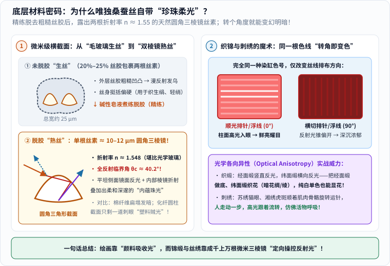
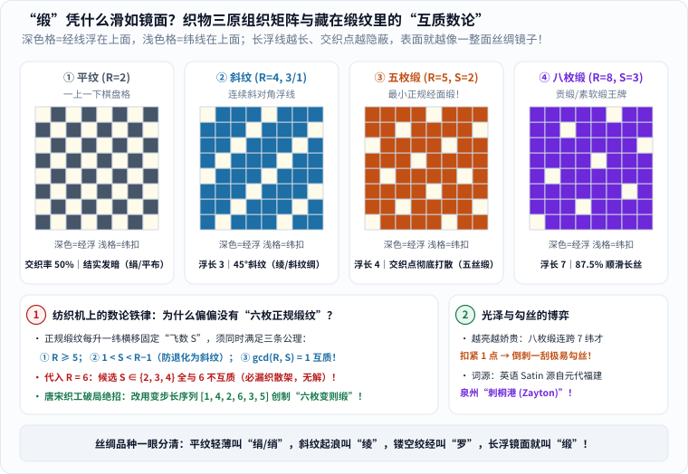
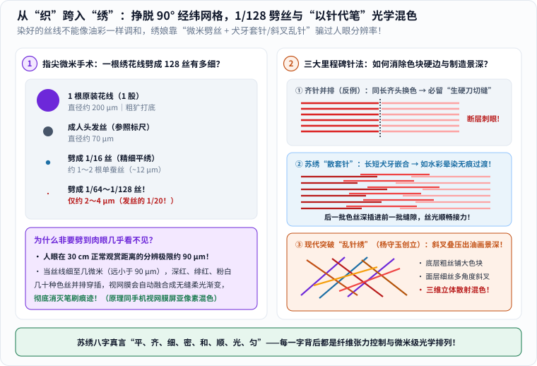
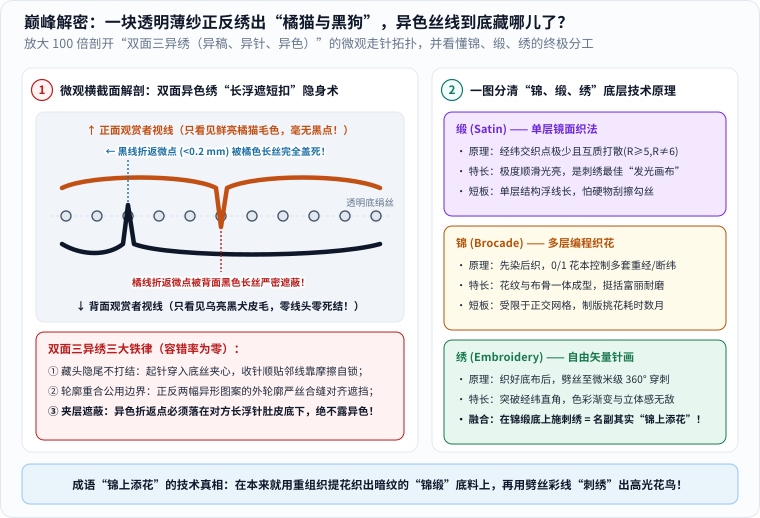

去逛江南丝绸博物馆或者故宫织绣特展时，几乎每个人都会在玻璃展柜前发出过三次惊叹：

1. 第一声惊叹献给**“缎”**：一匹素色真丝软缎明明没涂任何荧光剂，挂在展柜柔光灯下却像水银泻地一样流淌着温润珠光；可家里买过真丝枕套的朋友都领教过它的脾气——手指甲上长了一丁点肉刺，轻轻一蹭就能勾出一道让人心疼的长丝；
2. 第二声惊叹献给**“锦”**：明清宫廷的**南京云锦**龙袍与成都出土的汉代**“五星出东方利中国”蜀锦**护膊，金碧辉煌的花纹不是印上去的，也不是绣上去的，而是从第一根丝上机开始，就直接“长”在了布的骨头里，两位老匠人上下配合一整天，只能织出短短 **$$5\sim 6\text{ 厘米}$$**，真应了那句“寸锦寸金”；
3. 第三声惊叹献给**“绣”**：展厅中央立着一面近乎全透明的薄纱屏风，你站在正面看，是一只碧眼白毛的波斯猫；绕到背面一看，同一块薄纱的同一个位置，居然变成了一只琥珀眼乌毛的小黑狗（**苏绣“双面三异绣”**）——凑近到鼻尖贴着玻璃找，硬是找不到一个线结，正面看不到一丝黑线，背面也找不到半点白丝！

在日常汉语里，我们习惯把**“锦、缎、刺绣”**打包统称为华美丝织品，甚至连成语**“锦上添花”**都顺口说了上千年。但从工程与物理学的视角拆开看，**“缎”、“锦”、“绣”其实是古人为了攻克三个完全不同维度的光学与结构难题，在微米尺度上发明的三套硬核技术体系**：

- **蚕丝本身为什么自带“柔光滤镜”，连最顶级的化纤都模仿不像？**
- **“缎”凭什么滑如镜面？为什么纺织机在数学上根本造不出“六枚正规缎纹”？**
- **“锦”的花纹是怎么在没有电子芯片的汉代，靠 `0` 和 `1` 二进制程序自动织出来的？**
- **“刺绣”为什么要把一根丝线劈成 $$1/128$$ 缕？透明薄纱正反异色异形的“穿帮死局”又是怎样破解的？**

今天，我们就顺着一根桑蚕丝从吐丝结茧到“锦上添花”的奇幻旅程，把这门中国延续数千年的巅峰手艺彻底看个通透。

---

## 一、底层材料密码：一根蚕丝为什么是天然的“微米双三棱镜”？

要弄明白锦缎与刺绣为什么拥有油画、水彩、棉麻乃至现代涤纶都无法复制的华贵光泽，我们得先把镜头放大 $$1000$$ 倍，切开一根家蚕（*Bombyx mori*）吐出来的蚕丝看它的横截面。

很多人以为蚕宝宝吐出来的是一根圆溜溜的单丝。其实在显微镜下，刚从蚕茧上缫出来的**生丝（Raw Silk）**，是一根“双芯夹心电缆”：

- **内核（占总重 $$75\%\sim 80\%$$）**：是两根并排紧贴的结晶态蛋白质长丝，叫做**丝素（Fibroin，单根又称单丝 *brin*）**，每根直径只有 **$$10\sim 14\ \mu\text{m}$$（微米）**，大约只有人类头发丝粗细的六分之一；
- **外皮（占总重 $$20\%\sim 25\%$$）**：是一层把两根丝素死死糊在一起的胶状球蛋白，叫做**丝胶（Sericin）**。

_图 1：先看左图上下对比——未脱胶的“生丝”外层裹着粗糙凹凸的丝胶，光线被漫反射打散，手感挺硬发乌；经碱性皂液精练脱胶变成“熟丝”后，两根折射率高达 $$1.548$$ 的圆角三棱镜丝素裸露出来，产生表面镜面反射与内部全反射叠加的珍珠柔光。再看右图——完全同一种染缸色号的丝线，顺光排布（$$0^\circ$$）与横切排布（$$90^\circ$$）呈现出截然不同的明暗色泽。（[单独打开高清原图](/assets/images/brocade-embroidery/silk-triangular-prism-optics.svg)）_

生丝表面的丝胶坑洼不平，光线照上去四处乱弹（漫反射），因此生丝摸起来硬挺干涩、色泽偏暗（古人专门利用生丝这种挺括不贴身的特性，织造夏天穿的薄透**“轻绡”**和书画用的**“生绢”**）。

要想让蚕丝脱胎换骨，织工和绣娘必须执行一道关键化学工序——**精练脱胶（Degumming）**：把生丝放进温热的弱碱性皂液（古代用草木灰水或猪胰皂）中煮练，精准溶掉外层粗糙的丝胶，同时不伤及内部高结晶度的 $$\beta$$-折叠片层丝素，从而得到柔软滑糯的**熟丝**。

丝胶一洗掉，奇迹立刻出现——裸露出来的每根丝素，横截面既不是棉花那种干瘪扭曲的扁腰果形，也不是现代涤纶、锦纶那种喷丝板挤出来的标准正圆形，而是**三个面微拱、边缘圆润的“圆角三角形”**！

根据材料光学实测（Bucciarelli 等，*Optical Materials* 78, 2018），桑蚕丝丝素在可见光波段满足柯西色散关系（波长 $$\lambda$$ 以 $$\mu\text{m}$$ 计）：

$$n(\lambda) = 1.527 + \frac{5.5\times 10^{-3} }{\lambda^2} + \frac{3\times 10^{-4} }{\lambda^4}$$

代入人眼最敏感的绿光波长 $$\lambda = 0.55\ \mu\text{m}$$，算得丝素的折射率高达：

$$n \approx 1.548$$

这个折射率**比普通窗户玻璃和光学冕牌玻璃（$$n \approx 1.52$$）还要高**！由斯涅耳折射定律立即可算出光线在丝素内部发生**全反射（Total Internal Reflection）**的临界角：

$$\theta_c = \arcsin\!\left(\frac{1}{n}\right) \approx 40.2^\circ$$

这意味着，当一束自然光射向熟丝时，同时发生了两场精妙的光学接力：

1. 一部分光在丝素光滑平坦的三角形侧面上发生定向镜面反射；
2. 另一部分光折射钻进丝素内部，由于入射角很容易超过 $$40.2^\circ$$ 的全反射临界角，光线像钻进了万花筒和钻石切面一样，在圆角三棱柱内壁连续全反射并伴随轻微色散，最后从另一侧透射出来！

对比一下三种纤维的光学表现，高下立判：
- **棉麻纤维**：截面扁塌扭曲，全是漫反射，温和但暗淡无光；
- **化纤圆柱丝（早期仿丝涤纶）**：正圆柱面只在特定角度反射出一道刺眼生硬的白亮线，俗称**“塑料贼光”**（现代高端仿丝化纤不得不把喷丝孔改成三叶形截面，专门向蚕宝宝偷师！）；
- **脱胶桑蚕丝**：千万根微米级圆角三棱镜并排躺在一起，外层镜面光与内层折射光交融，呈现出“亮而不刺、柔而有骨”的珍珠光泽！

### 织绣艺术的第一条灵魂物理定律：“转个角度就变色”

更绝的是图 1 右侧展示的**光学各向异性（Optical Anisotropy）**。

因为蚕丝是一根细长的三棱柱，它的高光并不是向四面八方均匀散开的，而是像猫眼石和拉丝金属一样，集中分布在垂直于丝线走向的圆锥面上：

- 当丝线**顺着光源与视线构成的平面排布**时，柱面高光正面射入眼球，丝线显得鲜亮夺目；
- 当完全同一根、同一个染缸染出来的丝线**旋转 $$45^\circ\sim 90^\circ$$ 横向排布**时，主反射光锥偏折到了人眼侧面，你看到的就只剩穿过染料层的深层吸收光，颜色瞬间变得浓郁深沉！

古人把这一物理现象玩到了出神入化的地步：
- 在织造**暗花缎／绫**时，整匹布明明只染同一种纯白色或玄青色，工匠只需让底子用竖直的经线浮在表面，让牡丹花纹用横向的纬线浮在表面——哪怕没有半滴异色染料，光凭经纬丝线 $$90^\circ$$ 的反光方向差，轻轻晃动衣袖，花纹就会在丝绸表面忽明忽暗地浮现出来；
- 在**苏绣与湘绣**中，绣娘绣白猫眼眶或猛虎斑纹时，哪怕手里拿的是同一缕色线，只要顺着骨骼肌肉走向一圈圈旋转运针角度（俗称**“顺针转折”**），观众绕着绣品走两步，高光就会在老虎脊背上活生生流动起来！

---

## 二、“缎”凭什么滑如镜面？三原组织矩阵与“全宇宙织不出六枚正规缎”的数论铁律

有了圆角三棱镜般的熟丝，怎么把它织成布，决定了它是变成质朴的**绢**、斜波荡漾的**绫**，还是光可鉴人的**缎**。

注意一个最常被混淆的概念：**“缎（Satin）”并不是某一种图案，而是人类所有梭织面料最底层的“三原组织（Three Fundamental Weaves）”之一！**（顺带一提，英语里的 `satin` 一词，正源自宋元时期中国海上丝绸之路第一大港——福建泉州**“刺桐港 Zayton”**，阿拉伯商人把从刺桐港买到的这种丝滑织物称为 *zaitūnī*，传入欧洲演变成了 *satin*！）

把任何一块机织布放到放大镜下，都是竖直的**经纱（Warp）**与水平的**纬纱（Weft）**相互上下穿插。如果我们用深色方格代表“经纱浮在纬纱上面（经组织点）”，用浅色方格代表“纬纱压在经纱上面（纬组织点）”，就能画出纺织工程的语言——**意匠组织图**（图 2）：

_图 2：上方从左到右精确绘制了四种组织的 $$8\times 8$$ 意匠格（深色格为经线浮面，浅色格为纬线扣压）：① 平纹一上一下，交织最密最耐造但反光碎裂；② 斜纹交织点逐行右移 $$1$$ 格，连成 $$45^\circ$$ 斜向纹路；③ 五枚缎与 ④ 八枚缎通过“飞数互质跳步”，让每根经纱连浮 $$4$$ 根甚至 $$7$$ 根纬纱才潜下去扣紧 $$1$$ 次，把零星交织点彻底藏进两侧长丝底下！下方解释为什么唯独 $$R=6$$ 造不出正规缎纹。（[单独打开高清原图](/assets/images/brocade-embroidery/three-weaves-and-satin-math.svg)）_

顺着图 2 上半部分的四个矩阵，你能一眼看清丝绸家族“绢、绫、缎”的分工逻辑：

1. **平纹（Plain Weave，循环数 $$R=2$$）**：一上一下，棋盘格排布。经纬纱每隔 $$1$$ 根就必须弯折一次，交织率高达 **$$50\%$$**。频繁的上下弯曲把丝素三棱镜拧成了波浪起伏的漫反射面，所以平纹丝绸（如**绢、纺、电力纺**）轻薄结实、不易变形，作为古人作画写字的底料极佳，但表面没有镜面亮光。
2. **斜纹（Twill Weave，循环数 $$R \ge 3$$）**：比如“三上一下”（$$R=4$$），每根经纱连续跨过 $$3$$ 根纬纱才压下去 $$1$$ 次，而且相邻一行的下压点每次固定向右平移 $$1$$ 格（飞数 $$S = 1$$）。浮线变长后光泽大增，但所有下压点手拉手连成了一条清晰的 $$45^\circ$$ 斜向凹槽——这就是中国传统丝绸里的**“绫”**（也是今天牛仔布斜纹的同款拓扑结构）。
3. **缎纹（Satin Weave，循环数 $$R \ge 5$$）**：织工提出了一个大胆的光学设想——**能不能既保留超长浮线的镜面反光，又把斜纹那道刺眼的 $$45^\circ$$ 斜线彻底打碎藏起来？**

办法绝妙极了：**不再一格一格挨着挪，而是每隔固定几格“跳着走”！**

### 藏在织布机里的欧拉数论定理：为什么没有“六枚正规缎纹”？

在纺织学中，一个缎纹组织循环包含 $$R$$ 根经纱和 $$R$$ 根纬纱（称为 **$$R$$ 枚缎**）；每往上一根纬纱，单独的那个交织点向右横移固定的格数 $$S$$，叫做**飞数（Step / Move Number）**。于是第 $$y$$ 行（$$y = 0, 1, \dots, R-1$$）的交织点列号为：

$$x(y) \equiv y \cdot S \pmod R$$

要织出一匹不会散架、也不退化成斜纹的**正规缎纹（Regular Satin）**，$$R$$ 和 $$S$$ 必须同时闯过三条数学铁律：

1. **循环数够大**：$$R \ge 5$$（$$R \le 4$$ 时无论怎么跳都会挨在一起变成斜纹或平纹）；
2. **不能退化成左右斜纹**：$$1 < S < R - 1$$（如果 $$S = 1$$ 就是右斜纹，$$S = R - 1 \equiv -1 \pmod R$$ 就是左斜纹！）；
3. **每根经纱都必须被扣住一次（互质条件）**：当 $$y$$ 取遍 $$0$$ 到 $$R-1$$ 时，$$x(y)$$ 必须不重不漏地取遍全部 $$R$$ 根经纱——否则有的经纱整匹布从头到尾一次都没被纬纱压住，一提起来直接哗啦啦脱线散架！由初等数论（可以参考我们聊过的[《高斯到底发明了什么？从 1 加到 100 开始》]()中的同余思想），这等价于**最大公约数等于 1**：

$$\gcd(R, S) = 1$$

现在，让我们拿这三条铁律去检验各个枚数，见证一个让无数初学纺织的学生拍案叫绝的反直觉现象：

- **$$R = 5$$（五枚缎）**：满足 $$1 < S < 4$$ 的候选飞数是 $$S \in \{2, 3\}$$。由于 $$5$$ 是质数，$$\gcd(5,2)=1,\ \gcd(5,3)=1$$ 全部通过！这就是人类能织出的最小正规缎纹——**五枚二飞缎 / 五枚三飞缎**，正面 $$80\%$$ 全是顺直长浮线！
- **$$R = 7$$（七枚缎）**：$$7$$ 是质数，$$S \in \{2, 3, 4, 5\}$$ 全部互质通过！
- **$$R = 8$$（八枚缎）**：候选 $$S \in \{2, 3, 4, 5, 6\}$$ 中，$$S = 3$$ 和 $$S = 5$$ 与 $$8$$ 互质（$$\gcd(8,3)=\gcd(8,5)=1$$）！在八枚经面缎中，每根经纱连续浮跨 $$7$$ 根纬纱才潜下去扣 $$1$$ 次，正面整整 **$$87.5\%$$** 的面积被毫无遮挡的平行丝素三棱镜铺满，相邻两根经纱的饱满长浮线还会自动往中间一挤，把底下仅存的那 $$12.5\%$$ 交织暗点遮得严严实实——这就是**素库缎、贡缎**滑得像镜子一样的几何秘密！（也正因为连跨 $$7$$ 根才固定 $$1$$ 点，摩擦力极小，指甲倒刺一刮就会把整根长浮丝拽出来勾丝。）
- **唯独卡死在 $$R = 6$$（六枚缎）**：满足 $$1 < S < 5$$ 的候选飞数只有三个：**$$S = 2,\ 3,\ 4$$**。可一看最大公约数：

$$\gcd(6,2)=2,\;\gcd(6,3)=3,\;\gcd(6,4)=2$$

**全军覆没，一个互质的都没有！** 用欧拉函数 $$\varphi(R)$$ 写出来更漂亮：正规缎纹存在当且仅当 $$\varphi(R) > 2$$；在所有大于等于 $$5$$ 的整数里，**唯独 $$R = 6$$ 的欧拉函数 $$\varphi(6) = 2$$**（只有 $$1$$ 和 $$5$$ 与 $$6$$ 互质，偏偏这两个都是斜纹）！

面对这条不可逾越的数论死胡同，中国唐宋时期的丝绸工匠没有认输——既然“固定步长 $$S$$”走不通，他们干脆打破等差同余的限制，发明了变步长跳数序列 **`[1, 4, 2, 6, 3, 5]`**（相邻两纬分别横跳 $$+3, -2, +4, -3, +2, -4$$ 格），既保证每行每列恰好只有一个交织点，又让任何两个交织点绝不对角相邻，硬生生造出了举世闻名的**“六枚变则缎纹（不规则六枚缎）”**，成为中国古丝绸鉴定中最具辨识度的组织指纹之一！

---

## 三、“锦”为什么寸锦寸金？比电子计算机早两千年的“二进制花本”与通经断纬

搞懂了“缎”，我们再看**“锦（Brocade）”**，两者的层级关系一下子就清清楚楚了：

- **“缎”是单层基础织法**：通常只有一套经纱和一套纬纱，靠长浮线制造镜面光泽；
- **“锦”则是多色重组织提花织物（Polychrome Compound Weave）**：《释名·释采帛》说得极准——**“锦，金也；作之用功重，其价如金。”** 古人说“织彩为文曰锦”，意思是先把蚕丝染成五颜六色，甚至裹上真金箔与孔雀翠羽，在织布机上布置**两套以上不同颜色的经纱或纬纱**；织布时，该显什么颜色的花纹，就把对应颜色的丝线提上正面，暂时不用的其他色线则乖乖潜伏在夹层或背面！

因此，判断一块花绸到底是“印花绸”还是真正的“织锦”，只需把它翻到背面看一眼：印花布的染料只浮在表面，背面发白模糊；而**织锦的花纹是经纬交织结构本身，一针一线都是和布一起“出生”的**！

### 成都老官山汉墓到南京云锦：比法国贾卡织机早两千年的 `0 / 1` 二进制编程

但这也引出了一个惊人的工程难题：一匹宽几十厘米的蜀锦或云锦，并排绷着**几千甚至上万根极细的经纱**；要想织出繁复的瑞兽、流云、团龙和汉字（如新疆尼雅遗址出土的汉锦“五星出东方利中国”），每投一次梭子，都必须从上万根经纱里精准挑出特定的几千根抬起来，让剩下的几千根沉下去，而且每一行的组合都不一样！

靠人脑死记硬背？织一辈子也记不完一朵牡丹花的几万行经纬坐标！

中国古代工匠给出的答案，竟然与两千年后现代电子计算机的底层逻辑一模一样——**把整幅图案离散化成像素矩阵，用“抬起 = `1`、沉下 = `0`”编写成可循环读取的二进制只读程序（ROM）！**

_图 3：左图通过单次逐行读取动画（支持减少动态效果模式），演示大花楼织机如何按花本结绳储存的 `0 / 1` 二进制指令逐纬控制经线升降（蓝格 `1` 抬经露底、橙格 `0` 沉经显彩纬），织出对称菱形纹样；右图对比普通全幅贯通提花与人类非遗南京云锦“通经断纬（挖花妆彩）”多把小梭分区盘织的核心差异。（[单独打开高清动图，刷新可重播](/assets/images/brocade-embroidery/brocade-drawloom-binary-code-anim.svg)）_

这不是现代人的夸张附会，而是有实打实的考古铁证：

- **公元前 2 世纪（西汉景帝—武帝时期）**：2013 年，考古学家在**四川成都天回镇老官山汉墓（M2）**出土了 **4 部完整的西汉木质提花织机模型**，四周还散落着彩丝与织工木俑。中国丝绸博物馆赵丰团队在剑桥考古学顶刊 *Antiquity*（2017 年第 91 卷）发表论文证实：这是**全世界迄今发现最早的提花机实物证据**——汉代织工已经利用多片综框（滑框）存储一整套图案的经线升降程序，踩动踏板即可按既定代码顺序批量织出绚丽的汉代**“蜀锦”**！
- **唐宋至明清（大花楼“挑花结本”）**：随着图案越来越宏大，固定综框不够用了，工匠发明了软体结绳存储器——**“挑花结本”**（2009 年随**南京云锦织造技艺**入选联合国教科文组织《人类非物质文化遗产代表作名录》）。大师先在方格意匠纸上把龙袍画稿翻译成像素格，再用垂直的**“耳线”**代表经纱列、水平的**“脚子线”**代表纬纱行：需要抬起（`1`）的位置就打结编扣，不抬起（`0`）的位置就跳过！一部云锦龙袍的花本，往往要结上数万个绳结，相当于一张存有数百万比特（bits）数据的手工软盘！
- **跨越欧亚的技术回响**：中国提花织造技术沿丝绸之路西传欧洲后，启发了法国里昂丝织工匠的一系列改进，最终由**约瑟夫·玛丽·贾卡（Joseph Marie Jacquard）**在 **1804 年**用硬纸板“有孔 = `1`、无孔 = `0`”替代丝线绳结，造出了著名的**贾卡打孔卡提花机**。三十多年后，英国数学家**查尔斯·巴贝奇（Charles Babbage）**与世界上第一位程序员**阿达·洛夫莱斯（Ada Lovelace）**正是直接借用贾卡织机的打孔卡来为“分析机（Analytical Engine）”输入指令与数据——洛夫莱斯在 1843 年留下了那句计算机史名言：**“分析机编织代数模式，正如同贾卡织机编织花朵与树叶一样！”**

### 为什么现代电脑织机这么发达，依然替代不了南京云锦“妆花”？

看到这里你一定会问：既然现代电子贾卡提花机一分钟能打几百纬，为什么南京云锦至今还得靠长 $$5.6\text{ 米}$$、高 $$4\text{ 米}$$ 的木质大花楼，上面坐一个**“拽花工”**唱着口诀拽花本，下面坐一个**“织手”**投梭织造，一天只出五六厘米？

秘密就在图 3 右侧画出的云锦最高绝技——**“通经断纬”（又称“挖花妆彩”）**！

现代高速工业提花机采用的是**“通经通纬”**：一把大梭子（或剑杆、喷气引纬）一旦把金色纬纱射出去，就必须从布的最左边一直横穿到最右边。可如果这一行里只有中间一朵小梅花需要两厘米宽的真金线和孔雀羽线，全幅贯通不仅会在背面浪费掉 $$95\%$$ 昂贵的扁金线与孔雀羽，而且整匹布背面塞满几十层废纬纱，会厚重僵硬得像块铁板；更要命的是，机器选纬器同一横行能切换的梭子颜色数量极其有限。

而云锦**“妆花”**的织手面前，摆放着几十个拇指大小、缠着各色绒丝、**真金扁金线**和**孔雀羽线**的小竹梭（行话叫**“扁子”**）。当拽花工在楼上把第 $$k$$ 行花纹的经纱拽起时，织手就像弹钢琴一样，在左边的牡丹上用大红、粉白小梭来回盘织，在中间的祥云上换宝蓝、翠绿小梭局部盘织，在右边的龙爪上换捻金线与孔雀羽小梭单独盘织——**经线贯通全匹，彩色纬线却在每一朵花的边界处精准折返断开（通经断纬）**！这使得云锦在同一水平行内可以随心所欲配色几十种，既轻盈柔顺，又把孔雀羽的天然结构色与真金的璀璨发挥到极致，至今没有任何一台全自动工业织机能原样复刻。

顺便把**中国三大名锦**的技术指纹放在一起，以后逛博物馆一眼就能认出来：
1. **四川蜀锦**（历史最悠久，兴于秦汉）：早期以**“经锦”**（多色经纱交替显花）独步天下，唐宋后兼具纬锦，纹样古朴威严、构图严谨；
2. **苏州宋锦**（兴于北宋末南宋初）：采用独特的**“三枚斜纹地 + 纬重组织”**，质地柔韧平挺、配色典雅古朴，是历代皇家书画卷轴装裱的最高规制（故宫国宝名画外包首多用宋锦）；
3. **南京云锦**（元明清皇家御用巅峰）：以库缎、库锦和**“通经断纬”妆花**称雄，用金量最大、色彩最富丽堂皇。

---

## 四、从“织”跨入“绣”：突破 $$90^\circ$$ 经纬牢笼，$$1/128$$ 劈丝与“以针代笔”光学混色

既然“锦”和“缎”已经如此华美，古人为什么还要在织好的缎子和薄纱上面，一针一线地发明**刺绣（Embroidery）**呢？

这正是成语**“锦上添花”**的工程真相！

再高明的提花织机，也受制于一个先天的几何紧箍咒——**正交直角网格（$$0^\circ$$ 竖直经线 $$\times\ 90^\circ$$ 水平纬线）**。就像早期的低分辨率像素电子游戏一样，织锦里的所有斜线、圆弧和花瓣边缘，放大看都是一个个微小的直角锯齿台阶；而且织机的丝线方向永远只有竖直和水平两种，没法让丝素三棱镜顺着鸟羽、猫毛和花瓣的任意弧度连续旋转反光。

**刺绣的诞生，本质上是一场从“二维正交像素阵列”向“全角度连续矢量渲染”的降维打击！**

绣娘直接拿已经织得光洁如镜的**软缎**或轻薄如雾的**透明底绢（薄绡）**当作画布，手执细如牛毛的钢针，彻底挣脱了 $$90^\circ$$ 经纬网格的束缚——针脚可以在 **$$0^\circ \sim 360^\circ$$ 任意连续角度**穿刺，针距可长可短、丝层可薄可厚！

但紧接着，刺绣匠人撞上了一道比画家棘手十倍的物理壁垒：**画家画阴影渐变，可以在调色盘上把红颜料和白颜料搅匀抹开；可绣娘手里的桑蚕丝是提前染好色的固体纤维，根本没法像液体颜料那样融化调和！** 怎么用一根根纯色丝线，绣出比油画和水彩还要细腻无痕的柔光过渡？

中国刺绣大师靠两项硬核绝技破了局：**微米级“劈丝”**与**犬牙/斜叉空间混色针法**（图 4）。

_图 4：先看左图尺度对比——把直径约 $$200\ \mu\text{m}$$ 的 $$1$$ 股原装绣花线层层劈分，劈到 $$1/64\sim 1/128$$ 丝时细仅 $$2\sim 4\ \mu\text{m}$$，远小于人眼在 $$30\text{ cm}$$ 处的分辨极限（约 $$90\ \mu\text{m}$$），从而在视网膜上实现无缝亚像素混色！再看右图三代针法演进——① 齐针换色留有生硬接缝；② 苏绣“散套针”靠长短脚犬牙嵌合实现水彩般无痕晕染；③ 杨守玉创立的“乱针绣”用多层异色斜叉丝线叠出油画级立体景深。（[单独打开高清原图](/assets/images/brocade-embroidery/embroidery-splitting-and-stitches.svg)）_

### 1. 指尖上的微米手术：把一根丝线劈成 $$128$$ 缕是什么概念？

先算一笔人眼光学分辨极限的账。正常人在明视距离 $$D = 30\text{ cm} = 3\times 10^5\ \mu\text{m}$$ 观赏刺绣时，人眼的最小分辨视角约为 $$1\text{ 角分}$$（$$\theta_{\text{eye} } \approx 2.91\times 10^{-4}\text{ rad}$$），对应能看清的最小空间间距为：

$$\delta_{\min} = D \cdot \theta_{\text{eye} } \approx 87\ \mu\text{m}$$

一根从绣线轴上剪下来的标准桑蚕丝绣花线（称为**“一股”**或**“一绒”**，由多根蚕丝并合而成），直径大约在 **$$200\ \mu\text{m}$$** 左右——比人眼分辨极限 $$\delta_{\min}$$ 粗了两倍多！如果直接拿整股花线去绣人物脸颊或金鱼尾巴，人眼会清清楚楚看到一道道生硬的“排骨条纹”。

于是，以**苏绣**为代表的中国精细绣种，练就了一门令人叹为观止的基本功——**劈丝**：

- 绣娘双手大拇指与食指肚必须打磨得光滑无比（哪怕冬天有一丁点干裂粗糙，一碰就会把极细的丝素刮毛报废）；
- 先把 $$1$$ 股花线对半劈成 $$1/2$$（半绒），再对半劈成 $$1/4$$、$$1/8$$、$$1/16$$（此时已经逼近单根天然蚕丝丝素 $$\sim 12\ \mu\text{m}$$ 的极限！）；
- 到了绣制猫眼虹膜、蝉翼薄纱或金鱼透明尾鳍时，顶级苏绣大师竟能把单根丝素纤维顺着微原纤纹理继续劈分，达到惊世骇俗的 **$$1/64$$ 丝甚至 $$1/128$$ 丝**——有效直径仅约 **$$2\sim 4\ \mu\text{m}$$**，只有成人头发丝（$$\sim 70\ \mu\text{m}$$）的**二十分之一**，不迎着侧逆光甚至肉眼都看不见针上穿了线！

一旦丝线细到几微米（连人眼分辨极限 $$87\ \mu\text{m}$$ 的零头都不到），绣娘在一朵牡丹花瓣上依次排入从绛紫、深红、朱红、绯红、粉红到月白的二三十种相邻色阶极细丝线，你的视网膜就会像看手机高清 OLED 屏幕一样（参看我们写过的[《从胡萝卜怪液“拧光百叶窗”到微米自发光像素：读懂液晶显示与百年屏幕进化史》]()中的亚像素并置混色原理），把紧挨着的异色微丝自动融合成柔滑如脂的连续渐变！

### 2. 从“散套针”到“乱针绣”：四大名绣与现代针法的力学博弈

光把丝劈细还不够，如果两排不同颜色的针脚齐刷刷排成一条直线（图 4 右上**“齐针”**反例），交界处照样会崩出一条难看的“刀切沟”。为此，历代绣工发展出了精妙绝伦的针法工程体系：

- **苏绣王牌“散套针”（源于明代松江“顾绣”画绣合一传统）**：第一批深红色针脚故意刺得**一长一短、犬牙参差**；紧接着第二批浅一度的红丝，顺着前一批留下的凹槽深深插进去咬合（称为“套”），丝光顺着完全一致的方向平滑接力，水路清晰均匀，真正做到了苏绣八字真言——**“平、齐、细、密、和、顺、光、匀”**。
- **湘绣绝活“鹁鸪毛针”**：湖南湘绣以狮虎闻名天下。动物毛发不是平铺的绸子，而是从毛囊里一簇簇长出来的！湘绣大师用粗细不等的劈丝呈放射状交叉分叉刺入，底层压深褐、表层挑亮白，连老虎胡须根部的毛孔紧绷感都惟妙惟肖，素有“苏猫湘虎”的美誉。
- **粤绣“垫高钉金”与蜀绣“车拧衣锦针”**：广东粤绣喜用金银线盘绕，并在绣面底下先用棉絮或粗丝垫起浮雕高度再施金线，阳光下富丽立体；四川蜀绣则擅长在软缎上用极守规矩的几何“衣锦纹针”和旋转“车拧针”表现锦鲤与竹石的清亮质感。
- **20 世纪最伟大的针法革命——“乱针绣”**：20 世纪 30 年代，江苏常州刺绣艺术家**杨守玉**受西方油画与素描排线启发，一举打破两千年来传统刺绣“排比平行、严禁交叉乱线”的祖训，创立了**“乱针绣（正则绣）”**！如图 4 右下所示，“乱针”绝不是瞎绣，而是严守**“乱而有法，交叉不重叠成死十字”**：底层先用较粗色丝大斜向铺底，中层与表层再用极细的不同色相丝线以 $$30^\circ\sim 70^\circ$$ 斜角层层交叉叠压。光线钻进这层立体交错的丝素三棱镜森林里，经过多次异色内反射再射入人眼，居然在丝绸上调出了印象派油画厚涂般的深邃景深与空气感！

---

## 五、终极解密：透明薄纱正反绣出“橘猫与黑狗”，双面三异绣到底把异色线藏哪儿了？

最后，让我们揭开整座展厅最让人百思不得其解的压轴魔术——**双面三异绣（异稿、异针、异色）**！

在普通单面绣里，底布背面简直是“大型翻车现场”：到处是起针打的死结、换色拉扯的跨桥飞线和杂乱线头，最后必须糊上一层背衬纸或绸里子遮丑。

20 世纪 50 年代起，苏州刺绣研究所的艺人们先攻克了透明底料上的**“双面同形同色绣”**（最具代表性的就是双面绣《猫》），随后在 70 至 80 年代进一步登上了刺绣工程学的珠穆朗玛峰——在同一块薄如蝉翼、透光率极高的尼龙绡或真丝底绢上，正面用散套针绣一只黄色波斯猫，背面同一位置居然用乱针或施针绣出一只乌黑发亮的小京巴狗（**图案不同 = 异稿，针法不同 = 异针，颜色不同 = 异色**）！

按常理说，一根针既然刺穿了薄纱，正面是橘黄色丝线，穿到背面拉紧折返时，背面不就必定露出一个刺眼的橘黄色针点吗？反过来，背面的黑丝穿回正面，白猫和橘猫脸上不就长满黑麻子了吗？！

把这块薄纱横截面放大 $$100$$ 倍切开（图 5 左），你会对人类指尖的空间拓扑智慧佩服得五体投地！

_图 5：先看左图横截面拓扑——双面异色绣并不是用两块布拼贴，而是在单层透明底绢两侧施展“长浮线遮蔽微折返点”绝技：正面橘色长丝穿过底绢到背面折返时，只在背面极窄地挑扣一根底丝（针距 $$< 0.2\text{ mm}$$）便立刻返身回正面，而这颗微不足道的橘色折返点，恰好被背面跨过来的黑色宽幅长浮丝严严实实盖在肚皮底下；反之亦然！右图汇总“缎、锦、绣”三者的底层技术定位。（[单独打开高清原图](/assets/images/brocade-embroidery/double-sided-three-hetero-embroidery.svg)）_

双面三异绣之所以能做到“正反互不穿帮、全幅零线结”，靠的是三条容错率为零的微米级走针铁律：

### 第一铁律：起针入夹心，收针靠摩擦——全幅“零死结”
在透明薄绡上，哪怕打一个半毫米大的线结，迎光看也会像苍蝇屎一样刺眼。因此双面绣从第一针到最后一万针**绝对不准打结**：
- **起针藏头**：绣娘把线头顺着将来要被密集丝线覆盖的图案内部，悄悄穿进底绢经纬丝的夹缝里走一小段“虚针”，等后续绣线压上去，线头就被千百根丝素紧紧抱死；
- **收针隐尾**：快用完一根丝线时，把针尖贴着已经绣好的厚密针层夹心穿行几毫米，完全利用丝素纤维之间的静摩擦力自锁，齐根剪断后严丝合缝！

### 第二铁律：外轮廓必须“同界共边”
既然底绢是透明的，如果正面绣一只圆形的猫头，背面绣一只长耳朵兔子，多出来的兔子耳朵透过薄纱肯定会被正面观众看见！所以双面异形绣在设计画稿（白描定稿）阶段，就必须完成一道严苛的几何拼图题——**正反两幅完全不同的形象，外轮廓边界必须精准重合**（比如猫团身弯曲的弧线，在背面恰好构成小狗趴卧或仕女衣袖的同一条剪影边界），让两侧的丝线互相当对方的“不透光遮光板”！

### 第三铁律：“长浮盖短扣”夹层隐身术（双面异色的核心机密！）
最关键的异色穿刺是怎么藏住的？看图 5 左图中间那两个虚线箭头指着的位置：
- 当正面的**橘色丝线**在正面拉出一段几毫米长的饱满显色浮线后，针尖刺穿透明底绢下到背面——此时绣娘**绝不在背面拉长针**，而是在背面底绢上只极轻、极短地挑过**单根底丝（背面折返跨度 $$< 0.2\text{ mm}$$）**，立刻穿回正面！
- 最精妙的调度来了：这个 $$< 0.2\text{ mm}$$ 的橘色微点并不是随便落脚的，绣娘必须精准预判背面图案的走针路线，专挑**背面黑色丝线即将拉出宽幅长浮线的正下方**落针（或者直接钻进背面已绣好的黑丝夹层肚皮底下折返，行话叫**“藏针于夹层”**）！
- 同样地，当背面的**乌黑丝线**穿到正面折返时，也只挑 $$< 0.2\text{ mm}$$ 的极微点，并立刻被正面的橘色长浮丝盖得密不透风！

有时候为了效率与张力平衡，两位顶级绣娘甚至会分坐透明绷架正反两侧，一人执橘线、一人执黑线，像外科显微手术医生一样隔纱对刺，每一针的张力多一分就会把对方的微折返点拽翻露馅，少一分又会松弛起泡——一件精品双面三异绣屏风，往往要耗费数月乃至一两年的心血！

---

## 六、结语：一表看懂“缎、锦、绣”的三重技术交响

走到这里，当我们再次回望博物馆展柜里流光溢彩的中国织绣珍宝，那句说了上千年的**“锦上添花”**，终于露出了它恢弘而精密的工程骨架：

| 技术维度 | 缎（Satin） | 锦（Brocade） | 绣（Embroidery） |
| :--- | :--- | :--- | :--- |
| **工程层级** | 基础三原组织之一（素织镜面层） | 多色重组织提花织造（结构编程层） | 成布之上的穿刺叠丝（自由矢量渲染层） |
| **核心数学 / 物理原理** | $$\gcd(R, S)=1$$ 互质跳步，隐藏交织点，最大化平行丝素长浮线（$$R \ge 5, R \neq 6$$） | `0 / 1` 二进制花本控制数千经线升降；多套色经或“通经断纬”挖花小梭一体成型 | 突破 $$90^\circ$$ 经纬网格；$$1/128$$ 劈丝低于人眼 $$87\ \mu\text{m}$$ 分辨极限实现亚像素混色 |
| **光泽与色彩特长** | 镜面级珍珠柔光、触感极致顺滑，也是刺绣最理想的发光底布 | 花纹长在布骨子里，挺括耐磨，可织入真金箔线与孔雀翠羽 | $$360^\circ$$ 任意角度顺光转折，色彩晕染、毛发质感与双面异色立体度无敌 |
| **天然力学代价** | 单层浮线跨度大，摩擦锁定点少，怕尖锐硬物勾丝 | 挑花结本制版耗时数月，云锦妆花日产仅 $$5\sim 6\text{ cm}$$ | 惧怕强紫外线暴晒（丝蛋白光老化）与粗暴揉搓水洗 |
| **代表巅峰之作** | 素软缎、八枚贡缎、暗花库缎 | 四川蜀锦、苏州宋锦、南京云锦 | 苏绣（双面三异绣、乱针绣）、湘绣、粤绣、蜀绣 |

你看，从蚕宝宝吐出的那根折射率 $$1.548$$ 的圆角三棱镜丝素出发：
- 古人先用**互质同余数论**排布经纬，织出了滑如秋水的**“缎”**；
- 再用比电子计算机早两千年的**`0 / 1` 二进制花本程序**，织出了寸锦寸金的**“锦”**；
- 最后用细达两三微米的**指尖劈丝与三维走针拓扑**，在锦缎与薄纱之上绣出了呼吸流转的大千世界。

真正的顶级东方美学，从来都不只是感性的诗意浪漫——在每一缕流转千年的丝光背后，都站着物理光学、离散数学与极致工匠精神最惊艳的握手。

---

## 参考资料与核查来源

1. **老官山汉墓提花织机考古一手论文（世界最早可编程提花织机实物证据）**：Feng Zhao（赵丰，中国丝绸博物馆）et al., *The earliest evidence of pattern looms: Han Dynasty tomb models from Chengdu, China*, **Antiquity**, Vol. 91, Issue 356, pp. 360–374 (2017). [剑桥大学出版社 Antiquity 论文原页](https://www.cambridge.org/core/journals/antiquity/article/earliest-evidence-of-pattern-looms-han-dynasty-tomb-models-from-chengdu-china/50DDD53B5889E6FF4C88FD75F0271C33)（核查公元前 2 世纪西汉成都老官山 M2 出土 4 部木质提花机模型的综框存储与汉锦重组织提花原理）。
2. **联合国教科文组织人类非物质文化遗产官方档案（南京云锦与中国蚕桑丝织技艺）**：
   - UNESCO Intangible Cultural Heritage, *Craftsmanship of Nanjing Yunjin brocade*（编号 #00200，2009 年列入）：[UNESCO 南京云锦官方档案页](https://ich.unesco.org/en/RL/craftsmanship-of-nanjing-yunjin-brocade-00200)（核查大花楼双人提花织造、“挑花结本”结绳记忆程序、“通经断纬”挖花盘织及扁金线、孔雀羽线工艺）。
   - UNESCO Intangible Cultural Heritage, *Sericulture and traditional craftsmanship of silk spinning and weaving in China*（编号 #00197，2009 年列入）：[UNESCO 中国蚕桑丝织技艺官方档案页](https://ich.unesco.org/en/RL/sericulture-and-traditional-craftsmanship-of-silk-spinning-and-weaving-in-china-00197)（核查缫丝、精练脱胶、蜀锦与宋锦等传统丝织体系）。
3. **桑蚕丝丝素折射率与柯西色散实验数据**：A. Bucciarelli et al., *Preparation and statistical characterization of tunable silk fibroin films*, **Optical Materials**, Vol. 78, pp. 407–414 (2018)，收录于权威光学常数数据库 [RefractiveIndex.INFO — Bombyx mori Silk Fibroin](https://refractiveindex.info/?shelf=other&book=Bombyx_mori&page=Bucciarelli-rSF_FA) 及 [Wikipedia — Silk](https://en.wikipedia.org/wiki/Silk)（核查桑蚕丝 $$75\%\sim 80\%$$ 丝素与 $$20\%\sim 25\%$$ 丝胶组成、圆角三角形横截面、柯西色散公式及 $$n \approx 1.548$$ 折射率与全反射临界角）。
4. **缎纹组织互质条件与词源考证**：纺织材料与机织学基础定义，见 [Wikipedia — Satin weave](https://en.wikipedia.org/wiki/Satin_weave)（核查正规缎纹 $$R \ge 5$$、$$1 < S < R-1$$ 与 $$\gcd(R,S)=1$$ 充要条件、六枚正规缎纹不存在性及英语 *satin* 源自泉州刺桐港 *Zayton* 词源）。
5. **贾卡打孔卡提花机与现代计算机编程渊源**：见 [Wikipedia — Jacquard machine](https://en.wikipedia.org/wiki/Jacquard_machine)（核查 1804 年贾卡打孔卡二进制控制经线起落机制，以及巴贝奇分析机与阿达·洛夫莱斯 1843 年手记对提花织机编程思想的直接继承）。
6. **中国四大名绣、劈丝工艺、杨守玉乱针绣与双面三异绣技术文献**：见 [Wikipedia — Chinese embroidery](https://en.wikipedia.org/wiki/Chinese_embroidery)（核查苏绣、湘绣、粤绣、蜀绣四大名绣针法特征、桑蚕丝微米劈丝、散套针空间混色、杨守玉创立乱针绣及双面三异绣藏针拓扑原理）。
