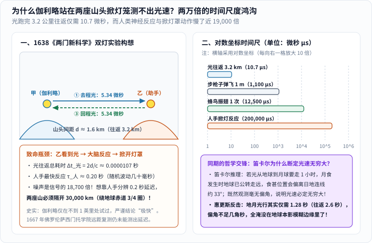
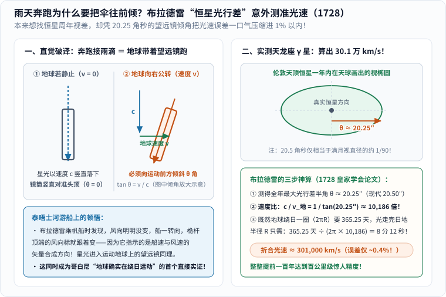
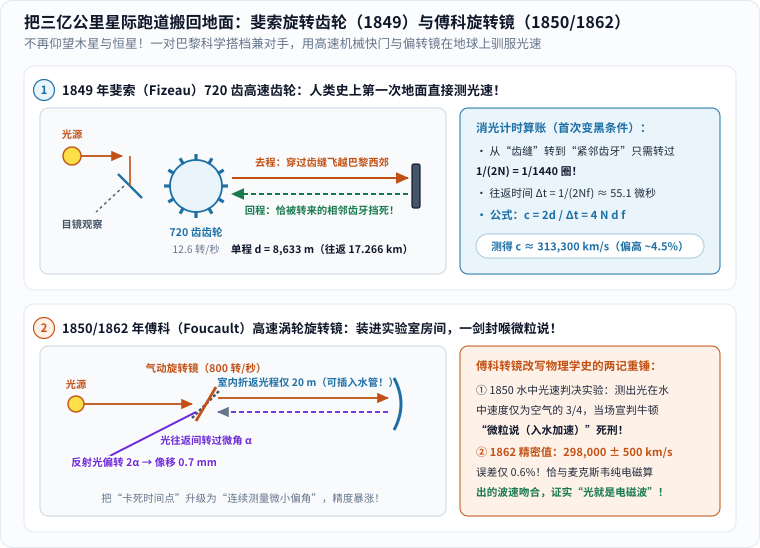
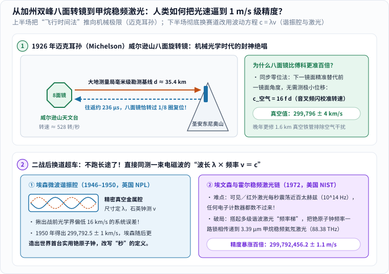
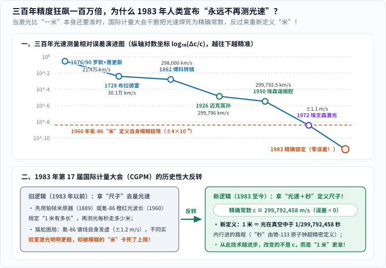

你按下卧室墙上的电灯开关，房间亮起的瞬间，根本感觉不到哪怕千分之一秒的迟滞。

正因为光快得完全超出了人类感官的分辨率，今天我们随口就能背出的那个常识——**真空中的光速约为每秒 30 万公里（精确值为 $299{,}792{,}458\text{ m/s}$），1 秒钟能绕地球赤道整整七圈半**——放在几百年前，听起来简直像天方夜谭。

如果你顺着物理学史往回翻，就会撞见一连串比侦探小说还要曲折的硬核追问：

- **在连机械秒表都还没发明的 17 世纪，大哲学家笛卡尔为什么敢用“月食”严密论证光速必定是无穷大？伽利略让两个人站上山头互掀灯笼，为什么注定抓不住光？**
- **既然地球上的跑道太短，天文学家是怎么突发奇想，向太阳系借来一把“3 亿公里长的大尺子”，靠木星一颗小卫星的“迟到记录”第一次逮住光速的？**
- **为什么一次泰晤士河上的帆船郊游、一个“雨天奔跑为什么要把雨伞往前倾”的生活直觉，就能让英国天文学家把光速误差一口气干到 $1\%$ 以内？**
- **等到 19 世纪还没有激光和高速电子芯片，法国物理学家凭什么只靠一个 720 齿的铜齿轮和一面吹气旋转的小镜子，就在巴黎屋顶和一间屋子里测出了光速，顺便还终结了牛顿两百年的微粒说？**
- **最不可思议的是大结局：从 17 世纪到 1972 年，人类把光速测量精度硬生生提升了一亿倍，可为什么到了 1983 年，全世界计量学家却集体投票宣布——“人类从此永远不再测量真空光速”？**

这篇文章，我们就顺着四百年科学家“跟光赛跑”的六次神级脑洞，把这桩物理学史上最浪漫的破案故事彻底拆开算清楚。

---

## 一、两千年的“瞬间到达”错觉，与伽利略山头提灯的挫败

### 1. 古人的拉锯战：笛卡尔那个极其聪明的“月食反证法”

在长达两千多年的时间里，人类最顶尖的头脑几乎一边倒地相信：**光的传播不需要时间，它是瞬间到达的（速度无穷大）。**

古希腊哲学家恩培多克勒（Empedocles，约公元前 5 世纪）和 11 世纪阿拉伯光学之父伊本·海赛姆（Alhazen，著有《光学书》）虽然曾凭直觉猜测“光既然是从一处传到另一处，就应该花一点点时间”，但亚里士多德、开普勒乃至近代解析几何之父**笛卡尔（René Descartes）**全都站在反方。

千万别以为笛卡尔是盲目武断。恰恰相反，他在 1637 年前后给出了一个看起来无懈可击的天文定量反证（后来被惠更斯完整记录在 1690 年出版的《光论》*Treatise on Light* 第一章中）：

- **笛卡尔的推理**：假设光从地球跑到月球要花 **1 个小时**。那么当太阳、地球、月球严格排成一条直线发生月食时，地球挡住阳光的“暗影信息”要过 1 小时才能传到月球表面，月球变暗的画面又要再花 1 小时传回人眼。在这整整 2 小时里，月球和地球已经在轨道上往前走了相当大一段路——折算下来，人眼看到月食最黑那一刻，月球相对于日地连线应该明显偏离约 **$33^\circ$** 才对！
- **观测事实**：千百年来天文学家精密观测月食，从未见过这种几十度的离谱滞后角。于是笛卡尔自信宣布：**光速必定是无穷大的！**

这个论证逻辑严密得让人拍案叫绝，但它藏着一个致命盲区——后来荷兰物理学家**克里斯蒂安·惠更斯（Christiaan Huygens）**一针见血地指出：谁规定“有限速度”就得慢到走 1 小时？如果光跑完 38.4 万公里的地月距离只需要 **1 秒多钟**（现代实测单程约 $1.28\text{ 秒}$），产生的视觉偏角连几角秒都不到，早就彻底淹没在地球本影那圈模模糊糊的边缘里了！

### 2. 1638 年伽利略的双山头灯笼实验：为什么慢了整整两万倍？

既然靠思辨吵不出结果，近代实验科学之父**伽利略（Galileo Galilei）**决定动手实测。

在 1638 年出版的晚年巨著《关于两门新科学的对话》（*Discorsi e dimostrazioni matematiche intorno a due nuove scienze*，第一天对话）中，伽利略借书中人物萨尔维亚蒂之口，设计了历史上第一个可控地面光速实验：

1. 让甲、乙两人各提一盏带遮光盖的灯笼，先在很近的地方练习：甲一掀开灯罩露出灯光，乙看到光立刻掀开自己的灯罩；两人练到配合滚瓜烂熟，记下这套动作的基准节奏；
2. 接着让甲、乙爬上相距一两英里（乃至更远用望远镜对看）的两座山头，在黑夜里重复同样的操作；
3. 如果光跑一个来回需要可观的时间，甲从自己掀灯到看见乙的回光之间，就会比近处练习时多出一截延迟 $\Delta t$！

伽利略在书中非常诚实地交代：他只在**不到一英里**（约 $d \approx 1.6\text{ km}$）的距离上试过，结果根本分辨不出任何延迟；1667 年，继承他衣钵的佛罗伦萨西门托学院（Accademia del Cimento）把两盏灯拉远到约 1 英里复测，照样一无所获。因此伽利略谨慎地总结道：“光如果不是瞬时的，也是快得惊人的。”

### 3. 算一笔残酷的生理学账：拿人手去卡微秒

为什么伽利略注定测不出来？我们用今天的精确光速替他算一笔账就全明白了：

$$
\begin{aligned}
\Delta t_{\text{光} } &= \frac{2d}{c} = \frac{2 \times 1{,}600\text{ m} }{299{,}792{,}458\text{ m/s} } \\
&\approx 1.067 \times 10^{-5}\text{ s} = 10.7\ \mu\text{s}
\end{aligned}
$$

光在这两座山头之间跑完 $3.2\text{ km}$ 的一个来回，总共只花了 **$10.7\text{ 微秒}$（约十万分之一秒）**！而人类视网膜感光、视神经把电信号传进大脑皮层、再指挥手指肌肉掀开灯罩，哪怕是受过极限训练的短跑运动员，反应时间 $\tau_{\text{人} }$ 也在 **$0.20\text{ 秒}$（即 $200{,}000\text{ 微秒}$）** 左右，而且每次按键本身就有几万微秒的随机抖动！

_图 1：先看左栏伽利略双灯往返流程，再看右栏对数坐标时间尺（每向右一格时间放大 10 倍）：人类神经反应（$2\times 10^5\,\mu\text{s}$）比光跑 3.2 公里的耗时（$10.7\,\mu\text{s}$）慢了约 $18{,}700$ 倍；想让光往返延迟达到人手勉强能察觉的 $0.2\text{ 秒}$，两座山头必须隔开 3 万公里——差不多绕地球赤道四分之三圈。_

看清这个公式 $\Delta t = \dfrac{L}{c}$ 里的矛盾，你就抓住了此后三百年所有科学家破局的两把钥匙：
- **第一条路（天文学家选的路）**：既然计时器不够快，那就把分子——**路程 $L$ 放大一亿倍**，上天去找一把几亿公里长的尺子！
- **第二条路（物理学家选的路）**：把笨拙的人手彻底踢出局，发明**每秒切碎上万次光束的机械与电子快门**，在地面直接卡住微秒！

---

## 二、地球太小就向太阳系借尺子：木卫一的“迟到表”与人类第一个光速值

### 1. 一桩水手测经度的悬赏难题，意外捧出太空秒表

第一个真正打破“光速无穷大”神话的人，本来根本不是去测光速的，而是在帮大航海时代的船长解决**海上测经度**问题。

要知道，在海里确定经度，核心是得知道“此刻标准天文台是几点钟”。伽利略当年用望远镜发现木星有四颗大卫星后，立刻意识到最内侧的**木卫一（Io）**是一块绝佳的“全地球共享太空钟”：木卫一绕木星公转一圈只需约 **$42.5\text{ 小时}$（$42\text{ 小时 } 28\text{ 分}$）**，每转一圈就会一头扎进木星巨大的阴影锥里消失（入蚀），或从阴影里重新钻出来（出蚀）。只要天文学家提前编好一张精准的“木卫一进出阴影时刻表”，全世界水手用望远镜一对比当地时间，就能算出经度。

1670 年代，年轻的丹麦天文学家**奥勒·罗默（Ole Rømer）**来到巴黎天文台，在台长卡西尼手下连续多年整理木卫一的蚀刻记录。结果他发现了一个让所有天文学家抓狂的怪现象：

- 当地球在公转轨道上**一天天远离木星**的那半年里，木卫一每次钻出阴影的间隔都比平均周期多出十几秒，几十圈攒下来，竟然比时刻表**整整迟到了十多分钟**！
- 反过来，当地球转过半圈、开始**一天天迎面靠近木星**的那半年里，木卫一每次出蚀又比平均周期提前一点点，把之前迟到的时间分秒不差地全补了回来！

### 2. 罗默的惊世预言（1676）：不是卫星不守时，是光在路上堵车了！

难道木卫一会看地球的脸色忽快忽慢？当然不可能！1676 年，罗默向法国科学院抛出石破天惊的解释（发表于同年 12 月《学者杂志》*Journal des sçavans*）：**木卫一这口钟准得很，之所以地球在远端看到它迟到，纯粹是因为光必须多跑一整条“地球公转轨道直径（$2\text{ AU} \approx 3\text{ 亿公里}$）”的路程！**

当时巴黎天文台台长卡西尼本人都不太敢信。为了服众，罗默在 1676 年 8 月当众立下赌约，预言 **11 月 9 日**那次木卫一出蚀将比按固定周期推算的旧历表**晚到整整 10 分钟**。到了 11 月 9 日傍晚，巴黎天文台的望远镜齐刷刷对准木星——木卫一果然在旧时刻过去 10 分钟后才姗姗亮起！

根据近十年的累积偏差，罗默推算出：**光横穿整条地球公转轨道直径大约需要 22 分钟**（受限于 17 世纪望远镜在木星强眩光旁辨认暗淡小卫星的难度，以及木卫一轨道摄动误差，罗默估大了约三分之一；今天我们知道 $2\text{ AU}$ 的真实光行时间是 **$998\text{ 秒} = 16\text{ 分 } 38\text{ 秒}$**）。

### 3. 纠正一个流传甚广的教科书误传：第一个光速数值其实是惠更斯算的！

很多科普书会直接写“1676 年罗默测出光速为 21 万或 22 万公里/秒”。但核查原始文献（包括惠更斯 1678 年向法国科学院宣读、1690 年正式出版的《光论》第一章原文）就会发现一个极其有趣的史实细节：

**罗默本人终其一生都没有把这“22 分钟”换算成“每秒多少公里”！** 为什么？一来罗默关心的重点是证明“光速有限”并修正天文历表；二来在 1676 年，连太阳到地球到底有多远（天文单位 $\text{AU}$）都才刚刚由卡西尼和里歇测出初步估计值，争议极大。

真正拿起笔完成人类历史上**第一次“路程 ÷ 时间”除法**的，正是**克里斯蒂安·惠更斯**。在《光论》第 8—9 页里，惠更斯一步步列出了他的算式：

$$
\begin{aligned}
v_{\text{惠更斯} } &\approx \frac{22{,}000\,D_{\text{地球} } }{22 \times 60\text{ s} } = 16\frac{2}{3}\ D_{\text{地球} }\text{/s} \\
&\approx 1.1 \times 10^8\text{ toises/s} \\
&\approx 214{,}000\text{ km/s}
\end{aligned}
$$

（注：$1\text{ 法国古寻 toise} \approx 1.949\text{ m}$。）惠更斯在书中惊叹地写道：这个速度是声音传播速度的 **60 多万倍**！虽然因为罗默的“22 分钟”偏长、加上当时采用的太阳视差（$9.5''$）略微低估了日地距离，导致 $21.4\text{ 万 km/s}$ 比真值偏低了约 $28\%$，但它石破天惊地**第一次在人类文明史上锁定了 $10^8\text{ m/s}$ 这个正确的数量级**！连牛顿也在 1687 年《自然哲学的数学原理》和 1704 年《光学》中欣然采纳，把日地单程光行时间修正到了相当精准的“7 到 8 分钟”。

_图 2：左栏演示木卫一出蚀光信号分别传往地球近点 $B$ 与远点 $C$ 的等速追赶过程（动画仅播放一次并停留在终态，单独打开 [SVG 原图](/assets/images/light-speed/romer-io-orbital-delay.svg) 刷新页面可重播；开启系统“减少动态效果”时直接展示完整静态光路）；右栏严格区分 1676 年罗默测出“22 分钟轨道横穿时间”与惠更斯在《光论》中算出“约 $21.4\text{ 万 km/s}$”各自的历史贡献。_

---

## 三、泰晤士河游船上的顿悟：布拉德雷怎样靠“斜着打伞”把误差压进 1%？

### 1. 本想找“恒星视差”，却撞见一个方向完全拧巴的怪圈

罗默之后仅仅过了半个世纪，一位英国天文学家纯属“歪打正着”，就把光速的测量误差从 $28\%$ 一口气干到了 **不到 $0.5\%$**！他就是后来的格林威治皇家天文学家**詹姆斯·布拉德雷（James Bradley）**。

1725 年起，布拉德雷和朋友莫利纽克斯在伦敦附近把一架长达 24 英尺的精密天顶望远镜垂直竖在烟囱旁，死死盯住几乎正对伦敦头顶的**天龙座 $\gamma$ 星（天棓四）**。他们原本的野心，是寻找哥白尼日心说梦寐以求的终极铁证——**恒星周年视差**（就像你左右晃脑袋看面前的手指，手指相对于远处背景墙会左右偏移一样，地球绕太阳公转也应该让近处恒星每年晃出一个小圈）。

恒星确实动了！而且一年下来画出了一个半长轴整整有 **$20''$（角秒，即 $1^\circ$ 的 $\frac{1}{180}$）** 的漂亮椭圆！可当布拉德雷仔细核对月份时，冷汗一下子冒了出来：**这颗星偏移的方向，跟“周年视差”预言的方向整整拧了 $90^\circ$（相差三个月相位）！** 本该在 6 月和 12 月出现的最大视差位置，它却偏偏出现在 3 月和 9 月——也就是地球正对着那个方向全速横冲过去的时候！

### 2. 帆船风向标与“雨中奔跑斜举雨伞”

这个怪象折磨了布拉德雷整整三年。直到 1728 年秋天，他陪朋友在泰晤士河上坐帆船游玩。每当帆船调头转向，他就抬头看到桅杆顶上的小风向标跟着转一个角度。他随口问船员：“这风怎么老跟着咱们的船变方向？”船员笑着答道：“风压根没变！是咱们的船在动，风向标指的其实是风速和船速合起来的方向！”

一道闪电瞬间劈开布拉德雷的脑海——这就是我们在雨天再熟悉不过的**“奔跑打伞效应”**：

- 假设天上无风，雨滴以速度 $c$ 笔直往下掉。如果你站在原地不动，把一根空心竹筒竖直朝天举着，雨滴就能顺着筒心一滴不沾筒壁地落到底部；
- 可一旦你以速度 $v$ 往右狂奔起来，如果竹筒还竖直举着，雨滴还没落到底，竹筒后壁就已经撞上雨滴了！要想让雨滴继续顺着筒心落到底，你**必须把竹筒往奔跑的正前方倾斜一个小角度 $\theta$**！

地球不就正驮着天文学家的望远镜，以每秒约 $30\text{ km}$ 的公转速度 $v_{\oplus}$ 在星光之雨里狂奔吗？从直角速度三角形一眼就能写出正切关系：

$$
\tan\theta = \frac{v_{\oplus} }{c}
$$

这就是天文学上赫赫有名的**恒星光行差（Stellar Aberration）**！

_图 3：左栏对比静止与公转运动下的望远镜光路（图中倾角 $\theta$ 为视觉清晰放大示意，真实角度仅约 $0.0057^\circ$）；右栏展示布拉德雷测得天龙座 $\gamma$ 星周年光行差半长轴约 $20.25''$，直接算出光速是地球公转速度的 $10{,}186$ 倍。_

### 3. 三行算术封神：提前一百年摸到 30.1 万 km/s！

在 1729 年初发表于英国皇家学会《哲学汇刊》（*Philosophical Transactions*）的经典论文中，布拉德雷用他测出的全年最大半角 $\theta \approx 20.25''$（现代国际天文联合会标准光行差常数为 $\kappa = 20.4955''$，布拉德雷在 18 世纪初竟只差了四分之一角秒！），完成了一次极其优雅的推算：

$$
\frac{c}{v_{\oplus} } = \frac{1}{\tan(20.25'')} \approx 10{,}186
$$

也就是说，**光速是地球绕日公转速度的 $10{,}186$ 倍！** 既然地球沿着周长 $2\pi R$ 跑完一圈要 $365.25\text{ 天}$，那么光走完日地半径 $R$（$1\text{ AU}$）需要的时间根本不用知道 $R$ 具体是多少公里就能直接算出来：

$$
\begin{aligned}
t_{\text{日地} } &= \frac{365.25\text{ 天} }{2\pi \times 10{,}186} \\
&\approx 492\text{ 秒} = 8\text{ 分 } 12\text{ 秒}
\end{aligned}
$$

（对比现代精确值 **$499.0\text{ 秒} = 8\text{ 分 } 19\text{ 秒}$**，只差了短短 7 秒钟！）按现代天文单位换算，布拉德雷测出的光速相当于 **约 $301{,}000\text{ km/s}$**，误差仅约 **$0.4\%$**——不仅顺手拿下了人类历史上**第一个地球确实在绕太阳公转的直接观测铁证**，还创造了一项让地面实验室追赶了一百多年才追平的精度纪录！

---

## 四、把星际跑道搬回巴黎屋顶与房间：720 齿齿轮与一剑封喉的旋转镜

尽管罗默和布拉德雷已经在天上把光速算得八九不离十，物理学家心里始终憋着一口气：**我们能不能彻底甩开木星和恒星，就在地球表面点一盏灯，亲手测出光跑一个来回的速度？**

1834 年，英国物理学家惠斯通（Charles Wheatstone）发明用高速旋转镜观察电火花的持续时间；随后法国科学院泰斗阿拉戈（François Arago）构想用旋转镜去测光在空气和水里的速度差，可惜年事已高、双目失明未能亲自完成。接过接力棒的，是巴黎两位年轻的天才搭档兼日后的竞争对手——**阿曼德·斐索（Hippolyte Fizeau）**与**莱昂·傅科（Léon Foucault）**。

### 1. 1849 年斐索的“720 齿机关枪快门”：人类首次在地面逮住光速！

斐索想出了一个把“伽利略掀灯笼的人手”加速上万倍的绝妙机械结构——**高速旋转的精密齿轮**。

1849 年夏天，斐索在巴黎西郊苏雷讷（Suresnes）父亲别墅的钟楼上架起光源和一个边缘密密麻麻铣出 **$N = 720$ 个齿牙与 $720$ 道等宽齿缝**的旋转齿轮；在正前方单程相距 **$d = 8{,}633\text{ m}$**（往返 $2d = 17{,}266\text{ m}$）的蒙马特高地（Montmartre）架起一面反射镜，让穿城而过的光束精准原路弹回同一个齿缝位置：

1. **齿轮静止或慢转时**：一束光从某道齿缝钻出去，飞越巴黎夜空跑完 $17.266\text{ km}$ 折返，这道齿缝还没转走，回光顺利钻进目镜，斐索看到一颗明亮的光点；
2. **慢慢摇动发条加速齿轮**：当转速一路飙升到 **$f = 12.6\text{ 转/秒}$** 时，奇迹发生了——目镜里的光点**第一次彻底变黑消失**！为什么？因为就在光跑那一个来回的几十微秒里，齿轮刚好转过了**半个齿距（即 $\frac{1}{2N} = \frac{1}{1440}$ 圈）**，紧挨着的那颗齿牙稳稳当当地转过来，把回家的光死死挡在了门外！
3. **继续加速到两倍转速（$25.2\text{ 转/秒}$）**：齿轮在光往返期间恰好转过整整一个齿距（$\frac{1}{720}$ 圈），下一道齿缝又把光放了进来，目镜重新变亮！

看！根本不需要任何电子时钟，齿轮本身的齿数 $N$ 和转速 $f$ 就是一台微秒级机械秒表：

$$
\begin{aligned}
\Delta t &= \frac{1}{2 N f} = \frac{1}{2 \times 720 \times 12.6\text{ s}^{-1} } \approx 55.1\ \mu\text{s} \\
c &= \frac{2d}{\Delta t} = 4 N d f \\
&= 4 \times 720 \times 8{,}633\text{ m} \times 12.6\text{ s}^{-1} \\
&\approx 313{,}274\text{ km/s} \approx 31.33\text{ 万 km/s}
\end{aligned}
$$

由于人眼判断“哪一转速恰好黑得最透”存在一定主观误差，斐索这个结果比真值偏高了约 $4.5\%$。但它的历史地位无可替代：**人类历史上第一次不靠任何天体，纯粹在地面两点之间亲手测出了光速！**

_图 4：上图为 1849 年斐索 720 齿齿轮消光实验（靠齿牙挡死回光卡时间）；下图为 1850—1862 年傅科气动涡轮旋转镜实验（把 $17\text{ km}$ 室外跑道压缩进 $20\text{ m}$ 房间，靠反射角加倍偏转 $2\alpha$ 连续读数）。_

### 2. 1850 与 1862 年傅科旋转平面镜：装进一间屋子，顺手终结两百年微粒说！

斐索刚立下大功，与他分道扬镳单干的**傅科**（对，就是造出“傅科摆”证明地球自转的那位全才）立刻指出了齿轮法的软肋：齿缝全黑的瞬间是个宽泛的极小值区间，很难卡准；而且动辄要找相隔八九公里的晴朗夜空。

傅科用一台由压缩空气涡轮驱动、每秒狂转 **$800\text{ 圈}$** 的**高速旋转小平面镜**彻底改造了实验：

- 光源发出的细光束先打在旋转镜 $R$ 上，反射到几米外的固定凹面镜 $M$，再原路弹回旋转镜 $R$；
- 哪怕室内往返光程只有短短 **$20\text{ 米}$**（光跑一趟仅需 $\Delta t \approx 0.067\text{ 微秒}$！），在这零点零几微秒里，每秒 800 转的镜面已经转过了一个微小但确定的角度 $\alpha = \omega \Delta t$；
- 根据平面镜反射定律，镜面转 $\alpha$ 角，反射光线就会偏转 **$2\alpha$ 角**！在刻度显微镜下，原本重合的狭缝像清清楚楚地横移了约 **$0.7\text{ 毫米}$**！

把“凭肉眼猜什么时候最黑”升级成“拿测微目镜精确量毫米位移”，傅科接连轰出了震动整个物理学界的两记重锤：

1. **1850 年“水中光速判决实验”**：既然光路缩短到了几米长，傅科直接在光路中间塞进了一根灌满清水的长玻璃管！当时物理学界为“光的本质到底是牛顿说的弹性微粒，还是惠更斯说的波”已经争论了将近两百年——牛顿微粒说预言光进入水里会被水分子吸引加速（$v_{\text{水} } > v_{\text{空气} }$），而惠更斯波动说以及我们在[《白天做法官、业余难倒数学家的费马》]()里讲过的“费马最短时间原理”都断定**光在水里必须变慢（$v_{\text{水} } = c/n < v_{\text{空气} }$）**。傅科往目镜里一看：穿过水管的回光偏转得更远了——铁证**光在水中的速度只有空气中的约四分之三**！牛顿微粒说当场被宣判死刑。
2. **1862 年刷新地面精度纪录**：傅科用多重凹面镜折叠出 $20\text{ m}$ 精密室内光路，一举测出空气中光速为 **$298{,}000 \pm 500\text{ km/s}$**，把地面实测误差第一次压到了 **$0.6\%$**！

### 3. 书斋里的神级会师：麦克斯韦算出来的电磁波，怎么恰好也是这个数？

就在傅科在巴黎暗室里盯着旋转镜读数的同一时期，海峡对岸的苏格兰物理学家**詹姆斯·克拉克·麦克斯韦（James Clerk Maxwell）**正在纸上推导他那组统合电与磁的方程组。

1856 年，德国物理学家韦伯（Wilhelm Weber）与科尔劳施（Rudolf Kohlrausch）在桌面上做了一个跟“光”八竿子打不着的纯电磁实验——他们只是拿莱顿瓶（电容器）和电流计测量了同一团电荷在静电单位制与电磁单位制下的比值，也就是真空电容率 $\varepsilon_0$ 与真空磁导率 $\mu_0$ 乘积的倒数平方根。

当麦克斯韦在 1861—1865 年推导出真空中电磁波的传播速度公式：

$$
v_{\text{电磁} } = \frac{1}{\sqrt{\varepsilon_0 \mu_0} }
$$

把韦伯团队测出的纯电学桌面常数往里一代，跳出来的数字约合 **$310{,}740\text{ km/s}$**——跟斐索测出的 $313{,}300\text{ km/s}$ 和傅科刚测出的 $298{,}000\text{ km/s}$ 几乎贴在一起！（后来 1907 年罗萨与多西用更精密的电磁基准重测 $1/\sqrt{\varepsilon_0\mu_0}$，得出 $299{,}788\text{ km/s}$，与光速分毫不差。）

麦克斯韦按捺不住内心的震撼，在论文里写下那句改写人类文明史的断语：**“我们几乎无法回避这样一个结论——光本身，就是按照电磁定律在场中传播的横波！”**

---

## 五、从加州双峰八面镜到稳频激光梯：换条赛道逼近小数点后第九位

### 1. 一辈子跟光速死磕的男人：迈克耳孙与威尔逊山八面镜（1926）

如果要在物理学史上选一位“追光痴人”，1907 年诺贝尔物理学奖得主、美国首位诺奖科学家**阿尔伯特·迈克耳孙（Albert A. Michelson）**绝对当仁不让。

他年轻时在美国安纳波利斯海军学院教书，1879 年只花了 10 美元改进傅科的旋转镜，就把光速精度提高了 20 倍（测得 $299{,}910 \pm 50\text{ km/s}$）；1887 年又和莫雷搭起浮在水银槽巨石上的干涉仪（著名的**迈克耳孙—莫雷实验**），意外发现无论地球往哪个方向运动，测到的光速都纹丝不变——直接为爱因斯坦 1905 年狭义相对论的“光速不变原理”铺平了红毯。

但年过七旬的迈克耳孙还不满足。1924—1926 年，他在南加州**威尔逊山天文台**与对面相距约 **$35.4\text{ km}$** 的**圣安东尼奥山（Mount San Antonio）**之间，上演了机械光学时代的封神绝唱：

- **毫米级大地基线**：美国海岸与大地测量局专门出动顶尖测绘队，花了极大心血把两座山峰之间的直线距离勘测到了误差不足几厘米的惊人水准（当时人类史上最准的大地基线）；
- **斐索＋傅科合体的“八面旋转棱镜”**：迈克耳孙把斐索的“卡周期归零”和傅科的“高反射率转镜”融为一炉——用压缩空气吹动一枚磨制得极度对称的**正八面体旋转镜**。当转速微调到 **$f \approx 528\text{ 转/秒}$**（用恒温音叉频闪仪严密锁频）时，光在两座大山之间跑完约 $70.8\text{ km}$ 来回所花的 **$236\text{ 微秒}$** 里，八面镜**分毫不差地转过了 $\frac{1}{8}$ 圈**！下一块镜面像克隆体一样接替前一块镜面的精确角度，把回光稳稳送回目镜十字丝正中央：

$$
c_{\text{空气} } = \frac{2d}{1 / (8f)} = 16 f d
$$

经大气温度、气压折射率修正后，迈克耳孙在 1926 年公布了轰动学界的结果：**$299{,}796 \pm 4\text{ km/s}$**！生命最后几年，这位快八十岁的老人甚至在加州尔湾牧场地面铺设了一条长达 **$1.6\text{ km}$（1 英里）的抽真空波纹铁管**，让光在真空管里来回反射十几次，彻底剔除山谷空气冷热湍流的干扰。

_图 5：上半幅为 1926 年迈克耳孙双山峰八面旋转镜实验（把传统“路程÷时间”飞行法推向机械极限）；下半幅展示二战后物理学家彻底换赛道，改用波动基本关系 $c = \lambda\nu$，先后用微波谐振腔和甲烷稳频激光把误差压缩到每秒 1 米！_

### 2. 二战后的换道超车：不跑几十公里长途了，改测“波长 × 频率”！

迈克耳孙把“让光跑一段路、再拿快门掐时间”（$c = L/t$）这条老路走到了物理极限——再想精确十倍，光是在野外地面量几十公里距离的热胀冷缩和地壳微变形就已经无解了。

二战期间雷达与微波技术的爆发，给了物理学家一条截然不同的新赛道：**既然光和无线电波都是电磁波，任何波的速度都严格等于它的波长 $\lambda$ 乘以频率 $\nu$：**

$$
c = \lambda \nu
$$

只要能在一间恒温恒湿的地下室里，同时测准同一束电磁波的**波长 $\lambda$** 和**频率 $\nu$**，根本不用去荒山野岭跑几十公里，就能在桌面上算出光速！

1946—1950 年，英国国家物理实验室（NPL）的**路易斯·埃森（Louis Essen）**与戈登-史密斯率先用一只抽成真空、内径测量精确到微米级的铜制圆筒——**微波谐振腔**——漂亮地打响第一枪。微波在金属筒内来回反射形成稳定的驻波：腔体几何尺寸直接定出波长 $\lambda$，外接石英钟校准的电子外差电路直接数出微波每秒震荡几十亿次的频率 $\nu$。

结果一算出来，把整个物理学界吓了一跳：当时国际权威物理常数表里公认的光速（综合了 1930—1940 年代多组克尔盒光电快门测值）大约是 $299{,}776\text{ km/s}$，而埃森在微波腔里测出的值竟整整高出了 **$16\text{ km/s}$**，1950 年精测值锁定在 **$299{,}792.5 \pm 1\text{ km/s}$**！起初不少光学前辈怀疑埃森这台“铁罐头”算错了，结果几年内世界各地用雷达导航（Shoran）、地质测距仪复测，全都向埃森低头认错——埃森离今天的精确值只差了不到 **$0.5\text{ km/s}$**！（值得一提的是，5 年后的 1955 年，也正是这位路易斯·埃森亲手造出了世界上第一台实用**铯-133 原子钟**，直接催生了现代“1 秒”的原子定义！）

### 3. 1972 年稳频激光频率链：把光速钉死在每秒差不到 1.1 米！

微波虽好，波长毕竟有几厘米，受金属腔壁趋肤效应（电波钻进铜壁表层一点点）限制，精度停在了百米到几十米每秒。要想再往上冲百倍，必须换波长比微波短一万倍的**激光**！

可换上激光立刻撞上一堵绝望的高墙：可见光与近红外激光的频率高达每秒近百太赫兹（$\sim 10^{14}\text{ Hz}$，即每秒震荡一百万亿次），地球上没有任何电子晶体管和计数器数得过来这么快的节拍！

1972 年，美国国家标准局（NBS，今 NIST）博尔德实验室的**肯尼思·埃文森（Kenneth M. Evenson）**与后来荣获诺贝尔奖的激光大师**约翰·霍尔（Jan Hall）**团队，搭起了一座堪称艺术品的**“多级激光谐波频率梯”**：

- 他们以铯原子钟的微波频率为最底下一级台阶，先锁住氰化氢激光、水蒸气激光、二氧化碳激光……像接力齿轮一样一级级倍频混频往上爬，硬生生把原子钟的计数能力一路锁相传递到了波长 **$3.39\ \mu\text{m}$ 的甲烷稳频氦氖激光**，直接数出它的频率 $\nu = 88.376181627\text{ THz}$！
- 与此同时，用法布里—珀罗干涉仪将这束激光的波长 $\lambda$ 与当时的国际“米”标准（1960 年规定的**氪-86 同位素橙红光谱线**）逐条干涉比对；
- 两者一乘（$c = \lambda \nu$），1972 年 11 月发表于《物理评论快报》（*Physical Review Letters*）的结果一举将光速精度暴涨了 **100 倍**：

$$
c = 299{,}792{,}456.2 \pm 1.1\text{ m/s}
$$

相对不确定度被打到了惊世骇俗的 **$3.7 \times 10^{-9}$（十亿分之三点七）**——相当于光狂奔 30 万公里，误差连一张餐桌的长度都不到！

---

## 六、1983 年的终极反转：为什么科学家突然宣布“永远不再测光速”？

### 1. 一个荒诞又幸福的烦恼：激光太准了，“一米”本身反倒糊了！

就在埃文森团队算出 $\pm 1.1\text{ m/s}$ 的那一刻，全世界计量学家发现自己陷入了一个极其荒诞的怪圈：

**为什么还剩那 $\pm 1.1\text{ m/s}$ 的误差消不掉？一查误差来源——根本不是激光测不准，而是当时用来定义“1 米有多长”的那条氪-86 谱线自己发虚了！**

原来，1960 年第 11 届国际计量大会废除巴黎保险柜里的铂铱合金米原器后，规定“$1\text{ 米}$ 等于氪-86 原子橙红光谱线波长的 $1{,}650{,}763.73$ 倍”。可在放电灯管里，氪原子受热乱撞产生多普勒展宽，谱线轮廓天生带有一丝不对称和模糊，极限分辨率只有 $\pm 4 \times 10^{-9}$（折算到光速正好就是 $\pm 1.2\text{ m/s}$ 左右）！

这就好比你手里造出了一把能看清头发丝千分之一的超级激光游标卡尺，却非要拿它去跟一根用粉笔画在黑板上的粗线条比对——如果各国实验室各自改进激光器，哪怕频率稳了十倍，测出来的“光速数值”只会因为各家对氪-86 模糊谱线中心点的取法不同而互相打架！

_图 6：上图用对数坐标展示从 1676 年到 1972 年光速相对误差跨越 8 个数量级一路俯冲，最终一头撞在 1960 年氪-86“米”定义自身模糊极限（橙色虚线）上的戏剧性一幕；下图展示 1983 年国际计量大会怎样把逻辑彻底倒转，用精确锁定的光速反过来定义“1 米”。_

### 2. 1983 年 10 月 20 日：人类给追光游戏画上最浪漫的句号

既然爱因斯坦狭义相对论和上百年的实验都已经千锤百炼地证实**真空光速是宇宙最底层的普适不变量**，而且铯-133 原子钟定义“1 秒”的精度当时已经高达 $10^{-14}$（比氪-86 的“米”准了十万倍！），国际计量界先在 1975 年第 15 届国际计量大会（CGPM）推荐全球统一采用 $299{,}792{,}458\text{ m/s}$，紧接着在 **1983 年 10 月 20 日第 17 届国际计量大会第 1 号决议**中拍板，完成了科学史上最漂亮的一次“釜底抽薪”：

1. **彻底废除 1960 年氪-86 的“米”定义**；
2. **把真空中的光速直接锁死为没有任何测量误差的精确定义常数**：

$$
\begin{aligned}
c &\equiv 299{,}792{,}458\text{ m/s} \\
&\quad (\text{定义常数，误差严格为 } 0)
\end{aligned}
$$

3. **反过来用光速和原子钟的“秒”定义“1 米”**：
   > **“米（metre）是光在真空中于 $\dfrac{1}{299{,}792{,}458}$ 秒时间间隔内所经路径的长度。”**

这一招有多绝？从 1983 年这一天起，**人类再也不需要、也不可能去“测出更准的真空光速数值”了**——因为 $299{,}792{,}458$ 就像“1 千米等于 1000 米”一样，成了写死在单位制地基里的精确整数！以后激光和光学原子钟哪怕再进步一万倍，改变的不再是 $c$ 小数点后面的数字，而是让我们复现出来的**“1 米这把尺子”变得越来越锋利**！（2019 年国际单位制 SI 历史性大改版时，更是把这一成功范式推广到了普朗克常数 $h$、元电荷 $e$、玻尔兹曼常数 $k$ 等全部七个基本物理常数上。）

### 3. 今天这把“光速尺”正在哪里替你干活？

光速从“猎物”变成“标尺”之后，早已悄悄住进了你每天的生活里：

- **阿波罗登月激光测距**：宇航员在月球表面摆下角反射器阵列，地面天文台打出一束脉冲激光，卡住往返约 **$2.56\text{ 秒}$** 的皮秒级飞行时间乘以 $c/2$，能把 38 万公里外的地月距离测准到**几毫米**，直接测出月球每年正以约 **$3.8\text{ 厘米}$** 的速度悄悄远离地球；
- **手机里的北斗与 GPS 导航**：导航卫星本质上就是在太空广播“我发出这串无线电信号时的原子钟精确时刻”。光在 **1 纳秒（十亿分之一秒）** 里恰好走 **约 $30\text{ 厘米}$（1 英尺）**！只要卫星钟表偏了区区 1 微秒（百万分之一秒），乘上光速，你的车载导航就会把你定位到 **$300\text{ 米}$** 外的河沟里去；
- **太空通信的物理极限延迟**：正如我们在[《同步卫星为什么能“钉”在头顶不动？》]()里算过的，地球静止轨道远在赤道上空 $35{,}786\text{ km}$，哪怕电波以光速狂奔，一去一回打个电话也躲不掉约 **$0.24\text{ 秒}$** 的物理延迟；而火星探测器最远时距离地球约 4 亿公里，地球发出一句指令，光也要在茫茫太空中孤独地飞上 **22 分钟** 才能抵达。

---

## 七、一图速览：四百年追光里程碑对照表

把这四百年科学家的奇思妙想摆在同一张表里，你会清楚看到人类是怎样一步步“拿智慧弥补感官短板”的：

| 年份 | 科学家与地点 | 核心测量原理 | 实测／推算结果 | 相对误差量级 | 历史破局意义 |
| :--- | :--- | :--- | :--- | :--- | :--- |
| **1638** | 伽利略（意大利） | 两座山头相隔不到 1 英里互掀遮光灯笼 | 未测出延迟（判定极快） | 人手反应慢约 2 万倍 | 首次提出地面可控物理测光速实验方案 |
| **1676 / 1690** | 罗默（巴黎天文台）＋惠更斯（荷兰） | 木卫一进出木星阴影时刻随地球公转靠近／远离的累积延误 | 2 AU 约需 22 分钟 $\to$ **约 $214{,}000\text{ km/s}$** | $\sim 28\%$ | **首次铁证光速有限**，惠更斯算出人类首个光速数值 |
| **1728** | 布拉德雷（英国伦敦） | 地球公转导致天顶恒星出现 $20.25''$ 周年恒星光行差（$\tan\theta = v/c$） | 日地光行 8 分 12 秒 $\to$ **约 $301{,}000\text{ km/s}$** | $\sim 0.4\%$ | 误差首破 $1\%$，并给出地球绕日公转首个直接观测实证 |
| **1849** | 斐索（法国巴黎郊区） | $720$ 齿旋转齿轮（$12.6\text{ 转/秒}$）跨越 $8.633\text{ km}$ 遮挡回光 | **$313{,}300\text{ km/s}$** | $\sim 4.5\%$ | **人类历史上首次在地面不借天体测出光速** |
| **1850 / 1862** | 傅科（法国巴黎） | 压缩空气涡轮旋转镜（$800\text{ 转/秒}$）在 $20\text{ m}$ 室内测偏转角 $2\alpha$ | **$298{,}000 \pm 500\text{ km/s}$**；且证 $v_{\text{水} } < v_{\text{空气} }$ | $\sim 0.17\%\text{–}0.6\%$ | 宣判牛顿微粒说死刑，并与麦克斯韦电磁波速完美会师 |
| **1926** | 迈克耳孙（美国威尔逊山） | 双山峰 $35.4\text{ km}$ 大地基线＋$528\text{ 转/秒}$ 正八面旋转棱镜 | **$299{,}796 \pm 4\text{ km/s}$** | $\sim 1.3 \times 10^{-5}$ | 将传统“飞行时间法”推向机械光学时代的最高峰 |
| **1946–1950** | 埃森与戈登-史密斯（英国 NPL） | 真空金属微波谐振腔驻波法（$c = \lambda\nu$） | **$299{,}792.5 \pm 1\text{ km/s}$** | $\sim 3.3 \times 10^{-6}$ | 换道波动方程，揪出战前光学表偏低 $16\text{ km/s}$ 的系统误差 |
| **1972** | 埃文森、霍尔等（美国 NBS/NIST） | 铯原子钟锁相谐波频率链直测甲烷稳频激光频率与波长 | **$299{,}792{,}456.2 \pm 1.1\text{ m/s}$** | **$3.7 \times 10^{-9}$** | 精度暴涨百倍，逼出氪-86“米”定义自身的模糊天花板 |
| **1983 至今** | 第 17 届国际计量大会（CGPM） | 将真空光速精确锁定，反过来结合铯原子钟定义“1 米” | **$c \equiv 299{,}792{,}458\text{ m/s}$（精确值）** | **$0$（定义值）** | 终结四百年测光速历史，光速正式成为人类丈量宇宙的终极尺子 |

回头看去，从伽利略在黑夜山头徒劳掀开的那盏小油灯，到罗默越过三亿公里盯住木星身旁的一粒微光，再到埃文森实验室里每秒共振八十八万亿次的稳频激光——光的速度从来没有变过，变的只是人类丈量世界的想象力。当我们终于追上光的那一天，光成了我们手中最准的那把尺子。

---

## 参考资料与核查来源

1. **国际计量局（BIPM）官方决议档案**：[Resolution 1 of the 17th CGPM (1983) — Definition of the metre](https://www.bipm.org/en/committees/cg/cgpm/17-1983/resolution-1) 及 [History of the SI: The metre](https://www.bipm.org/en/history-si/metre) —— 核查 1983 年 10 月第 17 届国际计量大会废除 1960 年氪-86 波长定义、将真空光速精确固定为 $c = 299{,}792{,}458\text{ m/s}$（零不确定度）并用其重定义“米”的法定原文，以及 1975 年第 15 届 CGPM 推荐值与 2019 年 SI 基本常数体系背景。
2. **惠更斯《光论》一手英译全本（Project Gutenberg 馆藏）**：Christiaan Huygens, [*Treatise on Light* (1690, written 1678, trans. Silvanus P. Thompson)](https://www.gutenberg.org/files/14725/14725-h/14725-h.htm)，Chapter I, pp. 5–10 —— 核查笛卡尔利用月食论证光速无穷大的原始逻辑及惠更斯的定量反驳、罗默在巴黎天文台利用木卫一（周期 $42.5\text{ 小时}$）推算地球轨道直径光行时间约 $22\text{ 分钟}$ 与预言 1676 年 11 月蚀刻推迟 $10\text{ 分钟}$ 的记录，以及惠更斯本人首次算出每秒 $16\frac{2}{3}$ 个地球直径（$>1.1\times 10^8\text{ toises/s} \approx 214{,}000\text{ km/s}$，逾声速 60 万倍）的一手算式。
3. **美国国家标准与技术研究院（NIST）激光测光速档案**：[NIST's Role in Laser Measurements and Applications: 1970s](https://www.nist.gov/history/nists-role-laser-measurements-and-applications/1970s) 及 Evenson, K. M., Wells, J. S., Petersen, F. R., Danielson, B. L., Day, G. W., Barger, R. L., & Hall, J. L. (1972), [*Speed of Light from Direct Frequency and Wavelength Measurements of the Methane-Stabilized Laser*](https://www.nist.gov/publications/speed-light-direct-frequency-and-wavelength-measurements-methane-stabilized-laser), *Physical Review Letters*, 29(19), 1346–1349 —— 核查 1972 年甲烷稳频氦氖激光直接频率链与波长干涉测量将光速精度提升百倍至 $299{,}792{,}456.2 \pm 1.1\text{ m/s}$、并揭示氪-86“米”定义自身不确定度瓶颈的史实。
4. **英国国家物理实验室（NPL）人物与计量史档案**：[Famous Scientists at NPL: Louis Essen](https://www.npl.co.uk/about-us/history/famous/louis-essen) —— 核查路易斯·埃森与戈登-史密斯 1946 年利用微波谐振腔测出 $299{,}792\text{ km/s}$（纠正战前光学共识值约 $16\text{ km/s}$ 偏差）、1950 年精化至 $299{,}792.5\text{ km/s}$，以及 1955 年研制首台实用铯原子钟的记录。
5. **诺贝尔奖官方传记档案**：[Albert A. Michelson — Biographical (NobelPrize.org)](https://www.nobelprize.org/prizes/physics/1907/michelson/biographical/) —— 核查迈克耳孙 1879 年安纳波利斯海军学院旋转镜改进实验、1887 年迈克耳孙—莫雷干涉实验与威尔逊山天文台光速测量生平。
6. **佛罗里达州立大学（FSU）光学物理导论与美国物理学会（APS）物理史专栏**：FSU Molecular Expressions, [*Light and Color: Speed of Light*](https://micro.magnet.fsu.edu/primer/lightandcolor/speedoflight.html)；APS News (July 2010), [*July 1849: Fizeau Publishes Results of Speed of Light Experiment*](https://www.aps.org/apsnews/2010/07/fizeau-speed-of-light-experiment)；及佐治亚州立大学 [*HyperPhysics: Historical Measurements of the Speed of Light*](http://www.hyperphysics.phy-astr.gsu.edu/hbase/Relativ/lighthist.html) —— 交叉核对伽利略《两门新科学》双灯实验、布拉德雷 1728 年恒星光行差（约 $301{,}000\text{ km/s}$）、斐索 1849 年 720 齿齿轮实验（$d=8{,}633\text{ m}, f=12.6\text{ rev/s}, c=4Ndf \approx 313{,}300\text{ km/s}$）、傅科 1850 年水中光速实验与 1862 年 $298{,}000\text{ km/s}$ 旋转镜实验，以及迈克耳孙 1926 年威尔逊山八面旋转镜 $299{,}796 \pm 4\text{ km/s}$ 实验参数。
