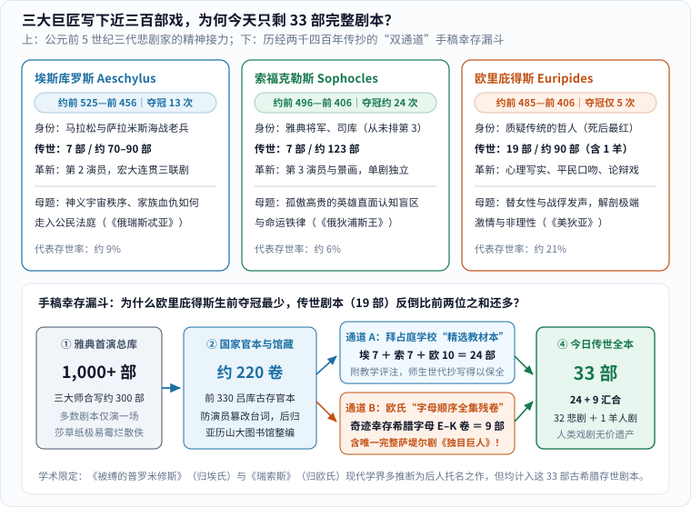

想象一下，你穿越回两千四百多年前——公元前 458 年早春的一个清晨，地点是希腊雅典卫城南坡。

天刚蒙蒙亮，爱琴海吹来微凉的春风。一万多名雅典人裹着羊毛披风，怀里揣着大麦饼、无花果干和葡萄酒囊，浩浩荡荡挤进山坡上的露天剧场。他们不是来听演唱会消遣一两个钟头的，而是要硬生生从破晓坐到日落，一口气连看**四部大戏**：先连看三部让人揪心落泪的悲剧，把王室弑亲、神明诅咒与人性困局翻来覆去剥开给你看；等到傍晚全场上万人哭得精疲力竭时，再紧接着演一部由半人半羊怪物歌队满场打滚逗乐的滑稽剧收尾。

如果你第一次撞见这个场面，脑子里八成会冒出一连串问号：

- **“悲剧（Tragedy）”这个词拆开古希腊语词根，字面意思居然是“公山羊之歌”——这门直击灵魂的高雅艺术，怎么会跟一只公山羊扯上关系？**
- **最早明明只是一群人围着祭坛唱赞美诗，是谁第一个大着胆子走出队伍说“我就是神本人”，一步步把“讲故事”变成了“演戏剧”？**
- **为什么雅典人看悲剧不是商业买票娱乐，而是由最高执政官选剧本、城里富豪出钱养歌队、连穷苦公民都能领国家补贴入场的“头等国事”？**
- **没有麦克风和音响，还不许在舞台上直接演刀剑砍杀，一座山坡剧场靠什么让一万四千人听清台词？成语“机械降神”为什么真是一台起重吊车？**
- **埃斯库罗斯、索福克勒斯、欧里庇得斯三大巨匠一生写下近三百部戏，为什么历经两千四百年战火后恰好只剩 33 部？雅典战败后，古希腊悲剧又是怎么阴差阳错催生了现代歌剧、莎士比亚和现代心理学的？**

今天，我们就顺着雅典卫城南坡的石阶往下走，把古希腊悲剧从破壳诞生、黄金巅峰到千年重生的完整脉络，一层一层彻底拆开。

---

## 一、从“公山羊之歌”到三位演员：人类戏剧是怎么破壳而出的？

在古希腊悲剧诞生之前，人类并不是没有好故事。早在公元前 8 世纪，《荷马史诗》就已经把特洛伊战争的英雄悲欢讲得荡气回肠；到了公元前 7 至前 6 世纪，古希腊抒情诗与合唱歌也已相当成熟。但无论是吟游诗人抱琴独唱，还是五十个人的歌队围成圆圈齐唱，本质上都停留在**“叙述（Narrative）”**——唱歌的人始终站在故事外面，用第三人称告诉听众：“大家听好，很久以前阿喀琉斯做过什么事……”

从“讲述别人的事”跨越到“我戴上面具，此刻我就是阿喀琉斯本人”，看似只差一层窗户纸，却是人类戏剧真正诞生的奇点。

### 1. 词源悬案：为什么悲剧叫“公山羊之歌”？

翻开任何一本词源词典，英语里的悲剧 **tragedy** 都直接源自古希腊语 **tragōidia（τραγῳδία）**。把这个词拆成两半，前一半 **tragos** 是“公山羊”，后一半 **ōidē** 是“歌”——合起来清清楚楚就是**“公山羊之歌”**。

为什么探讨命运、正义与苦难的悲剧，偏偏顶着一个“山羊之歌”的名字？实事求是地说，由于公元前 6 世纪悲剧萌芽期的原始文献早已散佚，就连生活在公元前 4 世纪的亚里士多德也没能给出唯一确凿的定论。现代古典学界主要并存着**三种假说**（参见[犹他州立大学古典系 Mark Damen《古典戏剧与社会》第 4 章对悲剧起源史料的考辨](https://artsci.usu.edu/history/classics/course-resources/classical-drama-and-society/chapter-4i)）：

1. **奖品或献祭山羊说（古典时期最流行的解释）**：公元前 3 世纪的《帕罗斯编年史碑》（Parian Marble）及古罗马诗人贺拉斯记载，早期酒神节合唱比赛的冠军奖品就是一头活公山羊；也有学者认为，演出开始前祭司会绕着祭坛宰杀公山羊献祭酒神狄奥尼索斯（Dionysus），绕坛所唱的祭歌便得名“山羊之歌”。
2. **羊人歌队脱胎说（亚里士多德《诗学》线索）**：亚里士多德在[《诗学》第 4 章（1449a）](https://classics.mit.edu/Aristotle/poetics.1.1.html)中提到，悲剧在经历漫长演变、确立庄重格局之前，曾脱胎于带有“萨堤尔（Satyr，酒神身边长着羊耳羊尾的林野精怪）风格”的诙谐短小格局。不过现代学者也提醒，早期古希腊陶瓶画上的萨堤尔更多长着马耳马尾而非山羊特征，这一线索仍需谨慎对待。
3. **少年歌队变声期假说（现代古典学新解）**：美国古典学家约翰·温克勒（John J. Winkler）提出过一个别开生面的视角——雅典城邦歌队常由即将成年的青年受训公民兵（*Ephebes*）组成，青春期男声变声、嗓音破音打颤在古希腊语动词里恰好叫 *tragizein*（字面意思就是“嗓子像山羊叫”），因此“山羊之歌”可能是雅典人对青年公民合唱团的俏皮称呼。

这三种解释至今没有哪一种能彻底压倒另外两种，但它们共同指向同一个母体：**古希腊悲剧绝不是书斋里文人拍脑袋编出来的纯文学，它直接诞生于祭祀酒神狄奥尼索斯的公共歌舞祭礼。**

### 2. 第 1、第 2、第 3 位演员：三次加人，怎样引爆戏剧冲突？

既然起点是围着酒神祭坛唱歌的歌队，它又是怎么一步步变成戏剧的？亚里士多德在[《诗学》第 4 章](https://classics.mit.edu/Aristotle/poetics.1.1.html)里留下了一份极为清晰的演化路线图。如果我们从舞台信息交互的角度算一笔账，就会发现每一次增加一名演员，舞台上的**成对互动通道数**都会按组合数 $\binom{n+1}{2}$（$n$ 为独立演员数，外加 $1$ 位代表集体的歌队长）发生质的跃迁：

- **第零步：纯合唱的“酒神颂（Dithyramb）”**（$n=0$，演员对话通道 $0$ 条）。由 50 名歌队员围成圆圈，伴随双管笛（*Aulos*）载歌载舞赞美酒神。此时只有领唱与齐唱的呼应，还没有人脱离集体扮演独立角色。
- **第一步：跨出第 1 位演员**（$n=1$，对话通道 $\binom{2}{2}=1$ 条）。相传在公元前 534 年左右，雅典僭主庇西特拉图（Pisistratus）把酒神节扩建为全城盛典时，来自阿提卡乡间的诗人**泰斯庇斯（Thespis）**做出了破天荒的一举：他戴上亚麻面具跨出歌队，不再说“酒神当年如何”，而是直接开口说“我就是酒神”！古希腊语把“演员”叫做 **hypokritēs（ὑποκριτής）**，本义就是**“应答者／阐释者”**——因为他要与歌队长（*Koryphaios*）一问一答。他退到后台换一张面具，回来又能扮演信使或国王。（*史实限定：关于泰斯庇斯的具体生平只见于数百年后的晚期文献，现代古典学界多将其视为早期独角戏剧革新者的半传说代表；但英语里至今仍把戏剧演员尊称为 Thespians。*）
- **第二步：埃斯库罗斯引入第 2 位演员**（$n=2$，对话通道 $\binom{3}{2}=3$ 条）。这看似只是“$1+1=2$”，却是戏剧史上最伟大的一次核爆！只要台上只有 1 名演员，他永远只能对着歌队倾诉或听取劝告；一旦第 2 名演员站上舞台，**两个抱持相反信念的活生生的人终于可以面对面拔剑弩张地直接交锋**（比如阿伽门农与妻子克吕泰涅斯特拉当面博弈，歌队在旁揪心旁观）。亚里士多德一针见血地指出：正是埃斯库罗斯缩减了歌队合唱篇幅（歌队定编为 12 人），**让“对话”第一次取代合唱跃升为全剧真正的主角**；台词韵律也从适合蹦跳舞蹈的扬抑格四音步，换成了最接近真人交谈语调的**抑扬格三音步（Iambic trimeter）**。
- **第三步：索福克勒斯引入第 3 位演员与景画**（$n=3$，对话通道 $\binom{4}{2}=6$ 条，歌队增至 15 人）。有了第 3 位演员，舞台立刻解锁了人类社交最微妙的**三角关系**：甲和乙激烈争吵时，丙可以在一旁冷眼旁观、暗中盘算，或者打断调停；同一个坏消息传上台，三个立场不同的人能同时做出截然相反的反应（例如《俄狄浦斯王》里俄狄浦斯还在追问到底，王后伊奥卡斯忒站在旁边已经听懂了恐怖真相而脸色惨白！）。埃斯库罗斯晚年在《俄瑞斯忒亚》（前 458 年）中也立刻吸收了这位年轻对手的三演员创举。

### 3. 奇妙的“三演员铁律”：三个男人怎么演活满台男女老少？

让人意想不到的是，加到第 3 位演员之后，雅典人突然踩下了刹车——在整个公元前 5 世纪古典悲剧黄金期，城邦竞赛立下了一条雷打不动的规矩：**同一部悲剧里，由国家统一调配的有台词专业演员严格限定为 3 人**（分别称为第一演员 *Protagonistes*、第二演员 *Deuteragonistes*、第三演员 *Tritagonistes*，此外允许无台词的侍卫、孩童充当群众演员，且所有演员与歌队员清一色为男性）。

只有 3 名演员，要是剧本里有国王、王后、公主、先知、牧人、报信人七八个角色怎么办？答案全靠**面具切换与剧本时间表调度**：第一演员演完上半场的英雄，立刻钻进后台景屋摘下面具、换上长袍，十分钟后从侧门出来扮演报信老仆；甚至同一个重要角色如果中途必须在场，也会由两名演员在幕后接力分饰。这条苛刻的硬约束，既是出于城邦竞赛绝对公平的考量（防止财大气粗的资助人雇十几个名角碾压对手），也逼着古希腊剧作家练就了出神入化的上下场结构艺术。

*图 1：先看上方四张卡片中的圆点与连线——从 50 人围坛齐唱（0 条角色对话线），到泰斯庇斯跨出第 1 演员实现“应答”，再到埃斯库罗斯引入第 2 演员实现正面冲突、索福克勒斯引入第 3 演员构成 6 通道三角张力；底部汇总了学界关于 Tragōidia（“公山羊之歌”）词源的三种代表性假说。（[单独打开高清矢量图](/assets/images/greek-tragedy/dionysus-to-three-actors-evolution.svg)）*

---

## 二、全城停工五天的民主实验室：为什么雅典人把看悲剧当成头等国事？

今天我们去剧院看戏，买票、入座、鼓掌、散场，纯属个人文化消费。但在公元前 5 世纪的雅典，悲剧从来不是随时买票就能看的日常商业演出，而是与雅典民主制同呼吸、共命运的**国家级宗教与公民政治盛典**。

### 1. 为什么偏偏是公元前 5 世纪的雅典？

把历史日历翻开，你会发现古希腊悲剧的黄金时代（约公元前 500—前 404 年），与雅典城邦历史上最惊心动魄的一百年严丝合缝地重叠在一起：

- **公元前 508/507 年**，克里斯提尼推行民主改革，推翻贵族世袭垄断，把雅典重组为十个行政部落，普通成年男性公民第一次在公民大会（*Ekklesia*）和陪审法庭上直接投票决定战争、立法与流放；
- **公元前 490 年与前 480 年**，小小的雅典接连在马拉松平原和萨拉米斯海峡击败庞大波斯帝国的远征军，一跃成为爱琴海海上盟主（提洛同盟领袖）；
- 与此同时，来自全希腊的哲人与智者云集雅典——就在我们前一篇聊到的[埃利亚人芝诺带着四十条逻辑悖论造访雅典、与少年苏格拉底交锋]()的同一个时代，雅典人发现自己正站在旧贵族神话传统与新民主法治秩序的剧烈断层带上。

公民大会做错了决定谁来承担后果？家族血亲道义和城邦法律撞车时该听谁的？强大的帝国会不会因为傲慢（*Hybris*）重蹈覆辙？这些问题没有现成教科书，**露天悲剧剧场就成了全体雅典公民一年一度集体演练伦理困境的“思想风洞”**。

这里还藏着一段极有意思的真实插曲：为什么流传下来的古希腊悲剧几乎全在演远古神话（特洛伊、忒拜王室），极少直接演雅典当下的时事新闻？因为早年真有人试过，结果闯了大祸！据希罗多德《历史》（第 6 卷第 21 章）记载，公元前 494 年小亚细亚希腊盟邦米利都被波斯大军攻陷屠城，早期悲剧家**弗吕尼科斯（Phrynichus）**不久后把这场惨剧直接编成《米利都的陷落》搬上雅典舞台。演出时全场上万雅典人痛哭失声，可哭完之后，雅典公民法庭当场判处弗吕尼科斯**罚款一千德拉克马**，并永远禁演此剧，理由是他“揭开了同胞切肤之痛的伤疤”（参见[犹他州立大学古典系《古典戏剧与社会》第 7.1 章](https://artsci.usu.edu/history/classics/course-resources/classical-drama-and-society/chapter-7i)）。

从那以后，雅典悲剧家们彻底悟透了一条艺术铁律（现存唯一例外是写敌国战败的《波斯人》）：**要想毫无顾忌地解剖雅典人自己的傲慢、战争残酷与政治撕裂，最安全也最深刻的办法，就是把故事放进遥远的忒拜、迈锡尼或特洛伊神话外壳里——拉开安全距离，刀子才能扎得更深。**

### 2. 执政官选本、富豪买单、穷人领补贴：城邦酒神节是怎样运转的？

每年早春的“猎鹿月”（*Elaphebolion*，公历 3 月底至 4 月初），冬季风暴平息，爱琴海航线重新通航，各盟邦使节与四方商旅涌入雅典，一年中最隆重的**城邦酒神节（City Dionysia）**正式拉开帷幕（此外前 440 年代起冬季“压酒节”Lenaea 也增设了规模较小的悲剧赛）。

整套演出机器完全按雅典民主制度精密咬合运转（参见[《古典戏剧与社会》第 5–6 章](https://artsci.usu.edu/history/classics/course-resources/classical-drama-and-society/chapter-6)）：

1. **名年执政官（Eponymous Archon）选拔入围者**：提前大半年，想参赛的剧作家必须向城邦最高行政长官提交剧本梗概申请“授予歌队”。执政官从中严格筛选出 **3 位悲剧诗人**入围正赛——哪怕是大名鼎鼎的索福克勒斯，如果某年没被选中，照样上不了台。
2. **歌队资助人制度（*Choregia*）——雅典富豪的“荣誉公益税”**：雅典不向富人收现代意义上的常年个人所得税，而是实行“公益捐助义务（*Leitourgia*）”——要么出钱给海军装备一艘三列桨战舰，要么担任某位悲剧诗人的**歌队资助人（*Choregos*）**！被点名的 3 位富豪公民要自掏腰包，招募 12 至 15 名年轻公民歌队员，管吃管住、聘请专业排练指导与双管笛乐师、定制全套华丽戏服面具，前后忙碌数月。要是夺了冠，资助人的名字甚至排在剧作家前面刻上大理石纪念碑！公元前 472 年，埃斯库罗斯上演名作《波斯人》夺冠时，为他豪掷千金担任歌队资助人的，正是当时年仅二十出头、初涉政坛的**青年伯里克利（Pericles）**！
3. **观剧津贴（*Theorika*）保障全民在场**：酒神节期间全城商铺歇业、法庭停审，甚至连部分在押轻罪囚犯都获准保释出来看戏。剧场门票大约是 **2 欧博尔**（约合当时一名普通工匠一天的工钱）；为了让贫苦公民不因囊中羞涩缺席这场城邦公共教育，雅典设立了专门的**观剧津贴基金**发给公民买票。
4. **十部落双层抽签评委**：怎样防止财大气粗的资助人收买评委？开赛前，雅典十个部落先由议事会建立密封候选名单，现场各抽选 1 名公民坐上评委席（共 10 人）。三天大戏演完，10 位评委把名次写在板子上投入投票瓮；最后执政官走上前，**当众随机只抽出其中 5 张选票计分定冠军**——在雅典人看来，这既保证了公民民主代表性，又把另外一半决定权恭敬地交还给了酒神本人！

### 3. 连哭三场再笑一场：“3 悲 + 1 羊”的四联剧配方

正赛开幕前，剧场中央先要举行极具震撼力的城邦政治仪式：公开把提洛同盟各城邦缴纳的巨额岁贡银锭一筐筐抬过乐池展示国威；宣读对雅典有特殊贡献者的嘉奖令；最后让为国阵亡将士的遗孤（由城邦抚养至满 18 岁）披挂国家赠送的全套重装步兵盔甲列队入场，接受全城父老起立欢呼。

紧接着是连续 **3 个悲剧竞赛日**。每位入围诗人独占一整天，必须端出一套完整的**“四联剧（Tetralogy）”套餐**：
- **清晨至午后：连演 3 部悲剧（合称“三联剧 Trilogy”）**。早期如埃斯库罗斯喜欢用三部曲讲完一个跨越三代人的宏大连续故事（如《俄瑞斯忒亚》）；后来索福克勒斯与欧里庇得斯则多用三部情节各自独立的悲剧参赛。
- **傍晚收尾：紧接 1 部萨堤尔剧（Satyr Play，又称羊人剧）**。同一位悲剧诗人必须亲自写一部短小精悍的荒诞神话闹剧——依然是白天那些威严的神话英雄（如奥德修斯、赫拉克勒斯），却闯进了一群贪杯好色、胆小嘴碎的半人半羊萨堤尔歌队中间，闹得鸡飞狗跳。连哭大半天的上万观众在哄堂大笑中走出剧场，既抚平了沉重压抑的悲恸，也热热闹闹地回归了酒神狂欢的本源。

*图 2：左栏拆解雅典城邦如何通过执政官选拔、富豪歌队资助义务（Choregia）、观剧津贴（Theorika）与十部落双层抽签评委把看戏变成民主公事；右栏展示正赛前的城邦政治仪式，以及连续三天每位诗人上演“3 部悲剧 + 1 部萨堤尔剧”（合计 $3 \times 4 = 12$ 部戏）的完整赛制。（[单独打开高清矢量图](/assets/images/greek-tragedy/athens-city-dionysia-civic-machine.svg)）*

---

## 三、没有麦克风也不演劈杀：一座露天山坡怎样制造震撼全场的视听奇观？

站在今天保存最完好的古希腊露天剧场遗址中央，哪怕你只是轻轻撕一张纸，或者用平时说话的音量念一句诗，六十米开外、二十多米高的顶排石阶上依然听得字字清晰。没有电子扩音设备、没有聚光灯幕布，古希腊人究竟是怎么把山坡变成视听魔术箱的？

### 1. 山坡声学奇迹：剧场四要素与考古史实刻度

一座标准的古希腊剧场主要由四个核心空间咬合而成，而且它们在古希腊语里的名字，几乎承包了今天西方所有戏剧词汇的老祖宗（参见[《古典戏剧与社会》第 6 章](https://artsci.usu.edu/history/classics/course-resources/classical-drama-and-society/chapter-6)与[联合国教科文组织世界遗产中心埃皮达鲁斯剧场官方档案](https://whc.unesco.org/en/list/491/)）：

1. **看台（Theatron，θεάτρον）**：字面意思是**“观看之所”**，正是英语 `theater` 的词源。古希腊人不平地起高楼，而是顺着天然山坡开凿出超过 $180^\circ$ 的马蹄形扇面阶梯，既借山势拢住声波，又让阳光自然照亮演区。
2. **乐池（Orchestra，ὀρχήστρα）**：字面意思是**“起舞之所”**（今天交响乐团“管弦乐队”一词即源于此）。位于看台环抱的坡底平地，正中央立着酒神祭坛（*Thymele*），12 至 15 人的歌队整场演出几乎都留在这里吟唱、列阵起舞，充当城邦长老、妇女代表与观众的情感共鸣箱。乐池左右两侧各有一条宽敞的露天通道**侧道（Parodoi）**，供观众入席及歌队进出场。
3. **景屋（Skene，σκηνή）与台口演区（Proskenion）**：*Skene* 本义是**“帐篷／木棚”**——英语里的 `scene`（场景）就从这顶小帐篷变来！起初它只是乐池后方供演员换面具戏服的临时布帐；到公元前 458 年《俄瑞斯忒亚》上演时，它已变成带正面大门、绘有布景画的宫殿或神庙立面墙。它的**平屋顶（Theologeion）**还能站人，既可让守夜士兵登高瞭望，也能让众神居高临下宣判。

这里必须标明一条严谨的**考古时间刻度**：很多介绍古希腊悲剧的插图直接把气势恢宏的纯圆石砌剧场画成公元前 5 世纪的样子，其实**在埃斯库罗斯和索福克勒斯首演的公元前 5 世纪上半叶，雅典卫城南坡的酒神剧场还是木质长凳看台（甚至曾发生看台坍塌事故），乐池也很可能接近梯形或矩形**（类似阿提卡地区古老的索里科斯 Thorikos 剧场遗址）。我们今天熟知的完美圆形乐池与大理石／石灰岩扇形看台，定型于**公元前 4 世纪**（如前 330 年代雅典吕库古改建工程，以及伯罗奔尼撒半岛建于**公元前 4 世纪**的**埃皮达鲁斯剧场 Epidaurus**）。

以联合国教科文组织列入世界遗产的埃皮达鲁斯剧场为例：它由中层环廊分为**下层 34 排、上层 21 排（合计 55 排，容纳约 14,000 人，上下排数比 $34/21 \approx 1.619$ 极度贴近黄金分割比）**。现代声学物理研究揭示了它不用麦克风的秘密：一排排带微凹轮廓的石灰岩阶梯构成了一座巨大的**天然周期性声学滤波器**——它能把低于 $500\text{ Hz}$ 的风声和上万观众的窃窃私语低频嗡鸣散射削弱，同时把演员声音中决定吐字清晰度的高频泛音完美反射到最高一排，让大脑自动“脑补”还原出洪亮基音！

### 2. 面具、滑轮推车与“机械降神”：把禁忌逼成神级脑洞

除了剧场建筑，古希腊悲剧还有三条塑造了后世两千年戏剧美学的独特舞台机制：

- **第一，亚麻面具（Prosopon）——不是“扩音喇叭”，而是远距离情绪透镜**。过去流传过一种民间说法，称希腊面具张大的嘴巴里装了金属扩音漏斗。但考古出土的公元前 5 世纪陶瓶画与戏剧浮雕证明，古典时期悲剧面具由轻便坚挺的涂胶亚麻布制成，嘴孔大小相当适中，并不具备物理扩音筒结构（过大的喇叭嘴只在数百年后的罗马帝国晚期雕塑中夸张出现）。面具真正的妙用在于：**抹去演员个人长相，用高对比度眉眼轮廓让百米高处的观众一眼认出“这是悲痛欲绝的王后”还是“盛怒的盲眼先知”**，同时让 3 名男演员在后台几秒钟内完成跨性别、跨年龄无缝变身。
- **第二，滑轮推车（Ekkyklema，“推出去”）——把血腥留给想象力**。读古希腊悲剧剧本，你会发现一个惊人的现象：剧里明明充满了弑夫、杀母、自刺双目、手刃亲生骨肉的惨烈暴力，**但古希腊古典悲剧几乎从不在舞台当众表演真刀真枪的砍杀动作！** 这一方面源于酒神圣地忌讳见血（哪怕假演劈砍也有违庄重），另一方面仅靠 3 名戴大面具、穿厚底靴的演员演近身搏斗很容易穿帮滑稽。于是剧作家发明了更骇人的心理恐怖法：先让观众盯着紧闭的宫殿大门，听见门后传来阿伽门农凄厉的呼救声“啊！我被刺中了！”；歌队惊惶议论之际，宫殿铜门轰然洞开，后台工匠推动带轮子的低矮木平台——**滑轮推车（Ekkyklema）**缓缓滑出门口：王后克吕泰涅斯特拉提着带血的双刃斧，冷冷伫立在丈夫与女先知的尸骸旁，用一幅凝固的雕塑定格画面击穿全场神经！
- **第三，起重吊车（Mechane）——“机械降神”的物理真身**。当凡人之间的仇杀与死结彻底无解时，景屋后方竖立的一根巨大木质悬臂起重机开始转动绞盘，用绳索吊钩把扮演雅典娜、阿波罗等神明的演员直接“空投”悬停在景屋半空中宣判终局。这台机器名叫 **Mechane（μηχανή）**，古希腊语管这一招叫 *Theos apo mechanes*，译成拉丁语就是今天全世界通用的文学成语——**Deus ex machina（字面义：“从机器里吊出来的神”，中文译作“机械降神”）**！连欧里庇得斯都敢反用这台机器制造惊悚：在《美狄亚》结尾，原本只有神明才有资格乘坐的半空吊车上，赫然出现了刚刚杀害亲生骨肉为自己复仇的凡人女子美狄亚——她驾着祖父太阳神赐予的飞龙战车凌空俯视绝望的丈夫伊阿宋，让全场观众在目瞪口呆中陷入刺骨寒意。

*图 3：左栏按埃皮达鲁斯剧场上下层 $34+21=55$ 排比例绘制俯视平面，标明看台（Theatron）、乐池（Orchestra）、侧道（Parodos）与景屋（Skene）的声学与调度关系；右栏图解亚麻面具、推出室内惨案现场的滑轮推车（Ekkyklema），以及催生“机械降神”一词的起重吊车（Mechane）。（[单独打开高清矢量图](/assets/images/greek-tragedy/greek-theater-architecture-and-stagecraft.svg)）*

---

## 四、短短八十年的三代跃迁：三大悲剧家与侥幸逃生的人类 33 部孤本

古希腊悲剧最不可思议的地方，在于它的黄金巅峰高度浓缩在**不到一百年、仅仅三代雅典人**的接力之中。古希腊人喜欢用一个巧妙的时间坐标记住这三位巨匠与公元前 480 年萨拉米斯海战的关系：**海战爆发那年，45 岁的埃斯库罗斯正握着长矛在甲板上浴血拼杀；16 岁的翩翩少年索福克勒斯在凯旋庆典上领唱胜利赞歌；而欧里庇得斯，恰恰就在那几年呱呱坠地。**

短短几十年间，这三个人硬是把悲剧从神圣庄严的祭坛颂歌，一路推到了纤毫毕现的现代人性心理实验室。

### 1. 埃斯库罗斯（约前 525—前 456）：“悲剧之父”把血债送进公民法庭

埃斯库罗斯一生创作了约 70 至 90 部剧本，夺得过 **13 次**酒神节头奖（且雅典破例允许在他去世后重演其剧作参赛）。但这位戏剧宗师晚年客死西西里岛杰拉城时，亲自拟定的墓志铭居然一个字都没提自己写过戏，只骄傲地写着：**“长发波斯人深知他的勇武，神圣的马拉松树林可以作证。”**（他的亲兄弟就在马拉松战役中壮烈战死。）

只有读懂他这代老兵亲历过的生死存亡与城邦建制，才能读懂埃斯库罗斯笔下雷霆万钧的宇宙格局：

- 在现存唯一一部历史题材悲剧**《波斯人》**（前 472 年）里，面对八年前刚烧毁雅典卫城的死敌波斯人，这位老兵没有写半句幸灾乐祸的民族叫嚣，而是把场景设在波斯王宫，用深沉悲悯的笔触去写波斯老太后等待儿子薛西斯败逃归来的绝望眼泪——他警告正在崛起的雅典同胞：**毁灭薛西斯的不是希腊人天生高贵，而是凡人越界狂妄（Hybris）招致的神明天谴（Nemesis）！**
- 在现存唯一一部完整连贯三联剧**《俄瑞斯忒亚》**（前 458 年，含《阿伽门农》《奠酒人》《报复神》）里，他追问了一个困扰人类文明几千年的死结：国王阿伽门农为出征献祭女儿 $\to$ 妻子克吕泰涅斯特拉杀夫报仇 $\to$ 儿子俄瑞斯忒斯奉阿波罗神谕杀母替父报仇 $\to$ 远古复仇女神（厄里倪厄斯）追杀弑母之子。**“以血洗血”的家族私刑什么时候是个头？** 在第三部结尾，智慧女神雅典娜在雅典战神山（Areopagus）亲手建立起由雅典公民组成的**第一座陪审法庭**，用公开辩论与投票表决取代世代仇杀（票数持平时判被告无罪），并把凶煞的复仇女神劝化为守护城邦敬畏之心的“仁慈女神（Eumenides）”。整部三联剧，就是一曲献给雅典民主法治诞生的宏伟史诗！

### 2. 索福克勒斯（约前 496—前 406）：在命运铁律前挺直脊梁的孤傲英雄

如果说埃斯库罗斯写的是“神与城邦的宏大秩序”，比他小三十岁的索福克勒斯则把镜头死死聚焦到了**孤立无援却绝不低头的个人英雄**身上。

索福克勒斯是雅典黄金时代最受爱戴的公众宠儿：他当过帝国财政司库，与伯里克利并肩担任过海军将军，一生写下约 **123 部**剧本，在城邦酒神节夺冠 **18 次**（连同压酒节共约 **24 冠**），而且终生参赛**从未落到过第三名**！早年他因为天生嗓音不够洪亮（古希腊史料称 *microphonia*），主动放弃了剧作家亲自登台领衔主演的旧惯例，成为西方历史上第一位坐在台下统筹全局的**专职编剧兼导演**（参见[《古典戏剧与社会》第 7.2 章](https://artsci.usu.edu/history/classics/course-resources/classical-drama-and-society/chapter-7ii)）。

他大刀阔斧地放弃了埃斯库罗斯式的“连贯三联剧”，把全部戏剧张力高密度压缩进一部 1,500 行左右的独立单剧里：
- 在**《安提戈涅》**中，新王克瑞翁下令禁止安葬攻打城邦战死的叛军兄长，违者处死；柔弱少女安提戈涅明知必死，仍孤身捧土葬兄，立下震撼千古的誓言——凡人国王的一纸政令，无权践踏神明与人类良知永恒的“未成文法”。克瑞翁维护城邦秩序并非毫无道理，安提戈涅守护血脉尊严更令人敬畏，两种不可调和的正义迎头相撞，撞得粉身碎骨。
- 在**《俄狄浦斯王》**中，没有一个坏人，只有一位竭尽全力想拯救城邦、逃避罪孽的聪明君主，在层层追查真凶的过程中，亲手查出自己就是那个弑父娶母的灾星。即便真相崩塌，他没有推卸给神谕，而是亲手刺瞎双眼承担一切苦果——**命运可以碾碎英雄的幸福，却碾不碎人直面真相的尊严。**

### 3. 欧里庇得斯（约前 485—前 406）：生前备受冷落、死后封神的灵魂解剖师

到了第三代大师欧里庇得斯登场时，雅典已经深陷长达二十七年的伯罗奔尼撒战争泥潭（前 431—前 404 年）：大瘟疫夺走伯里克利与四分之一人口，民主大会在战争狂热中屡屡做出屠杀中立小岛（如米洛斯岛）的残酷决定。

欧里庇得斯不再相信前辈笔下那种和谐崇高的英雄神话。他离群索居、藏书万卷，把智者学派的犀利辩论（*Agon*）与极度敏锐的心理写实搬上舞台——结果在生前遭到了保守观众的激烈抵触：一生写下约 **90 部**戏，生前只拿过区区 **4 次**第一名（加上去世后由儿子排演《酒神的伴侣》《奥利斯的伊菲革涅亚》追授的 1 次冠军，总共才 **5 冠**）！喜剧家阿里斯托芬甚至专门在喜剧里调侃他“专写跛子、乞丐和疯女人，把高贵的悲剧弄得像菜市场吵架”。

然而历史证明，欧里庇得斯只是领先了他的时代整整一百年：
- 在**《美狄亚》**（前 431 年，当年居然只拿了倒数第一名！）里，他让一位被希腊英雄伊阿宋始乱终弃的异邦女子站上舞台中央，说出“宁可在盾牌后上三次战场，也不愿生一次孩子”的呐喊，并细腻得令人战栗地展示了母爱如何与复仇怒火一寸寸撕扯直至疯狂；
- 在**《特洛伊妇女》**（前 415 年，紧随雅典屠杀米洛斯岛、即将远征西西里前夕上演！）里，他不写希腊联军凯旋的荣耀，只写城破之后特洛伊老王后、公主与幼子被抽签分给仇人当奴隶、稚子被扔下城墙摔死的惨状——等于指着台下正准备出征侵略的雅典公民的鼻子质问：**看看吧，这就是你们引以为傲的征服战争！**
- 在客死马其顿前留下的绝笔**《酒神的伴侣》（Bacchae）**里，他更写透了自以为绝对理性的国王彭透斯强行压制酒神狂热本能，最终被陷入迷狂的亲生母亲阿高埃当成幼狮亲手撕碎的惊悚悲剧——把人类理性外壳下暗流涌动的非理性深渊剖得干干净净。

### 4. 惊心动魄的手稿奇案：为什么上千部戏只剩 33 部，欧里庇得斯反倒独占 19 部？

据古典文献统计，仅公元前 5 世纪在雅典酒神节上演过的悲剧与萨堤尔剧就超过 **1,000 部**，光三大悲剧家合起来也写了近 **300 部**。为什么到了今天，全世界现存完整的古希腊悲剧类剧本加起来**恰好只有 33 部**（32 部悲剧 + 1 部萨堤尔剧），而且生前夺冠最少的欧里庇得斯一人就占了 **19 部**，比埃斯库罗斯（**7 部**）和索福克勒斯（**7 部**）加起来还要多？

这不是因为别的剧本写得差，而是一场跨越两千多年的**手稿存亡惊险接力**（参见[《古典戏剧与社会》第 7.3 章对两条手稿流传链的详考](https://artsci.usu.edu/history/classics/course-resources/classical-drama-and-society/chapter-7iii)）：

1. **第一关：公元前 330 年雅典“吕库古官本法令”**。公元前 4 世纪重演成风，巡回明星演员为了给自己加戏，动不动随意篡改三大悲剧家的台词。雅典政治家**吕库古（Lycurgus）**忍无可忍，立法由国家档案库统一誊录保存埃、索、欧三人的官方标准定本，演员登台必须严格核对官本！后来埃及托勒密王朝建**亚历山大图书馆**，用重金押金向雅典借走这套无价原稿抄录（甚至宁可没收巨额押金也把雅典真本扣留在了亚历山大！），学者们据此编成了按希腊字母顺序排列的《全集》莎草纸卷（当时仍保存着约两百多部）。
2. **第二关：拜占庭学校的“24 部精选课本”（通道 A）**。随着罗马帝国衰落、莎草纸卷向昂贵的羊皮纸册页（Codex）过渡，无人问津的冷门剧目因为不再被重新抄写而大批霉烂湮灭。到了中世纪东罗马（拜占庭）帝国，学校希腊语教育筛选出附带详细语法评注（*Scholia*）的**教学精选本**：埃斯库罗斯 **7 部** ＋ 索福克勒斯 **7 部** ＋ 欧里庇得斯 **10 部** ＝ **24 部**，靠一代代师生反复手抄得以幸存。（*学术限定：这 24 部中，归于埃斯库罗斯名下的《被缚的普罗米修斯》与归于欧里庇得斯名下的《瑞索斯》，现代古典语言学与格律研究普遍推断实为公元前 5 世纪末至前 4 世纪后人手笔，但它们依然是货真价实的古希腊传世剧本。*）
3. **第三关：天降横财的“欧里庇得斯字母残卷”（通道 B）**！按理说我们原本只能看到那 24 部“高考必读名篇”。但奇迹发生了：一套早已散佚的欧里庇得斯《按希腊字母排序全集》中，**恰好装有希腊字母 $\text{E}$ 到 $\text{K}$（Eta–Kappa）剧目的那一卷抄本**，竟阴差阳错躲过了战火与虫蛀，一路流传到 14 世纪拜占庭学者手中！这一卷残本一口气多救下了 **9 部**没有任何古代评注的欧里庇得斯作品——不仅让我们见识到了他晚期带有历险团圆色彩的另类悲剧（如《海伦》《伊昂》《陶里斯的伊菲革涅亚》），还把全人类**唯一一部完整存世的古希腊萨堤尔剧《独目巨人》（Cyclops）**送到了现代人眼前！

$$\begin{aligned}
&\underbrace{7\text{（埃）} + 7\text{（索）} + 10\text{（欧·精选本）} }_{24\text{ 部拜占庭学校定本} } \\
&\quad + 9\text{（欧·字母残卷）} = 33\text{ 部}
\end{aligned}$$

正是这“$24 + 9 = 33$”的命运巧合，保住了西方戏剧文明最核心的火种。

*图 4：上方三栏横向对比埃斯库罗斯、索福克勒斯与欧里庇得斯的时代身份、夺冠纪录、舞台革新与精神母题；下方漏斗图精确还原从上千部首演剧目、前 330 年吕库古官本与亚历山大馆藏，经“拜占庭学校 24 部精选本”与“欧里庇得斯 9 部字母全集残卷”双通道汇合为今日 33 部传世全本的过程。（[单独打开高清矢量图](/assets/images/greek-tragedy/three-tragedians-and-33-surviving-plays.svg)）*

---

## 五、为什么我们爱花钱看别人受苦？亚里士多德《诗学》拆解的悲剧密码

聊到这里，一个直击灵魂的哲学问题浮出了水面：**现实生活已经够苦了，为什么健康理智的人会心甘情愿排着队走进剧场，看俄狄浦斯刺瞎双眼、看美狄亚痛不欲生，哭得满脸泪水之后，走出剧场却觉得神清气爽、获得了极高的精神享受？**

这个被称为“悲剧快感悖论”的千古难题，在公元前 4 世纪引发了古希腊最伟大的两位哲学家——柏拉图与亚里士多德之间一场针锋相对的世纪交锋。

### 1. 柏拉图的“逐客令”与亚里士多德的绝地反击

在《理想国》第 2、3 卷尤其是第 10 卷中，柏拉图提到了著名的**“哲学与诗歌之间古老的争吵”**（`607b5–6`，参见[斯坦福哲学百科《柏拉图论修辞与诗》](https://plato.stanford.edu/entries/plato-rhetoric/)），甚至主张把荷马与悲剧诗人礼送出理想城邦。柏拉图并非不懂诗美（他年轻时自己都写过悲剧），但他提出了两条严厉指控：
1. **认识论上“隔了三层”**：理念世界才是真实，工匠模仿理念造出器物，诗人又只模仿表面现象，离真理越来越远；
2. **心理学上“浇灌非理性杂草”**：人在现实中遭遇丧子之痛时，理性会教导我们节哀克制；可一进悲剧剧场，诗人偏偏诱导上万公民跟着英雄放声痛哭、放纵悲伤与恐惧——久而久之，灵魂里感性冲动就会压倒理性统治。

大约半个世纪后（约公元前 335 年前后），柏拉图最杰出的学生**亚里士多德**在吕克昂学园写下讲义**《诗学》（Poetics）**，正面推翻了老师的指控（参见[MIT 古典文献库《诗学》英译全文](https://classics.mit.edu/Aristotle/poetics.1.1.html)与[斯坦福哲学百科《亚里士多德美学》](https://plato.stanford.edu/entries/aristotle-aesthetics/)）：

- 针对“悲剧远离真理”，亚里士多德在《诗学》第 9 章（`1451b5–7`）甩出了一句流传两千三百年的名言：**“诗比历史更富哲学意味，也更庄重。”** 为什么？因为历史只负责记录已经发生过的**个别偶然事实**（比如“亚西比德某年某月做过什么”），两件事前后发生未必有因果关系；而伟大的悲剧剔除了杂乱偶然，专门揭示**普遍的必然律或可然律（Katholou）**——即“某种性格的人，在某种处境下，按因果逻辑必然或极可能说出什么话、走到哪一步”。看懂一部《俄狄浦斯王》，等于看清了一类人类处境的深层结构模型！
- 针对“悲剧结构”，亚里士多德归纳出悲剧的六大构成要素——**情节（Mythos，悲剧的灵魂与第一原则）、性格（Ethos）、思想（Dianoia）、言词（Lexis）、歌曲（Melos）与戏景（Opsis）**，以及定量分段的推进节奏：**开场白（Prologue）$\to$ 歌队进场歌（Parodos）$\to$ 若干场对话（Episodes）与歌队驻场歌（Stasima）交替推进 $\to$ 退场歌（Exodos）**。

### 2. 满分悲剧引擎：悲剧性过失（Hamartia）、突转与发现

那么，什么样的情节才能把观众的心紧紧攥住？在[《诗学》第 11、13、14 章](https://classics.mit.edu/Aristotle/poetics.2.2.html)中，亚里士多德拿索福克勒斯的**《俄狄浦斯王》**当满分样板，拆出了三枚咬合得天衣无缝的戏剧齿轮：

1. **主角设定与“悲剧性过失（Hamartia）”——绝不是“坏人遭报应”！**
   亚里士多德先用排除法筛掉了三种二流套路：如果写一个十全十美的圣人无缘无故惨遭横祸，观众只会感到恶心与愤怒；如果写一个十恶不赦的恶棍由盛转衰，虽然符合道德善恶报应，却激不起丝毫同情与战栗。因此，最理想的悲剧主角必须是**享有崇高声望、品行端正但并非全知完人的人，他之所以从顺境跌入深渊，不是因为道德卑劣邪恶，而是因为犯下了某种重大过失或误判——即 *Hamartia*（ἁμαρτία）**。
   （*概念纠偏：过去不少文学读物把 Hamartia 译成“性格原罪／道德污点”，这是受基督教罪感文化影响的误读！在古希腊语里，Hamartia 源自射箭“脱靶、未射中目标”，核心含义是**在信息盲区与人类有限认知下做出的致命误判**。俄狄浦斯深爱子民、诚实果敢，他的盲点在于过度自信自己能掌控一切、急躁暴烈地杀死岔路口的陌生老人并步步紧逼追查真相——正因为他本质上是个好人，他的坠落才让人肝肠寸断！*）
2. **突转（Peripeteia）——用力自救的一推，恰好把自己推进悬崖**。
   所谓“突转”，不是天上掉陨石的意外巧合，而是人物的行动按严密因果律走向了**与初衷完全相反的结果**。在《俄狄浦斯王》第 4 场，科林斯老信使兴冲冲赶来报信，告诉俄狄浦斯“科林斯老国王自然病逝了”，本想彻底解除俄狄浦斯担心“弑父娶母”神谕成真的恐惧；没想到为了进一步安慰国王，信使顺嘴说漏了“其实你当年根本不是科林斯国王亲生的，是我从忒拜牧人手里接过来的弃婴”！
3. **发现（Anagnorisis）——在突转的同一秒揭穿终极身份**。
   “发现”即从不知到知的认知剧变。亚里士多德盛赞道：**最高级的发现，就是与“突转”在同一瞬间引爆的发现！** 当当年幸存的忒拜老牧人被传唤上台，与科林斯信使两相对质时，报喜在眨眼间翻转为灭顶之灾——俄狄浦斯在同一秒同时完成了行动结果的**突转**与“我就是杀父凶手、我妻子就是我生母”的**发现**！全剧没有半点生硬巧合或“机械降神”，每一块倒下的多米诺骨牌，都是俄狄浦斯自己亲手推倒的。

### 3. 争论两千年的“净化（Katharsis）”：眼泪到底洗清了什么？

在《诗学》第 6 章（`1449b24–28`）给悲剧下正式定义时，亚里士多德写下了全书最著名也最神秘的结语：悲剧通过演出而非叙述，**“借引起怜悯（Eleos）与恐惧（Phobos），来完成此类情感的净化（Katharsis）”**。

为什么我们会怜悯俄狄浦斯？因为怜悯针对的是**“不该遭此惨祸的无心受难者”**；为什么我们又会感到恐惧？因为恐惧针对的是**“和我们一样有血有肉、有认知盲区的同类”**——观众在心底不由自主地打了个寒颤：“如果连俄狄浦斯这样聪明正直的人都会在盲区里踩空，身为凡人的我，又凭什么自以为万无一失？”

至于最后的 **Katharsis（κάθαρσις）** 究竟是怎么起作用的，由于《诗学》原本的“下卷（论喜剧与净化详解卷）”早在古代失传，现存文本里亚里士多德竟没留下进一步定义！两千年来学者们提出了三种极具启发性的主流解读（参见[斯坦福哲学百科《亚里士多德美学》第 5 节对 Katharsis 诸学说的系统梳理](https://plato.stanford.edu/entries/aristotle-aesthetics/)）：

1. **医学宣泄／排泄说（德国古典学家雅各布·伯奈斯 Jakob Bernays，1858 年）**：结合亚里士多德《政治学》第 8 卷中用迷狂音乐治疗狂躁症的记载，认为 *Katharsis* 就像医学上的“排毒通便”——平时压抑在市民心头的焦虑、恐惧与悲伤，在安全虚构的剧场里借一场酣畅淋漓的痛哭彻底释放排空，人走出剧场自然一身轻松。（有趣的是，伯奈斯正是精神分析鼻祖**弗洛伊德**妻子的叔父！弗洛伊德早年与布洛伊尔创立心理创伤“宣泄疗法 Cathartic method”时，直接从这一古典学解释中汲取了灵感。）
2. **伦理陶冶／适度化说（莱辛、理查德·扬科 Richard Janko 等）**：结合亚里士多德《尼各马可伦理学》的“中道”美德观，认为悲剧不是把情感一排了之，而是锻炼观众**“在恰当的时刻、对恰当的对象、抱有恰如其分的同情与敬畏”**，不冷血麻木，也不盲目崩溃。
3. **认知澄明说（玛莎·努斯鲍姆 Martha Nussbaum、利昂·戈尔登等）**：*Katharsis* 也有“澄清浑水、擦亮镜片”之意——观众隔着艺术审美的安全距离凝视人类脆弱性，原本混沌恐慌的情绪转化为对人类命运处境清明而深沉的领悟。

*图 5：上方曲线按《诗学》定量结构（开场白 $\to$ 进场歌 $\to$ 场与合唱歌 $\to$ 高潮奇点 $\to$ 退场歌）描绘《俄狄浦斯王》的命运轨迹——从第 ①② 步高贵却带认知盲区（Hamartia）的追凶，爬升至第 ③ 步虚假安心的戏剧反讽顶点，在第 ④ 步科林斯信使与牧人对质时**同刻引爆突转（Peripeteia）与发现（Anagnorisis）**，最终抵达第 ⑤ 步苦难与净化（首次打开含单次轨迹演示，系统开启“减少动态效果”时自动静态呈现完整曲线）；下方两栏对比主角设定原则与 Katharsis 三大学派。（[单独打开高清矢量图，刷新页面可重播单次轨迹演示](/assets/images/greek-tragedy/aristotle-poetics-oedipus-arc.svg)）*

---

## 六、雅典落幕之后：古希腊悲剧真的“死”了吗？

很多通俗读物讲到这里，往往用一句富有诗意的话收尾：“公元前 404 年雅典向斯巴达投降，古希腊悲剧随之消亡。”

这句话如果是指**“前 5 世纪那种与雅典直接民主制水乳交融的原创悲剧黄金时代”**，确实抓住了神髓；但如果我们严格尊重历史事实，就会发现公元前 4 世纪以后的古希腊悲剧**非但没有死绝，反而经历了一场从“城邦地方祭礼”蜕变为“全人类永恒经典”的大转型**。

### 1. 公元前 4 世纪的真实转型，以及尼采《悲剧的诞生》到底说对了什么？

公元前 406 年，流寓马其顿的欧里庇得斯去世；几个月后，90 岁高龄的索福克勒斯在酒神节预展上带着剧组身穿黑衣、不戴花冠，率全城为老对手致哀，随后自己也在同年底安详辞世。两年后的公元前 404 年，雅典长墙被拆毁，伯罗奔尼撒战争以雅典惨败告终。

此后的公元前 4 世纪剧场发生了三件深远大事（参见[《古典戏剧与社会》第 8 章](https://artsci.usu.edu/history/classics/course-resources/classical-drama-and-society/chapter-8)）：

1. **公元前 386 年，“旧剧重演”正式写入酒神节赛制**：在此之前，城邦酒神节原则上只准演全新原创剧本；从前 386 年起，大会每年固定在悲剧正赛前重演一部前 5 世纪大师的经典旧作！这一改制产生了奇妙的“经典挤出效应”——新剧作家（如在亚里士多德记载中首创完全脱离神话、纯虚构人物与剧情《安忒斯》的阿伽通 Agathon，以及高产夺冠王阿斯提达马斯 Astydamas）虽然仍在积极创作，却不得不年年与已被奉上神坛的死去大师同台比拼，后世学校选本最终只保留了三大宗师。
2. **从“公民歌队剧”变为“国际巡演明星剧”**：随着亚历山大大帝东征开启希腊化时代，希腊式石砌剧场修遍了从西西里到小亚细亚、埃及乃至阿富汗的每一座新建城市。但外邦观众并不关心雅典十部落政治，歌队渐渐沦为幕间伴唱过场；**欧里庇得斯那些剖析普世人性爱恨、心理冲突激烈的剧作彻底爆红，成为整个地中海世界重演率最高的超级IP**，职业明星演员（“酒神艺术家公会”）身价堪比外交使节。
3. **公共政治退潮，世俗“新喜剧”接棒日常舞台**：经历战乱与马其顿霸权统治后，雅典市民对宏大城邦神义的焦虑退去，转而迷恋**米南德（Menander）**笔下描写邻里误会、吝啬老爹、机灵仆人与青年有情人终成眷属的**新喜剧（New Comedy）**——这门艺术后来经古罗马普劳图斯、泰伦斯传给莫里哀与莎士比亚喜剧，一直演成今天的都市情景喜剧！

说到悲剧黄金期的终结，就绕不开 1872 年年仅 27 岁的德国哲学家、巴塞尔大学古典语文学教授**弗里德里希·尼采（Friedrich Nietzsche）**发表的惊世处女作**《悲剧的诞生》（The Birth of Tragedy out of the Spirit of Music）**（参见[斯坦福哲学百科《尼采生平与著作》](https://plato.stanford.edu/entries/nietzsche-life-works/)）。

在尼采之前，以温克尔曼为代表的欧洲古典主义一直把古希腊艺术想象成一片阳光明媚、白衣胜雪的“高贵的单纯与静穆的伟大”。尼采一锤砸碎了这层温情滤镜：他一针见血地指出，古希腊人恰恰是因为比任何民族都更早看透了生存的无常、残酷与虚无（所谓西勒诺斯的智慧：“对人最好的是根本不要出生”），才没有陷入消极厌世，而是靠两种艺术冲动的奇妙联姻完成了自我救赎——
- **酒神狄奥尼索斯精神（Dionysian）**：如狂醉与音乐，消融个体边界，直面生命本原的痛苦与狂喜（体现在悲剧歌队合唱中）；
- **日神阿波罗精神（Apollonian）**：如梦境与雕塑，用清晰的个体形象、优美诗行与神话秩序给深渊披上可凝视的光辉面纱（体现在舞台英雄角色对话中）。

不过，这里同样需要守住**哲学洞见与历史考据的边界**：尼采在书中把古希腊悲剧的衰亡归咎于**“苏格拉底式的乐观主义理性精神入侵了欧里庇得斯”**（认为“知识即美德、凡事都要讲理辩论”杀死了酒神音乐精神）。这一论断在美学哲学上极具震撼力，但当年刚出版就遭到了德国古典学泰斗维拉莫维茨（Ulrich von Wilamowitz-Möllendorff）在史料与语文学层面的猛烈批驳——正如我们前面看到的，欧里庇得斯晚年的《酒神的伴侣》恰恰是对非理性酒神力量最敬畏的礼赞，而古典悲剧谢幕的真正推手，是雅典城邦民主生态、资助制度与地中海世界格局的整体剧变。

### 2. 跨越两千四百年的四次“借壳重生”

古希腊悲剧不仅没有真正消亡，每当后世人类文明迎来精神巨变时，这 33 部幸存的剧本就会像埋在冻土里的古老种子一样破土重生：

1. **古罗马改编与拜占庭抄本接力（公元 1 世纪—15 世纪）**：古罗马斯多葛派哲学家**塞内卡（Seneca）**将希腊悲剧母题改写为辞藻华丽、直接渲染鬼魂与血腥复仇的九部拉丁语悲剧；而在东方君士坦丁堡，拜占庭学者在羊皮纸上默默守护希腊语原本长达千年，直到 15 世纪文艺复兴前夕将抄本带回意大利，威尼斯阿尔杜斯印刷所于 1502—1504 年首次印行三大悲剧家希腊文铅字版。
2. **1590 年代佛罗伦萨的“美丽误会”——意外发明现代西方歌剧！** 16 世纪末，意大利佛罗伦萨一群贵族学者、诗人与音乐家组成**“卡梅拉塔同好会（Florentine Camerata）”**（成员包括伽利略的父亲文森佐·伽利略、作曲家雅各布·佩里等）。他们读古籍得知古希腊悲剧配有音乐，便误以为古希腊悲剧是从头到尾用单声部旋律“唱着演完”的！为了“原汁原味复原古希腊悲剧”，他们摒弃当时繁复的多声部复调合唱，发明了用器乐伴奏紧贴台词语调起伏的“宣叙调（Recitative）”，在 1598 年排演《达芙妮》、1600 年排演现存最早歌剧《尤丽狄茜》——**本来想复古两千年前的雅典悲剧，结果一不小心发明了统治西方音乐史四百年的现代歌剧（Opera）！**
3. **17 世纪英法近代戏剧双峰**：英国伊丽莎白时代剧作家透过塞内卡传统吸收了古希腊式的复仇、命运与性格悲剧内核，在**莎士比亚**的《哈姆雷特》《麦克白》《李尔王》中推向近代巅峰；而在法国路易十四时代，精通古希腊语的**拉辛（Jean Racine）**直接以欧里庇得斯《希波吕托斯》为蓝本写出新古典主义杰作《费德尔》，将古典“三一律”与心理煎熬打磨到了极致。
4. **20 世纪至今的心理学、存在主义与全球剧场**：1899 年，**弗洛伊德**在《梦的解析》中直接借索福克勒斯《俄狄浦斯王》之所以跨越两千多年仍震撼现代观众的秘密，命名了著名的心理学概念**“俄狄浦斯情结”**（荣格随后又借《厄勒克特拉》提出对应概念）；1944 年纳粹占领巴黎的至暗时刻，法国剧作家让·阿努伊重编上演《安提戈涅》，让那位孤身反抗强权政令的古希腊少女成为抵抗精神的化身；直到今天，从伦敦国家剧院、日本铃木忠志剧团到中国当代话剧与戏曲跨文化改编，这 33 部剧本依然年年在世界各地舞台上亮起灯光。

*图 6：上栏对比公元前 404 年雅典战败及前 386 年“旧剧重演”制度引发的真实剧场转型，与尼采 1872 年《悲剧的诞生》日神／酒神二元论的哲学视角边界；下栏梳理从古罗马与拜占庭传抄、1590 年代佛罗伦萨复原古剧意外催生歌剧、莎士比亚与拉辛近代双峰，到现代心理学与反抗戏剧的四次重生脉络。（[单独打开高清矢量图](/assets/images/greek-tragedy/decline-transformation-and-legacy.svg)）*

---

## 结语：为什么两千四百年后，我们依然坐在那座山坡上？

回望古希腊悲剧从一首乡野间的“公山羊之歌”起步，到雅典卫城南坡一万四千人屏息凝神的民主剧场，再到两千四百年间仅凭 33 部幸存孤本撑起半部世界戏剧史，它留给人类最宝贵的礼物，从来不是绝望与宿命论。

恰恰相反，古希腊悲剧之所以比廉价的“大团圆鸡汤”更有力量，是因为它从不欺骗成年人：它坦诚地把人生最残酷的真相摆在阳光下——**好人也会因为认知盲区犯下无可挽回的大错，两种同样崇高的正义也会迎头撞得头破血流，凡人终究不是无所不知的神明。**

但与此同时，它又用俄狄浦斯亲手揭开真相的勇气、安提戈涅捧起的那一掬黄土、以及雅典公民在眼泪流干后依然建立法庭守护正义的努力告诉我们：**哪怕命运的底牌无法全盘改写，一个人在风暴中心如何直面真相、如何承担责任、如何对受苦的同类保有一份怜悯与敬畏——这，才是人之所以为人的全部高贵所在。**

---

## 参考资料与延伸阅读

本文涉及的古希腊戏剧史实、剧场建筑数据、手稿流传链与哲学美学争议，均以核验可访问的一手古典文献与权威学术资料为依据（以下外部页面可直接点击查阅，部分学术站点在弱网环境下加载较慢，但不影响正文独立阅读）：

1. **Aristotle, *Poetics*（亚里士多德《诗学》，S. H. Butcher 英译本，MIT Internet Classics Archive）**
   - [Part I–VI（第 1–6 章）](https://classics.mit.edu/Aristotle/poetics.1.1.html) 与 [Part XII–XVII（第 12–17 章）](https://classics.mit.edu/Aristotle/poetics.2.2.html)：支撑正文关于悲剧起源于酒神颂领唱者、埃斯库罗斯引入第 2 演员与缩减合唱、索福克勒斯引入第 3 演员与景画、格律转向抑扬格三音步、悲剧六要素与定量分段（开场白／进场歌／场／合唱歌／退场歌）、以及悲剧性过失（*Hamartia*）、突转（*Peripeteia*）、发现（*Anagnorisis*）与净化（*Katharsis*）的一手原文依据。
2. **Pierre Destrée, *"Aristotle's Aesthetics"*（斯坦福哲学百科全书 Stanford Encyclopedia of Philosophy）**
   - [https://plato.stanford.edu/entries/aristotle-aesthetics/](https://plato.stanford.edu/entries/aristotle-aesthetics/)：支撑第五章关于《诗学》第 9 章“诗比历史更富哲学意味”（普遍必然／可然律 *Katholou*）、*Hamartia* 非道德邪恶的现代学界定论，以及关于 *Katharsis* 的医学排泄说（伯奈斯）、伦理适度说（扬科）与认知澄明说（努斯鲍姆）三大学术流派辨析。
3. **Charles Griswold, *"Plato on Rhetoric and Poetry"*（斯坦福哲学百科全书 SEP）**
   - [https://plato.stanford.edu/entries/plato-rhetoric/](https://plato.stanford.edu/entries/plato-rhetoric/)：支撑第五章第 1 节关于柏拉图《理想国》第 10 卷（`607b5–6`）“哲学与诗歌古老争吵”及对悲剧激发非理性悲恸之批评的哲学背景。
4. **Mark Damen, *Classical Drama and Society*（犹他州立大学古典与历史系公开学术课程专著）**
   - [Chapter 4.1 & 4.2: Origins of Greek Tragedy](https://artsci.usu.edu/history/classics/course-resources/classical-drama-and-society/chapter-4i)（及 [4.2](https://artsci.usu.edu/history/classics/course-resources/classical-drama-and-society/chapter-4ii)）：支撑第一章关于泰斯庇斯晚期文献性质、*Tragōidia*（“公山羊之歌”）三大词源假说（含温克勒青年变声说）的严谨史学限定；
   - [Chapter 5: Historical Context](https://artsci.usu.edu/history/classics/course-resources/classical-drama-and-society/chapter-5) 与 [Chapter 6: Early Classical Theatre](https://artsci.usu.edu/history/classics/course-resources/classical-drama-and-society/chapter-6)：支撑第二、三章关于城邦酒神节组织、歌队资助人制度（*Choregia*）、三演员铁律、早期木看台向石剧场演变、亚麻面具、滑轮推车（*Ekkyklema*）与起重吊车（*Mechane*）的制度与舞台细节；
   - [Chapter 7.1 (Aeschylus)](https://artsci.usu.edu/history/classics/course-resources/classical-drama-and-society/chapter-7i)、[7.2 (Sophocles)](https://artsci.usu.edu/history/classics/course-resources/classical-drama-and-society/chapter-7ii)、[7.3 (Euripides)](https://artsci.usu.edu/history/classics/course-resources/classical-drama-and-society/chapter-7iii) 与 [Chapter 8 (4th Century & After)](https://artsci.usu.edu/history/classics/course-resources/classical-drama-and-society/chapter-8)：支撑弗吕尼科斯《米利都的陷落》受罚、三大悲剧家生平与夺冠次数、前 330 年吕库古官本法令、“24 部拜占庭学校精选本 + 9 部欧里庇得斯字母残卷 = 33 部存世剧本”（及《被缚的普罗米修斯》《瑞索斯》真伪讨论）、以及前 386 年旧剧重演改制与米南德新喜剧转型。
5. **UNESCO World Heritage Centre, *"Sanctuary of Asklepios at Epidaurus"*（联合国教科文组织世界遗产中心官方档案 No. 491）**
   - [https://whc.unesco.org/en/list/491/](https://whc.unesco.org/en/list/491/)：支撑第三章关于公元前 4 世纪埃皮达鲁斯古希腊剧场的建造年代、建筑比例与卓越自然声学特征。
6. **R. Lanier Anderson & Lanier/Wicks, *"Friedrich Nietzsche"* & *"Nietzsche's Life and Works"*（斯坦福哲学百科全书 SEP）**
   - [https://plato.stanford.edu/entries/nietzsche-life-works/](https://plato.stanford.edu/entries/nietzsche-life-works/)（及 [Friedrich Nietzsche](https://plato.stanford.edu/entries/nietzsche/)）：支撑第六章关于尼采 1872 年《悲剧的诞生》日神阿波罗精神与酒神狄奥尼索斯精神二元张力、对苏格拉底理性主义的哲学批判，以及古典学家维拉莫维茨对其史料方法论批评的学术背景。
