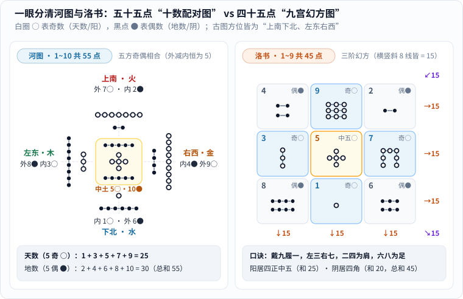
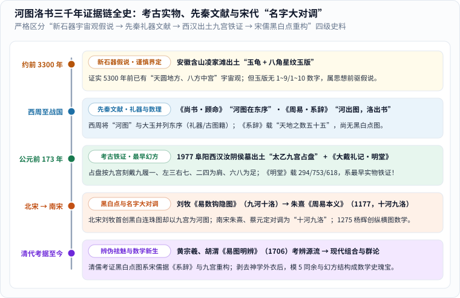
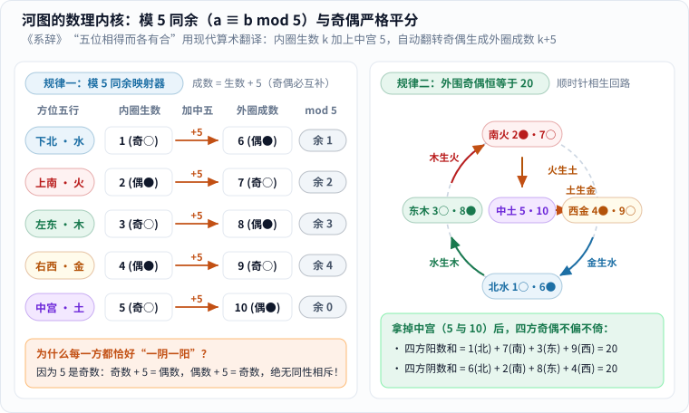
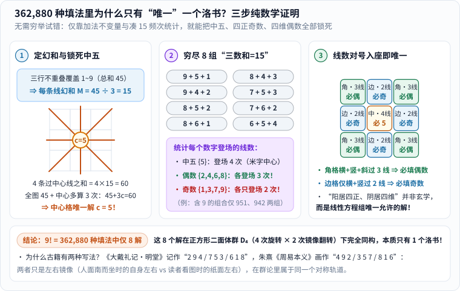
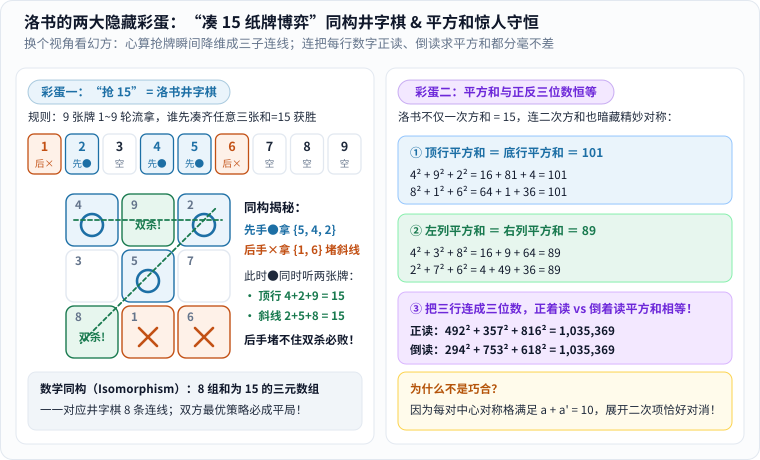

如果你在古建筑藻井、传统罗盘或者老书摊的插页上留意过，一定见过两张长得像“外星摩斯密码”一样的奇怪图案：**一堆白圈圈和黑点点，用细线串成一串串绳结，摆成十字或方阵。**

它们就是中国文化里名气大到无人不知、却又最容易让人一头雾水的头号神秘符号——**河图**与**洛书**。

围绕这两张图，千百年来分裂出了两个极端：一派把它们捧成包治百病、推演天机的“宇宙终极秘籍”；另一派则一摆手，觉得那不过是古人装神弄鬼的算命迷信。可只要你静下心来数一数上面的黑白圆点，再翻开现代考古报告和数学教材，马上就会撞见三桩让人拍案叫绝的事实：

- **第一桩在考古发掘现场**：1977 年，考古学家在安徽阜阳双古堆发掘西汉汝阴侯夏侯灶墓（下葬于公元前 165 年）时，出土了一件刻有**汉文帝七年（公元前 173 年）**纪年的漆器——**太乙九宫占盘** [7]。小圆盘底座上清清楚楚刻着与“洛书”分毫不差的九宫数字，成为目前全世界已知年代最早的三阶幻方实物铁证！
- **第二桩在思想史档案里**：今天全中国印在书上的黑白点《河图》（55 点）和《洛书》（45 点），既不是夏朝大禹画的，也不是周文王画的，而是**北宋学者刘牧**最先用黑白连珠画出来的；更好玩的是，刘牧当年起的名字跟今天**正好反过来**，直到一百多年后**南宋朱熹**大笔一挥把两个名字对调，才变成流传至今的模样 [8]！
- **第三桩在聚会牌桌上**：拿出一副扑克牌里的 $$1 \sim 9$$ 共九张牌摊在桌上，两个人轮流每次抽一张，谁手里的任意三张牌点数加起来先凑够 $$15$$ 谁就赢。没学过诀窍的人在脑子里算加法算到满头大汗，而懂一点洛书的人哪怕闭着眼睛都能立于不败之地——因为这个心算游戏，在数学上和三岁小孩都会玩的**井字棋（Tic-Tac-Toe）**根本是同一盘棋！

把神话归于神话，把历史还给历史，把数理交给数学。今天我们就顺着普通读者最好奇的四个问题，把这两张流传几千年的黑白点阵彻底拆透：

1. **怎么三秒钟分清哪张是河图、哪张是洛书？为什么中国古图偏偏是“上南下北、左东右西”？**
2. **先秦古书里明明没画图，这两张黑白点阵是怎么一步步演变出来的？为什么宋朝会发生一场“名字大对调”？**
3. **河图（55 点）和洛书（45 点）到底藏着什么硬核数学？为什么 $$1 \sim 9$$ 有 $$362{,}880$$ 种填法，三阶幻方却只有洛书这“唯一”一种解？**
4. **南宋数学家杨辉是怎么用 16 个汉字秒排幻方的？洛书里为什么连“三位数倒过来求平方和”都一分不差？**

---

## 一、先认脸再解密：怎么三秒分清河图与洛书？

很多人看河图洛书第一眼就晕，是因为用现代地图的习惯去套古图，结果东南西北全拧巴了。在看点阵之前，先记住一把万能钥匙。

### 1. 读懂古图的第一把钥匙：为什么“上南下北、左东右西”？

打开手机导航，默认永远是“上北下南、左西右东”。但在中国传统图学里，方位恰恰旋转了 $$180^\circ$$——**上南下北，左东右西**。

原因一点也不玄虚：《周易·说卦传》讲**“圣人南面而听天下，向明而治”**。中国黄河流域地处北半球中纬度，阳光终年从偏南方向照过来，所以古代帝王、官署乃至普通人家的正房，全都**坐北朝南**。想象你本人正坐在北屋的椅子上，面朝温暖明亮的南方，低头看铺在面前桌案上的一张图纸：

- 你抬头往前看（图纸的**上方**），就是正前方——**南方**；
- 你后背靠着的地方（图纸的**下方**），就是正后方——**北方**；
- 你左手边（图纸的**左方**），就是太阳升起的地方——**东方**；
- 你右手边（图纸的**右方**），就是太阳落山的地方——**西方**。

只要代入“坐北朝南低头看桌”的视角，所有古书里“前朱雀（南）、后玄武（北）、左青龙（东）、右白虎（西）”的方位就瞬间顺畅了。

### 2. 河图是“十数梅花桩”（55 点），洛书是“九宫米字格”（45 点）

再看图上的圆点，规则同样干净利落：

- **空心白圈（$$\circ$$）代表奇数**（$$1, 3, 5, 7, 9$$），古人称为**“天数”**或**“阳数”**；
- **实心黑点（$$\bullet$$）代表偶数**（$$2, 4, 6, 8, 10$$），古人称为**“地数”**或**“阴数”**。

怎么三秒区分两张图？看下面这张对照蓝图，只需盯住**“有没有 10”**和**“整体轮廓是十字还是方格”**：

_图 1：怎么读这张图——先看左面板【河图】：从 1 到 10 十个数全齐，共 $$1+2+\dots+10 = 55$$ 个点，按“下北、上南、左东、右西、中宫”五个方位各摆“一内一外、一奇一偶”两组绳结（口诀“十为河图”）。再看右面板【洛书】：没有 10，只有 $$1 \sim 9$$ 九个数，共 $$1+2+\dots+9 = 45$$ 个点，摆成 $$3 \times 3$$ 九宫格，横、竖、斜共 8 条直线上的三数之和统统等于 $$15$$（口诀“九为洛书”）。_

对照图 1，两首流传千年的古人口诀一下子就能念出画面感了：

- **左图《河图》（十数配对口诀）**：
  > **天一生水，地六成之**（下北：内 $$1\circ$$ 外 $$6\bullet$$）；
  > **地二生火，天七成之**（上南：内 $$2\bullet$$ 外 $$7\circ$$）；
  > **天三生木，地八成之**（左东：内 $$3\circ$$ 外 $$8\bullet$$）；
  > **地四生金，天九成之**（右西：内 $$4\bullet$$ 外 $$9\circ$$）；
  > **天五生土，地十成之**（中宫：内 $$5\circ$$ 外 $$10\bullet$$）。
- **右图《洛书》（北周甄鸾注《数术记遗》二十字口诀 [5]）**：
  > **戴九履一，左三右七，二四为肩，六八为足，五居中央。**
  > 把洛书想象成一个人：头顶戴着 $$9$$（上），脚底踩着 $$1$$（下），左手拎着 $$3$$，右手拎着 $$7$$，两肩扛着 $$4$$ 和 $$2$$，双脚踏着 $$8$$ 和 $$6$$，肚脐眼正中间坐着 $$5$$！

认清了长相，一个大悬念马上浮出水面：**传说中“龙马从黄河驮出河图、神龟从洛水背出洛书”，难道三四千年前的古书里就印着这两张黑白点阵吗？**

---

## 二、三千年侦探考据：从王室宝玉、西汉占盘到宋代“名字大对调”

如果我们像历史侦探一样，把先秦典籍、汉墓出土文物和宋明清学者的考据报告按时间顺序摊在桌上，会发现河图洛书的真实身世，比神话传说还要跌宕起伏。

### 1. 先秦真相：《尚书》里的东序国宝与《周易》里的无图之名

在现存可靠的先秦文献里，“河图”最早露面是在记录西周康王即位大典的**《尚书·顾命》**中 [1]：

> “越玉五重，陈宝：赤刀、大训、弘璧、琬琰，在西序；**大玉、夷玉、天球、河图，在东序**。”

注意看它的邻居！和“河图”一起摆在王宫东厢房（东序）展出的，全都是**大玉、夷玉、天球**这类连城美玉或镇国礼器。也就是说，在西周王室眼里，“河图”是一件实实在在可以捧在手里的**王室传世宝物**（可能是刻有山川纹理的玉版，也可能是绘在玉石或木牍上的王畿图籍），压根没有提什么黑白圆点。

到了春秋战国，“河图”与“洛书”开始带上受命祥瑞与哲学源头的色彩：

- 孔子在《论语·子罕》里感叹：**“凤鸟不至，河不出图，吾已矣夫！”**——把“黄河出图”和“凤凰降临”并列为太平盛世圣王受命的吉兆；
- **《周易·系辞上传》**第十二章第一次把两者并称：**“河出图，洛出书，圣人则之。”** [2] 同一篇第九章又写下了后来演化成《河图》的灵魂数字结构：
  > “天一地二，天三地四，天五地六，天七地八，天九地十。天数五，地数五，五位相得而各有合。天数二十有五，地数三十，凡天地之数五十有五。” [2]

但关键在于：**整个先秦时期，没有任何一部文献画出过黑白连珠点图，甚至也没有把“天地之数五十五”直接指认为“河图”！**

### 2. 汉代定格与考古铁证：公元前 173 年的“太乙九宫占盘”与凌家滩之辨

到了两汉时期，两条原本平行的线索开始合拢：

一条线索是**思想体系的绑定**。据班固《汉书·五行志上》记载，西汉经学家**刘歆**提出了一个影响此后两千年的经典框架——**伏羲氏受《河图》而画八卦，夏禹治水获赐《洛书》而陈《尚书·洪范》九畴**（“河图、洛书相为经纬，八卦、九章相为表里”）[4]。汉代人还把传说具象化为“龙马负图出河、神龟负文出洛”。

另一条更硬核的线索，则是**三阶幻方（九宫数）在战国秦汉彻底成型**，并且同时留下了文献与考古双料铁证：

- **最早传世文献铁证——《大戴礼记·明堂》** [3]：书中记载古代天子按季节巡行居住的“明堂”共有九室，室号顺序一字不差写着：**“二、九、四，七、五、三，六、一、八”**！北周卢辩注点明：“记用九室，谓法龟文，故取此数，以明其制也。”这正是横竖斜相加皆为 $$15$$ 的三阶幻方。
- **最早出土文物铁证——1977 年安徽阜阳西汉汝阴侯墓“太乙九宫占盘”** [7]：这是第二代汝阴侯夏侯灶的随葬天文式盘，器物明确刻有**汉文帝七年（公元前 173 年）**纪年。占盘下为边长 $$14.2\text{ cm}$$ 的方形地盘，上嵌直径 $$8.3\text{ cm}$$ 的圆形天盘（象征“天圆地方”）；小圆盘按八方与中央刻列九宫数字与节气日数，与《黄帝内经·灵枢·九宫八风》及《易纬·乾凿度》“太一取其数以行九宫，四正四维，皆合于十五”严丝合缝 [7]。**它比欧洲和阿拉伯世界同类的幻方记载早了整整一千多年！**

> **科学严谨边界：5300 年前的“凌家滩玉龟玉版”等于河图洛书吗？**
> 很多读者在网上见过另一种说法：1987 年安徽含山凌家滩新石器时代遗址（距今约 5300 年）出土了一件玉龟，腹背甲之间夹着一片刻有八角星纹、四圭指向四方与四隅的精美玉版，有人直接称它为“五千年前的原始洛书”。
> 这里我们必须把**考古事实**和**学界假说**严格分开：凌家滩玉龟玉版确实雄辩地证明，早在五千多年前，长江下游先民就已经拥有了**“天圆地方、中心八方、龟甲通灵”**的空间宇宙观，完全可能是后世龟卜与九宫思想的远古文化土壤；**但那块玉版上并没有刻 $$1 \sim 9$$ 或 $$1 \sim 10$$ 的数字点阵**。把“宇宙方位雏形”直接等同于“已有完整幻方数学”，就跨过了证据的边界。

### 3. 历史最大反转：北宋刘牧画出黑白点，南宋朱熹把两个名字对调了！

那么，今天全天下通行的这两张“黑白圆点连线图”，究竟是什么时候定型的？答案在**宋朝**——而且中间还闹过一场著名的“冠名权大反转” [8]！

_图 2：河图洛书三千年证据链分级图。顺着左侧年份自上而下阅读：每一行的白色胶囊明确标出了史料等级——从新石器宇宙观前驱假说、先秦文献、西汉公元前 173 年“太乙九宫占盘”实物铁证，一直到宋代刘牧首创黑白点图、朱熹拍板对调“十河九洛”，以及清代胡渭《易图明辨》的考据祛魅。_

顺着图 2 第四个节点看，这段宋代学术公案精彩得像一部悬疑剧 [8]：

1. **北宋刘牧首创黑白连珠图，却叫“九为河图、十为洛书”**：北宋学者**刘牧**（1011–1064）在《易数钩隐图》里提出“象由数设”，创造性地借用结绳记事的意象，用白圈（奇/阳）和黑点（偶/阴）画出了抽象数字图。但刘牧认为伏羲同时受河图洛书，否定了汉儒“大禹受洛书陈九畴”之说，把**九宫 45 点幻方图命名为《河图》**，反倒把**天地之数 55 点图命名为《洛书》**（史称**“九河十洛”**），风行北宋近百年 [8]。
2. **南宋蔡元定与朱熹联手“拨乱反正”，对调成“十为河图、九为洛书”**：到了南宋淳熙四年（1177 年），理学集大成者**朱熹**编撰《周易本义》，与门人**蔡元定**合撰《易学启蒙》时敏锐地发现：刘牧的命名有两大硬伤——《周易·系辞》本经里明明白白写着“天地之数五十有五”，怎能不归入作为画卦之源的《河图》？而《尚书·洪范》讲“九畴”，用九宫 45 点作为《洛书》岂不天衣无缝？于是朱熹毅然将两图名字对调，正式拍板为**“五十五点为河图，四十五点为洛书”（十河九洛）** [8]！
3. **清代考据学家的真相揭秘**：因为朱熹《周易本义》成为元、明、清三朝科举考试的官方标准教材，“十河九洛”从此一统天下。直到清初，大儒**黄宗羲**《易学象数论》与**胡渭**《易图明辨》（1706 年）抽丝剥茧考证指出：朱熹当年借以自称“复古”的《关氏易传》其实是北宋阮逸伪托之书；黑白点图确实是宋儒依据《系辞》“天地之数”与汉代“九宫算”推演重构出来的数理模型 [8]。

然而，奇妙的事情就在这里：**哪怕剥掉了“上古神兽原图”的神话光环，宋儒重构并保留下来的这两组数字阵列本身，在纯粹数学上依然美得令人窒息！**

---

## 三、拆开河图（55 点）：藏在五行口诀里的“模 5 同余”与奇偶对称

很多初学者看《河图》，觉得“一六在下、二七在上、三八在左、四九在右、五十居中”像是死记硬背的算命口诀。但如果你学过我们在[《高斯到底发明了什么？从 1 加到 100 开始》]()里聊过的**同余算术（Modular Arithmetic）**，一眼就能看穿它的数学底牌。

### 1. “生数”加 5 变“成数”：两千年前的模 5 同余类（$$\pmod 5$$）

先把 $$1 \sim 10$$ 的总账算清楚（这正是少年高斯最拿手的等差数列求和）：

- **五个奇数（天数 $$\circ$$）**：$$1 + 3 + 5 + 7 + 9 = 25$$；
- **五个偶数（地数 $$\bullet$$）**：$$2 + 4 + 6 + 8 + 10 = 30$$；
- **天地总数**：$$25 + 30 = 55$$。

接下来，古人把较小的 $$1, 2, 3, 4, 5$$ 叫做**“生数”**（摆在五个方位的内圈），把较大的 $$6, 7, 8, 9, 10$$ 叫做**“成数”**（摆在五个方位的外圈）。为什么偏偏是 $$1$$ 配 $$6$$、$$2$$ 配 $$7$$、$$3$$ 配 $$8$$、$$4$$ 配 $$9$$、$$5$$ 配 $$10$$？

用现代数论写出来只有一行字：**外圈成数 $$b$$ 与内圈生数 $$a$$ 除以 $$5$$ 的余数完全相同！**

$$
b = a + 5 \quad \Longleftrightarrow \quad b \equiv a \pmod{5}, \qquad a \in \{1, 2, 3, 4, 5\}
$$

换句话说，《河图》的东南西北中五个方位，不多不少正好对应整数环除以 $$5$$ 的**五个剩余类（$$\mathbb{Z}/5\mathbb{Z}$$）**：余 $$1$$ 归北水，余 $$2$$ 归南火，余 $$3$$ 归东木，余 $$4$$ 归西金，余 $$0$$ 归中土！《周易·系辞》那句玄之又玄的“五位相得而各有合”，翻译成白话就是：**内圈生数加上中央的“$$5$$”，就平移生成了外圈成数** [2, 5]！

_图 3：河图的数理内核。先看左面板：从第 1 行到第 5 行，内圈生数 $$1 \sim 5$$ 经过中间橙色“$$+5$$”箭头平移得到外圈成数 $$6 \sim 10$$，因为 $$5$$ 本身是奇数，每一行都自动把“奇变偶、偶变奇”，保证每一方都恰好一阴一阳。再看右面板：顺着圆环虚线顺时针走一圈（北水 $$\to$$ 东木 $$\to$$ 南火 $$\to$$ 中土 $$\to$$ 西金 $$\to$$ 北水），正好构成五行相生闭环；更绝的是拿掉中宫 $$5$$ 和 $$10$$ 后，四方阳数和与四方阴数和分毫不差都等于 $$20$$！_

### 2. 为什么每一方都“一阴一阳”，且外围奇偶严格平分？

顺着图 3 往下深挖一层，你会发现古人把 $$1 \sim 4$$ 排在四方时，还精巧地满足了两条对称守恒律：

1. **局部阴阳必互补**：因为平移步长 $$5$$ 是一个**奇数**，根据初等算术里的奇偶性法则：
   $$\text{奇数} + 5 = \text{偶数}, \qquad \text{偶数} + 5 = \text{奇数}$$
   所以不管内圈放的是奇数（$$1, 3, 5$$）还是偶数（$$2, 4$$），加上 $$5$$ 之后得到的搭档必然奇偶相反！五大方位**每一方都自动实现“一奇一偶、孤阴不生、独阳不长”**，绝不会出现两奇同窝或两偶同窝。
2. **全局外围奇偶严格等于 $$20$$**：整张图奇数和是 $$25$$、偶数和是 $$30$$，表面看偶数比奇数多 $$5$$。但你看中宫：内 $$5$$（奇）与外 $$10$$（偶）恰好把这 $$5$$ 点的差额全部留在了正中央（$$10 - 5 = 5$$）！一旦扣掉中宫的 $$5$$ 和 $$10$$，**外围东南西北四个方向上的白圈总数与黑点总数完全相等**：
   $$
   \begin{aligned}
   \text{四方阳数（白圈）之和} &= 1\text{（北）} + 7\text{（南）} + 3\text{（东）} + 9\text{（西）} = 20 \\
   \text{四方阴数（黑点）之和} &= 6\text{（北）} + 2\text{（南）} + 8\text{（东）} + 4\text{（西）} = 20
   \end{aligned}
   $$
   再看方位走向：奇数 $$1 \to 3 \to 7 \to 9$$ 从下（北）经左（东）升到上（南）再转右（西），偶数 $$2 \to 4 \to 6 \to 8$$ 从上（南）经右（西）降到下（北）再转左（东），两股气流如同双螺旋一样顺时针缠绕推进。难怪宋代学者一看到这组数，会忍不住惊叹它把对称性玩到了极致。

---

## 四、拆开洛书（45 点）：36 万种填法里，为什么只有“唯一”一个三阶幻方？

如果说《河图》展示的是**同余与分类对称**，那么《洛书》展示的就是组合数学里大名鼎鼎的**三阶幻方（Magic Square of Order 3）**：把 $$1 \sim 9$$ 九个互不相同的正整数填进 $$3 \times 3$$ 方格，使得**三横、三竖、两条对角线（共 8 条直线）上三个数字之和全都相等**。

你可能会好奇：九个格子随便填 $$1 \sim 9$$，一共有 $$9! = 9 \times 8 \times 7 \times \dots \times 1 = 362{,}880$$ 种不同填法！在三十六万多种排法里，除了洛书之外，还能不能凑出第二种完全不同的三阶幻方？

答案斩钉截铁：**不能！不用计算机暴力穷举，我们只用小学加法和三步逻辑推理，就能在两分钟内证明——全宇宙的三阶幻方只有洛书这“唯一”一种结构！**

_图 4：洛书唯一性的三步纯数学证明。请按 ① $$\to$$ ② $$\to$$ ③ 顺序跟读：面板 ① 用三行总和算出幻和 $$M=15$$，再用穿过中心的“米”字四线之和推出中心格必为 $$5$$；面板 ② 穷举 $$1 \sim 9$$ 中所有和为 $$15$$ 的 8 个三元组，发现偶数各出现 3 次、除 5 外的奇数各只出现 2 次；面板 ③ 对照九宫格每个位置承担的直线条数（角格 3 条、边格 2 条），当场锁死“偶居四角、奇居四边”；底部横栏说明 8 个解在正方形对称群 $$D_4$$ 下完全同构。_

我们跟着图 4，亲手把这个漂亮得像水晶一样的证明推一遍：

### 1. 第一步：三行总和定死幻和 $$M = 15$$，“米”字四线锁死正中心必为 $$5$$

设每条直线上三个数的固定总和（称为**幻和**）为 $$M$$。
看九宫格的**上、中、下三行**：这三行不重不漏地把 $$1 \sim 9$$ 九个数字全部盖住了一遍。既然 $$1 + 2 + \dots + 9 = 45$$，那么三行加起来就是 $$3M = 45$$，立刻得出：

$$
M = \frac{45}{3} = 15
$$

接下来求最正中间那一格的数字，设它为 $$c$$。请盯住图 4 面板 ① 里穿过中心格的那 **4 条橙色直线**（中间一横、中间一竖、左上到右下对角线、右上到左下对角线）：

- 把这 4 条直线上的数字全部加起来，总和当然等于 $$4M = 4 \times 15 = 60$$；
- 另一方面，这 4 条直线把周围 8 个格子**每个恰好算了 1 次**，唯独把最中间的 $$c$$ **重复算了 4 次**（比全图总和 $$45$$ 多算了 $$3$$ 次 $$c$$）！

于是列出一元一次方程：

$$
45 + 3c = 60 \quad \Longrightarrow \quad 3c = 15 \quad \Longrightarrow \quad c = 5
$$

没有任何试错余地：**只要是三阶幻方，最正中央那一格雷打不动必须是 $$5$$（“五居中央”）！** 而且任何穿过中心的直线上，两头相对的两个数加起来都必须等于 $$15 - 5 = 10$$（即 $$1$$ 对 $$9$$、$$2$$ 对 $$8$$、$$3$$ 对 $$7$$、$$4$$ 对 $$6$$）。

### 2. 第二步：为什么“阳居四正、阴居四维”不是玄学，而是组合计数逼出来的？

很多讲风水的书会神秘兮兮地说：“洛书把奇数 $$1, 3, 7, 9$$ 放在上下左右四个正方向（四正），把偶数 $$2, 4, 6, 8$$ 放在四个角落（四维），是因为阳气刚健走直线、阴气柔顺守角落。”

其实根本不用搬出阴阳气场！我们把 $$1 \sim 9$$ 里**所有“三个不同数字相加等于 $$15$$”的组合**全部列出来（图 4 面板 ②），从大到小一个不漏，总共只有 **8 组**：

$$
\begin{aligned}
&9 + 5 + 1 = 15, \qquad 9 + 4 + 2 = 15, \\
&8 + 5 + 2 = 15, \qquad 8 + 6 + 1 = 15, \qquad 8 + 4 + 3 = 15, \\
&7 + 5 + 3 = 15, \qquad 7 + 6 + 2 = 15, \\
&6 + 5 + 4 = 15.
\end{aligned}
$$

现在数一数每个数字在这 8 组算式里**一共登场了几次**：

- **中心数 $$5$$**：登场 **4 次**（正好对应穿过中心的 4 条线）；
- **四个偶数 $$\{2, 4, 6, 8\}$$**：每个数字都恰好登场 **3 次**！（比如含 $$8$$ 的有 $$8+5+2$$、$$8+6+1$$、$$8+4+3$$ 三组）；
- **其余四个奇数 $$\{1, 3, 7, 9\}$$**：每个数字都只登场 **2 次**！（比如含 $$9$$ 的只有 $$9+5+1$$ 和 $$9+4+2$$ 两组，再也凑不出第三组了！）。

再回头看图 4 面板 ③ 九宫格的几何位置：

- **四个角落格（四维）**：每个角同时属于“一横 + 一竖 + 一条对角线”，一共要满足 **3 条**和为 $$15$$ 的直线！既然 $$9$$（以及 $$1, 3, 7$$）全身上下只有 **2 组**凑 $$15$$ 的搭档，把 $$9$$ 塞进角落，第 3 条线当场就会“断粮”无解！所以**四个角落格只能填登场 3 次的偶数 $$\{2, 4, 6, 8\}$$**；
- **四个边中点（四正）**：每条边的中点只属于“一横 + 一竖” **2 条**直线，正好安放登场 2 次的奇数 $$\{1, 3, 7, 9\}$$！

一旦你在上边中点放下 $$9$$，下边中点必然是 $$10 - 9 = 1$$（**戴九履一**）；第一行包含 $$9$$ 且不过中心，只能用 $$9$$ 的另一组搭档 $$9 + 4 + 2 = 15$$，所以左上、右上两肩必然是 $$4$$ 和 $$2$$（**二四为肩**）；它们的对角 $$10 - 2 = 8$$、$$10 - 4 = 6$$ 自动落入左下、右下双足（**六八为足**）；最后左列 $$4 + 8 = 12$$ 缺 $$3$$，右列 $$2 + 6 = 8$$ 缺 $$7$$（**左三右七**）——整张洛书一气呵成，连一格自由改动的余地都没有！

### 3. 第三步：正方形对称群 $$D_4$$——为什么古书里有“492”和“294”两种洛书？

细心的读者刚才可能发现了一个小细节：

- 我们在《大戴礼记·明堂》里读到的顺序是：**第一行 `2 9 4`、第二行 `7 5 3`、第三行 `6 1 8`** [3]；
- 可朱熹《周易本义》和我们图 1 画的却是：**第一行 `4 9 2`、第二行 `3 5 7`、第三行 `8 1 6`** [8]。

难道这两者矛盾吗？一点也不！还记得我们在[《群论和集合，以及那些数学家》]()里介绍过的**正方形二面体对称群 $$D_4$$** 吗？

一张正方形纸片在空间里保持形状不变的刚体对称操作，一共有 **8 种**：绕中心旋转 $$0^\circ, 90^\circ, 180^\circ, 270^\circ$$（4 种旋转），外加沿横轴、纵轴、两条对角线的镜像翻转（4 种翻转）。把洛书做这 8 种旋转或翻转，横竖斜的和当然不会变，于是就在 $$362{,}880$$ 种排列里生成了**恰好 8 个合法幻方**——在抽象代数里，它们属于同一个群作用轨道，**本质上是同一个幻方的 8 张“自拍照”**！

而《明堂》的 `2 9 4` 和朱熹的 `4 9 2`，恰好只是**左右镜像翻转**：《明堂》站在“天子坐北朝南”本人的视角说“左三（东在自己左手边）右七（西在自己右手边）”；读者正对着纸面看时，纸面左边放 `3`、右边放 `7`，写出来就是 `4 9 2 / 3 5 7 / 8 1 6`。

---

## 五、古人怎么秒填幻方？南宋杨辉的十六字构造算法

如果每次排幻方都要列方程推理一遍，多少还是费点脑筋。到了南宋度宗咸淳十一年（**1275 年**），杭州出身的大数学家**杨辉**在《续古摘奇算法》卷上开辟了专门研究幻方的篇章 [6]。

杨辉做了一件在科学史上非常了不起的事：**他把河图洛书身上缠绕了上千年的占卜灾异色彩洗得干干净净，给幻方起了一个纯粹的数学名字——“纵横图”**，一口气给出了从三阶（洛书）直到十阶幻方的系统排法 [6]！其中排三阶洛书的口诀，只有朗朗上口的 **16 个汉字**：

> **“九子斜排，上下对易，左右相更，四维挺出。”** [6]

很多书只抄了这 16 个字，却没讲清楚第一步“斜排”到底怎么斜、最后一步“四维挺出”在几何上到底是什么意思。看下面这张四步分解与单次归位演示图，一眼就能顿悟（若页面加载后右侧动画已定格在终态，可[单独打开杨辉九子斜排 SVG 原图](/assets/images/hetu-luoshu/yang-hui-jiuzi-xiepai.svg)刷新重播，静态阅读左侧 ①–④ 四格同样完整呈现全部步骤）：

_图 5：杨辉十六字构造术。先看左侧静态四步：① 把方格顺时针歪转 $$45^\circ$$ 成菱形，顺着三条蓝虚线斜行依次写下 `1,2,3`、`4,5,6`、`7,8,9`；② 顶角 `1` 与底角 `9` 上下互换；③ 左角 `7` 与右角 `3` 左右互换；④ 把原本缩在内圈斜边上的 `4, 2, 8, 6` 向外推出到正方形四角，瞬间得到洛书！右侧面板用 8 秒单次动画演示同一几何归位过程并停留在完整幻方终态（开启系统“减少动态效果”时直接静态显示终态）。_

### 1. 为什么最后一步叫“四维挺出”？一个惊艳的几何小细节

跟着图 5 做完前两步互换（`1` 与 `9` 换、`7` 与 `3` 换）之后，很多第一次在草稿纸上画的人会愣一下：“咦，数字明明都已经换好了，为什么杨辉还要多此一举写一句**‘四维挺出’**？”

算一下欧氏几何距离你就拍大腿了！假设最终 $$3 \times 3$$ 九宫格相邻两格的步长是 $$s = 48$$：

- 在第 ① 步旋转 $$45^\circ$$ 的斜排菱形里，相邻点沿对角线方向的投影间距只有 $$d = \frac{s}{\sqrt{2} } = \frac{48}{1.414} \approx 34$$！
- 这意味着，当顶底的 `9`、`1` 和左右的 `3`、`7` 缩回到距离中心 $$48$$ 的四边中点时，斜边上的 `4, 2, 8, 6` 横纵坐标还停留在 $$(\pm 34, \pm 34)$$，**视觉上凹陷在正方形边框里面**！
- 只有把 `4, 2, 8, 6` 沿着四条对角线向外“挺胸推出”约 $$14$$ 个单位，推到 $$(\pm 48, \pm 48)$$ 的四个直角顶点上，凹陷的菱形才会“啪”一声撑开成方方正正的九宫格！古人用词之精准，连 $$1/\sqrt{2}$$ 的几何收缩都观察得一清二楚。

### 2. 这套办法能推广吗？顺便看一个反例：为什么“二阶幻方”绝对不存在？

杨辉这套“斜排再把越界数字平移回对侧”的思想（西方直到 17 世纪才由法国数学家巴谢 Bachet 独立发现，称为**巴谢露台法 Terrace Method**），不仅能秒排三阶洛书，还能直接推广到**任意奇数阶**（$$5 \times 5$$、$$7 \times 7$$、$$9 \times 9 \dots$$）幻方！一般地，把 $$1 \sim n^2$$ 填进 $$n \times n$$ 幻方，每行每列的幻和公式为：

$$
M(n) = \frac{1}{n} \sum_{k=1}^{n^2} k = \frac{n(n^2 + 1)}{2}
$$

- 当 $$n = 1$$ 时，$$M(1) = 1$$（只有一个数 `1`，平凡成立）；
- 当 $$n = 3$$ 时，$$M(3) = \frac{3 \times 10}{2} = 15$$（洛书）；
- 当 $$n = 4$$ 时，$$M(4) = \frac{4 \times 17}{2} = 34$$（德国画家丢勒 1514 年名画《忧郁 I》背景里刻的就是四阶幻方，杨辉早在 1275 年已给出“阴图”四阶构造法 [6]）；
- **唯独当 $$n = 2$$ 时（二阶幻方），全宇宙一个解都没有！** 证明只需一句话：假设把 $$1, 2, 3, 4$$ 填进 $$2 \times 2$$ 格子 $$\begin{smallmatrix} a & b \\ c & d \end{smallmatrix}$$，若第一行之和等于第一列之和，即 $$a + b = a + c$$，两边消去 $$a$$ 立刻得出 $$b = c$$——与四个数字互不相同直接矛盾！所以除了平凡的 $$1 \times 1$$ 外，**洛书（$$3 \times 3$$）正是人类能够构造出的最小非平凡幻方**。

---

## 六、洛书的两个高能彩蛋：必胜“凑 15”棋局与逆天平方和守恒

如果故事只讲到这里，洛书已经足够传奇了。但现代数学家和博弈论学者把洛书翻过来倒过去研究时，又挖出了两个让人直呼不可思议的隐藏彩蛋。

_图 6：洛书的两大隐藏彩蛋。左面板展示如何把扑克牌“轮流抽 $$1 \sim 9$$ 凑 15”翻译成洛书棋盘上的井字棋——先手拿 `{5, 4, 2}` 后同时听顶行 `9` 与斜线 `8` 形成必胜双杀；右面板展示洛书惊人的二次方对称性，不仅顶行与底行平方和同为 $$101$$、左列与右列平方和同为 $$89$$，连把三行看成三位数正着读与倒着读求平方和都恒等于 $$1{,}035{,}369$$！_

### 1. 彩蛋一：聚会破冰神技——“轮流抓牌凑 15”其实是蒙着眼下井字棋！

回到文章开头的扑克牌游戏：桌上摊开红桃 $$A(1) \sim 9$$ 共九张牌，两人轮流每次拿走一张，**谁手里的牌最先能挑出三张加起来等于 $$15$$，谁就获胜**（注意：手里如果有四张牌，只要其中任意三张之和为 $$15$$ 就算赢；九张抓完都没凑出 $$15$$ 则平局）。

普通玩家玩这个游戏，脑子里全是乱麻一样的算术：“我手里有 `5` 和 `4`，还差 `6`；哎呀他拿了 `6`，那我拿 `2` 吧，对手现在有 `1` 和 `6`，他差 `8`……”稍一走神就漏算一步。

可还记得我们刚才在第四节严格证明过的结论吗？

- 在 $$1 \sim 9$$ 当中，**三个不同数字之和等于 $$15$$ 的无序组合，不多不少只有 8 组**；
- 而在洛书 `4 9 2 / 3 5 7 / 8 1 6` 里，**三横、三竖、两斜也恰好是这 8 组**！

这意味着什么？在数学上，这个规律叫做**同构（Isomorphism）**——两个表面规则截然不同的系统，底层结构一模一样（我们在[《游戏背后的数学：如何在游戏中必胜》]()里专门讲过这种降维打击思想）！

只要你在脑海里（或者悄悄在餐巾纸角落）画一个洛书九宫格，对手抽哪张牌你就在对应数字上画 `×`，自己抽哪张牌就画 `○`：

- 抢数字 **`5`** $$=$$ 占领井字棋最核心的**天元中心格**；
- 抢偶数 **`2, 4, 6, 8`** $$=$$ 占领井字棋威力第二大的**四个角格**；
- 抢奇数 **`1, 3, 7, 9`** $$=$$ 走最弱的**四条边中点**！

看图 6 左面板的实战复盘：如果你先手拿了中心 `5`，不知情的对手觉得 `1` 最小最不起眼，随手拿了 `1`（在井字棋里等于回应了最弱的“边格”，一步铸成败局！），你立刻拿左上角 `4`；对手赶紧拿 `6` 堵住你的 `4+5+6=15`；你紧接着拿右上角 `2`——此时你手里握着 `{5, 4, 2}`，同时在顶行听 `9`（$$4+2+9=15$$）、在副对角线听 `8`（$$2+5+8=15$$）！对手下一回合只能堵一张，你稳稳双杀获胜！而如果双方都懂洛书井字棋，最优策略下必然握手言和。

### 2. 彩蛋二：不止一次方和相等，连“三位数正反读平方和”都一模一样！

再看图 6 右面板。通常我们只要求幻方每行“一次方之和”相等（$$4+9+2 = 8+1+6 = 15$$），从来没敢奢望把每个数字**平方**之后还能相等。可你拿计算器按一下洛书的上下两行和左右两列：

- **顶行平方和 vs 底行平方和**：
  $$4^2 + 9^2 + 2^2 = 16 + 81 + 4 = 101, \qquad 8^2 + 1^2 + 6^2 = 64 + 1 + 36 = 101$$
- **左列平方和 vs 右列平方和**：
  $$4^2 + 3^2 + 8^2 = 16 + 9 + 64 = 89, \qquad 2^2 + 7^2 + 6^2 = 4 + 49 + 36 = 89$$

还没完！更震撼的来了——把洛书三行的数字直接拼成三个**三位数**，从左往右正着读是 `492`、`357`、`816`；从右往左倒着读是 `294`、`753`、`618`。不仅正读之和等于倒读之和（$$492 + 357 + 816 = 1665 = 294 + 753 + 618$$），**把它们各自平方再相加，居然连个位数都分毫不差**！

$$
\begin{aligned}
492^2 + 357^2 + 816^2 &= 242{,}064 + 127{,}449 + 665{,}856 = 1{,}035{,}369 \\
294^2 + 753^2 + 618^2 &= 86{,}436 + 567{,}009 + 381{,}924 = 1{,}035{,}369
\end{aligned}
$$

竖着拼成三位数正读倒读也一样成立（$$438^2 + 951^2 + 276^2 = 834^2 + 159^2 + 672^2 = 1{,}172{,}421$$）！

这难道是什么超自然神迹吗？用初中代数展开两行就能揭晓谜底：
设第 $$i$$ 行三个数为 $$(a_i, b_i, c_i)$$（$$i=1,2,3$$）。正读三位数是 $$100a_i + 10b_i + c_i$$，倒读三位数是 $$100c_i + 10b_i + a_i$$。求两者的平方和之差：

$$
\sum_{i=1}^{3} \bigl[(100a_i + 10b_i + c_i)^2 - (100c_i + 10b_i + a_i)^2\bigr]
= 9999 \sum_{i=1}^{3} (a_i^2 - c_i^2) + 1980 \sum_{i=1}^{3} b_i(a_i - c_i)
$$

看清这两项为什么同时归零了吗？

1. 第一项里 $$\sum a_i^2$$ 是左列平方和（$$89$$），$$\sum c_i^2$$ 是右列平方和（$$89$$），所以 $$\sum (a_i^2 - c_i^2) = 89 - 89 = 0$$！（而左右两列平方和之所以相等，又因为左列每个数 $$a_i$$ 恰好等于右列中心对称格 $$10 - c_{4-i}$$，且左列之和 $$=$$ 右列之和 $$= 15$$，展开 $$\sum (10 - c)^2 = 300 - 20\sum c + \sum c^2 = 300 - 300 + \sum c^2 = \sum c^2$$！）
2. 第二项直接算更干脆：$$(9 \times 2 + 5 \times (-4) + 1 \times 2) = 18 - 20 + 2 = 0$$！

**所有看似通神的巧合，底层全都是“中心对称 $$a + a' = 10$$”与“行列定和 $$= 15$$”共同编织出的代数必然。**

---

## 七、结语：给古图祛魅，恰恰是对古人智慧最大的敬意

回头再看《河图》与《洛书》，我们大可不必把它们当成包打天下的玄学符咒，也不必因为后世方士附会过迷信就把它们一棍子打死。

在没有阿拉伯数字、没有现代代数符号的上古与中古中国，先民们用最朴素的白圈和黑点：

- 在**《河图》**里，直观画出了**模 $$5$$ 同余类（$$b \equiv a \pmod 5$$）**与**奇偶反演平衡**；
- 在**《洛书》**里，早在公元前 173 年之前就独立发现了人类历史上第一个、也是三阶唯一存在的**幻方结构**，并在 1275 年由杨辉提炼出了优美至极的**构造算法**。

当我们剥去“神马献图、灵龟赐书”的神话外壳，用考古铲、文献考据和现代数学看清它们的来龙去脉时，这两张黑白点阵非但没有变得黯淡，反而穿越三千年时光，露出了人类早期数理理性最清澈、最迷人的光芒。

下次朋友聚会，不妨抽出 $$1 \sim 9$$ 九张扑克牌，一边跟孩子或朋友来一局“抢 15”，一边把“戴九履一、左三右七、二四为肩、六八为足”的千年秘密讲给他们听吧！

---

## 参考资料与核查说明

本文涉及的先秦汉唐典籍原文、西汉出土文物信息、宋明清易图演变考证及幻方数学史均已逐一核查一手文献与权威学术资料，供延伸查证：

1. **《尚书·顾命》**（先秦传世文献，“河图”最早记载）：[维基文库《尚书·顾命》原文](https://zh.wikisource.org/zh-hans/%E5%B0%9A%E6%9B%B8/%E9%A1%A7%E5%91%BD)——核实“大玉、夷玉、天球、河图，在东序”，证实西周王室将“河图”与玉制重器并列陈设于东厢。
2. **《周易·系辞上传》**（首次并提“河出图，洛出书”及“天地之数五十五”）：[维基文库《周易·系辞上》原文](https://zh.wikisource.org/zh-hans/%E5%91%A8%E6%98%93/%E7%B9%AB%E8%BE%AD%E4%B8%8A)——核实第九章“天一地二……天数二十有五，地数三十，凡天地之数五十有五”与第十一章“河出图，洛出书，圣人则之”。
3. **《大戴礼记·明堂第六十七》**（现存最早明确写出三阶幻方九数的传世文献）：[维基文库《大戴礼记·明堂》原文](https://zh.wikisource.org/zh-hans/%E5%A4%A7%E6%88%B4%E7%A6%AE%E8%A8%98/%E6%98%8E%E5%A0%82)——核实“二、九、四，七、五、三，六、一、八”及北周卢辩注“法龟文”。
4. **班固《汉书·五行志上》**（刘歆“河图—八卦、洛书—洪范九畴”范式记载）：[维基文库《汉书·卷二十七上》原文](https://zh.wikisource.org/zh-hans/%E6%BC%A2%E6%9B%B8/%E5%8D%B7027%E4%B8%8A)——核实“刘歆以为虙羲氏继天而王，受河图，则而画之，八卦是也；禹治洪水，赐洛书，法而陈之，《洪范》是也”。
5. **汉·徐岳撰、北周·甄鸾注《数术记遗》**（洛书九宫二十字口诀与五行生数成数配对原文）：[维基文库《数术记遗》原文](https://zh.wikisource.org/zh-hans/%E6%95%B8%E8%A1%93%E8%A8%98%E9%81%BA)——核实“九宫算”条下甄鸾注“二四为肩，六八为足，左三右七，戴九履一，五居中央”及“成数算”条下生数加五为成数记载。
6. **MacTutor 数学史档案（英国圣安德鲁斯大学）— 杨辉传记与《续古摘奇算法》（1275）**：[Yang Hui — MacTutor History of Mathematics](https://mathshistory.st-andrews.ac.uk/Biographies/Yang_Hui/)——核实南宋数学家杨辉在 1275 年《续古摘奇算法》中以纯粹数学视角系统研究三阶（洛书）至十阶幻方（纵横图）及其构造算法。
7. **安徽阜阳双古堆西汉汝阴侯墓（公元前 173 年“太乙九宫占盘”）考古报告综述**：安徽省文物考古研究所编著《阜阳双古堆汉墓》（中华书局，2023 年；参见殷涤非《西汉汝阴侯墓出土的占盘和天文仪器》，《考古》1978 年第 5 期）及[中安在线文化频道专文评介](http://cul.anhuinews.com/xwwh/202305/t20230504_6837152.html)——核实 1977 年出土之汉文帝七年（前 173 年）太乙九宫占盘形制（方盘边长 14.2 cm、圆盘直径 8.3 cm）及其九宫洛书数字布局。
8. **陈岘：《宋代河图洛书范式之重构及其文明源起意象》，《中国哲学史》2025 年第 6 期**：[儒家网全文转载页](https://www.rujiazg.com/article/31406)——核实北宋刘牧《易数钩隐图》首绘黑白点图并定“九为河图、十为洛书”，南宋朱熹、蔡元定于《周易本义》（1177）对调为“十为河图、九为洛书”，以及清代黄宗羲、胡渭《易图明辨》对《关氏易传》伪书与宋儒重构过程的考辨。
