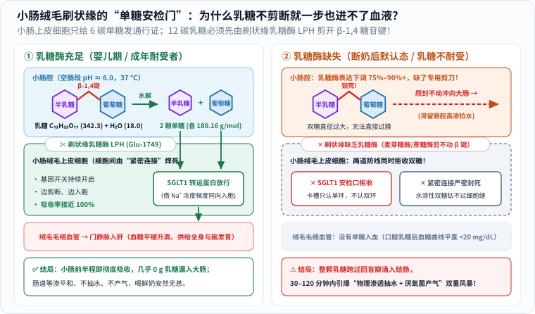
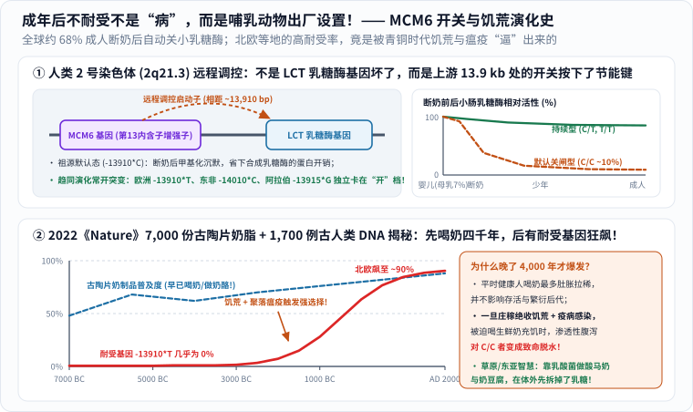
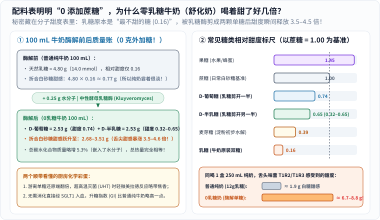
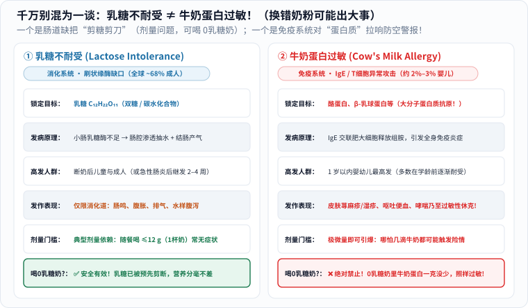
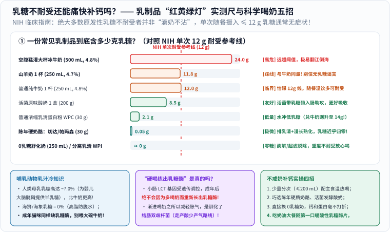

早起赶时间，从冰箱里拿出一盒冰镇纯牛奶，“咕咚咕咚”空腹灌下去。刚出门坐上地铁不到四十分钟，肚子里忽然传来一阵像拧开气泡水瓶盖似的“咕噜——咕噜——”声，紧接着小腹发胀、隐隐绞痛，逼得人冷汗直冒，满脑子只剩下一件事：下一站地铁口到底有没有卫生间？

如果你或身边的家人经历过这一幕，恭喜你——你一点都不孤单。但要是把这件小事往深里多问三句，三个特别反直觉的科学谜题就会立刻冒出来：

1. **小时候明明人人都是“喝奶高手”，怎么长大反而废了？** 人类母乳里的乳糖浓度高达约 $$7.0\%$$，比普通纯牛奶（约 $$4.8\%$$）还要高出近一半 [5][7]！婴儿顿顿拿母乳当唯一主食都能长得白白胖胖，为什么成年后喝一盒乳糖更低的牛奶，肠道反而招架不住？
2. **全球大多数成年人都不耐受，难道大半个人类都“生病”了？** 据美国国立卫生研究院（NIH）汇总的全球流行病学数据，全世界约 **$$68\%$$** 的人口在断奶后会出现乳糖吸收不良，在东亚人群中这一比例更是高达 **$$70\%\text{–}100\%$$** [1][2]。一个覆盖全球三分之二人口的现象，真的是“缺陷”吗？恰恰相反——**成年后关掉乳糖消化能力，才是哺乳动物出厂自带的节能默认设置；欧美牧民终身猛灌鲜奶不拉肚子，反倒是最近几千年被饥荒与瘟疫逼出来的基因突变“外挂”** [2][4]！
3. **“0 乳糖牛奶”配料表里一粒白糖都没加，为什么喝着甜了好几倍？** 买过无乳糖牛奶（俗称舒化奶）的朋友几乎都有同一个疑惑：配料表上清清楚楚只写着“生牛乳、乳糖酶”，既没加蔗糖也没加代糖，可入口那股清甜味怎么比普通纯牛奶浓郁三四倍？

这三个谜题背后，串起了一条从**小肠微绒毛跨膜物理、范特霍夫渗透压方程、结肠厌氧微生物发酵、2 号染色体远程增强子调控，一直延伸到史前考古与现代食品工程**的奇妙证据链。出发前，我们先把几种最容易混淆的“喝奶反应”底牌摊在桌上（数据核定自 NIH NIDDK [1]、MedlinePlus Genetics [2] 与 OpenStax 生理学教材 [3]）：

| 临床类型 / 常见混淆 | 核心问题出在哪儿 | 锁定分子靶点 | 高发人群与可逆性 | 单次喝 `250 mL` 0 乳糖奶安全吗 |
| --- | --- | --- | --- | --- |
| **原发性乳糖不耐受**（乳糖酶非持续型）[1][2] | 断奶后 `MCM6` 开关正常下调 `LCT` 表达，刷状缘乳糖酶降至婴儿期约 $$10\%$$ | **乳糖**（$$\mathrm{C_{12}H_{22}O_{11} }$$ 双糖） | 全球约 $$68\%$$、东亚 $$70\%\text{–}100\%$$ 成人；属正常生理遗传态 | **完全安全**（乳糖已被预剪开） |
| **继发性乳糖不耐受**（肠黏膜受损型）[1] | 轮状/诺如病毒肠炎、乳糜泻或炎症削平微绒毛尖端，乳糖酶暂时脱落 | **乳糖**（双糖） | 急性腹泻恢复期的婴幼儿或成人；黏膜修复后 **$$2\text{–}4$$ 周多可自愈** | **安全且推荐过渡期使用** |
| **先天性乳糖酶缺乏**（极罕见遗传病）[1][2] | `LCT` 编码基因双等位失活突变，出生起乳糖酶活性近乎为 $$0$$ | **乳糖**（连母乳也无法消化） | 极罕见常染色体隐性遗传（芬兰约 $$1/60{,}000$$ 新生儿）；终身持续 | 婴儿期须用**无乳糖特殊配方粉** |
| **牛奶蛋白过敏**（免疫异常反应，绝非不耐受！）[1] | `IgE` 抗体/肥大细胞或 T 细胞把牛奶蛋白质当成入侵敌军猛烈攻击 | **酪蛋白、$$\beta$$-乳球蛋白**等蛋白质 | $$1$$ 岁内婴幼儿最高发（约 $$2\%\text{–}3\%$$）；可致皮疹、便血乃至过敏性休克 | **绝对禁止！**（牛奶蛋白一克没少） |

---

## 一、小肠绒毛上的“单糖安检门”：为什么双糖不剪断就一步也进不了血液？

很多人直觉里以为，牛奶是顺滑的液体，乳糖又完完全全融化在水里，喝进肚子里顺着肠壁“渗”进血管不就完事了吗？

如果你能缩小到纳米尺度（就像我们在[《DNA 里面有多小的世界》]()里做过的微观旅行那样），站在小肠内壁的微绒毛（Microvilli）森林前，你会发现人类肠道是一座戒备极其森严的海关：**没有拿到“六碳单糖通行证”的糖分子，哪怕体积只大了一倍，也休想混进血液半步。**

### 1. 铁面无私的两道防线：紧密连接焊死缝隙，SGLT1 卡槽只认六碳单糖

小肠吸收营养靠的是表面积高达约 $$30\ \mathrm{m^2}$$ 的绒毛上皮细胞（Enterocytes）单层城墙 [3]。为了防止肠道里数以万亿计的细菌、毒素和未消化的异源大分子乱钻进血液，相邻两颗上皮细胞的顶端边缘，被一圈叫作**紧密连接（Tight Junctions）**的跨膜蛋白拉链死死焊在一起。

乳糖（Lactose）是由两颗六碳糖环手拉手拼成的**十二碳双糖**，化学式为 $$\mathrm{C_{12}H_{22}O_{11} }$$，摩尔质量为 $$342.30\ \mathrm{g/mol}$$ [5]。它身上挂满了亲水的羟基（$$\mathrm{-OH}$$），属于强极性水溶分子：

- **想硬穿细胞膜脂双层？行不通。** 细胞膜中间是疏水的磷脂长链油层，极性糖分子不靠专用通道根本穿不过去；
- **想从细胞缝隙溜过去？被紧密连接拦死。** 双糖的水合分子半径太大，钻不过健康肠黏膜的细胞间拉链；
- **想走正规转运大门？卡槽尺寸不对！** 小肠绒毛顶膜上负责转运葡萄糖和半乳糖的主力大门叫 **SGLT1**（钠-葡萄糖协同转运蛋白 1），它利用细胞内外钠离子（$$\mathrm{Na^+}$$）浓度梯度提供动力，但它的结合口袋是照着**单环六碳糖**（$$180.16\ \mathrm{g/mol}$$）量身定制的，双环连体的乳糖根本塞不进去 [3]！

### 2. 一颗“反着拧”的 $$\beta\text{-1,4}$$ 糖苷键：为什么唾液和胰液对乳糖束手无策？

这时候一个很自然的问题来了：我们平时大口吃米饭、馒头、面条，一顿饭吃下去五六十克淀粉（由成百上千个葡萄糖串成的多糖），也没见谁拉肚子呀！为什么唾液淀粉酶、胰淀粉酶连几千个糖环的长链都能咔嚓咔嚓剪碎，偏偏对区区两个糖环的乳糖束手无策？

答案藏在两个糖环牵手时的**三维立体朝向**里：

- **米饭淀粉和麦芽糖用的是 $$\alpha\text{-1,4}$$ 糖苷键**：第 1 号碳上的氧桥朝向六元环平面的下方（轴向），唾液淀粉酶、胰淀粉酶和小肠麦芽糖酶的活性口袋专门匹配这种朝向，三下五除二就能剪断；
- **牛奶乳糖用的是 $$\beta\text{-1,4}$$ 糖苷键** [5]：它的左边是一颗 **$$\beta$$-D-半乳糖**，第 1 号异头碳上的氧桥**朝向环平面上方（平伏键）**，斜着牵住右边 **D-葡萄糖**的第 4 号碳——化学全名叫 $$\beta\text{-D-吡喃半乳糖基-(1}\to\text{4)-D-葡萄糖}$$。

别小看这一个键朝上还是朝下的差别！自然界里另一位靠 $$\beta\text{-1,4}$$ 糖苷键串起来的著名亲戚，就是木头、青草和芹菜筋里的**纤维素（Cellulose）**。人体消化液里的淀粉酶和蔗糖酶遇到朝上的 $$\beta$$ 键，就像拿右手剪刀硬套左手异形锁，完全插不进锁孔。

### 3. 刷状缘上的孤勇者：乳糖酶 LPH 与质量守恒拆解账

整条人类消化道从口腔、胃、胰腺一直数到小肠，能够剪开乳糖这把 $$\beta\text{-1,4}$$ 锁的专用工具**只有一把**——锚定在小肠（主要是空肠段）微绒毛顶端细胞膜外侧的**乳糖酶-根皮苷水解酶**（Lactase-Phlorizin Hydrolase，简称 **LPH**，酶学编号 `EC 3.2.1.108`）[2][6]。

成熟的人类乳糖酶是一条重约 $$160\ \mathrm{kDa}$$ 的跨膜糖蛋白大分子，在体温 $$37\ ^\circ\mathrm{C}$$、空肠微酸环境（$$\mathrm{pH}\approx 6.0$$）下活性最高 [6]。当乳糖漂过微绒毛刷状缘时，乳糖酶肽链第 $$1749$$ 位的谷氨酸残基（$$\mathrm{Glu\text{-}1749}$$）充当亲核催化刀刃 [6]，拉来**一分子水（$$\mathrm{H_2O}$$）**，干脆利落地把 $$\beta\text{-1,4}$$ 糖苷键一刀两断：

$$
\underbrace{\mathrm{C_{12}H_{22}O_{11} } }_{\text{乳糖 }(342.30\ \mathrm{g/mol})} + \underbrace{\mathrm{H_2O} }_{\text{水 }(18.02\ \mathrm{g/mol})} \xrightarrow{\text{刷状缘乳糖酶 LPH} } \underbrace{\mathrm{C_6H_{12}O_6} }_{\text{D-葡萄糖 }(180.16\ \mathrm{g/mol})} + \underbrace{\mathrm{C_6H_{12}O_6} }_{\beta\text{-D-半乳糖 }(180.16\ \mathrm{g/mol})}
$$

注意等号两边的摩尔质量账：$$342.30 + 18.02 = 360.32\ \mathrm{g/mol} = 2 \times 180.16\ \mathrm{g/mol}$$，颗颗原子严丝合缝！剪开得到的葡萄糖和半乳糖立刻被紧挨着的 `SGLT1` 转运门吸进上皮细胞，再经基底侧的 `GLUT2` 通道送入绒毛毛细血管，顺着门静脉进肝脏供能 [3]。

*怎么读这张图：先看左侧绿框（乳糖酶充足态）——小肠腔里的双环乳糖在进入细胞前，先被刷状缘顶膜的“乳糖酶 LPH”加一分子水剪成独立的半乳糖与葡萄糖单环，随后双双穿过 SGLT1 转运门进入绒毛毛细血管，几乎零残留；再看右侧橙框（乳糖酶缺失态）——缺少了唯一能剪 $$\beta\text{-1,4}$$ 键的剪刀后，双环乳糖既塞不进 SGLT1 卡槽，又钻不过细胞间的紧密连接，只能原封不动顺着肠道一路冲向大肠。*

---

## 二、喝完冰奶半小时，肚子里发生了什么？——“物理抽水 + 菌群产气”双重暴击

既然乳糖吸不进血液，按理说顶多算是“白喝了、没长肉”，像膳食纤维一样安安静静排出去不好吗？为什么它会把好端端的肚子搅得翻江倒海？

因为乳糖和树叶纤维素有一个致命区别：**纤维素是不溶于水的长链大分子，几乎没有渗透压；而乳糖是彻头彻尾的小分子可溶糖，同时又是结肠厌氧菌眼里最肥美的速食燃料！** 一旦它跨过小肠尽头的回盲瓣掉进大肠，物理定律和微生物化学就会联手发动两轮暴击 [1][8]。

### 1. 第一击（物理渗透压）：范特霍夫方程 $$\Pi = cRT$$ 怎样从肠壁反向拽出半瓶水？

先算第一笔纯物理账。假设你早上空腹一口气喝下两盒（共 $$500\ \mathrm{mL}$$）冰牛奶，里面大约溶有 **$$24\ \mathrm{g}$$ 乳糖**。按乳糖摩尔质量 $$M = 342.30\ \mathrm{g/mol}$$ 换算，这批滞留在肠腔里的溶质物质的量为：

$$
n_{\text{乳糖} } = \frac{24\ \mathrm{g} }{342.30\ \mathrm{g/mol} } \approx 0.0701\ \mathrm{mol} = 70.1\ \mathrm{mmol}
$$

根据物理化学中的**范特霍夫渗透压定律（Van 't Hoff equation）**，稀溶液产生的渗透压 $$\Pi$$ 只取决于**单位体积里溶解了多少颗溶质微粒**（摩尔浓度 $$c$$），而不管微粒叫什么名字：

$$
\Pi = cRT
$$

其中 $$R = 8.314\ \mathrm{J/(mol\cdot K)}$$ 为摩尔气体常数，人体核心绝对温度 $$T = 310.15\ \mathrm{K}$$（$$37\ ^\circ\mathrm{C}$$）。如果这 $$70.1\ \mathrm{mmol}$$ 乳糖浓缩在 $$1\ \mathrm{L}$$ 肠液里，单凭它自己就能额外撑起 $$\Pi \approx 0.0701 \times 8.314 \times 310.15 \approx 180.8\ \mathrm{kPa}$$（约 **$$1.78$$ 个大气压**）的渗透拉力！

偏偏我们的小肠和结肠黏膜对水分子高度通透，时刻遵循铁律——**肠腔液体的总渗透压必须与人体血浆等渗（$$\mathrm{Osm}_{\text{血浆} } \approx 290\ \mathrm{mOsm/L}$$）**。哪怕这 $$70.1\ \mathrm{mmol}$$ 乳糖一颗都没被细菌拆开，为了把它稀释到不高于 $$290\ \mathrm{mOsm/L}$$，肠腔就必须死死拽住至少：

$$
V_{\text{保水下限} } = \frac{70.1\ \mathrm{mmol} }{290\ \mathrm{mOsm/L} } \approx 0.242\ \mathrm{L} = 242\ \mathrm{mL}
$$

更要命的是下一步：当这些乳糖刚滑进结肠，被细菌迅速劈成单糖乃至三四份短链有机酸小分子、还来不及被结肠壁吸收时，**肠腔里的溶质微粒颗数瞬间翻了 $$3$$ 倍（$$70.1 \times 3 \approx 210\ \mathrm{mmol}$$）**！对应的等渗拉水体积立刻飙升到：

$$
V_{\text{峰值拉水} } \approx \frac{210\ \mathrm{mmol} }{290\ \mathrm{mOsm/L} } \approx 0.725\ \mathrm{L} = 725\ \mathrm{mL}
$$

你想想看：本来大肠的工作是把食物残渣里的水分收回血液、浓缩成形；现在倒好，两盒牛奶里的未消化乳糖像一块强力高渗海绵，**硬生生在肠道里扣留甚至从肠壁血管反向拽出了半瓶到一瓶矿泉水那么多的液体！**

顺带也就破了那个生活常识之谜：**为什么“空腹喝冰牛奶”比“配面包喝温牛奶”更容易拉肚子？** 并不是冰温度冻坏了乳糖酶，而是**空腹缺乏固体食物脂肪与膳食纤维阻挡时，胃排空速度极快，再加上低温冷刺激直接加速胃肠平滑肌蠕动**——原本可以在空肠慢慢排队找残余乳糖酶剪切的牛奶，一下子像开闸泄洪一样冲过了小肠，抵达结肠的未消化乳糖瞬间冲破阈值！

### 2. 第二击（结肠厌氧菌狂欢）：大肠杆菌的 `lacZ` 基因、酸化与气泡风暴

紧接着就是第二轮生化暴击。人类结肠里住着约 $$10^{13}$$ 数量级的厌氧微生物群落。你在高中或大学生物课本里肯定听说过 1965 年诺贝尔生理学或医学奖的经典主角——雅各布与莫诺发现的**大肠杆菌乳糖操纵子（*lac* operon）**。平时没乳糖时，细菌也省电不开工；可一旦天降几十克乳糖大礼，结肠里的双歧杆菌、乳酸杆菌、大肠杆菌在几分钟内就会拉满自家的微生物 **$$\beta$$-半乳糖苷酶（`lacZ`）**，开启无氧发酵狂欢！

在[《可视化理解呼吸作用》]()里我们讲过，细胞在有氧时能把糖彻底氧化成 $$\mathrm{CO_2}$$ 和水；但人类大肠深处几乎**一丁点氧气都没有**，厌氧细菌只能把拆开的葡萄糖和半乳糖走**发酵（Fermentation）**路线，切成两类产物 [7][8]：

1. **短链脂肪酸（SCFA）与乳酸**：主要是乙酸（$$\mathrm{CH_3COOH}$$）、丙酸、丁酸以及乳酸。客观地说，结肠上皮细胞其实能吸收相当一部分短链脂肪酸（这叫**“结肠挽救 Colonic Salvage”**，甚至能帮不耐受者抢救回一部分热量！）；但如果一次性涌入的乳糖太多，产酸速度远超吸收速度，结肠腔就会迅速酸化（婴幼儿乳糖不耐受时粪便 $$\mathrm{pH}$$ 常跌破 $$5.5$$），叠加高渗液体猛烈刺激肠壁神经丛，直接触发**水样酸臭腹泻**。
2. **三大发酵气体（$$\mathrm{H_2}$$、$$\mathrm{CO_2}$$ 与 $$\mathrm{CH_4}$$）**：产气菌在平衡氧化还原电子时，会成升地往外冒**氢气（$$\mathrm{H_2}$$）**和**二氧化碳（$$\mathrm{CO_2}$$）**——注意，这两种气体本身都是无色无味的（难闻气味来自微量的硫化氢等含硫副产物）。上百毫升气泡混在刚才抽出来的几百毫升水里，被剧烈蠕动的肠管来回挤压，就发出了隔着衣服都能听见的**“咕噜咕噜”高调肠鸣音（Borborygmi）**，撑胀肠壁引发阵发性绞痛与连环排气 [1]！

### 3. 医院怎么不抽血就破案？——氢呼气试验曲线与 $$35\%$$“产甲烷隐身人”

搞懂了细菌产气，你也就瞬间看懂了消化内科诊断乳糖吸收不良的黄金标准——**氢呼气试验（Hydrogen Breath Test, HBT）** [1][8]。

它的底层逻辑妙极了：**整个人体几万亿颗自身细胞，没有任何一条生化途径会制造氢气（$$\mathrm{H_2}$$）！** 因此，只要你对着仪器吹出的肺泡气里检出了高浓度氢气，$$100\%$$ 铁板钉钉说明：**你刚喝下去的糖没有被小肠吸收，掉进大肠喂了细菌，细菌冒出的 $$\mathrm{H_2}$$ 有约 $$15\%\text{–}20\%$$ 透过肠壁毛细血管溶进血液，流回肺部被你呼了出来！**

*怎么读这张图（含单次流光动画，；开启系统“减少动态效果”时自动保持完整静态曲线）：先看左侧 ①→②→③ 三步连锁风暴——$$24\ \mathrm{g}$$ 乳糖（$$70.1\ \mathrm{mmol}$$）先靠范特霍夫渗透压在肠腔拽出 $$242\text{–}725\ \mathrm{mL}$$ 水分，再被结肠厌氧菌发酵为短链脂肪酸与 $$\mathrm{H_2}$$、$$\mathrm{CO_2}$$ 气泡，其中部分 $$\mathrm{H_2}$$ 入血由肺呼出；再看右侧氢呼气实测曲线——空腹喝下 $$25\ \mathrm{g}$$ 乳糖水后，耐受者（绿色虚线）全程平稳低于 $$10\ \mathrm{ppm}$$，而吸收不良者（橙色实线）在 $$60\text{–}90$$ 分钟乳糖抵达结肠时越过“较基线升高 $$\ge 20\ \mathrm{ppm}$$”的阳性红线，完美吻合现实中喝完奶半小时到两小时发作的时间窗 [1][8]！*

这里还有两个医生看报告时特别留心的细节 [1][8]：

- **“乳糖吸收不良”不等于“乳糖不耐受”**：只有当呼气氢气超标（证明吸收不良），**同时受试者在检测期间真的出现了腹胀、腹痛或腹泻症状**，临床上才下“乳糖不耐受”的诊断 [1]。有些人肠道痛觉阈值高、结肠回收短链脂肪酸能力强，哪怕呼气升到了 $$30\ \mathrm{ppm}$$ 肚子也毫无感觉。
- **小心 $$35\%$$ 的“产甲烷隐身人”**：大约三分之一的人结肠里住着大量**史氏产甲烷菌（*Methanobrevibacter smithii*，一种古菌）** [8]。它们最爱干的事，就是把隔壁细菌刚冒出来的 $$4$$ 颗氢气分子和 $$1$$ 颗二氧化碳分子一口吃掉，合成 $$1$$ 颗甲烷（$$\mathrm{4\,H_2 + CO_2 \rightarrow CH_4 + 2\,H_2O}$$）！结果气体总体积缩减了五分之四，患者更容易腹胀伴便秘而非腹泻，单测氢气还会出现“假阴性”——所以现代医院做呼气试验时，往往会**氢–甲烷双气联测**（甲烷较基线升高 $$\ge 12\ \mathrm{ppm}$$ 同样判阳）[8]。

---

## 三、不是你病了，是北欧人开了“饥荒外挂”：MCM6 基因开关与四千年演化悬案

聊到这儿，很多东亚朋友还是会觉得有点郁闷：“凭什么北欧人把冰牛奶当凉白开喝一点事没有，我们一喝就闹肚子？是不是我们的乳糖酶基因退化了？”

让我们把演化生物学的镜头拉远——真相刚好反过来：**你的基因一点都没坏，反而是忠实执行了地球上几乎所有陆生哺乳动物延续上亿年的标准程序！**

### 1. 为什么母乳乳糖高达 $$7\%$$，断奶后身体却急着把乳糖酶关掉？

先看自然界各路哺乳动物妈妈的乳汁配方 [5][7]：

- **人类母乳**：乳糖含量高达 **$$6.7\text{–}7.8\ \mathrm{g/100\ mL}$$（平均约 $$7.0\%$$）**，在常见哺乳动物里名列前茅！为什么人类婴儿需要这么高的乳糖？一方面，乳糖拆解出的 **$$\beta$$-D-半乳糖**是合成婴儿大脑神经纤维**半乳糖脑苷脂（髓鞘核心成分）**不可或缺的建材，正好匹配人类婴儿飞速膨胀的大脑；另一方面，母乳相比等热量单糖溶液渗透压低了一半，不伤婴儿娇嫩肠胃，还能顺手喂养婴儿肠道里的双歧杆菌。
- **牛、山羊、绵羊、牦牛乳**：乳糖含量十分接近，都在 **$$4.7\%\text{–}4.9\%$$** 左右 [5]。
- **海洋鳍足类（海狮、海豹、海象）**：乳糖含量接近 **$$0\%$$** [5]！因为冰冷海洋里的幼崽急需飙升体脂御寒，且妈妈不能频繁丢下水分，所以海狮奶脂肪高达 $$40\%\text{–}50\%$$，干脆不放乳糖，海狮幼崽天生也就没有乳糖酶。

而在人类驯化牛羊之前的几百万年里，任何一只小猫、小狗、小猴子或者智人幼崽，**一旦在几岁完成断奶，这辈子在自然界里就再也不可能喝到第二口奶了！**

既然这辈子再也遇不到乳糖，小肠上皮细胞每隔 $$3\text{–}5$$ 天就要全员更新换代一次，如果还日复一日耗费大量氨基酸和 ATP 去合成长达 $$1927$$ 个氨基酸残基的巨型乳糖酶蛋白 `LPH`，岂不是白白浪费宝贵的生命能量？（演化人类学家还补充过第二个好处：断奶后的哥哥姐姐喝妈妈的奶会腹胀难受，也能自然阻止大孩子跟刚出生的弟弟妹妹抢母乳！）因此，**全球约 $$68\%$$ 的成年人在 $$3\text{–}5$$ 岁断奶后，小肠乳糖酶活性会自动下调至婴儿峰值的 $$5\%\text{–}10\%$$**——这在医学遗传学上不叫“缺乏症”，而叫**乳糖酶非持续型（Lactase Nonpersistence）** [1][2]。

### 2. 2 号染色体上的“远程调光器”：LCT 基因毫发无损，秘密在 `13,910` 个碱基外的 `MCM6`！

那么，北欧约 $$90\%\text{–}95\%$$ 的人、以及东非和阿拉伯半岛的许多游牧民族，为什么成年后乳糖酶依然火力全开（称为**乳糖酶持续型 Lactase Persistence**）[2][7]？

2002 年，芬兰遗传学家莱娜·佩尔托宁（Leena Peltonen）团队揭开了分子谜底 [2][7]：科学家把欧洲耐受者和东亚不耐受者第 2 号染色体（`2q21.3`）上编码乳糖酶的 **`LCT` 基因本体**拿出来逐字比对，发现两者的蛋白质编码序列**一模一样，根本没有坏**！

真正的差异，居然藏在 `LCT` 基因上游 `13,910` 个碱基对（约 $$13.9\ \mathrm{kb}$$）之外、隔壁邻居基因 **`MCM6` 第 13 号内含子**里的一小段**顺式增强子（Enhancer）调控开关**上 [2][7]：

- **人类祖源出厂基因型（`-13910 C/C`）**：这个位点原本是胞嘧啶 `C`。婴儿期开关敞开，断奶后该区域逐渐发生 DNA 甲基化表观遗传修饰，像调光旋钮一样把下游 `LCT` 基因的转录关小到 $$10\%$$ 左右 [7]。
- **欧洲牧民常开突变（`-13910*T`）**：只要父母任意一方传给你一个把 `C` 换成胸腺嘧啶 `T` 的突变（常染色体显性遗传，`C/T` 或 `T/T`）[2]，转录因子 **Oct-1** 就能死死咬住这段增强子，挡住断奶后的甲基化关闸指令——等于用一根木楔子把乳糖酶开关**终身卡死在了“全功率常开”档**！
- **教科书级的“趋同演化”奇迹**：更神奇的是，非洲马赛牧民、东非图西族和阿拉伯骆驼牧民成年后也能喝鲜奶，但测序发现他们很多并没有欧洲的 `-13910*T`，而是在**同一个 `MCM6` 第 13 内含子相隔仅几十个碱基的地方**，各自独立演化出了 `-14010*C`、`-13915*G`、`-13907*G` 等至少 $$4$$ 种不同的“卡开关”突变 [7]！不同大陆的人群养起牛羊骆驼后，大自然竟然在同一块纳米级的基因开关面板上，用四把不同的改锥干成了同一件事！

### 3. 2022 年《Nature》古 DNA 大反转：先喝了四千年奶，饥荒与瘟疫才把耐受基因筛成主流！

以前生物课本讲到这里，总会顺理成章地编一个温和的故事：“大约九千年前新石器时代人类开始养牛挤奶，能喝奶的人营养更好、多生孩子，于是耐受基因慢慢普及开来。”

谁知 **2022 年 7 月，英国布里斯托大学理查德·埃弗谢德（Richard Evershed）与伦敦大学学院（UCL）马克·托马斯（Mark Thomas）等数十位学者在《自然》（*Nature*）发表了一项震撼学界的重磅研究** [4]，直接推翻了这个温和剧本！

研究团队干了三件硬核的事：分析了欧洲 $$554$$ 个考古遗址出土的近 **$$7{,}000$$ 份古陶器动物奶脂残留物**，比对了超过 **$$1{,}700$$ 例史前古人类骨骼 DNA**，还核查了当代英国生物银行（UK Biobank）逾 **$$30$$ 万名成年人**的饮奶与健康数据 [4]。结果发现了一个惊人的**“四千年时间差”**：

- **喝奶早就开始了（约公元前 `7000` 年）**：新石器时代早期欧洲农牧民就已经广泛挤牛奶、滤乳清做奶酪了；
- **耐受基因却迟到了整整四千年！** 在公元前 `7000` 年到公元前 `3000` 年长达四千年的古人类遗骸里，`-13910*T` 乳糖耐受基因几乎踪影全无；直到公元前 `3000` 年至公元前 `1000` 年的青铜与铁器时代，这个基因才像坐上火箭一样横扫北欧（选择系数高达约 $$s \approx 0.04$$，是人类基因组已知最猛烈的正向自然选择信号之一）[4][7]！

*怎么读这张图：先看上半部分——第 2 号染色体上 `LCT` 乳糖酶基因本体完好无损，真正决定断奶后去留的是上游 $$13.9\ \mathrm{kb}$$ 处 `MCM6` 第 13 内含子增强子（祖源 `C/C` 断奶后降至约 $$10\%$$，衍生突变 `C/T`、`T/T` 终身维持高活性）；再看下半部分时间轴——蓝色虚线代表考古陶片奶脂普及度（公元前 `7000` 年已居高位），红色实线代表 `-13910*T` 等位基因频率（沉寂四千年后才在青铜时代陡然飙升）。*

为什么喝了四千年奶都没事，偏偏在青铜时代突然爆发残酷筛选？UCL 团队的模型给出了令人唏嘘的答案——**饥荒 + 瘟疫的双重生死劫** [4]：

- 在风调雨顺的年景，乳糖不耐受的健康成年人喝点奶或吃点发酵奶酪，顶多放几个屁、拉一次软便，根本不会死人，自然也就产生不了演化淘汰压力（当代 UK Biobank 30 万人的数据同样证实，现代营养条件下耐受与否对寿命和生育率几乎毫无影响）[4]；
- 可到了青铜时代，农耕聚落人口越来越密集，一旦遭遇**气候骤冷导致庄稼绝收的大饥荒**，人们吃光了粮食和低乳糖熟奶酪，唯一活命的口粮只剩下**高乳糖生鲜牛奶**；与此同时，拥挤聚落里水源污染与人畜共患肠道病原体肆虐。**对一个本来就饥肠辘辘、感染了肠道致病菌的古人来说，再灌下高乳糖鲜奶引发重度渗透性水样腹泻，几天之内就会因急性脱水与电解质紊乱丧命！** [4]

反观蒙古草原与中亚、东亚的先民，则走出了一条同样高明的**“文化与微生物共生演化”之路**：不靠自己突变基因，而是驯化乳酸菌和酵母菌，把鲜奶酿成**酸马奶（Koumiss）、酸奶、奶豆腐和干酪**——让坛子里的微生物在体外替人类先把乳糖拆掉，既留住了全套蛋白质、脂肪和钙质，又稳稳避开了渗透性腹泻 [7]！

---

## 四、零乳糖牛奶为什么没加糖却甜了好几倍？揭开厨房与工厂里的食品化学

读到这里，我们开头留下的第三个日常谜题——**“配料表 0 添加蔗糖的零乳糖牛奶（舒化奶），为什么喝起来那么甜？”**——已经水到渠成，只差拿计算器算一笔分子甜度账了！

### 1. 算清 `100 mL` 舒化奶的化学计量账：多出来的 `0.25 g` 糖质量是从哪儿来的？

乳品厂生产零乳糖牛奶的原理，本质上就是把原本该由你小肠微绒毛干的活儿，提前搬到了无菌奶罐里：往生牛乳里加入食品级**乳糖酶（$$\beta$$-半乳糖苷酶）**，赶在灌装前把牛奶里的乳糖彻底水解成葡萄糖和半乳糖 [5][6]。

我们拿 **`100 mL` 普通纯牛奶**（含天然乳糖 $$4.80\ \mathrm{g}$$）来过一遍秤。根据第一章的配平反应式，每拆开 $$1\ \mathrm{mol}$$（$$342.30\ \mathrm{g}$$）乳糖，必须实打实镶进去 $$1\ \mathrm{mol}$$（$$18.02\ \mathrm{g}$$）水分子的氢和氧原子：

$$
m_{\text{并入水} } = 4.80\ \mathrm{g} \times \frac{18.02}{342.30} \approx 0.253\ \mathrm{g}
$$

于是，在**没有往奶罐里多投哪怕 $$0.01\ \mathrm{g}$$ 外加糖**的前提下，原有的 $$4.80\ \mathrm{g}$$ 乳糖结合 $$0.253\ \mathrm{g}$$ 水，精准变成了：

$$
m_{\text{葡萄糖} } = 2.53\ \mathrm{g}, \qquad m_{\text{半乳糖} } = 2.53\ \mathrm{g}, \qquad m_{\text{单糖合计} } = 5.05\ \mathrm{g}
$$

总碳水化合物的生理热量丝毫没变（依旧是约 $$19\ \mathrm{kcal}/100\ \mathrm{mL}$$），但**舌尖尝到的味道却发生了天翻地覆的变化**！

### 2. 舌尖味蕾 `T1R2/T1R3` 的甜度标尺：从 `0.16` 到 `3.5–4.5` 倍的甜感跃迁

人类舌头味蕾上的甜味受体蛋白（`T1R2/T1R3` 异源二聚体）对不同构型的糖分子敏感度天差地别。食品科学通常把日常**白砂糖（蔗糖 Sucrose）的甜度定为基准 `1.00`** [9]。来查一查权威甜度表上的实测分值 [9]：

- **果糖**（水果、蜂蜜主力糖）：$$1.17\text{–}1.75$$（冰镇后更甜）；
- **蔗糖**（白砂糖基准）：**$$1.00$$**；
- **D-葡萄糖**：**$$0.74\text{–}0.80$$**；
- **D-半乳糖**：**$$0.32\text{–}0.65$$**（随温度与浓度小幅浮动，标准对照表常取 $$0.65$$）[9]；
- **乳糖**：仅仅只有 **$$0.16$$**！

看清这个数字了吗？**天然乳糖的甜度只有白砂糖的六分之一（$$0.16$$）！** 这正是为什么普通纯牛奶明明含有将近 $$5\%$$ 的糖（跟低糖饮料差不多高！），喝进嘴里却只有淡淡奶香、几乎尝不出甜味。

现在我们算算同喝 `100 mL` 牛奶时，舌头味蕾收到的**“等效白砂糖甜感”** [5][9]：

- **酶解前（普通纯牛奶）**：

$$
S_{\text{普通奶} } = 4.80\ \mathrm{g} \times 0.16 \approx 0.77\ \mathrm{g\ 蔗糖当量}
$$

- **酶解后（零乳糖牛奶）**：按葡萄糖 $$0.74$$、半乳糖 $$0.32\text{–}0.65$$ 区间计算：

$$
S_{\text{零乳糖奶} } = 2.53\ \mathrm{g} \times 0.74 + 2.53\ \mathrm{g} \times (0.32 \sim 0.65) \approx 2.68 \sim 3.51\ \mathrm{g\ 蔗糖当量}
$$

一除便知：$$2.68 / 0.77 \approx 3.49$$，$$3.51 / 0.77 \approx 4.57$$——**一粒白糖都没加，单靠把一颗“哑巴甜度”的双糖剪成两颗活泼单糖，牛奶的舌尖甜感就原地暴涨了 $$3.5\text{–}4.5$$ 倍！**

*怎么读这张图：先看左栏质量与化学账——$$100\ \mathrm{mL}$$ 纯奶里的 $$4.80\ \mathrm{g}$$ 乳糖结合 $$0.25\ \mathrm{g}$$ 水分子，被中性酵母乳糖酶拆成各 $$2.53\ \mathrm{g}$$ 的葡萄糖与半乳糖，热量不变；再看右栏相对甜度标尺——乳糖甜度仅 $$0.16$$，而拆出的葡萄糖（$$0.74$$）和半乳糖（$$0.32\text{–}0.65$$）甜度高得多，叠加后令整盒 `250 mL` 牛奶的甜感从约 $$1.9\ \mathrm{g}$$ 白糖当量直接跃升到 $$6.7\text{–}8.8\ \mathrm{g}$$！*

顺着这个化学原理，你还能顺手看穿两个隐藏彩蛋：

1. **为什么有些高温灭菌（UHT）零乳糖牛奶颜色微黄、带一点点焦糖奶香？** 因为 $$1$$ 分子乳糖原本只有 $$1$$ 个游离还原端，剪成两颗单糖后还原性羰基数量翻倍，在 $$135\ ^\circ\mathrm{C}$$ 瞬时高温灭菌时更容易与牛奶蛋白的赖氨酸侧链发生轻微的**美拉德反应（Maillard reaction）**！
2. **控血糖人群的小提醒**：普通牛奶里的乳糖需要边剪边吸，升糖指数（GI 约 $$27\text{–}30$$）极低；零乳糖牛奶虽然总糖量没加，但因为已经预剪成了现成的葡萄糖和半乳糖，进小肠直接走 `SGLT1` 快速通道，餐后血糖爬升速度会比普通牛奶略快一点点，糖尿病朋友计入总碳水即可。

### 3. 工厂里的酵母酶 vs 药店里的霉菌酶：为什么口服乳糖酶片必须挑“耐胃酸款”？

既然乳糖酶这么好用，外出喝拿铁、吃奶油意面和冰淇淋时，兜里揣两片**口服乳糖酶补充剂**管用吗？完全管用 [1]，但里面藏着一个微生物工程的精巧分工 [6]：

- **乳品工厂罐子里用的是“中性酵母乳糖酶”**：提取自乳酸克鲁维酵母（*Kluyveromyces lactis*），最适 $$\mathrm{pH}$$ 在 $$6.5\text{–}7.0$$，正好匹配鲜牛奶本身的近中性环境（$$\mathrm{pH}\approx 6.6$$）[6]。但这种酶非常怕酸，一旦直接吞进人类 $$\mathrm{pH}\ 1.5\text{–}3.0$$ 的强酸胃液里，瞬间就会变性失活！
- **药店口服乳糖酶滴剂/咀嚼片用的是“耐酸真菌乳糖酶”**：提取自食品级**米曲霉（*Aspergillus oryzae*）**——也就是酿造酱油、味噌和清酒的老功臣 [6]！米曲霉分泌的酸性 $$\beta$$-半乳糖苷酶最适 $$\mathrm{pH}$$ 恰在 $$2.5\text{–}5.4$$ 之间，不怕胃酸腐蚀。**正确吃法是“随第一口含乳制品食物同时嚼服/吞服”**，让它在食物缓释的胃腔里就热火朝天地把乳糖剪完；如果等吃完火锅冰淇淋半小时、乳糖都滑进大肠了才想起来补吃一片，那就彻底追不上啦 [1]！

---

## 五、保命分界线：乳糖不耐受 $$\neq$$ 牛奶蛋白过敏，更要认清四种临床分型

在儿科和营养门诊里，最让医生捏一把汗的误区，就是家长把**“乳糖不耐受”**和**“牛奶蛋白过敏（Cow's Milk Protein Allergy, CMPA）”**混为一谈 [1]。这两者虽然都发生在喝完奶之后，但底层逻辑相差十万八千里——**一旦选错应对方案，轻则白挨饿，重则危及生命！**

### 1. 缺剪刀 vs 拉防空警报：为什么给牛奶过敏宝宝换“无乳糖奶粉”会闯大祸？

用一句话就能把两者彻底划清界限 [1]：

- **乳糖不耐受是“消化系统缺工具”**：针对的是**乳糖（糖类）**，免疫系统全程没有参与，绝对不会引起起疹子、流鼻涕、哮喘或休克。它有鲜明的**剂量门槛**——少喝一点往往屁事没有，换成**0 乳糖牛奶/无乳糖配方**就能立刻满血复活。
- **牛奶蛋白过敏是“免疫系统拉响防空警报”**：针对的是牛奶里的**酪蛋白（Casein）、$$\beta$$-乳球蛋白**等大分子蛋白质抗原！在 $$1$$ 岁以内婴幼儿中发病率约为 $$2\%\text{–}3\%$$ [1]。若是 `IgE` 介导的速发型过敏，哪怕嘴唇沾到**几滴**普通牛奶，几分钟内肥大细胞就会引爆组胺风暴，全身冒出风团荨麻疹、嘴唇眼睑水肿、剧烈呕吐、喉头水肿喘息，严重时引发**过敏性休克（Anaphylaxis）**；若是非 `IgE` 介导的迟发型过敏，则常表现为顽固湿疹、反复反流或婴儿大便带血丝。

*怎么读这张图：左右对照逐行核查六大核心差异，尤其牢记最底下一行红绿铁律——零乳糖牛奶只是剪开了糖，里面的整颗酪蛋白和乳清蛋白一毫克都没少！因此乳糖不耐受喝零乳糖奶安全有效（绿框），而确诊牛奶蛋白过敏的宝宝若误喝零乳糖奶，照样会触发全身过敏险情，必须严格遵医嘱改用**深度水解蛋白配方（eHF）或游离氨基酸配方（AAF）**（红框）[1]。*

### 2. 为什么平时喝奶没事的人，拉过一场肚子后突然也“乳糖不耐受”了？

除了大家最熟悉的断奶后**原发性乳糖不耐受**，NIH 临床指南还特别提醒留意另外三种情况，尤其是家有小朋友或刚得过肠胃炎的成年人最常撞上的**“继发性乳糖不耐受（Secondary Lactose Intolerance）”** [1]：

不知道你有没有注意过第一章里一个极精微的解剖位置细节：小肠绒毛表面同时挂着麦芽糖酶、蔗糖酶和乳糖酶，其中**乳糖酶驻扎在微绒毛最顶端、最外露的尖尖上，而且库存余量最少**！

一旦孩子感染了秋季轮状病毒、诺如病毒急性胃肠炎，或者成年人经历了一场严重细菌性腹泻、乳糜泻发作，肠道黏膜绒毛顶端就像被台风刮过一样出现钝化脱落——**站在最前排的乳糖酶第一个全军覆没，而且等黏膜修复时它是最后一个慢吞吞长回来的！** [1]

这就解释了一个困扰无数家长的怪现象：“孩子急性腹泻明明退烧止吐了，怎么一恢复喝普通配方奶或纯牛奶，立马又哗哗拉酸臭水样便，拖了半个月都不好？”——其实病毒早就清干净了，这是典型的**感染后继发性乳糖不耐受**！此时只需在儿科医生指导下临时换用无乳糖配方或加滴耐酸乳糖酶过渡 **$$2\text{–}4$$ 周**，等小肠微绒毛重新长齐，原本的耐受能力就会完好如初地回来 [1]。

至于另外两种罕见分型 [1][2]：一是足月前出生的**发育性乳糖酶缺乏**（胎儿小肠乳糖酶要到孕晚期约 $$34$$ 周后才大量表达，早产宝宝只需短暂过渡）；二是极罕见的**先天性乳糖酶缺乏**（`LCT` 基因本身双等位突变，出生第一口母乳就会严重脱水腹泻，必须终身规避乳糖）。

---

## 六、乳糖不耐受还能痛快补钙吗？两则辟谣与“红黄绿灯”实操指南

每到体检查出骨量减少，很多朋友都会叹气：“我知道喝奶补钙性价比最高，每 `100 mL` 牛奶就有超过 `100 mg` 好吸收的钙，可我一喝奶就跑厕所，只能彻底戒掉所有奶制品了吗？”

**千万别因噎废食！** 美国国立卫生研究院（NIH）专家共识专门强调：**绝大多数乳糖吸收不良的成年人，完全不需要对乳制品清零，更不该因此牺牲钙与维生素 D 的摄入** [1]。在给出实操清单前，我们先用实测数据拆穿两个流传最广的民间误区。

### 1. 连破两大误区：“换喝山羊奶就不含乳糖？”与“每天硬喝能重新长出乳糖酶？”

- **误区一：“牛奶拉肚子？花三倍价钱换纯山羊奶/绵羊奶/水牛奶就不含乳糖啦！”——错！**
  翻开乳品化学成分实测表 [5]：**山羊奶乳糖含量约为 $$4.7\%$$，绵羊奶约为 $$4.7\%$$，水牛奶约为 $$4.86\%$$，牦牛奶约为 $$4.93\%$$，普通荷斯坦牛奶约为 $$4.8\%$$**！看清了吗？几乎分毫不差！山羊奶的脂肪球颗粒确实比牛奶略细小一点、$$\alpha_{s1}$$-酪蛋白比例略低，对部分胃排空慢的人来说略好消化一丁点，但对真正的乳糖不耐受者而言，一杯 `250 mL` 山羊奶照样含有近 **$$11.8\ \mathrm{g}$$ 乳糖**，该拉肚子一样拉肚子！（顺带给家里养猫的朋友提个醒：**断奶后的成年猫咪同样关闭了乳糖酶**，动画片里给大猫喂一大盘纯牛奶其实是错的，想犒劳猫咪得选宠物专用零乳糖羊奶！）
- **误区二：“只要每天咬牙硬喝牛奶，就能把小肠的乳糖酶重新锻炼出来！”——半错半对，机制完全搞反了！**
  严格受控的人体小肠活检实验早已证实：**人类小肠 `LCT` 基因的表达完全由遗传程序锁定，绝对不像细菌的 `lac` 操纵子那样“给乳糖就诱导增产”**——哪怕你连喝三个月牛奶，小肠微绒毛上的乳糖酶数量一丁点都不会增加；反过来，北欧耐受者哪怕十年滴奶不沾，他的乳糖酶也一丁点不会退化 [7]！
  **那为什么很多人坚持每天少量喝点奶，两三周后肚子真的不那么胀气了呢？** 功劳全在你大肠里的菌群——这叫**“结肠微生物组适应（Colonic Microbiome Adaptation）”** [7]！持续温和的小剂量乳糖相当于精准益生元，把结肠里擅长**“只产乳酸、几乎不产氢气”的双歧杆菌与乳酸杆菌**喂成了优势菌群，挤走了乱冒气泡的产气杂菌，同时提升了结肠黏膜回收短链脂肪酸的速度。所以症状确实能练轻，但靠的是驯化大肠菌群，不是重长小肠乳糖酶！

### 2. 对照 NIH `12 g` 耐受红线：用科学五招稳稳留住优质钙和蛋白

NIH 营养指南基于大量双盲对照试验指出：**绝大多数乳糖不耐受者在单次随餐摄入不超过 `12 g` 乳糖（恰好相当于 `1` 杯 `250 mL` 普通牛奶）时，根本不会出现明显症状或仅有极轻微反应** [1]！真正把人放倒的，往往是“空腹 + 冰镇 + 一次性超量（`>20 g`）”。

*怎么读这张图：上半部分把日常一份乳制品的真实乳糖克数摆在同一把横尺上，并用红色虚线标出 NIH 单次 `12 g` 耐受参考线——空腹猛灌 `500 mL` 冰奶（`24.0 g`）直接冲上两倍红线，而活菌酸奶（`8.5 g`）、水冲浓缩乳清蛋白粉（`2.1 g`）、陈年硬奶酪（`0.05 g`）与零乳糖牛奶（`0 g`）一路降入舒适绿区；下半部分汇总哺乳动物乳汁冷知识、结肠菌群适应机制与日常补钙四招。*

结合这张实测标尺，送给你和家人五条今天就能用上的黄金法则 [1][5][7]：

1. **改掉“空腹吨吨灌冰奶”，换成“随餐温饮小半杯”**：把早上一大杯牛奶拆成早晚各 `150–200 mL`（乳糖仅 `7–9.6 g`，稳居 `12 g` 红线以内），温热后配着全麦面包、鸡蛋或燕麦一起吃。固体食物和油脂能显著放慢胃排空速度，让你小肠里仅存的那 $$10\%$$ 残余乳糖酶从从容容剪完每一颗乳糖 [1]。
2. **善用天然“自带外挂”的活菌原味酸奶**：乳酸菌在发酵成酸奶的过程中先替你消耗了约 $$25\%\text{–}35\%$$ 的乳糖；更妙的是，**含有保加利亚乳杆菌和嗜热链球菌活菌的酸奶进入十二指肠后，菌体细胞壁受胆汁作用破裂，会当场释放出大量微生物 $$\beta$$-半乳糖苷酶**，相当于免费附赠了一颗乳糖酶胶囊，在半固体慢排空的配合下耐受度极佳 [1][7]！
3. **解锁补钙王者——陈年硬质奶酪（Hard Aged Cheese）**：做奶酪第一步“凝乳排乳清”时，绝大部分水溶性的乳糖就已经随着乳清滤走了；剩下的微量乳糖又在长达数月乃至数年的陈化发酵中被细菌吃干抹净。一块 `30 g` 的**陈年切达（Cheddar）、帕玛森（Parmesan）或瑞士硬奶酪**，含钙量高达约 `200–300 mg`，而乳糖只剩不到 **`0.05–0.1 g`**——连重度乳糖不耐受者都能大口享用 [1][5]！
4. **重度敏感直接拥抱“0 乳糖牛奶”与“分离乳清蛋白粉（WPI）”**：零乳糖牛奶完整保留了牛奶全部优质蛋白与原生钙质；健身朋友如果喝普通浓缩乳清蛋白粉（WPC，每勺含约 `2 g` 乳糖）加上兑牛奶肚子翻腾，只需换成经过超滤脱糖的**分离乳清蛋白粉（Whey Protein Isolate, WPI，乳糖 `<0.5 g`）用水冲泡**，胀气立刻烟消云散。
5. **外出聚餐备一盒“米曲霉酸性乳糖酶片”**：遇到芝士焗饭、奶油浓汤、意式冰淇淋或大杯牛乳茶，随第一口嚼上一两片耐酸乳糖酶 [1][6]，从此美食和肚皮再也不用做单选题！

---

### 小结：一颗双糖照见的生命精打细算

回看这一整场肠道风波，你会发现身体里根本没有什么无缘无故的“娇气”：

- 小肠微绒毛用**紧密连接与 `SGLT1` 单糖卡槽**筑起高墙，是为了守住血液的纯净防线；
- 婴儿期火力全开制造乳糖酶消化 **$$7\%$$ 高乳糖母乳**，是为了托举人类幼崽飞速发育的大脑；
- 断奶后 `MCM6` 开关默契地把乳糖酶调低到 **$$10\%$$**，是演化写进哺乳动物基因里的节能智慧；
- 就连一盒“没加糖却变甜四倍”的零乳糖牛奶，也在舌尖上悄悄给我们演示了一堂最生动的分子化学课。

下次再听见谁喝完冰牛奶肚子“咕噜”响，不妨笑着告诉他：别怪肠胃不争气，这只是你体内那套传承了亿万年的原装哺乳动物系统，正在一丝不苟地按物理化学定律正常运转呢！

---

## 参考资料

1. **National Institute of Diabetes and Digestive and Kidney Diseases (NIH NIDDK)**, *Lactose Intolerance: Definition & Facts / Symptoms & Causes / Diagnosis / Eating, Diet, & Nutrition*：核查全球约 $$68\%$$ 乳糖吸收不良率、“吸收不良 vs 临床不耐受”定义区分、四大临床分型（原发性、继发性、先天性、发育性）、与牛奶蛋白过敏的鉴别，以及单次随餐 $$12\ \mathrm{g}$$ 乳糖耐受阈值与饮食管理建议。链接：[Definition & Facts](https://www.niddk.nih.gov/health-information/digestive-diseases/lactose-intolerance/definition-facts) ｜ [Symptoms & Causes](https://www.niddk.nih.gov/health-information/digestive-diseases/lactose-intolerance/symptoms-causes) ｜ [Diagnosis](https://www.niddk.nih.gov/health-information/digestive-diseases/lactose-intolerance/diagnosis) ｜ [Eating, Diet, & Nutrition](https://www.niddk.nih.gov/health-information/digestive-diseases/lactose-intolerance/eating-diet-nutrition)
2. **NIH MedlinePlus Genetics**, *Lactose Intolerance / LCT gene / MCM6 gene*：核查东亚（$$70\%\text{–}100\%$$）与北欧（约 $$5\%$$）人群患病率差异、芬兰先天性乳糖酶缺乏发生率（约 $$1/60{,}000$$）、第 2 号染色体 `2q21` 区段 `LCT` 编码基因与上游 `MCM6` 内含子增强子常染色体显性调控机制。链接：[Condition: Lactose Intolerance](https://medlineplus.gov/genetics/condition/lactose-intolerance/) ｜ [Gene: LCT](https://medlineplus.gov/genetics/gene/lct/) ｜ [Gene: MCM6](https://medlineplus.gov/genetics/gene/mcm6/)
3. **OpenStax, Rice University**, *Anatomy and Physiology 2e*, Section 23.7 *Chemical Digestion and Absorption: A Closer Look*：核查小肠碳水化合物“仅单糖可跨膜吸收”原则、刷状缘双糖酶分解机制，以及 `SGLT1` 钠离子协同次级主动转运与基底侧入血通道。链接：[OpenStax §23.7](https://openstax.org/books/anatomy-and-physiology-2e/pages/23-7-chemical-digestion-and-absorption-a-closer-look)
4. **University College London (UCL) Official Research Release**, *Famine and disease drove the evolution of lactose tolerance in Europe*（2022 年 7 月，解读 Evershed R. P., Thomas M. G., Davey Smith G. 等发表于 *Nature* 的史前奶脂与古 DNA 研究）：核查欧洲 $$554$$ 处遗址约 $$7{,}000$$ 份古陶器有机脂肪残留、逾 $$1{,}700$$ 例史前人类古 DNA 与 UK Biobank $$30$$ 余万样本结论——揭示公元前 `7000` 年饮奶普及与青铜时代饥荒、病原体腹泻暴露驱动 `-13910*T` 强自然选择的四千年时间差。链接：[UCL News Release](https://www.ucl.ac.uk/news/2022/jul/famine-and-disease-drove-evolution-lactose-tolerance-europe)
5. **Wikipedia**, *Lactose*：核查乳糖化学式 $$\mathrm{C_{12}H_{22}O_{11} }$$、摩尔质量 $$342.297\ \mathrm{g/mol}$$、$$\beta\text{-1,4}$$ 糖苷键构型、人乳（约 $$7\%$$）与牛羊乳（$$4.7\%\text{–}4.9\%$$）及鳍足类海洋哺乳动物乳汁乳糖含量对比，以及无乳糖乳制品酶解工艺。链接：[Lactose](https://en.wikipedia.org/wiki/Lactose)
6. **Wikipedia**, *Lactase*：核查人类刷状缘乳糖酶-根皮苷水解酶（`LPH`, `EC 3.2.1.108`）分子量、最适温度（$$37\ ^\circ\mathrm{C}$$）与最适 $$\mathrm{pH}\ 6.0$$、第 $$1749$$ 位谷氨酸（$$\mathrm{Glu\text{-}1749}$$）亲核催化位点，以及工业中性酵母乳糖酶（*Kluyveromyces lactis*）与口服耐酸米曲霉乳糖酶（*Aspergillus oryzae*）的 $$\mathrm{pH}$$ 适用差异。链接：[Lactase](https://en.wikipedia.org/wiki/Lactase)
7. **Wikipedia**, *Lactase persistence*：核查 `MCM6` 第 13 内含子多大陆趋同演化突变位点（欧洲 `-13910*T`、非洲与中东 `-14010*C`、`-13915*G`、`-13907*G`）、`Oct-1` 转录因子结合机制，以及人类小肠 `LCT` 表达不被饮奶诱导而症状缓解源于结肠双歧杆菌/乳酸杆菌菌群适应的对照证据。链接：[Lactase persistence](https://en.wikipedia.org/wiki/Lactase_persistence)
8. **Wikipedia**, *Hydrogen breath test*：核查口服 $$20\text{–}25\ \mathrm{g}$$ 乳糖氢呼气试验流程、呼气 $$\mathrm{H_2}$$ 较基线升高 $$\ge 20\ \mathrm{ppm}$$ 阳性判读线，以及约 $$35\%$$ 史氏产甲烷古菌携带者需联测呼气甲烷（$$\Delta\mathrm{CH_4}\ge 12\ \mathrm{ppm}$$）防假阴性的临床规范。链接：[Hydrogen breath test](https://en.wikipedia.org/wiki/Hydrogen_breath_test)
9. **Wikipedia**, *Sweetness*：核查以蔗糖（$$1.00$$）为基准的常见糖类相对甜度实测值（乳糖 $$0.16$$、麦芽糖 $$0.33\text{–}0.45$$、半乳糖 $$0.32\text{–}0.65$$、葡萄糖 $$0.74\text{–}0.80$$、果糖 $$1.17\text{–}1.75$$），用于核算零乳糖牛奶水解前后甜感倍增区间。链接：[Sweetness](https://en.wikipedia.org/wiki/Sweetness)
