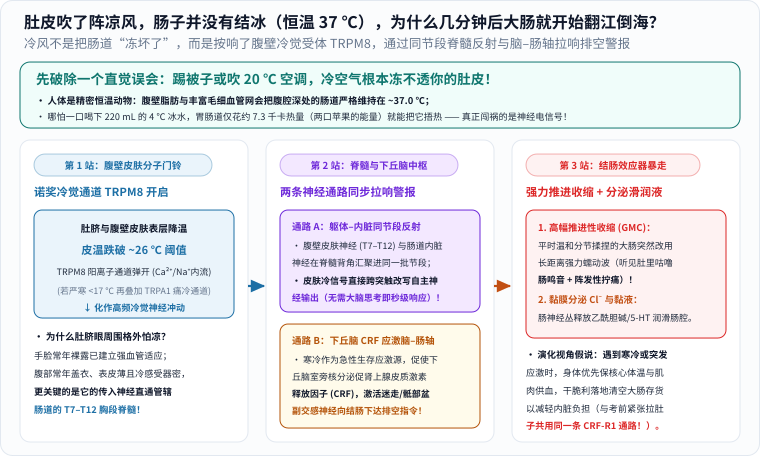
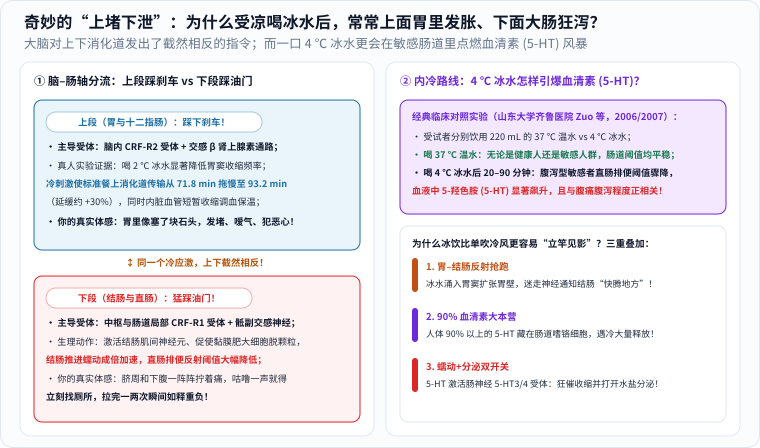
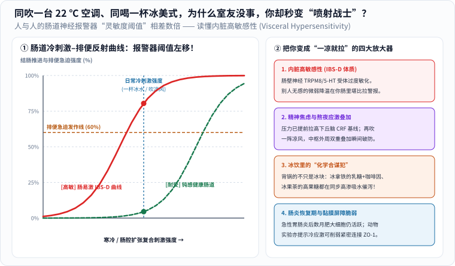
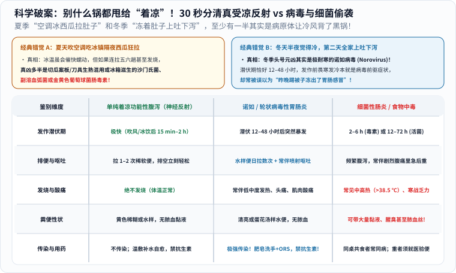
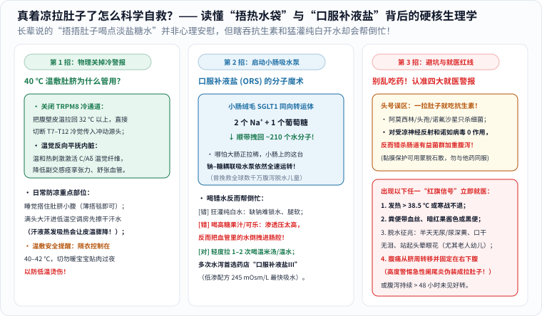

夏夜贪凉把空调开到 $$22\ ^\circ\text{C}$$，翻身时睡衣往上卷了一截，刚好露出肚脐眼；或者大热天满头大汗走进便利店，仰头灌下半瓶 $$4\ ^\circ\text{C}$$ 的冰镇饮料。不出二十分钟，小腹深处忽然掠过一阵拧毛巾似的坠痛，紧接着“咕噜——”一声长鸣，逼得你夹紧双腿、夺门而出直奔卫生间。

从小到大，长辈对这一幕都有一句高度统一的总结：**“看吧，肚子着凉了！肠子冻坏了！”**

可只要稍微较真想一想，这句听似天经地义的老话背后，藏着三个极其反直觉的生理学怪事：

1. **人体明明是 $$37\ ^\circ\text{C}$$ 恒温动物，一阵风、一杯水怎么可能“冻着”深处的结肠？** 结肠深埋在皮下脂肪、腹直肌和温热的肠系膜动脉血网深处；就算一口气喝下一杯冰水，它在胃和十二指肠里几分钟就会被焐热到接近体温，根本不可能一路带着冰碴子流进五六米外的大肠。既然结肠连 $$0.5\ ^\circ\text{C}$$ 都没降，是谁给它下了“紧急排空”的死命令？
2. **为什么很多时候受凉不仅下面“窜稀”，上面胃里反而“堵得发胀”？** 如果冷刺激只是简单地让整条消化道“全面加速”，那胃也应该排得飞快才对。可不少人吹了冷风或受冻后，偏偏觉得上腹发沉、胃胀嗳气，下腹却绞痛腹泻——同一条消化道，为什么会出现**“楼上踩刹车、楼下踩油门”**的精神分裂场面？
3. **你刚喝进去的那杯水不过 $$200$$ 毫升，为什么几十分钟后拉出来的水样便感觉比喝进去的还多？** 这些水到底是从哪儿凭空冒出来的？

这三个问号串起的，是一条横跨 **2021 年诺贝尔生理学或医学奖冷受体、脊髓躯体–内脏神经“串线”、下丘脑应激激素双向分流、肠道血清素风暴，以及人体每天 $$9$$ 升水循环大账本**的精密机制。出发前，我们先用一张总表把日常口中混为一谈的“受凉拉肚子”拆清底牌（综合自生理学经典综述 [3][4][9]、临床对照试验 [7] 与美国疾控中心 CDC 指南 [12]）：

| 触发场景 | 真正的生理/病理主角 | 核心发作时间 | 排空暖肚后能否迅速缓解 | 最容易踩中的误区 |
| --- | --- | --- | --- | --- |
| **肚皮吹冷风 / 半夜踢被子**（外冷型） | 腹壁皮肤 `TRPM8` 冷探头 $$\rightarrow$$ `T7–T12` 脊髓躯体–内脏反射 + 下丘脑 `CRF-R1` [1][3][4] | **$$10\text{–}40$$ 分钟**（神经电信号级） | **能**，拉完 $$1\text{–}2$$ 次、热敷后多平息 | 以为“寒气钻进肠子”，盲目吞抗生素 |
| **猛灌 $$4\ ^\circ\text{C}$$ 冰水 / 冰饮**（内冷型） | 胃–结肠反射 + 肠嗜铬细胞释放**血清素（`5-HT`）**（若含牛奶/咖啡因则叠加高渗催泻）[7] | **$$15\text{–}90$$ 分钟** | **能**，改喝温水、停冷饮后很快恢复 | 把乳糖不耐受或咖啡因催泻全怪给“冰块” |
| **吃冰镇隔夜西瓜 / 冷藏剩菜**（细菌毒素型） | 沙门氏菌、金黄色葡萄球菌肠毒素、单增李斯特菌（$$4\ ^\circ\text{C}$$ 仍能繁殖） | **$$2\text{–}24$$ 小时** | **不能**，常伴持续绞痛、恶心或发热 | 误以为“水果太凉伤胃”，耽误补液或就医 |
| **秋冬吹风后上吐下泻**（病毒潜伏巧合型） | **诺如病毒 / 轮状病毒**（仅需 $$18\text{–}100$$ 个病毒颗粒，潜伏期 $$12\text{–}48$$ 小时）[12] | 接触病毒后 **$$12\text{–}48$$ 小时** | **不能**，水样泻一日数次伴喷射状呕吐、低热 | 把前一天感染的诺如病毒怪罪给半夜踢被子 |

---

## 一、先破第一个迷思：你的肠子根本没“冻着”，那它在慌什么？

### 1. 算一笔热力学小账：一杯 $$4\ ^\circ\text{C}$$ 冰水能让体温降多少？

先拿大家最熟悉的“喝冰水拉肚子”算一笔极简单的热力学账。在山东大学齐鲁医院消化内科左秀丽教授团队发表的经典人体对照试验中，受试者一次性喝下的是 **$$220\ \text{mL}$$（质量 $$m \approx 220\ \text{g}$$）、温度 $$4\ ^\circ\text{C}$$** 的冰水 [7]。要把这杯冰水在体内从 $$4\ ^\circ\text{C}$$ 彻底焐热到人体核心温度 $$37\ ^\circ\text{C}$$，一共需要吸收多少热量？

水的比热容 $$c_{\text{水} } = 1.0\ \text{cal/(g}\cdot^\circ\text{C)}$$，因此所需热量 $$Q$$ 为：

$$
Q = c_{\text{水} } \cdot m \cdot \Delta T = 1.0 \times 220 \times (37 - 4) = 7{,}260\ \text{cal} \approx 7.26\ \text{kcal}\ (\text{约 } 30.4\ \text{kJ})
$$

$$7.26\ \text{kcal}$$ 是个什么概念？还不到**半口苏打饼干**的热量！对于一位体重 $$M = 65\ \text{kg}$$ 的成年人来说（人体平均比热容约 $$c_{\text{人体} } \approx 0.83\ \text{kcal/(kg}\cdot^\circ\text{C)}$$，整个人体的热容约为 $$54\ \text{kcal/}^\circ\text{C}$$），哪怕全身一丁点额外产热都不增加，这杯冰水能拉低的平均体温上限也只有：

$$
\Delta T_{\text{平均} } = \frac{Q}{c_{\text{人体} } \cdot M} \approx \frac{7.26}{0.83 \times 65} \approx 0.13\ ^\circ\text{C}
$$

更重要的是，我们的胃、小肠和大肠周围包裹着极其丰沛的内脏血管网——静息状态下流经胃肠与门静脉系统的温热血液高达每分钟 **$$1.0\text{–}1.5\ \text{L}$$**，就像在腹腔里铺满了全天候循环的 $$37.0\ ^\circ\text{C}$$ 水暖管。生理测温研究早就证实：喝进胃里的冷饮只会在胃腔和近端十二指肠造成几分钟的局部降温，还没走完长达 $$4\text{–}6$$ 米的小肠，温度就已经被彻底同化为 $$37\ ^\circ\text{C}$$；至于肚皮吹一阵凉风，隔着导热系数极低的皮下脂肪层（$$k \approx 0.21\ \text{W/(m}\cdot\text{K)}$$）和腹壁肌肉，深部结肠的核心温度更是**纹丝不动**。

问题来了：**既然大肠从头到尾都暖烘烘地泡在 $$37\ ^\circ\text{C}$$ 里，它凭什么在吹风十几分钟后突然翻江倒海？**

答案只有四个字：**神经电报**。拉肚子的指令根本不需要“寒气”慢吞吞地渗透进腹腔，而是由皮肤与上消化道的温度传感器变成每秒数米到数十米的神经脉冲，直接走“专线”砸向了结肠！

### 2. 2021 年诺贝尔奖主角 `TRPM8`：肚皮上的 $$26\ ^\circ\text{C}$$ 分子冷探头

我们的肚皮是怎么知道“变凉了”的？这恰恰是 **2021 年诺贝尔生理学或医学奖**揭晓的谜底 [1]。

2002 年，大卫·朱利叶斯（David Julius）团队与阿德姆·帕塔普蒂安（Ardem Patapoutian）团队各自独立克隆并鉴定出了人类感知凉爽的核心分子——**`TRPM8` 瞬时受体电位阳离子通道** [1][2]。这也是为什么你嚼薄荷糖或涂风油精会觉得“透心凉”：薄荷醇（menthol）在化学上恰好是一把能直接捅开 `TRPM8` 通道的分子钥匙！

* **平时在 $$32\text{–}35\ ^\circ\text{C}$$ 温暖被窝里**：腹壁皮肤感觉神经末梢上的 `TRPM8` 离子通道大门紧闭。
* **一旦掀被子、吹空调，肚皮表面温度跌破约 $$26\ ^\circ\text{C}$$**（若跌破 $$15\ ^\circ\text{C}$$ 刺骨寒冷还会进一步招募 `TRPA1` 痛觉冷通道）[1][2]：`TRPM8` 蛋白构象瞬间弹开，细胞外的钙离子（$$\mathrm{Ca^{2+} }$$）与钠离子（$$\mathrm{Na^+}$$）顺着电化学梯度汹涌灌入神经末梢，立刻产生去极化动作电位，沿着 $$\text{A}\delta$$ 与 $$\text{C}$$ 类传入神经纤维火速冲向脊髓背角！

> **顺手解一个好玩的小疑惑：既然薄荷醇也能激活 `TRPM8` 冷通道，为什么医院里反而有用“薄荷油肠溶胶囊”缓解肠痉挛的做法？**
> 关键在于**“急性突袭”与“持续脱敏 + 钙通道阻断”**的差别！皮肤或黏膜突然遭遇骤冷时，`TRPM8` 爆发的是高频阵发性警报信号；而临床使用的肠溶薄荷油在结肠局部缓慢释放较高浓度的左旋薄荷醇时，一方面会让 `TRPM8` 发生持续性脱敏，另一方面能**直接阻断肠道平滑肌细胞膜上的 L 型电压门控钙通道**，让原本紧绷抽搐的平滑肌松弛下来 [8]。一个拉响警报，一个切断肌肉电源，机制完全不同。

### 3. 为什么偏偏“露肚脐”最要命？`T7–T12` 脊髓节段的“同楼层串线”

你肯定也有过这种体会：大冬天脸蛋和手背冻得通红，很少因此拉肚子；可哪怕在夏天，只要**肚脐眼周围那一圈肚皮**吹上十分钟冷风扇，肚子就极容易咕噜作响。为什么肚皮这么娇气？

秘密藏在胚胎发育留下的**脊髓节段布线图**里。日本生理学家佐藤昭夫（Akio Sato）与德国生理学家罗伯特·施密特（Robert F. Schmidt）在长达三百多页的经典长篇综述《躯体–内脏反射》（*Somatovisceral Reflexes*）中系统阐明了这一现象 [3]：

*图 1：怎么看这张图——先看最左侧竖卡的热力学验算：核心腹腔靠丰沛的肠系膜温血牢牢锁在 $$37.0\ ^\circ\text{C}$$，肠子本身并没有“冻僵”；再顺着 ① $$\rightarrow$$ ② $$\rightarrow$$ ③ 读懂真正的跨级遥控链：肚皮表面跌破 $$26\ ^\circ\text{C}$$ 打开 `TRPM8` 通道后，腹壁皮肤传入神经（`T7–T12`，肚脐正对应 `T10`）恰好与支配小肠、结肠的内脏神经汇入**同一层胸腰段脊髓**，通过“躯体–内脏反射”与下丘脑应激通路，几分钟内就给远端结肠下达了巨幅推进收缩（`GMC`）与分泌黏液的指令（[单独打开高清 SVG](/assets/images/cold-diarrhea/skin-belly-to-colon-reflex.svg)）。*

* **脸部皮肤**归三叉神经管，**手背皮肤**归颈段脊髓（`C6–C8`）管，它们在脊髓里的“办公室楼层”离肠道十万八千里；
* 唯独**前腹壁皮肤（尤其是肋弓以下到耻骨上方的肚脐周围区域）**，它的躯体感觉传入神经全部走进胸段第 7 节至第 12 节脊髓（**`T7–T12`**，其中肚脐眼正是解剖学上最经典的 **`T10` 标志点**）！
* 巧就巧在，负责管辖小肠与结肠运动、血管舒缩的内脏传入与自主神经中继站（`T6–L2` 胸腰段脊髓背角及中间外侧核），**正好跟肚皮皮肤住在脊髓的同一层楼、共用同一批中间神经元网络** [3]！

这就是为什么生理学上存在大名鼎鼎的**“胃肠牵涉痛”**——急性阑尾炎发作最初几个小时，明明发炎的是右下腹深处的阑尾，大脑却总觉得是**肚脐眼正中间（`T10`）疼**，因为脊髓和大脑分不清信号到底来自 `T10` 皮肤还是内脏！反过来也一模一样：当 `T7–T12` 肚皮上的 `TRPM8` 冷探头突然拉响密集的低温警报冲进脊髓背角时，不仅直接触发同节段的**躯体–内脏自主神经反射**，还顺着脊髓丘脑束一路上报给大脑体温调节与应激总司令部——**下丘脑室旁核（PVN）** [3][4]。

---

## 二、楼上踩刹车、楼下踩油门：脑–肠轴的“双标”与冰水血清素风暴

信号传进下丘脑和肠道神经系统（人称拥有数亿神经元的“第二大脑”）后，真正精彩又滑稽的一幕上演了。

### 1. 为什么受凉会“上堵下泄”？`CRF-R2` 与 `CRF-R1` 的双向分道扬镳

很多读者都有过这种别扭体验：受凉之后并不是痛痛快快拉完就算，而是**上面胃口全无、胃里胀鼓鼓像塞了团湿棉花，下面小腹却一阵阵绞痛窜稀**。为什么同一阵寒冷，对胃和大肠下达了截然相反的命令？

美国加州大学洛杉矶分校（UCLA）脑–肠互动权威伊薇特·塔셰（Yvette Taché）教授团队揭示了这背后的分子总开关——**促肾上腺皮质激素释放因子（`CRF`）的双受体分流机制** [4]：

*图 2：怎么看这张图——左半幅看“外冷/应激”引发的脑–肠轴双向分流：同一个下丘脑应激信号 `CRF`，走到胃和近端小肠结合 **`CRF-R2` 受体**踩下刹车（人体冷应激实测口–盲肠传输时间从 $$71.8\ \text{min}$$ 拖慢到 $$93.2\ \text{min}$$ [5]），走到结肠却结合 **`CRF-R1` 受体**狠踩油门；右半幅看“内冷”喝冰水路线：$$220\ \text{mL}$$ 的 $$4\ ^\circ\text{C}$$ 冰水怎样唤醒胃–结肠反射并引爆占全身 $$90\%$$ 以上的肠道血清素（`5-HT`）大本营 [7]（[单独打开高清 SVG](/assets/images/cold-diarrhea/upstairs-brake-downstairs-rush.svg)）。*

当身体遭遇急性寒冷或应激警报时，下丘脑室旁核与肠道局部都会释放 `CRF`，但胃和结肠表面安装的“接收天线”型号完全不同：

1. **上消化道（胃 + 近端小肠）主装 `CRF-R2` 受体 + 交感神经 $$\beta$$ 通路 = 紧急踩刹车**：
   在进化视角下，突遇严寒或危机时，精细耗能的胃磨碎与小肠消化属于“可以缓一缓的慢活”，系统通过激活 **`CRF-R2` 受体**与交感神经抑制迷走运动背核向胃发出的兴奋冲动，压低胃窦蠕动波频率 [4][6]。英国学者奥布莱恩（J. D. O'Brien）与汤普森（D. G. Thompson）团队在人体冷痛应激试验（发表于 *Gut* 1989）中直接测出了这个“刹车幅度”：相比温暖对照态，冷应激让受试者的上消化道（口–盲肠）传输时间从平均 **$$71.8\ \text{min}$$ 显著延长到了 $$93.2\ \text{min}$$（拖慢约 $$30\%$$）** [5]！日本学者藤平（K. Fujihira）团队 2019 年的人体饮水试验同样证实，喝下 $$2\ ^\circ\text{C}$$ 冰水会直接压低胃窦收缩频率、推迟饥饿感与胃排空 [6]。胃不动了，食物和气体滞留在上头，你自然觉得**“上面胃胀堵得慌”**。
2. **下消化道（结肠）主装 `CRF-R1` 受体 + 骶段盆神经副交感通路 = 猛踩油门卸包袱**：
   与胃恰恰相反，结肠里装的是已经消化完的残渣“包袱”。`CRF` 一旦结合结肠肌间神经丛和骶段副交感通路上的 **`CRF-R1` 受体**，会瞬间点燃结肠的推进式运动神经元，把平时温和来回搅拌的分节运动，直接切换成横扫半条大肠的**巨幅移行性收缩（Giant Migrating Contractions，`GMC`，又称高幅推进性收缩 `HAPC`）** [4]！与此同时，`CRF-R1` 还会激活肠黏膜里的肥大细胞脱颗粒，释放组胺与蛋白酶，刺激杯状细胞分泌润滑黏液、隐窝细胞向肠腔泵水 [4]。于是，**“上面堵着不消化，下面火急火燎清库存”**的经典受凉套餐就这样凑齐了。

### 2. 一杯 $$4\ ^\circ\text{C}$$ 冰水下肚：唤醒占全身 $$90\%$$ 以上的肠道血清素（`5-HT`）

如果说吹冷风走的是“皮肤–脊髓–脑–肠”的外线，那空腹猛灌一大口冰水，则是直接从消化道内部摁下了双重引爆器。

在左秀丽教授团队发表于《胃肠病学杂志》（*Journal of Gastroenterology*，2006）与《胃肠病学与肝病学杂志》（2007）的两项随机交叉人体临床试验中，研究团队请腹泻型肠易激综合征（`IBS-D`）受试者与健康志愿者分别喝下 **$$220\ \text{mL}$$ 的 $$37\ ^\circ\text{C}$$ 温水**和 **$$220\ \text{mL}$$ 的 $$4\ ^\circ\text{C}$$ 冰水**，随后用直肠恒压器与血液生化连续追踪变化 [7]：

* 喝下 $$37\ ^\circ\text{C}$$ 温水时，两组人的直肠感觉阈值和血液指标几乎波澜不惊；
* 可一旦换成 **$$4\ ^\circ\text{C}$$ 冰水**，短短 **$$20$$ 分钟内**，敏感人群的直肠初始感觉阈值和排便紧迫阈值就显著下移（原本攒够一定体积才想上厕所，现在一点点粪水顶过来就警报大作）；更关键的是，饮冰水后 **$$30\text{–}150$$ 分钟内，受试者血浆中的五羟色胺（`5-HT`，即血清素）水平出现剧烈飙升**，且峰值浓度与腹痛、腹泻症状评分呈高度正相关（相关系数 $$r = 0.714,\ P = 0.001$$）[7]！

听到“血清素（`5-HT`）”，很多人第一反应是抗抑郁科普里说的“大脑快乐激素”。但一个冷知识是：**全身上下的血清素，只有不到 $$5\%$$ 在大脑里，足足 $$90\%\text{–}95\%$$ 都储存在胃肠道黏膜上皮的肠嗜铬细胞（Enterochromaffin cells，`EC` 细胞）中！**

当冰凉液体快速涌入胃窦和十二指肠时：
1. **第一重机械+温度抢跑（胃–结肠反射）**：胃壁被快速撑开叠加局部冷刺激，立刻通过迷走神经给远端结肠发去“新一批物资进仓了，赶紧给后面腾地方”的反射指令；
2. **第二重化学放大（`5-HT` 双开关）**：冷刺激与管腔压力促使肠嗜铬细胞向黏膜下层大量倾倒 `5-HT` [7]。涌出的 `5-HT` 一手抓住肠神经元上的 **`5-HT4` / `5-HT3` 受体**狂催平滑肌推进蠕动，另一手激活分泌神经元打开隐窝氯离子通道往肠腔滋水——蠕动与分泌两把大锁被同一把钥匙拧开，不往厕所跑才怪！

---

## 三、拉出来的水从哪儿来？算清肠道每天 $$9$$ 升水的“瀑布账本”

现在轮到第三个大疑惑了：**我明明只喝了半杯水（甚至半夜踢被子一口水都没喝），为什么受凉拉出来的水样便哗啦啦这么多？**

只要翻开消化生理学的“每日水平衡总账”，你会惊掉下巴——你的肠道根本不是一根干巴巴的管子，而是一座每天吞吐 **$$9{,}000\ \text{mL}$$（整整 $$18$$ 瓶矿泉水！）** 的超级水处理厂 [9][10]！

### 1. 每天 $$1{,}800\ \text{mL}$$ 稀汤流进大肠，全靠“慢工细活”烘干成便

根据国际胃肠分泌生理权威肖恩·基利（Stephen J. Keely）与金·巴雷特（Kim E. Barrett）2022 年在《美国生理学杂志》（*AJP-GI*）发表的定量综述 [9]，以及大学生理学教材 OpenStax 的标准账本 [10]，一个健康成年人每天进出胃肠道的水量收支严丝合缝：

$$
V_{\text{入肠总水量} } = \underbrace{2{,}000\ \text{mL} }_{\text{三餐食物 + 饮水} } + \underbrace{7{,}000\ \text{mL} }_{\text{唾液 + 胃液 + 胆汁 + 胰液 + 小肠液} } = 9{,}000\ \text{mL/天}
$$

没错，哪怕你今天少喝两杯水，你自己的唾液腺、胃、肝脏、胰腺和小肠每天也会尽职尽责地往消化道里倾倒约 **$$7\ \text{L}$$ 自产消化液**来溶解营养！这 $$9{,}000\ \text{mL}$$ 液体接下来要闯两道回收大关：

1. **第一关：小肠主力回收站（耗时 $$2\text{–}5$$ 小时）**：依靠刷状缘庞大的表面积与营养物质协同转运，小肠一口气吸走约 **$$7{,}200\ \text{mL}$$（占总量 $$80\%$$）** 的水。但请注意——即便小肠如此卖力，每天穿过回盲瓣流进大肠（结肠）起点盲肠的食糜，依然是足足 **$$1{,}800\ \text{mL}$$ 稀汤寡水**（相当于 $$3.6$$ 瓶矿泉水）！
2. **第二关：结肠精密烘干机（平时耗时 $$12\text{–}36$$ 小时）**：结肠没有小肠绒毛，它的吸水速度慢得多，全靠一段段袋状的“结肠袋”把这 $$1{,}800\ \text{mL}$$ 稀泥糊慢条斯理地来回翻拌十几个到三十几个小时，让水分充分贴紧肠壁上皮的钠通道（`ENaC` / `NHE3`），一点点榨干吸走约 **$$1{,}650\ \text{mL}$$** 水分，最终只留下 **$$100\text{–}200\ \text{mL}$$（典型约 $$150\ \text{mL}$$）** 水分锁在柔软成形的粪便里排出体外 [9][10]。整套系统的总回收率高达惊人的 **$$98.3\%$$**！

### 2. 差之毫厘，泻以千里：少收 $$5.6\%$$ 的水就足以变成水样腹泻！

看懂了上面这笔账，受凉为什么会拉稀水就成了一道小学生都能口算的减法题——**结肠烘干机根本没坏，是传送带开得太快，稀泥糊还没来得及烤干就被直接轰出厂门了！**

*图 3：怎么看这张动画图——先看顶部蓝色总账条：每天有 $$9{,}000\ \text{mL}$$ 水进入消化道，小肠吸走 $$7{,}200\ \text{mL}$$ 后，仍有 **$$1{,}800\ \text{mL}$$ 稀汤**涌入结肠起点；再对比上下两条轨道的团块推进速度：上半轨正常模式下，食糜慢悠悠走完 $$12\text{–}36$$ 小时，水分被榨干到只剩 $$150\ \text{mL}$$ 成形软便；下半轨受凉触发巨幅推进收缩（`GMC`）后，结肠停留时间暴跌至 $$1\text{–}3$$ 小时，外加隐窝轻度分泌，只要在 $$9{,}000\ \text{mL}$$ 总盘子里少回收区区 **$$500\ \text{mL}$$（不到 $$6\%$$！）**，末端粪便含水量就会暴涨 $$4$$ 倍以上变成 $$630\ \text{mL}$$ 稀水便（动画默认播放一次并停在终态；支持 `prefers-reduced-motion` 减弱动态效果；[单独打开 SVG 刷新可重播](/assets/images/cold-diarrhea/nine-liter-water-waterfall.svg)）。*

我们来算一下受凉反射发作那两个小时里发生了什么：
* `CRF-R1` 与 `5-HT` 触发的巨幅推进收缩（`GMC`）像推土机一样，把横结肠和降结肠里原本打算再烘十几个小时的半液态食糜，在 **$$1\text{–}3$$ 小时**内一路推到了直肠 [4]；
* 接触肠壁的时间骤减了八九成，原本应该被结肠吸回血液的那 $$1{,}650\ \text{mL}$$ 水里，哪怕仅仅**漏掉了 $$500\ \text{mL}$$ 没来得及吸完**（占全天 $$9{,}000\ \text{mL}$$ 水流量的比例不过 $$\frac{500}{9000} \approx 5.6\%$$！）；
* 再加上副交感神经（乙酰胆碱 `ACh`）、血管活性肠肽（`VIP`）和 `5-HT` 顺手打开隐窝顶膜的 **`CFTR` 氯离子通道**，往肠腔里多挤出约 **$$80\ \text{mL}$$** 润滑水盐液 [9]：

$$
V_{\text{受凉粪水} } \approx 150\ \text{mL（基础）} + 500\ \text{mL（过快漏吸）} + 80\ \text{mL（隐窝分泌）} = 730\ \text{mL（单轮约 } 500\text{–}700\ \text{mL）}
$$

在肛门直肠看来，$$150\ \text{mL}$$ 是规规矩矩的固体软条，而超过 **$$300\text{–}500\ \text{mL}$$** 就已经是完全兜不住的**水样稀便**了！你以为肠子里灌进了多少外来的水，其实全是你自己早上分泌的胃液、胆汁和胰液，还没来得及办完“回收手续”就被提前清退了。

---

## 四、为什么同吹一台空调，室友没事，偏偏你是“喷射战士”？

每次聊到受凉拉肚子，办公室和宿舍里总会分裂成两个世界：有人大冬天穿露脐装喝冰美式稳如泰山，有人夏天坐地铁正对冷风口吹五分钟就得中途下车找厕所。都是人类同款基因，差别凭什么这么大？

### 1. 内脏敏感度 S 曲线左移：别人的“微风”，你的“十级防空警报”

如果我们把冷刺激或肠腔扩张强度画作横轴，把肠道神经推进与排便急迫反应画作纵轴，每个人的肠道都有一条**S 形响应曲线**：

*图 4：怎么看这张图——左半幅看垂直蓝色虚线标出的“日常冷刺激强度”（如喝一杯冰水或吹一阵凉风）：在绿色虚线代表的钝感健康肠道上，反应度还不到 $$5\%$$，稳稳躺在安全区；而在红色实线代表的腹泻型肠易激（`IBS-D`）高敏肠道上，整条曲线大幅左移，同一强度的冷刺激已经飙上 $$80\%$$ 冲破橙色“排便急迫发作线”；右半幅列出把曲线往左推的四大现实放大器（[单独打开高清 SVG](/assets/images/cold-diarrhea/healthy-vs-ibsd-cold-threshold.svg)）。*

在左秀丽团队的冰水试验中有一个极其耐人寻味的对照细节：同样喝下 $$220\ \text{mL}$$ 的 $$4\ ^\circ\text{C}$$ 冰水，**健康对照组几乎没人腹痛腹泻**，真正显著出现症状并伴随 `5-HT` 剧烈失衡的，正是带有**内脏高敏感性（Visceral Hypersensitivity）**的 `IBS-D` 人群 [7]！把你推向“一凉就拉体质”的，通常是右图这四个幕后放大器：

1. **肠黏膜神经末梢“裸奔”与受体高敏（`IBS-D` 体质）**：活检与分子研究发现，`IBS-D` 人群结肠黏膜里的肥大细胞数量更多、距离肠神经纤维只有微米之遥，且神经末梢上的 `TRPM8`、`TRPV1` 以及 `5-HT3` 受体处于持续敏化状态 [7][8]。别人眼里微不足道的降温，在你肠壁神经元眼里不亚于拉响防空警报。
2. **焦虑、赶 DDL 与熬夜提前垫高了 `CRF` 水位**：还记得前面说的下丘脑应激因子 `CRF` 吗？心理压力、考前紧张（俗称“考试型窜稀”）本身就会让中枢 `CRF` 长期维持在高水位 [4]。水位已经淹到警戒线边缘了，这时再添上一阵穿堂冷风，外周反射轻轻推一把就直接决堤。
3. **冰饮里藏着“化学合谋犯”——锅真不全是冰块的！**
   这是无数人冤枉“冷温度”的重灾区。回想一下你拉肚子前喝的到底是什么？
   * 如果是**冰拿铁 / 冰鲜奶**：除了 $$4\ ^\circ\text{C}$$ 低温，里面还有 **$$12\ \text{g}$$ 乳糖**（在 $$70\%\text{–}100\%$$ 乳糖酶下调的东亚成年人小肠里直接高渗吸水、进结肠产气，详见上一篇[《为什么一喝牛奶肚子就咕噜咕噜闹革命？》]()），外加**咖啡因**（人体结肠测压证实，一杯咖啡在短短 $$4$$ 分钟内激发结肠推进收缩的威力堪比吃下一顿千卡大餐）！
   * 如果是**冰镇果茶 / 冰气泡饮**：里面往往塞满了**高果糖浆或山梨糖醇、赤藓糖醇**等高 `FODMAP` 短链碳水，吸收上限极低，留在肠腔里全靠范特霍夫渗透压硬拽水分！
   把“低温神经反射 + 咖啡因强催蠕动 + 乳糖/果糖高渗吸水”三拳叠在一起打向结肠，最后只让“冰块”一个人背锅，冰块实在太冤了。
4. **急性肠炎后的“惊弓之鸟”期与黏膜屏障受压**：
   得过一次细菌或病毒性急性胃肠炎后，即便病原体早已清除，肠道黏膜免疫与神经重塑往往需要数周到数月才能完全平复（临床称为感染后肠易激，`PI-IBS`）。此外，**需要严格限定在小鼠动物模型层面说明的是**：郭（Guo）等学者 2022 年发表于 *Frontiers in Physiology* 的实验显示，把小鼠长期置于 $$4\ ^\circ\text{C}$$ 寒冷环境中反复冷应激，会诱发结肠上皮内质网应激并下调紧密连接蛋白 `ZO-1` 与 Occludin 的表达，削弱黏膜屏障 [11]——当然，人类日常吹几分钟空调属于短暂轻度刺激，远不等同于小鼠全天候冻在 $$4\ ^\circ\text{C}$$ 冷房里，但若原本就有慢性肠道微炎症，对寒冷的耐受余量确实会更薄。

---

## 五、头号危险误判：多少次“着凉腹泻”，其实是诺如病毒和细菌李代桃僵！

讲到这里，我们必须给“着凉拉肚子”踩一脚关乎健康的急刹车——**现实生活里，至少有一小半被大家拍着胸脯自诊为“昨晚着凉了”的严重拉肚子，根本不是单纯的神经反射，而是货真价实的病原体感染！**

为什么人类大脑这么容易把细菌和病毒的锅甩给“着凉”？因为两起经典的**时间错位案**实在太具有欺骗性了：

*图 5：怎么看这张图——上半幅拆解两个最容易让人误判的“背锅现场”：左卡是夏天吃冰镇隔夜西瓜，真凶其实是刀砧交叉污染与冷藏期仍在繁殖的嗜冷菌/肠毒素；右卡是秋冬诺如病毒的 **$$12\text{–}48$$ 小时潜伏期时间差陷阱** [12]——白天摸电梯按键中招时毫无感觉，半夜恰好踢了被子，清晨潜伏期一到爆发上吐下泻，让被子替病毒背了黑锅；下半幅五维对照表帮你十秒钟分清真受凉与真感染（[单独打开高清 SVG](/assets/images/cold-diarrhea/chill-vs-pathogen-detective.svg)）。*

### 1. 夏天冤案：“吃冰西瓜太寒凉” vs 冰箱并不是消毒柜

夏天急诊室里最常见的台词就是：“医生，我昨晚吃了半个冰镇西瓜，太寒了，拉了一整宿还发烧！”

请记住刚才的规律：**单纯被低温激发的神经性腹泻，几乎不会引起 $$38.5\ ^\circ\text{C}$$ 高烧、剧烈呕吐或连续十几次停不下来的水泻。** 冰西瓜真正的杀机往往出在切瓜和冷藏那几个小时里：
* 切生肉或洗菜没彻底洗净的砧板、菜刀，把**沙门氏菌**或**金黄色葡萄球菌**抹到了高糖多汁的西瓜切面上；
* 更隐蔽的是**单核细胞增生李斯特菌（*Listeria monocytogenes*）**——它是微生物界出了名的“冰箱杀手”，在 $$4\ ^\circ\text{C}$$ 家用冷藏室里照样能慢悠悠地分裂繁殖！当你把敞口或裹着保鲜膜放了一夜的冰西瓜吃进肚子，让你上吐下泻发高烧的是成百上千万细菌和耐热肠毒素，“冰凉”顶多只是帮凶。

### 2. 冬天冤案：“半夜踢被子受寒” vs 诺如病毒的 $$12\text{–}48$$ 小时潜伏期

到了每年 $$11$$ 月至次年 $$3$$ 月，另一位伪装大师登场了——被美国疾控中心（CDC）称为“冬季呕吐病”头号元凶的**诺如病毒（Norovirus）** [12]。

诺如病毒有三个极其嚣张的特征 [12]：
1. **感染门槛极低**：只需要 **$$18\text{–}100$$ 个病毒颗粒**就能让人中招（一个针尖大小的污染飞沫里就有几百万个颗粒），且普通酒精免洗洗手液对这种无包膜病毒效果很差，必须用流动水和肥皂搓洗；
2. **潜伏期刚好 $$12\text{–}48$$ 小时**：你周二中午在食堂或电梯里摸了带病毒的门把手，下午活蹦乱跳一点事没有；周二半夜睡觉恰好踢掉了被子觉得有点冷；周三早上六点，$$18$$ 小时潜伏期准时引爆——恶心、喷射状呕吐、水样腹泻外加浑身酸痛低烧！
3. **人类归因本能**：没人看得见昨天中午那几十个纳米级的病毒颗粒，但每个人都清清楚楚记得凌晨四点冻醒盖被子的那一幕。于是全家人异口同声：“哎呀，昨晚冻感冒了，胃肠型感冒！”结果没做好马桶冲水盖盖子和含氯消毒液清洁，两天之内全家老小排队跑厕所——**真受凉绝不会传染，会“一人受凉、全家窜稀”的一定是病原体！**

---

## 六、真受凉了怎么科学救场？热敷温度、补液盐密码与四条就医红线

分清了原理和真假李逵，万一下次真的因为吹空调或喝急了冰饮肚子咕噜作响，怎样处理才既舒服又符合生理学？

*图 6：怎么看这张图——按左、中、右三步顺序对照实操：第一步用 **$$40\ ^\circ\text{C}$$ 左右温热敷**把肚皮温度拉回 `TRPM8` 阈值（$$26\ ^\circ\text{C}$$）以上关闭冷警报，同时严防超过 $$45\ ^\circ\text{C}$$ 贴肤过夜造成低温烫伤；第二步若水泻多次，利用小肠刷状缘完好无损的 **`SGLT1` 钠–葡萄糖协同转运泵**喝低渗口服补液盐 III（`245 mOsm/L`）[13]，别猛灌高糖运动饮料；第三步守住“不乱吞抗生素”铁律与四条急诊红线（[单独打开高清 SVG](/assets/images/cold-diarrhea/warm-rescue-and-ors-guide.svg)）。*

### 1. 第一招：给 `TRPM8` 关掉开关——$$40\ ^\circ\text{C}$$ 温敷肚脐，但严防“低温烫伤”

老辈人说“拿热水袋捂捂肚子、喝杯温开水”，这一招在现代神经生理学上**完全站得住脚**！
* 一条 **$$40\ ^\circ\text{C}$$ 左右**的温热毛巾或隔着秋衣的热水袋敷在肚脐周围（`T7–T12` 皮节），第一秒就能把皮肤表面温度拉升到远高于 `TRPM8` 激活上限（$$26\ ^\circ\text{C}$$）的温暖区间，彻底切断源源不断往脊髓背角发射的冷信号 [1][3]；
* 同时，温和的皮肤热刺激与轻柔触觉会激活愉悦的温觉与 $$\text{C}$$ 触觉传入纤维，在脊髓背角发挥类似“闸门控制”的安抚效应，帮紧绷痉挛的肠道平滑肌松开油门；小口慢饮 $$37\text{–}45\ ^\circ\text{C}$$ 的温水则能避免再次触发胃–结肠冷反射 [6][7]。
* **安全提醒**：千万不要把发热高达 $$50\text{–}60\ ^\circ\text{C}$$ 的暖宝宝直接贴在光肚皮上，也不要抱着热水袋睡整夜！皮肤只要持续接触 **$$44\text{–}45\ ^\circ\text{C}$$ 超过数小时**，就会在毫无剧痛知觉的情况下发生深达真皮层的**低温烫伤**。

### 2. 第二招：拉稀水多次怎么补水？认准小肠 `SGLT1` 的 `245 mOsm/L` 黄金配比

如果只是受凉拉了一两次软稀便，喝温开水、吃碗热乎清淡的软烂白粥面条就够了。但要是腹泻次数较多、拉出了明显的水样便（或者拿不准是不是轻症病毒性肠炎），光灌白开水效率低，**猛灌甜汽水、浓果汁或高糖运动饮料更是火上浇油**——因为高达 $$500\text{–}700\ \text{mOsm/L}$$ 的高渗糖水非但吸不进去，还会靠渗透压把血管里的水反抽进肠腔，让你越喝越拉！

这时候就该请出二十世纪医学界拯救了数千万生命的伟大发明——世界卫生组织（WHO）与联合国儿童基金会（UNICEF）推荐的**低渗口服补液盐 III（ORS III）** [13]：
* 即便在结肠疯狂推进或病毒性腹泻期间，小肠绒毛上皮细胞膜上的 **`SGLT1`（钠–葡萄糖协同转运蛋白 1）**依然完好无损地坚守岗位；
* 它的工作口令非常死板但极其高效：**每抓起 $$2$$ 个钠离子（$$\mathrm{Na^+}$$）和 $$1$$ 个葡萄糖分子跨膜送进血液，就会顺带把约 $$210$$ 个水分子一起拽回体内** [9][10]！
* 低渗口服补液盐 III 把钠离子与无水葡萄糖精准配成 **$$1:1$$ 摩尔比（各 $$75\ \text{mmol/L}$$）**，总渗透压压低到略低于人体血浆的 **$$245\ \text{mOsm/L}$$** [13]，顺着渗透梯度和 `SGLT1` 主动水泵双管齐下，补水止泻效率比白开水高出数倍（注意必须按说明书整袋兑足规定毫升数的温开水，切勿冲浓或往里加糖！）。

### 3. 第三招：管住手别乱吞“消炎药”，牢记四条医院红线

最后有两句救命叮嘱一定要贴在家里药箱上：

1. **受凉腹泻和诺如病毒腹泻，吃抗生素（诺氟沙星、头孢、阿莫西林）统统无效且有害！** 抗生素只杀细菌，既管不了你的 `TRPM8` 神经反射，也杀不死半个诺如病毒颗粒 [12]，反而会把肠道里帮你镇守地盘的有益共生菌群轰成焦土，诱发难治的抗生素相关性腹泻（况且诺氟沙星等氟喹诺酮类药物会损伤软骨发育，**未满 $$18$$ 周岁严禁使用**）。另外，若高度怀疑是吃坏东西引起的发热细菌性肠炎，也不要盲目吞强效止泻药（如洛哌丁胺）硬把细菌毒素“憋”在肠子里。
2. **出现以下四条红线中的任意一条，说明绝不是普通“着凉”，请立刻去医院**：
   * **发热或寒战**：体温超过 **$$38.5\ ^\circ\text{C}$$**，提示体内存在明确的侵袭性病原体或全身炎症反应；
   * **粪便带血或脓液**：出现鲜血便、暗红色果酱样便、黏液脓血便或柏油样黑便；
   * **明显脱水警报**：连续半天少尿或尿色深如浓茶、口唇干裂、站起来眼前发黑头晕（婴幼儿哭时无泪、眼窝或前囟凹陷、精神萎靡）；
   * **剧烈持续腹痛，尤其是“转移性右下腹痛”**：这是外科急诊最痛心的伪装陷阱——**急性阑尾炎**最初几小时几乎都表现为肚脐周围隐痛伴恶心或轻度腹泻（刚才讲过的 `T10` 内脏牵涉痛！），无数患者以为自己“受凉吃坏肚子”在家硬扛贴暖宝宝，直到几小时后疼痛转移并固定在右下腹甚至穿孔才送医。只要腹痛持续加重不缓解，交给医生排查永远最稳妥！

---

下次夏夜吹凉风前顺手把睡衣扎进裤腰，或者大汗淋漓时把第一口冰饮在嘴里含两秒再咽下去——你照顾的并不是“怕冻僵的肠子”，而是肚皮上那群兢兢业业拿过诺贝尔奖的 `TRPM8` 哨兵、一条和肚脐共用 `T10` 楼层的脊髓电话线，以及大肠里那台每天默默帮你烘干 $$1.8$$ 升稀汤的精密烘干机。读懂了身体这套有点敏感却一片好心的防卫机制，你就能在享受清凉与善待肠胃之间，找到最从容的分寸。

---

## 参考资料

1. **The Nobel Assembly at Karolinska Institutet (2021)**, *Press Release: The Nobel Prize in Physiology or Medicine 2021 (David Julius and Ardem Patapoutian — discoveries of receptors for temperature and touch)*：[https://www.nobelprize.org/prizes/medicine/2021/press-release/](https://www.nobelprize.org/prizes/medicine/2021/press-release/)（支持 `TRPM8` 冷与薄荷醇激活离子通道及温度感觉转导的诺奖科学背景）。
2. **McKemy, D. D., Neuhausser, W. M., & Julius, D. (2002)**, *Identification of a cold receptor reveals a general role for TRP channels in thermosensation*, *Nature*, 416(6876), 52–58：[https://doi.org/10.1038/nature719](https://doi.org/10.1038/nature719)（首次克隆鉴定冷与薄荷醇激活受体 `CMR1/TRPM8`，支持约 $$26\ ^\circ\text{C}$$ 以下凉爽激活阈值与 $$\mathrm{Ca^{2+} }/\mathrm{Na^+}$$ 内流机制）。
3. **Sato, A., Sato, Y., & Schmidt, R. F. (1997)**, *The impact of somatosensory input on autonomic functions*, *Reviews of Physiology, Biochemistry and Pharmacology*, 130, 1–328：[https://doi.org/10.1007/BFb0046598](https://doi.org/10.1007/BFb0046598)（系统阐明躯体–内脏反射机制，支持腹部皮肤 `T7–T12` 躯体感觉传入与同节段胸腰脊髓胃肠自主神经调控的汇聚回路）。
4. **Taché, Y., Larauche, M., Yuan, P.-Q., & Million, M. (2018)**, *Brain and Gut CRF Signaling: Biological Actions and Role in the Gastrointestinal Tract*, *Current Molecular Pharmacology*, 11(1), 51–71：[https://pmc.ncbi.nlm.nih.gov/articles/PMC8091865/](https://pmc.ncbi.nlm.nih.gov/articles/PMC8091865/)（支持急性冷/应激下脑–肠轴 `CRF` 双受体分流：`CRF-R2` 抑制胃排空与上消化道运动，而 `CRF-R1` 激活结肠推进性收缩、肥大细胞脱颗粒及黏液水盐分泌）。
5. **O'Brien, J. D., Thompson, D. G., Day, S. J., Burnham, W. R., & Walker, E. (1989)**, *Perturbation of upper gastrointestinal transit and motility by experimentally applied stress: the role of beta adrenoreceptor mediated pathways*, *Gut*, 30(11), 1530–1539：[https://pmc.ncbi.nlm.nih.gov/articles/PMC1434353/](https://pmc.ncbi.nlm.nih.gov/articles/PMC1434353/)（人体冷痛应激实验，实测冷刺激通过交感 $$\beta$$ 肾上腺素能通路将口–盲肠上消化道传输时间从 $$71.8\ \text{min}$$ 显著延迟至 $$93.2\ \text{min}$$）。
6. **Fujihira, K., Hamada, Y., Yanaoka, T., Yamamoto, R., Suzuki, K., & Miyashita, M. (2020)**, *The effects of water temperature on gastric motility and energy intake in healthy young men*, *European Journal of Nutrition*, 59(1), 103–109：[https://pmc.ncbi.nlm.nih.gov/articles/PMC7000532/](https://pmc.ncbi.nlm.nih.gov/articles/PMC7000532/)（人体随机交叉试验，证实饮用 $$2\ ^\circ\text{C}$$ 冷水相比 $$37\ ^\circ\text{C}$$ 与 $$60\ ^\circ\text{C}$$ 水显著降低胃窦收缩频率）。
7. **Zuo, X.-L., Li, Y.-Q., Shi, L., Lv, G.-P., Kuang, R.-G., Lu, X.-F., Li, J.-M., & Desmond, P. V. (2006 / 2007)**, *Visceral hypersensitivity following cold water intake in subjects with irritable bowel syndrome* (*Journal of Gastroenterology*, 41(4), 311–317：[https://doi.org/10.1007/s00535-005-1766-x](https://doi.org/10.1007/s00535-005-1766-x)) 及 *Plasma 5-HT levels in irritable bowel syndrome patients with visceral hypersensitivity following cold water intake* (*Journal of Gastroenterology and Hepatology*, 22(12), 2330–2337：[https://doi.org/10.1111/j.1440-1746.2006.04772.x](https://doi.org/10.1111/j.1440-1746.2006.04772.x))（人体 $$220\ \text{mL}$$ $$4\ ^\circ\text{C}$$ 冰水 vs $$37\ ^\circ\text{C}$$ 温水随机对照试验，支持冰水摄入降低 `IBS-D` 直肠感觉阈值并引发血浆 `5-HT` 显著升高与腹泻腹痛症状高度相关）。
8. **Mueller-Tribbensee, S. M., Karna, M., Khalil, M., Neurath, M. F., Reeh, P. W., & Engel, M. A. (2015)**, *Differential Contribution of TRPA1, TRPV4 and TRPM8 to Colonic Nociception in Mice*, *PLOS ONE*, 10(7), e0128242：[https://pmc.ncbi.nlm.nih.gov/articles/PMC4514604/](https://pmc.ncbi.nlm.nih.gov/articles/PMC4514604/)（解析结肠传入神经中 `TRPM8`、`TRPA1`、`TRPV4` 的伤害性感受分工及薄荷醇持续脱敏平滑肌解痉机制）。
9. **Keely, S. J., & Barrett, K. E. (2022)**, *Intestinal secretory mechanisms and diarrhea*, *American Journal of Physiology-Gastrointestinal and Liver Physiology*, 322(4), G405–G420：[https://pmc.ncbi.nlm.nih.gov/articles/PMC8917926/](https://pmc.ncbi.nlm.nih.gov/articles/PMC8917926/)（支持人体胃肠道每日约 $$9\ \text{L}$$ 总液体负荷、结肠约 $$1.8\ \text{L}$$ 进入量与 $$98\%$$ 以上重吸收效率，以及吸收减损或 `CFTR` 氯离子分泌导致水样腹泻的定量平衡）。
10. **OpenStax, Rice University**, *Anatomy and Physiology 2e — Chapter 23: The Digestive System (Chemical Digestion and Absorption & The Small and Large Intestines)*：[https://openstax.org/books/anatomy-and-physiology-2e/pages/23-7-chemical-digestion-and-absorption-a-closer-look](https://openstax.org/books/anatomy-and-physiology-2e/pages/23-7-chemical-digestion-and-absorption-a-closer-look)（支持消化液日分泌量、小肠 `SGLT1` 钠–葡萄糖协同吸水与结肠分节烘干运动基础生理数据）。
11. **Guo, J., Hu, H., Chen, Z., Xu, J., Nie, J., Lu, J., Ma, X., & Deng, Z. (2022)**, *Cold Exposure Induces Intestinal Barrier Damage and Endoplasmic Reticulum Stress in the Colon via the SIRT1/Nrf2 Signaling Pathway*, *Frontiers in Physiology*, 13, 822348：[https://pmc.ncbi.nlm.nih.gov/articles/PMC9065603/](https://pmc.ncbi.nlm.nih.gov/articles/PMC9065603/)（小鼠 $$4\ ^\circ\text{C}$$ 冷暴露模型实验，提示持续寒冷应激可诱发结肠内质网应激并下调紧密连接蛋白 `ZO-1`/Occludin）。
12. **U.S. Centers for Disease Control and Prevention (CDC)**, *About Norovirus*：[https://www.cdc.gov/norovirus/about/index.html](https://www.cdc.gov/norovirus/about/index.html)（支持诺如病毒 $$12\text{–}48$$ 小时潜伏期、极低感染剂量、冬季高发特征以及抗生素对病毒性胃肠炎无效的临床准则）。
13. **World Health Organization (WHO) & UNICEF (2006)**, *Oral Rehydration Salts: Production of the new ORS (`245 mOsm/L` reduced osmolarity formulation)*：[https://www.who.int/publications/i/item/WHO-FCH-CAH-06.1](https://www.who.int/publications/i/item/WHO-FCH-CAH-06.1)（支持低渗口服补液盐 III 钠与葡萄糖各 $$75\ \text{mmol/L}$$、总渗透压 $$245\ \text{mOsm/L}$$ 的标准配方与防脱水机制）。
