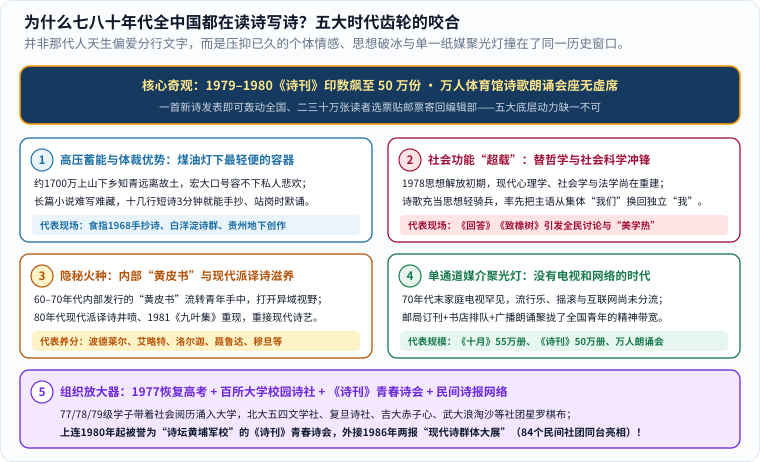
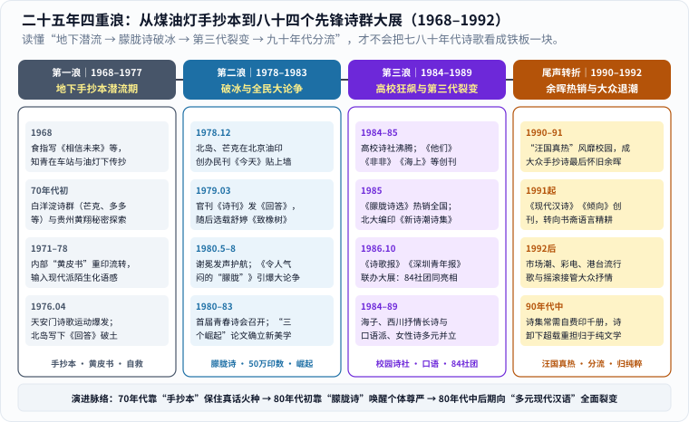
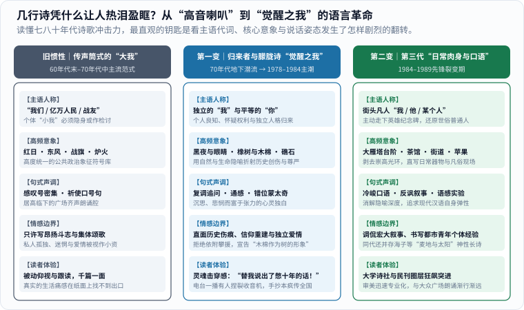
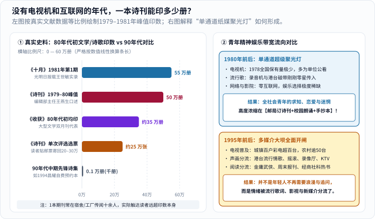
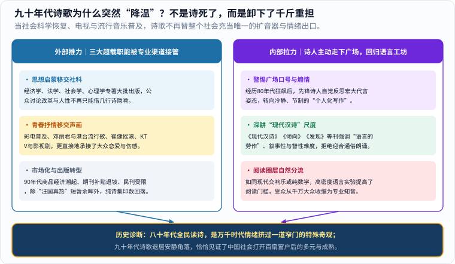

今天如果你在地铁里跟身边的年轻人说：**“有一本纯诗歌杂志，单期能卖 50 万册；办一场没有歌星伴舞的纯读诗晚会，能把首都体育馆一万多个座位塞得水泄不通；甚至有听众守着收音机听配乐诗朗诵，激动得把塑料机壳当场捏裂了。”**

对方大概率会觉得你在编科幻故事。

但这不是夸张，而是有据可查的历史现场。据 1977 年起在《诗刊》工作的编辑部主任王燕生口述回忆（《新世纪周刊》访谈《王燕生：见证八十年代》），1979 至 1980 年间，《诗刊》单期发行量高达 **50 万份**；编辑部搞一次读者诗歌评选，全国读者自己剪下选票、贴足邮票寄回来的信件就有**二三十万封**；在首都体育馆、工人文化馆和首都剧场举办诗歌朗诵会，场场万人攒动、热血沸腾。甚至在 1978 年底至 1979 年初，外国驻华使馆的记者都会紧盯《人民日报》角落里的一则新诗朗诵会预告，试图从中破译中国政坛与社会风向的最新温度。

翻开长辈箱底发黄的塑料皮笔记本，几乎每个上过中学、进过工厂或下过乡的七八十年代青年，本子里都工工整整抄过几页诗。这让人忍不住追问三个问题：

- **为什么偏偏是七八十年代？** 是那一代中国人天生比今天更有文艺细胞吗？
- **为什么冲在最前面的偏偏是“现代诗”，而不是长篇小说、哲学专著或流行歌曲？**
- **到了九十年代初，这场席卷全国的诗歌高烧为什么又像潮水一样迅速退去？**

当我们把文学史、出版档案与媒介变迁拼回同一张桌面就会发现：**七八十年代的全民诗歌热，绝不仅仅是一场审美风尚，而是五只巨大的时代齿轮在同一历史窗口死死咬合的产物。**

_先看顶部深蓝横幅锚定的真实历史规模，再顺着 ① 至 ⑤ 五张卡片拆解底层合力：70 年代的情感高压与短诗易抄易背的体裁优势埋下了地下火种；1978 年思想破冰期诗歌替尚未重建的哲学社科承担了“超载”启蒙使命；内部“黄皮书”与现代派译诗提供了语言弹药；无电视、无网络的单一纸媒环境造就了超级聚光灯；而 1977 年恢复高考后的高校诗社与民间诗报，则把零星火花放大成了全国风暴。_

---

## 一、先破除一个错觉：这场诗歌潮不是 1980 年突然从天上掉下来的

很多人一提“八十年代诗歌热”，脑海里直接跳出校园草坪上的白衬衫和吉他。但如果只看八十年代，你就没法解释：为什么改革开放的大门刚推开一条缝，北岛、舒婷、顾城、芒克、多多、江河这一整批二十多岁的年轻人，手里就已经攥着极其成熟的现代汉语诗稿了？

答案藏在更早的十多年里。如果把镜头拉长到 **1968—1992 年这二十五年**，中国当代诗歌潮其实经历了清晰的**“四重浪”**。

_按自左向右的四列卡片跟读二十五年脉络：第一浪（1968–1977）是在煤油灯与火车站秘密流转的知青手抄本潜流；第二浪（1978–1983）是油印民刊《今天》与官刊《诗刊》破壁互动、引发全国“朦胧诗”大论争的破冰期；第三浪（1984–1989）是高校诗社与 84 个民间先锋社团百花齐放的裂变期；第四列（1990–1992）则是汪国真摘抄热余晖之后，大众情绪被声画媒介分流的转折尾声。_

### 1. 第一重蓄水池：1700 万知青的无处安放与“三分钟手抄体裁学”

20 世纪 60 年代末至 70 年代，全国约 **1700 万城镇知识青年**告别父母与城市，奔赴东北黑土地、内蒙古草原、陕北窑洞、云南边疆与河北农村插队落户。

在那个公共广播里只有高亢口号的年代，一个十七八岁的年轻人面对漫长的冬夜、繁重的农活、前途的茫然以及初恋的悸动，内心的孤独与追问在公开出版物里找不到哪怕一寸合法的落脚之地。压抑越深，表达的渴望就越像地壳下的岩浆。

可是在那个随时可能被翻查行李、纸笔匮乏、劳动强度极高的环境里，**为什么年轻人首选“写诗、抄诗”，而不是写长篇小说或学术论文？** 这里藏着一个极其朴素的**媒介物理学道理**：

1. **体量极轻，三分钟就能抄完带走**：一部手抄小说（比如当年地下流传的《第二次握手》）动辄几万字，借到手往往只有一晚上时间，几个人接力抄到手腕发肿也未必抄得完；而一首十几二十行的现代诗，在知青点的煤油灯下，或者在火车站候车室昏黄的路灯下，**三五分钟就能抄进随身小本子**。
2. **天然自带韵律，烧掉纸也能装进脑子**：诗歌有节奏与意象锚点。哪怕为了安全不敢留纸质底稿，只要默念几遍就能死死刻在记忆里，锄地、放牧、站岗时随时能在心里默诵，口耳相传便能跨省扩散。

1968 年，20 岁的北京青年郭路生（笔名**食指**）在赴山西插队前后写下《相信未来》《这是四点零八分的北京》等诗作。没有一家报刊能发表它，但它硬是靠一笔一画的钢笔手抄，从山西传回北京，再从北京传遍东北、内蒙古和西南农场的知青点。紧接着，同在河北安新县插队的芒克、多多、根子等人形成了后来文学史上著名的**“白洋淀诗群”**，远在贵州的黄翔也在油灯下独自秘密写作。**七十年代的地下手抄本，就是八十年代诗歌火山喷发前蓄满岩浆的地底熔岩室。**

### 2. 第二重隐秘养分：印着“内部发行·请勿外传”的“黄皮书”与隔代重逢

光有痛苦和真情，还不足以写出耳目一新的现代诗——如果语言工具箱里只有旧式口号，写出来依然是分行的标语。那一代青年诗人的陌生化语感是从哪儿偷师来的？

据人民文学出版社外国文学编辑张福生在《中华读书报》（光明网载《我了解的“黄皮书”出版始末》）中的专题考证，20 世纪 60 年代初（1962—1965 年）及 70 年代中后期（1971—1978 年），为了配合外交与意识形态领域的“调研与批判参考”，人民文学出版社、作家出版社与上海译文出版社等机构先后翻译印行了一批特殊的**“内部发行”外国文学图书**。因为早期封皮多用比正文略厚的黄色胶版纸（70 年代部分改为白皮或灰皮），书里甚至夹着“本书为内部资料，供文艺界同志参考，请注意保存，不要外传”的小字条，民间俗称**“黄皮书”**。

这批原本每种只印约 900 册、专供高级干部和特定研究者锁在柜子里做“反面教材”的译本，阴差阳错地在 70 年代流散到了不少城市青年与知青手中，成了照亮精神荒原的“普罗米修斯之火”：

- 其中既有爱伦堡《人、岁月、生活》、阿克肖诺夫《带星星的火车票》、叶甫图申科诗集《〈娘子谷〉及其它》，也有美国塞林格的《麦田里的守望者》（1965 内部版）、凯鲁亚克的《在路上》（1962 内部版）以及荒诞派戏剧《等待戈多》（1965 内部版）。
- 与此同时，戴望舒、冯至、卞之琳以及波德莱尔、洛尔迦、艾略特、聂鲁达等外国现代诗人的旧译与新译手抄稿也在小圈子里悄悄传阅。到了 1980 年，袁可嘉等人编选的《外国现代派作品选》公开出版；1981 年，沉寂三十余年的穆旦、郑敏、陈敬容、袁可嘉等九位 40 年代现代派诗人合集**《九叶集》**正式面世（《光明日报》2025 年 6 月 18 日《从“谁是穆旦”说起》）。

**一边是 40 年代中国本土现代诗血脉的隔代重逢，一边是世界现代主义文学译本的破禁涌入。** 这两股活水汇合在一起，彻底砸碎了“诗歌只能押韵喊口号”的思维定势。

---

## 二、为什么几行诗能震动整个社会？“代词革命”与文学的功能超载

1978 年 5 月，《光明日报》发表《实践是检验真理的唯一标准》；同年年底，党的十一届三中全会召开，中国历史迎来了拨乱反正与改革开放的大转折。

就在这年 12 月，北岛、芒克等年轻人在北京用铁笔蜡纸油印创办了民间文学刊物**《今天》**，把油印册子贴到了街头墙上，甚至直接送到《诗刊》编辑部；1979 年 3 月，国家级权威刊物《诗刊》正式铅印发表了北岛写于 1976 年春天的《回答》，随后又选载了福建女工舒婷的《致橡树》等作品；与此同时，艾青、公刘、流沙河、邵燕祥、蔡其矫等历经坎坷的老一代**“归来者”诗人**重返诗坛，叶文福、雷抒雁、李发模等诗人的政治反思抒情诗更是在电台与报刊上掀起巨浪。

今天重读那段历史，最值得深思的核心问题是：**为什么几首短短的新诗，当年不仅在文艺圈流传，甚至会变成全社会争论不休的公共事件？**

### 1. 语言显微镜：主语从“我们”变回“我”，意象从“红日战旗”变回“眼睛与木棉”

如果我们把七十年代中期的公式化诗歌、八十年代初的“归来者/朦胧诗”与八十年代中后期的“第三代诗歌”并排放在语言显微镜下，一眼就能看清那场震动人心的**语法与意象革命**。

_横向对比三列卡片的五个维度（主语人称、高频意象、句式声调、情感边界、读者体验）：第一列旧范式里个体“我”被迫隐身于集体口号之后；中间一列朦胧诗与归来者诗歌最核心的突破，是让独立思考、敢于怀疑也敢于平等相爱的“我”重新站回句首；第三列 80 年代中后期的第三代诗人则进一步脱下英雄披风，用日常口语书写街头凡人。_

在长达十余年的惯性书写里，诗歌里的第一人称几乎只剩下大写的集体**“我们”**，高频词高度集中在“红日、东风、战旗、炉火”与密集的感叹号上；个人的委屈、怀疑、创痛乃至不带政治附加条件的爱情，在纸面上都是失语的。

而 1978—1982 年涌现的新诗，干了一件石破天惊却又无比朴素的事——**把单数的“我”还给了每一个活生生的普通人**：

- **把独立怀疑与良知还给“我”**：不再盲从现成的口号，而是以第一人称发出低沉却坚定的追问，用“黑夜”与“寻找光明的黑色眼睛”凝练整整一代人穿过荒诞岁月后的清醒。
- **把平等而有尊严的爱情还给“我”与“你”**：舒婷在《致橡树》里既拒绝做攀援的凌霄花，也拒绝做痴情的鸟儿，而是宣告以“木棉”作为“树的形象”与橡树并肩站立。这种独立人格的爱情宣言，对刚从禁欲与政治包办阴影中走出来的千万中国青年而言，无异于一场温柔而剧烈的精神地震。
- **用曲折隐喻代替直白说教**：岩石、礁石、悬崖边的树、不满的小草、带伤的船帆……这些需要读者调动生命经验去咀嚼的多义意象，让习惯了“一眼到底口号诗”的部分传统读者感到陌生，也让渴望深度心灵共鸣的青年读者如痴如醉。

### 2. 全民大论争与“三个崛起”：诗歌替哲学、社会学和心理学冲了锋

1980 年 8 月，《诗刊》刊登章明的文章《令人气闷的“朦胧”》，感叹一批青年新诗让人读着像雾里看花，“朦胧诗”这个原本带有批评意味的称呼由此传遍全国，并引爆了持续数年的全国性大论争。

耐人寻味的是，这场看似讨论“写诗该不该让人一眼看懂”的争论，迅速溢出了诗歌圈。据首都师范大学教授张桃洲在《中国当代文学研究》（2025 年第 1 期《1980—1990 年代诗歌场域与诗学论题的转变》）中的考述，不仅北京的《诗刊》《诗探索》、四川的《星星》连篇累牍地争鸣，连《福建文艺》（连续 20 期发文 50 余篇）、《安徽文学》、甘肃《当代文艺思潮》、江西《星火》乃至高校学报都纷纷开辟专栏加入激辩。

在关键时刻，三位评论家与青年学人先后发表了三篇带有宣言性质的长文，史称**“三个崛起”**：

1. **谢冕《在新的崛起面前》**（《光明日报》1980 年 5 月 7 日）：北京大学教授谢冕在南宁当代诗歌讨论会后顶住压力，呼吁以宽容态度倾听这批探索新美学道路的年轻人（《光明日报》2023 年 8 月 13 日头版《谢冕：永远倾听“新的崛起”》）。
2. **孙绍振《新的美学原则在崛起》**（《诗刊》1981 年第 3 期）：正面阐明青年诗人不是“故弄玄虚”，而是人的主体价值与个体尊严在文学中的重新觉醒。
3. **徐敬亚《崛起的诗群》**（《当代文艺思潮》1983 年第 1 期）：系统梳理新诗潮在现代主义艺术手法与思想向度上的全面突破。

正如学者裴毅然在《光明日报·文摘报》（2013 年 2 月 21 日《1980 年代文学热探源》）中所精辟指出的：**“1980 年代兴起的文学热，并不是因为那时特别偏爱文学，而是文学承担了过多的社会功能。”**

当时中国刚刚走出十年动乱，现代社会学、心理学、法学、政治学与现代西方哲学才刚刚恢复教研与译介，学术专著周期漫长、话语体系尚待重建。老百姓心里积压了太多关于“人性的价值是什么”“历史伤痕怎么疗愈”“个人与时代是什么关系”的大问题，而**现代诗恰好是所有文体里反应最快、篇幅最短、穿透力最锋利的“思想轻骑兵”**。于是，诗歌义不容辞地把哲学启蒙、社会批判、心理抚慰与审美教育几副重担全挑在了自己肩上——这就是那代人读一首诗能读到痛哭流涕、争论一首诗能争到面红耳赤的深层社会学原因。

---

## 三、一本诗刊凭什么印 50 万册？“单通道时代”的超级聚光灯效应

理解了情感需求和思想张力，还必须回答一个传播学硬问题：**就算诗写得再好，为什么当年能聚拢起几千万量级的同步读者，而今天再好的诗也很难破圈？**

答案只有八个字：**精神带宽高度集中。**

_先看左图严格按比例绘制的横条：1981 年《十月》单期印数达 55 万册，1979–1980 年《诗刊》峰值达 50 万册，连一次读者投票都能收回约 25 万张纸质选票，与 90 年代中期自费印 1000 册形成百倍级反差；再看右图上下两框的媒介环境对比，读懂什么叫“单通道时代的超级聚光灯”。_

让我们把时钟拨回 **1979—1982 年的中国城乡夜晚**，看看一个二十岁年轻人在晚饭后能干什么：

- **没有互联网、没有智能手机、没有电子游戏**；
- **家庭电视机极为稀缺**：1978 年北京电视台刚改名为中央电视台（新华网引《中国新闻出版广电报》《广播电视业 40 年风起云涌》），全国电视机保有量极少，绝大多数家庭根本没有电视，往往一个工厂车间或机关大院只有一台黑白电视机，晚上演什么大家围着看什么；
- **流行音乐与商业院线尚未成型**：双卡录音机和邓丽君、罗大佑的港台磁带刚刚从沿海零星传入，卡拉 OK、录像厅和商业大片更是多年以后的事。

换句话说，在那个夜晚无比安静的年代，**邮局订阅的文学期刊、新华书店柜台前排长队抢购的新书、中央人民广播电台与大学广播站的配乐朗诵，几乎垄断了全国青年 90% 以上的精神娱乐与情感社交带宽！**

看几组有据可查的出版史硬数据，就能感受到这束聚光灯有多耀眼：

- **《十月》55 万册与“整邮袋读者来信”**：据《光明日报》（2014 年 8 月 8 日《〈十月〉创刊的那些人，那些事》）记载，1978 年秋《十月》创刊时受限于国家计划配给纸张，每期先印 10 万册；1981 年邮局一取消限量发行，第 1 期印数直接飙升至 **55 万册**，出版社收发室每天收到的读者来信是用**“整邮袋”**往里扛的。
- **《诗刊》50 万册与“一刊十传”**：《诗刊》1979—1980 年单期发行 **50 万份**，加上四川《星星》诗刊、上海《收获》、北京《人民文学》等大刊每期动辄数十万册的印量，而且当年一本杂志寄到大学宿舍、军营或工厂图书室，往往被十几二十个人轮流传阅、择优手抄，一首好诗的实际读者动辄以数百万计。
- **会写诗是硬通货级的社交魅力**：在没有朋友圈和短视频的年代，谁能在联欢会上深情背诵一首新诗，谁能在信纸上写几行漂亮的现代诗夹进书里递给心仪的姑娘，谁就是校园和厂矿里最耀眼的风云人物。李泽厚 1981 年出版的美学小书《美的历程》能一印再印掀起全国“美学热”，背后也是同一股如饥似渴的青春求知潮。

---

## 四、火种如何燃遍全国？高考恢复、百所高校诗社与 84 个先锋社团大合流

如果只有老牌刊物和少数成名诗人，诗歌潮最多只是一场“名家独奏”。真正把八十年代变成**“全民写诗狂欢”**的，是一套前无古人的人才孵化与传播接力网络。

_顺着图中 ① → ⑤ 的五站接力轨迹看火种如何逐级放大：从内部“黄皮书”译介（①）与知青手抄本（②），到民刊《今天》贴上《诗刊》编辑部墙壁的罕见官民互动（③），再进入恢复高考后的全国大学诗社与“青春诗会”孵化器（④），最终在 1986 年两报“现代诗群体大展”汇成 84 个民间社团的汪洋大海（⑤）。[点此单独打开传播接力动图（刷新页面可重播一次）](/assets/images/poetry-boom-7080s/underground-to-campus-relay.svg)。_

在这张五级接力网里，有三个节点起到了决定性的放大作用：

### 1. 罕见的“民刊×官刊×开明前辈”破壁共振

在很多人的刻板印象里，民间油印刊物和官方大刊似乎总是对立的。但在八十年代初那个充满理想主义的窗口期，两者之间出现过极其动人的良性互动：

- 据《诗刊》原编辑部主任王燕生回忆，每次北岛、芒克把油印的民间诗刊《今天》印出来，北岛都会亲自送到《诗刊》编辑部，编辑们就把《今天》拆开**一页一页贴在编辑部的墙上读**，并把《致橡树》等佳作直接推上拥有 50 万订户的《诗刊》。
- 老一代诗人与编辑更是倾力托举年轻人：老诗人蔡其矫四处奔走推荐还是厦门焊锡女工的舒婷；公刘发文推介安徽青年梁小斌；牛汉主持大型文学刊物《中国》（1985—1986）时大量刊发新锐诗作并命名“诗的新生代”；严阵在安徽参与创办《诗歌报》全力扶持先锋探索；青年编辑骆一禾在《十月》主持诗歌栏，持续推举了海子、西川、于坚等一批同代健将（张桃洲，2025）。

### 2. 1977 年恢复高考 +“诗坛黄埔军校”青春诗会

1977 年冬，中断十余年的高考正式恢复。77 级、78 级、79 级这几批中国教育史上最特殊的大学生走进了校园——同一个宿舍里，既有刚满十七八岁的应届少年，也有在农村插队七八年、满手老茧、尝尽人间冷暖的大龄知青。**极其深厚的人生阅历与刚刚打开的图书馆大门一碰撞，大学校园瞬间变成了诗歌的核反应堆：**

- 北京大学五四文学社、复旦诗社、吉林大学赤子心诗社、武汉大学浪淘沙诗社、北京师范大学、华东师范大学、四川大学、南京大学……几乎每一所大学都有自己的诗社、油印社刊和挤破礼堂窗户的校园朗诵夜。1985 年，北大五四文学社的老木甚至凭一己之力在校园里搜集编印出上下两册《新诗潮诗集》，成了新诗潮最重要的文献选本之一。
- 与此同时，1980 年 7 月，《诗刊》社在北京与北戴河创办了第一届**“青春诗会”**，把舒婷、顾城、江河、梁小斌、王小妮、徐敬亚等 17 位青年诗人聚在一起改稿论诗（澎湃新闻《青春诗会 40 年：时代塑造青年，青年书写时代》）。这一机制此后延续数十年，陆续走出了西川、欧阳江河、于坚、韩东、翟永明、吉狄马加等数百位诗人，被公认为中国诗坛的**“黄埔军校”**。

### 3. 1985—1986 第三代裂变：84 个民间诗群集体亮剑

当“朦胧诗”在 1985 年前后通过春风文艺出版社《朦胧诗选》走进千家万户、成为新的经典时，更年轻一代成长于大学校园与城市街头的青年诗人（文学史上统称**“第三代诗人”**或**“新生代”**）已经不满足于前辈那种凝重的英雄主义与历史隐喻了。

他们响亮地喊出超越前辈的口号，把目光从纪念碑拉回热气腾腾的世俗日常：

- 1985 年 3 月，韩东、于坚等人在南京创办民间诗刊《他们》，主张脱掉崇高外衣，“诗到语言为止”，用平实冷峻的口语还原普通人的生存现场；
- 1986 年 5 月，周伦佑、蓝马、杨黎等人在四川创办《非非》；上海的孟浪、陈东东、王寅等人创办《海上》与《大陆》；而北京大学的“北大三诗人”海子、骆一禾、西川，则向着麦地、太阳与人类精神史诗的另一个纯粹高度发起冲击（高旭，《扬子江评论》2018《管窥 1985—1989 年的〈诗刊〉：裂变时代的后撤》）。
- 这场民间创造力在 **1986 年 10 月**达到了沸点：安徽《诗歌报》与特区新锐报纸《深圳青年报》联合推出轰动全国的**“中国诗坛 1986 现代诗群体大展”**，一次性把全国 **84 个民间现代诗歌流派与社团**的宣言和代表作集中推上报纸版面！从北国到巴蜀，从江南到西北，整整一代中国青年的想象力在同一张报纸上百舸争流。

---

## 五、既然当年那么火，为什么九十年代诗歌突然“退烧”了？

每次聊起八十年代诗歌的盛况，结尾总会有人叹一口气：“可惜到了九十年代，读诗的人一下子少太多了，是不是中国诗歌衰落甚至死了？”

其实只要看懂了前面它为什么兴起，就能非常坦然地看懂它为什么在 1990—1992 年之后迅速退居安静的角落。

1990 至 1991 年间，中国书市上曾出现过最后一次现象级的通俗诗歌热销——**“汪国真热”**。那些节奏明快、充满青春励志格言色彩的短诗再次被无数中学生抄在扉页上，甚至引发了学界编印《“汪国真现象”备忘录》（1992 年版）展开激辩。但这更像是一场漫长告别礼上的怀旧烟花。进入九十年代中叶，连青海著名老诗人昌耀在 1994 年出版四十年精品集《命运之书》时，都不得不在《诗刊》上刊登征订启事，自费预约印制区区 **1000 册**编号本（张桃洲，2025）。

为什么短短十几年间，印数从 50 万份退回到了 1000 册？因为**外部社会环境与诗歌内部追求，同时发生了一次深刻的结构性“卸载”**。

_左右两栏对照看懂 90 年代“退烧”真相：左栏是外部三大超载职能的移交——思想启蒙移交给恢复成熟的经济学法学社科专著，大众青春抒情移交给普及的彩电、港台流行金曲与摇滚乐，社会重心转向市场经济；右栏是诗人内部的自觉转向——主动告别广场扩音器姿态，回到书斋深耕高难度的现代汉诗技艺。_

1. **外部“超载卸货”：社会科学和流行声画接过了接力棒**
   - **想探讨国家改革与人性规律？** 九十年代以后，经济学、法学、社会学、心理学与现代哲学译丛摆满了书店，公众不再需要从一首十几行的隐喻诗里猜谜式地寻找思想武器。
   - **想宣泄失恋、孤独、青春热血与叛逆？** 彩色电视机走进千家万户，随身听（Walkman）、港台流行情歌、崔健与魔岩三杰的摇滚乐、校园民谣、卡拉 OK、录像厅以及后来的互联网陆续登场。老实说，对绝大多数普通青年而言，戴上耳机听一首三分半钟的流行歌或摇滚乐，远比啃读一首现代派实验诗更直接、更解渴。
2. **内部“回到工坊”：先锋诗人主动走下了广场高台**
   - 经历了八十年代的喧嚣与顿挫后，以《现代汉诗》《倾向》《发现》等九十年代民刊及学人诗群为代表的诗人们，开始自觉警惕“广场代言人”的浮泛姿态，转向沉静、内敛的**“个人化写作”**与复杂的现代汉语技艺实验。当诗歌像现代交响乐、先锋绘画或纯数学一样专注于推进语言本身的边界时，它的阅读门槛自然提高，不再适合万人体育馆齐声高喊，而是回到了少数知音静心慢读的书桌前。

---

## 六、结语：那不是诗歌的死亡，而是一个时代曾把全部心跳托付给几行字

回望二十世纪七八十年代那场波澜壮阔的中国诗歌潮，我们不必把它美化成完美无瑕的乌托邦，更不必为后来的降温感到悲哀。

- **八十年代全民读诗、万人空巷**，是因为在思想破冰而媒介单一的特殊历史峡谷里，几亿中国人压抑太久的真话、眼泪、尊严、求知欲与爱情理想，浩浩荡荡地挤过了“现代诗”这一道最敏锐、最轻盈的窄门，撞出了震耳欲聋的时代回响；
- **九十年代以后诗歌回归平静**，并不是中国人失去了诗意，而是这个社会终于打开了成百上千扇不同的窗户——哲学归哲学，经济归经济，摇滚归摇滚，电影归电影，而诗歌也终于卸下了本不该由它独自扛起的千斤重担，安安静静地做回语言的艺术。

但只要翻开那个年代留下的诗行，你依然能摸到滚烫的脉搏：在一个连电视机都罕见的年代里，曾有整整一代中国青年，就着昏黄的煤油灯和大学宿舍的手电筒光，靠几行工工整整抄在本子上的汉字，确认了自己是一个独立、清醒、值得被认真对待的“人”。

---

## 参考资料与核查来源

1. **王燕生口述、《新世纪周刊》访谈**：[《王燕生：见证八十年代》](https://news.sina.com.cn/c/2006-11-13/181811502274.shtml)（2006 年 11 月 13 日，新浪新闻转载）——核查 1979—1980 年《诗刊》单期发行量 50 万份、单次诗歌评选回收选票二三十万张、首都体育馆与工人文化馆万人诗歌朗诵会、听众听广播朗诵捏裂收音机，以及北岛将油印民刊《今天》送至《诗刊》编辑部贴墙阅读并转载《致橡树》等一手亲历细节。
2. **张桃洲（首都师范大学文学院）**：[《1980—1990 年代诗歌场域与诗学论题的转变——以出版物为线索》](https://www.chinawriter.com.cn/n1/2025/0224/c460092-40424835.html)，载《中国当代文学研究》2025 年第 1 期（中国作家网全文刊载）——核查《福建文艺》《安徽文学》《当代文艺思潮》在朦胧诗论争中的全国联动、老诗人与编辑（蔡其矫、公刘、牛汉、严阵、骆一禾）对青年诗人的扶持、北大五四文学社《新诗潮诗集》（1985）、“汪国真现象”争鸣，以及 1990 年代《现代汉诗》《倾向》转向与 1994 年昌耀《命运之书》自费预约印 1000 册等出版史料。
3. **高旭**：[《管窥 1985—1989 年的〈诗刊〉：裂变时代的后撤》](https://www.chinawriter.com.cn/n1/2018/0619/c404034-30065792.html)，载《扬子江评论》2018 年（中国作家网全文刊载）——核查 1985—1989 年民间诗刊（《他们》《非非》《海上》《幸存者》《倾向》等）风起云涌的编年脉络，以及 1986 年 10 月《诗歌报》与《深圳青年报》联合推出“中国诗坛现代诗群体大展”（84 个民间诗歌团体参展）的确切史实。
4. **张福生（人民文学出版社）**：[《我了解的“黄皮书”出版始末》](https://www.gmw.cn/01ds/2006-08/23/content_469775.htm)，载《中华读书报》2006 年 8 月 23 日（光明网刊载）——核查 1962—1965 年及 1971—1978 年两个阶段“内部发行”外国文学“黄皮书”的出版背景、初印册数（约 900 册）及代表书目（《人、岁月、生活》《带星星的火车票》《〈娘子谷〉及其它》《在路上》《麦田里的守望者》《等待戈多》等）。
5. **裴毅然**：[《1980 年代文学热探源》](https://epaper.gmw.cn/wzb/html/2013-02/21/nw.D110000wzb_20130221_7-06.htm)，载《光明日报·文摘报》2013 年 2 月 21 日第 6 版——核查“1980 年代兴起的文学热，并不是因为那时特别偏爱文学，而是文学承担了过多的社会功能”的核心社会学解释框架。
6. **《光明日报》头版人物报道**：[《谢冕：永远倾听“新的崛起”》](https://epaper.gmw.cn/gmrb/html/2023-08/13/nw.D110000gmrb_20230813_1-01.htm)（2023 年 8 月 13 日第 1 版）——核查 1980 年南宁诗歌讨论会交锋、谢冕于 1980 年 5 月 7 日在《光明日报》发表《在新的崛起面前》及同年参与创办纯诗歌理论刊物《诗探索》的史实。
7. **《光明日报》出版史专题**：[《〈十月〉创刊的那些人，那些事》](https://epaper.gmw.cn/gmrb/html/2014-08/08/nw.D110000gmrb_20140808_1-13.htm)（2014 年 8 月 8 日第 13 版）——核查 1978 年《十月》创刊时计划配纸印 10 万册、1981 年取消限量发行后第 1 期印数达 55 万册及读者“整邮袋”来信的历史记录。
8. **澎湃新闻特稿**：[《青春诗会 40 年：时代塑造青年，青年书写时代》](https://www.thepaper.cn/newsDetail_forward_12900948)（2021 年 5 月 31 日）——核查 1980 年 7 月《诗刊》创办首届“青春诗会”（舒婷、顾城、江河、梁小斌、王小妮、徐敬亚等 17 人参会）及四十年孵化青年诗人的制度史。
9. **陈雪**：[《从“谁是穆旦”说起》](https://news.gmw.cn/2025-06/18/content_38097214.htm)，载《光明日报》2025 年 6 月 18 日第 13 版——核查 1981 年《九叶集》出版使穆旦等 40 年代现代主义诗人重回当代诗歌视野及当下新诗公共传播处境的对比。
10. **哈艳秋（中国传媒大学）**：[《广播电视业 40 年风起云涌》](https://www.xinhuanet.com/zgjx/2018-12/13/c_137670356.htm)，载《中国新闻出版广电报》2018 年 12 月 13 日（新华网转载）——核查 1976 年底北京电视台转播《诗刊》朗诵音乐会、1978 年中央电视台更名与 1983 年后广播电视全面普及改革的媒介变迁时间线。
