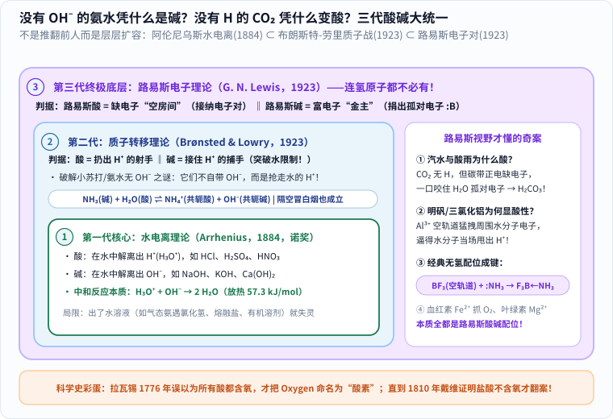
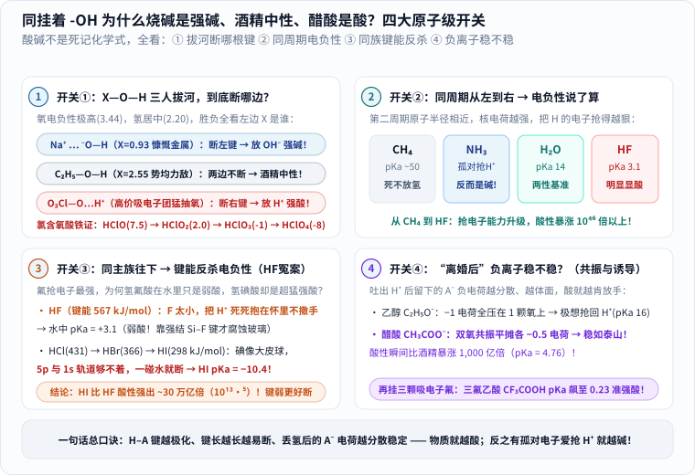
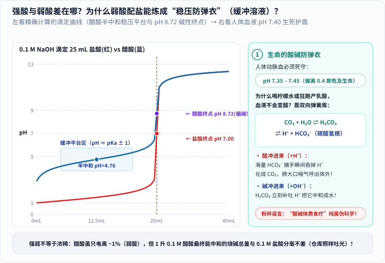
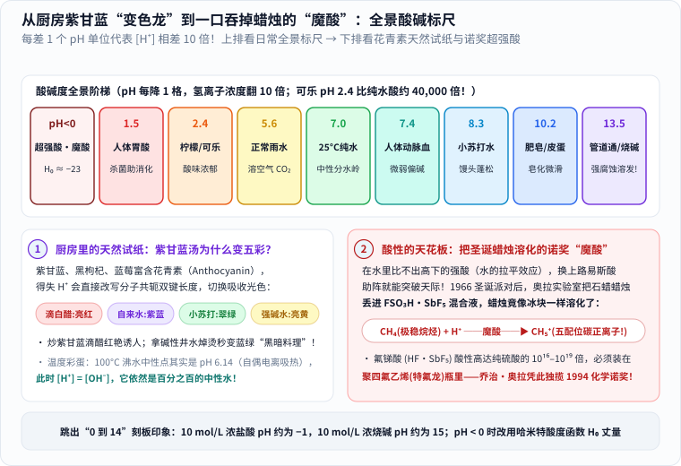

走进你家的厨房，随手就能摸到化学世界里最针锋相对的一对冤家：

切一片鲜柠檬舔一口，或者倒一勺陈醋闻一闻，腮帮子瞬间条件反射地发紧流口水——这是**酸（Acid）**；抓一小撮蒸馒头用的食用碱（碳酸钠）或小苏打（碳酸氢钠）兑水搓搓手，哪怕没打肥皂，指尖也会立刻变得腻腻的、滑溜溜的——这是**碱（Base / Alkali）**。把这两碗水往一块儿一倒，“嗤啦”冒出一串二氧化碳气泡，酸味和滑腻感双双消失，只剩下一碗平平无奇的盐水。

中学化学课本曾经给过我们一句看似万能的口诀：**“电离出氢离子（$$\text{H}^+$$）的是酸，电离出氢氧根（$$\text{OH}^-$$）的是碱。”**

可只要稍微多问三句，这句口诀就会当场“翻车”：

1. **同样满身是氢，凭什么待遇天差地别？** 天然气的主要成分甲烷（$$\text{CH}_4$$）一口气挂了 **4 颗氢原子**，泡在水里却一颗氢都不肯吐，中性得像块石头；氯化氢（$$\text{HCl}$$）只有 **1 颗氢**，一进水却倾家荡产百分之百全扔出来变成强酸！
2. **同样挂着一模一样的“$$-\text{OH}$$”（羟基），凭什么分道扬镳？** 疏通下水道的烧碱（$$\text{Na–OH}$$）、酒杯里的酒精（$$\text{C}_2\text{H}_5\text{–OH}$$）、凉拌黄瓜的醋酸（$$\text{CH}_3\text{CO–OH}$$），尾巴上全都挂着氧和氢。凭什么一个成了连头发都能溶化的强碱，一个不酸不碱，一个却成了酸掉牙的食醋？
3. **没有 $$\text{OH}^-$$ 凭什么是碱？没有 $$\text{H}$$ 又凭什么是酸？** 氨气（$$\text{NH}_3$$）和纯碱（$$\text{Na}_2\text{CO}_3$$）的化学式里连半个“氧氢组合”都没有，却是响当当的碱；二氧化碳（$$\text{CO}_2$$）和净水用的明矾（含 $$\text{Al}^{3+}$$）身上连一颗氢原子都没带，融进水里却实打实地变成了酸水！

就连现代化学之父**拉瓦锡（Antoine Lavoisier）**都曾在这件事上栽过跟头：1776 年前后，他看到硝酸、硫酸、碳酸里全都有氧，便武断地宣布“氧是一切酸性的根源”，甚至用希腊语“造酸者”（*oxys* 酸 + *geinomai* 产生）给氧元素取名为 **Oxygen**（中文至今仍保留着日语曾译的痕迹，日语里氧气就叫“酸素”）——直到 1810 年英国化学家**汉弗莱·戴维（Humphry Davy）**用铁证证明浓盐酸（$$\text{HCl}$$）里压根没有半颗氧原子，这场延续三十多年的“酸素乌龙”才宣告翻案（[Wikipedia: Acid–base reaction](https://en.wikipedia.org/wiki/Acid%E2%80%93base_reaction)）。

今天，我们就顺着那颗比原子还小十万倍的“裸露质子”，钻进分子的电子云拔河赛里，把**物质为什么会显酸性或碱性、为什么强弱能差出几十万亿倍**一次看个通透。

---

## 一、身体比仪器更诚实：为什么酸会“扎舌头”，碱会“抹肥皂”，而质子在水里像闪电？

在追问分子结构之前，我们先揭开开篇那个最接地气的感官之谜：**为什么你的舌头尝得出酸，手指摸得出碱？酸和碱掉进水里那一微秒，微观世界究竟发生了什么？**

### 1. 氢原子脱光外衣后，变成了宇宙间脾气最暴躁的“裸奔原子核”

复习一下我们在[《剧毒氯气遇上遇水爆炸的钠凭什么变成救命食盐？一文读透化学键的底层密码》]()里见过的氢原子（$$\text{H}$$）：它是元素周期表里的老幺，全身上下只有 **1 颗质子**做原子核、外加 **1 颗电子**当外衣。

普通正离子（比如食盐里的钠离子 $$\text{Na}^+$$）就算丢了最外层 1 颗电子，身上还裹着整整 10 颗内层电子当“棉袄”，半径依然有约 $$10^{-10}\text{ m}$$。可一旦氢原子把唯一那颗电子弄丢了，变成 **$$\text{H}^+$$**，它就瞬间脱得一丝不挂——**它不再是一个常规意义上的原子，而是一颗赤裸裸的质子！**

这颗裸质子的半径只有约 $$10^{-15}\text{ m}$$，比普通原子足足**缩小了十万倍**！如果把普通原子比作一座标准足球场，那么 $$\text{H}^+$$ 就是足球场正中央的一粒芝麻，却照样扛着满满当当的 $$+1$$ 单位正电荷。极端浓缩的体积让它表面的电场强度高到骇人听闻：**在液态水里，自由自在单飞的裸露 $$\text{H}^+$$ 绝对不可能存在**——它一露头，不到万亿分之一秒就会扑向身边最近的一颗水分子，死死咬住氧原子富余的孤对电子，抱团变成**水合氢离子（$$\text{H}_3\text{O}^+$$）**，甚至进一步披上三四件水分子“风衣”，化作 $$\text{H}_5\text{O}_2^+$$（Zundel 离子）或 $$\text{H}_9\text{O}_4^+$$（Eigen 离子）（[Wikipedia: Acid–base reaction](https://en.wikipedia.org/wiki/Acid%E2%80%93base_reaction)；[Wikipedia: Grotthuss mechanism](https://en.wikipedia.org/wiki/Grotthuss_mechanism)）。

### 2. 格罗特斯“击鼓传花”：为什么 $$\text{H}^+$$ 在水里跑得比别人快 7 倍？

早些年科学家测量水中离子导电速度时，发现了一个怪现象：体积相仿的钠离子（$$\text{Na}^+$$）、钾离子（$$\text{K}^+$$）、氯离子（$$\text{Cl}^-$$）在水里慢吞吞的，唯独 $$\text{H}^+$$（准确说是 $$\text{H}_3\text{O}^+$$）和 $$\text{OH}^-$$ 跑得像开了瞬移外挂——**水合氢离子的迁移率比钠离子快了足足约 7 倍！**

为什么会这样？早在 1806 年（甚至比人类确认水分子式是 $$\text{H}_2\text{O}$$ 还早！），立陶宛裔化学家**西奥多·格罗特斯（Theodor Grotthuss）**就猜透了天机，这便是著名的**格罗特斯质子跳跃机制（Grotthuss mechanism）**：

- 普通离子（如 $$\text{Na}^+$$）过马路，必须裹着一圈水分子硬生生挤开人群往前挪，就像早高峰背着大包硬挤地铁车厢；
- 而水分子之间本来就手拉手织成了一张绵密的**氢键网络**。左边这颗 $$\text{H}_3\text{O}^+$$ 根本不需要自己千里迢迢游到右边——它只需把右手边多出来的一颗 $$\text{H}^+$$ 顺着氢键塞给邻居水分子，邻居瞬间变成新的 $$\text{H}_3\text{O}^+$$，同时把另一头的 $$\text{H}^+$$ 踢给下一位邻居！共价键与氢键像多米诺骨牌一样交替翻转，正电荷信号瞬间闪现对岸（[Wikipedia: Grotthuss mechanism](https://en.wikipedia.org/wiki/Grotthuss_mechanism)）。

下面这张短动画还原了水中质子“换棒接力”的瞬间，并揭开了酸味与碱滑触感的生理真相（动画自动播放一次后定格在完整结果；若系统开启了“减少动态效果”也会直接展示清晰终态）：

*图 1：先看上栏 ①——氯化氢把质子塞给第一颗水分子后，并不需要这颗水分子自己游完全程，而是沿着氢键虚线网把相邻质子像接力棒一样依次传递（刷新页面或[单独打开动画原图](/assets/images/acid-base-causes/grotthuss-proton-relay-anim.svg)可重播跳跃过程）；再看下栏 ② 与 ③——一边是 $$\text{H}_3\text{O}^+$$ 钻进舌头专属质子门报警，另一边是 $$\text{OH}^-$$ 把你指尖的皮脂现场熬成了微米级肥皂。*

### 3. 舌尖上的 OTOP1“质子专用门”与指尖上的“现场造肥皂”

顺着图 1 下方的左右两栏，日常最熟悉的两种身体感觉也有了标准答案：

- **为什么酸会让你“酸掉牙”？** 甜味、苦味和鲜味靠的是复杂大分子像钥匙插锁一样贴合味蕾表面的受体蛋白，唯独酸味极其直接粗暴。2018 至 2019 年间，美国南加州大学艾米丽·利曼（Emily Liman）团队最终锁定了哺乳动物舌头上的酸味受体——**OTOP1（Otopetrin-1）质子选择性离子通道**（[Wikipedia: OTOP1](https://en.wikipedia.org/wiki/OTOP1)；[Wikipedia: Sourness](https://en.wikipedia.org/wiki/Sourness)）。它本质上就是开在味蕾细胞膜上的一扇“$$\text{H}^+$$ 检票闸机”：柠檬汁里的质子顺着闸机汹涌灌进味觉细胞内部，把细胞内液变酸并反转膜电位，瞬间向大脑拉响“酸味警报”！在演化史上，这扇警报门帮我们的祖先避开了还没长熟的青涩野果，以及发酵变酸的腐败食物。
- **为什么碱水摸起来“滑溜溜”？** 很多人以为碱水天生比清水润滑，其实如果戴上乳胶手套去摸小苏打水或稀释的烧碱水，那股奇特的滑腻感立刻就大打折扣了！**真正滑的不是碱水，而是你自己的皮肤！** 人类指尖表面覆盖着一层薄薄的皮脂（含甘油三酯与游离脂肪酸），当碱性溶液里的氢氧根（$$\text{OH}^-$$）碰上这层油脂，会在零点几秒内发生经典的**皂化反应（Saponification）**——把你指尖的表层油脂现场水解成了**脂肪酸盐（也就是货真价实的肥皂！）**和甘油。古人没有洗发水时用草木灰水（富含碳酸钾 $$\text{K}_2\text{CO}_3$$）洗头去油，靠的就是把头油现场变成肥皂冲走；但如果在实验室里徒手摸到某瓶无色液体觉得“滑得像泥鳅”，千万别觉得好玩——那说明强碱正在溶解你的皮脂和角质蛋白，必须立刻用大量流动清水冲洗！

### 4. 纯水自己也在悄悄“左右互搏”，还顺带催生了啤酒厂里的 $$\text{pH}$$ 标尺

哪怕是一杯连一颗杂质都没有的超纯水，水分子之间每时每刻也在发生极微弱的碰撞抢夺：平均每 **5.55 亿个**水分子里，随时都有一对水分子擦枪走火，一个抢走另一个的质子，变成一对水合氢离子与氢氧根（**水的自偶电离**）：

$$
2\,\text{H}_2\text{O} \rightleftharpoons \text{H}_3\text{O}^+ + \text{OH}^-
$$

在标准室温 $$25^\circ\text{C}$$ 下，这两者的浓度乘积被热力学死死锁在一个常数——**水的离子积常数 $$K_{\text{w} } = 1.0 \times 10^{-14}$$**：

$$
\begin{aligned}
K_{\text{w} } &= [\text{H}_3\text{O}^+][\text{OH}^-] = 1.0 \times 10^{-14} \\
[\text{H}_3\text{O}^+] &= [\text{OH}^-] = 10^{-7}\text{ mol/L}\quad (25^\circ\text{C})
\end{aligned}
$$

你看，这就好比一架永远守恒的跷跷板：往水里加酸让 $$[\text{H}_3\text{O}^+]$$ 暴涨一万倍，水里的 $$[\text{OH}^-]$$ 就会自动缩水一万倍；反之加碱让 $$[\text{OH}^-]$$ 暴涨，$$[\text{H}_3\text{O}^+]$$ 就乖乖退让。

不过每次写 $$0.0000001\text{ mol/L}$$ 实在太折磨人了。1909 年，在丹麦哥本哈根大名鼎鼎的**嘉士伯啤酒厂实验室（Carlsberg Laboratory）**里，主持酿造酶学研究的化学家**索伦·索伦森（S. P. L. Sørensen）**为了方便酿酒师记录麦芽糖化酶最喜欢的酸度，灵机一动给氢离子活度（稀溶液中近似等于浓度）套上了一个负常用对数，发明了今天无人不知的 **$$\text{pH}$$ 标尺**（[Wikipedia: pH](https://en.wikipedia.org/wiki/PH)）：

$$
\text{pH} = -\log_{10} a_{\text{H}^+} \approx -\log_{10}[\text{H}_3\text{O}^+]
$$

有了它，$$10^{-7}\text{ mol/L}$$ 瞬间化作清爽的 **$$\text{pH} = 7$$**！而且顺便记住两个极容易踩坑的真相：
1. **$$\text{pH}$$ 是十进制对数梯，不是均匀尺！** 柠檬汁（$$\text{pH } 2.4$$）和纯水（$$\text{pH } 7.0$$）看着只差 $$4.6$$ 个数字，实际氢离子浓度差出了 $$10^{4.6} \approx \mathbf{40{,}000}$$ **倍**！
2. **中性不一定等于 $$\text{pH } 7$$！** 水拆出离子的反应是吸热的。如果你把超纯水烧开到 $$100^\circ\text{C}$$，$$K_{\text{w} }$$ 会放大约 50 倍，此时纯水的 $$[\text{H}_3\text{O}^+] = [\text{OH}^-] \approx 7.2 \times 10^{-7}\text{ mol/L}$$，算出来 **$$\text{pH} \approx 6.14$$**——它数字小于 7，但因为正负双方人数一模一样，这壶开水依然是**百分之百的中性水**（[Wikipedia: pH](https://en.wikipedia.org/wiki/PH)）！

---

## 二、三次认知破壁：为什么没有 $$\text{OH}^-$$ 的氨水是碱，没有 $$\text{H}$$ 的二氧化碳却是酸？

现在我们来破解开篇的第三个大疑惑：为什么只靠“水里吐 $$\text{H}^+$$ 或 $$\text{OH}^-$$”解释不了小苏打、氨水、二氧化碳和明矾？

因为人类对“到底什么叫酸和碱”的认识，在短短四十年间完成过**三代漂亮的大一统升级**——后一代从来没有推翻前一代，而是像俄罗斯套娃一样，把前一代稳稳包进了更辽阔的宇宙里。

*图 2：从内向外逐层阅读三代酸碱定义——最内层 ① 阿伦尼乌斯盯着“水里解离出什么离子”；中层 ② 布朗斯特与劳里跳出水缸，盯着“谁扔质子、谁接质子”；最外层 ③ 路易斯连氢原子都不强求，直接看透底层本质：“谁有空轨道收电子对，谁有孤对电子送大礼”。*

### 1. 第一代（1884）：阿伦尼乌斯的“水中身份证”

瑞典青年**斯万特·阿伦尼乌斯（Svante Arrhenius）**在 1884 年的博士论文里大胆提出：盐和酸碱一进水就会自动拆成带电离子（当时评审教授差点给他不及格，结果 1903 年这篇论文直接帮他拿下了诺贝尔化学奖！）。按他的规矩，水里吐 $$\text{H}^+$$ 是酸，水里吐 $$\text{OH}^-$$ 是碱，酸碱中和的本质就是 $$\text{H}_3\text{O}^+ + \text{OH}^- \to 2\,\text{H}_2\text{O}$$。

这套理论干脆利落，但一离开水就捉襟见肘：把一瓶浓氨水（挥发出 $$\text{NH}_3$$ 气体）和一瓶浓盐酸（挥发出 $$\text{HCl}$$ 气体）在干燥空气里靠近，两股气体还没沾水，半空中就“呼”地腾起一团洁白的氯化铵（$$\text{NH}_4\text{Cl}$$）固体白烟！明明发生了地地道道的酸碱中和，水在哪儿？$$\text{OH}^-$$ 又在哪儿？

### 2. 第二代（1923）：布朗斯特与劳里的“质子传球赛”

1923 年，丹麦化学家**约翰内斯·布朗斯特（Johannes Nicolaus Brønsted）**与英国化学家**托马斯·劳里（Thomas Martin Lowry）**在同一年各自独立捅破了窗户纸（[Wikipedia: Brønsted–Lowry acid–base theory](https://en.wikipedia.org/wiki/Br%C3%B8nsted%E2%80%93Lowry_acid%E2%80%93base_theory)）：别再死盯水分子了，直接盯紧那颗质子（$$\text{H}^+$$）！

- **酸（质子给予体）**：凡是能把 $$\text{H}^+$$ 当乒乓球**扔出去**的分子或离子，就是酸；
- **碱（质子接受体）**：凡是能张开怀抱把 $$\text{H}^+$$ **接过来**的分子或离子，就是碱！

就这么轻轻一换视角，氨水和小苏打的“无 $$\text{OH}^-$$ 显碱之谜”迎刃而解：**碱根本不需要自带 $$\text{OH}^-$$，只要它有本事从水分子手里硬抢走一颗 $$\text{H}^+$$，剩下的水分子残骸不就自动变成 $$\text{OH}^-$$ 了吗？！**

$$
\begin{aligned}
\text{NH}_3 + \text{H}_2\text{O} &\rightleftharpoons \text{NH}_4^+ + \text{OH}^- \\
\text{HCO}_3^- + \text{H}_2\text{O} &\rightleftharpoons \text{H}_2\text{CO}_3 + \text{OH}^-
\end{aligned}
$$

你看上面这个式子多妙：
- 半空中气态 $$\text{NH}_3$$ 直接接住气态 $$\text{HCl}$$ 扔过来的质子变成 $$\text{NH}_4^+\text{Cl}^-$$，不需要半滴水，照样是名正言顺的酸碱反应！
- 水（$$\text{H}_2\text{O}$$）成了能屈能伸的**两性物质（Amphoteric）**：遇到氨气这种抢球手，水就当“酸”交出质子；遇到盐酸这种强力投手，水就当“碱”接住质子变成 $$\text{H}_3\text{O}^+$$！
- 酸丢掉一颗质子后留下的“单身汉”（比如醋酸 $$\text{CH}_3\text{COOH}$$ 丢氢后变成的醋酸根 $$\text{CH}_3\text{COO}^-$$），叫做它的**共轭碱（Conjugate base）**。这里顺手纠正一个流传极广的参考书误区：人们常背“越弱的酸，对应的共轭碱越强”，这只是相对排序——实际上醋酸虽然是弱酸（$$\text{p}K_{\text{a} } = 4.76$$），它的共轭碱醋酸根在水里抢质子的能力依然很弱（$$\text{p}K_{\text{b} } = 9.24$$），同样只算**弱碱**，只有甲烷、乙醇那种极弱酸脱氢后的负离子才是见水就抢的超级强碱（[Wikipedia: Acid strength](https://en.wikipedia.org/wiki/Acid_strength)）！

### 3. 第三代（同在 1923！）：吉尔伯特·路易斯的“电子对底层视角”

就在布朗斯特与劳里发文同一年，美国加州大学伯克利分校的化学巨匠**吉尔伯特·路易斯（Gilbert N. Lewis）**往更深处挖了一铲子：为什么氨气（$$\text{:NH}_3$$）和氢氧根（$$\text{:OH}^-$$）都那么擅长接住质子？因为它们手里都攥着一对没成键的**孤对电子（Lone pair）**！而质子 $$\text{H}^+$$ 之所以见谁扑谁，不就是因为它头顶着一间空荡荡的 **$$1s$$ 空轨道**，急需别人拿一对电子来合租吗？

于是路易斯给出了酸碱世界最宏大的终极定义（[Wikipedia: Lewis acids and bases](https://en.wikipedia.org/wiki/Lewis_acids_and_bases)）：

- **路易斯碱（电子对给予体）**：富电子的“金主”，手里有孤对电子愿意捐出来共享；
- **路易斯酸（电子对接受体）**：缺电子的“空房间”，手里有空轨道（或强正电中心）渴望接纳别人的电子对！

站在路易斯的高度往下看，前面所有悬案瞬间清零：
- **为什么二氧化碳（$$\text{CO}_2$$）没氢也能让汽水变酸？** 因为 $$\text{O=C=O}$$ 两头的氧原子拼命吸电子，把中间的碳原子抽得严重缺电子（路易斯酸！）。水分子的氧带着孤对电子（路易斯碱）一头撞上这颗缺电子碳，咔嚓拼成碳酸（$$\text{H}_2\text{CO}_3$$），随后吐出 $$\text{H}^+$$！
- **为什么炸油条、净水用的明矾（含铝离子 $$\text{Al}^{3+}$$）或三氯化铁（含 $$\text{Fe}^{3+}$$）泡水明显显酸性？** 因为 $$\text{Al}^{3+}$$ 个头小、正电荷高达 $$+3$$，堪称凶悍的路易斯酸！它一进水就抓过 6 个水分子配位成 $$[\text{Al(H}_2\text{O)}_6]^{3+}$$，把水分子氧上的电子云死死往自己怀里拽，拽得外围的 $$\text{O–H}$$ 键撑不住崩断，当场往水里甩出 $$\text{H}^+$$！
- 甚至连三氟化硼与氨气结成配位键（$$\text{BF}_3 + \text{:NH}_3 \to \text{F}_3\text{B}\leftarrow\text{NH}_3$$），以及我们在[《血液循环系统》]()里讲过的血红蛋白亚铁离子（$$\text{Fe}^{2+}$$）抓氧气、还有[《莲藕变黑与身边变色化学》]()里铁锅的 $$\text{Fe}^{3+}$$ 咬住藕片多酚瞬间变紫黑，**在最底层全都是一场路易斯酸与路易斯碱的电子对联姻！**

---

## 三、直捣黄龙：到底是什么原子级原因，决定了谁是强酸、谁是弱酸、谁是强碱？

现在，我们终于来到了整篇文章最核心的问题：**拿到任何一个陌生的分子，大自然究竟按什么开关，决定它是死抱氢原子不撒手，还是痛快吐出 $$\text{H}^+$$ 当强酸，抑或是吐出 $$\text{OH}^-$$ 当强碱？**

化学家把分子解离质子的慷慨程度写成酸解离常数 $$K_{\text{a} }$$（以及取负对数后的 $$\text{p}K_{\text{a} } = -\log_{10} K_{\text{a} }$$，**$$\text{p}K_{\text{a} }$$ 越小甚至越负，酸性越狂暴！**）。决定这个数字的，归根结底只有**四大原子级开关**。

*图 3：按四个象限逐一拆解分子的“酸碱基因”——左上 ① 解开同挂 $$-\text{OH}$$ 却分道扬镳的拔河真相；右上 ② 看同周期电负性如何让甲烷到氢氟酸酸性暴涨 $$10^{46}$$ 倍；左下 ③ 破案最反直觉的“氢氟酸弱酸冤案”；右下 ④ 看丢氢后的负离子如何靠“共振分摊房贷”稳住阵脚。*

### 开关 ①：$$\text{X—O—H}$$ 三人拔河——同样挂着 $$-\text{OH}$$，为什么烧碱、酒精、高氯酸走向三个极端？

请盯着图 3 左上角这串三原子链条：**$$\text{X—O—H}$$**。站在正中间的氧原子是个抢电子狂魔（鲍林电负性高达 $$3.44$$），右边挂着老实的氢原子（电负性 $$2.20$$）。到底断左边这根键（吐出 $$\text{OH}^-$$ 当碱），还是断右边这根键（吐出 $$\text{H}^+$$ 当酸），**百分之百取决于左边站着的 $$\text{X}$$ 是谁！**

1. **当 $$\text{X}$$ 是慷慨的碱金属（如钠 $$\text{Na}$$，电负性仅 $$0.93$$）**：钠原子最烦身上多出来的那颗价电子，氧原子一拉，钠干脆利落地把电子彻底送给氧，左边根本不是共价键而是离子键（$$\text{Na}^+\,\text{OH}^-$$）！一进水，左键瞬间解散，整根完整的 **$$\text{OH}^-$$** 带着孤对电子欢快游走——这就是**氢氧化钠（烧碱）成为强碱**的原因！
2. **当 $$\text{X}$$ 是温和的碳链（如乙醇 $$\text{C}_2\text{H}_5\text{—O—H}$$，碳电负性 $$2.55$$）**：碳和氢谁也不是软柿子，$$\text{C—O}$$ 和 $$\text{O—H}$$ 两根共价键势均力敌、结实得很，泡在水里哪边都拉不断（乙醇 $$\text{p}K_{\text{a} } \approx 15.9$$，比水还难电离）——所以你在[《红星二锅头的酿造技艺与味道密码》]()里喝到的纯酒精水溶液是**中性**的！
3. **当 $$\text{X}$$ 是拼命吸电子的高价非金属团（如硫酸、硝酸、高氯酸）**：好戏开场了！如果左边挂着一颗自己已经被好几颗氧原子抽干了电子的高价氯原子（如高氯酸 $$\text{O}_3\text{Cl—O—H}$$），这团吸电子巨兽就会隔着中间的氧原子，把右边 $$\text{O—H}$$ 键里的电子云疯狂往左抽！可怜的氢原子电子被抽得干干净净，一碰水分子就断掉**右边这根键**，光着身子变成 $$\text{H}^+$$ 飞出去——这就是**含氧酸**的诞生！

不信你看氯元素的四兄弟，仅仅是在氯原子身边多挂几颗抢电子的端基氧（$$=\text{O}$$），酸性立刻上演史诗级三级跳（[Wikipedia: Acid strength](https://en.wikipedia.org/wiki/Acid_strength)）：

| 含氧酸名称 | 结构式（写成 $$\text{X—O—H}$$） | 端基 $$=\text{O}$$ 个数 | 水中 $$\text{p}K_{\text{a} }$$ | 酸性对比（相对次氯酸） |
| :--- | :--- | :---: | :---: | :--- |
| **次氯酸**（84消毒液有效成分） | $$\text{Cl—O—H}$$ | $$0$$ | $$+7.53$$ | $$1\times$$（极弱酸，比碳酸还弱） |
| **亚氯酸** | $$\text{O=Cl—O—H}$$ | $$1$$ | $$+2.0$$ | 强约 **$$34\text{ 万倍}$$** |
| **氯酸** | $$\text{O}_2\text{Cl—O—H}$$ | $$2$$ | $$-1.0$$ | 强约 **$$3.4\text{ 亿倍}$$** |
| **高氯酸**（常规含氧酸之王） | $$\text{O}_3\text{Cl—O—H}$$ | $$3$$ | $$\approx -8$$ | 强约 **$$3.4\times 10^{15}\text{ 倍}$$（千万亿倍！）** |

### 开关 ②：同周期从左往右看——电负性碾压，破解“甲烷 4 颗氢为何不酸”

再看图 3 右上角：沿着元素周期表第二横排从左走到右——**$$\text{CH}_4 \to \text{NH}_3 \to \text{H}_2\text{O} \to \text{HF}$$**。这四位中心原子的个头（原子半径）相差不大，胜负手完全落在**电负性（抢电子狠劲）**上：

- **甲烷（$$\text{CH}_4$$）**：碳（$$2.55$$）和氢（$$2.20$$）电负性几乎平起平坐，四根 $$\text{C—H}$$ 键均匀对称、不偏不倚；万一硬扯走一颗 $$\text{H}^+$$，剩下的甲基负离子（$$\text{CH}_3^-$$）要把孤零零的负电荷硬塞在不爱吸电子的碳头上，简直生不如死！因此甲烷的 $$\text{p}K_{\text{a} }$$ 高达 **$$\approx 50$$**——哪怕有 4 颗氢，在水里也铁公鸡一毛不拔！
- **氨（$$\text{NH}_3$$）**：氮（$$3.04$$）抢电子稍强，但它头顶那对孤对电子太活跃，进水非但不吐氢（$$\text{p}K_{\text{a} } \approx 38$$），反而主动抢水的氢，成了碱。
- **水（$$\text{H}_2\text{O}$$）**到 **氟化氢（$$\text{HF}$$）**：氟的电负性冲上全周期表第一（$$3.98$$），把 $$\text{H—F}$$ 键电子抢得高度偏心，$$\text{p}K_{\text{a} }$$ 骤降到 **$$+3.1$$**——从甲烷到氢氟酸，酸性足足暴涨了 **$$10^{46}$$ 倍以上**！

### 开关 ③：同主族从上往下看——键长与键能绝地反杀，揭开“氢氟酸弱酸冤案”！

刚夸完氟抢电子天下第一，化学课上最让人摔眼镜的悖论就来了（图 3 左下角）：顺着卤素这一列往下走——**$$\text{HF} \to \text{HCl} \to \text{HBr} \to \text{HI}$$**，电负性明明一路下跌（氟 $$3.98 >$$ 氯 $$3.16 >$$ 溴 $$2.96 >$$ 碘 $$2.66$$），偶极矩也从 $$1.86\text{ D}$$ 跌到 $$0.38\text{ D}$$；按理说氟化氢应该是最猛的宇宙第一强酸吧？

**恰恰相反！氟化氢（$$\text{HF}$$）在水里居然只是个跟醋酸差不多的弱酸（$$\text{p}K_{\text{a} } = +3.1$$），而最不爱抢电子的氢碘酸（$$\text{HI}$$）却是凶猛绝伦的超强酸（$$\text{p}K_{\text{a} } = -10.4$$），比氢氟酸强出整整约 30 万亿倍（$$10^{13.5}$$）！**（[Wikipedia: Hydrogen halide](https://en.wikipedia.org/wiki/Hydrohalic_acid)；[Wikipedia: Acid strength](https://en.wikipedia.org/wiki/Acid_strength)）

凭什么？因为同一竖列往下走，原子像吹气球一样迅速变胖，这时候**“键能不能拉断”彻底压倒了电负性**：
- **氟原子太袖珍了**（$$2p$$ 轨道与氢的 $$1s$$ 轨道严丝合缝地重叠），导致 $$\text{H—F}$$ 共价键的键解离焓高达惊人的 **$$567\text{ kJ/mol}$$**！再加上脱出来的 $$\text{F}^-$$ 体积太小、电荷太集中，在稀水里会紧紧拉住 $$\text{H}_3\text{O}^+$$ 结成难舍难分的氢键离子对（$$\text{H}_3\text{O}^+\cdots\text{F}^-$$），并把周围水分子锁得整整齐齐导致巨大的熵惩罚——就像一位控制欲极强的家长，虽然把孩子的零花钱（电子）全没收了，却死死把孩子（$$\text{H}^+$$）抱在怀里不准出门！
- **碘原子却像一只巨大的沙滩球**（$$5p$$ 轨道又大又蓬松，跟袖珍的氢 $$1s$$ 轨道根本搭不上茬），键解离焓暴跌到只有 **$$298\text{ kJ/mol}$$**，而且离去后的大胖子碘离子（$$\text{I}^-$$）把 $$-1$$ 电荷稀稀拉拉摊在巨大的球面上，惬意无比——水分子轻轻一碰，$$\text{H—I}$$ 键就脆生生断掉！

> **⚠️ 保命冷知识：千万别因为氢氟酸是“弱酸”就小看它！**
> 影视剧和化工厂里最令人闻风丧胆的“化骨水”恰恰就是这个弱酸 $$\text{HF}$$！第一，连王水都奈何不了的石英玻璃（$$\text{SiO}_2$$），遇到氢氟酸会被迅速蚀穿（$$\text{SiO}_2 + 4\,\text{HF} \to \text{SiF}_4\uparrow + 2\,\text{H}_2\text{O}$$），原因不是它酸度高，而是硅和氟能结成化学界罕见的超强单键 **$$\text{Si—F}$$**；第二，正因为它在水里大部分是不带电的中性 $$\text{HF}$$ 小分子，溅到皮肤上时**起初甚至不怎么疼**，却能悄无声息穿透脂质细胞膜钻进深层组织和骨骼，死死螯合血液里的钙离子（$$\text{Ca}^{2+}$$）与镁离子生成不溶的氟化钙（$$\text{CaF}_2$$），引发剧痛甚至致命的心脏骤停！

### 开关 ④：“离婚后”的单身生活稳不稳——共振均摊与诱导效应

最后一个开关（图 3 右下角），专门回答开篇第二个谜题：**同样是碳链挂 $$-\text{OH}$$，为什么酒精（$$\text{CH}_3\text{CH}_2\text{OH}$$）一点都不酸，多长了一颗双键氧的醋酸（$$\text{CH}_3\text{COOH}$$），酸性瞬间飙升了 1,000 亿倍（$$\text{p}K_{\text{a} }$$ 从 $$15.9$$ 降到 $$4.76$$）？**

秘诀全在**“丢掉质子之后，留下的负离子稳不稳定”**：
- 酒精要是真丢掉 $$\text{H}^+$$，留下的乙氧基负离子（$$\text{CH}_3\text{CH}_2\text{O}^-$$）必须由**单独一颗氧原子**硬扛全部 $$-1$$ 负电荷，电荷高度拥挤，一有机会就立刻把 $$\text{H}^+$$ 抢回来；
- 而醋酸丢掉 $$\text{H}^+$$ 后变成**醋酸根（$$\text{CH}_3\text{COO}^-$$）**，奇迹发生了：原本那颗双键氧立刻过来“合伙分担房贷”，通过 $$\pi$$ 电子**共振离域（Resonance delocalization）**，两颗一模一样的氧原子完美平摊，每人只背 **$$-0.5$$ 个负电荷**！负担减半，负离子稳如泰山，氢离子自然乐意出门单飞！
- 如果我们再给醋酸左边的甲基换上三颗吸电子狂魔氟原子，做成**三氟乙酸（$$\text{CF}_3\text{COOH}$$）**，氟原子顺着碳链隔空抽走电子（**诱导效应 Inductive effect**），把负电荷分摊得更薄，$$\text{p}K_{\text{a} }$$ 直接一路狂跌到 **$$0.23$$**——一跃变成几乎跟无机酸平起平坐的有机准强酸（[Wikipedia: Acid strength](https://en.wikipedia.org/wiki/Acid_strength)）！

---

## 四、强弱不等于浓稀：为什么弱酸配盐能给你的血液穿上 $$\text{pH } 7.40$$“防弹衣”？

搞懂了分子为什么有强酸和弱酸之分，生活里还有一个高频误区必须拆穿：**“盐酸是强酸，醋酸是弱酸，所以同样浓度的盐酸能中和更多的烧碱，对吗？”**

**全错！一升 $$0.1\text{ mol/L}$$ 的食醋，最终能中和掉的氢氧化钠总量，跟一升 $$0.1\text{ mol/L}$$ 的盐酸分毫不差！**

- **强酸（如盐酸）**像是把全部现金都揣在兜里随时花掉的月光族（一进水 $$100\%$$ 电离）；
- **弱酸（如醋酸）**像是兜里只揣 $$1\%$$ 零花钱、剩下 $$99\%$$ 全锁在银行金库里的富翁。平时测 $$\text{pH}$$ 时只看兜里的零花钱，所以 $$0.1\text{ M}$$ 盐酸是 $$\text{pH } 1.0$$，而 $$0.1\text{ M}$$ 醋酸只有 $$\text{pH } 2.88$$；但一旦你往里滴加烧碱（$$\text{OH}^-$$）花掉兜里的 $$\text{H}^+$$，醋酸金库里的 $$\text{CH}_3\text{COOH}$$ 就会源源不断自动解离补货，直到最后一分子库存全部掏空！

更神奇的是，正是因为弱酸拥有这座“随时补货又随时收货”的双向仓库，一旦把**弱酸（$$\text{HA}$$）和它的共轭碱盐（$$\text{A}^-$$）**按差不多 $$1:1$$ 混在一起，就炼成了化学与生命世界里最伟大的稳压神器——**缓冲溶液（Buffer solution）**，它遵循简洁优美的**亨德森-哈塞尔巴尔赫方程（Henderson–Hasselbalch equation）**：

$$
\text{pH} = \text{p}K_{\text{a} } + \log_{10}\frac{[\text{A}^-]}{[\text{HA}]}
$$

*图 4：先看左图精确计算的滴定曲线——红色盐酸在终点前一路贴地飞行、到 $$25\text{ mL}$$ 突然垂直跳水到 $$\text{pH } 7.00$$；而蓝色醋酸在半中和点（$$12.5\text{ mL}$$）附近拉出了一段极其平坦的“蓝色缓冲平台”（外加酸碱几乎撼动不了 $$\text{pH}$$！），且完全中和终点落在偏碱性的 $$\text{pH } 8.72$$（因为生成的醋酸钠水解抢质子）；再看右图——你的血液正靠同一套原理每分每秒保命。*

看看图 4 右栏，你会瞬间对自己的身体肃然起敬：
人类全身几万种酶和离子通道都是极其娇贵的蛋白质，**正常人动脉血的酸碱度必须死死钉在 $$\text{pH } 7.35\text{–}7.45$$ 之间**——哪怕往左跌破 $$7.0$$（严重酸中毒昏迷），或者往右冲破 $$7.8$$（严重碱中毒抽搐），几小时内就会危及生命！

可我们中午刚喝下一大杯 $$\text{pH } 2.5$$ 的冰镇可乐或酸梅汤，下午又狂跑一千米往血液里排出一大堆乳酸，为什么血液的 $$\text{pH}$$ 纹丝不动？全靠血管里每分每秒都在运转的**碳酸—碳酸氢盐（$$\text{H}_2\text{CO}_3 / \text{HCO}_3^-$$）开放式缓冲护盾**：

$$
\begin{aligned}
&\text{CO}_2\text{（肺呼出）} + \text{H}_2\text{O} \rightleftharpoons \text{H}_2\text{CO}_3 \\
&\rightleftharpoons \text{H}^+ + \text{HCO}_3^-\text{（肾脏调节库存）}
\end{aligned}
$$

- 一旦运动乳酸涌入血液（$$+\text{H}^+$$），血浆里海量待命的碳酸氢根（$$\text{HCO}_3^-$$）捕手立刻扑上去吞掉质子变成碳酸，再拆成 $$\text{CO}_2$$，你的脑干呼吸中枢一感知，立刻让你大口喘气把多余的酸气呼出体外！
- 一旦碱性物质进血（$$+\text{OH}^-$$），碳酸又立刻吐出 $$\text{H}^+$$ 把它变成水，同时呼吸稍稍放缓留住 $$\text{CO}_2$$！

顺便也就彻底戳穿了朋友圈常年流传的养生骗局：**根本不存在所谓的“酸性体质百病生、多喝弱碱水改体质”！** 你喝下去的弱碱水（$$\text{pH } 8$$ 左右）刚进胃（$$\text{pH } 1.5$$ 的浓盐酸池！）第一秒就被彻底中和得连渣都不剩；就算真有人血液 $$\text{pH}$$ 掉到了 $$7.30$$ 以下，那叫临床急重症**酸中毒**，该去的地方是医院 ICU，绝不是超市买苏打水！

---

## 五、从厨房紫甘蓝“彩虹试纸”到一口吞掉圣诞蜡烛的诺奖“魔酸”

最后，让我们把视野拉到最壮观的全景尺度：在我们的厨房里怎么亲眼看见质子的得失？如果跳出水分子的束缚，酸性的极限又能狂暴到什么地步？

*图 5：上排展示了跨越十几个数量级的日常与极端酸碱阶梯；下排左栏演示如何用一碗紫甘蓝汤在自家餐桌上做出红—紫—绿—黄四色天然指示剂；下排右栏揭秘 1966 年圣诞派对上那支被“魔酸”一口溶掉的石蜡蜡烛与 1994 年诺贝尔化学奖。*

### 1. 厨房里的“变色龙”：为什么炒紫甘蓝滴醋变艳红，焯碱水秒变绿黑暗料理？

周末在家做菜时，你可以带孩子或朋友玩一个零成本的绝美化学魔术：撕两片**紫甘蓝**（或者抓几颗**黑枸杞**、蓝莓）用热水泡出一碗深紫色的汤汁，分装进四个透明玻璃杯里——
1. 第一杯滴半勺**白醋或柠檬汁**：汤汁瞬间变成娇艳欲滴的**亮玫红色**；
2. 第二杯留着**纯净水**：保持高贵的**紫罗兰色**；
3. 第三杯撒一点点蒸馒头的**小苏打**：眨眼间变成翡翠般的**蓝绿色**；
4. 第四杯滴一点强碱水（如浓食用碱或管道疏通液，切勿入口！）：直接跳成明亮的**柠檬黄**！

一碗菜汤凭什么变出整道彩虹？因为紫甘蓝里富含天然酸碱指示剂——**花青素（Anthocyanin）**。花青素本身就是一套精巧的弱酸弱碱共轭体系：在酸水里它抱紧质子，形成共轭双键较短的𬭩正离子（吸收蓝绿光、反射红光）；随着溶液变碱，花青素身上的质子被 $$\text{OH}^-$$ 一颗接一颗拽走，分子骨架上的 $$\pi$$ 电子共轭通道随之延长改道（醌式碱结构），吸收光的波长大幅红移，反射出来的颜色就一路从红跳到紫、蓝、翠绿，最后在强碱下开环变成黄色的查尔酮！实验室里大名鼎鼎的石蕊试纸（酸红碱蓝）和酚酞（遇碱变红），底层玩的都是这同一套**“得失一颗质子，改写电子跑道长度”**的把戏。

### 2. 捅破 $$\text{pH } 0$$ 的天花板：水的“拉平效应”与溶解蜡烛的诺奖“魔酸”

很多人从小背熟了“$$\text{pH}$$ 的范围是 $$0\text{–}14$$”，误以为 $$\text{pH } 0$$ 就是宇宙最酸的尽头。其实这只是稀水溶液给人造成的错觉！

一方面，只要浓度够高，哪怕普通的浓盐酸（约 $$12\text{ mol/L}$$）算出来的有效 $$\text{pH}$$ 也早就跌破零点，到了 **$$-1.1$$ 左右**；另一方面，水本身是个挺会抢质子的碱，任何比 $$\text{H}_3\text{O}^+$$（$$\text{p}K_{\text{a} } \approx -1.74$$）更强的猛男强酸（比如盐酸、氢溴酸、高氯酸、硫酸）一踏进水门，手里的质子瞬间全被水分子没收变成一模一样的 $$\text{H}_3\text{O}^+$$——就像让博尔特和普通长跑冠军一块儿在齐腰深的泥潭里赛跑，谁也跑不出真实极限，这叫溶剂的**拉平效应（Leveling effect）**（反过来，如果把盐酸倒进冰醋酸溶剂里，因为醋酸极不情愿接质子，堂堂盐酸在冰醋酸里甚至会委屈地变成一只“弱酸”！）（[Wikipedia: Acid strength](https://en.wikipedia.org/wiki/Acid_strength)）。

那要是彻底甩掉水分子，再请一位凶悍绝伦的**路易斯酸**过来把负离子死死锁住呢？人类就此推开了**超强酸（Superacid，定义为酸性比 $$100\%$$ 纯硫酸更强的体系，哈米特酸度函数 $$H_0 < -11.93$$）**的大门（[Wikipedia: Superacid](https://en.wikipedia.org/wiki/Superacid)）！

1966 年圣诞节派对散场后，美国凯斯西储大学**乔治·奥拉（George A. Olah）**实验室的博士后约阿希姆·卢卡斯（Joachim Lukas）突发奇想，掰下一截刚点过的**石蜡圣诞蜡烛**，丢进了一瓶由氟磺酸（$$\text{FSO}_3\text{H}$$，布朗斯特酸）与五氟化锑（$$\text{SbF}_5$$，极强路易斯酸）按 $$1:1$$ 配成的无色液体里。

要知道，石蜡是长链饱和烷烃（$$\text{C}_n\text{H}_{2n+2}$$，甲烷的亲兄弟），化学性质顽固得号称“石蜡（Paraffin，拉丁语原意就是**毫无亲和力**）”，哪怕泡进滚烫的浓硫酸或王水里也毫发无伤。然而奇迹出现了：**那截蜡烛竟像一块方糖掉进热茶里一样，悄无声息地彻底溶解了！**

奥拉立刻拿去测核磁共振谱，看到了震惊整个有机化学界的一幕——五氟化锑拼命抢走氟磺酸根的负电荷，释放出近乎赤裸的狂暴质子，居然硬生生把质子塞进了原本饱和得水泼不进的碳氢单键里，造出了五只手的**五配位碳正离子（如甲𬭩离子 $$\text{CH}_5^+$$）**，紧接着把长链蜡烛咔嚓咔嚓剪断重排成了带支链的叔丁基正离子！卢卡斯激动地把这瓶药水外号取名为**“魔酸”（Magic Acid）**；而它的同门大哥**氟锑酸（$$\text{HF}\cdot\text{SbF}_5$$）**，哈米特酸度函数更是深达惊人的 **$$H_0 \approx -21\text{ 至 }-28$$**——**质子化能力高达 $$100\%$$ 纯硫酸的亿亿倍（$$10^{16}$$）以上**，连玻璃瓶都会瞬间蚀穿，只能乖乖关在聚四氟乙烯（特氟龙）瓶子里！乔治·奥拉也正是凭着超强酸稳定碳正离子的开创性贡献，独揽了 **1994 年诺贝尔化学奖**（[Wikipedia: Superacid](https://en.wikipedia.org/wiki/Superacid)）。

---

## 六、一张总表带走：酸碱世界的底层逻辑全图谱

合上这篇文章前，下次再在配料表、厨房或实验室里看到任何酸酸碱碱的名字，你再也不必死记硬背——只需在脑海里过一遍这四行底层密码：

| 核心追问 | 底层物理化学真相 | 生活中的鲜活印证 |
| :--- | :--- | :--- |
| **酸和碱到底在争什么？** | 表层争的是**质子（$$\text{H}^+$$）谁扔谁接**（布朗斯特）；最底层争的是**电子对谁捐谁收**（路易斯） | 小苏打无 $$\text{OH}^-$$ 却能抢水的质子显碱；$$\text{CO}_2$$ 无 $$\text{H}$$ 却靠碳缺电子抓水变酸 |
| **同挂 $$-\text{OH}$$ 凭啥分家？** | 看 $$\text{X—O—H}$$ 左边是谁：金属送电子断左键成**碱**；高价非金属吸电子断右键成**酸** | 烧碱 $$\text{NaOH}$$（强碱）vs 酒精 $$\text{C}_2\text{H}_5\text{OH}$$（中性）vs 高氯酸 $$\text{HClO}_4$$（超猛强酸） |
| **谁决定了酸的强弱？** | **同周期比电负性**（越右越酸）；**同主族比键能**（越胖键越弱越酸）；外加**丢氢后负离子能否共振分摊电荷** | $$\text{HI}$$ 比 $$\text{HF}$$ 强约 30 万亿倍；醋酸靠双氧共振比酒精酸 1,000 亿倍 |
| **生命与日常怎么驯服酸碱？** | 弱酸配共轭碱盐组成**缓冲对**锁死 $$\text{pH}$$；共轭色素得失质子切换颜色 | 人体动脉血靠 $$\text{CO}_2/\text{HCO}_3^-$$ 死守 $$\text{pH } 7.35\text{–}7.45$$；紫甘蓝滴醋变红遇碱变绿 |

从你舌尖上一扇微米级的 OTOP1 质子小门，到嘉士伯酒窖里诞生的 $$\text{pH}$$ 对数尺，再到特氟龙瓶子里一口吞掉蜡烛的诺奖魔酸——看似千变万化的酸甜苦辣与腐蚀再生，剥到最深处，不过是一颗脱光外衣的小小质子，在一群电子云之间永不停歇的跳棋游戏。

---

## 参考资料与核查来源

1. **酸碱反应历史、拉瓦锡“酸素（Oxygen）”命名误判与戴维 1810 年盐酸翻案、水中 $$\text{H}_3\text{O}^+$$ 本质**：[Wikipedia: Acid–base reaction](https://en.wikipedia.org/wiki/Acid%E2%80%93base_reaction)（核查拉瓦锡 1776 年氧酸假说、戴维 1810 年证明 $$\text{HCl}$$ 无氧及阿伦尼乌斯 1884 年电离学说）。
2. **1923 年质子转移理论与共轭酸碱对**：[Wikipedia: Brønsted–Lowry acid–base theory](https://en.wikipedia.org/wiki/Br%C3%B8nsted%E2%80%93Lowry_acid%E2%80%93base_theory)（核查布朗斯特与劳里 1923 年独立提出质子给予体/接受体定义、水的两性行为及非水体系反应）。
3. **1923 年路易斯电子对酸碱理论**：[Wikipedia: Lewis acids and bases](https://en.wikipedia.org/wiki/Lewis_acids_and_bases)（核查吉尔伯特·路易斯空轨道接受体与孤对电子给予体定义、$$\text{BF}_3\text{–NH}_3$$ 加合物及无氢氧化物显酸机理）。
4. **酸强弱结构决定因素、氯含氧酸级数、溶剂拉平效应与卤化氢反常**：[Wikipedia: Acid strength](https://en.wikipedia.org/wiki/Acid_strength) 与 [Wikipedia: Hydrogen halide](https://en.wikipedia.org/wiki/Hydrohalic_acid)（核查 $$\text{HClO}\to\text{HClO}_4$$ 的 $$\text{p}K_{\text{a} }$$ 跨度、$$\text{HF}$$ [$$+3.1$$] 至 $$\text{HI}$$ [$$-10.4$$] 的水溶液酸度反转、键解离焓与诱导/共振稳定效应）。
5. **水中质子格罗特斯跳跃传导机制（1806）**：[Wikipedia: Grotthuss mechanism](https://en.wikipedia.org/wiki/Grotthuss_mechanism)（核查西奥多·格罗特斯 1806 年氢键质子接力模型、Eigen/Zundel 水合团簇及 $$\text{H}^+$$ 异常高离子迁移率）。
6. **1909 年嘉士伯实验室 $$\text{pH}$$ 标尺发明与高温纯水中性点偏移**：[Wikipedia: pH](https://en.wikipedia.org/wiki/PH)（核查索伦森 1909 年在嘉士伯实验室定义负对数氢离子标尺及温度对 $$K_{\text{w} }$$ 中性点的影响）。
7. **哺乳动物酸味受体 OTOP1 质子通道**：[Wikipedia: OTOP1](https://en.wikipedia.org/wiki/OTOP1) 与 [Wikipedia: Sourness](https://en.wikipedia.org/wiki/Sourness)（核查 2018–2019 年确认味蕾细胞 Otopetrin-1 质子选择性通道介导酸味感知的分子机制）。
8. **超强酸、1966 年圣诞蜡烛实验与乔治·奥拉 1994 年诺贝尔化学奖**：[Wikipedia: Superacid](https://en.wikipedia.org/wiki/Superacid)（核查哈米特酸度函数定义、$$\text{FSO}_3\text{H}\cdot\text{SbF}_5$$“魔酸”溶解石蜡生成碳正离子及氟锑酸极限酸度）。
