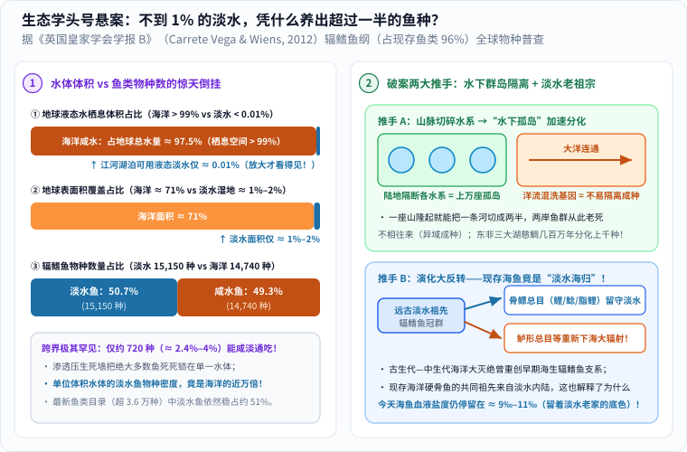
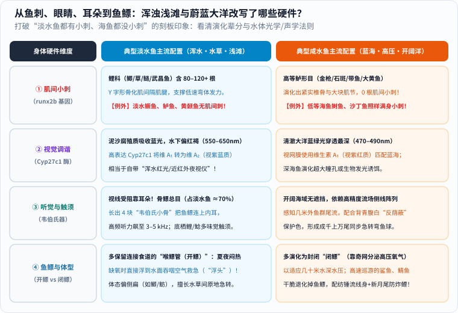
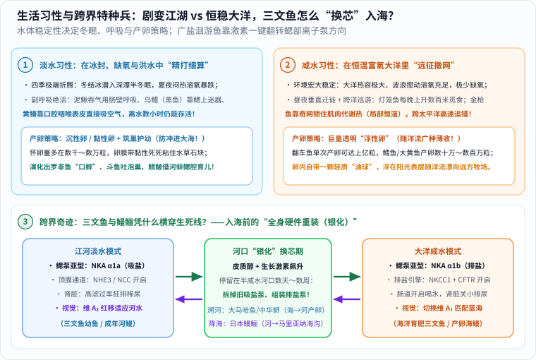
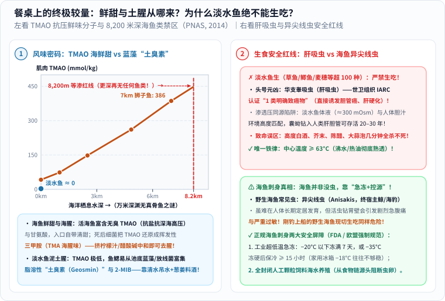

每年海边码头或内陆江畔，几乎都会上演几幕让人哭笑不得的“好心办坏事”。

有人在菜市场买了几条活蹦乱跳的草鱼、鲫鱼，心想“江河太窄，大海才宽广”，特意跑到海边栈桥把它们放生进蔚蓝大海；也有人把海钓上来的石斑鱼、真鲷带回家，放进小区景观池塘里想接着养。

结果不出几个小时，两边的鱼双双翻白肚暴毙——但死法却截然相反：

- 被扔进大海的**淡水草鱼**，明明全身泡在无穷无尽的水里，却是因为体内水分被疯狂抽干，死于**急性重度脱水（活活“渴死”）**；
- 被丢进池塘的**咸水石斑鱼**，则是浑身水肿、眼球凸出、细胞胀裂，死于**急性水中毒（活活“撑爆”）**！

同样长着鱼鳃、摇着尾巴在水里游，淡水鱼和咸水鱼（海水鱼）的身体内部到底隔着怎样一道看不见的生死墙？

如果你仔细琢磨日常买鱼、钓鱼和吃鱼的经验，还会冒出一连串更有趣的疑问：

1. **为什么泡在海里的鱼天天都在拼命喝水，而江河里的淡水鱼一辈子几乎从不喝水，每天却要疯狂排尿？**
2. **地球上超过 $$97\%$$ 的水都在海洋里，江河湖泊的液态淡水连全球水量的 $$0.01\%$$ 都不到，为什么淡水鱼的物种数量居然比海鱼还要多？**
3. **为什么我们常吃的鲫鱼、草鱼、鲢鱼肉里全是扎嗓子的“Y 字小刺”，而带鱼、金枪鱼、石斑鱼只有一根主刺？真是咸淡水决定的吗？**
4. **浑浊结冰的池塘与恒温蔚蓝的大洋，把两类鱼的眼睛、耳朵、鱼鳔和产卵习性改造成了什么样？为什么淡水鱼绝对不能学三文鱼切刺身生吃？**

今天，我们就顺着生理学、演化生物学与生物化学的证据链，把淡水鱼与咸水鱼从鱼鳃拆到餐桌，一次看个通透。

---

## 一、生存第一关：泡在海里防“渴死”，泡在河里防“撑爆”

决定一条鱼姓“淡”还是姓“咸”的最底层物理铁律，叫做**渗透压（Osmotic Pressure）**。

我们在讲植物春天开花的《[光秃秃的枝条凭什么一夜爆满繁花？]()》里介绍过范特霍夫（van 't Hoff）渗透压定律：只要一张半透膜两边溶液的溶质总浓度不同，水分子就会不可阻挡地从**低浓度（水多盐少）**一侧往**高浓度（水少盐多）**一侧猛钻，产生的压强差为：

$$
\begin{aligned}
\Delta \Pi &= \Delta C \cdot R T
\end{aligned}
$$

对陆地上的我们来说，皮肤外层裹着厚厚的不透水角质层，跳进泳池也不会吸水发胀，跳进大海也不会瞬间风干。**但鱼不一样！**

鱼为了从水里抢夺稀薄的溶解氧，必须把两片鱼鳃展开成成千上万片羽毛状的鳃小片——全部摊开的面积几乎等于它整条鱼的体表面积，而且鳃上皮薄膜只有**几微米厚**（不到头发丝的十分之一）！血液隔着这层比保鲜膜还薄的鳃膜直接贴着外界水流，于是，一场持续一辈子的渗透拔河战开始了（[Evans, *Frontiers in Physiology* 2010](https://www.frontiersin.org/journals/physiology/articles/10.3389/fphys.2010.00013/full)）。

### 1. 淡水鱼的核心困境：血液比河水咸 60 倍，每秒都在“漏水进肚”

不管是鲫鱼、草鱼、鲤鱼还是翘嘴鲌，绝大多数淡水硬骨鱼血液和体液的渗透压都维持在 **$$260\sim 330\text{ mOsm/kg}$$**（折合盐度约 **$$9\text{‰}$$**，跟医院里给人输液用的 $$0.9\%$$ 生理盐水几乎一模一样！）。

可它们生活的江河湖泊呢？淡水盐度低于 $$0.5\text{‰}$$，渗透压只有可怜的 **$$1\sim 10\text{ mOsm/kg}$$**。

把浓度差 $$\Delta C \approx 0.295\text{ mol/L}$$ 和水温 $$20^\circ\text{C}$$（$$T = 293.15\text{ K}$$）代入范特霍夫公式一算：

$$
\begin{aligned}
\Delta \Pi_{\text{淡水} } &\approx 295 \times 8.314 \times 293.15 \\
&\approx 7.2 \times 10^5\text{ Pa} \approx 7.2\text{ bar}
\end{aligned}
$$

**$$7.2\text{ bar}$$（超过家用汽车轮胎胎压的 $$3$$ 倍！）** 相当于每时每刻都有一台高压水枪，顶着淡水鱼娇嫩的鱼鳃和口腔黏膜往它血管里硬灌淡水；与此同时，它体内的钠离子（$$\text{Na}^+$$）和氯离子（$$\text{Cl}^-$$）还在顺着浓度差不断往河水里漏！

为了不被活活灌成一只胀破的水气球，淡水鱼演化出了**三大保命特征**：

- **① 嘴巴绝不主动喝水**：淡水鱼张嘴一开一合纯粹是为了让水流过鱼鳃呼吸，食道括约肌紧紧关闭（除了吞咽食物时顺带咽下极少一点水），一辈子几乎“滴水不沾”。
- **② 鱼鳃装上“逆流吸盐泵”**：早在 1937 年，诺贝尔奖得主奥古斯特·克罗格（August Krogh）就发现饥饿的淡水鱼竟能把鱼缸里的氯离子吸干。现代分子生理学证实，淡水鱼鳃上的**离子细胞（Ionocytes）**顶膜装满了质子泵（`V-H+-ATPase`）、钠氢交换体（`NHE3`）和钠氯共转运体（`NCC`），哪怕耗费大量 ATP 能量，也要从极其寡淡的河水里把稀缺的 $$\text{Na}^+$$ 和 $$\text{Cl}^-$$ 一颗颗“抠”回血液里。
- **③ 大号肾小球“狂排极稀尿”**：淡水鱼的肾脏里长着直径达 **$$60\sim 106\,\mu\text{m}$$ 的大型肾小球**，像全开的泄洪闸一样高速过滤血液；肾小管和膀胱拼命把盐分回收回来，然后把多余的水变成极稀的尿液排掉——**一条淡水鱼每天排出的尿量高达自身体重的 $$12\%\sim 30\%$$！**（换算成 $$70\text{ kg}$$ 的成年人，相当于每天要上厕所排掉 $$10\sim 20\text{ 升}$$ 尿！）

### 2. 咸水硬骨鱼的相反绝境：大海比血液咸 3 倍，不喝水就会“脱水干瘪”

反过来再看海洋里的石斑鱼、大黄鱼、真鲷、带鱼和鳕鱼。

很多人误以为“海鱼生活在大海里，血液肯定跟海水一样咸”。**错！** 海洋硬骨鱼的血液渗透压大约只有 **$$350\sim 400\text{ mOsm/kg}$$**（盐度约 $$10\text{‰}\sim 12\text{‰}$$），仅仅只有标准海水（盐度 $$35\text{‰}$$，渗透压高达 **$$1{,}000\sim 1{,}100\text{ mOsm/kg}$$**）的**三分之一**！

这意味着海鱼的跨鳃渗透压差高达 **$$\Delta \Pi_{\text{海水} } \approx 16.6\text{ bar}$$**，而且方向完全反了过来——**外面的高盐大海像一块超级干燥的吸水海绵，24 小时不停地隔着鱼鳃把海鱼体内的纯水往外猛抽！**

为了不在大海里活活渴死，咸水硬骨鱼练就了完全相反的**三套求生本领**：

- **① 全天候大口狂喝海水**：生理学家霍默·史密斯（Homer Smith）早在 1930 年就用酚红示踪剂证明，海洋硬骨鱼必须**一刻不停地吞咽海水**（每小时饮水量约 $$2\sim 7\text{ mL/kg}$$，每天喝掉相当于体重 $$5\%\sim 15\%$$ 的海水）。
- **② 肠道造“小石头” + 鱼鳃强力排盐**：喝进肚子的海水比血还咸，怎么解渴？海鱼先在肠道里用 `NKCC2` 转运体把盐连带水分一起吸进体内，同时向肠道分泌碳酸氢根（$$\text{HCO}_3^-$$），把海水里多余的钙、镁离子直接沉淀成白色的**碳酸钙小颗粒（“鱼肠白垩”）**拉出去——全球海洋鱼类每年拉出的碳酸钙高达数千万至上亿吨，甚至构成了海洋无机碳循环的重要一环！至于吸进血液里的单价食盐（$$\text{Na}^+$$、$$\text{Cl}^-$$），则全部交给鱼鳃上的**氯细胞（Chloride Cells）**，由基底膜 `Na+/K+-ATPase` 配合 `NKCC1` 共转运体和顶膜 `CFTR` 氯离子通道，耗能强行泵回大海！
- **③ 肾小球萎缩甚至“彻底删除”，惜尿如金**：为了少丢一滴水，海鱼肾小球缩水到了 $$35\sim 81\,\mu\text{m}$$；像**海马、海龙、鮟鱇鱼**等十几种海鱼干脆演化成了**“无肾小球肾”（Aglomerular Kidney）**！它们每天只挤出极少一点点浓稠尿液，专门用来排掉鱼鳃排不出去的二价苦盐（$$\text{Mg}^{2+}$$ 和 $$\text{SO}_4^{2-}$$）。

> **番外反转：为什么鲨鱼和鳐鱼在海里“不用喝水”？**
> 海洋里的**软骨鱼纲**（鲨鱼、鳐鱼、魟鱼）走出了绝妙的“第三条路”！它们在血液里故意留存了高达 **$$\approx 360\text{ mmol/L}$$ 的尿素**（要是人类血液里有这么多尿素早就尿毒症身亡了！），同时为了防止高浓度尿素破坏体内蛋白质，又精准搭配了约 **$$\approx 180\text{ mmol/L}$$ 的氧化三甲胺（TMAO）**——这组著名的 **$$2:1$$ 对抗性渗透保护剂黄金配比**，硬生生把鲨鱼体液总渗透压垫高到了 **$$\approx 1{,}050\text{ mOsm/kg}$$**（比海水还高一丁点！）。结果海水里的纯水反而会自动往鲨鱼鳃里钻，鲨鱼根本不用喝海水，多余食盐由尾巴附近的专门器官**“直肠腺”**排出即可！这也顺便解释了一个厨房冷知识：**不新鲜或处理不当的鲨鱼肉为什么会有一股刺鼻的氨水（尿骚）味？** 因为死后细菌把鲨鱼肉里天量的尿素分解成了氨气！

*图 1：淡水鱼与咸水鱼的跨鳃渗透拔河（内置一次水流方向短动画，；开启“减少动态效果”或看静态虚线箭头同样完整可读）。**左看淡水鱼**：体液比河水浓，$$7.2\text{ bar}$$ 压差把水往体内猛灌，必须“闭嘴不喝 + 鳃吸盐 + 狂排稀尿”；**右看咸水硬骨鱼**：体液只有海水三分之一浓，$$16.6\text{ bar}$$ 把水抽向大海，必须“狂喝海水 + 鳃排盐 + 惜尿如金”；**底栏**：鲨鱼靠 $$2:1$$ 尿素与 TMAO 把体液垫高到微超海水，免去喝水之苦。*

---

## 二、生态学第一大悬案：不到 0.01% 的淡水，凭什么养出超一半的鱼种？

搞懂了渗透压，我们马上会撞上演化生物学里最违反直觉的一组数字。

地球是一颗蓝色的海洋星球：海洋覆盖了地球表面积的约 **$$71\%$$**，装走了地球总水量的 **$$97.5\%$$**（算上平均近 $$3{,}700$$ 米的海洋深度，海洋占据了地球液态水可栖息三维空间的 **$$99\%$$ 以上**！）。相比之下，扣除冰川和深层地下水后，地面上所有江河、湖泊、沼泽里的液态淡水加起来，占地球总水量**还不到 $$0.01\%$$**，覆盖陆地表面积也只有区区 **$$1\%\sim 2\%$$**。

按常理猜，海鱼的种类怎么也得是淡水鱼的几十倍吧？

**结果恰恰相反！** 2012 年，演化生物学家格蕾塔·卡雷特·维加（Greta Carrete Vega）与约翰·温斯（John J. Wiens）在《英国皇家学会学报 B》上对占现存鱼类总数 $$96\%$$ 的**辐鳍鱼纲（Actinopterygii）**做了全面定量普查（[Carrete Vega & Wiens, *Proc. R. Soc. B* 2012](https://pmc.ncbi.nlm.nih.gov/articles/PMC3350687/)）：

- **淡水辐鳍鱼**：足足有 **15,150 种（占 $$50.7\%$$）**！
- **海洋辐鳍鱼**：反而只有 **14,740 种（占 $$49.3\%$$）**！
- 而真正能横跨咸淡水的广盐／洄游鱼类，加起来只有约 **720 种（不到 $$4\%$$）**！（注：截至近年超过 $$3.6$$ 万种的全球鱼类最新目录，淡水鱼比例依然稳稳咬在约 $$51\%$$。）

如果按**每立方公里水体平均孕育的鱼种密度**来算，淡水竟然比大海高出**近一万倍**！为什么一丁点儿江河湖泊，能演化出比浩瀚四大洋还多的鱼？科学家揪出了两大幕后推手：

### 推手一：“水下群岛效应”——陆地把淡水切成了上万座演化孤岛

物种是怎么变多的？最核心的引擎叫**地理隔离（异域成种）**。

四大洋彼此连通，又有浩荡的洋流（就像我们在《[赤道太平洋“发烧”，为什么会搅乱全球天气？]()》里讲过的跨洋环流）把浮游鱼卵和幼鱼带往四面八方，不同海域的鱼群基因很容易混洗，不容易分家。

但对一条不能上岸走路、也不能下海穿行的淡水鱼来说，**两条相邻河流之间的分水岭和咸水大海，就是绝对无法翻越的万里长城！** 只要地质运动隆起一道山梁、或者河流改道断流，原本一家子的鱼群就被硬生生拆在两个水系里老死不相往来。几百万年各自演化下来，一条河一套新物种——最极端的例子是非洲维多利亚湖、马拉维湖和坦噶尼喀湖，仅仅几百万年时间，慈鲷（丽鱼科）就在封闭湖泊的礁石与沙湾间爆炸式分化出了 **1,500 多种**！

### 推手二：演化史惊天反转——今天的海鱼，老祖宗居然都是“淡水鱼”！

单靠地理隔离还解释不了全部，因为计算表明当代淡水支系和海洋支系的净物种分化速率其实相差不大。卡雷特·维加与温斯重建了涵盖化石与现存鱼类的生命演化树，发现了一个改写常识的事实：

虽然地球最早的鱼类在寒武纪—奥陶纪诞生于海洋，但古生代末至中生代初的多次海洋大灭绝重创了早期的海生辐鳍鱼支系；**今天地球上所有活着的海洋硬骨鱼（辐鳍鱼冠群），追根溯源竟然全都是一位“淡水共同祖先”的后代！**

后来，一部分后代（**骨鳔总目**，如鲤鱼、鲶鱼、脂鲤的祖先）一直留守内陆淡水开枝散叶；另一支后代（以**鲈形总目**为代表）则在约一亿多年前重新杀回海洋，掀起二次辐射演化，但留在海里积累物种的时间反而比淡水老家更短！

**读到这里，前面那个伏笔瞬间串起来了：** 为什么今天海洋硬骨鱼明明泡在 $$35\text{‰}$$ 的咸水里，血管里的血液却死活维持在 $$9\text{‰}\sim 11\text{‰}$$ 的低盐浓度？**因为它们的祖先就是从淡水老家重新下海的“海归派”，血管里至今流淌着亿万年前内陆淡水的历史记忆！**

*图 2：**左栏**：按 2012 年《英国皇家学会学报 B》实测数据绘制——液态淡水不足全球栖息水体的 $$0.01\%$$，却装下了 $$50.7\%$$ 的辐鳍鱼物种（$$15{,}150$$ 种对 $$14{,}740$$ 种）；**右栏**：陆地山脉将水系切割成“水下孤岛”加速成种，叠加“现存海鱼皆为淡水祖先海归后代”的演化时间差，共同造就了这一生物多样性奇观。*

---

## 三、淡水鱼的四大身体特征（对比咸水鱼）：从满身小刺、红外夜视眼到“内耳扩音器”

当我们把一条典型的淡水鱼（比如鲫鱼、草鱼、鲤鱼）和一条典型的海鱼（比如大黄鱼、石斑鱼、金枪鱼）并排摆在案板上，除了鱼鳃里的微观离子泵，它们从头骨、眼睛、骨骼到鱼鳔，全被各自的水下物理环境重新设计了一遍。

### 1. 骨刺之谜：为什么鲤鱼鲫鱼满嘴“Y 字小刺”，海鱼大多只有主刺？

从小到大吃鱼被卡过嗓子的人，几乎都会灵魂发问：**草鱼、鲫鱼、鲢鱼、武昌鱼背肉里那百十根又细又分叉的“Y 字小刺”（学名：肌间骨／肌间刺，Intermuscular Bones），到底是干嘛用的？**

2022 年，华中农业大学高泽霞教授团队联合中科院南海海洋研究所林强研究员团队在《国家科学评论》（*National Science Review*）发表重磅单细胞转录组与基因编辑研究，彻底摸清了这些小刺的底细（[Nie et al., *Natl. Sci. Rev.* 2022](https://pmc.ncbi.nlm.nih.gov/articles/PMC9718792/)）：

- **小刺的本质**：它们根本不是从脊椎骨上分叉长出来的肋骨，而是鱼肉一节节肌节之间**“肌间隔肌腱”直接骨化变成的碎骨针**，核心总开关基因叫做 **`runx2b`**！（科研团队用 CRISPR 敲除斑马鱼和武昌鱼的 `runx2b` 基因后，鱼肉里的肌间小刺消失得无影无踪，而且鱼照样正常游泳长大，“无刺武昌鱼／无刺鲫鱼”已进入培育进程！）
- **为什么要长肌间刺？** 鲤科等相对早期的真骨鱼肌肉密度较低，在浅水草丛里频繁做低速弯体摆动时，骨化的肌腱能像伞骨一样帮松软的肌肉传递横向拉力。
- **【重点纠偏！有刺没刺看“演化辈分”，不直接看咸淡水！】**
  很多人以为“淡水鱼都有小刺、海鱼都没小刺”，这其实是一个美丽的统计错觉：
  - **为什么常吃的淡水鱼多刺？** 因为中国传统淡水养殖当家品种（青、草、鲢、鳙、鲤、鲫、鲂）清一色全属于演化树上较早分家的**骨鳔总目·鲤形目**（一条鲫鱼或草鱼体内通常藏着 **$$80\sim 120$$ 多根**肌间刺！）。
  - **海里照样有“多刺刺客”！** 同样处在较低演化位置的**鲱形目海鱼**——比如著名的江鲜／海鲜**鲥鱼**、**凤尾鱼（刀鲚）**、**沙丁鱼**、**青鱼（太平洋鲱）**，肉里的肌间细刺多到让人怀疑人生！
  - **淡水里照样有“无小刺神仙鱼”！** 演化树上更晚近的**棘鳍总类（如鲈形目）**早把肌间刺退化干净了（改靠紧实的大块椎骨和胶原肌隔发力）。它们不仅统治了大海（金枪鱼、带鱼、石斑鱼、大黄鱼、马鲛鱼全是 0 肌间刺），杀回淡水的亲戚——比如**鳜鱼（桂鱼）**、**加州鲈**、**罗非鱼**，以及骨鳔总目里靠厚皮硬棘支撑的**鲶形目（黄颡鱼／昂刺鱼、鲶鱼、鮰鱼）**，同样**几乎没有肌间小刺**，老人孩子吃起来毫无压力！

### 2. 眼睛之谜：浑水池塘里的“红光／近红外夜视仪”（`Cyp27c1` 酶）

潜过水的人都知道：远海大洋的水清澈蔚蓝，太阳光里波长较短的**蓝绿光（$$470\sim 490\text{ nm}$$）**穿透最深，红光在海面下十几米就被水分子吸光了；因此绝大多数海鱼眼睛里的感光色素都以**维生素 $$\text{A}_1$$（视黄醛，构成视紫红质）**为核心，专门捕捉幽蓝微光。

可内陆河流、湖泊和池塘完全是另一番景象！水里飘满了泥沙、藻类和腐烂落叶溶出的腐殖质（单宁酸），把蓝紫光吸收得干干净净，只剩下波长较长的**黄红光乃至近红外光（$$550\sim 650\text{ nm}$$ 以上）**能穿透浑水。如果拿海鱼的“蓝光眼”下河，眼前就是一片漆黑。

淡水鱼是怎么破局的？2015 年，美国华盛顿大学约瑟夫·科博（Joseph Corbo）团队在《当代生物学》（*Current Biology*）揭开了困扰视觉生理学一百年的谜底（[Enright et al., *Current Biology* 2015](https://zfin.org/ZDB-PUB-151110-9)）：淡水鱼眼睛里高表达一种名叫 **`Cyp27c1`** 的细胞色素酶，能给维生素 $$\text{A}_1$$ 多添一根双键，把它改造成**维生素 $$\text{A}_2$$（3,4-去氢视黄醛，构成视紫蓝质 Porphyropsin）**！这一刀小小的分子改装，直接把视网膜的感光峰值往长波红光方向平移了几十纳米，相当于给淡水鱼戴上了一副**“浑水红光夜视仪”**！

### 3. 耳朵与胡须：水草挡住视线，就把鱼鳔改造成“助听麦克风”！

在能见度经常不足半米的浑浊河底，光靠夜视眼还不够，**听觉和触味觉**才是淡水鱼真正的看家法宝。

全球淡水鱼里有将近 **$$70\%$$ 的物种**（包括所有鲤科鱼、鳅科、鲶鱼和食人鱼所在的脂鲤目）统称为**骨鳔总目（Ostariophysi）**。“骨鳔”这两个字，指的就是它们独步天下的秘密武器——**韦伯氏器（Weberian Apparatus）**：

- 普通海鱼没有外耳和中耳，水下声波穿过身体时因为鱼肉密度跟水差不多，很难震动内耳耳石，往往只能听见几百赫兹以下的低沉闷响。
- 骨鳔类淡水鱼却把前几节脊椎骨精巧地改造成了 **4 对微小的“韦伯氏听小骨”**（简直和人类中耳的锤骨、砧骨、镫骨异曲同工！），一头连着装满空气的**鱼鳔**，另一头直接顶住**内耳淋巴液**！
- 一有风吹草动，水下声波先震动空心鱼鳔（像麦克风振膜一样把微弱声波放大几十倍），再顺着 4 块听小骨精准传进内耳——这让鲤鱼、鲫鱼的听觉上限飙升到 **$$3{,}000\sim 5{,}000\text{ Hz}$$**！难怪岸上钓鱼的人脚步稍微重一点，水底的野生老鲤鱼立刻掉头溜之大吉。

此外，鲤鱼嘴角的 2 对触须、泥鳅的 5 对触须、鲶鱼和黄颡鱼的长须上，密布着成千上万个**体外味蕾**（一条鲶鱼全身皮肤加触须上有超过 $$10$$ 万个味蕾，整条鱼就是一根在水底舔食寻味的超级舌头！）。而开阔明亮的大洋海鱼则更依赖敏锐的大眼睛、精密感知同伴尾流的**侧线阵列**，以及**背青黑、肚银白**的经典光学隐身涂装（**反荫蔽 Countershading**：从上往下看融入幽暗深海，从下往上看融入明亮海面波光）。

### 4. 鱼鳔与体态：“开鳔吞气急转弯” vs “闭鳔抗压大巡航”

最后看一眼体型和肚子里的鱼鳔：

- **淡水鱼（多为“喉鳔／开鳔类” + 侧扁／底栖体态）**：鲤鱼、草鱼、鲶鱼、鳗鲡和鲑鱼的鱼鳔与食道之间，终身保留着一根畅通的**喉鳔管（Pneumatic Duct）**。水浅变化快时，它们能直接吞气或吐气快速调浮力；夏夜闷热池水缺氧时，更能浮到水面张嘴吞空气救急！为了在芦苇水草和乱石缝里灵活闪转腾挪，鲫鱼、团头鲂大多长成高背侧扁的“柳叶／菱形盘子”，原地掉头半径极小。
- **咸水鱼（多为“闭鳔类”或干脆无鳔 + 纺锤流线炮弹）**：海鱼动辄在几十米到几百米水深上下活动（每下潜 $$10$$ 米水压就暴增 $$1$$ 个大气压！）。如果保留开口喉鳔管，高压下鳔里的气早从嘴里挤跑了；所以大黄鱼、石斑鱼、鳕鱼演化出了完全封闭的**闭鳔**，靠血管组成的逆流倍增器**“奇网（Rete Mirabile）”**硬往高压鱼鳔里分泌纯氧（这也是为什么深水海鱼被鱼竿猛拉出水面时，鳔内高压气体来不及吸收，会把胃顶出嘴外形成“炸鳔”！）。而像**鲨鱼**，以及需要每秒飙出十几米、随时上下俯冲百米的**鲐鱼（青花鱼）和部分金枪鱼**，干脆**彻底废除了鱼鳔**，配上一身炮弹般的纺锤流线肌肉和新月形尾鳍，靠不停游动产生升力！

*图 3：顺着四行看清两类鱼的全身硬件差异。特别留意第 ① 行的红色科学纠偏：**有没有肌间小刺取决于演化树位置（低等真骨鱼 vs 高等棘鳍鱼），而不是咸淡水本身**——海里的鲥鱼、沙丁鱼照样满身细刺，淡水的鳜鱼、加州鲈、黄颡鱼却没有肌间小刺。*

---

## 四、生活习性全对比：折腾四季的“江湖求生家” vs 跨越重洋的“换芯特种兵”

身体硬件都是为日子怎么过服务的。淡水鱼和咸水鱼的日常生活习性，说到底就是**“高度动荡的狭小江湖”**与**“宏大恒稳的开放大洋”**塑造出的两种人生哲学。

### 1. 淡水鱼的四大生活习性：耐折腾、分区住、会憋气、护娃娃

1. **四季冷暖剧变与“潜底半冬眠”**：
   大海热容量巨大，同一片海域冬夏水温往往只差几摄氏度；但内陆一汪两米深的池塘，夏天晒到 $$35^\circ\text{C}$$，冬天直接结上厚冰！好在水在 $$4^\circ\text{C}$$ 时密度最大沉在池底，鲤鱼、鲫鱼、青鱼一到寒冬就集体退守深潭泥窝，心率与新陈代谢降到最低，几个月不吃不动靠消耗秋季囤积的脂肪“越冬”。
2. **与缺氧死磕到底的“副呼吸绝技”**：
   水温越高氧气溶解度越低；每逢盛夏闷热雷雨前夜，池底藻类和微生物耗光氧气，普通鱼纷纷浮到水面张嘴吞气（俗称**“浮头”**）。更硬核的淡水鱼干脆练出了不靠鱼鳃也能活的**空气副呼吸器官**：
   - **泥鳅**冲到水面吞一口气咽进肚里，用布满毛细血管的**后肠壁**直接吸氧，再从肛门吐出废气；
   - **乌鳢（黑鱼）**和攀鲈脑后长着折叠如迷宫的**鳃上迷器**，湿润状态下离水大半天照样生龙活虎；
   - **黄鳝**鱼鳃高度退化，直接靠布满血管的**口腔和咽喉表皮**呼吸空气；
   - 最逆天的是北欧冰封池塘里的**欧鲫（Crucian carp）**：在连续几个月零氧气的冰底黑泥里，它竟然能激活肌肉里的丙酮酸脱氢酶旁路，把乳酸直接酿成**乙醇（酒精）**从鱼鳃排进水里，靠“自己把自己泡在酒里”躲过酸中毒活到春天！
3. **精打细算的立体水层食性分工**：
   因为湖泊河流空间有限，淡水鱼把水体上中下三层分得明明白白——中国古人总结的**“四大家鱼混养术”**就是对淡水鱼生活习性最精妙的运用：上层住着滤食浮游植物（蓝绿藻）的**鲢鱼**和滤食浮游动物的**鳙鱼（胖头鱼）**；中下层住着拿咽喉齿像割草机一样嚼碎水草的**草鱼**；最底层住着专门咬碎螺蛳蚌壳的**青鱼**，以及拱泥翻找摇蚊幼虫与有机碎屑的**鲤鱼、鲫鱼**。
4. **产卵习性：黏在水草上的“沉性卵”与花式护幼**：
   你想想看，如果一条河里的鲫鱼像海鱼那样产一肚子轻飘飘浮在水面的卵，会发生什么？**顺着江水漂不了几天，全窝鱼宝宝都会被冲进咸水大海里集体脱水团灭！**
   因此，绝大多数定居淡水鱼每次只产**数千到数万粒**个头较大、卵黄充足的**沉性卵或黏性卵**，一排出体外就死死粘在水草茎叶或鹅卵石缝里（注：长江四大家鱼产的是顺江漂流孵化的“半浮性漂流卵”，但也必须算准几百公里江段流速，在入海前及时孵出游进湖泊湿地）。许多淡水鱼更是演化出了感人至深的“育儿经”：**罗非鱼**把受精卵含在嘴里孵化（口孵），遇到危险幼鱼还会游回妈妈嘴里躲藏；**斗鱼**吐出空气泡泡筑成浮巢；小小的**鳑鲏鱼**甚至长出长长的产卵管，借活河蚌的鳃腔当天然育儿保险箱！

### 2. 咸水鱼的生活习性：大集群、垂直迁徙与“百万浮性卵”豪赌

反观开阔大洋，水温恒定、海浪搅动溶氧充沛，但四面八方一望无际、没有任何水草石头可以躲藏。于是咸水鱼演化出了截然不同的习性：

- **超级鱼球与跨洋远征**：沙丁鱼、鳀鱼成千上万尾聚成旋转的银色“鱼球”迷惑掠食者；深海灯笼鱼每天傍晚准时上浮几百米到表层吃浮游生物、天亮前再潜回黑暗深海（地球上规模最大的动物日常迁徙！）；蓝鳍金枪鱼和大白鲨则利用血管逆流热交换把肌肉温度锁在比海水高 $$10^\circ\text{C}$$ 以上的“局部温血”状态，横跨整个太平洋高速追猎。
- **“广种薄收”的百万粒浮性卵**：没有冲出大海的后顾之忧，大黄鱼、真鲷、鳕鱼、金枪鱼普遍采用极致的“数量豪赌”——单次产卵动辄**数十万到数百万粒**（翻车鱼甚至一次产卵高达 **3 亿粒**！）。每一粒海鱼卵里都包着一滴晶莹的轻质**油球**，让透明鱼卵稳稳漂浮在阳光充足、浮游饵料丰富的海洋表层，搭着洋流的顺风车播撒到千里之外。

### 3. 跨界特种兵：三文鱼和鳗鲡凭什么在咸淡水之间自由穿行？

既然咸淡水隔着生死墙，那为什么**三文鱼（大西洋鲑／大马哈鱼）、中华鲟**能生在淡水河源、长在茫茫大海、最后又逆流回河里产卵（**溯河洄游**）；而我们餐桌上的**鳗鱼（日本鳗鲡）**却生在几千公里外马里亚纳海沟西侧的深海海山、变成透明柳叶鳗漂回中国江河长大、成熟后又钻回深海产卵（**降海洄游**）？

秘密就在于：它们绝不是直接“一猛子硬闯”的，而是在河口半咸水区完成了一次**“全身芯片热插拔”**！

以小三文鱼入海前的**“银化（Smoltification）”**为例：当春天日照变长，幼鱼体内**皮质醇（Cortisol）与生长激素**水平飙升，它会在河口咸淡水交界处逗留数天到数周，紧锣密鼓地重装全身硬件：

1. **鱼鳃一键反转泵向**：关停淡水吸盐型的 `NKA α1a` 亚型与顶膜 `NHE3/NCC`，大举合成海水排盐专用的 **`NKA α1b` + `NKCC1` + `CFTR` 氯通道**，把鱼鳃从“吸盐机”当场改成“排盐机”；
2. **肠肾联动切换**：打开食道开始主动吞咽海水，同时把肾脏排尿阀门关小十倍；
3. **换涂装 + 换眼镜**：褪去河里躲石头的暗色斑纹，披上大海反荫蔽的银白铠甲，同时下调眼部 `Cyp27c1` 酶，把红移的维生素 $$\text{A}_2$$ 视网膜切换成匹配蓝海的维生素 $$\text{A}_1$$！等到几年后返乡产卵时，再在河口把整套开关倒着拨回来一次！

*图 4：**上半部**：剧变浅水逼出了淡水鱼的冬眠、空气副呼吸与黏沉卵护幼习性；恒稳大洋塑造了海鱼的跨洋巡游与百万粒浮性卵策略。**下半部**：极少数洄游特种兵（三文鱼、鳗鲡）靠河口期的激素调控，把鳃离子泵、肾脏与视觉色素在两套水体系统间双向切换。*

---

## 五、餐桌终极拷问：鲜甜与土腥从哪来？为什么淡水鱼绝不能生吃？

最后，让我们回到每个人最关心的厨房与餐桌：为什么清蒸海鱼自带一股清甜，放久了却是刺鼻的“海腥味”；而淡水鱼刚出锅细嫩无比，养不好却有一股挥之不去的“泥土腥味”？为什么日料店敢卖三文鱼、金枪鱼刺身，疾控中心却反复警告**绝对不要吃一筷子淡水鱼生**？

### 1. 风味密码与“万米深渊无鱼之谜”：神奇分子 TMAO vs 蓝藻土臭素

海鱼和淡水鱼味道分家的头号化学功臣，正是前面在鲨鱼身上露过一面的小分子——**氧化三甲胺（TMAO）**！

- **活海鱼为什么自带“鲜甜紧实感”？**
  海洋硬骨鱼不仅要在高盐环境里护住细胞，还要抵抗深海恐怖的静水压力。2014 年，美国生物学家保罗·扬西（Paul Yancey）团队在《美国国家科学院院刊》（*PNAS*）发表了一项轰动海洋学界的实测研究（[Yancey et al., *PNAS* 2014](https://pmc.ncbi.nlm.nih.gov/articles/PMC3970477/)）：TMAO 是一种天然的“蛋白质抗压支架”，能阻止百倍大气压把水分子硬挤进蛋白质内部导致酶失活。
  测量显示：淡水鱼肌肉里的 TMAO **几乎为 $$0$$（$$0\sim 5\text{ mmol/kg}$$）**；浅海硬骨鱼肌肉里含有约 **$$40\sim 50\text{ mmol/kg}$$**；随着栖息水深增加，海鱼肌肉里的 TMAO 呈完美直线飙升——在 $$4{,}850$$ 米深海升至 $$261\text{ mmol/kg}$$，而在新西兰克马德克海沟 **$$7{,}000$$ 米**深处捕获的超深渊狮子鱼（*Notoliparis kermadecensis*）体内，TMAO 高达惊人的 **$$386\text{ mmol/kg}$$**，连带把它的体液渗透压推高到了 $$991\text{ mOsm/kg}$$！
  **顺便解开了一个世界级自然之谜——为什么马里亚纳海沟一万一千米海底有端足类小虾，全世界却在 $$8{,}400$$ 米以下没见过任何一条真骨鱼？** 因为按这条直线外推到约 **$$8{,}200\sim 8{,}400$$ 米**水深时，鱼为了抗压攒下的 TMAO 就会让体内渗透压突破 **$$1{,}100\text{ mOsm/kg}$$**（追平海水）！一旦超过海水，海鱼整套“喝水排盐”的低渗生理系统就会当场反水崩溃——**是 TMAO 的渗透压天花板，给地球所有鱼类画下了约 $$8{,}200$$ 米的终极深度红线！**
  回到餐桌上：新鲜海鱼体内丰富的 TMAO 本身无臭且略带清甜，搭配较高浓度的游离甘氨酸、甜菜碱与肌苷酸（IMP），造就了清蒸海鱼一入口的浓郁“海鲜甜味”。
- **死海鱼的“海腥味”怎么来的？挤几滴柠檬汁为什么秒去腥？**
  海鱼一旦死去，体表和肠道细菌分泌的氧化三甲胺还原酶就会迅速把无臭的 TMAO 还原成挥发性的碱性气体——**三甲胺（TMA）**！这就是让人皱眉的典型“海鱼臭腥味”。因为三甲胺是有机弱碱，吃烤秋刀鱼或海鲜时**挤几滴柠檬汁或蘸点陈醋**，柠檬酸／醋酸立刻跟碱性的三甲胺发生酸碱中和反应，生成不挥发、无气味的盐类，海腥味当场消失！
- **淡水鱼的“泥土腥味”又是什么？**
  淡水鱼体内几乎没有 TMAO，肌肉自由水含量略高、肌纤维更细嫩（所以刚宰杀的活桂鱼、活鲫鱼清蒸煮汤极其滑嫩鲜美）。但富营养化的池塘和缓流河底生长着大量**蓝藻（Cyanobacteria）和放线菌（Actinomycetes）**，它们会向水里释放两种极强的脂溶性气味分子——**土臭素（Geosmin，也就是久旱逢甘霖时泥土扬起的那股气味，人类鼻子灵敏到万亿分之几就能闻出来！）**和 **2-甲基异茨醇（2-MIB）**。这两样东西顺着淡水鱼呼吸水流穿过鱼鳃，富集在鱼皮黏液、腹腔黑膜和脂肪层里，柠檬酸对它们毫无办法！要想去掉淡水鱼土腥味，最科学的两招是：买回来在干净清水里**“吊水（停食吐泥）”几天**让它自己顺鱼鳃代谢排掉，或者下锅前**刮净腹腔黑膜与鱼鳞黏液，再用葱姜、料酒和热油（脂溶性萃取+高温共沸挥发）**带走。

### 2. 刺身生死线：为什么淡水鱼绝对不能生吃？海鱼就真的“天生没虫”吗？

这是整篇文章最关乎你和家人健康的一条铁律：**任何时候，都绝对不要生吃、半生吃（包括醉虾醉鱼、生滚鱼片粥没烫熟）未经彻底加热的淡水鱼！**

- **淡水鱼生的头号杀手——华支睾吸虫（肝吸虫，WHO 1 类明确致癌物！）**：
  根据美国疾控中心（[CDC Clonorchiasis](https://www.cdc.gov/dpdx/clonorchiasis/index.html)）与世界卫生组织国际癌症研究机构（IARC）权威档案，包括草鱼（鲩鱼）、鲫鱼、鲤鱼、青鱼、鲢鱼、麦穗鱼在内的**超过 100 种淡水鱼**，都是**华支睾吸虫（*Clonorchis sinensis*，俗称肝吸虫）**的第二中间宿主（此外还有颚口线虫、阔节裂头绦虫等）。
  更致命的是**“渗透压同源陷阱”**：淡水鱼肌肉的体液渗透压（$$\approx 300\text{ mOsm/kg}$$）跟我们人类的血液、胆汁环境几乎一模一样！包裹着坚韧囊壁的肝吸虫囊蚴一旦随生鱼片吞进肚子，胃酸不仅消化不掉它，反而帮它软化外壳；到了十二指肠囊蚴破壳而出，顺着胆总管一路钻进你的肝内胆管定居产卵，**在人体肝脏里能活整整 $$20\sim 30$$ 年**！长期慢性感染会引发胆结石、胆管炎、肝硬化，更是世界卫生组织认证的**“1 类明确人类致癌物”（直接诱发凶险的胆管细胞癌）**！
  **千万别信餐桌偏方**：实验早已反复证实，无论是 $$50^\circ$$ 以上的高度白酒、浓芥末、陈醋还是大蒜汁，在餐桌浸泡的那几分钟里**根本杀不死鱼肉深处的肝吸虫囊蚴**！唯一百分百安全的办法只有一条：**彻底做熟（鱼肉中心温度至少达到 $$\ge 63^\circ\text{C}$$，日常沸水滚煮或热油煎透）**，并且切生鱼的菜板刀具与熟食严格分开！
- **打破另一个致命半真理：“海鱼有渗透压保护，所以刚钓上来的野生海鱼随便生吃？”——错！**
  很多人听说“海鱼寄生虫进到人体淡水环境会水土不服”，就敢在渔船上把刚钓起来的野生海鱼现切生吃。**这同样非常危险！**
  野生海鱼（野生三文鱼、大马哈鱼、鲐鱼、鳕鱼、带鱼、鱿鱼等）体内极其常见一种乳白色的线虫——**异尖线虫（*Anisakis*，终宿主是鲸豚、海豹等海洋哺乳动物）**（[CDC Anisakiasis](https://www.cdc.gov/anisakiasis/about/index.html)）。虽然异尖线虫幼虫确实很难在人体内发育成产卵成虫，但它在死前会拼命往人类的**胃壁或肠壁肌肉里钻**，吃下几小时内就会引发刀割般的剧烈急腹痛、呕吐甚至消化道穿孔，同时它释放的耐热过敏原还会诱发严重的荨麻疹乃至过敏性休克！
  那为什么正规料理店的海鱼刺身可以安全吃？全靠现代食品工业的**两道硬核防线**（美国 FDA 与欧盟海产品寄生虫控制强制规范）：
  1. **工业级超低温急冻灭虫**：生食野生海鱼必须在 **$$-20^\circ\text{C}$$ 或更低温度下连续冷冻满 7 天（168 小时）**，或者在 **$$-35^\circ\text{C}$$ 超低温冷库冻硬后继续保冷至少 15 小时**，靠冰晶彻底刺破异尖线虫细胞！（注意：普通家用冰箱冷冻室通常只有 $$-18^\circ\text{C}$$ 且频繁开门温度波动，不能替代工业急冻标准，也无法可靠杀灭全部淡水吸虫囊蚴。）
  2. **全封闭人工颗粒饲料海水养殖**：例如正规生食级大西洋鲑（冰鲜三文鱼），全程投喂高温膨化灭菌的人工配合饲料，从食物链源头切断了“海兽粪便 → 磷虾甲壳类 → 野生鱼”的虫卵传播链。

*图 5：**左栏**：按 2014 年《PNAS》实测数据绘制——海鱼肌肉中的抗压鲜甜分子 TMAO 随深度一路爬升到 $$7{,}000$$ 米狮子鱼的 $$386\text{ mmol/kg}$$，并在约 $$8{,}200$$ 米撞上等渗生化天花板（解释万米海沟为何没有鱼）；**右栏**：一图牢记生食红线——淡水鱼生藏着 1 类致癌物肝吸虫（酒醋芥末无效，唯有做熟），野生海鱼则必须靠 $$-20^\circ\text{C}$$ 冻满 7 天或 $$-35^\circ\text{C}$$ 急冻防住异尖线虫。*

---

## 六、一张总表速查 + 免费鱼类百科工具

把上面五个维度的硬核规律浓缩起来，下次在菜市场挑鱼、在水族馆给孩子讲鱼，或者在餐桌上点菜时，你脑海里就有了一张清清楚楚的底层地图：

| 对比维度 | 淡水鱼（江河湖沼代表：鲫、草、鲤、鲶、鳜） | 咸水鱼（海洋代表：石斑、大黄鱼、带鱼、金枪、鲨） |
| :--- | :--- | :--- |
| **渗透压与喝水排尿** | 血液（$$\approx 300\text{ mOsm}$$）远浓于河水：**几乎不喝水**，鳃主动吸盐，大肾小球每天排稀尿达体重 $$12\%\sim 30\%$$ | 硬骨鱼血液（$$\approx 370\text{ mOsm}$$）仅海水 $$1/3$$：**全天狂喝海水**，鳃排盐、肾萎缩少尿（鲨鱼靠尿素+TMAO 免喝水） |
| **栖息空间 vs 物种数** | 水体体积不足全球液态水 **$$0.01\%$$**，却因水系地理隔离演化出约 **$$51\%$$ 的鱼种**（超 $$1.5$$ 万种） | 占据全球 **$$>99\%$$** 液态栖息空间，鱼种约占 **$$49\%$$**；现存海生硬骨鱼皆为远古淡水祖先重返海洋的后代 |
| **肌间小刺（`runx2b`）** | 鲤形目（青草鲢鳙鲤鲫鲂）含 **$$80\sim 120+$$ 根 Y 字刺**；**例外**：淡水鳜鱼、加州鲈、黄颡鱼无肌间小刺 | 高等鲈形目（金枪、石斑、带鱼、黄鱼）**0 根肌间小刺**；**例外**：低等海鱼鲥鱼、沙丁鱼、凤尾鱼多刺 |
| **视觉、听觉与鱼鳔** | `Cyp27c1` 维 $$\text{A}_2$$ **浑水红移视觉** + **韦伯氏器**高频听觉 + 触须；多保留**开鳔**，侧扁灵活 | 维 $$\text{A}_1$$ **蓝海视觉** + 侧线鱼群阵列 + 反荫蔽银腹；多为抗压**闭鳔**或高速巡游**无鳔** |
| **四季习性与产卵** | 耐严寒（潜底越冬）耐缺氧（泥鳅肠呼吸／黑鱼迷器）；产数千～数万粒**沉性／黏性卵**，常见筑巢口孵护幼 | 环境恒稳、大集群或跨洋洄游；产数十万～上亿粒带油球**透明浮性卵**，随洋流扩散 |
| **风味与生食安全** | 几乎无 TMAO，易富集池底蓝藻**土臭素**（靠吊水+葱姜料酒）；携 **1 类致癌物肝吸虫，严禁生吃！** | 富含抗压 **TMAO**（活鱼清甜，死后变 TMA 海腥，柠檬酸可中和）；野生鱼有**异尖线虫**，生食须经 **$$-20^\circ\text{C}$$ 7 天急冻**或控源养殖 |

如果你想随手查询世界上任意一种鱼（目前收录超过 $$35{,}000$$ 种）到底是纯淡水鱼、纯海鱼还是咸淡两栖鱼，以及它的最大体长、栖息水深、产卵方式与食性，可以访问全球鱼类学家联合维护的免费权威公益数据库 **FishBase（全球鱼类数据库）**：[https://www.fishbase.se/](https://www.fishbase.se/)（支持中文俗名与拉丁学名检索；注：访问外站需联网并开启浏览器 JavaScript，不访问也丝毫不影响本文完整阅读）。

一条小小的鱼鳃薄膜，一边挡着 $$7.2\text{ bar}$$ 的江水洪流，另一边扛着 $$16.6\text{ bar}$$ 的大洋抽吸；一滴氧化三甲胺，既调出了清蒸海鱼的满口鲜甜，又在海底八千二百米深处画下了脊椎动物最后的生命疆界。看懂了这些藏在鱼鳞底下的物理学与演化史，下一次端起一碗奶白鲜美的鲫鱼豆腐汤，或夹起一片晶莹的清蒸石斑鱼时，滋味一定会格外不同。

---

## 参考资料与核查来源

1. **硬骨鱼与软骨鱼跨鳃渗透压调节机制综述（饮水率、肾小球退化、肠钙沉淀与鳃离子泵 `NKCC1/CFTR/NHE/NCC`）**：David H. Evans, *"A brief history of the study of fish osmoregulation: the central role of the Mt. Desert Island Biological Laboratory"*, *Frontiers in Physiology* **1**, 13 (2010), [DOI: 10.3389/fphys.2010.00013](https://www.frontiersin.org/journals/physiology/articles/10.3389/fphys.2010.00013/full)；以及 D. H. Evans, P. M. Piermarini, and K. P. Choe, *"The Multifunctional Fish Gill: Dominant Site of Gas Exchange, Osmoregulation, Acid-Base Regulation, and Excretion of Nitrogenous Waste"*, *Physiological Reviews* **85**, 97–177 (2005)。
2. **全球淡水与海洋辐鳍鱼物种数量倒挂之谜及淡水共同祖先重建**：Greta Carrete Vega and John J. Wiens, *"Why are there so few fish in the sea?"*, *Proceedings of the Royal Society B: Biological Sciences* **279**(1737), 2323–2329 (2012), [PMCID: PMC3350687](https://pmc.ncbi.nlm.nih.gov/articles/PMC3350687/) / [DOI: 10.1098/rspb.2012.0075](https://doi.org/10.1098/rspb.2012.0075)（核查淡水 15,150 种 vs 海洋 14,740 种、广盐物种约 720 种及现存海生辐鳍鱼起源于淡水祖先）。
3. **鱼类肌间小刺起源、真骨鱼演化分布与 `runx2b` 关键调控基因研究**：Chun-Hong Nie, Shi-Ming Wan, Yu-Long Chen, ..., Qiang Lin, and Ze-Xia Gao, *"Single-cell transcriptomes and runx2b−/− mutants reveal the genetic signatures of intermuscular bone formation in zebrafish"*, *National Science Review* **9**(11), nwac152 (2022), [PMCID: PMC9718792](https://pmc.ncbi.nlm.nih.gov/articles/PMC9718792/) / [DOI: 10.1093/nsr/nwac152](https://doi.org/10.1093/nsr/nwac152)（核查肌间刺为肌间隔肌腱骨化、鲤科与鲱形目多刺而高等棘鳍鱼类退化丢失，以及敲除 `runx2b` 完全消除肌间刺）。
4. **淡水鱼浑浊水体红移视觉开关 `Cyp27c1` 酶机制**：Jennifer M. Enright, Matthew B. Toomey, Shin-ya Sato, ..., and Joseph C. Corbo, *"Cyp27c1 Red-Shifts the Spectral Sensitivity of Photoreceptors by Converting Vitamin A1 into A2"*, *Current Biology* **25**(23), 3048–3057 (2015), [ZFIN: ZDB-PUB-151110-9 / PMID: 26549260](https://zfin.org/ZDB-PUB-151110-9) / [DOI: 10.1016/j.cub.2015.10.018](https://doi.org/10.1016/j.cub.2015.10.018)。
5. **海鱼肌肉氧化三甲胺（TMAO）抗压鲜味化学与 8,200 米深海鱼类等渗极限**：Paul H. Yancey, Mackenzie E. Gerringer, Jeffrey C. Drazen, Ashley A. Rowden, and Alan Jamieson, *"Marine fish may be biochemically constrained from inhabiting the deepest ocean depths"*, *Proceedings of the National Academy of Sciences (PNAS)* **111**(12), 4461–4465 (2014), [PMCID: PMC3970477](https://pmc.ncbi.nlm.nih.gov/articles/PMC3970477/) / [DOI: 10.1073/pnas.1322003111](https://doi.org/10.1073/pnas.1322003111)（核查浅海 40–50 mmol/kg、7,000 米狮子鱼 386 mmol/kg TMAO 及约 8,200–8,400 米鱼类生化深度上限）。
6. **淡水鱼华支睾吸虫（肝吸虫）与海鱼异尖线虫感染风险及 FDA 冷冻灭虫标准**：U.S. Centers for Disease Control and Prevention (CDC), [*DPDx – Clonorchiasis (Clonorchis sinensis)*](https://www.cdc.gov/dpdx/clonorchiasis/index.html) 及 [*About Anisakiasis – Food Precautions*](https://www.cdc.gov/anisakiasis/about/index.html)（核查超过 100 种淡水鱼携带肝吸虫囊蚴、$$\ge 63^\circ\text{C}$$ 烹调标准，以及异尖线虫 $$-20^\circ\text{C}$$ 7 天或 $$-35^\circ\text{C}$$ 15 小时冷冻杀灭规范）；WHO IARC Monographs Volume 100B（华支睾吸虫列为 1 类人类致癌物）。
