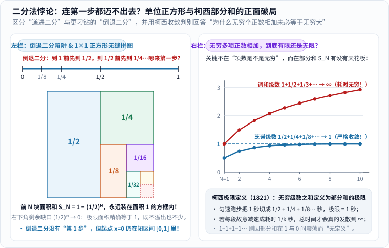
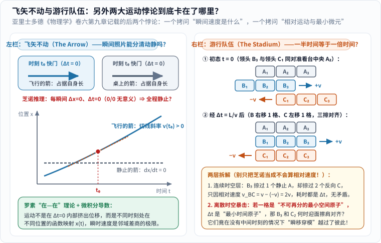
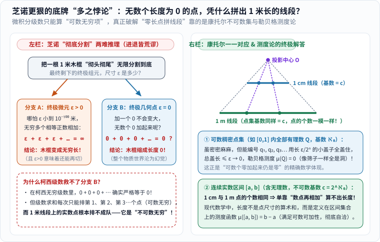
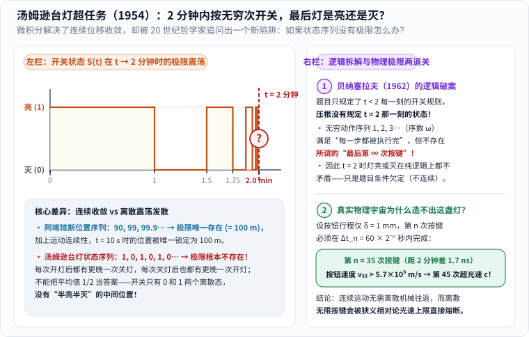
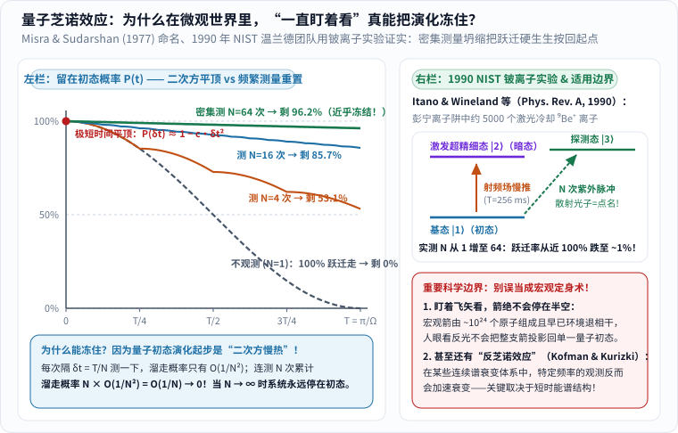

古希腊流传着一则著名的轶事：当有人眉飞色舞地复述芝诺关于“运动根本不存在”的逻辑论证时，犬儒学派哲学家第欧根尼（Diogenes the Cynic）一言不发，直接从座位上站起来，当着众人的面来回走了两步——意思再明白不过：“你看，我这不是走给你看了吗？”

围观的人哄堂大笑，觉得芝诺输得一败涂地。

然而两千五百年来，从亚里士多德、牛顿、柯西、康托尔、罗素，一直到现代量子物理学家，没有一位真正严肃的学者觉得第欧根尼赢了。道理很简单：**芝诺又不是瞎子，他当然每天亲眼看见人在跑、箭在飞！** 他真正扔给全人类的难题是：

> **你明明亲眼看见飞毛腿追上了乌龟、离弦之箭射中了靶心；可只要顺着你日常深信不疑的“时间、空间、部分与整体”常识一步步往下推，怎么每条路都会推出自相矛盾的荒唐结论？你的常识到底哪一步坏掉了？**

很多人中学学了等比数列求和 $$\frac{1}{2} + \frac{1}{4} + \frac{1}{8} + \cdots = 1$$，就以为芝诺悖论早被一道中学公式彻底打发了。殊不知，这连芝诺布下的第一层机关都没拆完：
- 把二分法倒过来数（想到终点先过一半，想过一半先过四分之一……），**连“第一步”都不存在，你怎么迈出起跑线？**
- 在时长严格为 $$0$$ 的每一个“瞬间”里，飞行的箭和摆在桌上的箭有什么区别？**无数个“静止的瞬间”凭什么拼出运动？**
- 把一根 1 米长的木棍彻头彻尾分割成几何点，每个点的长度都是 $$0$$——**无数个 $$0$$ 加起来为什么不是 $$0$$，反而变成了 $$1$$ 米？**（剧透一下：这一题连牛顿和柯西的微积分都救不了！）
- 如果“有限时间完成无穷多步”真的合法，我在 2 分钟里按 $$1\text{ 分钟} + \frac{1}{2}\text{ 分钟} + \frac{1}{4}\text{ 分钟} + \cdots$$ 无限次按台灯开关，**2 分钟整那一刻，灯到底是亮着还是灭着？**
- 更神奇的是，到了现代量子力学实验室里，科学家发现：**只要你足够频繁地“盯着”一颗微观粒子看，它居然真的像芝诺说的那样被冻在原地动弹不得了！**

今天我们就沿着两千五百年的思想攻防史，把这串人类历史上回报率最高的“智力炸弹”一颗颗拆开看清。

---

## 一、芝诺为什么要跟常识唱反调：一本失传的“四十道诡辩书”与归谬法鼻祖

在拆解具体悖论之前，我们先花三分钟认清历史现场——因为关于芝诺，后世演义和一手史料之间有不少必须厘清的边界。

### 1. 公元前 450 年前后的雅典对话：替老师巴门尼德挡箭的年轻人

**埃利亚的芝诺（Zeno of Elea，约公元前 490—前 430 年）**出生在今天意大利南部海岸的古希腊城邦埃利亚（今韦利亚 Velia）。根据斯坦福哲学百科全书（SEP）与圣安德鲁斯大学 MacTutor 数学史档案考证，我们对芝诺生平最核心的记载来自柏拉图对话录《巴门尼德篇》（*Parmenides*，127a–128e）：大约公元前 450 年雅典泛雅典娜节期间，年近 65 岁的埃利亚学派宗师**巴门尼德（Parmenides）**带着年近 40 岁的学生芝诺来到雅典，与当时才 20 岁出头的年轻**苏格拉底**展开了一场哲学交锋（现代学者普遍认为这场会面带有柏拉图的文学构拟成分，但人物年代比例是吻合的）。

巴门尼德提出过一个让全希腊人觉得疯了的“存在一元论”：**真正实在的宇宙是一个不可分割、永恒不动、没有生灭变化的整体（“一”）；我们肉眼看到的“万物众多”与“运动变化”，统统是感官的幻觉。**

雅典的知识分子自然拿常识疯狂嘲笑巴门尼德。于是年轻气盛的芝诺写了一本小册子，据公元 5 世纪新柏拉图主义哲学家普罗克洛斯（Proclus）记载，书中一共包含 **40 个悖论（论证，*logoi*）**。遗憾的是，芝诺的原书在古代就已散佚，今天存世、由公元 6 世纪学者辛普里丘（Simplicius）逐字引述的芝诺原话加起来**不到两百个希腊词**；其余我们熟知的运动悖论，主要靠**亚里士多德在《物理学》卷六第九章（*Physics* VI.9, 239b5–240a18）**中为了反驳芝诺而做的高度浓缩转述才得以幸存。至于芝诺悖论当年在民间有多轰动？考古学家甚至在意大利伊特鲁里亚古城法莱里（Falerii）挖出过一只公元前 5 世纪中叶的红绘陶制饮酒杯，杯底赫然画着一位希腊英雄正大步流星跃过一只大乌龟——堪称人类历史上最早的“表情包回怼”！

### 2. 芝诺真正的武器不是“眼瞎”，而是归谬法：揪出时空观里的隐含矛盾

在《巴门尼德篇》里，芝诺向苏格拉底坦白了自己写书的真实战术：**归谬法（*Reductio ad absurdum*，亚里士多德因此尊称芝诺为“辩证法的发明人”）**——

> “你们嘲笑我老师说‘万物归一、没有运动’太荒谬？好，那我就先顺着你们的常识，假定**世上有许多事物、时间和空间真的存在运动**，然后严格按逻辑往下推，看看你们自己的前提会不会推出更荒谬的自打嘴巴结论！”

最绝的是，芝诺的**四大运动悖论**根本不是零散的脑筋急转弯，而是一张严丝合缝的**双向包围网**：
- **如果你主张“空间和时间是连续的、可以无限分割”**：他就祭出**《二分法》**和**《阿喀琉斯追乌龟》**，证明你要跨越无穷多个路段，永远到不了终点；
- **如果你为了躲开无限分割，改口主张“空间和时间是由不可再分的最小原子/瞬间拼成的”**：他立刻在另一头祭出**《飞矢不动》**和**《游行队伍》**，证明在不可分的瞬间里箭根本没动，或者反向队伍会在没有中间时刻的情况下“穿模瞬移”！

横也是死，竖也是死。这就是为什么芝诺悖论能逼着后世数学家把微积分、实数连续统、集合论与测度论的地基翻修了一遍又一遍。

---

## 二、前两大运动悖论：阿喀琉斯追乌龟与二分法——为什么微积分级数只解开了一半？

我们先从名气最大的前两个悖论入手，一步步看清芝诺到底是怎么给我们的思维下套的。

### 1. 阿喀琉斯追乌龟：把 10 秒钟拍成无穷多帧慢镜头，不等于花掉无穷长时间

阿喀琉斯（Achilles）是荷马史诗《伊利亚特》里跑得最快的英雄。芝诺设计了一场看似毫无悬念的追逐赛——为了算数清爽，我们给出一组精确的物理参数：
- **阿喀琉斯**从起点 $$x = 0\text{ m}$$ 出发，匀速奔跑速度 $$v_A = 10\text{ m/s}$$；
- **乌龟**获准从前方 $$x = 90\text{ m}$$ 处同时起跑，匀速爬行速度 $$v_T = 1\text{ m/s}$$。

小学生的追及算式只需一行就能算出何时何地追上：

$$
\begin{aligned}
10 t = 90 + t &\implies 9 t = 90 \\
&\implies t^* = 10\text{ 秒},\ x^* = 100\text{ 米}
\end{aligned}
$$

第 10 秒整，阿喀琉斯在 100 米线追平乌龟；第 12 秒，阿喀琉斯已经冲到 120 米，把爬到 102 米的乌龟远远甩在身后。

**可芝诺偏偏换了一种记账方式**：
1. **第 1 段追赶**：阿喀琉斯要追上乌龟，必须先跑到乌龟刚才出发的地方（$$90\text{ m}$$），这花掉他 $$\Delta t_1 = 9\text{ s}$$；但在这 $$9\text{ s}$$ 里，乌龟没闲着，又往前爬了 $$9\text{ m}$$，到了 $$99\text{ m}$$ 处！
2. **第 2 段追赶**：阿喀琉斯接着跑完这 $$9\text{ m}$$ 追到 $$99\text{ m}$$，花掉 $$\Delta t_2 = 0.9\text{ s}$$；乌龟趁机又往前拱了 $$0.9\text{ m}$$，到了 $$99.9\text{ m}$$ 处！
3. **第 3 段追赶**：阿喀琉斯再花 $$\Delta t_3 = 0.09\text{ s}$$ 追到 $$99.9\text{ m}$$，乌龟又爬到了 $$99.99\text{ m}$$……

芝诺一拍桌子：**每当阿喀琉斯跑到乌龟前一次所在的位置，乌龟都已经往前挪了一小段新路程！这样的追赶步骤有无穷多个，既然无穷多个动作永远做不完，阿喀琉斯就永远追不上乌龟！**

到底是谁骗了谁？请看图 1 的**真实匀速对比动画与时空图解**（支持减少动态效果模式；若滚到此处时 6 秒单次动画已停在 12 秒反超终态，[点击单独打开 SVG 刷新即可重播](/assets/images/zeno-paradox/achilles-tortoise-race.svg)）：

_图 1：怎么看这张图——先看上栏跑道：蓝圆（阿喀琉斯 10 m/s）与绿块（乌龟 1 m/s）严格按匀速运动推进，在第 10 秒（动画进度的 10/12 处）精准于 100 米红虚线处并肩，随后反超至 120 米。再看下栏左侧时空图 $$(t,x)$$：阿喀琉斯的世界线 $$x_A = 10t$$ 与乌龟的世界线 $$x_T = 90 + t$$ 在 $$(10\text{ s}, 100\text{ m})$$ 干脆利落地相交；而芝诺画出的橙色阶梯折线之所以永远碰不到交点，只是因为芝诺故意把快门只按在 $$t_1=9\text{ s}$$、$$t_2=9.9\text{ s}$$、$$t_3=9.99\text{ s}\dots$$，死活不肯把拨盘拨过 10 秒那条红线！_

看懂这张图，芝诺的第一个戏法就当场露馅了：**芝诺偷偷把“时间轴上 $$0$$ 到 $$10$$ 秒这一截有限区间”，用快门越按越快的摄影机切成了无穷多帧慢放，然后指着这无穷多张照片骗你说“这段录像永远播不完”！**

把下栏右侧账本里的每一段耗时加起来：

$$
\begin{aligned}
T_{\text{总} } &= 9 + 0.9 + 0.09 + 0.009 + \cdots \\
&= \sum_{k=1}^{\infty} 9 \times \left(\frac{1}{10}\right)^{k-1} = \frac{9}{1 - \frac{1}{10} } = 10\text{ 秒}
\end{aligned}
$$

这无穷多个追赶阶段**没有任何一步发生在 10 秒之后**——它们完完整整被装在 $$[0, 10)\text{ 秒}$$ 这短短十秒钟里面！只要真实世界的时钟正常走过第 10 秒，阿喀琉斯就已经越过 100 米线扬长而去了。

### 2. 二分法悖论与更要命的“倒退二分”：连第一步都迈不出去怎么办？

如果说《阿喀琉斯追乌龟》还需要两只脚色配合，芝诺的**《二分法悖论（The Dichotomy）》**干脆连乌龟都省了，一个人跑步照样把你困住：

- **递进版二分法**：你想从起点 $$0$$ 跑到 $$1$$ 米外的公交站，必须先跑过 $$\frac{1}{2}$$，再跑过剩下的一半 $$\frac{1}{4}$$，再跑过 $$\frac{1}{8}$$、$$\frac{1}{16}$$……后面永远剩下一半没跑完，永远到不了站！
- **倒退版二分法（亚里士多德《物理学》239b11 原版！）**：更狠的是倒过来想——在你跑到终点 $$1$$ 之前，必须先到中点 $$\frac{1}{2}$$；但到 $$\frac{1}{2}$$ 之前，必须先到 $$\frac{1}{4}$$；到 $$\frac{1}{4}$$ 之前，必须先到 $$\frac{1}{8}$$……如此无限倒推下去，你面前排着一串**没有排头元素**的任务清单：

$$
\cdots, \ \frac{1}{32}, \ \frac{1}{16}, \ \frac{1}{8}, \ \frac{1}{4}, \ \frac{1}{2}
$$

芝诺坏笑着问你：**连“第一步该迈到哪儿”都找不到（任何你指出的 $$\frac{1}{2^n}$$ 前面都还挡着一个 $$\frac{1}{2^{n+1} }$$），你的脚怎么可能离开起点？！**

### 3. 为什么光背一句“等比级数等于 1”还不够：亚里士多德的潜无穷与柯西的收敛铁律

面对二分法，古希腊的亚里士多德给出了第一个流传两千年的哲学回应：区分**“潜无穷（Potential Infinity）”**与**“实无穷（Actual Infinity）”**。亚里士多德认为，1 米长的跑道和 1 秒钟的时间本身都是完整的连续整体，你虽然“在潜力上”想切多少刀就能切多少刀（潜无穷），但只要跑步的人没有每到中点就停下来立块碑喘口气，跑道就没有真的碎成无穷多截现成的独立线段（实无穷）。

但到了近代科学里，数学家发现躲着“实无穷”走根本行不通——更何况，芝诺藏在暗处的真正数学假设其实是这一句：**“无穷多个大于零的正数加起来，难道不必然等于无穷大吗？”**

这句话在直觉上极具迷惑性，以至于直到 **1821 年柯西（Cauchy）在《分析教程》里严格定义无穷级数收敛**之前（详见我们的专篇[“无限接近”到底算不算零？给微积分重立规矩的柯西]()），连顶尖数学家都经常在无穷和上栽跟头！看图 2 左右两栏的正面对比：

_图 2：怎么看这张图——左栏把单位正方形（总面积严格为 $$1$$）依次切出一半 $$\frac{1}{2}$$、剩下一半的一半 $$\frac{1}{4}$$、再一半 $$\frac{1}{8}$$……无论切多少步，所有彩色矩形互不重叠地严丝合缝装在边长为 $$1$$ 的外框里，右下角剩余缺口面积 $$(1/2)^N$$ 随 $$N\to\infty$$ 缩向 $$0$$。右栏则把两条“无穷多项正数之和”摆在一起对比：同样是加无穷多项正数，蓝线芝诺级数的部分和被天花板 $$1$$ 稳稳按住并收敛于 $$1$$，而红线调和级数 $$1 + \frac{1}{2} + \frac{1}{3} + \cdots$$ 哪怕每一项也在趋向 $$0$$，加起来却真的会冲破一切天花板发散到无穷大！_

柯西立下的铁律非常干净：我们根本不需要真的去做“无穷次加法运算”，而是考察**前 $$N$$ 项有限部分和** $$S_N$$ 的变化趋势：

$$
\begin{aligned}
S_N &= \sum_{k=1}^{N} \frac{1}{2^k} = 1 - \frac{1}{2^N} \\
\Longrightarrow \quad S &= \lim_{N \to \infty} S_N = \lim_{N \to \infty} \left(1 - \frac{1}{2^N}\right) = 1
\end{aligned}
$$

对于任意挑剔的误差容限 $$\varepsilon > 0$$，只要步数 $$N > \log_2(1/\varepsilon)$$，剩余距离 $$\frac{1}{2^N}$$ 就严格小于 $$\varepsilon$$。因为匀速运动中第 $$k$$ 段耗时 $$\Delta t_k = \frac{\Delta x_k}{v} = \frac{T}{2^k}$$ 与路程同比例缩小，时间和路程两个等比级数同步收敛于有限总时间 $$T$$。

至于“倒退二分法找不到第一步”怎么破？答案同样清清楚楚：**连续运动根本不是一蹦一跳的离散走棋，不需要存在“紧挨着 $$0$$ 右边的第一个正实数”！** 在实数轴上，开区间 $$(0, 1]$$ 本来就没有最小正数（任何 $$x > 0$$ 和 $$0$$ 之间都有 $$x/2$$），但整个运动的定义域是包含起点 $$x(0) = 0$$ 的**闭区间 $$[0, 1]$$**——起点 $$0$$ 就在那儿，连续函数 $$x(t) = vt$$ 平滑扫过所有位置，压根不需要先迈出所谓“最小的第一格”。

---

## 三、后两大运动悖论：飞矢不动与游行队伍——“瞬间”里到底有没有运动？

假设你现在对芝诺说：“好，我放弃无限切割，干脆承认时间和空间由一个个最小微元拼成总行了吧？”

芝诺微微一笑，立刻翻开他小册子的下半卷——**《飞矢不动》**与**《游行队伍》**正等着你自投罗网！

### 1. 飞矢不动：单张快门照片分不清动静，罗素“在—在”理论与导数如何破局

亚里士多德在《物理学》（239b30）里这样概括芝诺的第三记重拳——**飞矢不动（The Arrow）**：

1. 在任何一个没有时长（$$\Delta t = 0$$）的**“瞬间（此刻，Now）”**，一支射在半空中的箭不可能发生位移（否则这个瞬间就还能再分成“前半瞬间在左、后半瞬间在右”，违背瞬间不可分的前提）；
2. 既然在这一瞬间箭一动没动、仅仅占据着与自身体积相等的一块空间，那它在这一瞬间就是**静止**的；
3. 整段飞行时间不过是由这无数个“瞬间”拼起来的——**每一瞬间都静止，合起来怎么可能变成运动？所以飞行的箭其实根本没动！**

用现代相机打比方就更直观了：假设你有一台快门时间绝对为零的理想相机，对着半空中呼啸飞过的箭拍下一张照片，再对着桌上静静摆着的箭拍下一张照片。单看这两张完全清晰、没有任何拖影的瞬间照片，它们有任何物理区别吗？

这里芝诺精准刺中了古典物理学的一个盲区，直到微积分导数与 20 世纪英国哲学家、数学家**伯特兰·罗素（Bertrand Russell）**的**“在—在运动观（At-At Theory of Motion）”**合流，人类才给出无懈可击的回答。请看图 3 左栏：

_图 3：怎么看这张图——左栏上方对比同一时刻 $$t_0$$ 的两张零时长快照，确实看不出差别；但往下看 $$(t,x)$$ 时空图：桌上的箭是一条水平直线（不同时刻都在同一位置），飞行的箭则是一条向上倾斜的曲线，在 $$t_0$$ 处拥有非零切线斜率 $$v(t_0) > 0$$。右栏展示游行队伍三排等大方块：经 $$\Delta t$$ 后 $$B_3$$ 掠过 1 格静止 $$A$$ 却掠过 2 格反向 $$C$$；若一格和一步是不可再分的时空原子，$$B_3$$ 与 $$C_2$$ 就会在没有任何对齐时刻的情况下直接错位穿模！_

芝诺在《飞矢不动》里偷偷犯了两个概念偷换：
- **第一，在单个瞬间 $$t_0$$ 里，根本不存在“静止”与“运动”之分！** 因为速度等于位移除以时间，单看 $$\Delta t = 0$$ 的孤立点，$$\frac{\Delta x}{\Delta t} = \frac{0}{0}$$ 在数学上没有意义（我们在[微积分到底在算什么]()一开篇讨论汽车速度表“此刻时速 60 公里”时就追问过这个谜题）。“静止”和“运动”一样，都不是孤立一个时间点的内禀属性，而是**时间邻域上的函数关系属性**！
- **第二，运动不需要在单个瞬间内部“挤”出位移——这就是罗素著名的“在—在（At-At）”定义**：所谓物体在运动，无非是**“在（at）不同的时刻 $$t$$，处在（at）不同的空间位置 $$x(t)$$”**，而静止则是“在不同的时刻 $$t$$，始终处在同一个空间位置 $$x(t) \equiv x_0$$”。至于“$$t_0$$ 这一刻的瞬时速度”，严格定义正是函数 $$x(t)$$ 在 $$t_0$$ 附近开邻域上的差商极限（导数）：

$$
v(t_0) = \lim_{\Delta t \to 0} \frac{x(t_0 + \Delta t) - x(t_0)}{\Delta t}
$$

你看，单看照片（函数在某一点的值 $$x(t_0)$$）当然分不清动静，但只要看这点的**邻域切线斜率 $$x'(t_0)$$**，飞行的箭（$$v(t_0) > 0$$）和桌上的箭（$$v(t_0) = 0$$）立刻泾渭分明！正如法国哲学家柏格森曾感叹的那样，现代数学坦然承认“运动轨迹是由一连串位置状态构成的连续映射”，而且这套框架推导出的一切力学定律经受住了全部实验检验。

### 2. 游行队伍（运动场悖论）：别只笑芝诺不会算相对速度，它藏着对“离散时空原子”的绝杀

再看图 3 右栏的第四个运动悖论——**《游行队伍》（又译《运动场悖论》，The Stadium / Moving Rows，239b33）**。

设运动场看台前立着三块静止的等宽石碑 $$A_1, A_2, A_3$$；一列等宽战车 $$B_1, B_2, B_3$$ 以速度 $$+v$$ 向右开，另一列等宽战车 $$C_1, C_2, C_3$$ 以同样速率 $$-v$$ 向左开：
- 初态 $$t = 0$$ 时，向右排头兵 $$B_3$$ 与向左排头兵 $$C_1$$ 正好同时对齐在中间石碑 $$A_2$$ 上下；
- 经过一段时间 $$\Delta t$$，当 $$B$$ 列向右挪动 1 格、$$C$$ 列同时向左挪动 1 格后，三排整整齐齐上下对齐。

此时数一数排头兵 $$B_3$$ 路过了几个方块？它只路过了 **1 块静止的 $$A$$（从 $$A_2$$ 到 $$A_3$$）**，却路过了 **2 块迎面开来的 $$C$$（既掠过了 $$C_2$$，又对齐了 $$C_3$$）**！如果芝诺按“路过 1 块方块耗时 $$\tau$$，路过 2 块同尺寸方块必然耗时 $$2\tau$$”来算，就会推出荒唐的**“一半时间等于一倍时间（$$\tau = 2\tau$$）”**！

很多通俗读物读到这里会哈哈一笑：“芝诺连初中物理的相对速度 $$v_{BC} = v - (-v) = 2v$$ 都不懂！”——然而当代科学哲学史家（如保罗·塔内里、欧文与 SEP 词条作者尼克·休格特）指出，把一位能想出前三大悖论的天才当成连迎面错车更快都不知道的糊涂虫，太小看芝诺了！**如果你把方块当成古希腊对手主张的“不可再分的最小空间原子（长度为 $$1\text{ 格}$$）”，把 $$\Delta t$$ 当成“不可再分的最小时间原子（时长为 $$1\text{ 跳}$$）”，这个悖论瞬间变成绝杀：**

请盯紧图 3 右栏里的 **$$B_3$$（蓝）和 $$C_2$$（橙）**：
- 在第 $$0$$ 跳（初态），$$B_3$$ 在第 2 列，而 $$C_2$$ 在第 3 列（**$$B_3$$ 在 $$C_2$$ 左边**）；
- 到了紧接着的下一跳——第 $$1$$ 跳（终态），$$B_3$$ 跳到了第 3 列，而 $$C_2$$ 跳到了第 2 列（**$$B_3$$ 已经跑到 $$C_2$$ 右边去了**）！

致命问题来了：**既然第 $$0$$ 跳和第 $$1$$ 跳之间已经没有任何更小的时间（否则“最小时间原子”就能被一分为二！），请问 $$B_3$$ 和 $$C_2$$ 迎面擦肩对齐的那一幕发生在什么时候？！** 根本没有那一刻！它们居然在不曾相遇的情况下“隔空穿模”越过了彼此！反过来，如果你坚持两车迎面错车必有对齐的一刻，那就证明任何所谓“最小时间微元 $$\Delta t$$”都还能再劈开一半 $$\Delta t / 2$$——离散时空原子论当场破产！

---

## 四、比运动悖论更毒辣的“多之悖论”：无数个长度为 0 的点，凭什么拼出 1 米长的木棍？

拆完四大运动悖论，你可能以为芝诺手里没牌了。其实，在辛普里丘保存下来的芝诺真迹残篇与亚里士多德《论生灭》（*On Generation and Corruption*，316a19）里，还藏着一记比阿喀琉斯追乌龟深奥得多的杀招——**关于“多”与“彻底分割”的悖论（Paradox of Finite Size & Complete Divisibility）**。（顺带一提，亚里士多德还记下了芝诺另外两条趣味诘难：一是追问“空间本身占不占空间”的**场所悖论**，二是追问“一粒谷子落地没声音，为什么一斗谷子倒下却哗啦响”的**谷粒悖论**——后者其实触及了声波能量与人类听觉阈值的非线性效应。）

### 1. 彻底分割的两难死局：微元大于 0 就无穷长，微元等于 0 就缩成虚无

芝诺指着你手里一根实实在在、长 $$1\text{ 米}$$ 的木棍问：既然你们承认木棍在几何上可以“彻头彻尾（through and through）”无限分割下去，那假想把所有能切的地方全都切到底之后，最终剩下的终极组成单元（点），长度 $$\varepsilon$$ 是多少？逻辑上只有两种可能：

- **可能 A：终极微元有微小但大于零的长度 $$\varepsilon > 0$$**。哪怕 $$\varepsilon = 10^{-100}\text{ 米}$$，既然切出了无穷多个这样相等的小段，无穷多个相等正数加在一起 $$\varepsilon + \varepsilon + \varepsilon + \cdots = \infty$$，**1 米木棍必然变成无穷长**！（而且只要 $$\varepsilon > 0$$，它就还有左半边和右半边，根本没切到底！）
- **可能 B：终极几何点完全没有长度，即 $$\varepsilon = 0$$**。芝诺在残篇里冷冷写道：“把一个没有大小的东西加到别的东西上，不会让它变大一分一毫；减掉它也不会变小。”既然每个点的长度严格等于 $$0$$，**那无数个 $$0$$ 拼在一起，$$0 + 0 + 0 + \cdots$$ 难道不还是 $$0$$ 吗？1 米的长度是从哪儿无中生有冒出来的？！**

### 2. 为什么微积分救不了这一题：可数无穷与不可数连续统的鸿沟

请千万注意：**面对“无数个 $$0$$ 拼出 $$1$$ 米”这一问，牛顿和柯西的微积分级数彻底失灵了！**

为什么？因为在柯西的无穷级数定义里，哪怕加无穷多项 $$0$$，前 $$N$$ 项部分和 $$S_N = 0 + 0 + \cdots + 0 \equiv 0$$，取极限依然铁板钉钉等于 $$0$$：

$$
\sum_{n=1}^{\infty} 0 = \lim_{N \to \infty} \sum_{n=1}^{N} 0 = 0
$$

那岂不是芝诺赢了，1 米线段真的应该缩成 0 吗？！

直到 19 世纪末**格奥尔格·康托尔（Georg Cantor）**创立超限集合论、20 世纪初**埃米尔·博雷尔（Émile Borel）**与**昂利·勒贝格（Henri Lebesgue）**建立现代**测度论（Measure Theory）**，人类才终于看清柯西级数为什么管不着这根木棍——因为**无穷大跟无穷大之间，有着不可逾越的等级鸿沟**！（关于康托尔对角线法与实数不可数性的入门故事，可以参看我们的[群论和集合以及那些数学家]()与[无理数怎么比较]()。）

请对照图 4 一步步看懂这个惊艳的数学突破：

_图 4：怎么看这张图——左栏呈现芝诺把 1 米木棍无限分割推入“$$\varepsilon>0$$ 则无穷长、$$\varepsilon=0$$ 则缩为零”的死胡同。右栏上方用一条简单的几何中心投影揭示惊人事实：从顶点 $$O$$ 发出的每条射线，都在上方 1 厘米线段与下方 1 米线段之间建立起严格的一一对应，证明两条长短悬殊的线段拥有的几何点个数一模一样（同为连续统基数 $$\mathfrak{c}$$）！右栏下方对比可数有理数点集（测度真为 0）与不可数实数区间（测度为 $$b-a$$）。_

1. **如果你只取“能排队编号”的无穷多个点（可数无穷 $$\aleph_0$$），芝诺说得完全对——它们的总长度真的等于 $$0$$！**  
   比如把 $$[0, 1]$$ 线段上密密麻麻的全部**有理数点** $$\mathbb{Q} \cap [0, 1]$$ 全挑出来，虽然任意两个有理数之间都还夹着无穷多个有理数，但它们可以按分母大小排成一列 $$q_1, q_2, q_3, \dots$$。我们拿第 $$n$$ 块长度为 $$\frac{\varepsilon}{2^n}$$ 的微型胶布盖住点 $$q_n$$，无穷块胶布的总长度不过是：

   $$\sum_{n=1}^{\infty} \frac{\varepsilon}{2^n} = \varepsilon$$

   由于 $$\varepsilon$$ 可以取得任意小，全体有理数点合在一起占的“地盘长度”（勒贝格测度）**严格等于 $$0$$**！这完美印证了柯西级数里“可数无穷个 $$0$$ 相加仍是 $$0$$”。
2. **但整条连续实数线段 $$[0, 1]$$ 包含无理数，它的点数是“不可数无穷”（连续统基数 $$\mathfrak{c} = 2^{\aleph_0} > \aleph_0$$），根本无法排成第 1、第 2、第 3 项放进级数加号里！**

### 3. 康托尔与勒贝格的终极答案：1 厘米和 1 米点一样多，长度是区间测度而不是“数点加法”

那我们能不能发明一种“不可数无穷加法”，把不可数个点的长度硬加起来呢？

**图 4 右上角的中心投影直接宣判了这种想法的死刑**：把 $$1\text{ 厘米}$$ 长的线段 $$AB$$ 和 $$1\text{ 米}$$ 长的线段 $$CD$$ 平行放置，连起两端交于投影中心 $$O$$。随便在 $$1\text{ 厘米}$$ 线段上点一个点，沿射线往下必唯一命中 $$1\text{ 米}$$ 线段上的一个点，反之亦然（代数上函数 $$f(x) = 100x$$ 同样给出 $$[0, 0.01]$$ 到 $$[0, 1]$$ 的完美双射）！

这意味着什么？**$$1\text{ 厘米}$$ 线段、$$1\text{ 米}$$ 线段，甚至整条一亿光年长的线段，包含的零长几何点的“个数（基数）”完完全全相等！**

既然点的个数一模一样、每个点的自身长度又都是 $$0$$，**单凭“数出有多少个点再把点长加起来”，在逻辑上就绝不可能区分 $$1\text{ 厘米}$$ 和 $$1\text{ 米}$$！** 科学哲学家阿道夫·格林鲍姆（Adolf Grünbaum）与现代测度论由此给出了终极破局：
- **芝诺错把“线段的几何长度”当成了“组成它的点的长度之算术和”**；
- 在现代数学中，连续统首先是点的有序集合，随后我们在它的子集族上额外赋予**距离函数（度规）与勒贝格测度 $$\mu$$**：基本规定闭区间 $$[a, b]$$ 的测度为 $$\mu([a, b]) = b - a$$，并满足**可数可加性**（可数个互不相交集合并集的测度等于各自测度之和：单点测度 $$\mu(\{x\}) = \mu([x,x]) = 0$$，可数点集测度为 $$0$$，半段 $$\frac{1}{2} + \frac{1}{4} + \frac{1}{8} + \cdots$$ 测度之和为 $$1$$），而**绝不满足不可数可加性**！自此，点的零尺寸与线段的有限长度在现代实分析中彻底握手言和，再无一丝逻辑裂缝。

---

## 五、芝诺在现代的两次惊艳复活：20 世纪“汤姆逊台灯超任务”与实验室里的“量子芝诺效应”

最奇妙的是，哪怕到了 20 世纪下半叶，芝诺两千五百年前埋下的火种依然在哲学界和物理学界接连引爆了两次大震动。

### 1. 汤姆逊台灯（1954）：2 分钟内按完无穷次开关，最后灯是亮着还是灭着？

1950 年代，马克斯·布莱克（Max Black）和英国哲学家**詹姆斯·汤姆逊（James F. Thomson，1954）**对微积分解答发起了新一轮反扑。汤姆逊造出了一个新词叫**“超任务（Supertask）”**——即在有限时间内执行完无穷多个分立动作——并设计了著名的**汤姆逊台灯悖论（Thomson's Lamp）**：

假设桌上有盏带按钮开关的台灯，初始 $$t = 0$$ 时处于**亮（记为 $$1$$）**的状态：
- 过 $$1\text{ 分钟}$$（$$t = 1$$），你按一下开关把它**关灭（$$0$$）**；
- 再过 $$\frac{1}{2}\text{ 分钟}$$（$$t = 1.5$$），你按一下把它**开亮（$$1$$）**；
- 再过 $$\frac{1}{4}\text{ 分钟}$$（$$t = 1.75$$），再**关灭（$$0$$）**；再过 $$\frac{1}{8}\text{ 分钟}$$，再**开亮（$$1$$）**……

每次等待时间减半，无穷多次按键消耗的总时间同样是完美收敛的等比级数：

$$
1 + \frac{1}{2} + \frac{1}{4} + \frac{1}{8} + \cdots = 2\text{ 分钟}
$$

好，现在秒表咔嚓一声走到 **$$t = 2\text{ 分钟整}$$**，无穷次按键全部做完了。汤姆逊问你：**此时此刻，这盏台灯到底是亮着（$$1$$），还是灭着（$$0$$）？！**

- 它**不可能是亮着**——因为你每一次开灯之后，紧接着都又按过一次关灯！
- 它也**不可能是灭着**——因为你每一次关灯之后，紧接着也都又按过一次开灯！
- 它更不可能是“半亮半灭（$$0.5$$）”——机械开关只有通（$$1$$）和断（$$0$$）两档！

难道这证明“有限时间完成无穷多步”本身在逻辑上就是自相矛盾的吗？请看图 5 的清晰拆解：

_图 5：怎么看这张图——左栏画出汤姆逊台灯在 $$t \to 2\text{ 分钟}$$ 时的状态方波 $$S(t)$$：越靠近红虚线 $$t=2$$，方波在 $$1$$ 与 $$0$$ 之间上下跳变越密集，左侧极限根本不存在（对比下方阿喀琉斯的位置序列平滑收敛于唯一极限 $$100\text{ m}$$）。右栏分两步破案：逻辑上贝纳塞拉夫指出题目只定义了 $$t<2$$ 的规则而根本没约束 $$t=2$$；物理上按钮往返速度在第 45 次前就会撞上狭义相对论的光速天花板！_

1962 年，普林斯顿大学哲学家**保罗·贝纳塞拉夫（Paul Benacerraf）**一针见血地揭开了汤姆逊台灯的谜底，同时帮我们把阿喀琉斯和机械台灯彻底区分开来：
1. **逻辑上并不矛盾，只是“条件欠定”**：汤姆逊给出的操作说明书，只规定了严格小于 2 分钟的开区间 $$t \in [0, 2)$$ 内每一刻的灯态，**压根没有对 $$t = 2$$ 那一刻立下任何逻辑规定**！之所以在阿喀琉斯赛跑里我们能唯一算出 $$x(10) = 100\text{ m}$$，是因为连续运动函数 $$x(t)$$ 满足连续性且左极限 $$\lim_{t \to 10^-} x(t) = 100$$ 存在；而台灯状态序列 $$1, 0, 1, 0, \dots$$ 没有极限（就像格兰迪级数一样震荡发散），又不具备连续性，所以在纯逻辑上 $$t = 2$$ 时灯亮或灯灭**全都不违背前面任何一条规则**！同时，无穷序列 $$1, 2, 3, \dots$$（序数 $$\omega$$）只代表“每一个第 $$n$$ 步都被做完了”，绝不意味着存在某一个“最后第 $$\infty$$ 次按键”来决定结局。
2. **物理上则被相对论直接拦截**：阿喀琉斯匀速跑过 100 米根本不需要做任何离散停顿或往返动作；而汤姆逊台灯如果要靠实体机械按钮每次上下移动哪怕 $$\delta = 1\text{ 毫米}$$，第 $$n$$ 次按键留给它的时间只有 $$\Delta t_n = 60 \times 2^{-n}\text{ 秒}$$——算到第 35 次按键时按钮速度就突破每秒 570 公里，**到第 45 次按键时所需的往返速度就已经超过真空光速 $$c = 3 \times 10^8\text{ m/s}$$**！真实宇宙用相对论直接禁止了这种离散机械超任务。

### 2. 量子芝诺效应：为什么在微观世界里，“一直盯着看”真的能把跃迁冻住？

最后这一幕，要是芝诺泉下有知，恐怕真会得意地笑出声来。

1977 年，得克萨斯大学奥斯汀分校物理学家**米斯拉（Baidyanath Misra）**和**苏达山（E. C. George Sudarshan）**在《数学物理杂志》发表了一篇经典论文，发现量子力学里藏着一个跟《飞矢不动》神似的现象，并正式将其命名为**“量子芝诺效应（Quantum Zeno Effect）”**——俗称“被一直盯着看的量子水壶永远烧不开”！

为什么宏观世界里看一眼不会拦住飞矢，微观量子世界里“偷看一眼”却能把演化冻住？秘密全在薛定谔方程算出的**极短时间二次方存活率**里！

考虑一个初态处在基态 $$\lvert1\rangle$$ 的二能级量子系统（比如受射频场驱动准备翻转到激发态 $$\lvert2\rangle$$ 的离子，拉比振荡角频率为 $$\Omega$$）。如果完全不去测量打扰它，经过半周期时间 $$T = \frac{\pi}{\Omega}$$ 后，留在初态 $$\lvert1\rangle$$ 的概率会从 $$100\%$$ 降为 $$0\%$$（百分百翻转到了 $$\lvert2\rangle$$）：

$$
P_{\text{未测} }(t) = \cos^2\!\left(\frac{\Omega t}{2}\right)
$$

注意看它在起步极短时间 $$\delta t \to 0$$ 时的泰勒展开：因为余弦函数在 $$0$$ 附近是**平顶抛物线** $$\cos x \approx 1 - \frac{1}{2}x^2$$，留在初态的概率刚开始掉得极慢，与 $$\delta t^2$$ 成正比，而不是线性下降：

$$
P_{\text{单步存活} }(\delta t) = \cos^2\!\left(\frac{\Omega\,\delta t}{2}\right) \approx 1 - \frac{\Omega^2}{4}\,\delta t^2
$$

现在，假设我们在总时长 $$T = \frac{\pi}{\Omega}$$ 内，每隔极短时间 $$\delta t = \frac{T}{N}$$ 就发射一束探测脉冲做一次**量子投影测量**（相当于点名追问离子：“你还在 $$\lvert1\rangle$$ 吗？”）。根据量子测量坍缩原理，只要测出它还在 $$\lvert1\rangle$$（概率高达 $$1 - \frac{\pi^2}{4N^2}$$），它的波函数就会瞬间被**重置回纯净初态 $$\lvert1\rangle$$**，刚才攒下的一丁点跃迁苗头全部清零重来！连续点名 $$N$$ 次后，全程一直被按在初态 $$\lvert1\rangle$$ 的总概率是：

$$
\begin{aligned}
P_{\text{全程留守} }(N) &= \left[\cos^2\!\left(\frac{\pi}{2N}\right)\right]^N \approx \left(1 - \frac{\pi^2}{4N^2}\right)^N \\
&\approx 1 - \frac{\pi^2}{4N} \xrightarrow{N \to \infty} 100\%
\end{aligned}
$$

看图 6 左栏精确计算出的四条存活率曲线，再对照右栏的里程碑实验：

_图 6：怎么看这张图——左栏严格按公式画出总时长 $$T = \pi/\Omega$$ 内不同测量次数下的初态留存率：不观测时（灰色虚线 $$N=1$$）粒子平滑滑落到 $$0\%$$ 完成跃迁；只测 $$N=4$$ 次（橙线）就能留住 $$53.1\%$$；测 $$N=16$$ 次（蓝线）留住 $$85.7\%$$；密集测到 $$N=64$$ 次（绿线）时，每一步刚冒头就被拉回平顶起点，最终高达 $$96.2\%$$ 的概率被硬生生“冻”在初态！右栏展示 1990 年 NIST 博尔德实验室温兰德团队的铍离子能级探测原理，并明确标出不可外推到宏观飞矢的科学边界。_

**1990 年 3 月**，美国国家标准与技术研究院（NIST）博尔德实验室的**韦恩·伊塔诺（Wayne Itano）**与后来荣获 2012 年诺贝尔物理学奖的**大卫·温兰德（David Wineland）**团队在《物理评论 A》（*Phys. Rev. A* 41, 2295）上首次漂亮地在实验室里做成了这个实验：他们在电磁彭宁阱里囚禁了约 5,000 个激光冷却的铍离子 $$^9\text{Be}^+$$，一边用耗时 $$256\text{ 毫秒}$$ 的射频场把离子从基态 $$\lvert1\rangle$$ 推向激发态 $$\lvert2\rangle$$，一边在期间打入 $$N = 1, 2, 4, 8, 16, 32, 64$$ 次极短的紫外激光脉冲“查岗”（处在 $$\lvert1\rangle$$ 的离子会强烈散射紫外光子亮起荧光，处在 $$\lvert2\rangle$$ 则不发光）。实验数据与量子芝诺公式严丝合缝：当脉冲加密到 $$64$$ 次时，原本几乎 $$100\%$$ 应该翻过去的铍离子，**超过 $$99\%$$ 都被死死按在了原位**！今天，量子芝诺效应甚至已经成为**量子计算抗退相干与量子纠错控制**中的实用工具。

不过按照严谨的科学规范，这里必须划清两条边界，千万别被伪科学营销号带偏：
1. **量子芝诺效应绝不意味着“人眼盯着空中的箭看，箭就会停在半空”**！宏观箭矢由约 $$10^{24}$$ 个原子组成，每时每刻都在与空气分子和热辐射发生海量碰撞（环境退相干），它的质心运动完全服从经典牛顿力学极限，你看或不看一眼散射光子，根本不会把整支箭重置回某个单一相干量子初态。
2. **甚至连微观世界里也不是无条件越看越慢**——2000 年前后物理学家科夫曼与库里兹基（Kofman & Kurizki）证明并在冷原子实验中观测到了相反的**“量子反芝诺效应（Anti-Zeno Effect）”**：在某些耦合到连续能谱的不稳定衰变体系里，如果测量时间间隔恰好匹配环境能谱耦合峰，频繁观测反而会**加速**粒子衰变！

---

## 结语：一张总表看清两千五百年人类从芝诺手里赢回了什么

现在再回想开头第欧根尼沉默走出的那两步，你一定会生出全新的敬意。芝诺当年写下的那本小册子，表面上句句违背常识，实际上却是人类思想史上最锋利的一把手术刀——他逼着一代又一代最聪明的大脑不再拿“本来就是这样嘛”敷衍了事，而是老老实实把每一个模糊直觉锻造成精确的数学与物理公理：

| 芝诺抛出的悖论 | 芝诺暗藏的隐含假设（陷阱所在） | 现代数学与物理学的破局武器 |
| :--- | :--- | :--- |
| **阿喀琉斯追乌龟 & 二分法** | 无穷多个正的时间/路程片段相加必然等于无穷大；倒退二分必须有“最小第一步” | **柯西无穷级数极限**（$$\sum 2^{-k} = 1$$ 收敛于有限值）+ 连续闭区间 $$[0,1]$$ 包含起点 $$0$$ 无需最小正数 |
| **飞矢不动** | 物体只有在单个无时长瞬间（$$\Delta t = 0$$）内部发生位移才叫运动 | **罗素“在—在”运动观**（不同时刻处在不同位置 $$x(t)$$）+ **微积分导数**（邻域差商极限 $$dx/dt$$） |
| **游行队伍（运动场）** | 忽略相对速度合成；或假定空间、时间由不可再分的有限“网格原子”拼成 | **伽利略相对速度**（$$v_{BC} = 2v$$）+ 否定朴素经典离散网格时空（至于普朗克尺度 $$10^{-35}\text{ m}$$ 量子引力结构仍是前沿课题） |
| **多之悖论（彻底分割）** | 1 米线段的长度等于组成它的所有几何点长度（$$0$$）的算术和 | **康托尔不可数连续统**（$$\mathfrak{c} = 2^{\aleph_0}$$，不同长线段点集等势）+ **勒贝格测度论**（可数可加区间测度 $$\mu([a,b])=b-a$$） |
| **衍生：汤姆逊台灯超任务** | 以为 $$t < 2$$ 的无穷离散操作必然连续决定 $$t = 2$$ 的终态，且存在“最后一步” | **贝纳塞拉夫逻辑欠定分析**（序数 $$\omega$$ 无最末元素，状态震荡无极限）+ **狭义相对论光速上限**熔断机械超任务 |
| **回响：量子芝诺效应** | （现代正面印证！）量子态极短时间演化不是线性掉血，而是二次方平顶 $$1 - c\,\delta t^2$$ | **量子投影测量坍缩**（1977 理论预言、1990 NIST $$^9\text{Be}^+$$ 离子实验证实密集测量冻结能级跃迁） |

两千五百年过去了，阿喀琉斯依然在 10 秒整轻快地越过乌龟，离弦之箭依然沿着导数切线呼啸向前，而人类为了回答芝诺这几句看似刁钻的追问，手里已经多出了整座现代分析学与量子物理学的大厦。

---

## 参考资料与核查说明

本文涉及的古希腊文献出处、现代分析学与测度论解答、超任务分析及量子芝诺效应实验细节均逐一打开核查自以下学术百科与权威期刊原始页面：

1. **斯坦福哲学百科全书（SEP）：*Zeno's Paradoxes***（Nick Huggett 撰，2024 年修订版）：全面核查二分法（含倒退二分）、阿喀琉斯追乌龟、飞矢不动、游行队伍（含相对速度层与离散时空原子反证两重解读）、多之悖论（稠密性、有限大小、彻底分割）、场所与谷粒悖论原文引述，以及柯西级数、罗素“在—在”运动观与格林鲍姆/博雷尔测度论解答。  
   链接：<https://plato.stanford.edu/entries/paradox-zeno/>
2. **斯坦福哲学百科全书（SEP）：*Zeno of Elea***（John Palmer 撰，2025 年修订版）：核查芝诺生卒年代（约前 490—前 430 年）、柏拉图《巴门尼德篇》（127a–128e）对话背景、普罗克洛斯关于 40 个论证的记载，以及法莱里出土公元前 5 世纪中叶“英雄跨跃大乌龟”红绘陶杯文物实证。  
   链接：<https://plato.stanford.edu/entries/zeno-elea/>
3. **斯坦福哲学百科全书（SEP）：*Supertasks***（JB Manchak & Bryan Roberts 撰，2022 年修订版）：核查詹姆斯·汤姆逊（J. F. Thomson, 1954）提出的“超任务”概念与汤姆逊台灯悖论、“完成每一步”与“执行最后一步”两层语义区分及贝纳塞拉夫（Paul Benacerraf, 1962）的逻辑分析。  
   链接：<https://plato.stanford.edu/entries/spacetime-supertasks/>
4. **圣安德鲁斯大学 MacTutor 数学史档案：*Zeno of Elea***（J. J. O'Connor & E. F. Robertson）：核查芝诺生平文献考辨、辛普里丘《物理学注》保存的芝诺原话残篇，以及亚里士多德《物理学》对四大运动悖论的经典引述与反驳。  
   链接：<https://mathshistory.st-andrews.ac.uk/Biographies/Zeno_of_Elea/>
5. **互联网哲学百科全书（IEP）：*Zeno's Paradoxes***（Bradley Dowden 撰）：核查现存十个芝诺悖论分类体系、第欧根尼起身行走轶事（据辛普里丘记载）、亚里士多德潜无穷/实无穷区分与现代标准数学解答对比。  
   链接：<https://iep.utm.edu/zenos-paradoxes/>
6. **美国物理学会《物理评论 A》原始实验论文（APS *Physical Review A* 41, 2295, 1990）：*Quantum Zeno effect***（Wayne M. Itano, D. J. Heinzen, J. J. Bollinger & D. J. Wineland，NIST 博尔德时频实验室）：核查彭宁离子阱中激光冷却 $$^9\text{Be}^+$$ 超精细能级射频跃迁受短脉冲紫外光测量坍缩抑制的首次直接实验观测。  
   链接：<https://journals.aps.org/pra/abstract/10.1103/PhysRevA.41.2295>
7. **诺贝尔物理学奖官方科普公报（The Nobel Prize in Physics 2012 — Popular Information）**：核查大卫·温兰德（David J. Wineland）在科罗拉多博尔德实验室利用电磁离子阱与精细激光脉冲操控、测量单个囚禁离子量子态的实验原理背景。  
   链接：<https://www.nobelprize.org/prizes/physics/2012/popular-information/>
