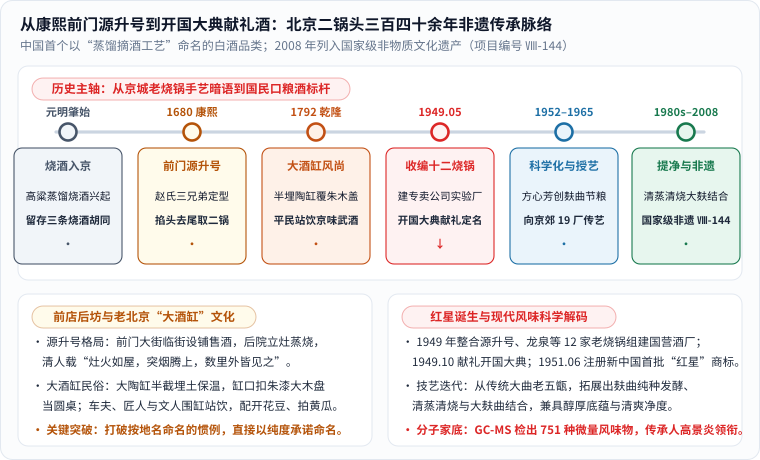
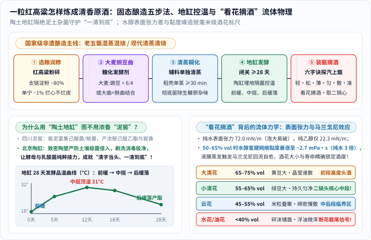
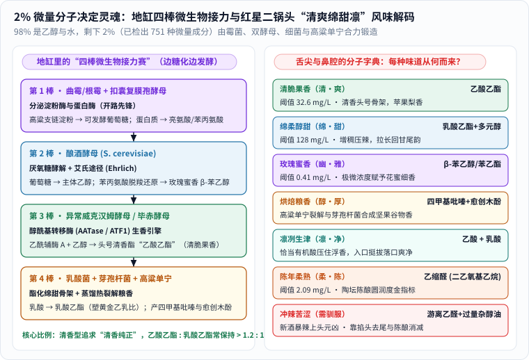
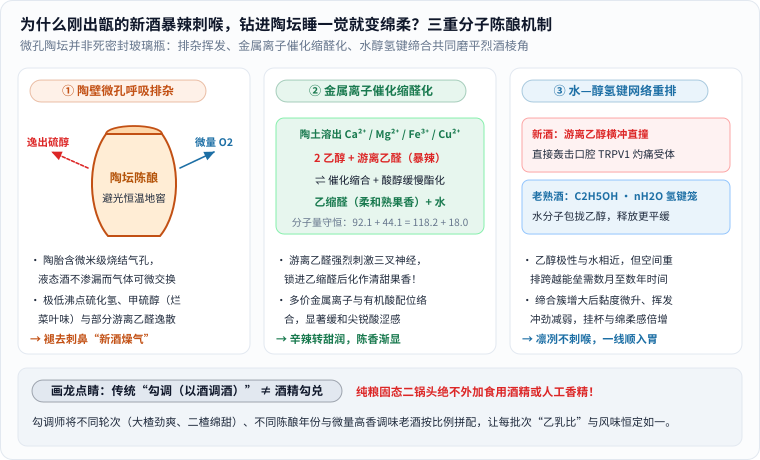

北京深冬的傍晚，西北风刮过胡同口的槐树梢，掀开厚棉门帘钻进一家热气腾腾的铜锅涮肉馆或卤煮小店，桌上十有八九立着一只眼熟的小酒瓶——或是经典的 56 度绿瓶“大二／小二”，或是透亮温润的蓝瓶绵柔陈酿。

拇指一顶，“啪”地拧开铝盖，一股干净利落、带着清脆梨果与熟高粱甜香的酒气立刻窜进鼻腔。抿上一小口，舌尖先是一阵挺拔清冽的微凛，紧接着口腔里化开绵柔的醇甜，咽下喉咙不挂杂味，只留下一丝爽净的回甘。

这瓶陪伴了几代中国人、连外国游客来北京都要揣两瓶回去的**红星二锅头**，几乎人人喝过或见过，可真要追问起它背后的门道，十个人里有九个会卡在下面这三个问题上：

1. **“二锅头”真的是把酒回锅蒸了两遍吗？** 如果不是，三百多年前前门外的酿酒师傅到底换了哪“三口锅”？为什么全中国成百上千种名酒都按地名、名泉或古井起名（茅台、汾阳、泸州、古井），偏偏只有它把一道车间里的**摘酒工序**直接印成了大名？
2. **配料表里明明只有“水、高粱、大麦、豌豆”（或玉米），连半滴食用香精都没加，酒里那股清脆苹果香、玫瑰蜜香、烘焙坚果香和绵甜尾韵，究竟是怎么凭空变出来的？**
3. **为什么四川浓香白酒视千年“老泥窖”为命根子，北京二锅头却偏要把光溜溜的大陶缸埋进地里？在没有密度酒精计的年代，老师傅扫一眼酒花泡沫的大小，凭什么就能把酒精度数卡准到一两度以内？**

今天，我们就顺着一粒红高粱走进前门外的百年烧锅，再钻进现代风味化学实验室的气相色谱仪里，把**红星二锅头的历史渊源、国家级非遗酿造技艺与 751 种味道分子的诞生密码**一次讲透。

---

## 一、三百四十年京味传奇：从前门“源升号”天锅换水，到开国大典献礼酒

要读懂红星二锅头，得先把时钟拨回三百四十多年前的清代京师。

*图 1：怎么看这张图——上方时间轴按年代串起北京二锅头从元明高粱烧酒、1680 年康熙前门源升号定型“掐头去尾取二锅”、1792 年大酒缸民俗，到 1949 年收编 12 家老烧锅创立红星献礼开国大典、1952 年方心芳院士麸曲革新、1965 年无私传艺京郊及 2008 年入选国家级非遗（编号 `Ⅷ-144`）的六大节点；下方两栏对比清代“前店后坊 + 大酒缸平民站饮”的市井烟火气与现代分子风味学的科学解码。*

### 1. 元明烧酒入京与康熙十九年（1680）的“源升号革命”

元代以前，中原百姓喝的主流酒是液态发酵、酒度只有十来度的黄酒与米酒。元定都大都（今北京）后，蒸馏器技术与北方耐旱高粱在京畿交汇，酒度高达五六十度的固态蒸馏**高粱烧酒**迅速风靡京城。到了明清两代，京城内外烧锅林立，清人笔记形容当时的酿酒作坊**“灶火如屋，突烟腾上，数里外皆见之”**——直到今天，北京老城区里还留存着三条名叫**“烧酒胡同”**的古街巷（[中国非物质文化遗产网 `Ⅷ-144` 档案](https://www.ihchina.cn/project_details/14584)；[北京市人民政府门户网站·北京二锅头非遗志](https://www.beijing.gov.cn/renwen/bjgk/hrgk/fy/202212/t20221220_2881122.html)）。

不过，早年的高粱烧酒虽然劲大解乏，却有个让人头疼的毛病：**刚蒸出来的头段酒暴辣刺鼻、喝了容易头晕脑胀；快蒸完的尾段酒又发酸发苦、略带浑浊杂味。**

转折发生在**清康熙十九年（1680 年）**。当时在前门外粮食店街开设**“源升号”**酒坊（典型“前店卖酒、后坊蒸烧”格局，今前门源升号博物馆原址）的酿酒名师**赵存仁、赵存义、赵存礼**三兄弟，决心做出一碗纯粹净爽、不辣喉不上头的好酒（[北京二锅头酒博物馆·技艺的诞生](https://www.redstarwine.cn/qyjs1/egtjdsyqmysh/cindex1.html)）。

他们紧盯蒸馏时架在蒸桶顶上盛凉水冷却的锡锅（俗称**“天锅”**），反复品尝比对发现：
- 蒸酒刚开始、天锅里盛着**第一锅凉水**时冷却流出的“酒头”，辛辣邪杂味最重；
- 等第一锅水被蒸汽烫热舀走、换上**第二锅凉水**期间流出的中段酒，清香纯正、醇厚甘冽；
- 等换上**第三锅凉水**继续蒸出的“酒尾”，又开始泛酸发涩。

于是，赵氏三兄弟立下一条铁规矩：**第一锅水接的酒头不要，第三锅水接的酒尾也不要，店里只卖第二锅冷却水接出来的那段黄金酒心！**

老北京酒客一传十、十传百，进门打酒直接喊行话：“掌柜的，来四两**二锅头**！”就这样，中国白酒史上**第一个不靠地名、不靠传说，直接用“蒸馏摘酒纯度工艺”命名的品类**横空出世。

伴随二锅头走红的，还有独树一帜的老北京**“大酒缸”文化**（现存乾隆五十七年即 **1792 年**京西“聚盛号”大酒缸开业古合同实物见证，[北京二锅头博物馆·大酒缸文化](https://www.redstarwine.cn/gnjs/lbjddjg/cindex1.html)）：酒铺把一人高的大陶缸半截埋进土里保温，缸口扣上一块刷着朱红大漆的厚圆木盖，既防酒气挥发，又直接当成天然小圆桌。不管是拉洋车的车夫、扛活的木匠，还是穿长衫的账房先生与落魄文人，进门都不分高低贵贱，围着大酒缸站成一圈（老北京管这叫“喝武酒”），二两二锅头配一碟炸开花豆、五香豆腐干或拍黄瓜，一口烈酒下肚，凛冽里透着敞亮与体面。

### 2. 1949 年收编十二家老烧锅：为什么说“先有红星，后有二锅头品类”？

在长达两百多年的岁月里，“二锅头”始终只是老北京烧锅铺子里的口头工艺俗称，市面上卖的酒都挂着各自字号（源升号、龙泉、同泉涌、永利成等），并没有谁把“二锅头”三个字正式印成商品酒名。

1949 年 1 月 31 日北平和平解放。为了整顿混乱的私营烧锅市场、节约宝贵口粮并筹备新中国开国大典用酒，人民政府宣布对酒类实行专卖。**1949 年 5 月 6 日**，新中国北京第一家国营酿酒厂——**华北酒业专卖公司实验厂**（即北京红星股份有限公司前身）正式建厂，将**源升号、龙泉**等京城最负盛名的 **12 家老字号烧锅**连同老匠人、老曲种、老酒海一并收编整合（[中国非物质文化遗产网 `Ⅷ-144`](https://www.ihchina.cn/project_details/14584)；[北京二锅头品类的始创](https://www.redstarwine.cn/qyjs1/hxdjscegt/cindex1.html)）。

1949 年 9 月，赶在 10 月 1 日开国大典前夕，首批总共 $20.5$ 吨国营新酒作为**开国大典献礼酒**隆重面世。定名时，酒厂做了一个载入史册的决定：直接把老匠人引以为傲的摘酒良心——“二锅头”印在五星红徽商标下方，定名为**“红星牌二锅头”**！**1951 年 6 月 1 日**，“红星”获准注册，成为新中国最早核准的商标之一。

更令人敬佩的是红星后来的两次历史担当（[北京二锅头技艺的创新](https://www.redstarwine.cn/qyjs1/hxdjyccjcx/cindex1.html)）：

- **1952 年的微生物科学革命**：建国初期粮食极度紧缺，传统大曲耗粮高达原料的四分之一以上。中国现代工业微生物学奠基人**方心芳院士**（中国科学院学部委员）率队驻扎红星，与酿酒大师**王秋芳**（源升号传人）日夜攻关，从优质老曲中分离纯化出高效糖化曲霉与产香酵母，以麦麸代替整粒大麦豌豆，首创**麸曲二锅头**酿造法，在守住纯正二锅头风味的同时为国家省下了海量粮食；
- **1965 年的无私倾囊授艺**：从 1949 年到 1965 年整整十六年间，红星一直是全国唯一生产二锅头的酒厂。面对百姓日益高涨的需求，1965 年起，红星毫无保留地派出技术骨干，向顺义牛栏山、昌平、通县等京郊 **19 家酒厂**无偿输送菌种、传授装甑摘酒绝活，一手孵化出整个“京酒二锅头”大家族。

**2008 年**，由红星完整保存并发展的“蒸馏酒传统酿造技艺（北京二锅头酒传统酿造技艺）”正式入选第二批**国家级非物质文化遗产代表性项目名录**（项目编号 **`Ⅷ-144`**，国家级代表性传承人为红星酿酒大师**高景炎**）。

---

## 二、“二锅头”到底换了哪三锅水？拆开甑桶与锡制天锅看馏分化学

现在我们来解开第一个核心迷思：**“二锅头”真的蒸了两遍吗？**

答案非常干脆：**只蒸了一遍，但头顶上的冷却水换了三锅！**

要想一眼看明白这套精妙设计，请先对照图 2 左栏的古法蒸馏器剖面图：

*图 2：怎么看这张图——左栏是古法“底锅 + 甑桶 + 锡制天锅”剖面图（含单次酒汽穿醅上升与天锅尖底冷凝滴落动画，支持减少动态效果模式；[单独打开高清原图](/assets/images/hongxing-erguotou/zengtong-tianguo-three-cooling-pots-distillation.svg)刷新可重播）：注意顶上的“天锅”装的不是酒，而是用来降温的凉水！右栏结合分子沸点与 2025 年全二维气相色谱质谱（GC×GC-MS）实测规律，展示头锅水、二锅水、三锅水为什么能把冲辣醛类、清甜主酯与苦涩杂醇油干净利落地切成三段。*

### 1. 一口蒸桶上下夹着两口锅：什么是“天锅”？

传统北京烧锅蒸酒的这套家伙什，从下到上分成三层（对照图 2 左栏）：

1. **最底下叫“底锅”**：一口装满清水、架在炉火上猛烧的大铁锅，专门负责源源不断产生洁净的沸腾水蒸气；
2. **中间叫“甑桶（Zèngtǒng）”**：一只底部垫着带孔竹篾或金属筛板（甑箅）的大圆桶，里面铺着整整一桶发酵好的疏松高粱酒醅。水蒸气从底锅穿过甑箅钻进酒醅，把高粱碎粒里的酒精和几百种香味分子统统蒸发带起，变成滚烫的混合酒汽往上涌；
3. **最顶上扣着的那口尖底锡锅，就叫“天锅”**：锡导热极快又不会给酒染上铁锈腥味。工匠在天锅里灌满冰凉的井水——当滚烫的酒汽撞上冰凉的天锅外壁锥底时，瞬间冷凝成晶莹的酒珠，顺着锥尖滴进下方的**流酒槽**，汩汩流出桶外！

问题来了：蒸汽不断放热，天锅里的凉水过一阵子就会被烫热，冷凝效率随之下降，工匠就得把热水舀出去，重新换上一锅新凉水。一整桶高粱酒醅从开蒸到蒸干，**天锅里的冷却水刚好要连换三次**——老匠人不用秒表也不用温度计，直接拿这“三锅冷却水”当成了天然的馏分切割尺！

### 2. 沸点 $154^\circ\text{C}$ 的甜香酯为什么能在 $80^\circ\text{C}$ 蒸出来？看懂“挥发度洗牌”

很多学过中学化学的朋友会纳闷：要是蒸馏只按沸点高低排队，水是 $100^\circ\text{C}$、乙醇是 $78.3^\circ\text{C}$，那沸点高达 **$154^\circ\text{C}$** 的绵甜功臣**乳酸乙酯**，岂不是要等水全烧干了才出得来？

这就触及了白酒固态蒸馏最迷人的物理化学机制——**气液相平衡与挥发度系数（精馏系数）**！在混合溶液里，某一种微量风味分子 $i$ 容不容易被蒸汽带出来，取决于它在气相中的摩尔分数 $y_i$ 与液相摩尔分数 $x_i$ 之比，也就是挥发度系数 $K_i$：

$$
K_i = \frac{y_i}{x_i} = \frac{\gamma_i(x_{\text{醇} })\; P_i^\circ(T)}{P_{\text{总} } }
$$

别被符号吓到，里面只有两个主角在拔河：$P_i^\circ(T)$ 是分子自身的饱和蒸气压（沸点越低，$P_i^\circ$ 越大，越爱往外跑）；而 **$\gamma_i(x_{\text{醇} })$ 是它在当前酒水比例下的活度系数**（你可以直白理解成**“水油排斥力”**——乙醇多的时候，亲油分子如鱼得水；水多酒精少的时候，疏水的油性大分子被水分子集体排挤，哪怕沸点高也会被水蒸气强行轰出液面！）。

2025 年，科研团队利用全二维气相色谱—质谱联用仪（GC×GC-MS）联合电子鼻、电子舌，对清香型白酒甑桶蒸馏的**酒头（约 $80\%\;\text{vol}$）、中段酒心（约 $65\%\;\text{vol}$）与酒尾（约 $45\%\;\text{vol}$）**做了逐段定量解剖（[Tian et al., *Foods*, 2025](https://pmc.ncbi.nlm.nih.gov/articles/PMC12385443/)），用铁打的数据证实了三百年前赵氏三兄弟“三锅换水”的惊人科学性（对照图 2 右栏）：

- **第一锅凉水 · 酒头（约 $75\%\text{--}80\%\;\text{vol}$）→ 为什么必须“掐头”？**
  刚开锅时，酒醅里乙醇浓度最高，那些**沸点极低**或**高度亲酒精**的小分子一马当先冲出重围：沸点仅 **$20.2^\circ\text{C}$**（室温下就在沸腾！）的**乙醛**、沸点 **$64.7^\circ\text{C}$** 的**甲醇**、沸点 $54.3^\circ\text{C}$ 的甲酸乙酯，以及高达 **$390.7\,\text{mg/L}$** 的早期缩醛和 $140.3\,\text{mg/L}$ 的头段乙酸乙酯扎堆涌出。这段头酒闻着冲鼻刺眼、入口像针扎舌尖，喝下去极易面红耳赤、头晕脑胀，所以只接最初约 $1\%\text{--}2\%$ 当场截除！
- **第二锅凉水 · 二锅头酒心（约 $58\%\text{--}68\%\;\text{vol}$）→ 为什么是“天选黄金段”？**
  换上第二锅凉水时，刺鼻的低沸点毒杂物基本排净，主体**乙醇（沸点 $78.3^\circ\text{C}$）**进入最稳健的流出平台。奇妙的一幕发生了：一方面，赋予二锅头清脆果香的头号功臣**乙酸乙酯（沸点 $77.1^\circ\text{C}$）**稳定保持在约 **$127.4\,\text{mg/L}$** 的高水平；另一方面，随着蒸汽里水分比例温和抬升，分子里带羟基（$-\text{OH}$）、亲水又绵甜的二号功臣**乳酸乙酯（纯沸点 $154^\circ\text{C}$）**开始借着水蒸气共沸温和馏出——**在头酒里它几乎是 $0$（未检出），到了二锅中段恰好升至约 $40.1\,\text{mg/L}$！** 再配上微量的乙酸苯乙酯（玫瑰蜜香），清爽与绵甜在这一锅水里达成了天衣无缝的平衡！
- **第三锅凉水 · 酒尾（低于 $48\%\;\text{vol}$）→ 为什么必须“去尾”？**
  换上第三锅凉水后，酒醅里的酒精快被掏空了，满桶只剩滚烫的水蒸气往上顶（口诀叫“大火追尾”）。这时两类讨厌鬼集中爆发：一是原本躲在酒精里、此刻被大量水分子排挤轰出来的**异戊醇等高级醇（杂醇油，纯沸点 $131.1^\circ\text{C}$）**，在酒尾里暴涨到 **$212.8\,\text{mg/L}$** 以上，苦涩麻口且人体代谢极慢，正是劣质酒“隔夜头疼欲裂”的元凶；二是高沸点的**乙酸**（飙升至 $30.0\,\text{mg/L}$）、甲酸与油酸、亚油酸乙酯大举出笼，既酸涩拉嗓子，又因为酒度太低溶不住高级脂肪酸酯而泛起白雾油花。所以老师傅果断断流截尾——把富含香味前体的酒尾单独存起来，泼回下一锅发酵酒醅里重新提炼，半点不进成品瓶！

---

## 三、从一粒红高粱到一滴原酒：老五甑、陶土地缸与“看花摘酒”的硬核手艺

如果蒸馏只是“把造好的味道挑出来”，那这些味道最初是怎么从没滋没味的粮食里长出来的？这就得走进国家级非遗的完整酿造车间，拆解那五道环环相扣的硬功夫（[北京二锅头传统酿造技艺](https://www.redstarwine.cn/qyjs1/egtgfnzjy/cindex1.html)）。

*图 3：怎么看这张图——上方横栏是一粒红高粱变成二锅头原酒的五步主线；左下栏解答“为什么二锅头非要用埋地大陶缸而不用四川泥窖”，并画出地缸闭关 28 天“前缓、中挺、后缓落”的实测品温曲线；右下栏揭开没有酒精计年代“看花摘酒”的流体力学真相：水—醇氢键黏度峰与马兰戈尼自愈效应如何让不同酒度的泡沫自动分出黄豆大、绿豆大与米粒层叠的四级标尺。*

### 1. 选粮与踩曲：为什么非挑“带点微涩”的红高粱，用大麦豌豆踩曲？

酿二锅头的第一关是选粮。为什么不用白米或精白面粉，偏偏钟情北方颗粒饱满的**红高粱**？

现代谷物化学揭开了老祖宗的智慧（[Tang et al., *Front. Microbiol.*, 2024](https://pmc.ncbi.nlm.nih.gov/articles/PMC11322492/)；[Li et al., *Foods*, 2026](https://pmc.ncbi.nlm.nih.gov/articles/PMC13512506/)）：
1. **约 $80\%$ 支链淀粉的蓬松骨架**：北方红高粱总淀粉含量约 $62\%\text{--}70\%$，其中约八成是树枝状分叉的**支链淀粉**。粉碎时讲究**“烂心不烂皮”**（破成 4—6 瓣，保留种皮棱角）——蒸煮糊化后外软内疏、透气不粘团，像无数座微型氧气公寓供微生物呼吸栖息；
2. **$0.5\%\text{--}1.5\%$ 单宁的“双面神功”**：红高粱种皮里带着一丝生嚼发涩的**缩合单宁**。单宁多了（$>2\%$）会锁死淀粉酶让发酵罢工，一点没有又会让酒体寡淡如水；唯独在 **$1\%$ 左右**的黄金区间，单宁既能精准抑制杂菌疯长、稳定菌群网络，使发酵终点的总酯提升约 $27\%$，又能在蒸煮和蒸馏受热时裂解成**丁香醛、阿魏酸与愈创木酚类芳香物**，化作二锅头灵魂深处那抹淡淡的“熟粮香”！

有了高粱当口粮，还得请来“微生物兵团司令部”——**酒曲**。这也是中国白酒与西方威士忌、伏特加最根本的分水岭（[Qiao, Zhang & Zheng, *Food Chem. X*, 2023](https://pmc.ncbi.nlm.nih.gov/articles/PMC10739939/)）：威士忌先用发芽大麦把淀粉变成麦芽糖水，再投单一纯种酵母液态发酵；而二锅头采用古老的**清茬大曲**——把**大麦与豌豆按 $6:4$（或 $7:3$）**粉碎拌水（“成团而不散”），装进榆木曲斗，由踩曲工在青石板上赤足踩出外紧内松（“光滑而不致密”）的曲砖，送入曲房在 $44^\circ\text{C}\text{--}46^\circ\text{C}$ 的温和顶温下自然富集空气与谷物表皮的霉菌、酵母和细菌。到了现当代，红星更把传统大曲的复合幽香与方心芳院士开创的纯种麸曲高糖化力融为一体，发展出独门**“大麸曲结合工艺”**。

### 2. 老五甑与“清蒸清烧”：连垫底的稻壳都要先单蒸半小时！

高粱粉碎润水后怎么蒸、怎么烧？这里藏着两代技艺的传承与进化：

- **古法“老五甑（Zèng）混蒸混烧”**：每一批高粱要经历漫长的多轮循环，地缸里同时躺着不同发酵轮次的五甑酒醅（大楂、二楂、小楂、回活、糟活）。出缸后把新投的高粱糁子拌进发酵好的老酒醅里，同进一口甑桶**“边蒸熟粮食、边蒸出美酒”**——热酒汽反复熏蒸新粮，蒸出的酒粮香浓郁、骨力遒劲；
- **现代“清蒸清烧”提净术**：为了把清香二锅头的“净爽度”推向极致，20 世纪 80 年代红星引入并完善了**清蒸清烧**——高粱先单独清蒸糊化，连用来疏松酒醅透气的那点辅料**稻壳**，也必须提前单独猛火清蒸 **$30$ 分钟以上**，把稻壳自带的生糠腥味（过量糠醛前体）彻底轰走，摊凉下曲发酵成熟后再单独装甑蒸酒，真正做到“清蒸糊化、清烧取酒、一清到底”。

### 3. 陶土地缸 vs 四川泥窖：为什么二锅头绝不碰半点泥巴？

去过四川泸州、宜宾酒厂的人都知道，浓香型白酒把连续用了几百年的黑褐色“老泥窖”当成无价之宝；可一走进红星的发酵车间，地面下整整齐齐埋着的却是成千上万口内壁光洁的**大陶缸（地缸）**（对照图 3 左下栏）。为什么北京二锅头死活不肯用泥窖？

答案全在微生物生态边界里：四川湿润老窖泥中栖息着庞大的厌氧**己酸菌与酪丁酸梭菌（*Clostridium*）**群落，它们源源不断合成浓烈奔放的己酸乙酯（菠萝与窖泥复合浓香）；但清香型二锅头追求的是**“清字当头，净字到底，绝无泥臭邪杂味”**！

把致密烧结的大陶缸埋入地下（就像我们在[《黄金有价玉无价》]()中聊过的致密硅酸盐器物一样化学性质极稳），既借大地土壤守住了冬暖夏凉的恒定地温，又用光滑陶壁像铜墙铁壁一样把土壤里的梭菌、放线菌与土腥味死死挡在缸外！每一轮酒醅出缸后，工匠都要用清水把缸壁刷洗消毒得纤尘不染。

高粱酒醅封进地缸闭关 **28—30 天**，不能插电加热也不能开盖偷看，全凭入缸温度、水分与踩缸松紧度，引导缸内品温自己走出一条教科书般的**“前缓、中挺、后缓落”**曲线（对照图 3 左下曲线）：
1. **前缓（第 0—5 天，$18^\circ\text{C}\to 26^\circ\text{C}$）**：霉菌缓缓糖化，生香酵母趁低温优先繁殖攒下芳香前体；
2. **中挺（第 6—16 天，顶温稳稳挺在 $30^\circ\text{C}\text{--}32^\circ\text{C}$ 约一周）**：酿酒酵母火力全开，把还原糖大举转化成乙醇；
3. **后缓落（第 17—28 天，缓降至 $22^\circ\text{C}\text{--}24^\circ\text{C}$）**：酒精抑制酵母后，耐酸的乳酸菌接管赛场，酸与醇在余温里静静酯化生香。

### 4. 装甑六字诀与“看花摘酒”：藏在毫米泡沫里的马兰戈尼物理

28 天期满开缸，迎来了最考验手上十年苦功的两幕绝活：**装甑**与**看花摘酒**。

很多人以为装甑就是拿铁锹把酒醅铲进桶里——错！如果一锹拍实了，底下蒸汽顶不上来叫“憋汽”；哪边铺薄了，蒸汽专挑软柿子捅出个大窟窿直冲天锅，周围酒醅根本蒸不透，叫“穿孔跑汽”。非遗传承人必须端着簸箕，眼盯桶面哪冒白汽就往哪撒料，严格遵循**“轻、松、薄、匀、散、准”**六字真经，两千斤酒醅分几十层如春雨般匀匀铺上去。

紧接着酒液从流酒槽涌出。在没有玻璃浮子酒精计的几百年里，老师傅怎么知道流出来的酒现在是 72 度、62 度还是 45 度？**全靠盯着酒流砸进接酒盆时溅起的那层泡沫——“看花摘酒”！**

你不妨在家做个小观察：摇晃一瓶纯矿泉水，水泡又大又脆，“啪”一下不到半秒全破了；摇晃一瓶 $95\%$ 医用酒精，连泡都起不来。**可为什么偏偏 $50\%\text{--}65\%\;\text{vol}$ 的二锅头原酒，能激起一层像绿豆粒一样匀称透亮、足足十几秒不散的“酒花”？**

这背后其实是两重硬核流体物理的联手杰作（[Bozorgmehr & Murray, *ACS Omega*, 2021](https://pmc.ncbi.nlm.nih.gov/articles/PMC8154141/)，对照图 3 右下栏）：

1. **水—醇氢键网络的“三倍黏度峰”**：$25^\circ\text{C}$ 时纯水动力黏度只有 $0.89\,\text{mPa}\cdot\text{s}$，纯乙醇也只有 $1.07\,\text{mPa}\cdot\text{s}$；可当乙醇与水按体积比约 $45\%\text{--}60\%$ 混合时，水分子与乙醇分子拉起密集的三维氢键网，**混合液黏度反常飙升到约 $2.7\,\text{mPa}\cdot\text{s}$**（将近纯水的 **3 倍**！）。黏度大增，泡沫液膜受重力往下排液变薄的速度就慢了三倍，泡泡自然长寿；
2. **溶质马兰戈尼效应（Solutal Marangoni self-healing）的“自动补膜术”**：纯水表面张力高达 $\gamma_{\text{水} } = 72.0\,\text{mN/m}$，纯乙醇仅 $\gamma_{\text{醇} } = 22.3\,\text{mN/m}$。当一颗酒花浮在液面时，泡顶液膜最薄，里面的酒精挥发最快——酒精一跑，泡顶局部含水量升高，**表面张力瞬间变大**！流体力学铁律规定，高表面张力区会像强力橡皮筋一样，把泡底低表面张力的酒液**逆着重力往上拉回泡顶**（这正是红酒杯壁“挂杯酒泪”的同一原理），给快要破洞的泡沫液膜实时“打补丁自愈”！

正因不同酒度对应的表面张力梯度 $\Delta \gamma$ 与黏度 $\eta$ 一一锁定，流酒槽下的酒花便化作了精确到毫米级的物理酒度计：
- **大清花（$65\%\text{--}75\%\;\text{vol}$）**：黄豆大小，清亮透明，表面张力极低，眨眼即散——提示初段高度酒；
- **小清花（$55\%\text{--}65\%\;\text{vol}$）**：绿豆大小，晶莹匀净，马兰戈尼自愈与黏度峰完美咬合，持留十几秒不散——**正是二锅头最精华的中段原酒！**
- **云花（$45\%\text{--}55\%\;\text{vol}$）**：米粒大小，层层叠聚如碎云，酒度已向中后段滑落；
- **水花／油花（$<40\%\;\text{vol}$）**：碎沫铺面且泛起高级脂肪酸酯微浑油珠——立刻“断花”停接！

---

## 四、98% 是骨架，2% 才是灵魂：751 种味道分子是怎么“接力造出来”的？

解决了怎么蒸，我们再回答第二个让人拍案惊奇的问题：**高粱里既没有苹果也没有玫瑰，二锅头里丰富的果香、花香、蜜甜香和烘焙粮香到底是从哪冒出来的？**

如果把一瓶 56 度的红星二锅头放进化学天平，你会发现：**约 $98\%$ 的质量都只是乙醇（酒精）和水分子**——纯酒精只有微甜带辣的灼烧感，纯水更是无色无味。真正让二锅头脱胎换骨、区分出优级品与普通酒的，恰恰是剩下那占总量不到 **$1\%\text{--}2\%$ 的微量风味物质**！

北京工商大学**孙宝国院士**风味化学团队与红星科研人员通过气相色谱—嗅闻—质谱联用技术（GC-O-MS）及全二维色谱分析，在红星二锅头中累计鉴定出了多达 **751 种微量挥发性成分**，并精准锁定了不同发酵蒸馏阶段起决定作用的 **34—59 种核心香气活性分子**（[Wang, Hao, Sun et al., *Food Chem. X*, 2024](https://pmc.ncbi.nlm.nih.gov/articles/PMC11016957/)；[Huang et al., *Food Chem. X*, 2025](https://pmc.ncbi.nlm.nih.gov/articles/PMC11754487/)）。

*图 4：怎么看这张图——左栏拆解地缸 28 天闭关里霉菌、酿酒酵母、异常威克汉姆生香酵母、乳酸菌及芽孢杆菌的“四棒生化接力赛”；右栏是一份直白的“舌尖分子字典”，把你喝二锅头时感受到的清爽果香、绵柔醇甜、玫瑰蜜香、烘焙粮香、凛冽生津、陈年柔熟与冲辣苦涩，逐一对应到具体的化学分子与嗅觉阈值。*

### 1. 地缸里的“四棒微生物生化接力赛”

这些风味分子不是哪一种菌单打独斗造出来的，而是中国白酒独有的**“边糖化、边发酵（双边固态发酵）”**体系里，四路微生物大军默契传棒的结晶（[Dong et al., *Front. Microbiol.*, 2025](https://pmc.ncbi.nlm.nih.gov/articles/PMC12399592/)，对照图 4 左栏）：

1. **第 1 棒 · 开路拆解工（曲霉、根霉 + 扣囊复膜孢酵母 *S. fibuligera*）**：
   酵母菌其实是个“挑食鬼”——它吞不下巨大的高粱支链淀粉分子，只认识切碎的小分子单糖和双糖（就像我们在[《为什么一喝牛奶就拉肚子？》]()里讲过的，没有乳糖酶剪刀，肠道就吸收不了整分子的乳糖）。酒曲里的米曲霉、黑曲霉与扣囊复膜孢酵母率先分泌强力 **$\alpha$-淀粉酶与糖化酶**，把高粱支链淀粉一节节剪成葡萄糖；同时分泌**酸性蛋白酶**，把高粱蛋白拆解成亮氨酸、异亮氨酸、苯丙氨酸等游离氨基酸，为后面的造香大戏备足砖瓦。
2. **第 2 棒 · 酒精主引擎与花香画师（酿酒酵母 *Saccharomyces cerevisiae*）**：
   地缸封严、氧气耗尽后，酿酒酵母切入我们在[《可视化理解呼吸作用》]()里学过的**厌氧糖酵解途径**，把葡萄糖变成丙酮酸，脱羧生成乙醛，再还原成主体乙醇：
   $$
   \text{C}_6\text{H}_{12}\text{O}_6 \xrightarrow{\text{酵母糖酵解} } 2\,\text{C}_2\text{H}_5\text{OH} + 2\,\text{CO}_2\uparrow
   $$
   更妙的是，酿酒酵母在缺氮吃氨基酸时，会走一条著名的**艾氏途径（Ehrlich pathway）**：把高粱蛋白拆出来的**苯丙氨酸**脱去氨基、脱掉羧基再加氢还原，神奇地变出了散发着幽雅玫瑰花瓣与槐花蜜甜香的 **$\beta$-苯乙醇**（以及异戊醛、适量的异戊醇醇厚底座）！
3. **第 3 棒 · 头号清香制造机（异常威克汉姆酵母 *Wickerhamomyces anomalus* 与毕赤酵母 *Pichia*）**：
   如果你把乙酸和酒精倒进烧杯里常温放上一个月，靠纯化学反应生成的乙酸乙酯微乎其微！那二锅头里高达数百毫克/升的清脆果香从哪来？2025 年多组学研究证实，真正的幕后功臣是以**异常威克汉姆酵母**为代表的非酿酒生香酵母——它们体内高表达由 *ATF1／ATF2* 等基因编码的**醇酰基转移酶（AATase）**，能直接抓住高能量的**乙酰辅酶 A** 与乙醇咔嚓一声缩合，以惊人效率大批量合成清香头号灵魂分子**乙酸乙酯**：
   $$
   \begin{aligned}
   &\text{乙酰-CoA} + \text{C}_2\text{H}_5\text{OH} \\
   &\xrightarrow{\text{AATase} } \text{CH}_3\text{COOC}_2\text{H}_5 + \text{CoA}
   \end{aligned}
   $$
4. **第 4 棒 · 绵甜压舱石与烘焙粮香师（乳酸菌 *Lactobacillus* + 芽孢杆菌 *Bacillus* + 高粱单宁）**：
   发酵中后期，耐酸的乳酸菌成为细菌霸主。它产出的乳酸一方面压低酒醅酸度防止杂菌腐败，另一方面在酯化酶与蒸馏热力催动下与乙醇结成二号核心酯——**乳酸乙酯**；与此同时，红星从高温堆积酒曲中选育出的功能芽孢杆菌（如 `HXB` 系列菌株）利用氨基酸与糖反应合成带烘烤花生坚果香的**四甲基吡嗪**；再叠加上甑桶蒸酒时，高粱皮壳里的阿魏酸与单宁受热裂解生成的**糠醛（杏仁谷物香）**与 **4-乙基愈创木酚（丁香烟熏粮香）**（[Wang et al., 2024](https://pmc.ncbi.nlm.nih.gov/articles/PMC11016957/)），整幅清香画卷至此圆满收官！

### 2. 一张表读懂味道密码：你尝到的每一丝风味，分别是谁？

在风味化学里，判断一种分子能不能被你的鼻子闻出来，不能光看含量高低，还要看它的浓度 $C$ 除以人类嗅觉识别阈值 $T_{\text{阈值} }$ 得到的**气味活度值（$\text{OAV} = C / T_{\text{阈值} }$）**——只要 $\text{OAV} \ge 1$，它就能直接跳上你的嗅觉舞台（[Qiao et al., 2023](https://pmc.ncbi.nlm.nih.gov/articles/PMC10739939/)；[Huang et al., 2025](https://pmc.ncbi.nlm.nih.gov/articles/PMC11754487/)）。下次举杯细品红星二锅头时，你可以直接拿着下面这张分子清单“按图索骥”：

| 感官体验（老酒客行话） | 核心代表分子 | 嗅觉阈值参考 | 诞生途径与风味角色定位 |
| :--- | :--- | :--- | :--- |
| **清脆苹果／鲜梨果香（“清、爽”）** | **乙酸乙酯** | $32.6\;\text{mg/L}$ | 生香酵母 AATase 主力合成；国标 `GB/T 10781.2` 头号分级指标（特级/优级酒显著更高，VIP 判别分第一），撑起二锅头清冽昂扬的前调 |
| **绵柔醇甜、压辣回甘（“绵、甜”）** | **乳酸乙酯 + 丙三醇等多元醇** | $128\;\text{mg/L}$ | 乳酸菌发酵酯化 + 酵母甘油途径；挥发慢、亲水强，像丝绒垫子一样包住酒精锋芒，激活甜味受体拉长回甘 |
| **幽雅玫瑰与槐花蜜香（“雅、细”）** | **$\beta$-苯乙醇、乙酸苯乙酯、苯乙醛** | $0.26\text{--}0.41\;\text{mg/L}$ | 酵母经艾氏途径转化苯丙氨酸；阈值极低、留香极久，空杯闻香时那缕若有若无的甜花香正是它们 |
| **烘焙坚果与纯正熟粮香（“粮香”）** | **四甲基吡嗪、糠醛、4-乙基愈创木酚** | $0.12\text{--}44\;\text{mg/L}$ | 芽孢杆菌代谢 + 美拉德反应 + 红高粱单宁热裂解；赋予纯粮酒区别于食用酒精勾兑酒的厚重谷物底色 |
| **挺拔微凛、生津爽净（“凛、净”）** | **乙酸、乳酸** | $160\;\text{mg/L}$（乙酸） | 醋酸菌与乳酸菌代谢；嗅觉贡献小但味觉贡献极大，压住酯类“浮香”，做到入口挺拔、落口干净利索 |
| **柔和熟果香与岁月圆润感（“陈”）** | **乙缩醛（1,1-二乙氧基乙烷）、琥珀酸二乙酯** | $2.09\;\text{mg/L}$（乙缩醛） | 陶坛陈酿中醇醛缩合与慢酯化产物；年份越足含量越稳，是老熟好酒的化学勋章 |
| **冲鼻暴辣、苦涩上头（过量则劣）** | **游离乙醛、甲硫醇、过量异戊醇/异丁醇** | $1.2\;\text{mg/L}$（乙醛） | 发酵副产物；低等级酒中甲硫醇（烂菜叶味）与杂醇油偏高，优质二锅头靠掐头去尾与陶坛陈酿将其驯服 |

这里还要点破清香型白酒最核心的一把风味天平——**“黄金乙乳比”（乙酸乙酯与乳酸乙酯的含量比）**：
- 浓香型白酒唱主角的是己酸乙酯，酱香型讲究焦糊曲香与复杂吡嗪呋喃；
- 而红星二锅头代表的**清香型白酒**，灵魂全系于**“清脆飞扬的乙酸乙酯”**与**“醇甜稳重的乳酸乙酯”**这两兄弟的配比！如果乙酸乙酯太少、乳酸乙酯压倒了它，酒就会显得发闷、发涩、拖泥带水；反过来只有乙酸乙酯没有乳酸乙酯托底，酒又会显得单薄飘浮、刮嗓子。唯独让**乙酸乙酯略高于乳酸乙酯（优质清香原酒常保持在 $1.2:1$ 至 $2.5:1$ 左右）**，才能奏响那句经典的京味品酒词：**“清香纯正，醇厚绵甜，入口凛冽，落口爽净”**！

---

## 五、陶坛里的时光魔术：为什么刚出甑的原酒暴辣刺喉，睡上一觉就变温柔？

最后，我们揭开第三个秘密：刚从流酒槽接出来的 60 多度新产二锅头原酒，哪怕已经掐了头去了尾，直接喝上一口依然会觉得**火辣冲鼻、带着一股生猛的“新酒燥气”**；可一旦把它灌进半人高的大陶坛里，送进避光恒温的地下酒窖静静睡上大半年甚至三五年、八年，酒精度数明明没降多少，喝进嘴里却变得像丝绸一样绵柔顺滑！

没有加糖也没有加增稠剂，陶坛里究竟发生了什么化学魔术？

*图 5：怎么看这张图——从左到右并列展示陶坛陈酿磨平新酒棱角的三重机制：① 烧结陶壁微米气孔“呼吸”放走极低沸点的甲硫醇与游离燥气；② 陶土溶出的微量钙、镁、铁、铜离子催化冲辣的游离乙醛与乙醇缩合成柔和熟果香的乙缩醛；③ 散乱的游离乙醇分子与水分子结成氢键缔合笼，减弱对舌面 TRPV1 灼痛受体的瞬间轰击；底部说明纯粮固态酒“以酒调酒”的真实含义。*

### 1. 为什么陈酿老酒非用“陶坛”，不用不锈钢罐或玻璃瓶做主力？

现代食品分析追踪对比了陶坛与密封不锈钢容器陈酿白酒的化学演化，发现看似古朴笨重的大陶坛，同时干成了玻璃瓶干不了的**三件大事**（[Huang, Zeng et al., *Food Sci. Nutr.*, 2020](https://pmc.ncbi.nlm.nih.gov/articles/PMC7174237/)；[Huang et al., 2025](https://pmc.ncbi.nlm.nih.gov/articles/PMC11754487/)，对照图 5）：

1. **第一重 · 微孔“呼吸”排走生燥恶臭物**：
   不锈钢罐和玻璃瓶是死密封，什么味进去了就一辈子憋在里头；而黏土高温烧结成的陶坛壁里，布满了液体渗不出去、气体分子却能极其缓慢穿行的**微米级毛细气孔**。在数月乃至数年的静置中，新酒里残留的微量硫化氢、**甲硫醇**（嗅觉阈值极低，带刺鼻烂菜叶气味）以及一部分低沸点游离乙醛，会顺着微孔悄悄挥发逸散，同时渗入的微量氧气温和推动醇醛陈化，“新酒燥气”随之烟消云散。
2. **第二重 · 陶土金属离子催化“化辣为甜”**：
   实验检测证实，陶坛内壁会向酒液中极微量地溶出 $\text{Ca}^{2+}$、$\text{Mg}^{2+}$、$\text{Fe}^{3+}$、$\text{Cu}^{2+}$、$\text{Al}^{3+}$ 等天然矿物金属离子。这些多价金属离子一方面与尖锐的游离有机酸发生配位络合，磨平酸涩感；另一方面扮演天然路易斯酸催化剂，加速酒液里的**缩醛化可逆反应**——让两分子乙醇像左右护卫一样，把冲鼻辣喉的**游离乙醛**夹在中间锁成一分子**乙缩醛**（即 1,1-二乙氧基乙烷，$\text{CH}_3\text{CH}(\text{OC}_2\text{H}_5)_2$）：
   $$
   \begin{aligned}
   &\text{CH}_3\text{CHO} + 2\,\text{C}_2\text{H}_5\text{OH} \\
   &\overset{\text{H}^+,\;\text{M}^{n+} }{\rightleftharpoons} \text{CH}_3\text{CH}(\text{OC}_2\text{H}_5)_2 + \text{H}_2\text{O}
   \end{aligned}
   $$
   这一锁堪称点石成金：原本刺激鼻腔三叉神经的“辣味刺客”游离乙醛大幅减少，摇身一变成了散发柔和熟果甜香的老熟标志物乙缩醛！
3. **第三重 · 水—醇氢键缔合笼驯服“灼痛受体”**：
   你喝高度烈酒时觉得舌头和食道“火辣辣地烧”，其实并不是味蕾尝出了辣味，而是散乱的高活度**游离乙醇分子**直接撞开了舌面三叉神经末梢上的 **TRPV1 离子通道**（原本在 $43^\circ\text{C}$ 以上才开启的热痛觉受体，乙醇会把它的开启门槛拽低到体温 $37^\circ\text{C}$ 以下，让你误以为喝下了滚烫的开水！）。
   刚蒸馏或刚加水降度的新酒里，水分子和乙醇分子还没来得及排好队，大量游离乙醇横冲直撞；而在陶坛漫长的岁月静置中，强极性的水分子与乙醇分子一点点跨过空间重排能垒，通过氢键紧密交织成稳定的 **$\text{C}_2\text{H}_5\text{OH}\cdot n\text{H}_2\text{O}$ 超分子缔合簇**。被水分子温柔包拢的乙醇不再一进嘴就猛扑神经受体，释放变得绵密平缓——于是同样是五十多度的二锅头，陈酿老酒喝起来却格外“柔顺绵甜、一线顺喉”！

### 2. 破除最后一个常见误解：纯粮酒的“勾调”绝不是“兑酒精香精”！

很多读者一听见“勾兑／勾调”四个字就心里发怵，以为是往水里兑食用酒精和香精。其实，这里必须把两类完全不同的国家标准分得清清楚楚：

- **纯粮固态发酵清香型白酒（执行国标 `GB/T 10781.2`）**：像经典的红星大小二锅头、蓝瓶绵柔、红星高照年份系列，瓶身明确印着 **`GB/T 10781.2`（优级／一级）**，国家强制规定**只能以粮谷为原料，经固态糖化、固态发酵、固态蒸馏制成，严禁添加任何食用酒精或非自身发酵产生的呈香呈味物质**！
- **那纯粮酒为什么要“勾调（以酒调酒）”？** 因为纯天然微生物发酵就像种庄稼——头轮“大楂酒”香气冲天、劲爽凛冽，二轮“二楂酒”醇厚绵甜、尾韵悠长；冬天入缸的酒与秋天入缸的酒，哪怕同一个老师傅蒸出来，乙酸乙酯和乳酸乙酯的毫克数也会有细微波动。勾调大师的看家本领，就是把几十种不同轮次、不同陈酿年份的原浆基酒，再点入几滴陈放十余年的高酯“调味老酒”，像交响乐指挥家调配声部一样**“以酒调酒”**，最后加入经过精密除杂软化的纯净水降到目标度数（如酣畅刚烈的 **56 度绿瓶**，或柔顺适口的 **53 度／43 度蓝瓶**）并复存缔合，确保今天你在胡同小馆拧开的这一瓶，跟十年前喝到的那一口分毫不差。

---

## 结语：一瓶平价国民酒里的硬核中国智慧

下次当你再看到货架上那只朴实无华的红星二锅头时，不妨试着透过清澈见底的酒液，看一看它身体里浓缩的三百四十年时光与科学：

- 它的名字里，刻着 **1680 年康熙前门源升号**匠人盯着锡制天锅连换三锅凉水、宁舍首尾只留中段的诚实与克制，也刻着 **1949 年收编十二家老烧锅献礼开国大典**的家国记忆；
- 它的工艺里，藏着北方红高粱 $80\%$ 支链淀粉与 $1\%$ 单宁的微妙平衡，藏着**陶土地缸隔绝泥土杂菌闭关 28 天**的洁净执念，也藏着**水—醇黏度峰与马兰戈尼效应**在毫米酒花上演绎的流体物理；
- 它的味道里，奔流着霉菌、酿酒酵母、威克汉姆生香酵母与乳酸菌四棒接力酿出的 **751 种微量分子**，更沉淀着微孔陶坛里金属离子把暴辣乙醛化作甜润乙缩醛的岁月温柔。

真正伟大的传统手艺，从来不是故弄玄虚的玄学——而是老匠人用几百年的舌尖与双手，在还没有分子式与色谱仪的年代，提前摸准了自然界最精密的物理化学定律，又把它酿成了一碗人人喝得起的滚烫人间烟火。

---

## 参考资料与核查来源

1. **文化和旅游部 · 中国非物质文化遗产网（中国非物质文化遗产数字博物馆）**：《蒸馏酒传统酿造技艺（北京二锅头酒传统酿造技艺）》（项目编号 **`Ⅷ-144`**，2008 年第二批国家级非遗名录，保护单位：北京红星股份有限公司，国家级代表性传承人：高景炎）——核查北京三条明清“烧酒胡同”、1680 年清康熙十九年定型、1949 年收编 12 家老烧锅、1951 年注册“红星”商标及老五甑、混蒸混烧、看花接酒核心技艺：[https://www.ihchina.cn/project_details/14584](https://www.ihchina.cn/project_details/14584)
2. **北京市人民政府门户网站（首都之窗）**：《北京二锅头酒传统酿造技艺》（2022）——核查元代高粱烧酒起源、清代京师烧锅史料记载及前门源升号赵存仁、赵存义、赵存礼三兄弟“天锅三换冷却水、掐头去尾取二锅”历史细节：[https://www.beijing.gov.cn/renwen/bjgk/hrgk/fy/202212/t20221220_2881122.html](https://www.beijing.gov.cn/renwen/bjgk/hrgk/fy/202212/t20221220_2881122.html)
3. **北京二锅头酒博物馆 / 北京红星股份有限公司官方文献档案**：
   - 《二锅头技艺的诞生与前门源升号》：[https://www.redstarwine.cn/qyjs1/egtjdsyqmysh/cindex1.html](https://www.redstarwine.cn/qyjs1/egtjdsyqmysh/cindex1.html)
   - 《北京二锅头古法酿造技艺》（核查大麦豌豆 6:4 踩曲口诀、地缸 28 天“前缓中挺后缓落”、装甑“轻松薄匀散准”六字诀与看花摘酒）：[https://www.redstarwine.cn/qyjs1/egtgfnzjy/cindex1.html](https://www.redstarwine.cn/qyjs1/egtgfnzjy/cindex1.html)
   - 《红星始创北京二锅头品类 & 技艺传承创新》（核查 1949 年 5 月 6 日华北酒业专卖公司实验厂建厂、开国大典献礼酒、1952 年方心芳院士与王秋芳创麸曲二锅头、1965 年扶植京郊 19 厂、清蒸清烧及 751 种微量风味成分鉴定）：[https://www.redstarwine.cn/qyjs1/hxdjscegt/cindex1.html](https://www.redstarwine.cn/qyjs1/hxdjscegt/cindex1.html) 与 [https://www.redstarwine.cn/qyjs1/hxdjyccjcx/cindex1.html](https://www.redstarwine.cn/qyjs1/hxdjyccjcx/cindex1.html)
   - 《老北京“大酒缸”文化与乾隆五十七年（1792）聚盛号古合同》：[https://www.redstarwine.cn/gnjs/lbjddjg/cindex1.html](https://www.redstarwine.cn/gnjs/lbjddjg/cindex1.html)
4. **Wang, J., Hao, J., Zeng, Y., Huang, M., Wu, J., & Sun, B. [孙宝国院士团队] (2024)**, *Characterization of key aroma-active compounds in Beijing Erguotou across brewing stages via GC-O-MS and TP-HS-GC-IMS*, **Food Chemistry: X**, 22, 101341 —— 核查北京二锅头熟粮、地缸发酵酒醅与大楂/二楂原酒全流程中乙酸乙酯、异戊醛、$\beta$-苯乙醇、琥珀酸二乙酯、糠醛及 4-乙基愈创木酚等关键呈香分子演变：[https://pmc.ncbi.nlm.nih.gov/articles/PMC11016957/](https://pmc.ncbi.nlm.nih.gov/articles/PMC11016957/)
5. **Tian, T., Guan, X., et al. (2025)**, *Decoding Flavor Profiles of Head, Heart, and Tail Distillates in Light-Aroma Baijiu via GC×GC-MS, E-Nose, and E-Tongue*, **Foods**, 14(16), 2819 —— 核查甑桶蒸馏酒头（$\sim 80\%\;\text{vol}$）、中段酒心（$\sim 65\%\;\text{vol}$，乙酸乙酯 $127.4\,\text{mg/L}$、乳酸乙酯 $40.1\,\text{mg/L}$）与酒尾（$\sim 45\%\;\text{vol}$，异戊醇飙升至 $212.8\,\text{mg/L}$、乙酸 $30.0\,\text{mg/L}$）的定量馏分切割规律：[https://pmc.ncbi.nlm.nih.gov/articles/PMC12385443/](https://pmc.ncbi.nlm.nih.gov/articles/PMC12385443/)
6. **Huang, X., Guan, X., et al. (2025)**, *Sensomics and GC×GC-MS characterization of different grades and regional styles of Qingxiangxing Baijiu*, **Food Chemistry: X**, 25, 102127 —— 核查包含红星在内的清香型白酒 `GB/T 10781.2-2022` 等级差异（乙酸乙酯 VIP 第一、多元醇增甜、乙缩醛老熟增柔及低等级酒甲硫醇/杂醇油特征）：[https://pmc.ncbi.nlm.nih.gov/articles/PMC11754487/](https://pmc.ncbi.nlm.nih.gov/articles/PMC11754487/)
7. **Dong, W., Chen, S., Zhao, X., et al. (2025)**, *Diversity, evolution, and metabolic functions of yeasts in Baijiu fermentation ecosystems*, **Frontiers in Microbiology**, 16, 1633794 —— 核查清香型白酒地缸发酵中酿酒酵母糖酵解/艾氏途径、异常威克汉姆酵母与毕赤酵母醇酰基转移酶（AATase / *ATF1/ATF2*）合成乙酸乙酯及酵母—乳酸菌互作机制：[https://pmc.ncbi.nlm.nih.gov/articles/PMC12399592/](https://pmc.ncbi.nlm.nih.gov/articles/PMC12399592/)
8. **Tang, J., Chen, L., et al. (2024) & Li, S., Yu, X., Ma, Y., et al. (2026)**, **Frontiers in Microbiology** / **Foods** —— 核查红高粱支链淀粉比例（$\sim 80\%$）与 $1.0\%$ 缩合单宁调控菌群网络、抑制杂菌并提升酯类与酚类粮香前体的实验证据：[https://pmc.ncbi.nlm.nih.gov/articles/PMC11322492/](https://pmc.ncbi.nlm.nih.gov/articles/PMC11322492/) 与 [https://pmc.ncbi.nlm.nih.gov/articles/PMC13512506/](https://pmc.ncbi.nlm.nih.gov/articles/PMC13512506/)
9. **Qiao, L., Zhang, H., & Zheng, F. [郑福平] (2023)**, *Advances in key odorants and flavoromics of Chinese Baijiu compared with world distilled spirits*, **Food Chemistry: X**, 20, 100984 —— 核查中国白酒“曲药双边固态发酵”与世界蒸馏酒对比，以及乙酸乙酯、乳酸乙酯、乙酸苯乙酯、乙醛、乙缩醛等核心风味物质的嗅觉阈值与 OAV 数据：[https://pmc.ncbi.nlm.nih.gov/articles/PMC10739939/](https://pmc.ncbi.nlm.nih.gov/articles/PMC10739939/)
10. **Huang, T., Zeng, Y., Shi, W., et al. (2020)**, *Effects of pottery jar aging and leached trace metal ions on organic acid coordination and flavor maturation of Baijiu*, **Food Science & Nutrition**, 8(4), 1904–1914 —— 核查陶坛陈酿微孔呼吸及溶出 $\text{Ca}^{2+}$、$\text{Mg}^{2+}$、$\text{Fe}^{3+}$、$\text{Cu}^{2+}$ 离子催化陈化降刺机制：[https://pmc.ncbi.nlm.nih.gov/articles/PMC7174237/](https://pmc.ncbi.nlm.nih.gov/articles/PMC7174237/)
11. **Bozorgmehr, B., & Murray, B. T. (2021)**, *Numerical Simulation of Evaporation of Ethanol–Water Mixture Droplets*, **ACS Omega**, 6(19), 12577–12590 —— 核查乙醇—水二元混合液表面张力梯度（$72.0\to 22.3\,\text{mN/m}$）、氢键黏度峰与溶质马兰戈尼（Solutal Marangoni）液膜回流物理机制：[https://pmc.ncbi.nlm.nih.gov/articles/PMC8154141/](https://pmc.ncbi.nlm.nih.gov/articles/PMC8154141/)
