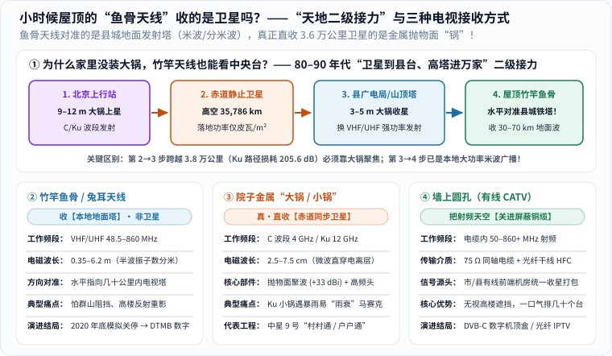
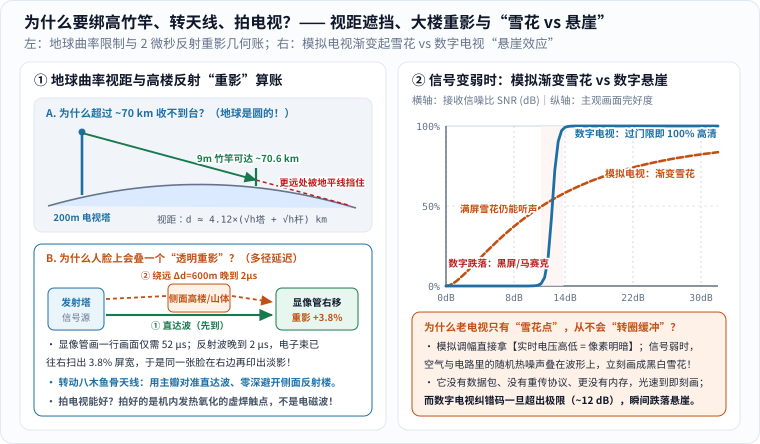
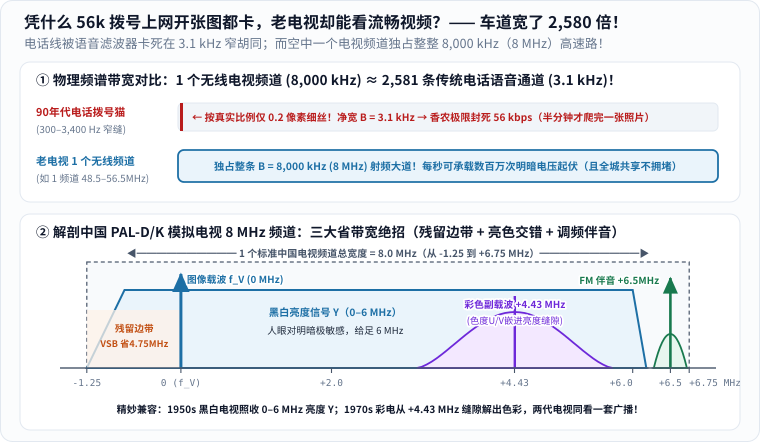
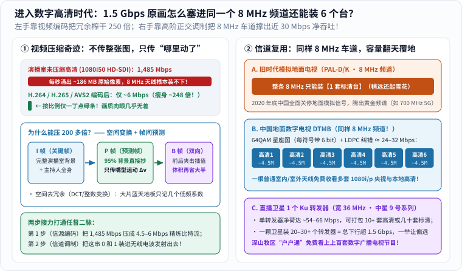
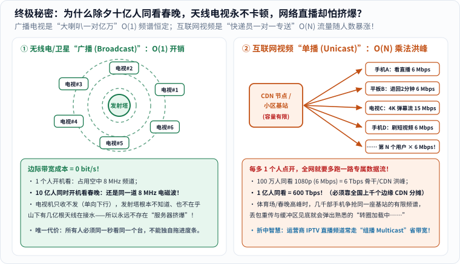

只要是从八九十年代走过来的人，脑海里大概率都存着这三幕生动的童年记忆：

第一幕在夏夜的平房屋顶或农家小院。电视机里正放着《西游记》，孙悟空的金箍棒刚举到一半，屏幕上突然涌起密密麻麻的黑白“雪花点”，伴着“沙沙”声连猴脸都糊成了双影。于是大人们搬梯子爬上房顶，双手抱住那根绑着一长排横铝管的竹竿，一点点往东拧、再往南转，底下小孩趴在窗台扯着嗓子当人体信号表：“偏啦！回来一点！哎——停！清楚啦！千万别动！”

第二幕在客厅茶几旁。有时候外面没刮风，电视画面却冷不丁上下翻滚或者闪出横纹，家里长辈走过去，抬手在厚重的大屁股显像管（CRT）电视机侧面“啪啪”拍上两巴掌，画面居然真的立竿见影恢复了正常。

第三幕则发生在九十年代末、两千年初电脑刚进家庭的时候。电话线插进 `56k` 拨号调制解调器（Modem），听着它发出“滋啦——叮咚——咔嚓”一阵神秘的电子握手声连上互联网，点开一张哪怕只有 $$200\ \mathrm{KB}$$ 的网页静态照片，都得眼巴巴看着它像拉百叶窗一样从上往下卡顿半分钟才能刷完。

把这三幕放在一起，两个让人越想越好奇的问题就冒出来了：

1. **我们以前屋顶竹竿上绑的“鱼骨天线”、电视机顶支起的“兔耳拉杆天线”，直接收的是太空卫星发射的频道吗？** 如果不是，为什么深山县城和农村老家也能跟北京同步看上中央一套？
2. **在连电脑拨号上网看一张静态图都卡成幻灯片的年代，哪来那么大的“带宽”，能让空气里几根毫无芯片的空心铝管，丝滑接收每秒 25 帧的全屏有声彩色视频？**

这两个问题看似家常，背后却藏着整整一百年无线电物理、视觉生理学与信息论最漂亮的一连串巧思。先把从七八十年代到今天四代“看电视”方式的底牌摊在桌上（核心频段、信道宽度与容量均按国际电联 ITU-R BT.470 [1]、我国 PAL-D/K 与 DTMB 国家标准 [2][7] 核定），我们顺着电磁波的来路一步步破案：

| 接收方式与时代代表 | 天线长什么样 | 信号直接来自哪里 | 工作频段与波长 $$\lambda$$ | 单频道占多大“车道” | 弱信号下会发生什么 |
| --- | --- | --- | --- | --- | --- |
| **地面模拟电视**（1958–2020 年底关停）[1][2] | 屋顶竹竿“鱼骨天线” / 机顶“兔耳” | **几十公里内的本地地面电视塔 / 差转台**（非卫星！） | VHF/UHF $$48.5\text{–}860\ \mathrm{MHz}$$（波长 $$0.35\text{–}6.2\ \mathrm{m}$$） | **$$8\ \mathrm{MHz}$$**（仅装 **$$1$$ 套**标清台） | 渐变起黑白**雪花点**、大楼反射出**重影**，永不缓冲 |
| **卫星直收电视 DTH**（大锅 / 2008 中星 9 号小锅）[6] | 院子里的金属抛物面“大锅 / 小锅” + 焦点高频头 | **[$$35{,}786\ \mathrm{km}$$ 赤道静止广播卫星]()** | C 波段 $$4\ \mathrm{GHz}$$ / Ku 波段 $$12\ \mathrm{GHz}$$（波长 $$2.5\text{–}7.5\ \mathrm{cm}$$） | 单个转发器 **$$27\text{–}50\ \mathrm{MHz}$$**（约 $$60\ \mathrm{Mbps}$$，装十余套台） | Ku 小锅遇瓢泼暴雨会出现**“雨衰”**马赛克或中断 |
| **有线电视 CATV**（90 年代起城镇普及） | 墙上面板的 $$75\ \Omega$$ 同轴圆孔 | 市/县有线前端机房统一收星后送入屏蔽电缆 | 电缆内 $$50\text{–}860+\ \mathrm{MHz}$$ 射频通道 | 每隔 **$$8\ \mathrm{MHz}$$** 排 $$1$$ 个模拟台或 $$6$$ 个数字高清台 | 铜网屏蔽隔绝高楼反射，彻底告别重影与转天线 |
| **地面数字电视 DTMB**（2006 国标，至今免费广播）[7] | 普通室内平板天线 / 旧式室外UHF鱼骨天线照用 | **本地地面数字电视发射塔** | 同样 UHF（主力 $$470\text{–}700\ \mathrm{MHz}$$） | 同样 **$$8\ \mathrm{MHz}$$**（跑出 $$24\text{–}32\ \mathrm{Mbps}$$，装 **$$4\text{–}6$$ 套高清**！） | 过门限即 $$100\%$$ 纯净高清；跌破约 $$12\ \mathrm{dB}$$ 呈**“数字悬崖”**卡停 |

---

## 一、破案第一问：以前屋顶的“鱼骨天线”，收的真不是卫星！

### 1. 竹竿“鱼骨”与机顶“兔耳”：对准的是县城铁塔，不是外太空

先给第一个问题下个干脆利落的结论：**小时候绑在屋顶竹竿上的“鱼骨天线”，以及插在电视机后背的两根可伸缩“兔耳拉杆天线”，收的都不是太空里的卫星，而是几公里到几十公里外、架在你们市里或县城最高山头上的地面电视发射塔（或乡镇差转台）！**

不信你回忆一个细节：当年大人们爬上房顶转竹竿时，那一排铝管组成的“鱼骨头”永远是**水平端着指向县城方向**的，从来没有人把它仰起脖子朝天上指；而后来村里真正装卫星电视的人家，院子里立起的那口灰白色金属圆“锅盖”，才是一律斜仰着脸对准偏南方的天空。

为什么长相差别这么大？因为那副形似鱼骨的铝管架子，学名叫**八木-宇田天线（Yagi-Uda Antenna）**，由日本东北帝国大学的宇田新太郎与八木秀次于 1926 年发明 [5]。你仔细看它的构造就会发现，一长排横杆其实只有靠近尾端、接扁平馈线或同轴线的那一根（常做成扁圈状的折合振子）真正通电；它身后的**反射器**略长一点，负责把漏往背后的电磁波挡回来；它身前朝向发射塔的一串**引向器**则一根比一根略短，靠感应电流的相位干涉把前方射来的无线电波像手电筒聚光一样拢进主瓣里 [5]。

电磁学有一条铁律：杆状天线要想高效感应出交变电流，每根横杆的长度必须和电磁波的**半波长（$$\lambda / 2$$）**旗鼓相当。按真空光速 $$c \approx 3.0 \times 10^8\ \mathrm{m/s}$$ 算一算我国地面电视的波长 [2]：

- **VHF 甚高频（1–12 频道，俗称“米波”）**：频率 $$f = 48.5\text{–}223\ \mathrm{MHz}$$。拿当年专播中央一套的 **1 频道（$$48.5\text{–}56.5\ \mathrm{MHz}$$，中心约 $$52.5\ \mathrm{MHz}$$）**[2] 来说，它的电磁波波长足有：

$$
\lambda_1 = \frac{c}{f} \approx \frac{3.0 \times 10^8\ \mathrm{m/s} }{52.5 \times 10^6\ \mathrm{Hz} } \approx 5.71\ \mathrm{m}
$$

半波长 $$\lambda_1 / 2 \approx 2.86\ \mathrm{m}$$！哪怕到了 6–12 频道（$$167\text{–}223\ \mathrm{MHz}$$），波长也有 $$1.35\text{–}1.80\ \mathrm{m}$$，半波振子长约 $$0.7\text{–}0.9\ \mathrm{m}$$。
- **UHF 特高频（13 频道往上，俗称“分米波”）**：频率 $$470\ \mathrm{MHz}$$ 起步，波长缩到 $$0.35\text{–}0.64\ \mathrm{m}$$，所以鱼骨最前端那一排密密麻麻的小短齿只有十几到二十几厘米长。

这下你就全看懂了：屋顶鱼骨天线上那一排从一米多到二十厘米不等的铝管，从基因上就是专门为接收地面铁塔发出的**米波与分米波**量身定做的！

### 2. 既然没收卫星，老家怎么也能同步看央视？——“天地二级接力”

听到这儿你肯定会追问：“不对呀！既然竹竿天线只能收几十公里内县城电视塔的信号，那离北京两千多公里的云贵大山、西北小县城，八九十年代没有全国光纤网，县城铁塔里的《新闻联播》和春晚又是从哪儿变出来的？”

答案是：**卫星真的参与了，只不过它干的是前半程“批发运输”，县城铁塔干的是后半程“零售送货”！** 这套撑起中国几十年电视普及史的功臣架构，叫做**“天地二级接力”**。

_图 1：怎么读这张图——先看上半部分从左到右的四步接力：北京上行站先用 9–12 米大锅把节目送上 35,786 公里赤道静止卫星（如 1988 年投入使用的东方红二号甲通信卫星及后续中星系列），卫星用微波洒向全国；各地县广电局或高山转播站院子里立着一口 3–5 米的大铁锅把极其微弱的卫星信号接住，解调放大后，再换成大功率 VHF/UHF 米波从本地铁塔向方圆几十公里广播，最后被你家屋顶水平对准铁塔的鱼骨天线收到。下半部分横向对比了鱼骨天线、直收卫星锅与有线电视同轴孔的物理本质。_

在 1980 年代中期以前，远途传电视只能靠每隔几十公里修一座山头微波接力站，翻山越岭成本极高。随着我国通信广播卫星（如 1988 年成功定点并承担全国电视传输的东方红二号甲实用通信卫星，以及随后的亚洲一号、中星系列卫星）陆续驻守赤道上空，国家广电系统走通了一条绝妙的捷径：不需要全国两亿户家庭每家买一口昂贵的大铁锅，只要**每个县广播电视局或高山差转台院子里立一口直径 $$3\text{–}5$$ 米的专业大锅**，把天上的央视和省级卫视信号接下来，再转换成普通老百姓黑白/彩色电视机高频头就能直接识别的 VHF/UHF 无线频道，用几百瓦到几十千瓦的发射塔向全县洒出去！

所以，你小时候看中央台，确实享受了同步卫星的福泽，但你家房顶那根铝管架子只负责跑完了最后几十公里的“地面冲刺”。

### 3. 为什么鱼骨天线绝不可能直接收卫星？算清 205 分贝的太空衰减账

那能不能偷个懒，干脆拿鱼骨天线直接对准天上的[地球静止卫星]()呢？物理定律会毫不留情地拦住你——差了整整两个数量级维度的鸿沟：

第一道鸿沟是**波长完全不匹配**。为了穿过电离层并把天线做小，直播卫星下行普遍采用 **C 波段（约 $$3.7\text{–}4.2\ \mathrm{GHz}$$，波长 $$\lambda \approx 7.5\ \mathrm{cm}$$）** 或 **Ku 波段（约 $$11.7\text{–}12.75\ \mathrm{GHz}$$，波长 $$\lambda \approx 2.5\ \mathrm{cm}$$）**[6]。面对波长只有 $$2.5$$ 厘米的微波，一米长的鱼骨铝管就像拿捕鲸鱼的大网去捞芝麻，而且老电视机内部的调谐器最高只认到约 $$860\ \mathrm{MHz}$$，连 $$12\ \mathrm{GHz}$$ 的门都摸不着。

第二道更致命的鸿沟是**跨越 $$3.8$$ 万公里的自由空间能量稀释**。卫星在距离赤道 $$35{,}786\ \mathrm{km}$$（从中纬度斜着看过去，斜距 $$d \approx 38{,}000\ \mathrm{km} = 3.8 \times 10^7\ \mathrm{m}$$）的太空靠太阳能帆板供电，单个转发器功率通常只有一百多瓦 [6]。按无线电物理的**自由空间路径损耗公式（Free-Space Path Loss）**算一算 Ku 波段（$$\lambda = 0.025\ \mathrm{m}$$）一路跑到你家屋顶损失了多少倍能量：

$$
L_{\mathrm{FS} } = \left(\frac{4\pi d}{\lambda}\right)^2 = \left(\frac{4\pi \times 3.8 \times 10^7\ \mathrm{m} }{0.025\ \mathrm{m} }\right)^2 \approx 3.65 \times 10^{20}
$$

换成通信工程师最爱用的分贝（$$\mathrm{dB}$$）：

$$
L_{\mathrm{FS}(\mathrm{dB})} = 10 \log_{10}\left(3.65 \times 10^{20}\right) \approx 205.6\ \mathrm{dB}
$$

衰减 **$$3.65 \times 10^{20}$$ 倍（三万六千五百亿亿倍）** 是什么概念？哪怕卫星用定向天线把一百多瓦功率聚拢成只照亮中国版图的波束（等效全向辐射功率 EIRP 约 $$52\ \mathrm{dBW}$$，合 $$1.6 \times 10^5\ \mathrm{W}$$），等这束微波摊开在几百万平方公里的土地上时，落到你家屋顶**每一平方米面积上的功率通量密度 $$S$$** 也只剩下：

$$
S = \frac{\mathrm{EIRP} }{4\pi d^2} \approx \frac{1.6 \times 10^5\ \mathrm{W} }{4\pi \times (3.8 \times 10^7\ \mathrm{m})^2} \approx 8.8 \times 10^{-12}\ \mathrm{W/m^2} \quad (\text{不到 } 10\ \text{皮瓦/平方米！})
$$

一皮瓦（$$\mathrm{pW}$$）是**一万亿分之一瓦**！几根手指粗的铝管截不到万分之一平方米的能量，淹没在室温热噪声里连个水花都冒不出来。

要想抓到这游丝般的皮瓦级微波，人类只有一个办法——**拿一口金属抛物面“锅”（卫星天线）当聚光镜** [6]！抛物面有一条神奇的几何性质：所有平行射入的电磁波撞上锅面后，都会同相位精准反射汇聚到锅前支架顶端的唯一焦点上。按天线孔径增益公式（取孔径效率 $$\eta \approx 0.60$$）：

$$
G = \eta \left(\frac{\pi D}{\lambda}\right)^2
$$

哪怕是 2008 年我国发射“中星 9 号”直播卫星后在广大农村普及的“村村通 / 户户通”**直径 $$D = 0.45\ \mathrm{m}$$（45 厘米）偏馈小锅**，在 $$\lambda = 0.025\ \mathrm{m}$$ 的 Ku 波段下也能瞬间攒出 **$$G \approx 1{,}920$$ 倍（约 $$+32.8\ \mathrm{dBi}$$）** 的聚波增益！汇聚到焦点处的信号立刻钻进那个拳头大的塑料圆筒——**LNB 高频头（低噪声下变频器）**[6]：先由超低噪声放大器放大上十万倍，再与本振混频，把烫手的 $$12\ \mathrm{GHz}$$ 微波一把降到普通同轴线能轻松传输的 **$$950\text{–}2{,}150\ \mathrm{MHz}$$ 中频**，送进屋里的卫星机顶盒解出画面。

顺便还能解开一个生活冷知识：**为什么村里的小锅一遇夏天瓢泼大雨就会卡出马赛克，而电视台院子里几米大的网状大锅暴风雨里也稳如泰山？** 因为小锅用的 Ku 波段波长只有 **$$2.5\ \mathrm{cm}$$**，跟天空中密集的大雨滴、冰晶尺寸已经不再悬殊，水分子对这一频段微波既有强烈介电吸收又有散射损耗（俗称**“雨衰 Rain Fade”**）[6]；而电视台大锅用的 C 波段波长达 **$$7.5\ \mathrm{cm}$$**，雨滴在它眼里小如尘埃，轻松绕射穿云而过——代价就是为了维持高增益 $$(\pi D/\lambda)^2$$，波长长 $$3$$ 倍，锅的直径也得跟着放大 $$3$$ 倍以上！

---

## 二、童年三大怪象的物理真相：绑高竹竿、人脸重影与“拍两巴掌真能好”

搞清了鱼骨天线收的是几十公里内的地面电视塔，当年折磨全家人半宿的三大怪象，用初高中物理算两步就能水落石出。

### 1. 为什么要绑高竹竿？地球是圆的，米波不会拐大弯

小时候常听老人念叨：“竹竿再接高两米，就能多收两个外县的台！”这话一点不假。

我们平时听的中短波收音机（波长几十米到几百米），电磁波撞上高空 $$60\text{–}400\ \mathrm{km}$$ 的电离层会像照镜子一样反射回地面，所以夜里一台破收音机能收到几千公里外的电台。但电视所在的 VHF/UHF 米波与分米波频率太高，电离层根本拦不住它，一旦越过地平线就会笔直冲向外太空。

_图 2：怎么读这张图——左图上半部分画出弯曲的地球表面：米波沿近似直线传播，200 米电视塔配 9 米屋顶竹竿的最大视距约 70.6 公里，再远就被地球肚子挡住了；左图下半部分算出大楼多径反射为什么会让人脸右侧偏出约 3.8% 屏宽的透明重影。右图对比信噪比滑落时两条截然不同的曲线：橙色虚线模拟电视渐变起雪花但仍能看，蓝色实线数字电视在约 12.5 dB 门限处垂直跳水（数字悬崖）。_

因为地球是个半径 $$R_E \approx 6{,}371\ \mathrm{km}$$ 的球体（计入低空大气密度梯度让无线电波略微向下弯曲的等效地球半径系数 $$k \approx 4/3$$，即 $$R_{\mathrm{eff} } \approx 8{,}495\ \mathrm{km}$$），由勾股定理立刻就能推出发射塔高 $$h_{\text{塔} }$$（单位：米）与你家天线高 $$h_{\text{杆} }$$（单位：米）之间的**无线电视距公式**：

$$
d_{\max} \approx \sqrt{2 R_{\mathrm{eff} } h_{\text{塔} } } + \sqrt{2 R_{\mathrm{eff} } h_{\text{杆} } } \approx 4.12 \left(\sqrt{h_{\text{塔} } } + \sqrt{h_{\text{杆} } }\right)\ (\mathrm{km})
$$

代入算一算：假如市里的电视塔建在 $$200\ \mathrm{m}$$ 高处，你把兔耳天线放在一楼屋里茶几上（$$h_{\text{杆} } = 1.5\ \mathrm{m}$$），还隔着两堵砖墙衰减，不仅信号弱，理论视距也只有 $$4.12\times(\sqrt{200}+\sqrt{1.5}) \approx 63.3\ \mathrm{km}$$；而当你爬上平房顶，立起一根离地 **$$9\ \mathrm{m}$$** 的大竹竿，不仅一下子越过了村口大树和前排屋脊的遮挡，视距也延伸到了 **$$4.12\times(14.14 + 3) \approx 70.6\ \mathrm{km}$$**！难怪当年谁家竹竿立得最高，谁家就是全村频道最全的“观影中心”。

### 2. 为什么人脸上会叠一张“透明重影”？600 米绕路 = 2 微秒迟到

比雪花更恼人的是**“重影（Ghosting）”**：电视里播音员正端坐念稿，他的右耳朵旁边却像分身术一样，紧贴着印出了半张一模一样但淡淡发虚的侧脸。

这是典型的**多径传播干扰（Multipath Interference）**。发射塔发出的电磁波分成了两路跑到你家天线：

- **第 ① 路（直达波）**：直线奔向你家屋顶，路程最短，最先抵达；
- **第 ② 路（反射波）**：撞上侧面几百米外的一栋水泥大楼、水塔或山坡，像乒乓球撞墙一样弹射到你家天线上。

假设这束反射波比直达波仅仅多绕了 **$$\Delta d = 600\ \mathrm{m}$$** 的冤枉路。电磁波在空气中每秒跑 $$3 \times 10^8\ \mathrm{m}$$（也就是每微秒跑 $$300\ \mathrm{m}$$），多走 $$600\ \mathrm{m}$$ 只会让反射波迟到区区 **$$2\ \text{微秒}$$**：

$$
\Delta t = \frac{\Delta d}{c} = \frac{600\ \mathrm{m} }{300\ \mathrm{m/\mu s} } = 2.0\ \mu\mathrm{s}
$$

两微秒（一百万分之二秒），人眨一下眼都够它跑十万回了，怎么会在屏幕上被肉眼抓个正着？因为显像管里的电子束跑得太快了！后面第四节我们会算到，我国模拟电视电子枪从屏幕最左边扫到最右边画完一整行画面，总共只花 **$$52\ \mu\mathrm{s}$$** [3]。当直达波在屏幕中央画出播音员高挺的鼻梁时，仅仅过 $$2\ \mu\mathrm{s}$$ 赶到的反射波，此时电子枪已经往右扫出了屏幕总宽度的：

$$
\frac{\Delta t}{T_{\text{有效行} } } = \frac{2.0\ \mu\mathrm{s} }{52.0\ \mu\mathrm{s} } \approx 3.85\%
$$

在一台屏幕宽约 $$42\ \mathrm{cm}$$ 的 $$21$$ 英寸彩电上，$$3.85\%$$ 正好是 **$$1.6\ \mathrm{cm}$$**！于是这股迟到的弱信号就在原鼻梁右边 $$1.6$$ 厘米处，忠实地又描了一道浅浅的假鼻梁。大人在房顶慢慢转动八木鱼骨天线，本质上就是利用它的方向性，拿灵敏度最低的侧面“盲区（零深）”去对准那栋讨厌的反射大楼，把回声掐灭！

### 3. 为什么老电视信号差是“起雪花”，拍两巴掌居然真管用？

再看图 2 右侧那张耐人寻味的对比曲线：为什么当年模拟电视信号再烂，最多也就是雪花变厚、画面变黑白，你眯着眼照样能看清孙悟空一棒子打倒妖怪，而今天的数字电视要么纤毫毕现，信号稍微弱过一条红线就突然卡死成马赛克甚至黑屏？

因为模拟电视压根没有“0 和 1”的编码与重传概念——它用的是最朴素的**调幅（AM）直接映射** [4]：天线收到的瞬时信号电压有多高，显像管电子枪这一瞬间射向荧光粉的电流就有多猛。当天线信号很微弱、接收机自动把放大倍数开到最大时，空气里的宇宙背景辐射和电路电阻里电子热运动产生的**随机热噪声电压 $$n(t)$$** 也被一并放大了。热噪声忽正忽负，撞在荧光屏上就是一粒粒随机炸开的亮白点与黑点——你看到的满屏“雪花”，其实是货真价实的微观电子热运动直播（甚至其中约 $$1\%$$ 的雪花点，真有一小撮来自 $$138$$ 亿年前宇宙大爆炸留下的微波背景辐射余晖）！

而数字电视改用高阶正交调制配前向纠错码（如 LDPC 码）[7]：只要信噪比高于约 **$$12\ \mathrm{dB}$$** 的纠错门限，哪怕空气里有噪声，纠错算法也能把错掉的比特一字不差修回来，画面 $$100\%$$ 纯净如镜；可一旦乌云遮挡或天线松动让信噪比跌破门限哪怕 **$$1\text{–}2\ \mathrm{dB}$$**，错码数量瞬间超出纠错上限，整帧数据包作废，立刻跳水坠入**“数字悬崖（Digital Cliff）”**[4]。

至于当年长辈“拍两巴掌修好电视”的绝技，可真不是把电磁波拍通顺了——老式显像管电视内部有上万伏的高压包和大功率行输出管，开机滚烫、关机冰凉，日复一日热胀冷缩，沉重的元器件引脚焊锡极易裂开一圈肉眼难辨的细缝（俗称**“虚焊”**），机械旋转式频道调谐器的铜触点也容易氧化。重重拍两下机壳，机械震动让虚焊缝隙瞬间重新挨紧导通，画面自然奇迹般复活——直到下一次热胀冷缩再把它震开为止！

---

## 三、破案第二问：连拨号上网都卡的年代，凭什么电视“带宽”够看视频？

破完了天线的案，重头戏来了：**为什么九十年代末装根电话线拨号上网，连看一张静态照片都慢如蜗牛，而早它三四十年的老电视，却能轻轻松松播全屏动态视频？**

很多人下意识觉得：“老电视年代哪有什么宽带呀，宽带不是两千年初拉了网线才有的词吗？”——恰恰相反！这正是词汇演进制造的最大错觉：**单论物理频谱车道的宽度，1980 年代随便一个无线电视频道的“带宽”，比 1998 年的电话拨号上网宽了整整 2,580 倍！**

### 1. 窄胡同 vs 八车道高速：3.1 kHz 电话线与 8,000 kHz 电视频道

在通信物理里，**带宽（Bandwidth，记作 $$B$$）** 原本的意思根本不是“每秒下载多少兆字节”，而是**允许信号通过的最高频率与最低频率之差（单位：赫兹 $$\mathrm{Hz}$$）**——就像高速公路留给你的车道有多宽。

1948 年，信息论之父克劳德·香农（Claude Shannon，我们在[《计算机是如何工作的？》]()里见过他用继电器搭逻辑门的故事）证明了统治现代一切有线与无线通信的铁律——**香农-哈特利信道容量定理（Shannon–Hartley Theorem）**[8]：在带宽为 $$B$$（单位：$$\mathrm{Hz}$$）、信号功率与噪声功率之比为 $$S/N$$ 的高斯白噪声信道里，无论人类发明多聪明的编码，每秒无差错传输的信息量上限 $$C$$（单位：$$\mathrm{bit/s}$$）永远逃不出：

$$
C = B \log_2\!\left(1 + \frac{S}{N}\right)
$$

你看公式最前面乘的那个字母 **$$B$$**：车道宽度 $$B$$ 直接决定了容量的底盘！我们来对比一下九十年代家里那两条线的真实车道宽度：

- **电话拨号猫（56k Modem）的憋屈窄胡同**：百年电话网设计之初只为了让人听清说话声。人说话的核心频率都在低频段，电信局为了在一根干线里多塞几百路电话，在程控交换机口给每一户电话线都焊死了一道 **$$300\ \mathrm{Hz}\text{–}3{,}400\ \mathrm{Hz}$$ 的语音带通滤波器**！也就是说，不管你家墙里的铜线本身潜力有多大（后来 ADSL 绕开语音滤波器走高频，同一对铜线照样跑出十几兆），拨号猫能钻的缝隙净宽只有可怜巴巴的：

$$
B_{\text{电话} } = 3{,}400 - 300 = 3{,}100\ \mathrm{Hz} = 3.1\ \mathrm{kHz}
$$

代入香农公式：就算市内电话线非常干净，信噪比高达 $$36\ \mathrm{dB}$$（即线性功率比 $$S/N = 10^{3.6} \approx 3{,}981$$），物理极限也只有 $$C \approx 3{,}100 \times \log_2(3{,}982) \approx 37\ \mathrm{kbps}$$（后来 `V.90/V.92` 56k 猫靠下行跳过一次模数转换量化噪声，才勉强摸到 $$56\ \mathrm{kbps}$$ 理论天花板，实际常年只有 $$40\text{–}48\ \mathrm{kbps}$$，每秒合 $$5\ \mathrm{KB}$$ 左右！）。

- **无线电视 1 个频道的豪华八车道**：再看空中的电视广播！根据国际电联 ITU-R BT.470 与我国自 1970 年代统一采用的 **PAL-D/K 制式标准** [1][2]，国家无线电管理部门给**仅仅一个电视频道**（比如 1 频道独占 $$48.5\text{–}56.5\ \mathrm{MHz}$$，2 频道独占 $$56.5\text{–}64.5\ \mathrm{MHz}$$……）划出的频谱净宽度是：

$$
B_{\text{电视} } = 8\ \mathrm{MHz} = 8{,}000\ \mathrm{kHz} = 8{,}000{,}000\ \mathrm{Hz}
$$

把两者的车道宽度除一下：

$$
\frac{B_{\text{电视} } }{B_{\text{电话} } } = \frac{8{,}000\ \mathrm{kHz} }{3.1\ \mathrm{kHz} } \approx 2{,}580.6\ \text{倍！}
$$

_图 3：怎么读这张图——先看上半部分的真实比例冲击：如果把老电视 1 个无线频道的 8,000 kHz 频谱画成一条 540 像素宽的大马路，90 年代电话拨号猫能用的 3.1 kHz 语音窄缝按比例只有 0.2 像素粗的一根红头发丝！再看下半部分对这 8 MHz 频道的精细解剖：工程师切掉左侧多余下边带（VSB 省下 4.75 MHz），把 0–6 MHz 留给黑白亮度 Y，把彩色副载波精准插在 +4.43 MHz 缝隙里，最右端 +6.5 MHz 放上抗干扰的 FM 调频伴音。_

真相大白！老电视从来就不是“在窄带宽里变魔术”，恰恰相反，它是把**足足抵得上两千五百多条电话线的 8 兆赫豪华频谱大道**，一口气全砸给了**一个电视频道**！

顺便说一句，九十年代末有线电视网推出“宽带上网（Cable Modem）”时，为什么直接起了**“宽带（Broadband）”**这个名字？正是相对于电话线 $$3.1\ \mathrm{kHz}$$ 的**“窄带（Narrowband）”**而言——在同轴电缆里哪怕随便腾出**半个**电视频道的频谱给电脑上网，速度都能把电话拨号猫甩出几百条街！

### 2. 8 MHz 里的三大省地绝招：切边带、钻牙缝与黑白彩电神兼容

话虽如此，就算批给你 $$8\ \mathrm{MHz}$$ 频谱，在没有一块数字压缩芯片的 1950–1960 年代，要想把清晰的彩色动态画面外加清楚的伴音统统塞进去，依然极其吃紧！

为什么？因为清晰标清电视的黑白明暗信号最高频率约需 **$$6\ \mathrm{MHz}$$** [2]。如果像普通中波调幅收音机那样老老实实用**双边带调幅（DSB-AM）**发射，载波左右两侧会对称长出两个一模一样的 $$6\ \mathrm{MHz}$$ 边带，光黑白画面就得占掉 **$$2 \times 6 = 12\ \mathrm{MHz}$$**，直接撑爆 $$8\ \mathrm{MHz}$$ 频道！而且到了 1960 年代推广彩色电视时，全国老百姓家里已经买了成百上千万台黑白电视机——你总不能彩色台一开播，让老百姓家里的黑白电视一夜之间全变成废铁吧？

你再低头细看图 3 下半部分那张频谱解剖图，就能领略二十世纪模拟电路工程师令人拍案叫绝的三招“螺蛳壳里做道场” [2][3][4]：

1. **一刀切掉大半个下边带——残留边带调制（VSB，立省 $$4.75\ \mathrm{MHz}$$）**：既然图像载波 $$f_V$$ 左右两边的上下边带装的是完全重复的镜像信息，干脆拿滤波器把左边 $$-6.0\ \mathrm{MHz}$$ 的下边带咔嚓切掉绝大部分，只保留 $$-0.75\ \mathrm{MHz}$$（连滚降过渡带共 $$-1.25\ \mathrm{MHz}$$）的一小截“残留边带”防止低频相位失真 [4]。这一刀下去，原本 $$12\ \mathrm{MHz}$$ 的胖子瞬间瘦身进 $$7.25\ \mathrm{MHz}$$！
2. **欺负人眼对颜色迟钝——亮色分离与 $$+4.43361875\ \mathrm{MHz}$$ 梳状交错（零额外占地实现彩电兼容！）**：生理学家早就发现，人眼视网膜上负责看明暗轮廓的**视杆细胞约有 $$1.2$$ 亿个**，而负责看红绿蓝色彩的**视锥细胞只有约 $$600$$ 万个**——也就是说，只要黑白素描轮廓足够锐利，哪怕把上面的水彩涂得稍微模糊一点，大脑也完全看不出破绽！于是工程师不再傻乎乎地传红、绿、蓝三份各 $$6\ \mathrm{MHz}$$ 的信号（那得要 $$18\ \mathrm{MHz}$$！），而是调配成**$$1$$ 路全带宽（$$6\ \mathrm{MHz}$$）的黑白亮度 $$Y'$$** 加上 **$$2$$ 路带宽砍到仅约 $$1.3\ \mathrm{MHz}$$ 的色差信号 $$U, V$$** [3]。更绝的是，由于电视画面一行行周期扫描，亮度 $$Y'$$ 的能量在频谱上并不是铁板一块，而是像一把梳子一样每隔行频 $$15{,}625\ \mathrm{Hz}$$ 留出一道空牙缝！1962 年德国德律风根公司的瓦尔特·布鲁赫（Walter Bruch）团队设计 PAL 制（逐行倒相制，靠每行翻转色度相位自动抵消传输偏色）时，把彩色副载波选在了精确到小数点后两位的 [3]：

$$
f_{\mathrm{SC} } = 283.75 \times 15{,}625\ \mathrm{Hz} + 25\ \mathrm{Hz} = 4{,}433{,}618.75\ \mathrm{Hz} \approx 4.43\ \mathrm{MHz}
$$

正好不偏不倚把彩色信号像第二把梳子一样**插进黑白亮度频谱的牙缝里**！老式黑白电视机收到它，只拿 $$0\text{–}6\ \mathrm{MHz}$$ 亮度照常看黑白片；新款彩色电视机认出每行开头的 $$10$$ 个周期“色同步摆动脉冲”，立刻从 $$4.43\ \mathrm{MHz}$$ 牙缝里解出绚丽色彩——**两代电视机同看一道电波，没多占半寸频谱！**
3. **最右端留 $$+6.5\ \mathrm{MHz}$$ 给调频（FM）伴音**：图像用调幅省带宽，而声音本身频率窄（$$<15\ \mathrm{kHz}$$），就在图像载波上方 $$+6.5\ \mathrm{MHz}$$ 处单独放一座抗幅度杂波极强的 **FM 调频广播电台** [2]。这也就是为什么以前信号差得屏幕全是雪花时，电视里的歌声和对白依然字正腔圆！

---

## 四、没有内存、不打数据包的年代，怎样把二维动画塞进一根电线？

看到这儿，习惯了今天手机拍照和电脑显卡的读者可能还会犯嘀咕：“慢着！就算有 $$6\ \mathrm{MHz}$$ 视频车道，一张二维画面有几十万个点，一秒钟 $$25$$ 张，1930–1970 年代全世界连块像样的内存条（RAM）都没有，电视机拿什么把整张图存下来再画到屏幕上？”

答案极其干脆：**一丁点都不存！模拟电视根本没有“像素”和“内存”，它玩的是光速同步的“一维切面条 + 隔行障眼法”！**

### 1. 64 微秒画一行：把二维图像切成每秒 15,625 根“电压面条”

一根天线或一根铜线，在同一瞬间只能有一个电压值——它是**一维**的；而电视画面有宽又有高——它是**二维**的。怎么用一根一维的线传二维的画？

就像你读这篇博客文章一样：**一行一行从左往右扫！**

_图 4：怎么读这张图——左图上半部分是显像管屏幕（电子束从左往右划过一行的单次扫描动画播放一次；开启系统减少动态效果时直接呈现静态完整扫描线），下半部分是这一行精确对应的 64 微秒电压波形：前 12 微秒用 -0.3V 负脉冲发号施令让电子束关灯回左端，后 52 微秒用 0V（黑）到 +0.7V（亮白）的高低起伏实时画出整行明暗。右图拆解 2:1 隔行扫描如何分奇偶两场交替点亮，用 25 帧带宽骗出 50 Hz 无闪烁视觉。_

按照我国采用的 $$625$$ 行、每秒 $$25$$ 幅完整帧的标准 [2]，显像管尾部的电子枪在偏转线圈磁场拽动下，每秒钟要在荧光屏上从左往右拉出：

$$
f_H = 625\ \text{行/帧} \times 25\ \text{帧/秒} = 15{,}625\ \text{行/秒}
$$

顺手一除，电子束画完**每一行**分到的总时间精确到微秒不差：

$$
T_H = \frac{1}{15{,}625\ \mathrm{Hz} } = 0.000064\ \mathrm{s} = 64\ \mu\mathrm{s}
$$

如上图左侧波形所示，这短短的 **$$64\ \mu\mathrm{s}$$** 被切成了职责分明的两段 [3][4]：

- **前 $$12\ \mu\mathrm{s}$$（行消隐与同步脉冲）**：当演播室摄像机扫到一行最右端时，立刻往电波里打出一个跌到 **$$-0.3\ \mathrm{V}$$** 的方波“负脉冲同步头”。全国几千万台电视机一收到这个负脉冲，就像听到教官吹哨一样，立刻掐断电子枪（防止回程画出斜白线），用磁场把电子束飞速拽回下一行的最左端对齐起跑线！
- **后 $$52\ \mu\mathrm{s}$$（有效图像波形）**：电子束从左往右匀速滑行。碰到深色衣服，电波电压接近 $$0\ \mathrm{V}$$，电子枪微弱，荧光粉发暗；扫到雪白衬衫，电压升到 $$+0.7\ \mathrm{V}$$，电子枪猛烈轰击荧光粉发出耀眼白光！

现在我们可以亲手验算**为什么 $$6\ \mathrm{MHz}$$ 带宽刚好够画清整幅电视画面**了！假设一行画面从左到右要看清 **$$550$$ 个黑白交替的精细竖条纹**（一黑一白算 $$1$$ 个完整正弦波周期，$$550$$ 个点就是 **$$275$$ 个波周期**），必须在 $$52\ \mu\mathrm{s}$$ 内跑完，那么这根电压波形每秒钟最高要上下震荡多少次？

$$
f_{\max} = \frac{275\ \text{个周期} }{52 \times 10^{-6}\ \mathrm{s} } \approx 5.29 \times 10^6\ \mathrm{Hz} = 5.29\ \mathrm{MHz} < 6.0\ \mathrm{MHz}
$$

严丝合缝！既不需要半字节内存，也不需要 CPU 解码，演播室摄像管扫到哪一点，几百公里外你家显像管电子束在千分之一秒内就同步点亮哪一点——这就是为什么老电视开机即看、零延迟、永远没有“正在缓冲 $$99\%$$”！

### 2. 2:1 隔行扫描（50i）：不多花一赫兹带宽，顺手消灭画面闪烁

不过，早年设计这套每秒 $$25$$ 帧标准的工程师还撞上过一个生理学大麻烦：**闪烁感**！

人眼的视觉暂留虽然能把每秒 $$24$$ 格胶片连成动作，但在明亮的阴极射线管荧光屏上，如果整块屏幕每秒只明暗闪烁 $$25$$ 次，低于人眼约 **$$45\text{–}50\ \mathrm{Hz}$$ 的临界闪烁融合频率（Critical Flicker Fusion Frequency）**，观众看十分钟就会觉得屏幕一闪一闪直晃眼。要想不闪，屏幕每秒至少得整体刷亮 $$50$$ 次；可如果老老实实改成每秒传 $$50$$ 幅完整 $$625$$ 行画面，前面的 $$f_{\max}$$ 立刻翻倍成 **$$10.6\ \mathrm{MHz}$$**，$$8\ \mathrm{MHz}$$ 频道当场爆炸！

怎么做到**“既只花 $$25$$ 帧的带宽，又让眼睛看到 $$50$$ 次刷新”**？RCA 等早期电视先驱想出了流传近百年的神作——**2:1 隔行扫描（Interlaced Scanning）**[2][4]（见图 4 右侧）：

- **前 $$1/50$$ 秒（$$0\text{–}20\ \mathrm{ms}$$，奇数场）**：电子束偷个懒，跳着画，只把全屏的第 $$1, 3, 5, \dots, 625$$ 根奇数行从头到尾刷亮一遍；
- **后 $$1/50$$ 秒（$$20\text{–}40\ \mathrm{ms}$$，偶数场）**：电子束回到顶部，精准嵌进刚才留出的空隙里，把第 $$2, 4, 6, \dots, 624$$ 根偶数行补齐！

远坐在两三米外沙发上的你，根本分辨不出相邻两根相隔不到一毫米的扫描线是先后亮的，你的视网膜只感受到**整块大屏幕每 $$1/50$$ 秒（$$50\ \mathrm{Hz}$$）就被从上到下均匀照亮了一次**，闪烁感烟消云散，而空中每秒传输的总行数依然是 $$312.5 \times 50 = 15{,}625$$ 行，**一赫兹带宽都没多花**！直到今天，你在机顶盒或摄像机菜单里看到的 `1080i50` 与 `1080p50`，那个字母 `i`（Interlaced，隔行）和 `p`（Progressive，逐行），就是当年模拟电视时代省带宽留下的历史印记。

---

## 五、从“1 个雪花台”到“6 个高清台”：数字电视与 250 倍视频压缩

时间来到二十一世纪，家家户户换上了四五十英寸的平板液晶电视，标清（`576i`）升级成了全高清（`1080i / 1080p`）乃至超高清（`4K`）。这时候你再拿前面那套“模拟直接传波形”的办法去算，可就彻底玩不转了！

### 1. 如果不压缩，1 套高清节目就能撑爆 20 个老电视频道

我们来算一笔实打实的数字像素账。如果完全不压缩，把一台全高清电视（$$1920 \times 1080$$ 像素，每个像素红绿蓝各 $$8\ \mathrm{bit}$$ 共 $$24\ \mathrm{bit}$$，每秒 $$50$$ 帧逐行 `1080p50`）的原始画面直接变成 `0` 和 `1` 发出去，每秒钟涌出的比特洪流有多恐怖？

$$
R_{\text{原画(1080p50)} } = 1920 \times 1080 \times 24\ \mathrm{bit} \times 50\ \mathrm{s^{-1} } \approx 2.488 \times 10^9\ \mathrm{bit/s} = 2{,}488\ \mathrm{Mbps}
$$

哪怕采用电视台演播室专业高清串行接口（SMPTE 292M `1080i50` 隔行、色度抽样 `4:2:2`），原始未压缩码率也高达 **$$1{,}485\ \mathrm{Mbps}$$（约 $$1.5\ \mathrm{Gbps}$$，每秒钟产生 $$186\ \mathrm{MB}$$ 数据）**！

回头看看空中那条只有 **$$8\ \mathrm{MHz}$$** 宽的地面电视频道：根据香农定理 $$C = B \log_2(1 + S/N)$$，哪怕接收信噪比做到极奢侈的 $$30\ \mathrm{dB}$$（$$S/N = 1{,}000$$），$$8\ \mathrm{MHz}$$ 无线电波在物理定律允许下的绝对理论极限也不过 $$8 \times \log_2(1{,}001) \approx 79.7\ \mathrm{Mbps}$$，扣除抗多径保护间隔与纠错码开销后，真实可用的净吞吐率通常只有 **$$24\text{–}32\ \mathrm{Mbps}$$** [7]。拿 $$27\ \mathrm{Mbps}$$ 的水管去装 $$1{,}485\ \mathrm{Mbps}$$ 的原画，差了整整五十多倍！

_图 5：怎么读这张图——左图展示现代数字电视的第一件法宝“信源编码压缩”：利用空间变换和 I/P/B 帧运动预测（95% 不动的背景直接抄上一帧，只传主播嘴唇动作差值），把 1,485 Mbps 的演播室高清原画瘦身约 250 倍压成 6 Mbps 而不伤观感。右图展示第二件法宝“信道调制复用”：同样一条 8 MHz 地面无线频道，旧模拟时代只能装 1 套雪花标清台，换用我国 DTMB 数字标准后净吞吐约 27 Mbps，一口气免费塞进 6 套 1080i/p 高清台！_

### 2. 怎么把 1,485 Mbps 榨成 6 Mbps 还不糊？只传“哪里动了”！

既然拓宽无线电频谱比登天还难（黄金频段还要分给 4G/5G 手机基站），科学家和工程师就把算力全砸在了**视频压缩编码**上——从早年的 `MPEG-2`，到后来普及全球的 `H.264 / AVC`、`H.265 / HEVC`，以及我国自主研发广泛用于广播电视与超高清直播的 **`AVS+ / AVS2 / AVS3`** 系列标准。它们能把 $$1{,}485\ \mathrm{Mbps}$$ 的高清原画狠狠压到 **$$4.5\text{–}6\ \mathrm{Mbps}$$**（**压缩比高达 $$250$$ 倍左右**），靠的是榨干图像里两座巨大的“水分金矿”：

1. **第一座矿叫“空间冗余”（同一张图里大片相似）**：一帧画面里，演播室的蓝色背景墙、绿茵茵的足球场草皮，成千上万个相邻像素颜色几乎一模一样。编码器把画面切成小块，做一次与我们在[《傅里叶怎样把温度拆成波》]()里学过的频域拆解同源的**离散余弦变换（DCT / 整数变换）**：平滑色块瞬间浓缩成左上角寥寥几个低频数字，而人眼根本察觉不到的细碎高频噪点在量化时直接归零扔掉！
2. **第二座更大的矿叫“时间冗余”（前后两帧 95% 一模一样）**：想象每秒 $$50$$ 场的《新闻联播》——连续十几秒里，背景的地球仪、主播的西装肩膀纹丝不动，只有嘴唇和眨眼动了一点点！如果每一帧都傻乎乎地把背景重画一遍，纯属浪费电波。于是现代编码器把画面编成 **`I 帧`、`P 帧`、`B 帧`** 团队作战（见图 5 左侧）：每隔一两秒才发一张完整的 **`I 帧`（关键帧）** 打底；中间几十张 **`P 帧`（前向预测帧）** 和 **`B 帧`（双向预测帧）** 直接给电视机芯片下达极简指令：“*背景全部照抄上一张图！只把嘴角这块 $$16 \times 16$$ 方块往左挪 $$2$$ 个像素，再叠加上这丁点光影差值！*”

这一招“只传变化量”，瞬间砍掉了九成以上的比特！

### 3. 同样 8 MHz 车道大变身：今天插根天线还能免费看高清吗？

左手有了 $$250$$ 倍瘦身的 `4.5–6 Mbps` 高清视频流，右手再配上现代数字调制技术——我国于 2006 年正式颁布自主地面数字电视国家标准 **DTMB（GB 20600-2006，融合了清华大学多载波与上海交通大学单载波核心专利）**[7]，并在 **2020 年底全面关停了陪伴中国人六十余年的地面模拟电视信号**（腾出的 700 MHz 黄金频段如今还成了覆盖最广的 5G 主力频段！）。

最神奇的事情发生了：在**一模一样的 $$8\ \mathrm{MHz}$$ 频道宽度**里，DTMB 利用 `64QAM` 正交调幅星座（让电磁波的幅度与相位组合出 $$64$$ 种状态，每跳一次就携带 $$\log_2 64 = 6\ \mathrm{bit}$$）配合强大的 LDPC 纠错码，稳稳跑出 **$$24\text{–}32\ \mathrm{Mbps}$$** 的净数据流 [7]。用统计复用技术一打包，**当年只能播 $$1$$ 个满屏雪花标清台的 $$8\ \mathrm{MHz}$$ 频谱，如今轻轻松松并排塞进 $$4\text{–}6$$ 套清清楚楚的 `1080i/p` 高清频道！**

很多住在城市里的朋友不知道一个隐藏福利：**直到今天，地面无线免费电视依然在你窗外的空气里 24 小时广播着！** 近十几年出厂的几乎所有国产液晶智能电视，机身背面那个圆圆的 `天线输入（RF / DTMB）` 接口里都内置了 DTMB 数字解调芯片——你哪怕家里断了宽带、没交一分钱有线电视费，只要花二十块钱买一根巴掌大的室内数字电视天线（甚至拿旧年代的 UHF 鱼骨天线）插上去，在电视菜单里点一下“地面数字电视自动搜台”，几分钟就能免费搜出十来套到二十多套零月租、零缓冲的高清央视与本地卫视频道！

而在广袤的偏远山区与牧区，天上以中星 9 号系列为代表的直播卫星，单个 **$$36\ \mathrm{MHz}$$** 宽的 Ku 波段转发器就能倾泻约 **$$54\text{–}66\ \mathrm{Mbps}$$** 的数字比特流，整星二三十个转发器加起来总下行容量超过 **$$1.5\ \mathrm{Gbps}$$** [6]，一口气向大山深处免费洒下上百套广播电视节目。

---

## 六、终极秘密：为什么除夕十亿人同看春晚，天线电视从不缓冲，手机直播却怕卡顿？

讲到这里，我们还剩最后一层窗户纸没捅破——也是整个问题最让人豁然开朗的一笔大账：

> “好，我懂了 1 个电视频道有 $$8\ \mathrm{MHz}$$（数字时代约 $$27\ \mathrm{Mbps}$$）。可是除夕夜看春晚，全国有**几亿户家庭**同时打开电视看中央一套啊！$$27\ \mathrm{Mbps}$$ 分给几亿台电视，怎么没有像小区宽带高峰期那样被大家抢光、卡成 PPT 呢？”

因为**无线电电视（包括卫星电视）和互联网刷视频，在底层架构上是完全不同的两种物种**：前者叫**“广播（Broadcast）”**，后者叫**“单播（Unicast）”**！

_图 6：怎么读这张图——左图是无线电与卫星“广播”：发射塔像水面投石激起一圈涟漪，无论岸边蹲着 1 台电视还是 10 亿台电视，空中永远只跑那一道 8 MHz 电磁波，新增观众的边际带宽成本严格为 0（复杂度 O(1)）。右图是互联网“单播”：每个人看的内容、进度条都不同，CDN 与基站必须给每部手机单独拉一条 6 Mbps 数据流，观众人数 N 一乘上去就是成百上千 Tbps 的流量洪峰（复杂度 O(N)）。_

### 1. 广播（Broadcast）的 $$O(1)$$ 魔法：大喇叭喊话，多一亿人听也不用多费一口气

想象你在广场正中央拿着一只大喇叭喊话，或者天上的太阳往大地上洒阳光：

- 广场上只站着 **$$1$$ 个人**听，你喊一嗓子占用的声波频带是这么多；
- 广场上站满了 **$$10$$ 万人**一起听，你需不需要把语速加快十万倍、或者长出十万张嘴？**完全不需要！**

传统无线电视、地面 DTMB 和卫星电视，就是最纯粹的**单向下行电磁波广播**。电视机与屋顶天线**只收不发**，根本不会向发射塔回传任何“握手包”或“请求包”。发射塔甚至完全不知道此刻山下到底有 $$3$$ 台电视开着，还是有 $$3$$ 亿台电视开着！它只管以光速把那一道 $$8\ \mathrm{MHz}$$ 的电磁波均匀洒向天地之间，每一根竖起的天线都像在雨天伸出去的一只水碗，各自安静地接走落在自己碗口里的那一丁点能量。

用算法复杂度的话说，广播电视服务 $$N$$ 个同时在线观众所需的总频谱带宽是：

$$
B_{\text{广播总计} }(N) = 1 \times B_0 = O(1) \quad (\text{与人数 } N \text{ 完全无关！})
$$

**每多一亿名观众开机的边际带宽成本，严格等于 $$0\ \mathrm{bit/s}$$！** 所以哪怕十亿人在除夕零点同一秒钟盯着电视倒计时，电视塔和天上的同步卫星连眉头都不会皱一下，永远不可能出现“观众太多挤爆频道”。当然，天下没有免费的午餐，$$O(1)$$ 广播付出的唯一代价就是**整齐划一**：全城人同一秒看到的必须是同一帧画面，谁也不能自己按暂停或往回拖两分钟进度条。

### 2. 互联网单播（Unicast）的 $$O(N)$$ 洪峰：给一亿人每人派一位专属快递员

反观今天我们拿手机刷短视频、在视频网站拖进度条看球赛：你看到第 $$12$$ 分 $$05$$ 秒想倒回去重看慢动作，隔壁邻居正在第 $$15$$ 分 $$30$$ 秒发弹幕，楼下小伙子正在刷算法只推给他一个人的美食短视频。

既然每个人的画面都不一样，互联网底层默认走的就只能是**一对一单播（Unicast）**——服务器和小区基站必须像派专属快递员一样，跟**每一台设备单独建立连接、单独打包发送一份 `6 Mbps` 的高清数据流**！如果有 $$N$$ 个人同时点开 $$6\ \mathrm{Mbps}$$ 的 `1080p` 直播，全网需要搬运的实时总带宽立刻变成恐怖的乘法：

$$
R_{\text{单播总计} }(N) = N \times 6\ \mathrm{Mbps} = O(N)
$$

算一算这个数字有多吓人：

- **$$100$$ 万人**同时在线：$$10^6 \times 6\ \mathrm{Mbps} = 6\ \mathrm{Tbps}$$（每秒 $$6$$ 万亿比特）；
- **$$1$$ 亿人**同时在线：**$$10^8 \times 6\ \mathrm{Mbps} = 600\ \mathrm{Tbps}$$**！

没有任何一台中心机房能硬扛 $$600\ \mathrm{Tbps}$$ 的出口洪峰——今天的视频平台之所以能撑住上亿人看春晚或世界杯网络直播，全靠在全国各个省市运营商机房里提前部署成千上万台**边缘内容分发节点（CDN）**就近接力；即便如此，一旦跨年夜广场或演唱会体育馆里几万部手机同时挤在同一座 4G/5G 基站铁塔下，大家争抢那几十兆赫兹有限的基站空口频谱，每个人分到的流速跌破视频码率，熟悉的“转圈加载中……”就会准时跳出来提醒你物理定律的存在。（顺便一提：电信运营商装进家里的光纤 **IPTV 专网机顶盒**看央视和卫视直播台之所以换台飞快、除夕也不卡，正是因为它在光纤城域网里悄悄启用了**组播（Multicast）**协议——主干网上只发一份流，到了你家楼道分光器/交换机才复制分发，把广播的智慧嫁接进了光纤网！）

---

## 七、一图一表带走核心答案

现在再回看开头那两个童年疑问，整条逻辑链已经清澈见底：

1. **以前屋顶的竹竿“鱼骨天线”收的不是卫星**，而是几十公里内**本地地面电视发射塔**发出的 VHF/UHF 米波与分米波；只不过在八九十年代，县城电视塔顶上的节目源，大多是由县广电局院子里的几米大铁锅先从 [$$35{,}786\ \mathrm{km}$$ 赤道静止卫星]()接力收下来再二次广播的。只有院子里斜仰朝南、焦点装有高频头（LNB）的**金属抛物面“大锅/小锅”**，才是靠几千倍聚波增益战胜 $$205\ \mathrm{dB}$$ 太空损耗、真正直收卫星微波的天线。
2. **以前看电视之所以比拨号上网流畅千百倍**，一是因为单个无线电视频道独占 **$$8{,}000\ \mathrm{kHz}$$（$$8\ \mathrm{MHz}$$）** 宽阔频谱，足足是 $$3.1\ \mathrm{kHz}$$ 电话语音拨号通道的 **$$2{,}581$$ 倍**；二是因为模拟电视用残留边带、亮色交错、$$64\ \mu\mathrm{s}$$ 逐行电压扫描与 $$2:1$$ 隔行扫描实现了零延迟无内存直播（数字时代更靠 `I/P/B` 帧运动预测把高清原画压缩了 $$250$$ 倍）；三是因为**广播天然具备 $$O(1)$$ 零边际成本魔法**——一道电波洒满人间，十亿人同看也不用多占一比特带宽。

下次路过老城区屋顶，要是再瞥见哪根生锈的旧铝管架子或者朝南静立的小圆锅，不妨跟孩子指一指它：那几根不起眼的金属杆里，装满了一整代工程师在没有算力与光纤的年代，向电磁波与人类眼睛借来的顶级智慧。

---

## 参考资料

1. **International Telecommunication Union (ITU-R)**, *Recommendation ITU-R BT.470-7: Conventional analogue television systems* (2005). 国际电联关于全球模拟电视制式（含我国采用的 625 行 / 50 场 / 8 MHz 频道带宽 D、K 制，残留边带及彩色副载波参数）的权威技术规范总表：[https://www.itu.int/rec/R-REC-BT.470/en](https://www.itu.int/rec/R-REC-BT.470/en)
2. **Wikipedia**, *CCIR System D*（含中国 1970 年起 VHF 1–12 频道与 UHF 13 频道以上图像载波、$$+6.5\ \mathrm{MHz}$$ 伴音载波及 DTMB 中心频率对照表）：[https://en.wikipedia.org/wiki/CCIR_System_D](https://en.wikipedia.org/wiki/CCIR_System_D)
3. **Wikipedia**, *PAL (Phase Alternating Line)*。核查瓦尔特·布鲁赫（Walter Bruch）1962–1963 年发明 PAL 制历史、$$4.43361875\ \mathrm{MHz}$$ 彩色副载波公式（$$283.75 \times 15{,}625\ \mathrm{Hz} + 25\ \mathrm{Hz}$$）、Y′UV 亮色频谱交错及 $$64\ \mu\mathrm{s}$$ 行扫描结构：[https://en.wikipedia.org/wiki/PAL](https://en.wikipedia.org/wiki/PAL)
4. **Wikipedia**, *Analog television*。核查 CRT 电子束光栅扫描、行/场消隐同步、$$2:1$$ 隔行扫描抑制闪烁原理、残留边带调制（VSB），以及模拟信号弱场“渐变雪花（Snow）”与数字电视“数字悬崖（Digital cliff）”机制对比：[https://en.wikipedia.org/wiki/Analog_television](https://en.wikipedia.org/wiki/Analog_television)
5. **Wikipedia**, *Yagi–Uda antenna*。核查 1926 年宇田新太郎与八木秀次发明八木-宇田定向天线历史，以及折合半波有源振子、反射器与引向器相位干涉聚束原理：[https://en.wikipedia.org/wiki/Yagi%E2%80%93Uda_antenna](https://en.wikipedia.org/wiki/Yagi%E2%80%93Uda_antenna)
6. **Wikipedia**, *Satellite television*。核查地球静止轨道电视广播上下行链路、C 波段（$$4\text{–}8\ \mathrm{GHz}$$ 大锅抗雨衰）与 Ku 波段（$$12\text{–}18\ \mathrm{GHz}$$ 小锅与雨衰效应）、$$27\text{–}50\ \mathrm{MHz}$$ 转发器带宽及抛物面焦点馈源与 LNB 高频头（下变频至 $$950\text{–}2{,}150\ \mathrm{MHz}$$ 中频）工作原理：[https://en.wikipedia.org/wiki/Satellite_television](https://en.wikipedia.org/wiki/Satellite_television)
7. **Rohde & Schwarz**, *DTMB Technology (GB 20600-2006)*。核查中国自主地面数字多媒体电视广播标准 DTMB（融合上海交大单载波 ADTB-T 与清华多载波 DMB-T 3780 子载波）、8 MHz 射频信道、`4QAM / 16QAM / 64QAM` 调制与 LDPC 前向纠错技术：[https://www.rohde-schwarz.com/uk/technologies/terrestrial-broadcast/dtmb/dtmb-technology/dtmb_technology_55770.html](https://www.rohde-schwarz.com/uk/technologies/terrestrial-broadcast/dtmb/dtmb-technology/dtmb_technology_55770.html)
8. **Wikipedia**, *Shannon–Hartley theorem*。核查连续加性高斯白噪声信道容量公式 $$C = B\log_2(1 + S/N)$$ 及其对受限带宽信道（如 $$3.1\ \mathrm{kHz}$$ 传统语音电话线与 $$8\ \mathrm{MHz}$$ 射频信道）物理速率上限的定量约束：[https://en.wikipedia.org/wiki/Shannon%E2%80%93Hartley_theorem](https://en.wikipedia.org/wiki/Shannon%E2%80%93Hartley_theorem)

---

*本文六幅计算配图均由仓库内 `tools/visuals/science_tech.py` 中的 `tv-antenna-bandwidth` 模块通过波长、自由空间路径损耗、电波视距、PAL 频谱与扫描时序方程精确生成并包含数值断言校验。*
