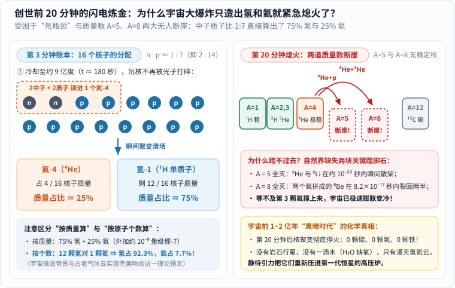
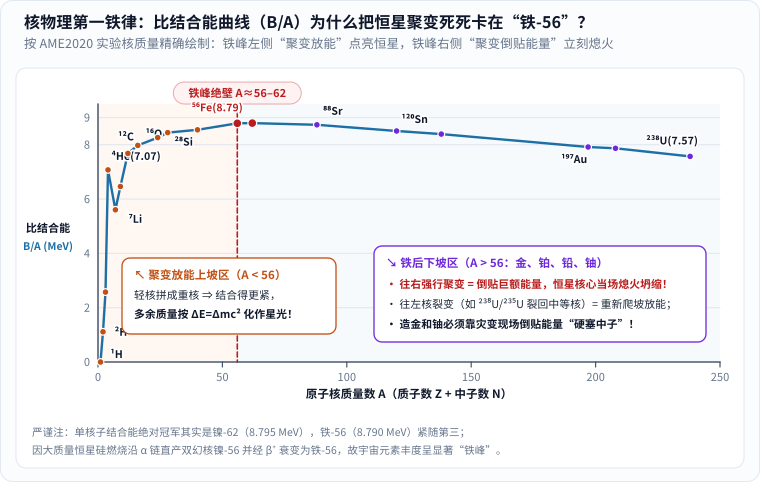
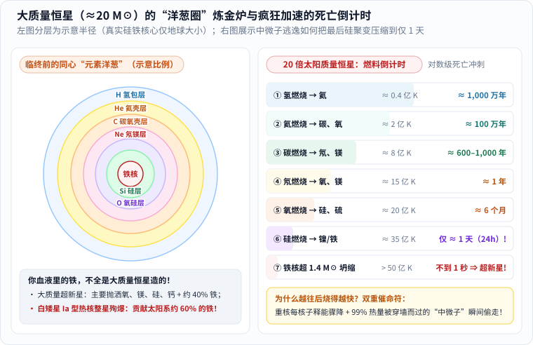
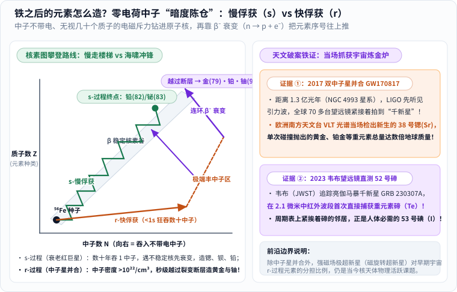
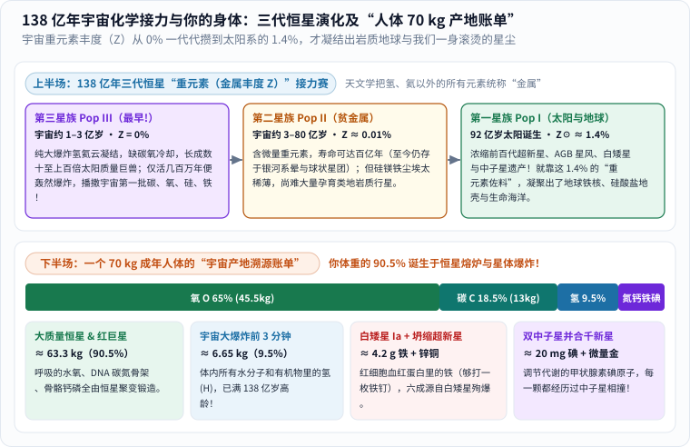

不妨先低头看一眼自己的手背，再看看桌上的半杯水：

- 杯子里的水（$$\text{H}_2\text{O}$$），每两颗**氢原子（$$\text{H}$$）**配着一颗**氧原子（$$\text{O}$$）**；
- 皮肤底下奔流的鲜红血液，靠红细胞血红蛋白正中央的**铁原子（$$\text{Fe}$$）**抓住氧气；
- 脖子前方的甲状腺，正用微量的**碘原子（$$\text{I}$$）**维持着你的心跳与体温；
- 如果你无名指上恰好戴着一枚**黄金戒指（$$\text{Au}$$）**，那更是人类追逐了几千年的贵金属。

但你有没有想过一个极其硬核的问题：**地球自己连一颗新的碳原子、铁原子或金原子都造不出来！**

即便钻进地球最深处的地核，那里的温度也只有约 $$5{,}000\text{–}6{,}000\text{ K}$$——这点热度顶多剥掉原子外围的几颗电子（我们在[《元素周期表为什么有长有短？》]()里聊过，日常化学反应只是外层电子换座位），离撬动原子核动辄**上千万到几十亿摄氏度**的门槛差了整整一百万倍！换句话说，地球上现存的九十多种天然元素（关于同一元素下不同中子数的家族成员，详见[《双胞胎原子为什么能给万物测年龄？从同位素“神探家族”讲到碳十四》]()），**全都是地球诞生之前，从宇宙各处的极端核熔炉里“进口”来的二手遗产。**

更神奇的是，这一百多种元素根本不是在同一口锅里炖出来的——你水杯里的氢比太阳还要老 **92 亿岁**，骨骼里的钙来自大质量恒星的临终爆炸，血液里过半的铁源自白矮星粉身碎骨的热核殉爆，而甲状腺里的碘和手上的黄金，则诞生于两颗中子星迎头相撞的宇宙级车祸现场 [[4]](#ref-4)[[8]](#ref-8)。

今天，我们就顺着宇宙 **138 亿年**的时间轴，把这场惊心动魄的“宇宙炼金接力赛”从第一分钟拆解到你自己的身体。

---

## 一、创世前 20 分钟的闪电炼金：为什么宇宙大爆炸只造出氢和氦就紧急熄火了？

很多朋友第一次听说“宇宙大爆炸（Big Bang）”时，都会产生一个非常合情合理的直觉疑问：

> **“既然大爆炸刚开始的时候温度高达几百亿、上万亿度，比任何恒星核心都要热得多，为什么宇宙没趁着头几分钟一口气把碳、氧、铁、黄金全给烧出来？”**

答案听起来像个黑色幽默：**刚开始太烫，造出来的核一秒被打碎；等好不容易凉到能攒原子核了，前面又横着两道“没有踏脚石的断崖”，外加宇宙膨胀降温太快，短短 20 分钟炉子就被迫拉闸熄火了！** 这段物理过程被称为**大爆炸原初核合成（Big Bang Nucleosynthesis，简称 BBN）**，由伽莫夫团队在 1948 年提出雏形、詹姆斯·皮布尔斯（James Peebles，2019 年诺贝尔物理学奖得主 [[1]](#ref-1)）等人在 1960 年代精确奠基。

### 1. “氘瓶颈”与 1 : 7 的中子质子比：两行算术算出宇宙为什么是 75% 氢 + 25% 氦

让我们把时钟拨回宇宙诞生后的**第 1 秒钟**（$$t \approx 1\text{ s}$$）：

此时夸克-胶子汤刚刚凝结成独立的**质子（$$p$$，即氢原子核 $$^1\text{H}$$）**和**中子（$$n$$）** [[4]](#ref-4)。在高于 $$10^{10}\text{ K}$$（约 $$1\text{ MeV}$$）的热浴中，质子和中子通过弱相互作用（$$n + \nu_e \leftrightarrow p + e^-$$）频繁互变。因为中子比质子稍微重一点点——质量差乘以光速平方为 $$(m_n - m_p)c^2 = 1.293\text{ MeV}$$——按热力学玻尔兹曼分布，当宇宙在 $$t \approx 1\text{ s}$$（温度约 $$0.8\text{ MeV}$$）弱相互作用“冻结”时，中子比质子少一截，比例定格在约：

$$\frac{n}{p} \approx \frac{1}{6}$$

按理说，接下来只要一颗质子和一颗中子抱在一起，就能拼成搭建一切重元素的“第一块积木”——**氘核（$$^2\text{H}$$，重氢）**。

可偏偏氘核是个出了名的“脆皮”！它的核结合能只有区区 **$$2.225\text{ MeV}$$**。而在早期宇宙里，高能光子（伽马射线）的数量是核子数量的**十亿倍以上**——每当一对质子和中子刚牵上手，旁边呼啸而过的高能光子立刻一棍子把它们敲散（$$\gamma + {}^2\text{H} \to p + n$$）。这就是著名的**“氘瓶颈（Deuterium Bottleneck）”**。

所有中子只能干等着宇宙继续膨胀变凉。而在等待的这几分钟里，**自由中子是不稳定的**（半衰期约 $$10.2\text{ 分钟}$$），它们正一秒接一秒地衰变成质子（$$n \to p + e^- + \bar{\nu}_e$$）！一直熬到宇宙诞生约**第 3 分钟（$$t \approx 180\text{ s}$$）**，温度降到约 **$$9 \times 10^8\text{ K}$$（9 亿开尔文）**，光子终于打不动氘核了——此时中子与质子的比例，已经从 $$1:6$$ 跌到了黄金数字：

$$\frac{n}{p} \approx \frac{1}{7}$$

见证奇迹的时刻到了！你根本不需要解任何微分方程，只要掰着手指做一道小学算术，就能直接算出整个原初宇宙的化学配方：

1. 按 $$n : p = 1 : 7$$，我们随便抓一把牌：**$$2$$ 颗中子 + $$14$$ 颗质子**，总共 **$$16$$ 个核子**；
2. 氘瓶颈一旦放行，几乎所有幸存的中子都会顺着一连串极快的核反应，被锁进结构极其紧密的**氦-4 原子核（$$^4\text{He}$$，由 $$2$$ 质子 + $$2$$ 中子组成，质量数为 $$4$$）**；
3. $$2$$ 颗中子拉走了 $$2$$ 颗质子，拼成 **$$1$$ 颗氦-4 核（占 $$4$$ 份质量）**，原地还剩下 **$$12$$ 颗孤零零的质子——也就是 $$12$$ 颗氢-1 核（占 $$12$$ 份质量）**！

因此，大爆炸结束后，全宇宙普通物质（重子物质）的**质量占比**直接被锁死在：

$$\begin{aligned}
Y_p(\text{氦-4 质量比}) &= \frac{4}{16} = 25\% \\
X_p(\text{氢-1 质量比}) &= \frac{12}{16} = 75\%
\end{aligned}$$

（如果按**原子个数**来数，$$12$$ 颗氢配 $$1$$ 颗氦，则是 **92.3% 的氢原子 + 7.7% 的氦原子**，外加约十万分之二的氘、十万分之一的氦-3，以及约十亿分之几的微量锂-7 [[1]](#ref-1)[[4]](#ref-4)。）几十年后，天文学家用普朗克卫星和大型望远镜去测最古老的星际气体云，实测氦质量比约为 **$$24.7\%$$**——和我们这几行指头算出来的结果严丝合缝！

_图 1：怎么看这张图——左边按 $$n:p = 1:7$$ 摆出 $$2$$ 颗深灰中子与 $$14$$ 颗蓝色质子：$$2n+2p$$ 聚成 $$1$$ 个氦-4（占质量 $$4/16=25\%$$），余下 $$12$$ 个单质子就是氢-1（占质量 $$12/16=75\%$$）；右边展示氦-4 想继续往上拼重核时，迎面撞上了质量数 $$A=5$$ 与 $$A=8$$ 两处完全没有稳定原子核的断崖。_

### 2. 挡住重元素的两座无人深渊：质量数 $$A = 5$$ 与 $$A = 8$$ 断崖

有了满宇宙的氢（$$A=1$$）和氦-4（$$A=4$$），为什么不顺手来个 $$1 + 4 = 5$$，或者 $$4 + 4 = 8$$，一路往上搭积木呢？

请看图 1 右半边的红色虚线框——这是核物理给宇宙设下的第一道天险：**在自然界中，质量数 $$A = 5$$ 和 $$A = 8$$ 的稳定原子核一个都不存在！**

- 如果拿 $$1$$ 颗质子或中子去撞氦-4，拼出来的氦-5（$$^5\text{He}$$）或锂-5（$$^5\text{Li}$$）在约 **$$10^{-22}\text{ 秒}$$**内就会当场散架；
- 如果拿 $$2$$ 颗氦-4 硬撞在一起，拼出来的铍-8（$$^8\text{Be}$$）寿命也只有可怜的 **$$8.2 \times 10^{-17}\text{ 秒}$$**（不到十亿亿分之一秒），转眼又裂回两颗氦-4！

想要跨过这道坎，唯一的办法是在铍-8 还没来得及散架的那 $$10^{-16}\text{ 秒}$$ 里，恰好有**第 3 颗氦-4** 一头撞上来（三体碰撞）。可大爆炸时期的宇宙正在以惊人的速度膨胀：到了**第 20 分钟**，宇宙温度跌破 $$3 \times 10^8\text{ K}$$，物质密度更是稀释得一塌糊涂，三颗氦核同时撞车的概率直接归零 [[4]](#ref-4)。

于是，创世第 20 分钟，宇宙第一座核熔炉彻底拉闸停火。在此后长达 **1 亿到 2 亿年**的“宇宙黑暗时代”里，浩瀚星空中连一颗碳原子、一颗氧原子、一粒沙子、一滴水都没有——只有无边无际的氢氦迷雾，在暗物质引力的拉扯下静静坍缩，等待下一代炼金炉点火。

---

## 二、跨越断崖的奇迹：第一批恒星如何造出碳和氧？被跳过的锂、铍、硼又从哪来？

大爆炸做不到的事，为什么**恒星**能做到？

核心秘诀只有四个字：**引力囚禁**。大爆炸的火球一边烧一边往四面八方散伙，只坚持了十几分钟；而当一团巨大的氢氦气体云在自身引力下坍缩成恒星（关于高温电离态气体，详见[《等离子体到底是什么？》]()），庞大的外层重量像一只无形的万吨水压机，把恒星核心死死按在高温高压状态长达**数百万年乃至上百亿年**！

### 1. 从汉斯·贝特的氢聚变，到霍伊尔用“人类存在”倒推出的 $$7.654\text{ MeV}$$ 共振奇迹

1938 年，物理学家汉斯·贝特（Hans Bethe，因此荣获 1967 年诺贝尔物理学奖 [[2]](#ref-2)）率先算清了主序星发光发热的两套看家本领——像太阳这样的中小恒星主要靠**质子-质子链（pp 链）**，更大质量的恒星则借碳氮氧当催化剂跑**碳氮氧循环（CNO 循环）**，殊途同归地把 $$4$$ 颗氢核聚变成 $$1$$ 颗氦-4，每合成一颗氦核释放 $$26.73\text{ MeV}$$ 能量。

但当恒星核心的氢烧光后，真正的生死考验来了：核心在引力下继续收缩升温到 **$$1\text{ 亿开尔文}$$（$$10^8\text{ K}$$，密度高达约 $$10^5\text{ g/cm}^3$$）**，膨胀成一颗**红巨星**。此时满肚子都是氦-4，它又一次站到了大爆炸当年折戟沉沙的 **$$A = 8$$ 断崖**面前！

在 $$1\text{ 亿度}$$的高密氦核里，虽然两颗氦-4 撞出的铍-8（$$^8\text{Be}$$）依然只活 $$8.2 \times 10^{-17}\text{ 秒}$$，但架不住碰撞极其密集，炉膛里每时每刻都能维持大约**十亿分之一**浓度的瞬态 $$^8\text{Be}$$。即便如此，物理学家在 1950 年代初一算账还是傻眼了：拿第 3 颗氦-4 去撞这十亿分之一的 $$^8\text{Be}$$ 变成碳-12（$$^{12}\text{C}$$，即**“$$3\alpha$$ 过程”**），常规核反应截面实在太小，算出来的造碳速度比实际宇宙少了**上千万倍**！

1953 年，英国天体物理学家弗雷德·霍伊尔（Fred Hoyle）干了一件载入物理学史册的“逆向破案”：

1. 他算了一下能量账：瞬态 $$^8\text{Be}$$ 加上第 3 颗 $$^4\text{He}$$ 的静止质量总和，本身就比基态碳-12 高出 **$$7.367\text{ MeV}$$**；再加上 $$1\text{ 亿度}$$核心里核子的热运动动能（伽莫夫窗口约 **$$0.29\text{ MeV}$$**），碰撞体系的总能量刚好落在碳-12 基态上方约 **$$7.65\text{ MeV}$$** 处；
2. 霍伊尔指着自己由碳元素构成的身体断定：**既然宇宙里到处都是碳，我们碳基人类就活生生站在这儿，那么碳-12 原子核在 $$7.65\text{ MeV}$$ 附近就一定藏着一个此前从未被发现的自旋宇称为 $$0^+$$ 的激发共振态！**（就像推秋千踩准了固有频率，核反应概率会暴增上千万倍！）
3. 霍伊尔直接闯进加州理工学院威廉·福勒（William A. Fowler，1983 年诺贝尔物理学奖得主 [[3]](#ref-3)）的核物理实验室，软磨硬泡请他们开机验证。短短几天后，实验团队真的在 **$$7.654\text{ MeV}$$** 处抓到了这个救命能级——分毫不差！这就是大名鼎鼎的**“霍伊尔态（Hoyle State）”**。

_图 2：怎么看这张图——左面板演示红巨星核心的“$$3\alpha$$ 过程”（含单次播放并定格的短动画，可[单独打开图片](/assets/images/cosmic-elements/triple-alpha-and-spallation.svg)刷新重播）：① 两颗 $$^4\text{He}$$ 先撞成寿命仅 $$8.2\times 10^{-17}\text{ s}$$ 的 $$^8\text{Be}$$；② 第 3 颗 $$^4\text{He}$$ 趁其未散架踩准 $$7.654\text{ MeV}$$ 霍伊尔共振态；③ 放出光子或正负电子对退激为稳定的碳-12（$$^{12}\text{C}$$）。右面板解释被恒星跳过的 3 号锂、4 号铍、5 号硼为何主要靠星际宇宙射线“反向敲碎”碳氮氧重核产生。_

更妙的是，碳-12 一旦诞生，顺手再吞下第 4 颗氦-4（$$^{12}\text{C} + {}^4\text{He} \to {}^{16}\text{O} + \gamma$$），**8 号元素氧（$$\text{O}$$）**也源源不断地出炉了！为什么自然界偏偏没有给氧-16 在对应门槛处安排一个同样强的共振态？如果那里也有共振，所有刚造出来的碳瞬间就会被全部烧成氧——正是“碳有共振、氧无门槛共振”这组绝妙搭配，才让宇宙同时攒下了丰沛的**碳**（生命骨架）与**氧**（生命之水）！

### 2. 顺手破一桩悬案：为什么 3 号锂、4 号铍、5 号硼反而是星际空间的“车祸碎片”？

讲到这儿，细心的读者马上会发现元素周期表上少了一截：

> **大爆炸造了 1 号氢、2 号氦（和极微量锂），红巨星直接用 3 颗氦跳到了 6 号碳和 8 号氧——那夹在中间的 3 号锂（$$\text{Li}$$）、4 号铍（$$\text{Be}$$）、5 号硼（$$\text{B}$$）去哪儿了？！**

如果你去查太阳系的元素丰度表，会看到一个深不见底的“大峡谷”：锂、铍、硼的含量，竟然比排在它们后面的碳、氮、氧稀少了**几十万到上百万倍**！

原因就藏在图 2 右半边：
- 在恒星肚子里，锂、铍、硼不但很难生成，而且极不耐热——只要温度刚过几百万度（远低于氦聚变的 1 亿度），它们就会被周围乱窜的质子迅速撞碎吃掉。**对锂、铍、硼来说，恒星不是产房，而是火葬场！**
- 那你手机锂电池里的一部分锂、祖母绿宝石里的铍，还有厨房耐热高硼硅玻璃烤盘里的硼是从哪来的？1970 年代天体物理学家终于破案：在冰冷稀薄的星际空间里，超新星冲击波加速出的**高能宇宙射线（主要是接近光速的质子与 $$\alpha$$ 粒子）**，迎头撞上漂浮在星际云里的碳、氮、氧原子核，把大核硬生生**“敲碎剥落”成 3、4、5 号碎片** [[8]](#ref-8)！这个逆向做减法的过程叫做**宇宙射线散裂（Cosmic-Ray Spallation）**。（注：宇宙中的锂有约三成来自大爆炸遗留及新星/红巨星特殊通道，而天然的**铍**和全部**硼-10/硼-11** 几乎 100% 都是星际宇宙射线撞出来的碎渣！）

---

## 三、撞上“铁峰绝壁”：为什么再巨大的恒星，烧到 26 号铁也会在一天之内暴毙？

既然恒星能在上亿度高温下把氦拼成碳和氧，那像猎户座参宿四那样 **15 到 25 倍太阳质量**的超级巨星，能不能一鼓作气，把元素一路聚变到 79 号黄金、82 号铅、92 号铀呢？

**绝对不行。哪怕恒星质量再大十倍，核聚变的放能生产线走到 26 号铁（与 28 号镍）这一站，也会撞上一堵不可逾越的物理死墙。**

### 1. 核物理第一铁律：比结合能曲线（$$B/A$$）为什么在铁附近翻脸？

为什么聚变能发光发热？靠的是爱因斯坦质能方程 $$\Delta E = \Delta m c^2$$：当几个松散的轻原子核抱成一团更紧凑的原子核时，平均每个核子（质子或中子）被强核力捆得更死，亏损掉的那一小撮质量就化作澎湃的能量释放出来。衡量“平均每个核子被捆得有多紧”的标尺，叫做**平均核子结合能（比结合能，$$B/A$$，单位 $$\text{MeV}$$）**——数值越高，说明原子核越稳定、“能量坑”挖得越深。

让我们把核物理实验测得的真实 $$B/A$$ 数据点画成图 3：

_图 3：怎么看这张图——横轴是原子核质量数 $$A$$，纵轴是按 AME2020 实验核质量精确计算的比结合能 $$B/A$$。红色虚线左侧（橙色区，$$A < 56$$）曲线一路向上爬坡，轻核聚变成重核会释放能量；红色虚线右侧（蓝色区，$$A > 56$$）由于几十个质子间的长程静电排斥力反超短程强核力，曲线掉头下坡——往右强行聚变不但不放热，反而要倒贴巨额能量！_

顺着图 3 的曲线从左往右看，整座宇宙能量大厦的逻辑一目了然：

1. **左边陡峭上坡（$$A = 1 \to 56$$，聚变赚钱区）**：单质子 $$^1\text{H}$$ 为 $$0\text{ MeV}$$，氘 $$^2\text{H}$$ 升到 $$1.11\text{ MeV}$$，氦-4（$$^4\text{He}$$）猛蹿出一个高达 **$$7.07\text{ MeV}$$** 的尖峰（这就是为什么氦-4 如此结实），接着经碳-12（$$7.68\text{ MeV}$$）、氧-16（$$7.98\text{ MeV}$$）、硅-28（$$8.45\text{ MeV}$$），一路爬到 **$$A = 56 \text{–} 62$$ 的最高山巅（约 $$8.79\text{ MeV}$$）**。在这段上坡路上，每往右聚变一步都在往外吐能量，支撑着恒星抵抗自身万有引力。
2. **山顶严谨辨析（铁-56 vs 镍-62）**：很多科普书直接写“铁-56 是比结合能最高的元素”，如果抠核物理实验表，真正排第一的其实是**镍-62（$$^{62}\text{Ni}$$，$$8.7945\text{ MeV}$$）**，铁-58 排第二，**铁-56（$$^{56}\text{Fe}$$，$$8.7903\text{ MeV}$$）**屈居第三！那为什么天文学家总提“铁峰”？有两个硬核原因：第一，铁-56 的质子比例比镍-62 略高（质子比中子轻），所以按**平均单个核子的总静止质量**算，铁-56 确实是全周期表“最轻、最划算”的谷底；第二，大质量恒星最后一步硅燃烧是顺着每次加一颗 $$^4\text{He}$$（$$2p+2n$$）的 $$\alpha$$ 阶梯往上走的，从硅-28 连加 $$7$$ 颗氦-4，正好停在质子数与中子数同为 $$28$$ 的双幻数核**镍-56（$$^{56}\text{Ni}$$）**，随后镍-56 通过两次 $$\beta^+$$ 衰变（半衰期分别为 $$6.1\text{ 天}$$ 和 $$77.2\text{ 天}$$：$$^{56}\text{Ni} \to {}^{56}\text{Co} \to {}^{56}\text{Fe}$$），全部变成了稳定的**铁-56**！
3. **右边一路下坡（$$A > 62$$，聚变赔本区）**：当原子核里的质子塞到三四十个以上时，强核力手太短（只够得着紧挨着的邻居），而所有带正电的质子却在隔空互相排斥！于是曲线从 $$8.79\text{ MeV}$$ 一路滑落到金-197（$$7.92\text{ MeV}$$）和铀-238（$$7.57\text{ MeV}$$）。在铁峰右边，想把重核硬捏成更重的核属于**吸能反应**；反过来把铀-235 劈成两半退回中间（核裂变），才是顺着坡往上爬的放能方向！

### 2. 从一千万年到二十四小时：大质量恒星的“洋葱圈”与中微子催命符

像太阳这样只有 $$1\,M_\odot$$（一倍太阳质量）的恒星，核心烧到碳和氧就再也压不动了，晚年会温和地吹散外层化作行星状星云，留下一颗地球大小的碳氧**白矮星**。

但对于一颗 **$$20\,M_\odot$$（20 倍太阳质量）**的大质量恒星来说，恐怖的引力会逼着它一路点火闯关，把肚子里一层套一层地烧成图 4 左边那颗经典的**“同心元素洋葱”**——最外层是没烧完的氢，往里依次是氦、碳、氖、氧、硅，最核心攒出一颗超高密度的**铁镍核** [[4]](#ref-4)：

_图 4：怎么看这张图——左图展示大质量恒星临终前的七层同心“元素洋葱”（注：为看清各层采用了非等比例示意半径，真实的硅层与铁核挤在恒星最中心仅地球般大小的体积内）；右图列出每一轮核燃料耗尽的真实时间尺度，从氢聚变的 1,000 万年一路雪崩式加速到硅聚变的仅仅 1 天！_

看着图 4 右边的寿命表，几乎所有读者第一次读到都会倒吸一口凉气：
- **烧氢**能稳稳当当烧 **1,000 万年**；
- **烧氦**缩短到 **100 万年**；
- **烧碳**只够撑 **600–1,000 年**；
- **烧氖**只剩 **1 年**，**烧氧**只剩 **半年**；
- 等到 $$35\text{ 亿开尔文}$$的**硅燃烧（把硅-28 烧成镍-56/铁）**点火时，整颗恒星只剩下最后 **24 小时（约 1 天）**的阳寿！

**为什么越往后死得越快？** 除了图 3 里越靠近铁峰“每公斤燃料榨出的能量越少”之外，更致命的凶手叫**热中微子逃逸**！在普通阶段，核心产生的光子要在致密的恒星肚子里跌跌撞撞几万年才能漏到表面，热量捂得很严实；可一旦核心温度突破 $$5\text{ 亿度}$$，高能正负电子对湮灭会产生海量不跟物质打招呼的**中微子（$$\nu$$）**——它们以接近光速直接穿透整颗恒星扬长而去，偷走了核心 **$$99\%$$ 以上的能量**！为了填补这个疯狂漏气的无底洞，恒星只能把油门踩进油箱里，一天之内就把整锅硅烧成铁灰。

当中心那颗不再放热的惰性铁核质量跨过约 **$$1.4\,M_\odot$$（钱德拉塞卡极限）**的那一瞬间，电子简并压轰然崩塌！地球大小的铁核在**不到 $$1\text{ 秒钟}$$**内以四分之一光速向内自由落体，砸成一颗直径仅约 $$20\text{ 公里}$$的**中子星**（或黑洞）；反弹激波携带着中微子洪流把外围积攒了上千万年的**氧、氖、镁、硅、硫、钙（你骨头和牙齿里的钙！）**连同新烧出的铁一起炸向太空——这就是照亮整个星系的**核心坍缩超新星（Core-Collapse Supernova）** [[4]](#ref-4)！

> **一个颠覆直觉的冷知识：你血液里的铁，多半不是大质量恒星给的！**
> 大质量恒星核心的铁核大部分自己坍缩成了中子星，没能全吐出来。现代巡天光谱测量表明（如 SDSS 斯隆数字巡天 [[8]](#ref-8)），太阳系和你红细胞里**约 $$55\% \text{–} 60\%$$ 的铁元素**，其实来自另一种连渣都不剩的爆炸——**Ia 型超新星（白矮星热核爆炸）**！当双星系统里的一颗碳氧白矮星吸积伴星物质（或两颗白矮星合并）逼近 $$1.4\,M_\odot$$ 时，整颗星球会在几秒钟内发生失控碳氧热核聚变，一次性炸出约 **$$0.6\text{ 倍太阳质量}$$**的纯镍-56（衰变成铁-56），把自己炸得尸骨无存，成了宇宙头号“炼铁高炉”！

---

## 四、铁之后的黄金、碘和铀怎么造？不带电中子的“慢走楼梯”与“千新星海啸”

现在，元素周期表前 26 号（从氢到铁）的来历全齐了。可周期表后面还排着六十多位重量级嘉宾：铜（29）、锶（38）、碘（53）、钡（56）、铂（78）、金（79）、铅（82）、铀（92）……

既然铁往右聚变既要**倒贴巨额能量**，又要面对几十个质子拼死抵抗的**库仑静电斥力高墙**，宇宙到底耍了什么花招，才造出了黄金和铀？

### 1. 绕开几十个质子的电磁铁壁：B²FH 论文揭秘的慢中子俘获（s-过程）与快中子俘获（r-过程）

1957 年，玛格丽特·伯比奇（Margaret Burbidge）、杰弗里·伯比奇（Geoffrey Burbidge）、威廉·福勒与弗雷德·霍伊尔四位学者在《现代物理评论》发表了一篇长达 108 页的传世巨著《恒星中的元素合成》（学界尊称为 **B²FH 论文** [[3]](#ref-3)），一举揭开了铁后元素的通关密码——**派“不带电的中子”去暗度陈仓！**

你想啊，质子带正电，还没靠近铅核就被 $$82$$ 个正电荷弹飞了；可**中子（$$n$$）电荷严格等于 $$0$$**！它对几十个质子的静电斥力墙完全视若无睹，哪怕动能不高，也能大摇大摆晃进铁原子核里被强核力吸住，让质量数加一（$$^A_Z\text{X} + n \to {}^{A+1}_Z\text{X} + \gamma$$）。

当一颗原子核吃中子吃撑了、变得不稳定时，核内的一颗中子就会发生 **$$\beta^-$$ 衰变**：

$$n \longrightarrow p + e^- + \bar{\nu}_e$$

吐出一颗电子后，**中子原地变成了一颗质子**——原子序数瞬间从 $$Z$$ 升到了 $$Z + 1$$，不费吹灰之力就在元素周期表上往后挪了一格！

根据“吃下一颗中子要等多久（$$\tau_{n,\gamma}$$）”与“不稳定核自己 $$\beta^-$$ 衰变要多久（$$\tau_\beta$$）”谁快谁慢，宇宙演化出了两条截然不同的重元素流水线（见图 5 左半边）：

_图 5：怎么看这张图——左图在（中子数 $$N$$，质子数 $$Z$$）核素图上对比两条攀登路线：绿色折线是衰老红巨星里的 **s-过程（慢中子俘获）**，每吞一颗中子都有充足时间衰变回灰色“$$\beta$$ 稳定谷”，一路稳扎稳打爬到 82 号铅与 83 号铋封顶；橙紫箭头是极端灾变中的 **r-过程（快中子俘获）**，不到 1 秒狂吞数十颗中子冲进右侧丰中子区，越过裂变断层后再集体斜向上衰变成黄金、铂金和铀！右图汇总了 2017 年与 2023 年人类亲眼抓获的两大天文实证。_

1. **慢中子俘获（s-process，“s”代表 slow，位于 $$1\text{–}8\,M_\odot$$ 衰老红巨星 / 渐近巨星支 AGB）**：
   - 在这类老年红巨星的氦壳层与氢壳层夹缝中，$$^{13}\text{C}(\alpha, n){}^{16}\text{O}$$ 等反应会慢悠悠地吐出自由中子。中子密度不算高，一颗铁种子平均要等**几十年甚至上千年**才能逮到下一颗中子（$$\tau_{n,\gamma} \gg \tau_\beta$$）。
   - 因此，只要吃出一颗有放射性的同位素（通常半衰期几分钟到几年），它绝对来得及先完成 $$\beta^-$$ 衰变爬回稳定谷，再等下一顿饭。
   - **代表产物**：宇宙里约一半的铁后重元素——包括烟花里的鲜红功臣**锶（$$\text{Sr}$$，38号）**、医院消化道造影喝的“钡餐”**钡（$$\text{Ba}$$，56号）**、人造钻饰里的**锆（$$\text{Zr}$$，40号）**，一直造到 **82 号铅（$$\text{Pb}$$）和 83 号铋（$$\text{Bi}$$）**。
   - **为什么 s-过程造不出黄金和铀？** 一是黄金（79号）的关键路径被短寿命核卡位，s-过程只贡献极少份额；更绝的是走到 83 号铋再往上（84 号钋到 89 号锕），所有核都会在极短时间内发生 $$\alpha$$ 衰变吐出氦核退回铅和铋！慢吞吞的 s-过程根本跨不过这道“钋—镭流沙河”，在 83 号铋原地打转封顶。

2. **快中子俘获（r-process，“r”代表 rapid，位于极端中子海啸现场）**：
   - 如果把中子密度猛推到恐怖的 **$$10^{22} \text{–} 10^{24}\text{ 个/cm}^3$$**，会发生什么？
   - 不稳定原子核连眨眼的工夫都没有（$$\tau_{n,\gamma} \ll \tau_\beta$$），在**不到 $$1\text{ 秒钟}$$**里像填鸭一样被硬塞进几十颗中子，一路横冲直撞推到质量数 $$A > 240$$ 的极度丰中子边缘，一脚跨过了 $$Z = 84\text{–}89$$ 的短命断层！等这 1 秒钟的中子暴风雪过去，这些胖得快爆裂的原子核再沿着斜对角线连环 $$\beta^-$$ 衰变，稳稳降落在**铕（63）、铱（77）、铂（78）、金（79），以及跨过铅铋天堑的钍（90）和铀（92，核电站的燃料本尊！）**位置上！

### 2. 人类亲眼抓获宇宙炼金现场：从 2017 引力波千新星的“锶”，到 2023 韦布望远镜的“碲”

虽然 B²FH 论文早在 1957 年就算清了 r-过程的核物理机制，但此后整整 **60 年**里，天文学家一直为一件事吵得不可开交：**宇宙里到底哪座炼金炉能喷出每立方厘米 $$10^{22}$$ 颗中子的疯子环境？** 早期教材大多猜是普通核心坍缩超新星，可超级计算机越算越发现普通超新星中子不够多、反而容易被中微子把中子变回质子！

直到 **2017 年 8 月 17 日**，多信使天文学迎来了载入史册的破案时刻：

- **第一现场（2017–2019 `GW170817`）**：当天，LIGO 与 Virgo 引力波天文台捕捉到距离地球约 **1.3 亿光年**（长蛇座 NGC 4993 星系）外两颗**中子星**螺旋相撞的引力波信号 `GW170817`；仅 $$1.7\text{ 秒}$$后费米卫星收到短伽马射线暴，随后哈勃等全球 70 多座望远镜拍到了一团比普通新星亮上千倍、由刚合成的放射性重元素衰变加热点亮的火球——**“千新星（Kilonova）”** [[5]](#ref-5)！2019 年，丹麦哥本哈根大学团队利用欧洲南方天文台甚大望远镜（VLT）的 X-shooter 光谱仪复盘这团火球光谱，在《自然》杂志宣布首次在太空中直接指认出新诞生的重元素——**38 号锶（$$\text{Sr}$$）** [[6]](#ref-6)！观测测算表明，仅这一次双中子星相撞，抛洒出的纯黄金和铂金等重元素质量就相当于**好几个地球那么重**！
- **第二现场（2023 韦布空间望远镜直测 `GRB 230307A`）**：2023 年 10 月，NASA 詹姆斯·韦布空间望远镜（JWST）对准另一场双中子星并合引发的千新星 `GRB 230307A`，在 $$2.1\,\mu\text{m}$$ 中红外波段拍到了极其清晰的发射峰——首次在星体合并余晖中直接抓到了原子量更重的 r-过程元素 **52 号碲（$$\text{Te}$$）** [[7]](#ref-7)！而在元素周期表上紧挨着 52 号碲的下一格，正是塑造陆地脊椎动物与人类新陈代谢的 **53 号碘（$$\text{I}$$）**！

*（严谨科学边界说明：双中子星并合如今已被公认为宇宙主要的 r-过程黄金工厂；不过双中子星从诞生到螺旋相撞往往需要数亿年时间，为了解释宇宙极早期古老恒星里就已经存在的少量铕和金，**极强磁场快速旋转超新星（磁旋转超新星）**或坍缩星吸积盘在早期宇宙究竟分担了多少比例的 r-过程产出，仍是今天核天体物理学界最活跃的前沿课题之一 [[6]](#ref-6)[[8]](#ref-8)。）*

---

## 五、138 亿年的星际化学接力：从纯氢氦荒漠，到你这具 70 公斤的“星尘之躯”

把上面四大篇章串起来，我们终于可以退后一步，俯瞰整部宇宙 **138 亿年**的宏大演化图景：宇宙的元素并不是一次造完的，而是一场**“恒星生 → 炼重核 → 爆炸死 → 污染星云 → 孕育下一代富重元素恒星与行星”**的循环接力赛。

### 1. 三代恒星的“重元素攒钱史”：为什么太阳只要 1.4% 的“杂质”就能造出地球？

在天文学行话里有个特别逗的习惯：天文学家把除了**氢（$$X$$）**和**氦（$$Y$$）**以外的所有元素——哪怕是碳、氧、氮这些明明是非金属的元素——统称为**“金属（Metals，质量占比记作金属丰度 $$Z$$）”**。

更让人容易晕头的是，历史上天文学家是按“在银河系里先发现谁”倒着给恒星排辈分的，所以**编号越大反而年纪越老**（见图 6 上半部分）：

1. **第三星族星（Population III，宇宙最早的第一代恒星，约大爆炸后 1–3 亿年，$$Z = 0\%$$）**：
   它们完全由大爆炸留下的纯氢氦云坍缩而成。因为没有碳、氧原子发射红外线帮气体云高效散热，气体云很难碎裂成小块，所以第一代恒星个个都是**几十倍乃至上百倍太阳质量的超级巨兽** [[4]](#ref-4)。它们光芒万丈却极其短命，只活了短短 **200 万–500 万年**便在一连串剧烈的超新星爆炸中粉身碎骨，把宇宙历史上**第一批碳、氧、镁、硅、铁**洒进了原本一尘不染的太空！
2. **第二星族星（Population II，贫金属古老恒星，$$Z \approx 0.001\% \text{–} 0.1\%$$）**：
   喝着第一代巨星留下的稀薄“肉汤”诞生。因为有了一点点碳氧帮忙散热，这一代终于能诞生寿命超过百亿年的小质量恒星（至今仍大量保存在银河系银晕和球状星团里）。但在它们诞生时，星云里的硅、镁、铁尘埃还是太稀薄，很难凝聚出像地球这样拥有铁核和硅酸盐地壳的岩质行星。
3. **第一星族星（Population I，富金属年轻恒星，比如 46 亿年前诞生的太阳，$$Z_\odot \approx 1.4\%$$）**：
   在宇宙演化的前 **92 亿年**里，银河系圆盘里前赴后继地炸过了上百代大质量超新星、吹过了无数代衰老红巨星的星风、殉爆了无数白矮星、碰撞了罕见的双中子星。等到 **46 亿年前**太阳星云坍缩时，云团的质量配方已经变成了：**约 $$73.8\%$$ 氢 + $$24.8\%$$ 氦 + $$1.4\%$$ 的“重元素精华”**！千万别小看这区区 $$1.4\%$$ 的星尘佐料——正是其中的硅、镁、氧、铁凝聚成了水星、金星、**地球**和火星；正是其中的钍-232 与铀-238 在地球深处持续核衰变放热，让地幔对流、板块漂移并维持地核液态铁发电机（保护大气层不被太阳风吹跑）；也正是其中的水、碳、氮、磷，在液态海洋里点燃了第一缕生命之火！

_图 6：怎么看这张图——上半场按宇宙时间轴展示从零金属第三星族（Pop III）、贫金属第二星族（Pop II）到富含 $$1.4\%$$ 重元素的第一星族太阳系（Pop I）的化学丰度演化；下半场把一位 $$70\text{ kg}$$ 成年人的体重按元素产地拆成四张溯源小票，直观看到你身上 $$90.5\%$$ 的质量都曾经历过恒星熔炉与星体爆炸。_

### 2. 打印一张属于你的“70 公斤人体宇宙产地小票”

最后，让我们把这张横跨 138 亿年的宇宙元素周期表，浓缩成一张每个人都随身携带的**“$$70\text{ kg}$$ 成年人体产地清单”** [[4]](#ref-4)[[8]](#ref-8)：

| 宇宙核炼金工坊 | 造出的代表元素 | 在 $$70\text{ kg}$$ 人体中的角色与重量 | 核心物理机制回顾 |
| :--- | :--- | :--- | :--- |
| **① 宇宙大爆炸前 20 分钟** | **氢（H）**、氦（He）、微量锂 | **约 $$6.65\text{ kg}$$（占体重 $$9.5\%$$）**，存在于全身每一滴水与有机分子中 | $$t \approx 3\text{ 分钟}$$突破氘瓶颈，$$n:p=1:7$$ 锁死 75% 氢与 25% 氦 |
| **② 宇宙射线星际散裂** | **锂（Li）、铍（Be）、硼（B）** | 微量（毫克级硼参与骨骼代谢） | 高能宇宙射线质子在冷星际空间撞碎碳氮氧重核 |
| **③ 中小质量红巨星（AGB）** | **碳（C）、氮（N）**，及半数 **锶、钡、铅** | 贡献体内大部**氮（约 $$2.2\text{ kg}$$）**、约半数**碳**与微量重元素 | $$3\alpha$$ 霍伊尔共振、CNO 循环，及几十年一拍的 **s-慢中子俘获** |
| **④ 大质量恒星与坍缩超新星** | **氧（O）、镁、硅、磷（P）、硫、钙（Ca）**及约 40% 铁 | **氧 $$45.5\text{ kg}$$（$$65\%$$）**、半数碳、骨骼牙齿**钙 $$1.05\text{ kg}$$**、DNA **磷 $$0.7\text{ kg}$$** | 洋葱壳层阶梯聚变，铁核超 $$1.4\,M_\odot$$ 在 $$<1\text{ s}$$ 坍缩反弹抛射 |
| **⑤ 白矮星 Ia 型热核爆炸** | **铁（Fe，占约 60%）**、铬、锰、镍 | 血液血红蛋白里**约 $$4.2\text{ g}$$ 铁**（刚好够打一枚小铁钉）的主力来源 | 碳氧白矮星逼近 $$1.4\,M_\odot$$ 失控热核殉爆，生成 $$^{56}\text{Ni}\to{}^{56}\text{Fe}$$ |
| **⑥ 双中子星并合（千新星）** | **碘（I）、碲、铂、金（Au）、钍、铀** | 甲状腺激素必需的**约 $$15\text{–}20\text{ mg}$$ 碘**，以及首饰里的黄金 | 秒级狂吞数十颗中子的 **r-快中子俘获**（GW170817 与韦布望远镜证实） |

合上这张账单，再看一眼桌上的那杯水吧：

你左手原子的碳，可能来自银河系某颗红巨星温柔吹散的晚年星风；你右手原子的铁，或许来自另一端某颗白矮星粉身碎骨的烈焰；而连接它们的每一颗氢原子，都亲眼见过 138 亿年前宇宙创世第 3 分钟的第一缕光芒。

天文学家卡尔·萨根那句名言“我们皆由星尘所铸（We are made of starstuff）”，从来不是一句浪漫的文学比喻——**它是核物理学一个小数点都不差的自然定律。**

---

## 参考资料与延伸阅读

1. **NobelPrize.org — James Peebles (Nobel Prize in Physics 2019)**: [James Peebles – Facts](https://www.nobelprize.org/prizes/physics/2019/peebles/facts/)（支持大爆炸原初核合成 BBN 理论框架、宇宙微波背景印记及普通重子物质占比等物理宇宙学基础）。
2. **NobelPrize.org — Hans A. Bethe (Nobel Prize in Physics 1967)**: [Hans Bethe – Facts](https://www.nobelprize.org/prizes/physics/1967/bethe/facts/)（支持 1938 年恒星内部氢聚变为氦的质子-质子链与碳氮氧循环能量产生机制）。
3. **NobelPrize.org — William A. Fowler (Nobel Prize in Physics 1983)**: [William A. Fowler – Facts](https://www.nobelprize.org/prizes/physics/1983/fowler/facts/)（支持恒星核合成实验测量、霍伊尔碳-12 的 $$7.65\text{ MeV}$$ 共振态验证，以及 1957 年 Burbidge, Burbidge, Fowler & Hoyle 经典 B²FH 论文提出的慢/快中子俘获理论）。
4. **U.S. Department of Energy (DOE Office of Science)**: [DOE Explains... Nucleosynthesis](https://www.energy.gov/science/doe-explainsnucleosynthesis)（支持从夸克-胶子等离子体、氘核合成氢氦锂，到第一代大质量恒星、核心坍缩超新星、白矮星合并与双中子星并合的元素起源全流程说明）。
5. **NASA Science — Hubble & Multi-Messenger Astronomy (2017)**: [NASA Missions Catch First Light from a Gravitational-Wave Event (GW170817)](https://science.nasa.gov/missions/hubble/nasa-missions-catch-first-light-from-a-gravitational-wave-event/)（支持 2017 年 8 月 17 日 NGC 4993 星系双中子星并合引力波、短伽马暴及千新星多波段余晖观测）。
6. **European Southern Observatory (ESO Press Release eso1917, 2019)**: [First Identification of a Heavy Element Born from Neutron Star Collision](https://www.eso.org/public/news/eso1917/)（支持哥本哈根大学 Darach Watson 等人利用甚大望远镜 VLT/X-shooter 光谱在 GW170817 千新星中首次直接指认新生重元素 38 号锶 `Sr` 的《自然》论文成果）。
7. **NASA James Webb Space Telescope (JWST, 2023)**: [NASA's Webb Makes First Detection of Heavy Element from Star Merger (GRB 230307A)](https://science.nasa.gov/missions/webb/nasas-webb-makes-first-detection-of-heavy-element-from-star-merger/)（支持 Andrew Levan 团队利用韦布望远镜在千新星中红外光谱首次直接测得重 r-过程元素 52 号碲 `Te` 及其邻近生命元素碘 `I` 的天体起源）。
8. **NASA Science / Jennifer A. Johnson (Ohio State University & SDSS)**: [Where Your Elements Came From](https://science.nasa.gov/image-article/apod-2023-january-8-where-your-elements-came-from/)（支持宇宙元素起源彩色周期表分类、宇宙射线散裂生成锂铍硼、白矮星与超新星铁分担比例，以及人体各元素宇宙溯源；该官方页面需联网浏览高清大图，本文核心结论与分步图解均已独立完整呈现）。
