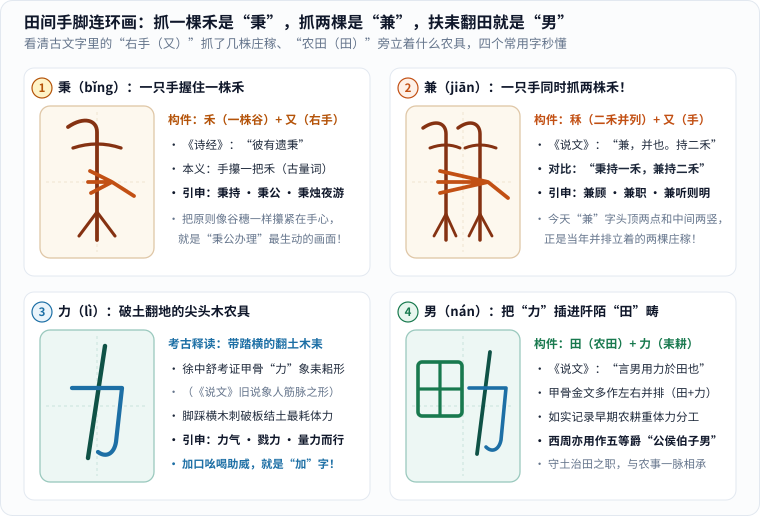
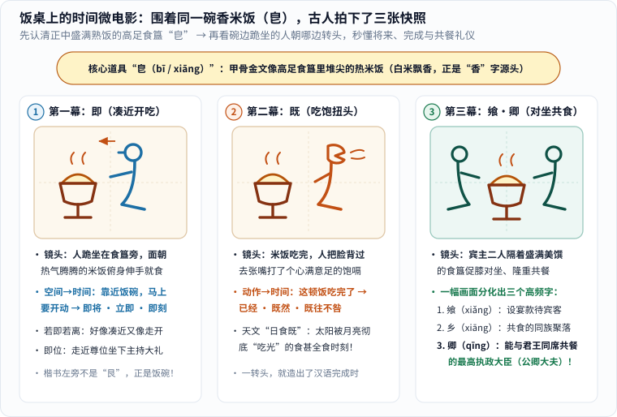
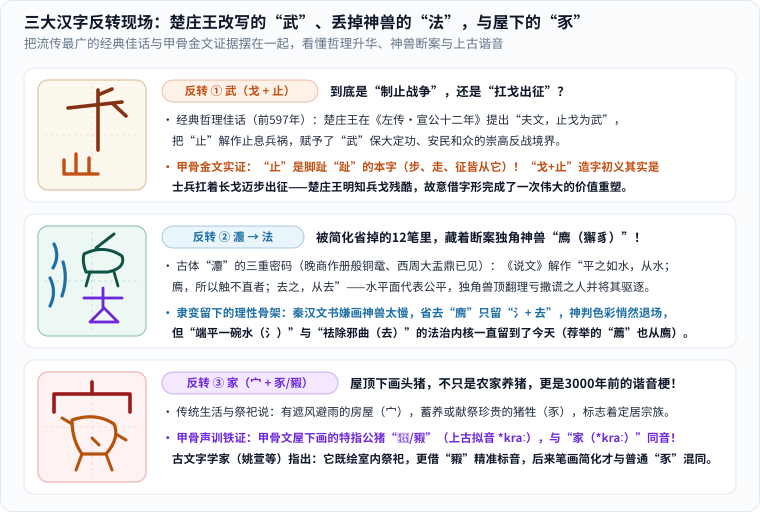

如果家里有正在认字的小朋友，某天指着课本问你这样一个问题，你多半会愣上三秒钟：

**“爸爸，‘大公无私’里的‘公’和‘私’，意思明明是死对头，为什么它们俩身上却长着一模一样的同一个零件——那个像小三角一样的‘厶’？”**

别小看这个问题。两千两百多年前，战国末期的法家集大成者**韩非子**，也盯着这两个字看出了神。他在传世名篇《韩非子·五蠹》里写下了一段震古烁今的拆字解说 [1]：

> **“古者苍颉之作书也，自环者谓之私，背私谓之公。公私之相背也，乃苍颉固以知之矣。”**

翻译过来简直妙绝：上古造字的时候，画一个圈把自己围起来，就叫**“私（厶）”**；在“厶”头顶加个向两边背道而驰的“八”，意思就是**“背弃自私，才叫作公”**！三百多年后，东汉经学家许慎编撰中国第一部字典《说文解字》，也郑重其事地把韩非子这段话收进了词条里：**“公，平分也。从八从厶。八犹背也。韩非曰：背厶为公。”** [2]

这个解释流传了两千多年，既深刻又好记，几乎成了中国人解释“公私之辨”的标准答案。

直到 1899 年河南安阳殷墟的商代**甲骨文**重见天日，再加上大批商周**青铜器金文**陆续出土，古文字学家拿着放大镜一比对，才惊讶地发现了一桩跨越三千年的大反转：**在造字之初，“公”字底下画的，压根儿就不是那个自私的“厶”！**

韩非子和许慎之所以那样拆字，是因为他们看到的战国竹简与秦代小篆，已经经历了一场阴差阳错的“笔画撞脸”。更奇妙的是，顺着“公”与“私”摸进商周古文字的百宝箱，你会发现古人根本不是坐在书房里凭空捏造抽象词汇——**分肉的大瓮、田里沉甸甸的小米穗、一只手攥住几棵庄稼、跪在饭碗前把脸朝哪边扭**，全被他们拍成了活灵活现的“微电影”。

今天我们就顺着**考古初形**与**哲理重解**这两条线索，先破译“公”和“私”的身世之谜，再一口气解锁十几个让你拍案叫绝的汉字彩蛋。

---

## 一、“公”字三千年变形记：从广场分食的圆口瓮，到韩非子的“美丽误会”

要想看清“公”字最初画的是什么，我们得先把它的上半截和下半截拆开验明正身。

### 1. 上半截的“八”，在古文字里居然不是数字？

今天我们一看到**“八”**，第一反应是“七八九”的数字 8。但在商周古文字与《说文解字》里，“八”最核心的造字本义其实是动词——**向左右两边分开**。《说文解字·八部》开篇就写得明明白白：**“八，别也。象分别相背之形。”** [2]

你不信？只要看看“八”生出来的三个亲兄弟，一秒钟就能找到手感：

- **“分”**：上面一个“八”，下面一把“刀”——拿刀把东西一劈两半、向两侧拨开，就是“分开、分配” [2]；
- **“半”**：上面一个“八”，下面一头“牛”——《说文》说**“物中分也，从八从牛。牛为物大，可以分也”**，把一头大牛从正中劈成两扇，就是“一半” [2]；
- **“小”**：中间一竖或微尘，左右用“八”继续切分，越分越细微，就是“大小”的“小” [2]。

搞懂了“八 = 分开、均分”，现在请把目光移到下面这张三千年演变动画上，盯紧**“公”字下半截那个构件是怎么一步步变形的**：

*图 1：“公”字三千年变形记（[单独打开高清原图](/assets/images/gong-si-characters/gong-evolution-and-twist-anim.svg)，在浏览器中刷新原图可重播分步演变动画；开启系统“减少动态效果”时直接呈现完整终态）。请按①→④顺序观察：第①②步商代甲骨文与西周毛公鼎金文中，下方都是闭合的圆口或方圆器皿，直到第③步战国简帛与秦小篆中才开口盘曲成“厶”。*

### 2. 第一层真相：商周甲骨金文里的“当众平分”与“大口陶瓮”

看图 1 左起第 ①、② 张卡片：在距今三千多年的**商代甲骨文**和西周晚期的青铜重器**毛公鼎**铭文里，“公”字上面是向两侧敞开的“八”，下面却清清楚楚是一个**四面闭合的“口”（或圆腹敞口器皿形）**，连一根多余的尾巴都没有！

围绕这个闭合的“口”与上面的“八”，现代古文字学界结合出土材料提出了几种相互补充的考释（学术界对具体细节仍有讨论，但有一点毫无争议——**它绝不是战国才定型的“厶”**）[5]：

1. **“平分共有器物/场地说”（以文字学家高鸿缙《中国字例》等为代表）**：上面的“八”代表均分、分配（即“分”的初文），下面的“口”代表盛放食物的器皿、猎获的物资，或是氏族聚会的宗庙广场（古文字里“口”与表示城邑围墙的“囗”常可相通）。在氏族公社或宗族祭祀结束后，长老当着全体族人的面，把祭肉与粮食不偏不倚地一分为二、均摊给众人——**当众平分，所以叫“公平”“公共”；主持分肉与祭祀的氏族首领，就被称为“公”（后来演变为周公、诸侯公爵与长辈尊称“阿公”）** [5]。（关于商周宗庙礼器如何承载权力与秩序，也可以参看本博另一篇[《一块石头怎样历劫亿年变成传世古玉》]()。）
2. **“大口圆腹陶瓮假借说”（以古文字学家朱芳圃《殷周文字释丛》等为代表）**：认为甲骨文、金文的“公”整体是一个象形字，下面的圆圈是陶瓮鼓起的肚子，上面外撇的“八”是向外翻卷的大瓮口沿或壶盖提手——也就是说，**“公”原本是“瓮（wèng）”的初文**（古音同属东部，声母相近），后来因为大瓮常用于聚落共饮共食，才被假借用来记录“公共、王公”这个词，人们只好在“公”底下再加一个“瓦”另造出今天的“瓮”字 [5]。

不管采纳“平分器物”还是“共饮大瓮”，商周时期的“公”字都透着一股朴素热闹的烟火气：**看得见的器物，敞开来的分配，大家伙儿凑在一起共享。**

### 3. 第二层真相：一次线条偷懒，成就了两千年的哲学金句

那下面的圆口“口”，怎么会变成小三角“厶”呢？

秘密全在图 1 的**第 ③ 步（战国至秦代小篆）**。到了春秋战国，书写材料从坚硬的龟甲、青铜模范变成了竹简和缣帛。毛笔蘸墨写圆圈时，一笔转到底很难严丝合缝地封口，抄书吏手腕一顺，底下的圆圈右上角留了个缺口、尾巴往里一勾——**原本闭合的“口”，在线条快写讹变中，竟然跟另一个早已存在的古字“厶”撞了脸！**

韩非子生活在战国末年，从未见过深埋在安阳地下的商代甲骨。他案头摊开的正是这种下方已经变成“厶”的战国文字。这位目光如炬的思想家灵机一动：**既然“厶”是绕着自己画圈圈（自私），“八”是背道而驰，那“公”岂不正是老祖宗劝诫世人“背弃私心方能为公”吗？** [1]

在古文字考据学上，韩非子和许慎属于典型的**“据讹形立说”**（拿演变走样后的字形去倒推造字初义）；但在中国思想史上，这却是一场光芒万丈的**“美丽误会”**——就像宋代学者重排黑白点阵赋予《河图》《洛书》全新哲学秩序一样（详见[《从上古传说到幻方数学读懂河图洛书》]()），战国秦汉的哲人借着这次字形巧合，把“公平分配”与“克服私欲”死死焊接在了一起，让“天下为公、大公无私”成了流淌两千年的文化基因。

---

## 二、“私”字拆解：为什么画个小圈还不够，非要抱回一棵庄稼“禾”？

破了“公”字的案，我们再掉头审视它的老冤家——**“私”**。

既然韩非子说“自环者谓之私”里的本字明明就是那个两笔写成的小圈圈**“厶”（读音 sī，上古拟音 \*sil）**，《说文解字·厶部》也认证“厶”本身就表示私心与营谋（“苍颉作字，自营为厶”）[3]，为什么古人不直接用“厶”，偏偏要在它左边再栽上一棵**“禾”**呢？

而且顺便告诉你一个冷知识：**“厶”这个老祖宗今天依然活在亿万人的键盘和课本里！** 1913 年章太炎先生等人创制注音字母时，直接请出古字“厶”作为声母 **s** 的符号，写作 **“ㄙ”**，至今仍在台湾省中小学语文课本和词典里天天使用；而在唐代传入日本的汉字楷书偏旁里，“厶”更是直接化身为日语片假名里的 **“ム（mu）”** [6]！

那么，把“厶”挤下主角宝座的**“私”**，当年究竟是在什么场景下诞生的？请看图 2 的三步拆解：

*图 2：“厶 + 禾 = 私”的三步造字现场与“禾”部农耕词汇树（[单独打开高清原图](/assets/images/gong-si-characters/si-grain-and-private-field.svg)）。左栏为回环自绕的初文“厶”（另有一派学者认为其初形亦与翻土农具“耜”端头相通），中栏为垂穗粟谷象形“禾”，右栏还原《诗经》公田与私田并耕的历史语境。*

### 1. 先看中栏的“禾”：一株沉甸甸弯下腰的北方小米

很多现代城里孩子把“禾”笼统当成小草，其实甲骨文和金文里的**“禾”**画得极其精准（图 2 中栏）：

- **最底下分开的两笔**：扎进黄土里的根须；
- **中间一竖加一横**：挺立的秸秆和舒展的叶片（到这一步长得像“木”）；
- **最顶上往一侧弯折垂下来的那一撇**：这是全字的灵魂——**熟透以后沉甸甸低下头的谷穗！**

在商周时期的黄河流域，“禾”特指北方旱作农业的头号主粮——**粟（脱壳后就是金黄的小米）**（后来北方人用粟、黍、高粱蒸酒，才有了本博另一篇讲过的[《红星二锅头的酿造技艺与味道密码》]()）。因为小米一年成熟一次，甲骨文里画一个人弯腰把一捆熟透的“禾”背在肩膀上，造出来的就是过年的**“年”**字；拿一把锋利的刀（刂）去割“禾”，割得飞快、大获丰收，造出来的就是利益与锋利的**“利”**字！

### 2. 再看右栏的《诗经》现场：“雨我公田，遂及我私”

明白了“禾”就是命根子一样的口粮，再翻开两千八百年前西周时期的农事诗《诗经·小雅·大田》，你会瞬间撞见“公”与“私”同框出镜的名场面 [4]：

> **“有渰萋萋，兴雨祁祁。雨我公田，遂及我私。”**
> （乌云一层层聚拢，春雨淅沥沥飘落。老天爷啊，请先下满我们的公田，再顺便浇灌我自家的私田吧！）

在周代的农村公社与井田制度下，土地分为两类：一块是大家先合力耕种、收成用来祭祀先祖和上交贵族的**“公田”**；周围则是分给各家各户自己糊口度日的**“私田”**。

当人们嘴里说 *\*sil*（属于我自己的那一份）时，究竟什么东西才是最实在、最要紧的“个人财产”？当然是**自家私田里长出来、抱回自家粮仓的那一捆庄稼（禾）**！于是，人们在表音兼表“自环个人”之义的“厶”旁边，郑重加上了一株沉甸甸的谷穗“禾”，造出了形声兼会意的**“私”**字。直到东汉许慎写《说文解字·禾部》时，北方方言还保留着这个最古老的泥土味：**“私，禾也。从禾厶声。北道名禾主人曰私主人。”**（北方管庄稼的主人就叫“私主人”）[7]。

后来，随着私有产权越来越普遍，“私”从“自家的庄稼”一路扩张成私产、私事、隐私乃至贬义的“自私”，彻底鸠占鹊巢；而原本的本字“厶”，只好默默退居二线，在“公、私、鬼、篡”这些字里当起了低调的偏旁。

---

## 三、田埂上的手脚连环画：抓一棵禾是“秉”，抓两棵是“兼”，扶耒下田就是“男”

读懂了《诗经·大田》里的那句“雨我公田，遂及我私”，千万别急着合上书——因为紧挨在它后面的两句诗里，还藏着另一个超级好玩的古文字密码 [4]：

> **“彼有不获穉，此有不敛穧。彼有遗秉，此有滞穗，伊寡妇之利。”**
> （那边留点没割完的嫩禾，这边剩些没捆走的新谷；那里故意落下一把“秉”，这里掉下几串麦穗，留给村里的孤儿寡母捡回去过冬吧。）

诗里这个**“遗秉”**的**“秉”**，和我们今天天天挂在嘴边的“秉公办理”“兼职”“男女”“力气”，在甲骨文里简直是一套连贯的**田间劳作动作片**（图 3）：

*图 3：田间手脚连环画——“秉、兼、力、男”的甲骨金文构件拆解（[单独打开高清原图](/assets/images/gong-si-characters/harvest-hands-bing-jian-li-nan.svg)）。上排对比右手“又”握一株禾与同时握两株禾的数量差异；下排展示翻土农具“力（耒）”与阡陌农田“田”组合成“男”的耕作场景。*

跟着图 3 的编号挨个数一遍，这四个字这辈子都忘不掉：

1. **一只手抓 1 棵庄稼 = 秉（bǐng）**：古文字里画三根手指代表右手，也就是偏旁**“又”**。在垂穗的**“禾”**腰杆正中间画一只大手紧紧攥住——**手里攥着一把庄稼，就叫“秉”**！把规矩、良心或蜡烛像这把谷穗一样稳稳握在手心里不松开，就引申出了**“秉持”“秉公执法”“秉烛夜游”**。
2. **一只手同时抓 2 棵庄稼 = 兼（jiān）**：如果秋收赶时间，嫌一棵一棵抓太慢怎么办？图 3 右上角画得让人忍俊不禁——把**两株“禾”并排摆在一起**（这个二禾并立的字念 **秝 lì**），再伸出一只右手**“又”**横跨过去，**一把将两棵庄稼同时攥进掌心**！《说文解字》写得干脆利落：**“兼，并也。从又持秝。兼持二禾，秉持一禾。”** [8] 你现在低头看看现代楷书的**“兼”**字：头顶上的倒八字两点（丷），就是当年那两串低垂的谷穗；中间贯穿上下的两道长竖，就是两根并排的禾秆；横穿中间的扁框加撇捺，就是那只贪多求快的大手！所以“同时干两份活”叫**兼职**，“两头都照顾到”叫**兼顾**，“两样都优秀”叫**品学兼优**！
3. **刺进硬土的翻地农具 = 力（lì）**：以前看《说文》说“力，筋也，象人筋之形”，很多人以为“力”画的是胳膊上的肌肉线条；但近代古文字学家徐中舒先生在名篇《耒耜考》中比对大量甲骨金文后指出，“力”在商周古文字里极像先民用来翻土破地的尖头木农具——**耒（lěi）**：一根长木柄底下带着尖利的分叉木刺，上面装一根供脚踩发力的横木 [9]。在没有铁犁牛耕的年代，双脚死死踩住横木把木尖刺进板结的黄土地再撬起来，是全村最耗费体能的重活儿，于是这把农具直接成了**“力气、力量”**的化身！（顺便送你一个彩蛋：**“加”**字为什么是“力 + 口”？因为田里一个人踩耒翻不动硬土时，旁边人一边帮把手、一边张嘴喊号子助威——**出力又出声吆喝，就是“加油、增加”的“加”**！）
4. **把“力”插进“田”里 = 男（nán）**：左边是田埂纵横交错的四方农田**“田”**，右边立着一把翻土的**“力（耒）”**。《说文》解作**“男，丈夫也。从田从力，言男用力于田也”**——如实定格了早期定居农业社会里男子承担大田翻耕重体力活的分工，后来也在周代分封制下成为守土治田的第五等爵位（公、侯、伯、子、男）。

---

## 四、一碗热米饭演活“时间与礼仪”：即、既、飨、卿

如果说庄稼地里的汉字充满了汗水味，那么走进商周古人的饭厅，你会撞见汉字造字史上最惊艳的一组镜头设计。

在没有钟表、也没有语法书的三千年前，**怎么用图画把看不见摸不着的“马上就要（将来时）”和“已经结束（完成时）”画出来？**

古人的办法绝了——他们在屋子正中间摆上一碗香喷喷、冒着尖儿的白米饭（古字写作 **皀**，读音 bī 或 xiāng，上面是堆成小尖山的熟米粒，下面是盛饭的高足圆腹食器“簋”或“豆”，米饭飘香四溢，它正是**“香”**和**“食”**的核心部件），然后拿起摄像机，对着围坐吃饭的人连拍了三张快照（图 4）：

*图 4：围着同一尊盛饭食器“皀”拍下的三幕微电影（[单独打开高清原图](/assets/images/gong-si-characters/dinner-table-ji-ji-xiang-qing.svg)）。盯住食簋旁跪坐人像的朝向：①面朝饭碗俯身凑近为“即”；②吃完把脸扭向背后张嘴打嗝为“既”；③两人隔碗相对跪坐共食分化出“飨、乡、卿”三字。*

请按图 4 从左到右看这三幕微电影，你会忍不住为三千年前的造字天才鼓掌：

- **第一幕：“即（jí）”——凑到饭碗跟前，马上开吃！**
  左边是一碗冒着热气的熟米饭（皀），右边画一个双膝着地跪坐的人（偏旁**“卩”**，古人席地而坐，臀部坐脚后跟叫“跽坐”），**脑袋和双手正急切地朝着饭碗凑过去**！从空间上的“走近饭桌”，水到渠成地引申出：
  - **靠近、接触**：成语**“若即若离”**（好像凑近了，又好像走开了）、**“可望而不可即”**（只能远远看着，却凑不到跟前）；新君走到尊位前坐下就叫**“即位”**；
  - **时间上的“下一秒就发生”**：饭碗都端到嘴边了，当然是**“即将、立即、即刻、一触即发”**！（注意看现代楷书“即”的左边，比“艮”少一横或写法微异，那根本不是山艮的“艮”，就是当年那只高足饭碗！）
- **第二幕：“既（jì）”——吃饱喝足，扭过头去打个饱嗝！**
  左边还是同一只饭碗（皀），右边跪坐的人身子没动，但**脑袋彻底拧到了背对饭碗的另一边，而且嘴巴大大张开（偏旁“旡”，本义就是饮食气逆打嗝）** [10]！这顿饭吃得干干净净，连头都转过去了，于是诞生了汉语里最核心的**完成时标记**——**“已经、完结”**：
  - **既往不咎**：已经过去的事不再追究；**一言既出，驷马难追**：话都已经出口了；
  - 甚至在中国古代天文学里，日全食月球把太阳表面**最后一丝光亮彻底吞没、吃得一干二净**的食甚瞬间，就专门叫作**“日食既”**！（关于日全食观测怎样改写现代物理学史，可以顺便读读[《从电梯思想实验到日全食追星读懂爱因斯坦光线弯曲》]()。）
- **第三幕：“飨 / 乡 / 卿”——两个人围着饭碗面对面促膝共餐！**
  如果在饭碗左边跪坐一个人，右边也跪坐一个人，两人隔着热气腾腾的盛馔**面对面揖让共食**呢？在商代甲骨文和西周金文里，**“飨（xiǎng）”“乡（xiāng）”“卿（qīng）”原本是完完全全的同一个字** [11]！后来随着社会复杂化，这同一幅共餐画面才一分为三：
  1. 用丰盛酒食隆重款待宾客或祭祀先祖，加“食”旁分化为**“飨”（宴飨、以飨读者）**；
  2. 逢年过节聚在同一座祠堂广场共吃祭肉的同族聚落，省写为**“乡”（故乡、乡里）**；
  3. 而在等级森严的周王室与诸侯朝堂上，谁才有资格跪坐在天子、国君对面，和主公同席吃饭议政？当然是地位最尊贵的执政大臣——于是分化出了位极人臣的**“卿”（公卿大夫、卿相）**！你看，哪怕是庙堂之巅的政治头衔，源头依然是一起分吃一碗热饭的交情。

---

## 五、汉字史三大“反转名场面”：楚庄王改写的“武”、弄丢神兽的“法”与屋顶下的“豕”

就像开头我们看到的“公”字一样，汉字在三千年的流传中，常常上演**“考古造字初义”**与**“后世文化升华”**的精彩碰撞。最后我们再看三个每次讲出来都会让满桌朋友恍然大悟的著名汉字反转（图 5）：

*图 5：三大汉字反转现场——“武、灋（法）、家”的经典说解与甲骨金文证据对照（[单独打开高清原图](/assets/images/gong-si-characters/classic-plot-twists-wu-fa-jia.svg)）。每行左侧为古文字构件还原，右侧对比流传最广的文化解读与现代古文字学考证结论。*

### 1. “武”：到底是“放下屠刀止息干戈”，还是“扛着长戈大步出征”？

几乎每个中国人都听过**“止戈为武”**这句成语。它出自《左传·宣公十二年》：公元前 597 年，楚庄王在邲之战中大败晋军。手下大臣劝他把阵亡晋军将士的尸首堆成高高的大土丘（“京观”）向天下炫耀武功，楚庄王却断然拒绝，说出了一番载入史册的反战宣言 [12]：

> **“非尔所知也。夫文，止戈为武……夫武，禁暴、戢兵、保大、定功、安民、和众、丰财者也。”**

在楚庄王看来，“武”字由“止”和“戈”组成，意思是**用实力制止战争、平息杀伐，才配叫真正的武德**！

这话格局高到极点，但如果我们回到比楚庄王早七百年的商代甲骨文（图 5 第一行），真相却正好相反：甲骨文里的**“止”**，画的是一只长着三根脚趾的**脚掌**——它就是脚趾**“趾”**的本字，核心意思是**迈步往前走**！你看汉字里的**“步”**（上下一前一后两只脚）、**“走”**（人甩开大步脚底生风）、**“正 / 征”**（迈着脚朝远方城邑进发），全都是靠这只脚走出来的 [13]。

因此，商代人把长柄锋刃的兵器**“戈”**和迈步的脚掌**“止”**拼在一起造出**“武”**字，最原始的画面其实就是**全副武装的士兵扛着长戈列队出征**！楚庄王作为春秋霸主，当然知道兵戈意味着流血，他巧妙借用了当时“止”已经引申出“停止”的多义性，用政治家的悲悯给嗜血的战争踩下一脚急刹车，硬生生把一个行军打仗的字，升华成了东方和平哲学的图腾。

### 2. “法（灋）”：简省掉的那 12 笔里，藏着一头专顶撒谎者的独角神兽！

我们今天写法律的**“法”**字只要短短 8 画：左边三点水**“氵”**，右边来去的**“去”**。很多人纳闷：水和去加在一起，怎么就变成法律了？

答案藏在它被简省前的古体正字——足足 **20 画的“灋”** 里（图 5 第二行）。早在商代晚期的青铜器**作册般铜鼋**和西周早期的重器**大盂鼎**铭文（“灋保先王”）中，这个字就已经威风凛凛地登场了 [14]。东汉许慎在《说文解字·廌部》里把它的三重构件拆解得入木三分 [15]：

> **“灋，刑也。平之如水，从水；廌（zhì），所以触不直者；去之，从去。”**

原来，老祖宗心目中的“法”由三样东西共同守护：

- **左边的“氵（水）”**：无论把水倒进什么歪斜的容器，静止后的水面永远不偏不倚——象征**执法的绝对公平（一碗水端平）**；
- **右上角的“廌（zhì，即传说中的独角神兽獬豸）”**：似山牛而额生一角，古时遇到双方各执一词的疑难官司，就请出神兽当堂辨认，谁撒谎理亏，它就一低头用独角把谁顶翻在地！（顺便揭秘一个天天见的字：为什么“推荐”的繁体字**“薦”**草字头底下也是这头神兽“廌”？《说文》记载，廌兽专门挑最丰美干净的水草吃，所以好草垫席就叫“薦”，把最好的人才像献美草一样举荐上去，就是“推荐”！）[15]
- **右下角的“去”**：把被判定不直的作恶者驱逐出共同体，祛除邪曲。

后来秦汉文书浩繁，刀笔吏每天抄写成百上千条律令，画一头 12 笔的独角兽实在太费工夫，干脆在隶变与日常书写中省去神兽“廌”，简化成了今天的**“法”**。神兽断案的远古巫术色彩悄然退场，而**“平之如水（氵）”**与**“除恶去邪（去）”**的理性骨架，稳稳传到了今天。

### 3. “家”：屋顶下画头猪，不只是农家致富，更是三千年前的“谐音梗”！

最后压轴的，是人人都听说过的拆字段子：**“宝盖头（宀）是一间房子，底下的‘豕（shǐ）’是一头猪——古人觉得屋里有猪才算成家！”**

这个说法对了一半，却漏掉了古文字学里最硬核、最精妙的另一半（图 5 第三行）。

一方面，新石器时代至商周时期，猪确实是中原定居农耕聚落最重要的家畜与宗庙祭品——游牧迁徙民族极难赶着猪群长途跋涉，屋檐（宀）下圈养猪牲或陈列祭祀祖先的猪牲，的确标志着稳固的定居宗族。

可问题来了：牛、羊、犬同样是商周常见的家畜和祭品，屋顶下画头牛叫**“牢”**（牛圈），为什么唯独画头猪就读作 **jiā（家）** 呢？

古文字学家（如姚萱《殷墟甲骨文考辨》等研究）仔细比对殷墟甲骨文后揭开了谜底：早期甲骨文“家”字屋顶下画的那头猪，肚子底下多了一笔明显的雄性特征——它画的不是普通的猪“豕”，而是**专门指代公猪的古字“𢑓”（也就是后来《诗经》“献豭于公”里的“豭 jiā”）** [16]！

根据上古音构拟，“家”的上古读音是 **\*kraː**，而公猪“豭”的上古读音**同样是 \*kraː** [16]！真相水落石出：三千多年前的商代贞人造“家”字时，屋顶下的公猪既是宗庙居室祭祀的真实写照，**更是一个精准得严丝合缝的上古谐音表音符**！后来甲骨金文为了书写省便，省去了公猪肚皮底下那一笔，跟普通“豕”字混成了一团；等到语音演变让“豕（shǐ）”和“家（jiā）”读音越走越远，这个埋藏了三千年的谐音梗才终于被现代考古学家重新擦亮。

---

## 六、一张总表收好：12 个高频汉字的“造字镜头与千年反转”

读到这里，我们不妨把今天拆解过的汉字串成一张随手可查的小卡片。下次吃饭、散步或者陪孩子写作业时，随便拎出一个都能讲上一段有理有据的故事：

| 汉字 | 商周古文字核心画面 | 后世演变或哲理反转 | 今天留下的高频词 |
| :--- | :--- | :--- | :--- |
| **公** | 上“八（分开）”+ 下“口/瓮（器皿或宗邑）”：当众平分共有物资 | 战国秦篆下方圆口开口讹变成“厶”，韩非子借形发挥出**“背私为公”** | 公平、公共、天下为公 |
| **厶** | 一笔回环自绕（指事字），“私”最早的本字（上古音 \*sil） | 被加了禾旁的“私”夺走主业，化身偏旁、注音符号 **ㄙ** 与片假名 **ム** | 某（古通）、偏旁构件 |
| **私** | “禾（低垂粟穗）”+“厶”：西周私田里收归自家粮仓的庄稼 | 从《诗经》“遂及我私”的自家口粮，扩展为一切个人、私密与自私义 | 隐私、私田、大公无私 |
| **秉** | 右手“又”握住 **1 株** 谷穗“禾” | 由手握一把庄稼（古量词），引申为牢牢握守原则或器物 | 秉公办理、秉持、秉烛 |
| **兼** | 右手“又”同时攥住并排的 **2 株** 谷穗“秝” | 楷书顶部两点与中间两竖仍保留两棵禾苗轮廓，表“加倍、同时” | 兼顾、兼职、品学兼优 |
| **力 / 男** | 踏脚翻土的尖头木农具“耒”；插进阡陌“田”里即为“男” | 从农耕破土最耗体能的工具，抽象为一切物理与精神力量 | 勠力同心、量力而行 |
| **即** | 高足饭碗“皀”旁，跪坐的人面朝食物俯身靠近准备开吃 | 从空间“走近饭案”，自然演化出时间副词**“马上、即将”** | 立即、即将、若即若离 |
| **既** | 吃完碗里的饭，跪坐的人把头扭向背后张嘴打饱嗝 | 从“用餐完毕”，演化出汉语完成时**“已经”**与天文“日食既” | 既然、既往不咎 |
| **飨 / 卿** | 宾主两人隔着一尊盛满热饭的“皀”面对面跪坐共餐 | 同一古字分化为宴请（飨）、同族聚落（乡）与同席执政大臣（卿） | 宴飨、故乡、公卿大夫 |
| **武** | 兵器“戈”+ 迈步前行的脚掌“止（趾）”：士兵扛戈出征 | 楚庄王借“止”的引申义提出**“止戈为武”**，注入止战安民哲理 | 止戈为武、文武双全 |
| **灋 → 法** | 水平面“氵”+ 顶翻理亏者的独角神兽“廌”+ 驱逐“去” | 秦汉隶变省去 12 笔的神兽“廌”，褪去神判色彩，保留水准与去邪 | 法律、公平执法 |
| **家** | 房屋“宀”+ 雄性公猪“𢑓/豭（\*kraː）” | 既绘定居宗庙畜牲祭祀，更借“豭”为“家（\*kraː）”精准谐音标音 | 家庭、成家立业 |

回望这十几个跨越三千年的方块字，最打动人的地方恰恰在于它的**两层温度**：

第一层温度来自**泥土与烟火**——古人没有躲在云端造字，公道来自大伙儿围着陶瓮平分食物，私产来自秋雨过后抱回自家粮仓的那把小米，连时间和官职都诞生在一碗热气腾腾的白米饭旁边；第二层温度则来自**一代代读书人与思想家的接力重塑**——哪怕“背私为公”与“止戈为武”并非甲骨初义，先贤们却把对公平与和平的向往写进了笔画里，让每一个写下汉字的人，在提笔落墨之间，依然能听见三千年前的回响。

---

## 参考资料与核查说明

1. **《韩非子·五蠹》原文核查**：战国末期韩非撰，“古者苍颉之作书也，自环者谓之私，背私谓之公，公私之相背也，乃苍颉固以知之矣”。核查自维基文库点校本：[韩非子/五蠹](https://zh.wikisource.org/wiki/%E9%9F%93%E9%9D%9E%E5%AD%90/%E4%BA%94%E8%A0%B9)。
2. **《说文解字·卷二》（八部、半部、小部）原文核查**：东汉许慎撰，“八，别也。象分别相背之形”；“分，别也。从八从刀，刀以分别物也”；“公，平分也。从八从厶。八犹背也。韩非曰：背厶为公”；“半，物中分也。从八从牛”。核查自维基文库：[说文解字/02](https://zh.wikisource.org/wiki/%E8%AA%AA%E6%96%87%E8%A7%A3%E5%AD%97/02)。
3. **《说文解字·卷九》（厶部、卩部、𠨍部）原文核查**：“厶，姦衺也。韩非曰：苍颉作字，自营为厶”；并含“卩”“卿”等部首说解。核查自维基文库：[说文解字/09](https://zh.wikisource.org/wiki/%E8%AA%AA%E6%96%87%E8%A7%A3%E5%AD%97/09)。
4. **《诗经·小雅·大田》原文核查**：“以我覃耜……有渰萋萋，兴雨祁祁，雨我公田，遂及我私……彼有遗秉，此有滞穗，伊寡妇之利”，印证西周公田与私田并耕及“私”“秉”农事语境。核查自维基文库：[诗经/大田](https://zh.wikisource.org/wiki/%E8%A9%A9%E7%B6%93/%E5%A4%A7%E7%94%B0)。
5. **“公”字甲骨金文构形与现代古文字学诸说综述**：对比韩非子/孙诒让传统说、高鸿缙《中国字例》“八（平分）+ 口（器物）”共有平分说、朱芳圃《殷周文字释丛》“瓮”初文象形假借说，及白一平—沙加尔（Baxter & Sagart）上古音构拟。核查自 Wiktionary 古文字词源档案：[公 - Glyph origin & Etymology](https://en.wiktionary.org/wiki/%E5%85%AC)。
6. **“厶”字指事源流及注音符号“ㄙ”、片假名“ム”演变考证**：核查自 Wiktionary 字源及衍生符号条目：[厶 - Glyph origin & Descendants](https://en.wiktionary.org/wiki/%E5%8E%B6)。
7. **“私”字形声会意结构与《说文·禾部》“北道名禾主人曰私主人”引文核查**：核查自 Wiktionary 古文字字源条目：[私 - Glyph origin](https://en.wiktionary.org/wiki/%E7%A7%81)。
8. **“兼”与“秉”持禾数量对比（《说文·秝部》“兼持二禾，秉持一禾”）**：核查自 Wiktionary 古文字字源条目：[兼 - Glyph origin](https://en.wiktionary.org/wiki/%E5%85%BC)。
9. **“力”与“男”甲骨金文耒耜农具考释**：综合徐中舒《耒耜考》农具象形说与《说文》“男，用力于田”记录。核查自 Wiktionary 古文字条目：[男 - Glyph origin](https://en.wiktionary.org/wiki/%E7%94%B7)。
10. **“即”与“既”围绕食器“皀”的就食与食毕转头打嗝构形考释**：核查自 Wiktionary 古文字条目：[即](https://en.wiktionary.org/wiki/%E5%8D%B3) 与 [既](https://en.wiktionary.org/wiki/%E6%97%A2)。
11. **“飨、乡、卿”甲骨金文同源分化考释**：裘锡圭《文字学概要》相关论述（一字分化为同族聚落“乡”、宴饮“飨”与执政官“卿”）。
12. **《左传·宣公十二年》楚庄王论“止戈为武”原文与甲骨文“戈+止（趾）”行军本义对比**：核查自 Wiktionary 古文字词源档案：[武 - Glyph origin](https://en.wiktionary.org/wiki/%E6%AD%A6)。
13. **甲骨金文“止”作为“趾”本字表迈步前行之构形通例**：见裘锡圭《文字学概要》（商务印书馆）会意字与止部字考释。
14. **古体“灋（法）”晚商作册般铜鼋、西周大盂鼎铭文出处及构件分析**：核查自 Wiktionary 词源档案：[法 / 灋](https://en.wiktionary.org/wiki/%E6%B3%95)。
15. **《说文解字·卷十·廌部》“灋”与“薦”原文核查**：“廌，解廌，兽也，似山牛，一角。古者决讼，令触不直”；“薦，兽之所食艸”；“灋，刑也。平之如水，从水；廌，所以触不直者；去之，从去”。核查自维基文库：[说文解字/10](https://zh.wikisource.org/wiki/%E8%AA%AA%E6%96%87%E8%A7%A3%E5%AD%97/10)。
16. **“家”字甲骨文从“宀”从“𢑓（豭，\*kraː）”声训兼表意考辨**：引用姚萱《殷墟甲骨文考辨》（2016）及上古音同音证据。核查自 Wiktionary 古文字词源档案：[家 - Glyph origin](https://en.wiktionary.org/wiki/%E5%AE%B6)。
