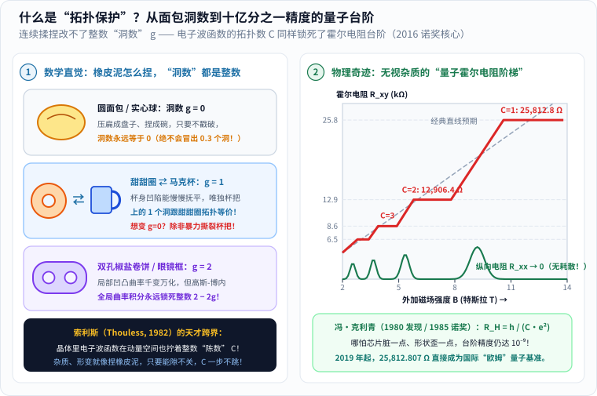
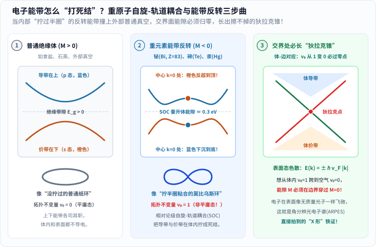
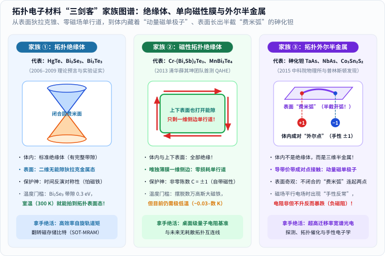

2016 年 10 月 4 日，瑞典皇家科学院的诺贝尔物理学奖发布会现场，出现了一幕让全球记者忍俊不禁的画面。

诺奖委员会委员、理论物理学家托尔斯·汉斯·汉松（Thors Hans Hansson）没有一上来就写满黑板的偏微分方程，而是笑眯眯地从纸袋里掏出了三样午餐面包：一个**没有洞的肉桂卷**、一个**中间有 1 个洞的贝果（甜甜圈）**，还有一个**带 2 个洞的瑞典椒盐卷饼**。

他举起面包对台下说：今年获奖的三位物理学家——大卫·索利斯（David J. Thouless）、邓肯·霍尔丹（F. Duncan M. Haldane）和迈克尔·科斯特利茨（J. Michael Kosterlitz），正是用这种“数面包上有几个洞”的数学（**拓扑学**），揭开了物质世界里一整片从未被写入老教科书的新大陆（[Nobel Prize in Physics 2016 Press Release](https://www.nobelprize.org/prizes/physics/2016/press-release/)）。

而这片新大陆里最让材料学家和芯片工程师着迷的明星，就叫**拓扑电子材料（Topological Electronic Materials）**。

如果你第一次听说这个词，不妨先想象一块像“夹心软糖”一样反直觉的神奇晶体（比如硒化铋 $$\text{Bi}_2\text{Se}_3$$）：

- **它的肚子里面**，像橡胶、玻璃一样死气沉沉，电子被死死锁住，**完全绝缘**；
- **它的最外层表皮**（只有几个原子层、约 $$1\sim 2\text{ nm}$$ 厚），却天生铺着一条金属般的**“电子高速公路”**，电流贴着表皮畅通无阻；
- **最不可思议的是**：假如你怀疑这是不是工厂在玻璃外面镀了一层铜膜，于是拿砂纸把表皮磨掉，或者干脆一刀把这块晶体劈成两半——**新露出来的切口表面，会在一瞬间自动变成新的导电层！**

你永远无法把这层“导电皮”从这块“绝缘肉”上剥下来。因为它根本不是涂上去的涂层，而是晶体内部亿万电子的量子波函数打了一个**解不开的“拓扑死结”**。

一块石头里的电子怎么会“打结”？面包上的洞跟电阻有什么关系？为什么 2019 年科学家用超级计算机普查完人类已知的数万种晶体后，震惊地发现**大自然里超过 $$20\%$$ 的晶体其实都是拓扑材料**？它又能不能治好手机和 AI 芯片最头疼的“发热绝症”？

今天，我们不堆砌晦涩的算符，就从那袋诺贝尔奖面包出发，一层层揭开这场席卷现代凝聚态物理的认知革命。

---

## 一、在“拓扑”进场之前：老教科书是怎么给万物分类的？

要想明白拓扑电子材料到底“突破”了什么，得先看一眼在它出现之前，物理学家统治了近百年的两套经典分类法。

### 1. 第一套分类法：看原子排得齐不齐（朗道的“对称性破缺”）

水为什么会结成冰？铁块冷却后为什么会突然产生磁性？

苏联物理大师列夫·朗道（Lev Landau）给出了一把极其漂亮的标尺：**看“对称性”（Symmetry）有没有被打破**（我们在《[群论和集合，以及那些数学家]()》里聊过对称性如何支配几何与方程）：

- **液态水**里，水分子杂乱无章地乱跑，你往任何方向平移一点、旋转任意角度，水看起来都一模一样（对称性极高）；
- 降温冻成**冰晶**后，水分子排成了整齐的六方格子，只有移动特定步长才重合——原本连续的平移对称性被“打破”了，物质就发生了**相变**。

在很长一段时间里，物理学家深信：**世上所有的物态变化，本质上都是原子排列或磁针指向的对称性变了。**

### 2. 第二套分类法：看电子看台满不满（固体的“能带理论”）

那为什么铜能导电、玻璃完全绝缘、硅却能做电脑芯片（详见《[计算机是如何工作的]()》）？

1930 年代建立的量子**能带理论（Band Theory）**把固体里的电子能量比作一座多层体育场看台：

- **导体（金属，如铜、金）**：一楼看台只坐了一半观众（电子）。只要外加一点点电压，电子就能轻松跳到旁边的空座位上跑起来，形成电流。
- **绝缘体（如金刚石、石英玻璃）**：一楼看台（**价带**）座无虚席，连落脚的缝隙都没有；而二楼空看台（**导带**）和一楼之间隔着一道高达数电子伏特（例如金刚石约 $$5.5\text{ eV}$$）的深渊——**禁带能隙（Band Gap）**。普通电压根本举不起电子跨过这道深渊，所以完全不导电。
- **半导体（如硅 $$\text{Si}$$）**：结构跟绝缘体一样，只不过一楼和二楼之间的台阶比较矮（硅的能隙约 $$1.12\text{ eV}$$），用栅极电压推一把就能让电子跳上去，从而实现 `0` 和 `1` 的开关。

直到 1980 年前，几乎所有人都觉得固体的账本已经算完了：**只要两块绝缘体原子对称性相同、一楼价带都坐得满满当当、中间都隔着一道能隙，它们在物理本质上就是同一种平平无奇的“死绝缘体”。**

直到一个寒冷的冬夜，一台强磁场实验室里的仪器吐出了一串“精确得不讲道理”的数字。

---

## 二、十亿分之一的台阶奇迹：咖啡杯和甜甜圈是怎么管住电阻的？

1980 年 2 月 4 日深夜至 5 日凌晨，法国格勒诺布尔强磁场实验室。

德国物理学家克劳斯·冯·克利青（Klaus von Klitzing）正在测试一块极薄的硅基场效应晶体管（MOSFET）。他把电子限制在一个二维平面里，泡进约 $$1.5\text{ K}$$（接近 $$-271.6^\circ\text{C}$$）的液氦超低温中，再外加十几特斯拉（$$\text{T}$$）的超强磁场。

按照经典电磁学的**霍尔效应**，磁场会把往前跑的电子往侧面推，产生横向的“霍尔电阻” $$R_{xy}$$。按理说，磁场 $$B$$ 调大多少，横向电阻 $$R_{xy}$$ 就应该沿着一条斜线平滑增大多少；而且样品越脏、形状越歪，测出来的电阻肯定越不准。

但冯·克利青在记录仪上看到的，却是一排**像刀切出来一样绝对水平的阶梯**！

每当磁场扫到特定区间，横向霍尔电阻 $$R_{xy}$$ 就会死死钉在某几个固定数值上纹丝不动，与此同时，顺着电流方向的纵向电阻 $$R_{xx}$$ 直接跌落到 **0**（意味着此时电流没有任何发热损耗！）。那些平台的电阻值满足一个简洁得令人屏息的公式：

$$
\begin{aligned}
R_{xy} &= \frac{h}{\nu e^2} \\
&= \frac{25\,812.807\,45\dots\,\Omega}{\nu} \\
(\nu &= 1, 2, 3, \dots)
\end{aligned}
$$

公式里竟然没有任何跟这块硅片材质、长宽厚薄、电子浓度或杂质多少有关的参数！只有宇宙最底层的两个基本常数——普朗克常数 $$h$$ 和单个电子电荷 $$e$$，再除以一个**正整数** $$\nu = 1, 2, 3\dots$$！

更可怕的是它的精度：不管换用多脏的样品、把电极焊得多歪，只要平台一出现，$$\nu=1$$ 对应的电阻就死死锁在 **$$25\,812.807\,45\dots\,\Omega$$**（冯·克利青常数 $$R_K$$），实验误差小于 **$$10^{-9}$$（十亿分之一）**——这相当于测量北京到纽约的距离，误差不超过半根头发丝的粗细！冯·克利青因此独享了 [1985 年诺贝尔物理学奖](https://www.nobelprize.org/prizes/physics/1985/klitzing/facts/)；从 2019 年国际单位制（SI）重新定义起，这个数字干脆成为了全人类校准“$$1\,\Omega$$（欧姆）到底有多大”的法定最高量子基准（[NIST CODATA: von Klitzing constant](https://physics.nist.gov/cgi-bin/cuu/Value?rk)）。

### 为什么“脏样品”算出来的整数能准到十亿分之一？

这一下把全世界的理论物理学家难住了：在固体物理里，硅片里明明到处都是乱七八糟的硅氧缺陷、掺杂原子和晶格畸变，凭什么一团乱麻里能涌现出十亿分之一都不偏的**精确整数** $$\nu$$？

1982 年，大卫·索利斯与合作者（TKNN 团队：Thouless, Kohmoto, Nightingale, den Nijs）给出了石破天惊的答案：**因为 $$\nu$$ 根本不是一个几何测量值，而是一个“拓扑不变量”（Topological Invariant）！**

什么叫拓扑不变量？这就回到文章开头那袋面包了。

在数学家眼里，普通几何学关心长短、角度、凹凸（比如球体半径是不是 $$5\text{ cm}$$）；而**拓扑学（Topology）**像是在研究一块橡皮泥：**只要你不把它撕裂、也不把分开的两处粘合，随便你怎么捏扁、拉长、扭曲，都不改变的性质，就叫拓扑性质。**

我们在讲数学王子高斯的《[高斯到底发明了什么？从 1 加到 100 开始]()》时提到过曲面曲率。后来数学大师陈省身将其推广到高维，而在二维封闭曲面上，经典的**高斯-博内定理（Gauss–Bonnet Theorem）**写下了一个神奇等式：

$$
\begin{aligned}
\frac{1}{2\pi}\iint_{S} K\,\mathrm{d}A &= 2 - 2g \\
(g &= 0, 1, 2, \dots)
\end{aligned}
$$

这里的 $$K$$ 是曲面每一点局部的弯曲程度（高斯曲率），右边那个整数 $$g$$ 就是曲面上的**洞数（亏格，Genus）**：

1. **球面或肉桂卷（$$g=0$$）**：哪怕你在球面上捏出十几个坑坑洼洼的鼓包，每一处的局部曲率 $$K$$ 都变了，但凸起多出来的正曲率和凹坑抵消的负曲率加总积分后，结果永远等于 $$2 - 0 = 2$$。
2. **甜甜圈与带把手的咖啡杯（$$g=1$$）**：把甜甜圈一侧慢慢按凹下去做成杯肚，剩下的环正好变成杯把——整个过程没撕裂也没粘合，所以**拓扑学家分不清咖啡杯和甜甜圈**，它们的全局积分永远锁死 $$2 - 2\times 1 = 0$$，洞数 $$g$$ 永远是 **1**！
3. **关键直觉**：洞的个数 $$g$$ 只能是 $$0, 1, 2, 3\dots$$，**绝不可能出现“$$0.999999999$$ 个洞”！** 想把 $$g=1$$ 变成 $$g=0$$，你唯一的办法是暴力一刀切断面包圈（对应物理上“把绝缘能隙彻底关上再重开”）。

索利斯发现：晶体里电子波函数生活的“动量空间（布里渊区）”，由于晶格周期性首尾相连，本身就长成一个封闭的甜甜圈表面！当电子在动量空间里移动时，它的量子相位也会发生局部扭曲（称为**贝里曲率** $$\mathcal{F}$$）。把整个满带所有电子的贝里曲率在动量空间里做一次全局积分，得到的必定也是一个严格的整数——物理学界用华人数学大师**陈省身（Shiing-Shen Chern）**的名字，把它命名为**陈数（Chern Number，$$C$$）**：

$$
\begin{aligned}
C &= \frac{1}{2\pi}\iint_{\text{BZ} } \mathcal{F}(k_x, k_y)\,\mathrm{d}k_x\,\mathrm{d}k_y \in \mathbb{Z} \\
\sigma_{xy} &= C \cdot \frac{e^2}{h}
\end{aligned}
$$

这下真相大白了！芯片里的杂质、划痕、几何歪斜，全都是在**“轻轻捏橡皮泥”**——它们只能改动局部的贝里曲率，却丝毫撼动不了全局积分出来的整数陈数 $$C$$！只要陈数 $$C$$ 不能跳出小数点，横向电导率 $$\sigma_{xy}$$ 和霍尔电阻 $$R_{xy} = h/(C e^2)$$ 就被数学铁律死死焊在了整数台阶上！

*图 1：怎么读这张图？**先看左栏**：肉桂卷（$$g=0$$）、甜甜圈与带把马克杯（$$g=1$$）、双孔椒盐卷饼（$$g=2$$）只要不撕裂，怎么揉捏都不会改变整数洞数 $$g$$。**再看右栏**：按真实冯·克利青常数 $$R_K = 25\,812.807\,\Omega$$ 绘制的量子霍尔曲线——红色实线 $$R_{xy}$$ 无视样品杂质，精准卡在 $$25.813\text{ k}\Omega$$（$$C=1$$）、$$12.906\text{ k}\Omega$$（$$C=2$$）等水平平台上；而在平台区间内，绿色曲线代表的纵向电阻 $$R_{xx}$$ 直接归零（仅在平台跳变、即拓扑相变瞬间出现尖峰）。*

---

## 三、甩掉十几吨重的强磁铁：材料自己长出“禁止掉头”的高速公路

冯·克利青的量子霍尔效应虽然神奇，但有一个巨大的工程遗憾：**它需要十几特斯拉的超强外加磁场**（比医院核磁共振仪还要强好几倍，是地球磁场的几十万倍！）。你总不能为了用上无损耗导电通道，在口袋里的手机背面绑一台几吨重的液氦超导磁铁吧？

“**能不能不加外磁场，光靠晶体材料自身的原子结构，就自带拓扑高速公路？**”

这个疯狂的念头，引爆了从 1988 年到 2013 年整整二十五年的接力突破：

1. **1988 年，霍尔丹的纸上预言**：邓肯·霍尔丹在蜂窝晶格上构造了一个精巧的理论模型，证明**根本不需要宏观净磁场**，只要晶格内部存在破坏时间反演对称性的微观跃迁相位，照样能长出陈数 $$C=\pm 1$$ 的单向导电边缘！
2. **2005—2007 年，“拓扑绝缘体”横空出世**：宾夕法尼亚大学的查尔斯·凯恩（Charles Kane）与尤金·梅勒（Eugene Mele），以及斯坦福大学张首晟（Shoucheng Zhang）、安德烈·伯内维格（B. Andrei Bernevig）等学者意识到——**大自然早就把一种“等效内禀磁场”藏进了重元素原子里！**

这种天然内禀效应，叫做**自旋-轨道耦合（Spin–Orbit Coupling, SOC）**。

我们在《[你血液里的铁和手上的黄金，是从哪炼出来的？]()》里讲过，像汞（$$\text{Hg}$$，80 号）、铋（$$\text{Bi}$$，83 号）、碲（$$\text{Te}$$，52 号）这类重元素原子核带有极强的正电荷，内层电子绕核飞行的速度甚至逼近光速的相当一部分。根据爱因斯坦狭义相对论，高速穿过原子核电场的电子，在它自己的参考系里会感受到一股强烈的**等效磁场**，并且这股磁场直接跟电子自身的磁小针方向——**自旋（Spin，$$\uparrow$$ 或 $$\downarrow$$）**死死绑在一起！

2006 年，伯内维格、休斯与张首晟预言碲化汞（$$\text{HgTe}$$）量子阱就是二维拓扑绝缘体；仅仅一年后（2007 年），德国维尔茨堡大学莫伦坎普（Laurens Molenkamp）实验组就在实验室里测到了它的边缘量子自旋霍尔电导；紧接着在 2007—2009 年间，傅亮、凯恩、摩尔、罗伊，以及方忠、戴希、张首晟、哈桑（M. Zahid Hasan）、沈志勋等中外理论与实验团队联手，把拓扑绝缘体推进到了真实的三维块体晶体——如**硒化铋（$$\text{Bi}_2\text{Se}_3$$）**、**碲化铋（$$\text{Bi}_2\text{Te}_3$$）**和**碲化锑（$$\text{Sb}_2\text{Te}_3$$）**（[Hasan & Kane, *Rev. Mod. Phys.* 2010](https://arxiv.org/abs/1002.3895)）！

### 核心机制拆解：为什么拓扑表面的电子不怕撞上杂质？

普通铜导线为什么会发热？因为铜线里的电子像在玩一台拥挤的**三维弹珠机**：往前跑的电子随时会迎面撞上晶格缺陷、杂质原子或热振动的晶格，**“啪”地一下 $$180^\circ$$ 原路弹回（背散射，Backscattering）**，动能瞬间变成无规则热能（焦耳热 $$I^2R$$）。

而在拓扑电子材料的边界或表面上，自旋-轨道耦合立下了一条铁面无私的交规——**自旋-动量锁定（Spin–Momentum Locking）**：

- **凡是往右（东向 $$+k$$）开的电子，头顶必须顶着“自旋向上 $$\uparrow$$”的通行证；**
- **凡是往左（西向 $$-k$$）开的电子，头顶必须顶着“自旋向下 $$\downarrow$$”的通行证！**

现在，假设东向车道正中央掉下来一块大石头（一颗**非磁性杂质原子**或晶格空位）。在普通铜线里，电子撞上石头就会 $$180^\circ$$ 掉头往西跑；但在拓扑表面上，奇迹发生了：

1. 如果电子想 $$180^\circ$$ 掉头拐进对面的西向车道（$$+k \to -k$$），交规要求它**必须同时把自己的自旋从 $$\uparrow$$ 翻成 $$\downarrow$$**；
2. 可是路中间那块普通杂质石头**没有磁性**，根本使不出翻转电子自旋的磁力矩！
3. 更深层的量子力学（时间反演对称性下的**克拉默斯定理**，$$\mathcal{T}^2 = -1$$）保证：电子从杂质上沿顺时针绕过去的分波，和从下沿逆时针绕过去弹回来的分波，自旋恰好旋转了整整一圈（$$360^\circ$$），而自旋 $$1/2$$ 粒子的波函数转一圈会多出一个负号（$$\mathrm{e}^{\mathrm{i}\pi} = -1$$）——**顺逆两束回波在 $$180^\circ$$ 掉头方向上严丝合缝地相消干涉，概率严格等于 $$0$$！**

既然 $$180^\circ$$ 掉头的路被量子力学彻底焊死了，电子遇到非磁性杂质能怎么办？**它只能像溪水绕过鹅卵石一样，贴着杂质优雅地滑过去，继续往前跑！**

如果更进一步，往这种拓扑绝缘体薄膜里掺入磁性铬（$$\text{Cr}$$）原子打破时间反演对称性——2013 年，清华大学与中国科学院物理研究所**薛其坤院士团队**领衔在实验上首次观测到了困扰物理学界多年的**量子反常霍尔效应（Quantum Anomalous Hall Effect, QAHE）**（[Chang et al., *Science* 2013](https://arxiv.org/abs/1605.08829)）：在掺铬的 $$(\text{Bi},\text{Sb})_2\text{Te}_3$$ 薄膜里，反向车道干脆被彻底拆除了！**外加磁场等于 $$0$$**，整块芯片边缘只剩下一条同向旋转的**纯单行道**，横向电阻再次精准锁定在 $$h/e^2 \approx 25.8\text{ k}\Omega$$，纵向电阻趋近于零！

*图 2：三种电子交通规则对比（内置一次短动画，[点此单独打开 SVG 刷新可重播](/assets/images/topological-materials/ordinary-wire-vs-topological-highway.svg)；开启系统“减少动态效果”或看静态虚线同样完整可读）。**① 上栏（普通铜导线）**：自旋方向随意，撞上红色杂质即 $$180^\circ$$ 弹回产生焦耳热；**② 中栏（三维拓扑绝缘体 $$\text{Bi}_2\text{Se}_3$$）**：右行锁死 $$\uparrow$$、左行锁死 $$\downarrow$$，遇到非磁性杂质无法翻转自旋掉头，只能绕障滑行；**③ 下栏（量子反常霍尔磁拓扑绝缘体）**：无需外磁场（$$B=0$$），边缘只保留单向环流车道，根本不存在逆行车道。*

---

## 四、为什么这层“导电皮”拿刀都削不掉？三步看懂“能带反转”与体-边对应

读到这里，最爱动脑筋的读者一定会追问那个核心悬念：

> **“就算表面有自旋锁定，可为什么一块内部绝缘的石头，外表面偏偏非得导电不可？为什么拿刀劈开，新切面上又立刻长出导电层？”**

答案藏在凝聚态物理最富诗意的一条定理里——**体-边对应原理（Bulk–Boundary Correspondence）**。我们可以用经典的 BHZ（Bernevig–Hughes–Zhang）有效模型，分三步把这颗“莫比乌斯死结”拆开看清：

$$
\begin{aligned}
E_{\pm}(k) &= \pm\sqrt{\bigl(M + \lvert B\rvert k^2\bigr)^2 + A^2 k^2}
\end{aligned}
$$

别被根号吓到，这里 $$k$$ 是电子动量，你只需要盯住公式里唯一会变正负号的开关参数——**有效能隙质量 $$M$$**：

### 第一步：普通绝缘体与真空（$$M > 0$$，没拧弯的普通纸环）

在普通玻璃、食盐甚至晶体外面的**空气／真空**里，$$M > 0$$。能量较高的导带（比如重原子的 $$s$$ 或正宇称轨道，蓝色）乖乖待在上面；能量较低的价带（$$p$$ 或负宇称轨道，橙色）老老实实待在下面。把整个动量空间的波函数串起来看，就像一条**平平整整粘起来的普通纸环**，拓扑不变量 $$\nu_0 = 0$$。

### 第二步：拓扑绝缘体内部（$$M < 0$$，拧了 $$180^\circ$$ 的莫比乌斯环）

当我们换上铋（$$\text{Bi}$$）、硒（$$\text{Se}$$）、碲（$$\text{Te}$$）这类重元素组成 $$\text{Bi}_2\text{Se}_3$$ 晶体时，强烈的相对论效应和自旋-轨道耦合把原本在上面的导带狠狠往下拽、把原本在下面的价带往上顶——在动量中心 $$k=0$$ 附近，**上下两条能带竟然上下颠倒、互换了身份！** 这就叫**能带反转（Band Inversion，$$M < 0$$）**。

紧接着，自旋-轨道耦合项 $$A k$$ 又在交叉处撑开了一道约 **$$0.3\text{ eV}$$** 的体能隙（室温 $$300\text{ K}$$ 下分子热运动能量 $$k_B T \approx 0.026\text{ eV}$$，这道 $$0.3\text{ eV}$$ 的能隙足足是室温热扰动的 $$11$$ 倍以上，所以晶体内部在室温下也是稳稳的绝缘态！）。但请注意：虽然内部依然有能隙，但在 $$k=0$$ 处上下能带的轨道身份已经拧反了——就像把纸带**拧转 $$180^\circ$$ 再首尾粘成的莫比乌斯环（Möbius strip）**，拓扑不变量变成了 $$\nu_0 = 1$$！

### 第三步：晶体与空气的交界面（必须穿过 $$M = 0$$！能隙当场闭合）

现在，把这块 $$M < 0$$（$$\nu_0 = 1$$）的拓扑晶体放到 $$M > 0$$（$$\nu_0 = 0$$）的空气或真空里。

沿着垂直于晶体表面的空间坐标 $$z$$ 从晶体内部往外走，参数 $$M(z)$$ 必须从内部的**负数（$$M < 0$$）**连续变化到外部空气的**正数（$$M > 0$$）**。初中数学的**介值定理**告诉我们：一个连续量从负数变到正数，**在跨过晶体表面的那一瞬间，必定有一层位置满足：**

$$
M(z_{\text{表面} }) = 0
$$

把 $$M = 0$$ 代回上面的能量公式（在小动量附近略去高阶 $$k^2$$ 项），原本隔开导带和价带的能隙 $$\lvert2M\rvert$$ 瞬间坍塌成 **0**，能量与动量变成一条直线交叉的圆锥——**无质量狄拉克锥（Dirac Cone）**：

$$
E_{\text{表面} }(k) = \pm \hbar v_F \lvert k\rvert
$$

看懂这一步，你就彻底想通了为什么刀劈不掉导电皮：**因为只要晶体内部还是 $$M < 0$$、外面空气还是 $$M > 0$$，无论你从哪个角度切一刀，新切口永远是“负数撞上正数”的边界，数学铁律逼着那一层交界面必须令 $$M=0$$、关掉绝缘能隙、长出金属性的无能隙表面态！**

*图 3：为什么这层“导电表皮”永远削不掉？顺着 **① → ② → ③** 读图：**① 普通绝缘体与真空**（$$M>0$$）导带在上、价带在下，如同普通纸环（$$\nu_0=0$$）；**② 拓扑晶体内部**（$$M<0$$）因重元素自旋-轨道耦合在 $$k=0$$ 处发生红蓝轨道反转并重开驼峰状能隙，如同拧了半圈的莫比乌斯环（$$\nu_0=1$$）；**③ 晶体与空气交界面**从 $$M<0$$ 过渡到 $$M>0$$ 时被迫穿过 $$M=0$$，能隙必然闭合为绿色的线性狄拉克锥导电态。*

---

## 五、拓扑家族“三剑客”：从绝缘体一路扩军到“幽灵粒子”半金属

如果拓扑只能造出“外皮导电的绝缘体”，它还不足以改写半部凝聚态物理。真正让全世界实验室沸腾的是：物理学家顺藤摸瓜，很快把拓扑概念从**绝缘体**一路扩张到了**磁性体系**、**半金属（Semimetals）**乃至超导体！其中实验证据最扎实、性质最鲜明的，正是下面这**三大核心家族**：

### 1. 三维拓扑绝缘体（代表：$$\text{Bi}_2\text{Se}_3$$、$$\text{Bi}_2\text{Te}_3$$、$$\text{Sb}_2\text{Te}_3$$）

这是整个领域的“开山鼻祖”。晶体内部有清晰的体能隙（其中 $$\text{Bi}_2\text{Se}_3$$ 体能隙达 $$\sim 0.3\text{ eV}$$，是最经典的“室温候选明星”），上下外表面则住着受时间反演对称性保护的二维无质量狄拉克电子。科学家用**角分辨光电子能谱（ARPES）**——相当于给晶体里的电子直接拍“能量-动量快照”——在实验上清清楚楚拍到了横跨禁带的 X 形狄拉克锥。

### 2. 磁性拓扑绝缘体与量子反常霍尔体系（代表：$$\text{Cr}$$ 掺杂 $$(\text{Bi},\text{Sb})_2\text{Te}_3$$、本征 $$\text{MnBi}_2\text{Te}_4$$）

给拓扑绝缘体引入铁磁序，时间反演对称性破缺把上下表面的狄拉克锥打开能隙，唯独在样品最外圈侧面留下一维**无耗散手性边缘通道**（陈数 $$C = \pm 1$$）。从方忠、戴希、张首晟等 2010 年的理论材料预言，到薛其坤团队 2013 年首次实验攻克，再到近年在层状本征磁拓扑材料 $$\text{MnBi}_2\text{Te}_4$$ 中把工作温度往上推高，中国科学家在这一方向做出了世界公认的里程碑贡献。

### 3. 拓扑外尔半金属与“费米弧”奇迹（代表：砷化钽 $$\text{TaAs}$$、$$\text{Na}_3\text{Bi}$$、$$\text{Cd}_3\text{As}_2$$）

这是粒子物理与凝聚态物理最浪漫的一次跨时空重逢！

早在 **1929 年**，数学物理学家赫尔曼·外尔（Hermann Weyl）在化简狄拉克方程时预言：宇宙中可能存在一种**没有静止质量、具有确定“手性”（左手或右手螺旋）的幽灵粒子——外尔费米子（Weyl Fermion）**。然而在高能粒子加速器里，物理学家苦苦找了整整 **86 年**，连一度被怀疑是外尔费米子的中微子最后都被证实有微小质量——基本粒子世界里至今没抓到半个外尔费米子。

没想到在 **2015 年**，这颗失踪了 86 年的粒子，竟然在一块小小的**砷化钽（$$\text{TaAs}$$）**晶体里作为电子集体运动的“准粒子”被抓住了！中国科学院物理研究所翁红明、方忠、戴希理论预言与丁洪、钱天实验团队（[Lv et al., *Phys. Rev. X* 2015](https://arxiv.org/abs/1502.04684)），以及普林斯顿大学徐苏阳、哈桑团队（[Xu et al., *Science* 2015](https://arxiv.org/abs/1502.03807)）（同期还有麻省理工学院陆凌等在光子晶体中的独立发现），在 $$\text{TaAs}$$ 中直接观测到了外尔费米子和它独一无二的身份证——**开放费米弧（Open Fermi Arcs）**！

为什么外尔半金属这么特别？

- **体内不再绝缘，而是“点接触”**：导带和价带在三维动量空间里只在成对的孤立点（**外尔点，Weyl Nodes**）上轻轻碰在一起。每一个外尔点就像动量空间里的一颗“磁单极子”，一颗往外喷涌贝里曲率（手性 $$+1$$），另一颗往里吞噬贝里曲率（手性 $$-1$$）。它们**必须一正一负成对出现**，除非你把正负两颗外尔点推到一起撞毁湮灭，否则任何微扰都消除不掉它们！
- **表面长出“半截弧线”**：在一切普通金属里，电子等能面（费米面）必须是首尾闭合的圈（就像地图上的等高线绝不会走到一半凭空断掉）。唯独在外尔半金属的上表面，ARPES 拍到的费米面竟然是一段**两头断掉的开放弧线（费米弧）**！另一半去哪儿了？**电子顺着体内 $$+1$$ 和 $$-1$$ 外尔点的拓扑管道，直接潜入晶体内部穿到了底面，跟底面的另一半费米弧连成整圈！**
- **负磁阻奇观（手性反常）**：普通金属加磁场后电子打转，电阻往往变大；但在外尔半金属中，当电场平行于磁场（$$\mathbf{E} \parallel \mathbf{B}$$）时，电子会从左手外尔谷源源不断“泵”向右手外尔谷，反而让**纵向电阻随磁场增强而显著下降**！

*图 4：一张图分清拓扑电子材料三大家族。**左栏（三维拓扑绝缘体）**：体内打开约 $$0.3\text{ eV}$$ 能隙绝缘，二维表面铺满自旋锁定的狄拉克锥；**中栏（磁性拓扑绝缘体／QAHE）**：内禀铁磁性封死表面，只在芯片四周留下一维零磁场单向导电边；**右栏（拓扑外尔半金属 $$\text{TaAs}$$）**：体内导带与价带在成对的 $$+1/-1$$ 外尔点处接触，上下表面长出普通金属绝不可能拥有的“开放费米弧”。*

---

## 六、两大反转：大自然超 20% 的晶体自带拓扑基因，可为什么手机芯片还没换成它？

故事讲到这里，还有两个最让人拍案叫绝、也最需要冷静祛魅的现实反转。

### 反转一：从“大海捞针”到 2019《Nature》大普查——原来拓扑一点都不稀有！

在 2015 年之前，寻找一种新的拓扑材料就像大海捞针：科学家全靠物理直觉猜一种化合物，再用超级计算机跑好几个星期密度泛函理论（DFT）去检查能带到底反没反转，十年下来全球一共也只攒了几十种确认材料。

2017—2019 年，理论物理学家再次请出了百年前的**晶体空间群对称性**（230 种空间群，再次呼应《[群论和集合，以及那些数学家]()》），发明了**“对称性指标（Symmetry Indicators）”**和**“拓扑量子化学（Topological Quantum Chemistry）”**理论：不需要再去逐点硬算复杂的贝里曲率积分，只要对比高对称动量点上电子波函数的对称性标签，几秒钟就能像“验血查基因”一样判定一块晶体是不是拓扑材料！

2019 年 2 月 28 日，英国《自然》（*Nature*）杂志罕见地在同一期背靠背刊发了三篇独立团队（中科院物理所方辰、翁红明、方忠团队；普林斯顿伯内维格、马普所费尔泽与毕尔巴鄂晶体学中心团队；南京大学万贤纲与哈佛维什瓦纳特团队）的高通量拓扑材料普查报告，结果震惊了整个材料界：

- 在中科院物理所团队扫描的 **39,519 种**非磁性晶体材料中，竟然有整整 **8,056 种（占比 $$20.4\%$$）** 是拓扑电子材料！其中包括 **5,005 种**拓扑半金属、**1,814 种**拓扑绝缘体和 **1,237 种**拓扑晶体绝缘体（[Zhang et al., *Nature* 2019](https://arxiv.org/abs/1807.08756)）。
- 在欧美联合团队筛选的 **26,938 种**高纯度化学计量比无机晶体库（ICSD）材料中，更是有超过 **$$24\%\sim 27\%$$** 携带拓扑能带（[Vergniory et al., *Nature* 2019](https://arxiv.org/abs/1807.10271)）！

甚至连我们实验室抽屉里摆了一百年的**单质铋（$$\text{Bi}$$）**、**单质砷（$$\text{As}$$）**，乃至黄金（$$\text{Au}$$）的特定表面态里，本来就藏着拓扑电子结构！原来拓扑物态根本不是象牙塔里的珍稀动物，而是大自然造物时随手撒下的家常便饭——只是人类此前的眼镜里没有“拓扑”这片镜片，才对身边五分之一以上的拓扑晶体视而不见了整整一百年！

### 反转二：冷静纠偏！既然能“抗散射”，为什么我的电脑 CPU 还没换成拓扑材料？

很多营销号一提拓扑材料，就爱写“室温零电阻、明天取代硅芯片、手机永远不发热”。**这是典型的把局部物理机制夸大成了现成工程奇迹。** 作为严肃科普，我们必须把挡在“实验室样品”与“消费级硅芯片”之间的 **3 道真实工程铁门槛**讲透：

1. **误区澄清：“禁止 $$180^\circ$$ 掉头” $$\neq$$ “室温下完全零电阻”！**
   在三维拓扑绝缘体（如 $$\text{Bi}_2\text{Se}_3$$）的**二维表面**上，电子动量可以在一个二维平面内朝四面八方走。量子力学严格禁止的，仅仅是**正后方 $$180^\circ$$ 完全掉头**（因为只有 $$+k$$ 和 $$-k$$ 的自旋严格正交，内积为 $$0$$）；如果电子撞上杂质或室温下剧烈振动的晶格（声子），**偏转 $$30^\circ$$、$$60^\circ$$ 或 $$120^\circ$$ 的斜向散射依然是允许的**（此时两个方向的自旋并不完全正交）！
   要想把斜向散射也彻底堵死、只留下一条线往前走，就必须用**一维边缘通道**（例如二维量子自旋霍尔单原子层，或磁性量子反常霍尔薄膜）。但截至目前，**零磁场量子反常霍尔效应仍需要液氦级极低温**（从 2013 年的约 $$0.03\text{ K}$$ 提升到了如今 $$\text{MnBi}_2\text{Te}_4$$ 或异质结中的几开尔文至数十开尔文量级），距离室温 $$300\text{ K}$$（$$27^\circ\text{C}$$）还有一场硬仗要打！
2. **体内缺陷“漏电”难题**：
   理论上 $$\text{Bi}_2\text{Se}_3$$ 内部应该完全绝缘，但在真实晶体生长过程中，硒（$$\text{Se}$$）原子极易挥发留下“硒空位”，相当于给原本绝缘的晶体肚子免费塞进了大量导电电子——结果表面那层几纳米厚的拓扑高速公路，经常被肚子里庞大的体漏电信号淹没，必须靠极其精细的四元合金掺杂（如 $$(\text{Bi}_{1-x}\text{Sb}_x)_2(\text{Te}_{1-y}\text{Se}_y)_3$$）去中和。
3. **逻辑晶体管“关不掉”的两难**：
   现代硅基 CPU 之所以能算题，靠的是晶体管每秒百亿次干脆利落地在“导通（`1`）”和“彻底关断（`0`）”之间切换，开关电流比高达 $$10^5\sim 10^7$$。可拓扑边界态恰恰是因为**受拓扑保护、天生没有能隙**，普通栅极电压很难像捏断水管一样把它关死！科学家正在研发用强电场或应力直接切换拓扑相（在 $$M<0$$ 与 $$M>0$$ 之间来回翻转）的“拓扑场效应晶体管”，目前仍处于前沿原型探索阶段。

> **科学的诚实自我纠偏（拓扑超导与马约拉纳准粒子）**：除了上述三大家族，物理学家还在全力追寻第四颗圣杯——**拓扑超导体**及其边界上的**马约拉纳零能模（Majorana Zero Modes）**，希望把量子比特编码在非局域拓扑辫子里，造出天生免疫局部噪声的**拓扑量子计算机**。这一方向的实验甄别难度极高（例如 2018 年一篇备受瞩目的半导体纳米线马约拉纳《Nature》论文，因后续更严格检验发现杂质无序态也能模仿类似电导峰，已于 2021 年由作者主动撤稿重做）。这恰恰展现了前沿物理学不迷信噱头、用铁证说话的严谨底色。

### 那么，拓扑电子材料今天已经用在哪儿了？

虽然还没直接取代你电脑里的硅基 CPU，但拓扑电子材料已经在三个最契合它天赋的赛道率先落地：

- **① 全球电阻最高计量基准**：量子霍尔电阻平台（$$R_K = 25\,812.807\,45\dots\,\Omega$$）已是各国国家计量院标定精密电阻的绝对标尺，而量子反常霍尔效应正让这套基准摆脱庞大超导磁体的束缚；
- **② 超低功耗自旋轨道矩磁存储器（SOT-MRAM）**：利用 $$\text{Bi}_2\text{Se}_3$$、$$\text{BiSb}$$ 等拓扑绝缘体极高的“电流→自旋流”转换效率（自旋-动量锁定天赋），只需极小电流就能翻转磁性存储单元，断电数据不丢失，已成为下一代嵌入式非易失存算芯片的热门候选；
- **③ 纳米芯片互连线与宽谱太赫兹／红外光电探测**：当铜导线在先进制程芯片里缩窄到 $$10\text{ nm}$$ 以下时，表面散射会让铜的电阻率暴涨；而部分拓扑半金属（如 $$\text{CoSi}$$、$$\text{MoP}$$）越薄反而越能发挥表面导电通道优势。同时，无能隙的狄拉克／外尔锥能吸收传统宽禁带半导体看不见的低能量远红外与太赫兹光子。

*图 5：**左栏**：按 2019 年《Nature》高通量普查真实数据等比例绘制——39,519 种非磁性晶体中，拓扑半金属（12.7%）、拓扑绝缘体（4.6%）与拓扑晶体绝缘体（3.1%）合计达 **8,056 种（20.4%）**；**右栏**：客观拆解拓扑材料走向室温逻辑芯片必须跨越的 3 道真实物理门槛，以及目前已经率先开花结果的三大应用方向。*

---

## 七、动手查一查：普通读者也能玩的官方“拓扑材料大词典”

如果你想亲眼看看我们日常熟悉的某种晶体（比如金 $$\text{Au}$$、铋 $$\text{Bi}$$、食盐 $$\text{NaCl}$$ 或砷化钽 $$\text{TaAs}$$）到底是不是拓扑材料，2019 年《Nature》普查背后的中外科学家已经把数万种晶体的拓扑档案做成了**免费公开的在线交互数据库**（注：访问外部网站需联网并开启浏览器 JavaScript；不访问也完全不影响理解本文全部核心逻辑）：

1. **Materiae 拓扑材料数据库（中国科学院物理研究所团队维护）**：[http://materiae.iphy.ac.cn/](http://materiae.iphy.ac.cn/) —— 输入任意化学式（例如 `Bi2Se3` 或 `TaAs`），即可查看它的空间群编号、三维晶体结构、电子能带图以及它属于普通绝缘体、拓扑绝缘体还是拓扑半金属。
2. **Topological Materials Database（普林斯顿／马普所／毕尔巴鄂晶体学中心联合维护）**：[https://www.topologicalquantumchemistry.com/](https://www.topologicalquantumchemistry.com/) —— 收录了数万种 ICSD 晶体的拓扑量子化学分类与对称性指标分析。

回望这场横跨四十多年的凝聚态物理突围战，最动人的地方莫过于此：

数学家在纸上研究“咖啡杯怎么捏成甜甜圈”时，绝不会想到百年后它会变成全人类定义“$$1$$ 欧姆”的最高标尺；外尔在 1929 年写下无质量旋量方程时，也绝不会想到那颗高能加速器找了 86 年都没抓到的幽灵粒子，竟然安静地藏在一块几毫米大的砷化钽晶体里。当人类换上一副名叫“拓扑”的新眼镜，原本以为早就研究透了的石头与金属，瞬间露出了整整五分之一此前从未被看见的壮丽星空。

---

## 参考资料与核查来源

1. **2016 年诺贝尔物理学奖官方公报与科普背景（面包洞数类比、BKT 相变、TKNN 陈数与霍尔丹模型）**：Royal Swedish Academy of Sciences, [*Press Release: The Nobel Prize in Physics 2016*](https://www.nobelprize.org/prizes/physics/2016/press-release/) 及 [*Popular Science Background: Strange phenomena in matter's flatlands*](https://www.nobelprize.org/prizes/physics/2016/popular-information/)（核查 Thouless、Haldane、Kosterlitz 获奖理由、肉桂卷 $$g=0$$／贝果 $$g=1$$／双孔卷饼 $$g=2$$ 拓扑不变量说明及量子霍尔陈数解释）。
2. **量子霍尔效应发现史与冯·克利青常数精确国际基准**：NobelPrize.org, [*Klaus von Klitzing – Facts (1985)*](https://www.nobelprize.org/prizes/physics/1985/klitzing/facts/)；美国国家标准与技术研究院（NIST）CODATA 基本物理常数库，[*von Klitzing constant $$R_K = h/e^2 = 25\,812.807\,45\dots\,\Omega$$ (exact)*](https://physics.nist.gov/cgi-bin/cuu/Value?rk)（核查 1980 年发现、$$10^{-9}$$ 平台精度与 2019 年 SI 欧姆量子基准定义）。
3. **TKNN 拓扑陈数原始论文**：D. J. Thouless, M. Kohmoto, M. P. Nightingale, and M. den Nijs, *"Quantized Hall Conductance in a Two-Dimensional Periodic Potential"*, *Physical Review Letters* **49**, 405–408 (1982), [DOI: 10.1103/PhysRevLett.49.405](https://doi.org/10.1103/PhysRevLett.49.405)（核查布里渊区贝里曲率积分与整数霍尔电导 $$\sigma_{xy} = C e^2/h$$ 的严格对应）。
4. **拓扑绝缘体权威综述（自旋-轨道耦合、能带反转、$$\text{Bi}_2\text{Se}_3$$ 约 $$0.3\text{ eV}$$ 体能隙与体-边对应）**：M. Z. Hasan and C. L. Kane, *"Colloquium: Topological insulators"*, *Reviews of Modern Physics* **82**, 3045–3067 (2010), [arXiv:1002.3895](https://arxiv.org/abs/1002.3895) / [DOI: 10.1103/RevModPhys.82.3045](https://doi.org/10.1103/RevModPhys.82.3045)（核查二维量子自旋霍尔绝缘体、三维 $$\mathbb{Z}_2$$ 拓扑绝缘体、自旋-动量锁定禁止 $$180^\circ$$ 非磁性背散射及斜向散射边界条件）。
5. **量子反常霍尔效应首次实验观测**：Cui-Zu Chang, Jinsong Zhang, Xiao Feng, Jie Shen, Zuocheng Zhang, Minghua Guo, Kang Li, Yunbo Ou, Pang Wei, Li-Li Wang, Zhong-Qing Ji, Yang Feng, Shuaihua Ji, Xi Chen, Jinfeng Jia, Xi Dai, Zhong Fang, Shou-Cheng Zhang, Ke He, Yayu Wang, Li Lu, Xu-Cun Ma, and Qi-Kun Xue, *"Experimental Observation of the Quantum Anomalous Hall Effect in a Magnetic Topological Insulator"*, *Science* **340**, 167–170 (2013), [arXiv:1605.08829](https://arxiv.org/abs/1605.08829) / [DOI: 10.1126/science.1234414](https://doi.org/10.1126/science.1234414)（核查 $$\text{Cr}$$ 掺杂 $$(\text{Bi},\text{Sb})_2\text{Te}_3$$ 薄膜在零外磁场下实现 $$R_{xy} = h/e^2$$ 与极低温实验条件）。
6. **外尔半金属 $$\text{TaAs}$$ 与表面开放费米弧实验发现**：B. Q. Lv, H. M. Weng, B. B. Fu, X. P. Wang, H. Miao, J. Ma, P. Richard, X. C. Huang, L. X. Zhao, G. F. Chen, Z. Fang, X. Dai, T. Qian, and H. Ding, *"Experimental Discovery of Weyl Semimetal TaAs"*, *Physical Review X* **5**, 031013 (2015), [arXiv:1502.04684](https://arxiv.org/abs/1502.04684)；以及 S.-Y. Xu et al., *"Discovery of a Weyl fermion semimetal and topological Fermi arcs"*, *Science* **349**, 613–617 (2015), [arXiv:1502.03807](https://arxiv.org/abs/1502.03807)（核查 1929 年外尔预言至 2015 年凝聚态发现、成对 $$\pm 1$$ 外尔点及开放费米弧）。
7. **2019 年《Nature》晶体材料高通量拓扑大普查**：Tiantian Zhang, Yi Jiang, Zhida Song, He Huang, Yuqing He, Zhong Fang, Hongming Weng, and Chen Fang, *"Catalogue of topological electronic materials"*, *Nature* **566**, 475–479 (2019), [arXiv:1807.08756](https://arxiv.org/abs/1807.08756)（核查 39,519 种非磁性材料中检出 8,056 种占比 $$20.4\%$$，含 5,005 种拓扑半金属、1,814 种拓扑绝缘体与 1,237 种拓扑晶体绝缘体）；以及 M. G. Vergniory, L. Elcoro, C. Felser, N. Regnault, B. A. Bernevig, and Z. Wang, *"A complete catalogue of high-quality topological materials"*, *Nature* **566**, 480–485 (2019), [arXiv:1807.10271](https://arxiv.org/abs/1807.10271)（核查 26,938 种化学计量比晶体中逾四分之一具拓扑能带）。
