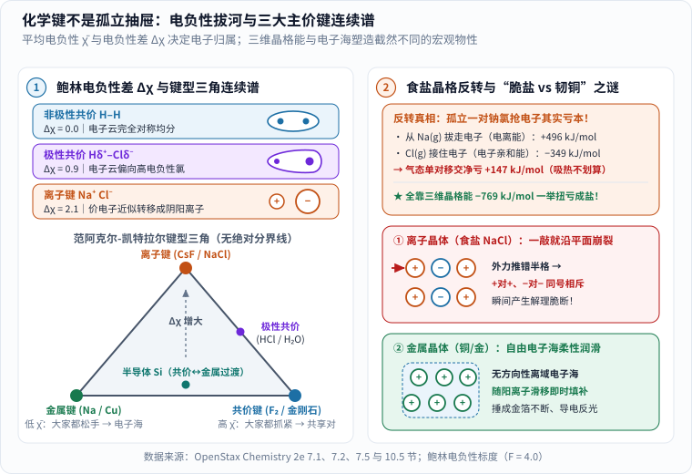
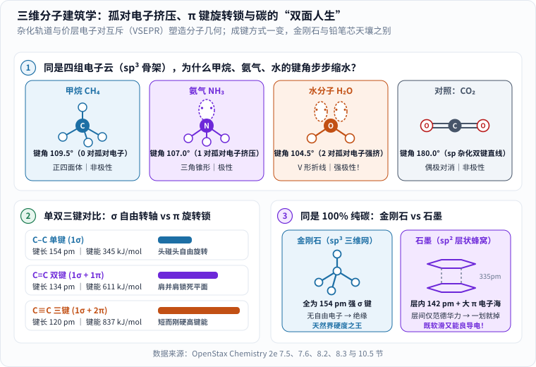
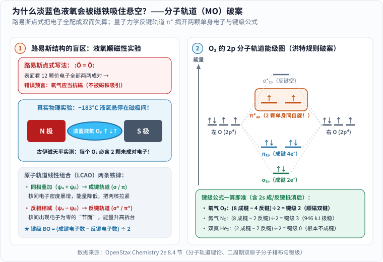
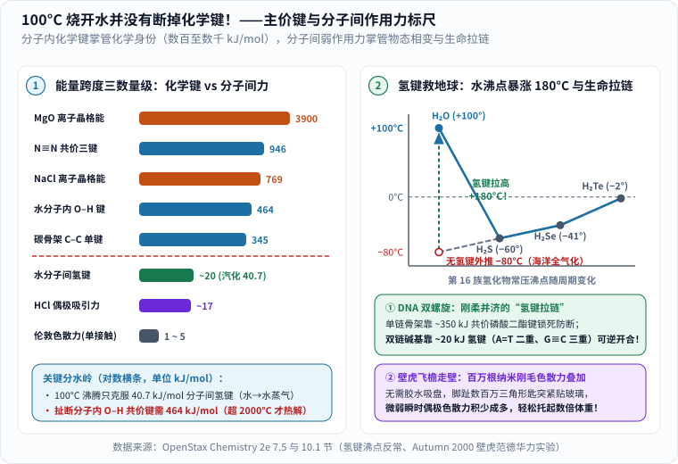

打开厨房橱柜拿起一勺白色食盐（$$\text{NaCl}$$）时，你手里捧着的其实是自然界最匪夷所思的一场“性格大变脸”：

它的前半身是**金属钠（$$\text{Na}$$）**——软得能用餐刀切开，但脾气暴烈到必须泡在煤油里保存，一旦沾水就会嘶嘶狂飙、蹿出火球甚至炸裂烧杯；它的后半身是**氯气（$$\text{Cl}_2$$）**——一种刺鼻的黄绿色剧毒气体，能腐蚀大多数金属、灼伤肺泡。可当钠原子和氯原子在烧瓶里轰然相遇、耀眼黄光散去之后，留下的白色晶体既不爆炸也无毒性，反而成了维持人体神经电信号和血液渗透压的救命必需品。

再低头看看你书桌上的两样东西：**钻戒上的金刚石**与**2B 铅笔芯里的石墨**。如果把它们送进元素分析仪，你会得到一个反直觉的检验报告——它们没有掺杂任何别的原子，**全都是由 $$100\%$$ 纯碳原子（$$\text{C}$$）搭出来的！** 可前者的硬度傲视天然矿物、透明璀璨、几乎完全绝缘；后者却黑乎乎软绵绵，在纸上轻轻一蹭就脱落下成千上万层碳片，插进电路还能点亮小灯泡。

是什么无形的“微观榫卯”，既能把狂暴的毒物驯服成温顺的食盐，又能让同一种碳原子活出硬如金刚与软如脂粉的“双面人生”？答案只有三个字：**化学键（Chemical Bond）**。

今天，我们就拆掉死记硬背的中学概念卡片，顺着以下五个最让人上头的追问，一层层潜入原子之间的量子拔河现场：

1. **两个原子靠近时，为什么既不会擦肩而过，也不会一头撞进对方怀里，而是精准停在几十皮米的“黄金坑底”？为什么说“断键释放能量”是个流传最广的科学误区？**
2. **共价键、离子键、金属键真是三个互不相干的抽屉吗？为什么孤立一对钠氯原子抢电子其实“亏本”，食盐一敲就碎而铜块却能捶成薄箔？**
3. **同样是四组电子云，为什么甲烷、氨气、水分子的键角会一路缩水？碳原子怎么靠杂化轨道与 $$\pi$$ 键旋转锁，变出钻石和石墨两种极端材料？**
4. **为什么按中学“八隅体电子点式”画出来完美配对的氧气，冻成淡蓝色液氧后却会被磁铁凌空吸住？**
5. **把水烧开到 $$100^\circ\text{C}$$ 到底断没断化学键？那些只有化学键十分之一力气的“弱相互作用”，凭什么救活地球海洋、拼起 DNA 双螺旋，还让壁虎倒挂在玻璃天花板上狂奔？**

---

## 一、第一幕：74 皮米的“黄金势能坑”——原子为什么要成键？

在 20 世纪以前，化学家虽然已经画出了无数分子式（比如[门捷列夫排布元素周期表时依据的最高化合价规律]()），却没人答得上来一个最朴素的物理问题：**两个电中性的氢原子（$$\text{H}$$）既不带净正电也不带净负电，凭什么能死死吸在一起变成极其稳定的氢分子（$$\text{H}_2$$）？**

1916 年，美国化学家吉尔伯特·路易斯（Gilbert N. Lewis）发表经典论文，首次提出**“共享电子对”**的直觉模型：两个原子可以把最外层的价电子拿出来“合伙使用”，凑满类似稀有气体的稳定壳层（氢凑满 $$2$$ 电子，第二周期碳、氮、氧、氟凑满 $$8$$ 电子，即**八隅体规则 Octet Rule**）。到了 1927 年，年轻的物理学家瓦尔特·海特勒（Walter Heitler）与弗里茨·伦敦（Fritz London）用刚诞生不久的薛定谔方程算出了氢分子的量子波函数，人类才第一次真正看清化学键在物理底层到底是什么。

### 1. 远了想靠近、近了嫌太挤：莫尔斯势能曲线的四步博弈

把两个孤立的氢原子 $$\text{H}_A$$ 和 $$\text{H}_B$$ 放在真空里，设它们原子核之间的距离为 $$r$$（单位通常用**皮米**，$$1\text{ pm} = 10^{-12}\text{ m}$$，即一万亿分之一米），并规定两颗原子相隔无穷远、互不打扰时的总势能为 $$0\text{ kJ/mol}$$。当我们把它们慢慢推近时，体系能量会走出一条经典的**莫尔斯势能曲线（Morse Potential Curve）**（数据参见 [OpenStax 化学教材 7.2 节 Covalent Bonding](https://openstax.org/books/chemistry-2e/pages/7-2-covalent-bonding)）：

_图 1：先看左图上方与曲线轨迹——单次短动画展示了氢原子 $$\text{H}_B$$ 从远距（① $$V=0$$）靠近 $$\text{H}_A$$ 时，电子波函数同相叠加在两核之间形成共享电子云（② 放热下滑），最终稳稳停在 ③ $$r_0 = 74\text{ pm}$$、势能谷底 $$-436\text{ kJ/mol}$$ 的平衡键长处；若继续强压至 ④ $$r < 38\text{ pm}$$，核间正电斥力与泡利排斥会让势能垂直飙升（可[单独打开动图](/assets/images/chemical-bonds/h2-morse-potential-anim.svg)，刷新页面可重播单次靠近过程；开启系统“减少动态效果”时直接显示完整静态成键终态）。再看右图——对比成键放热与断键吸热的铁律，并用 $$\text{H}_2 + \text{Cl}_2 \to 2\text{HCl}$$ 的真实键能算清反应放热账本。_

沿着图 1 左侧曲线从右往左看，两颗原子一共经历了四段截然不同的物理拉锯：

1. **① 远距互不相干区（$$r > 250\text{ pm}$$）**：两团 $$1s$$ 电子云几乎没有重叠，彼此看不见对方，势能平平躺在 $$0\text{ kJ/mol}$$。
2. **② 波函数相长干涉与吸引下滑区（$$250\text{ pm} \to 74\text{ pm}$$）**：当两团电子波函数开始重叠并发生**同相叠加（$$\psi_+ = \psi_A + \psi_B$$）**时，电子不再被囚禁在单个质子周围狭小的空间里，而是扩展到了两颗质子之间的公共区域——德布罗意波长变长让电子动能率先下降，随后两颗带正电的质子共同拉住中间这团高密度负电云，体系总能量一路往下掉，并把多余能量以热量或光子形式释放出去。
3. **③ 黄金平衡谷底（$$r_0 = 74\text{ pm}$$，势能 $$-436\text{ kJ/mol}$$）**：在核间距恰好等于 **$$74\text{ pm}$$** 时，吸引力与排斥力精确抵消，体系落入整条曲线最深的谷底！这个谷底横坐标 $$74\text{ pm}$$ 就是氢分子的**键长（Bond Length）**，而谷底深度 **$$436\text{ kJ/mol}$$** 就是 $$\text{H–H}$$ 键的**键解离能（Bond Dissociation Energy）**。
4. **④ 近距强排斥陡墙（$$r < 38\text{ pm}$$）**：如果还想把两颗原子核往一块硬挤，中间那点电子云再也挡不住两颗裸露质子之间的库仑同号正电斥力（$$\propto 1/r$$），势能曲线穿过 $$38.3\text{ pm}$$ 零点后像一堵绝壁一样笔直冲上正值高空，把两颗核狠狠弹回 $$74\text{ pm}$$ 附近做微小振动。

> **一句话记住化学键的第一性定义**：化学键不是原子身上长出来的实体小铁钩，而是**两个或多个原子核与价电子在量子力学与库仑定律共同支配下，掉进总能量显著低于孤立原子的“势能深坑”后所处的稳定束缚态**。

### 2. 破除头号科学误区：“打断化学键”从来不会释放能量！

在日常科普甚至不少生物课笔记里，最容易让人产生错觉的一句话莫过于：“ATP 高能磷酸键断裂释放能量”或“汽油里的化学键断裂放出巨大热量”。**从物理学和热化学角度看，只看“断键”这一个动作，它永远是吸热的！**

道理就像图 1 左边的势能坑一样直白：成键的原子对正舒舒服服躺在 $$-436\text{ kJ/mol}$$ 的深坑底部；你想把 $$1\text{ mol}$$ 氢气（约 $$6.02\times 10^{23}$$ 个 $$\text{H}_2$$ 分子）硬生生拆回两堆孤立氢原子，就必须像从井底往上拎水桶一样，**由外界往里硬砸进 $$+436\text{ kJ}$$ 的能量**。反过来，两堆孤立氢原子啪地合拢成键掉进坑底，才会向外放出 $$-436\text{ kJ}$$ 的热量。

那燃烧氢气、消化食物、引爆燃料时喷涌而出的热量到底是从哪来的？看一眼图 1 右侧的**化学反应总账公式**（数据引自 [OpenStax 化学教材 7.5 节](https://openstax.org/books/chemistry-2e/pages/7-5-strengths-of-ionic-and-covalent-bonds)）就全明白了：

$$
\Delta H \approx \sum D_{\text{拆旧键投入} } - \sum D_{\text{成新键释放} }
$$

拿氢气在氯气中剧烈燃烧生成氯化氢（$$\text{H}_2 + \text{Cl}_2 \longrightarrow 2\,\text{HCl}$$）来现场查账：
- **第一步先花本钱拆旧键（吸热 $$>0$$）**：拆开 $$1\text{ mol }\text{H–H}$$ 键要投进 $$+436\text{ kJ}$$，拆开 $$1\text{ mol }\text{Cl–Cl}$$ 弱键要投进 $$+243\text{ kJ}$$，前期一共垫付了 **$$+679\text{ kJ}$$**；
- **第二步再组装新键回血（放热 $$<0$$）**：重新拼出 $$2\text{ mol}$$ 更结实的 $$\text{H–Cl}$$ 键（每摩尔键能 $$432\text{ kJ}$$），一口气向外界吐出 **$$-864\text{ kJ}$$**！

两相抵扣，$$\Delta H \approx 679 - 864 = -185\text{ kJ/mol}$$（与热化学精确测量值 $$-184.6\text{ kJ/mol}$$ 几乎分毫不差）。**一切放热反应之所以放热，绝不是因为旧键断裂放出了能量，而是因为拆掉“较浅旧坑”垫付的本钱，远远少于掉进“更深新坑”赚回来的红利！**

---

## 二、第二幕：电负性拔河与键型三角——共价、离子、金属键本是一家人

搞懂了两个氢原子“平分电子”的理想模型，下一个问题紧跟着就来了：如果凑在一起的不是两个一模一样的双胞胎原子，而是一个力气大、一个力气小的异种原子，中间那对共享电子该归谁？

1932 年，唯一两度独享诺贝尔奖的化学巨匠莱纳斯·鲍林（Linus Pauling，1954 年诺贝尔化学奖得主）通过比较不同化学键的键能差，发明了一把衡量“原子在化学键中把共享电子往自己怀里拽的本领”的标尺——**电负性（Electronegativity，记作 $$\chi$$）**。在这把 $$0\sim 4.0$$ 的无量纲标尺上，周期表右上角的**氟（$$\text{F}$$，$$\chi = 4.0$$）**是全宇宙最霸道的抢电子冠军，氧（$$3.5$$）、氮（$$3.0$$）、氯（$$3.0$$）紧随其后；而左下角的碱金属钠（$$\text{Na}$$，$$0.9$$）、铯（$$\text{Cs}$$，$$0.7$$）则对最外层那颗孤零零的电子毫不在乎。

### 1. 没有一刀切的楚河汉界：范阿克尔—凯特拉尔键型三角

很多初学者以为共价键、离子键、金属键是三种老死不相往来的独立物种。其实，只要同时看成键原子的**平均电负性 $$\bar{\chi}$$**（大家抓电子的平均紧度）与**电负性之差 $$\Delta\chi = \lvert\chi_A - \chi_B\rvert$$**（双方实力悬殊程度），三大主价键就会无缝拼成一张连续过渡的**范阿克尔—凯特拉尔键型三角（Van Arkel–Ketelaar Triangle）**：

_图 2：先看左图上半部分与下方三角形——随着电负性差 $$\Delta\chi$$ 从 $$0$$ 增大到 $$2.1$$，电子云从完美均分（$$\text{H–H}$$）变为向高电负性端倾斜（$$\text{H}^{\delta+}\text{–Cl}^{\delta-}$$），再到近似彻底移交（$$\text{Na}^+\text{Cl}^-$$）；三角底边左侧当双方电负性都很低时，电子无人紧抓而汇成金属电子海，硅（$$\text{Si}$$）等半导体恰好落在共价与金属的过渡带上。再看右图——拆解为什么气态单对钠氯原子移交电子反而亏本 $$+147\text{ kJ/mol}$$，全靠三维晶格能 $$-769\text{ kJ/mol}$$ 翻盘，以及食盐锤击脆断与铜片锤击延展的微观差别。_

顺着图 2 左侧的三个顶点和三条边，世间万物的三大主价键一目了然：

- **右下角顶点（高 $$\bar{\chi}$$，$$\Delta\chi \approx 0$$）——非极性共价键（Pure Covalent Bond）**：比如 $$\text{H}_2$$、$$\text{N}_2$$、$$\text{Cl}_2$$ 和金刚石里的 $$\text{C–C}$$ 键。双方都是抓电子高手且实力相当，谁也抢不走谁，只能老老实实把电子云对称夹在两核正中央。
- **右侧斜边中段（$$0.4 \lesssim \Delta\chi \lesssim 1.8$$）——极性共价键（Polar Covalent Bond）与配位共价键**：比如氯化氢 $$\text{H–Cl}$$（$$\Delta\chi = \lvert3.0 - 2.1\rvert = 0.9$$）和水中的 $$\text{O–H}$$（$$\Delta\chi = \lvert3.5 - 2.1\rvert = 1.4$$）。电子对虽然还共享着，但大半辈子都赖在氯或氧那边，让氧/氯带上部分负电荷（$$\delta^-$$），氢带上部分正电荷（$$\delta^+$$）。此外还有一种特殊的“单方出资”共价键叫**配位键（Coordinate Covalent Bond）**——比如氨气 $$\text{NH}_3$$ 把自己现成的一对孤对电子直接塞进氢离子 $$\text{H}^+$$ 的空轨道里拼成铵根 $$\text{NH}_4^+$$：虽然成键时电子由氮单方买单，但**一旦建成，四个 $$\text{N–H}$$ 键在键长、键能和对称性上就完完全全平起平坐，再也分不出谁是后来者！**（一氧化碳中毒也是因为 $$\text{CO}$$ 用配位键死死抱住血红蛋白里的亚铁离子 $$\text{Fe}^{2+}$$ 不撒手。）
- **正上方顶点（$$\Delta\chi \gtrsim 1.8$$，典型金属 + 非金属）——离子键（Ionic Bond）**：比如食盐 $$\text{NaCl}$$（$$\Delta\chi = \lvert3.0 - 0.9\rvert = 2.1$$）。实力差距过于悬殊，钠干脆把最外层 $$3s^1$$ 电子交给氯，双双退守到氖（$$\text{Ne}$$）和氩（$$\text{Ar}$$）的满壳层稳定构型，变成带整电荷的 $$\text{Na}^+$$ 与 $$\text{Cl}^-$$。
- **左下角顶点（低 $$\bar{\chi}$$，$$\Delta\chi \approx 0$$）——金属键（Metallic Bond）**：比如纯钠、纯铜、纯金、纯铁。大家都是电负性很低的金属原子，谁都不想把外层电子攥在手里，干脆把价电子集体“充公”，在整块金属几百亿亿个带正电的金属原子实（阳离子核）之间汇成一片无拘无束、全域共享的**离域“自由电子海”**！

### 2. 食盐的惊天大反转：为什么单挑抢电子明明亏本，凑成晶体却狂赚？

讲到离子键，几乎所有人都会背一句顺口溜：“钠想扔掉一个电子，氯想抢来一个电子，一拍即合放出能量。”**慢着——让我们拿真实实验数据算一笔硬账，你会大吃一惊！**

查阅 [OpenStax 化学教材 7.1 与 7.5 节（玻恩—哈伯循环 Born-Haber Cycle）](https://openstax.org/books/chemistry-2e/pages/7-5-strengths-of-ionic-and-covalent-bonds)的实验测量值：
1. 把孤立气态钠原子 $$\text{Na}(g)$$ 最外层那颗电子硬拔下来（**第一电离能 $$IE_1$$**），并不是免费赠送，而是必须吸热投入 **$$+496\text{ kJ/mol}$$**！
2. 把这颗电子塞给孤立气态氯原子 $$\text{Cl}(g)$$ 变成 $$\text{Cl}^-(g)$$（**电子亲和能 $$EA$$**），哪怕氯已经是全周期表电子亲和能最高的元素，也只能放热回血 **$$-349\text{ kJ/mol}$$**！

把孤立气态移交电子的这两步加起来看看：

$$
\Delta H_{\text{气态} } = +496 - 349 = +147\text{ kJ/mol}
$$

**竟然净亏了 $$+147\text{ kJ/mol}$$！** 也就是说，如果全宇宙只有一颗钠原子和一颗氯原子在真空中迎面撞上，把电子从钠搬到氯身上根本是一件违背能量最低原理的赔本买卖！

那钠在氯气里凭什么烧得火光冲天？真正力挽狂澜的幕后功臣，叫做**三维晶格能（Lattice Energy）**！首先必须澄清一个关键概念：**世界上根本不存在独立的“一个 $$\text{NaCl}$$ 分子”**——正负电荷之间的库仑引力是没有方向性的，每一个 $$\text{Na}^+$$ 都会在上下左右前后六个方向同时吸住 $$6$$ 个 $$\text{Cl}^-$$，每一个 $$\text{Cl}^-$$ 也同时吸住 $$6$$ 个 $$\text{Na}^+$$，瞬间在三维空间里码成一座无限延伸的立方棋盘晶格。当 $$1\text{ mol}$$ 气态 $$\text{Na}^+$$ 和 $$\text{Cl}^-$$ 啪地拼进这座三维静电网时，库仑引力一次性狂吐出 **$$-769\text{ kJ/mol}$$** 的巨额晶格能，把前期那 $$+147\text{ kJ}$$ 的小亏空连本带利填平，成就了熔点高达 $$801^\circ\text{C}$$ 的食盐晶体！

而且库仑定律告诉我们，晶格能正比于阴阳离子电荷乘积除以核间距（$$\Delta H_{\text{晶格} } \propto \frac{Z^+ Z^-}{R_0}$$）：一旦把 $$+1/-1$$ 价的氟化锂 $$\text{LiF}$$（核间距约 $$200\text{ pm}$$，晶格能 $$1{,}023\text{ kJ/mol}$$）换成尺寸相近但电荷翻倍的 $$+2/-2$$ 价**氧化镁 $$\text{MgO}$$**，电荷乘积翻四倍，晶格能直接飙升到恐怖的 **$$3{,}900\text{ kJ/mol}$$**，熔点冲上 $$2{,}852^\circ\text{C}$$，直接被人类拿去砌炼钢高炉的耐火砖！

### 3. 一锤子砸下去：为什么食盐碎成渣，铜块却能压成铜箔？

同样是强得惊人的三维固体化学键，拿铁锤分别敲一下食盐晶体和紫铜块（参见图 2 右下对比）：
- **食盐（离子晶体）脆如玻璃**：平时正负离子严丝合缝交错排列，彼此相吸；可铁锤顺着晶面猛推半个离子格距，原本“正对负”瞬间变成了**“正对正、负对负”面对面硬刚**！狂暴的同号静电斥力像炸药一样沿着整张晶面炸开，让食盐裂成平滑方正的小碎块（矿物学称**解理脆断**）。固态时离子被死死锁在格点上动弹不得，所以干食盐完全不导电；但只要丢进水里化开或烧化，自由游走的阴阳离子立刻变成优良导体。
- **紫铜与黄金（金属晶体）柔韧不断**：金属里的自由电子海没有固定方向性，就像在正电原子实滚珠之间灌满了永不干涸的“量子润滑油”。铁锤把一层铜原子推滑半格、十格甚至一万格，自由电子海在一飞秒内就自动重新填满缝隙，前后左右照样是正核浸在负电海里，既不产生同号排斥，也不断裂（所以 $$1\text{ 克}$$ 黄金能捶打成近 $$1\text{ 平方米}$$ 的半透明金箔！）。同时，外加电场一推，电子海浩浩荡荡定向流动，赋予金属极佳的导电导热性与反射全波段可见光的金属光泽。

---

## 三、第三幕：三维分子建筑学——孤对电子挤压、$$\pi$$ 键旋转锁与钻石石墨之谜

如果离子键和金属键像没有方向性的“万向磁球”，那**共价键就是极其挑剔角度和方位的“精密鲁班锁”**——正是因为原子轨道在空间中有特定朝向，由共价键搭出来的有机分子和生命大分子才拥有千姿百态的三维几何造型。

### 1. 同是四组电子云，为什么水分子被挤成了 $$104.5^\circ$$ 的 V 字形？

看一个曾让早期量子化学家挠头的问题：氧原子的价电子排布是 $$2s^2 2p^4$$，其中两个未成对电子分别住在互相垂直（$$90^\circ$$）的两个 $$2p$$ 轨道里。如果水分子（$$\text{H}_2\text{O}$$）真是用这两个原始 $$2p$$ 轨道去接氢原子，水的键角理应是 $$90^\circ$$；可光谱实测水分子的 $$\text{H–O–H}$$ 键角偏偏是 **$$104.5^\circ$$**！

鲍林为此提出了漂亮的**杂化轨道理论（Hybridization）**，再配合吉莱斯皮等人的**价层电子对互斥理论（VSEPR）**（详见 [OpenStax 化学教材 7.6 节](https://openstax.org/books/chemistry-2e/pages/7-6-molecular-structure-and-polarity) 与 [8.2 节](https://openstax.org/books/chemistry-2e/pages/8-2-hybrid-atomic-orbitals)），整套分子几何谜题迎刃而解：

_图 3：先看上方第一栏——甲烷、氨气、水分子的中心原子同样采取 $$sp^3$$ 四面体电子对骨架，但每多一对只受单核束缚、体型肥大的“孤对电子”，就把成键电子对往一块多挤约 $$2.5^\circ$$（$$109.5^\circ \to 107.0^\circ \to 104.5^\circ$$），右侧二氧化碳因 $$sp$$ 杂化呈 $$180^\circ$$ 直线而偶极归零。再看左下方单双三键键长键能对比，以及右下方纯碳家族中金刚石（$$sp^3$$）与石墨（$$sp^2 + \text{大 }\pi\text{ 键}$$）的结构分野。_

当碳、氮、氧周围有四组价层电子云时，它们会把原本一球三哑铃的 $$1\text{ 个 }2s + 3\text{ 个 }2p$$ 轨道重新搅拌重组，生成**四个能量与形状完全等同、指向正四面体四个顶角的 $$sp^3$$ 杂化轨道**，理想夹角为 $$\arccos(-1/3) \approx \mathbf{109.5^\circ}$$。但住进这四个顶角的电子对有两种身份——夹在两颗原子核中间被拉得瘦长的**成键电子对（Bonding Pair）**，以及只归中心原子一家独享、没人帮着收束而显得格外“肥胖霸道”的**孤对电子（Lone Pair）**。排斥力大小按孤对（LP）与成键对（BP）遵循铁律：

$$
\text{LP–LP} > \text{LP–BP} > \text{BP–BP}
$$

（即**孤对—孤对斥力 $$>$$ 孤对—成键斥力 $$>$$ 成键—成键斥力**。）于是图 3 上方上演了教科书级的“步步挤压”：
- **甲烷 $$\text{CH}_4$$（$$0$$ 对孤对电子）**：四条 $$\text{C–H}$$ 键完全等价对称，不偏不倚定格在完美正四面体角 **$$109.5^\circ$$**，电荷重心重合，是非极性气体；
- **氨气 $$\text{NH}_3$$（$$1$$ 对孤对电子）**：头顶坐着一团肥大的孤对电子往下施压，把三条 $$\text{N–H}$$ 腿挤成了 **$$107.0^\circ$$** 的三角锥形；
- **水分子 $$\text{H}_2\text{O}$$（$$2$$ 对孤对电子）**：两团孤对电子联手猛挤，把两条 $$\text{O–H}$$ 键硬生生压小到 **$$104.5^\circ$$** 的 V 形折线！

**千万别小看这 $$104.5^\circ$$ 的弯折——地球生命全指望它活着！** 看看图 3 右上角的反面教材**二氧化碳 $$\text{CO}_2$$**：碳与氧的电负性差高达 $$1.0$$，每一根 $$\text{C=O}$$ 双键本身都是强极性键；但因为碳采取 $$sp$$ 杂化（$$1\text{ 个 }s + 1\text{ 个 }p$$），两根双键呈 **$$180^\circ$$ 笔直拔河**，一左一右两个偶极向量抵消得干干净净，导致 $$\text{CO}_2$$ 整体成了非极性气体（$$-78^\circ\text{C}$$ 就升华飞走）。假如水分子也是 $$180^\circ$$ 直线，地球将在一瞬间失去液态海洋和极性生命溶剂！

### 2. $$\sigma$$ 键转轴 vs $$\pi$$ 键旋转锁：单键、双键与三键

当两个碳原子之间不止共享一对电子时，轨道重叠方式会分出两种截然不同的“机械铰链”（参见 [OpenStax 化学教材 8.3 节 Multiple Bonds](https://openstax.org/books/chemistry-2e/pages/8-3-multiple-bonds)）：

1. **头碰头重叠——$$\sigma$$ 键（Sigma Bond）**：所有共价单键都是 $$\sigma$$ 键。电子云沿着两核连线呈圆柱轴对称分布——这意味着**哪怕你捏住乙烷（$$\text{C}_2\text{H}_6$$）的一头绕着键轴呼呼旋转 $$360^\circ$$，轨道重叠面积也丝毫不变！** 所以单键是天然的“自由旋转轴承”，让蛋白质长链和聚乙烯塑料分子能灵活折叠弯曲。
2. **肩并肩重叠——$$\pi$$ 键（Pi Bond）**：在乙烯（$$\text{C}_2\text{H}_4$$，$$sp^2$$ 杂化，平面 $$120^\circ$$）中，每个碳原子还剩下一个垂直于分子平面的未杂化 $$2p$$ 轨道，它们在核连线上方和下方同时“肩并肩”搭成一道 $$\pi$$ 键（双键 $$= 1\sigma + 1\pi$$）；到了乙炔（$$\text{C}_2\text{H}_2$$，$$sp$$ 杂化，直线 $$180^\circ$$）中，两个互相垂直的未杂化 $$2p$$ 轨道搭出两道 $$\pi$$ 键（三键 $$= 1\sigma + 2\pi$$）。**因为 $$\pi$$ 键要求两侧 $$p$$ 轨道必须严格平行才能重叠，一旦你想强行扭转双键两端，就等于硬生生扯断 $$\pi$$ 键！**（人眼之所以能看见光，正是因为视网膜里的顺式视黄醛吸收一颗光子后暂时打开 $$\pi$$ 键旋转锁，啪地翻转为反式视黄醛，触发视觉神经电脉冲！）

共享电子对越多，两颗核被拉得越近、绑得越牢（图 3 左下）：从碳碳单键（$$154\text{ pm}$$，$$345\text{ kJ/mol}$$）到双键（$$134\text{ pm}$$，$$611\text{ kJ/mol}$$）再到三键（$$120\text{ pm}$$，$$837\text{ kJ/mol}$$），键长一路缩短，键能翻倍暴涨。而空气中占 $$78\%$$ 的**氮气分子（$$\text{N}\equiv\text{N}$$）**拥有高达 **$$946\text{ kJ/mol}$$** 的超强共价三键——正因为这道“铁锁”极难砸开，氮气在常温下稳如泰山不会助燃爆炸，但人类想把空气里的氮气变成庄稼能吸收的化肥（哈伯合成氨），也必须动用高温高压和铁催化剂硬啃这块硬骨头。

### 3. 钻石与铅笔芯破案：同是纯碳，差在哪一根键上？

现在回到文章开头的第二个悬案：**为什么 $$100\%$$ 纯碳既能变成最硬绝缘的金刚石，又能变成最软导电的石墨？**（对照图 3 右下）

- **金刚石（全 $$sp^3$$ 三维共价网状固体）**：每个碳原子把全部 $$4$$ 颗价电子都投进 $$sp^3$$ 杂化轨道，与周围 $$4$$ 个碳原子以 $$109.5^\circ$$ 正四面体角结成键长 $$154\text{ pm}$$ 的强 $$\sigma$$ 键，一环扣一环向三维空间无限延伸——**整颗一克拉钻石，本质上就是“一个超级巨大的共价分子”！** 想在钻石上划一道口子或把它烧化（熔点超 $$3{,}500^\circ\text{C}$$），必须同时硬扯断成千上万根 $$345\text{ kJ/mol}$$ 的共价键；而且 $$4$$ 颗价电子全部被死死钉在定域单键里，没有半颗自由电子，形成宽禁带绝缘体（这也与我们在[拓扑电子材料与能带绝缘体一文]()中讲过的满价带绝缘机制完全相通）。
- **石墨（$$sp^2$$ 平面蜂窝网 $$+$$ 离域大 $$\pi$$ 键 $$+$$ 层间弱作用力）**：每个碳原子只拿 $$3$$ 颗价电子做 $$sp^2$$ 杂化，在平面内织成 $$120^\circ$$ 正六边形蜂窝网；剩下的**第 $$4$$ 颗未杂化 $$2p$$ 电子垂直于平面连成一片贯穿整张碳层的“离域大 $$\pi$$ 电子海”**！一方面，这层大 $$\pi$$ 键把层内碳碳键拉得比钻石还短、还结实（键长仅 **$$142\text{ pm}$$**！如果只撕扯单层石墨——也就是 2010 年诺贝尔物理学奖主角**石墨烯**，它的抗拉强度其实是钢铁的百倍以上）；但另一方面，**上下两层碳网之间相隔足足 $$335\text{ pm}$$，中间没有任何化学键，只靠微弱的分子间范德华力轻轻搭着！** 你拿铅笔在纸上一划，层与层就像一摞扑克牌一样轻松滑脱留在纸纤维上；而层内那片自由奔跑的大 $$\pi$$ 电子海，则让铅笔芯成了名副其实的良导体！

---

## 四、第四幕：淡蓝色液氧悬空奇案——分子轨道理论如何补上最后一块拼图？

读到这里，路易斯点式 + 杂化轨道 + VSEPR 似乎已经无坚不摧了。然而，只要把我们每时每刻都在呼吸的**氧气（$$\text{O}_2$$）**冻成 $$-183^\circ\text{C}$$ 的淡蓝色液体，往马蹄形强磁铁两极之间一倒——**整套经典路易斯电子点式就会当场翻车！**

按照路易斯八隅体规则，每个氧原子有 $$6$$ 颗价电子，两个氧共享两对电子形成双键，各自再留两对孤对电子（写作 $$\ddot{\text{O} }=\ddot{\text{O} }$$）——数一数，**$$12$$ 颗价电子整整齐齐两两成对，一颗单身电子都没有！** 量子物理告诉我们，电子全部成对自旋抵消的物质具有**抗磁性**（像液氮 $$\text{N}_2$$ 倒过磁极时，会毫不停留地哗啦流走）。可真实实验里，**淡蓝色的液氧竟然违抗重力，稳稳悬停吸附在磁铁 N 极和 S 极的缝隙中央**（表现出典型的**顺磁性 Paramagnetism**），古伊磁天平实测证明：**每一个 $$\text{O}_2$$ 分子体内，货真价实藏着 $$2$$ 颗未成对的单身电子！**

是谁把这两颗电子拆散的？1929 年前后由伦纳德-琼斯（John Lennard-Jones）、马利肯（Robert Mulliken）和洪特（Friedrich Hund）建立的**分子轨道理论（Molecular Orbital Theory，简称 MO 理论）**给出了终极答案（参见 [OpenStax 化学教材 8.4 节](https://openstax.org/books/chemistry-2e/pages/8-4-molecular-orbital-theory)）：

_图 4：先看左图——路易斯点式将 $$\text{O}_2$$ 的电子全部配成双而误判抗磁，而真实实验里 $$-183^\circ\text{C}$$ 淡蓝液氧却被磁极牢牢吸住；下方给出原子轨道同相成键（$$\sigma/\pi$$）与反相反键（$$\sigma^*/\pi^*$$）的波函数干涉铁律。再看右图——在 $$\text{O}_2$$ 的 $$2p$$ 分子轨道能级图中，$$8$$ 颗 $$2p$$ 电子填满下方 $$6$$ 个成键空位后，最后 $$2$$ 颗电子遵照洪特规则以平行自旋分住进两个等能量的反键轨道 $$\pi^*_{2p}$$ 中，一举解释双键键级与顺磁性。_

MO 理论彻底抛弃了“轨道还归某个原子私有”的局域观念：**两个原子一旦成键，原有的 $$N$$ 个原子轨道就会通过波函数线性组合（LCAO），重组为属于整个分子共有的 $$N$$ 个分子轨道**——其中一半是波函数同相相加、核间电子云加厚、能量降低的**成键轨道（$$\sigma, \pi$$）**；另一半则是波函数反相相减、核间出现电子概率为零的“节面”、专门往外推开两核的**反键轨道（$$\sigma^*, \pi^*$$）**。分子最终结不结实，全看成键电子能不能压倒反键电子，即**键级公式（Bond Order）**：

$$
\text{键级 (BO)} = \frac{N_{\text{成键电子} } - N_{\text{反键电子} } }{2}
$$

现在对照图 4 右侧，把两个氧原子的价电子（共 $$12$$ 颗：其中 $$2s$$ 贡献的 $$4$$ 颗电子把成键 $$\sigma_{2s}^2$$ 和反键 $$\sigma_{2s}^{*2}$$ 刚好填满互相对消，真正决胜负的是两边的 $$2p^4 + 2p^4 = 8$$ 颗电子）从低到高往 $$2p$$ 分子轨道楼层里排座位：

1. 先填最底层的 $$1$$ 个 $$\sigma_{2p}$$ 成键轨道和第 2 层的 $$2$$ 个简并 $$\pi_{2p}$$ 成键轨道——一共住进 **$$6$$ 颗成键电子**；
2. 此时手里还剩 **$$2$$ 颗电子**，必须往第 3 层——也就是**两个能量完全相等（简并）的反键轨道 $$\pi^*_{2p_y}$$ 和 $$\pi^*_{2p_z}$$** 里安排；
3. 根据量子力学的**洪特规则（Hund's Rule）**——就像乘客上公交车遇到空双人座时，总会先一人坐一排、避免同座拥挤排斥一样——**这最后 $$2$$ 颗电子绝不会挤进同一个轨道配对，而是各自单独住进一个 $$\pi^*_{2p}$$ 反键轨道，且保持自旋方向平行向上（$$\uparrow$$ 与 $$\uparrow$$）！**

破案了！套进键级公式一算：
- **氧气 $$\text{O}_2$$**：价层共有 $$8$$ 颗成键电子、$$4$$ 颗反键电子，$$\text{BO} = (8 - 4)/2 = \mathbf{2}$$——它依然是货真价实的**双键**（键能 $$498\text{ kJ/mol}$$），但反键轨道里那两颗平行自旋的单身电子赋予了它天然磁矩，让淡蓝液氧在磁极间凌空悬停！（这也顺带解释了为什么氧气明明是双键，在常温生物体内却颇具氧化活性——那两颗反键单身电子正是自由基反应的天然突破口。）
- **氮气 $$\text{N}_2$$**：比氧气少 $$2$$ 颗电子，$$\pi^*_{2p}$$ 反键房空无一人，$$\text{BO} = (8 - 2)/2 = \mathbf{3}$$，电子全部成对，抗磁且拥有 $$946\text{ kJ/mol}$$ 的金刚不坏三键。
- **双氦 $$\text{He}_2$$**：两颗氦原子凑出 $$4$$ 颗电子，$$2$$ 颗住成键 $$\sigma_{1s}^2$$、$$2$$ 颗住反键 $$\sigma^*_{1s}{}^2$$，$$\text{BO} = (2 - 2)/2 = \mathbf{0}$$——拉拢与拆台一比一抵消，所以氦气永远是单原子稀有气体，常温下绝不结成 $$\text{He}_2$$ 分子！

而当成键原子的数量从 $$2$$ 个放大到固体晶体里的 $$10^{23}$$ 个时，$$10^{23}$$ 条密密麻麻的成键分子轨道就汇成了固体的**价带（Valence Band）**，反键分子轨道汇成了**导带（Conduction Band）**——金属能带交叠而导电，金刚石禁带极宽而绝缘，硅（$$\text{Si}$$）禁带适中成为现代芯片基石的**半导体**。一套分子轨道理论，把从双原子气体到手机芯片的底层物理彻底打通！

---

## 五、第五幕：$$100^\circ\text{C}$$ 烧开水没断一根化学键！——分子间作用力如何掌管物态与生命？

最后，让我们解开日常生活里最容易张冠李戴的一个问题：**你在厨房把一壶水烧到 $$100^\circ\text{C}$$ 咕嘟咕嘟沸腾变成水蒸气时，水分子里的 $$\text{O–H}$$ 化学键被烧断了吗？**

**一根都没断！** 假如烧开水真把 $$\text{O–H}$$ 共价键烧断了，你揭开锅盖吸进去的就不是温暖湿润的水蒸气（$$\text{H}_2\text{O}(g)$$），而是随时会把厨房炸上天的氢气和氧气混合气！要把水分子内部的 $$\text{O–H}$$ 共价键（键能高达 **$$464\text{ kJ/mol}$$**）真正靠高温硬生生震断，温度至少要飙到 **$$2{,}000^\circ\text{C}$$ 以上**；而 $$100^\circ\text{C}$$ 烧开 $$1\text{ mol}$$ 液态水（$$18\text{ 克}$$）所消耗的汽化热，仅仅只有 **$$40.7\text{ kJ/mol}$$**——连一根 $$\text{O–H}$$ 化学键零头的十分之一都不到！

这 $$40.7\text{ kJ/mol}$$ 拆掉的究竟是什么？答案是与“分子内主价化学键”相对的另一套微观胶水——**分子间作用力（Intermolecular Forces，简称 IMFs，广义统称范德华力与氢键）**（参见 [OpenStax 化学教材 10.1 节](https://openstax.org/books/chemistry-2e/pages/10-1-intermolecular-forces)）：

_图 5：先看左图对数能量横条——分子内主价化学键（$$\text{MgO}$$ 晶格能 $$3{,}900$$、氮三键 $$946$$、水中 $$\text{O–H}$$ 键 $$464\text{ kJ/mol}$$）与红色虚线下方的分子间作用力（氢键 $$\sim 20$$、偶极力 $$\sim 17$$、色散力 $$1\sim 5\text{ kJ/mol}$$）横跨三个数量级，前者决定“它是谁”，后者决定“它是冰、是水还是蒸汽”。再看右图——第 16 族氢化物沸点实测折线中，氢键把水的沸点从外推值 $$-80^\circ\text{C}$$ 硬生生拉高 $$180^\circ\text{C}$$ 至 $$+100^\circ\text{C}$$，下方展示 DNA 氢键拉链与壁虎纳米刚毛色散力的精妙应用。_

把图 5 左侧红色虚线上下的两类力放在一起对照，整个物质世界的分工豁然开朗：**几百到几千 $$\text{kJ/mol}$$ 的化学键负责锁死分子的化学身份；而仅几到几十 $$\text{kJ/mol}$$ 的三档“弱相互作用”，则专门掌管熔沸点、溶解度、三态相变与生命大分子的可逆组装**：

### 1. 氢键（Hydrogen Bond，约 $$10\sim 40\text{ kJ/mol}$$）：救活地球海洋与拉起 DNA 拉链的功臣

尽管名字里带个“键”字，氢键其实是一种**强化的特殊分子间静电吸引**（只有化学键强度的 $$5\%\sim 10\%$$）。当氢原子共价连在全周期表电负性最高、个头又极小的三巨头——**氟（$$\text{F}$$）、氧（$$\text{O}$$）、氮（$$\text{N}$$）**身上时，氢核外那点微薄的电子云几乎被抽干，变成一颗近乎裸露的微型正电荷点（$$\delta^+$$），能死死吸住隔壁分子 $$\text{F/O/N}$$ 头顶肥大的孤对电子（写作 $$\text{O–H}\cdots\text{O}$$）。

看看图 5 右上角那条震撼的**第 16 族氢化物沸点曲线**：按理说，分子量越大，分子间色散力越强，沸点越高——碲化氢 $$\text{H}_2\text{Te}$$（分子量 $$130$$，沸点 $$-2^\circ\text{C}$$）$$>$$ 硒化氢 $$\text{H}_2\text{Se}$$（$$-41^\circ\text{C}$$）$$>$$ 硫化氢 $$\text{H}_2\text{S}$$（$$-60^\circ\text{C}$$）。顺着这条斜线往回外推，分子量只有 $$18$$ 的轻巧小个子**水（$$\text{H}_2\text{O}$$）常压沸点本该低至 $$-80^\circ\text{C}$$ 左右！** 果真如此，地球表面所有江河湖海早在几十亿年前就沸腾汽化光了。全靠每个水分子能与周围邻居织成四面体氢键网络（单根氢键约 $$20\text{ kJ/mol}$$），硬是把水的沸点逆天拽高了整整 **$$+180^\circ\text{C}$$**，定格在 $$+100^\circ\text{C}$$！（结冰时四面体氢键撑开空旷六角笼，还让冰的密度比液态水小约 $$9\%$$，浮在湖面替水下鱼群挡住严寒。）

在[细胞核的 DNA 双螺旋]()里，自然界把“强共价键 + 弱氢键”的刚柔配比玩到了极致：
- **纵向单链骨架**用的是约 $$350\text{ kJ/mol}$$ 的**共价磷酸二酯键**——死死焊牢遗传字母的排列顺序，绝不轻易断链丢失密码；
- **横向双链配对**用的却是每根仅约 $$20\text{ kJ/mol}$$ 的**氢键**（$$\text{A=T}$$ 之间 $$2$$ 根氢键，$$\text{G}\equiv\text{C}$$ 之间 $$3$$ 根氢键）——平时亿万根氢键合力把双螺旋拉得稳稳当当；等到细胞分裂需要复制基因时，解旋酶在常温 $$37^\circ\text{C}$$ 下只需轻轻花一点 ATP，就能像拉开衣服拉链一样把两条链完好无损地分开抄写，抄完又能自动合拢！如果双链之间也焊成共价键，生命根本没法复制。

### 2. 偶极—偶极作用力与伦敦色散力（$$1\sim 15\text{ kJ/mol}$$）：壁虎飞檐走壁的无胶秘籍

那像氯气（$$\text{Cl}_2$$）、碘单质（$$\text{I}_2$$）、蜡烛石蜡甚至氦气这些完全对称、连极性都没有的非极性分子，降温加压时凭什么也能凝结成液体和固体？

1930 年，正是前面算出氢分子共价键的那位物理学家弗里茨·伦敦（Fritz London）再次破案：电子云在量子涨落中时刻处于高速晃动之中，哪怕平均来看完全对称的非极性原子，**在某亿万分之一秒的瞬间也会出现电子偏左或偏右的“瞬时偶极”**，并立刻把隔壁邻居的电子云也诱导歪斜，产生同步起伏的微弱静电吸引——这就是无处不在的**伦敦色散力（London Dispersion Force）**。分子量越大、电子云越松软易变形（极化率越高），或者分子表面接触面积越大，色散力就越强：所以同属卤素家族，轻巧的 $$\text{F}_2$$、$$\text{Cl}_2$$ 常温下是气体，$$\text{Br}_2$$ 变成了红棕色液体，而沉甸甸的 $$\text{I}_2$$ 常温下直接凝成了紫黑色固体！

更奇妙的是，别看单次接触的色散力只有微不足道的 $$1\sim 5\text{ kJ/mol}$$，一旦数量叠加到百万级，就能创造宏观奇迹：2000 年，生物力学家凯勒·奥特姆（Kellar Autumn）团队在《自然》杂志揭开了困扰人类两千年的**壁虎爬玻璃之谜**——壁虎脚趾上既没有吸盘（真空中照样吸得住），也不分泌任何黏液，而是长着数十万根微米级刚毛（setae），每根刚毛末端又分叉出数百片宽仅 $$200\text{ 纳米}$$ 的三角形扁平匙突（spatulae）。当几百万片纳米匙突严丝合缝贴上光滑玻璃表面时，纯粹靠最微弱的**伦敦色散力**积少成多，就能产生足以吊起壁虎体重十倍以上的吸附力；而壁虎抬脚时只需把脚趾轻轻卷起改变角度，像撕魔术贴一样逐排剥离，毫秒之间就能零阻力迈出下一步！

---

## 六、一张总表收官：世间万物的“化学键全景地图”

下次再看到盐粒、铜线、钻石、水滴和铅笔芯时，你不妨在脑海里调出下面这张横跨三个能量数量级的全景密码表——整个宏观物质世界的软硬、冷暖、导电、透明与生机，全都写在这几行数字里：

| 作用类别 | 典型键型 / 作用 | 微观电子机制 | 典型能量量级 ($$\text{kJ/mol}$$) | 方向性 | 宏观代表物与标志性物性 |
| :--- | :--- | :--- | :---: | :---: | :--- |
| **分子内主价键** （决定化学身份） | **非极性 / 极性共价键** | 核间波函数相长干涉，共享电子对（均分或偏移） | $$150 \sim 1{,}080$$ （如 $$\text{O–H}\ 464$$，$$\text{N}\equiv\text{N}\ 946$$） | **强方向性** （决定键角与三维分子形状） | 水、有机物、$$\text{CO}_2$$（分子固体软、熔沸点低）；金刚石、石英（三维共价网极硬、高熔点） |
| **分子内主价键** | **离子键** | 大电负性差（$$\Delta\chi \gtrsim 1.8$$）移交电子，三维晶格静电吸引 | $$600 \sim 4{,}000$$ （晶格能：$$\text{NaCl}\ 769$$，$$\text{MgO}\ 3{,}900$$） | 无方向性 （各向同性库仑场） | 食盐 $$\text{NaCl}$$、氧化镁：高熔点、硬而**易解理脆断**；固态绝缘、熔融或水溶液导电 |
| **分子内主价键** | **金属键** | 低电负性原子共享离域“自由电子海”包裹正电原子实 | $$100 \sim 850$$ （汞极弱液态，钨极强高熔点） | 无方向性 （电子海柔性缓冲） | 铜、铁、黄金：优良导电导热、金属光泽、**锤击延展不断裂** |
| **分子间弱作用** （决定三态与组装） | **氢键** | $$\text{F/O/N–H}^{\delta+}$$ 与邻近孤对电子的强定向静电吸引 | $$10 \sim 40$$ （水氢键 $$\sim 20$$） | 较强方向性 | 液态水高沸点（$$+100^\circ\text{C}$$）、冰浮于水、DNA 双螺旋可逆拉链、蛋白质折叠 |
| **分子间弱作用** | **偶极力与伦敦色散力** | 永久偶极取向吸引，或量子涨落瞬时诱导偶极吸引 | $$1 \sim 20$$ （随极化率与接触面积增大） | 无方向性 | 干冰、碘升华、石蜡柔软、石墨层间滑脱、壁虎纳米刚毛飞檐走壁 |

从两颗氢原子在 $$74\text{ 皮米}$$ 处那场寂静的量子波函数握手，到食盐晶格里亿万正负离子的整齐列阵，再到 DNA 双螺旋中一拉即开、一合即稳的氢键拉链——**化学键从来不是枯燥的短横线，它是宇宙用同一条库仑定律与量子力学方程，把百余种孤单原子编织成星辰、岩石、海洋与生命的终极建筑学。**

---

## 参考资料与核查来源

本文关键物理化学常数、键长键能数据、分子轨道排布及科学史事实均核查自以下权威公开教材与学术资料：

1. **OpenStax *Chemistry 2e* — Section 7.1: Ionic Bonding**：金属钠与剧毒氯气反应生成氯化钠的性质剧变、离子晶体无独立“$$\text{NaCl}$$ 分子”的三维各向同性晶格特征，以及拆散 $$1\text{ mol}$$ 固态 $$\text{NaCl}$$ 为气态离子所需的晶格能（$$769\text{ kJ/mol}$$）。链接：[https://openstax.org/books/chemistry-2e/pages/7-1-ionic-bonding](https://openstax.org/books/chemistry-2e/pages/7-1-ionic-bonding)
2. **OpenStax *Chemistry 2e* — Section 7.2: Covalent Bonding**：氢分子莫尔斯势能曲线形成机制（成键放热 $$-436\text{ kJ/mol}$$、断键吸热 $$+436\text{ kJ/mol}$$）、鲍林电负性标度（$$\text{F} = 4.0$$）以及从非极性共价键、极性共价键到离子键的连续过渡。链接：[https://openstax.org/books/chemistry-2e/pages/7-2-covalent-bonding](https://openstax.org/books/chemistry-2e/pages/7-2-covalent-bonding)
3. **OpenStax *Chemistry 2e* — Section 7.5: Strengths of Ionic and Covalent Bonds**：标准平均键能与键长表（$$\text{H–H}\ 436$$、$$\text{Cl–Cl}\ 243$$、$$\text{H–Cl}\ 432$$、$$\text{O–H}\ 464$$、$$\text{N}\equiv\text{N}\ 946$$、$$\text{C}\equiv\text{O}\ 1{,}080\text{ kJ/mol}$$；碳碳单双三键 $$154/134/120\text{ pm}$$ 与 $$345/611/837\text{ kJ/mol}$$）、反应焓变账本计算、$$\text{LiF}$$（$$1{,}023\text{ kJ/mol}$$）与 $$\text{MgO}$$（$$3{,}900\text{ kJ/mol}$$）晶格能对比及玻恩—哈伯循环（Born-Haber Cycle）。链接：[https://openstax.org/books/chemistry-2e/pages/7-5-strengths-of-ionic-and-covalent-bonds](https://openstax.org/books/chemistry-2e/pages/7-5-strengths-of-ionic-and-covalent-bonds)
4. **OpenStax *Chemistry 2e* — Section 7.6 & Section 8.2 & Section 8.3**：价层电子对互斥理论（VSEPR）孤对电子挤压序列（$$\text{CH}_4\ 109.5^\circ$$、$$\text{NH}_3\ 107^\circ$$、$$\text{H}_2\text{O}\ 104.5^\circ$$ 及 $$\text{CO}_2\ 180^\circ$$ 偶极抵消）、$$sp / sp^2 / sp^3$$ 杂化轨道模型，以及 $$\sigma$$ 单键自由旋转与 $$\pi$$ 重键平面旋转锁、苯环离域共振。链接：[https://openstax.org/books/chemistry-2e/pages/7-6-molecular-structure-and-polarity](https://openstax.org/books/chemistry-2e/pages/7-6-molecular-structure-and-polarity) 、[https://openstax.org/books/chemistry-2e/pages/8-2-hybrid-atomic-orbitals](https://openstax.org/books/chemistry-2e/pages/8-2-hybrid-atomic-orbitals) 与 [https://openstax.org/books/chemistry-2e/pages/8-3-multiple-bonds](https://openstax.org/books/chemistry-2e/pages/8-3-multiple-bonds)
5. **OpenStax *Chemistry 2e* — Section 8.4: Molecular Orbital Theory**：液氧（$$\text{O}_2$$）顺磁性悬停实验、古伊磁天平测量、原子轨道线性组合（LCAO）成键与反键轨道、键级公式、第二周期双原子分子能级排布（解释 $$\text{O}_2$$ 的 $$(\pi^*_{2p_y})^1(\pi^*_{2p_z})^1$$ 双单电子与 $$\text{He}_2$$ 零键级），以及固体能带理论（导体、半导体与绝缘体）。链接：[https://openstax.org/books/chemistry-2e/pages/8-4-molecular-orbital-theory](https://openstax.org/books/chemistry-2e/pages/8-4-molecular-orbital-theory)
6. **OpenStax *Chemistry 2e* — Section 10.1 & Section 10.5**：分子内化学键与分子间作用力（伦敦色散力、偶极吸引、氢键）量级对比、第 15–17 族氢化物沸点反常曲线、Kellar Autumn（2000）壁虎刚毛色散力实验，以及离子固体、金属固体、共价网状固体（金刚石熔点 $$>3{,}500^\circ\text{C}$$ vs 石墨层状导电）与分子固体的物性分类。链接：[https://openstax.org/books/chemistry-2e/pages/10-1-intermolecular-forces](https://openstax.org/books/chemistry-2e/pages/10-1-intermolecular-forces) 与 [https://openstax.org/books/chemistry-2e/pages/10-5-the-solid-state-of-matter](https://openstax.org/books/chemistry-2e/pages/10-5-the-solid-state-of-matter)
7. **Chemical Bond — Historical & Quantum Overview**：路易斯（G. N. Lewis, 1916）电子对共价键与科塞尔（W. Kossel, 1916）离子键模型、海特勒与伦敦（W. Heitler & F. London, 1927）氢分子量子力学计算，以及波函数相长干涉在成键稳定性中的作用。链接：[https://en.wikipedia.org/wiki/Chemical_bond](https://en.wikipedia.org/wiki/Chemical_bond)
