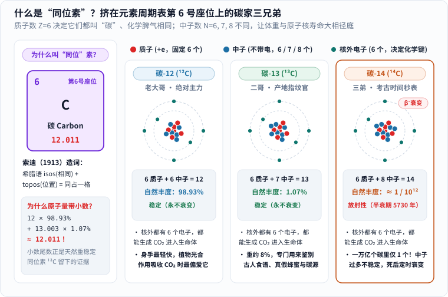
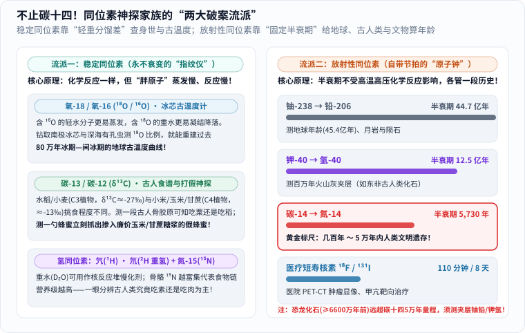
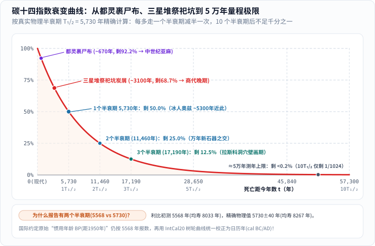
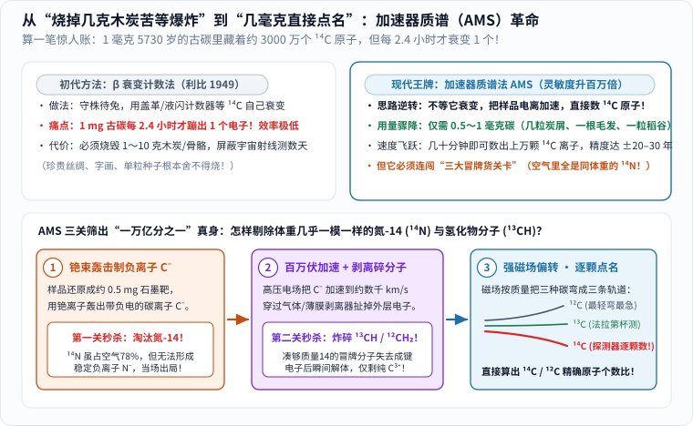
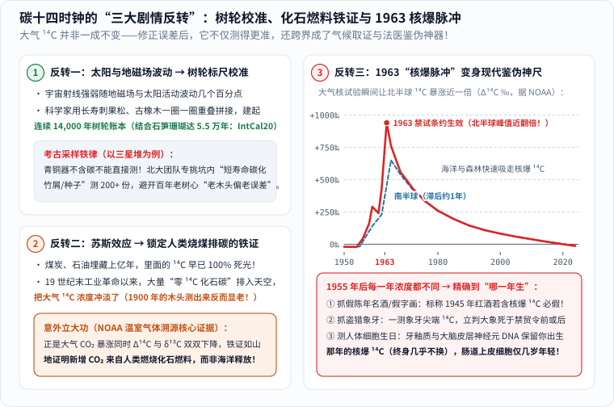

如果把下面这三桩看似八竿子打不着的“破案现场”摆在一起，你会发现科学比侦探小说还要离奇：

- **第一桩在四川广汉的考古大棚里**：三星堆遗址新发现的 6 座“祭祀坑”出土了成千上万件青铜神树、黄金面具和象牙，既没有留下一行自报年份的铭文，青铜本身也不含一星半点碳元素；但北京大学碳十四测年团队只提取了坑里两百多份不起眼的炭屑等样品，就以超过 $$94\%$$ 的高置信度宣布——4 号坑埋入地下的时间锁定在**公元前 1126 年至前 1016 年（置信度 $$94.1\%$$）**，3、6、8 号坑也全部落在**商代晚期（距今约 3200–3000 年，置信度 $$95.4\%$$）** [7]。
- **第二桩在海关与食品安全实验室里**：一罐色泽金黄的“纯天然百花蜜”，不管是测葡萄糖、果糖含量还是尝口感都无懈可击；检测员却只需烧掉一滴蜂蜜测一下碳原子的“体重比”，几分钟就当场抓获了掺入廉价玉米糖浆或甘蔗糖浆的造假者 [3]。
- **第三桩在名酒拍卖行与神经生物学实验室里**：一瓶标称 **1945 年份**的天价红酒，连软木塞都不用拔穿报废，就能铁证如山地拆穿它是 1960 年代后勾兑的赝品；同一把尺子甚至能测出——**你大脑皮层里的神经元和你本人同岁（出生后几乎终身不换），而你肠道内壁的细胞才刚满几岁** [4, 8]！

这三桩神乎其技的破案背后，站着同一个隐形家族：**同位素（Isotope）**；而在整个家族里名气最大、故事最多、反转也最精彩的头号明星，正是大名鼎鼎的**碳十四（Carbon-14，写作 $${}^{14}\mathrm{C}$$）**。

不过，每次听到“同位素”和“碳十四测年”，大多数人脑海里都会蹦出四个最容易卡壳的疑问：

1. **到底什么是“同位素”？** 为什么两种原子在化学反应里脾气秉性一模一样，连植物和人体都分不清，偏偏体重不一样，一个能永生稳定、另一个却像定时炸弹一样自己衰变？
2. **除了碳十四，其他同位素都在干什么？** 为什么恐龙化石（至少 6600 万年前）绝对不能用碳十四测年龄？
3. **最大的脑筋急转弯来了：地球已经 $$45.4$$ 亿岁了，而碳十四的半衰期只有短短 $$5730$$ 年——按理说它早就对折上百万次、连渣都不剩了，为什么今天我们呼吸的空气和吃的米饭里依然源源不断有碳十四？**
4. **一万亿个普通碳原子里才藏着 $$1$$ 个碳十四！** 现代科学家凭什么只取**半毫克（比一粒芝麻还轻）**的样品，就能避开空气里占 $$78\%$$、体重几乎一模一样的氮气干扰，把碳十四一颗一颗数出来？

我们先把元素周期表翻到第 6 号座位，去认识一下挤在同一张椅子上的“碳氏三兄弟”。

---

## 一、元素周期表上的“同座三兄弟”：到底什么是同位素？

### 1. 1913 年的怪事：几十种“不同重量的放射性元素”，怎么抢起了同一个座位？

在之前的文章[《同一张元素周期表，为什么俄罗斯的看起来不一样？》]()里我们聊过，元素周期表就像是给宇宙万物排座位的“大礼堂”——1 号座坐氢（$$\mathrm{H}$$），6 号座坐碳（$$\mathrm{C}$$），7 号座坐氮（$$\mathrm{N}$$），秩序井然。

可在 20 世纪初，研究放射性的化学家们差点被逼疯了：他们在铀矿和钍矿的衰变产物里一口气发现了三四十种“新物质”——**有的半衰期只有几分钟，有的长达几千年，原子重量也明显差了一截；可一旦把它们放进烧杯做化学实验，好几种物质的化学性质竟然完完全全重叠，用尽全世界最精密的沉淀、结晶、蒸馏手段都分不开！** 如果给每种物质都单独发一张周期表座位卡，整张元素周期表当场就得挤爆。

1913 年，英国放射化学家**弗雷德里克·索迪（Frederick Soddy，1921 年诺贝尔化学奖得主）**拍案提出了一个石破天惊的解释：它们根本不是不同的化学元素，而是**同一种元素长出了“体重不同”的孪生兄弟**，理应共享周期表上的同一个格子 [1]！他采纳友人玛格丽特·托德医生的建议，用希腊语词根 *isos*（相同）加上 *topos*（位置），造出了 **Isotope** 这个词——翻译成中文，就是信达雅到了极致的三个字：**同位素（占同一个位置的元素）** [1]。

直到 1932 年詹姆斯·查德威克（James Chadwick）发现原子核里不带电的**中子（Neutron）**，同位素的全部底牌才彻底揭晓。

### 2. 原子世界的身份密码：质子定“姓氏”，电子定“脾气”，中子定“胖瘦与寿命”

把任意一颗原子放大一百亿倍，里面其实只有三种基本角色，分工明确得像一家公司 [3]：

- **质子（Proton，带 $$1$$ 个正电荷 $$+e$$）——决定“姓什么、坐几号座”**：原子核里有几个质子（原子序数 $$Z$$），它就是几号元素，绝不含糊。只要核里是 $$6$$ 个质子，它就永远姓“碳”（第 6 号座）；一旦变成 $$7$$ 个质子，它当场改姓“氮”（第 7 号座）。
- **核外电子（Electron，带 $$1$$ 个负电荷 $$-e$$）——决定“化学脾气”**：电中性的原子里，核外电子数严格等于质子数（碳原子外围都有 $$6$$ 个电子）。**日常所有的燃烧、光合作用、消化吸收等化学反应，本质上都只是最外层电子在牵手重组，根本碰不到深藏在核心里的原子核！** 所以只要质子数相同，外围电子排布就一模一样，化学性质几乎像复印出来的一样 [3]。
- **中子（Neutron，不带电，质量与质子几乎相等）——决定“体重与核稳定性”**：中子在原子核里充当抵抗质子正电排斥力的“强核力胶水”。多背一两个中子，原子的质量数 $$A = Z + N$$ 就会变重，但完全不影响外围电子谈恋爱；**不过中子也不能乱塞——比例恰当时原子核固若金汤（稳定同位素），一旦中子塞得太多打破核力平衡，原子核就会择机“吐出粒子”自我改组（放射性同位素）！**

### 3. 解开中学化学课本的伏笔：为什么碳的相对原子质量是 `12.011`，而不是整整齐齐的 `12`？

理解了这三条规则，我们再看自然界里的碳元素，一切就豁然开朗了（下图建议按**先看左栏第 6 号碳格 → 再横向对比右栏三兄弟的核内粒子与丰度 → 最后核对左下角的原子量账单**顺序阅读）：

你看，地球上天然存在的碳原子，全都是挤在第 6 号座位上的“碳氏三兄弟”（左上角标质量数 $$A$$，左下角标质子数 $$Z$$）[3]：

1. **老大“碳-12”（$${}^{12}_{6}\mathrm{C}$$）——绝对主力**：$$6$$ 个质子 + $$6$$ 个中子，占了自然界所有碳原子的 **$$98.93\%$$**。核内配比完美，永不衰变（稳定同位素）；因为身手最轻快，绿色植物做光合作用抓 $$\mathrm{CO}_2$$ 时最偏爱它。
2. **老二“碳-13”（$${}^{13}_{6}\mathrm{C}$$）——隐形指纹官**：$$6$$ 个质子 + $$7$$ 个中子，比老大重了约 $$8.3\%$$，占自然界碳的 **$$1.07\%$$**，同样**永不衰变**。中学化学课本上，国际纯粹与应用化学联合会（IUPAC）正是把一颗 $${}^{12}\mathrm{C}$$ 原子的质量硬性规定为精确的 $$12\ \mathrm{u}$$，再按天然稳定同位素丰度算出加权平均：
   $$\overline{A}_{\mathrm{C} } = 12 \times 98.93\% + 13.00335 \times 1.07\% \approx 12.011$$
   **课本上那个不起眼的小数尾巴 `.011`，正是老二“碳-13”在自然界留下的签名！**
3. **老三“碳-14”（$${}^{14}_{6}\mathrm{C}$$）——稀世时间秒表**：$$6$$ 个质子硬扛着 **$$8$$ 个中子**！自然界里每 **一万亿（$$10^{12}$$）个**碳原子当中，仅仅藏着大约 **$$1$$ 个**碳-14（相当于往 $$20$$ 座标准奥运泳池的水里滴进 $$1$$ 滴墨水，连小数点后第十位都排不上号）[3]。但正因为核里多了两个嫌挤的中子，它是三兄弟里唯一的**放射性同位素**——每隔 **$$5730 \pm 40$$ 年**就会严格衰变掉一半 [3, 5]！

---

## 二、不止碳十四！同位素“神探家族”的两大破案流派

在把聚光灯彻底打向碳十四之前，非常值得花三分钟认识一下整个“同位素神探局”。很多读者误以为“同位素 = 放射性 = 测年代”，其实自然界 80 多种稳定元素拥有约 250 种**稳定同位素**和数千种**放射性同位素**，它们在科学界分成了分工截然不同的**两大破案流派**：

### 1. 流派一：稳定同位素——永不衰变，却靠“胖原子跑得慢”查清古气候、古食谱与假蜂蜜

既然稳定同位素化学性质一样、又不会衰变，科学家怎么利用它破案？秘诀只有六个字：**同位素质量分馏（Mass Fractionation）**——**化学反应虽然一样，但背着额外中子的“胖原子”振动更慢、蒸发更费劲、穿过细胞膜也更迟钝！**

- **地球 80 万年古温度计（氧-18 / 氧-16，$${}^{18}\mathrm{O} / {}^{16}\mathrm{O}$$）**：海水蒸发变成水蒸气时，含轻氧的水分子（$$\mathrm{H}_2{}^{16}\mathrm{O}$$）身轻如燕，优先飞上天空；含重氧的水分子（$$\mathrm{H}_2{}^{18}\mathrm{O}$$）笨重懒惰，在往南北极飘移的路上稍一降温就优先凝成雨雪掉回海里。气候越寒冷，能活着飘到南极和格陵兰冰盖上的 $${}^{18}\mathrm{O}$$ 就越少！科学家钻取几千米深的南极冰芯与深海有孔虫外壳，逐层测量 $${}^{18}\mathrm{O}/{}^{16}\mathrm{O}$$ 比值，硬是把过去 **80 万年地球冰期与间冰期的温度曲线**画得清清楚楚。
- **古人食谱还原与真假蜂蜜打假（碳-13 / 碳-12，$$\delta^{13}\mathrm{C}$$）**：实验室里通常用千分偏差 $$\delta^{13}\mathrm{C}$$ 来衡量样品比国际标准少了多少重碳 [3]：
  $$\delta^{13}\mathrm{C} = \left( \frac{(^{13}\mathrm{C}/^{12}\mathrm{C})_{\text{样品} } }{(^{13}\mathrm{C}/^{12}\mathrm{C})_{\text{标准} } } - 1 \right) \times 1000\text{‰}$$
  奇妙的是，地球上的植物演化出了两套光合作用生产线 [3]：
  - **C3 植物**（水稻、小麦、大豆、树木以及绝大多数蜜源开花植物）非常“挑食”，极度嫌弃笨重的 $${}^{13}\mathrm{CO}_2$$，体内 $$\delta^{13}\mathrm{C}$$ 很低，约为 **$$-25\text{‰}\sim -27\text{‰}$$**；
  - **C4 植物**（耐旱抗晒的小米/粟、黍、玉米、甘蔗、高粱）自带“二氧化碳浓缩泵”，来者不拒，体内 $$\delta^{13}\mathrm{C}$$ 高得多，约为 **$$-12\text{‰}\sim -14\text{‰}$$**！
  这就诞生了两大神技：① **考古学家测一截新石器时代古人骨骼胶原蛋白的 $$\delta^{13}\mathrm{C}$$**（再配合越往食物链顶端越富集的氮-15，$${}^{15}\mathrm{N}/{}^{14}\mathrm{N}$$），立刻知道这位先民生前吃的是黄河流域的小米（粟黍），还是长江流域的大米，乃至肉食占了几成！② **质检员测一勺蜂蜜**：蜜蜂采的百花蜜属于 C3 植物（约 $$-25\text{‰}$$），造假者一旦兑入廉价的玉米果葡糖浆或甘蔗糖浆（全是 C4 植物，约 $$-13\text{‰}$$），任凭化学甜度伪装得再像，$$\delta^{13}\mathrm{C}$$ 指标当场“爆表”露馅！

### 2. 流派二：放射性同位素——无视烈火寒冰的“核内节拍器”，为什么恐龙化石不能用碳十四测？

放射性同位素的脾气恰好相反：原子核外哪怕经历摄氏几千度的火山岩浆、几万个大气压的地壳挤压，或者被强酸强碱腐蚀成灰，**都丝毫改变不了原子核内部固有的衰变半衰期**！不过，每把“放射性尺子”都有自己的专属量程（见上图右栏）：

- **量几十亿年（地球与太阳系年龄）**：靠**铀-238 $$\to$$ 铅-206**（半衰期 **$$44.7$$ 亿年**）和**铀-235 $$\to$$ 铅-207**（$$7.04$$ 亿年）。1956 年克莱尔·帕特森正是测量陨石中的铅同位素，定出了地球年龄 **$$45.4 \pm 0.5$$ 亿年**。
- **量几百万到几亿年（恐龙与早期古人类）**：靠火山灰矿物里的**钾-40 $$\to$$ 氩-40**（半衰期 **$$12.5$$ 亿年**）。这也是为什么**恐龙化石（灭绝于 $$6600$$ 万年前）绝对不能测碳十四**：一来恐龙骨骼早已被地下水矿物替换成了石头，原本的有机碳几乎荡然无存；二来就算留有碳，$$6600\text{ 万年} \div 5730\text{ 年} > 11500$$ 个半衰期——别说一块化石，就算把整个地球质量的纯碳十四摆在那儿，$$6600$$ 万年后也早已衰变到连 **$$1$$ 颗原子都不剩**了！地质学家测恐龙年代，测的其实是包裹化石上下层**火山灰夹层**里的铀铅或钾氩时钟。
- **量几十分钟到几天（医院核医学显像）**：比如医院查肿瘤最常用的 `PET-CT`，给患者静脉注射一点点挂着**氟-18（$${}^{18}\mathrm{F}$$，半衰期仅 $$110$$ 分钟）**的葡萄糖类似物，癌细胞抢食葡萄糖最凶，$${}^{18}\mathrm{F}$$ 在病灶处发出正电子信号被机器精准定位，一天之内就衰变排空，安全又灵敏。
- **量几百年到 $$5$$ 万年（人类文明黄金档）**：从旧石器时代晚期洞穴壁画、农业起源、良渚与三星堆，一直到秦汉简牍与中世纪羊皮卷，铀铅太慢“指针根本不动”，氟-18 太快“眨眼就光”——唯有半衰期 **$$5730$$ 年**的**碳十四**，不偏不倚卡在了人类文明史最黄金的刻度上 [2, 3, 5]！

---

## 三、碳十四的生死闭环：地球已经 45.4 亿岁了，为什么半衰期仅 5730 年的碳十四没绝迹？

现在，我们来正面解开那个最让人拍案叫绝的谜题：**既然超过 $$5$$ 万年（约 $$10$$ 个半衰期）碳十四就会衰变掉 $$99.9\%$$ 以上，那在 $$45.4$$ 亿岁的地球上，今天的碳十四究竟是从哪冒出来的？**

1946 至 1949 年间，曾参与曼哈顿计划的美国化学家**威拉德·利比（Willard F. Libby，因此独得 1960 年诺贝尔化学奖）**想通了整条因果链 [2]：**地球上的碳十四根本不是地球诞生时的“老遗产”，而是头顶一万多米高空每分每秒都在现造的“新鲜货”！**

下面的闭环图包含一段播放一次并停留在终态的轻量级动画（支持系统“减少动态效果”设置；如已播放完毕，可点击[单独打开碳十四生死闭环动画 SVG](/assets/images/isotopes-c14/c14-cosmic-birth-life-death-cycle.svg)并刷新重播）。请按 **① 高空造碳 $$\to$$ ② 活体实时充值 $$\to$$ ③ 死后断电读秒** 三步跟读：

### 1. 第一步：一万五千米高空的“宇宙射线造碳工厂”

外太空深处无时无刻不在向地球倾泻高能**宇宙射线**（主要是高速质子）。当它们猛烈撞进距地面约 **$$12\text{–}15\ \mathrm{km}$$** 的平流层下部与对流层顶时，会把空气里的原子核撞碎，溅射出一大批慢速游荡的**热中子（$${}^{1}_{0}n$$）** [3]。

别忘了，地球大气里占 **$$78\%$$** 的绝对霸主是谁？是**氮气（$${}^{14}_{7}\mathrm{N}$$，$$7$$ 质子 + $$7$$ 中子）**！慢中子一头钻进氮-14 原子核，顺脚把里面 $$1$$ 个带正电的质子踢出家门 [3]：

$${}^{1}_{0}n + {}^{14}_{7}\mathrm{N} \longrightarrow {}^{14}_{6}\mathrm{C} + {}^{1}_{1}p$$

我们来数数核子账：反应前核子总数是 $$1 + 14 = 15$$，踢走 $$1$$ 个质子（氢核 $${}^{1}_{1}p$$）后，剩下的原子核里核子总数还是 $$14$$，但**质子从 $$7$$ 个变成了 $$6$$ 个、中子从 $$7$$ 个变成了 $$8$$ 个——氮原子当场“改姓”，变成了一颗新鲜出炉的碳十四（$${}^{14}_{6}\mathrm{C}$$）**！

刚出生的碳十四化学脾气跟普通碳一模一样，眨眼间就和氧气结合成带放射性的二氧化碳（$${}^{14}\mathrm{CO}_2$$），顺着大气环流均匀混入全球空气中。全球每年大约新造出 $$7.5$$ 公斤碳十四，恰好与全球每年衰变消失的碳十四总量打成平手，让大气里的 $${}^{14}\mathrm{C} / {}^{12}\mathrm{C}$$ 长期稳定在 **$$1 : 10^{12}$$** 左右 [2, 3]。

### 2. 第二步与第三步：活着实时“充值”，死亡瞬间“摁下秒表”

接下来就是利比最天才的推论了 [2]：

- **只要生物还活着，秒表永远显示“零岁”**：绿色植物做光合作用时，把空气里的 $${}^{12}\mathrm{CO}_2$$ 和万亿分之一的 $${}^{14}\mathrm{CO}_2$$ 一视同仁做成淀粉和纤维素；食草动物吃草，人类和食肉动物吃粮吃肉——**所有活着的植物、动物和你我，体内每时每刻都在呼吸、吃饭、新陈代谢，一边有极少量 $${}^{14}\mathrm{C}$$ 衰变走，一边又从空气和食物里实时“满格充值”补回来**。因此，活体生物身上的 $${}^{14}\mathrm{C} / {}^{12}\mathrm{C}$$ 比例始终跟大自然大气保持同步（$$100\%$$ 现代碳水平）[2, 3]。
- **一旦生物死亡，充值瞬间切断，倒计时正式启动！** 树木被砍倒烧成木炭、亚麻被割下织成布、竹子被劈成竹篾、动物停止呼吸的那一刻，它就与大气碳库彻底断开了联系：**遗骸里的老大哥 $${}^{12}\mathrm{C}$$ 稳如泰山，一万年也不少一颗；而老三 $${}^{14}\mathrm{C}$$ 发生 $$\beta^-$$ 衰变**——核里 $$1$$ 个中子变成 $$1$$ 个质子，同时吐出 $$1$$ 颗电子（$$e^-$$）和 $$1$$ 颗反电子中微子（$$\bar{\nu}_e$$），静悄悄地变回氮气溜走 [3]：
  $${}^{14}_{6}\mathrm{C} \longrightarrow {}^{14}_{7}\mathrm{N} + e^- + \bar{\nu}_e$$

### 3. 指数衰变公式与一个有趣的考古冷知识：为什么会有 `5568 年` 和 `5730 年` 两个半衰期？

既然老大哥 $${}^{12}\mathrm{C}$$ 的数量不变，我们根本不需要知道这块木头当年原本有多重——**只需要测出样品里现在的 $${}^{14}\mathrm{C} / {}^{12}\mathrm{C}$$ 比值 $$R(t)$$，相当于活体标准比值 $$R_0$$ 的百分之几，就能直接反推出它死了多少年** [3, 5]！

按真实物理半衰期 $$T_{1/2} = 5730 \pm 40$$ 年（对应的平均寿命 $$\tau = T_{1/2} / \ln 2 \approx 8267$$ 年），剩余比例遵循极其优美的指数衰变律 [3]：

$$\frac{R(t)}{R_0} = \left(\frac{1}{2}\right)^{t / 5730} = e^{-t / 8267}, \qquad t = -8267 \ln\!\left(\frac{R(t)}{R_0}\right)$$

把典型文物放进这张精确计算的指数曲线上，每一格刻度都清清楚楚：

- **都灵裹尸布（1988 年牛津、亚利桑那、苏黎世联邦理工三家实验室盲测）**：织物亚麻纤维里的 $${}^{14}\mathrm{C}$$ 还剩约 **$$92.2\%$$**，代入公式一算仅距今约 $$670$$ 年（树轮校正后落在 **公元 1260–1390 年**，置信度 $$95\%$$），一锤定音证实这块著名亚麻布织造于中世纪，而非两千年前 [5]。
- **三星堆祭祀坑炭化竹屑**：$${}^{14}\mathrm{C}$$ 还剩约 **$$68.7\%$$**，距今约 $$3100$$ 年（商代晚期）[7]。
- **过 $$1$$ 个半衰期（$$5730$$ 年）**：剩 **$$50\%$$**（阿尔卑斯山冰川里发现的“冰人奥兹”距今约 $$5300$$ 年，略年轻于此）。
- **过 $$2$$ 个半衰期（$$11460$$ 年）**：对折再对折，剩 **$$25\%$$**；**过 $$3$$ 个半衰期（$$17190$$ 年）**：剩 **$$12.5\%$$**（法国拉斯科洞穴壁画时期）。
- **过 $$9\sim 10$$ 个半衰期（$$51570\sim 57300$$ 年）**：只剩 $$(1/2)^{10} = 1/1024 < 0.1\%$$！此时极其微弱的真实信号很容易被环境微量现代碳污染淹没，因此**碳十四测年的实战上限大约在 $$5\text{–}5.5$$ 万年左右** [3, 5]。

> **读专业考古报告必懂的冷知识：为什么论文里总写“惯用半衰期 5568 年”？**
> 细心的读者去翻牛津大学放射性碳加速器实验室（ORAU）或中国社科院考古所的测年报告时，常会吓一跳：怎么公式里写的半衰期是 **$$5568$$ 年**（平均寿命 $$8033$$ 年），而不是教科书上的 **$$5730$$ 年** [5]？
> 原来，利比在 1949 年最初测出的半衰期是 $$5568 \pm 30$$ 年；等后来物理学家测准为 $$5730 \pm 40$$ 年（差了约 $$3\%$$）时，全世界已经用 $$5568$$ 年发表了成千上万篇考古数据！如果一半实验室改用新数、一半还用旧数，整个历史学界就会陷入彻底的换算灾难。于是国际碳十四学界达成了一项聪明的公约 [5]：
> 1. 所有实验室公布原始**“惯用碳十四年龄（Conventional Radiocarbon Age，单位 `BP`，严格定义为距 **1950 年** 的年数）”**时，统一继续按利比的 $$5568$$ 年（$$T_{\mathrm{BP} } = -8033 \ln(R/R_{1950})$$）报数，保证全球百年文献口径绝对一致；
> 2. 随后在套用国际标准树轮校准曲线（如 `IntCal20`）把 `BP` 换算成真实历史日历年（写作 `cal BC` 或 `cal AD`）时，**校准曲线已经把“$$5568 \to 5730$$ 的 $$3\%$$ 偏差”连同“古代大气浓度波动”一次性全部修正到位**，最终日历年代分毫不差 [5]！

---

## 四、毫克级“大海捞针”：加速器质谱（AMS）怎样从一万亿颗原子里揪出碳十四？

原理听起来很浪漫，可一旦动手测量，早期科学家就撞上了一堵令人绝望的物理高墙。

### 1. 给 1 毫克古碳算一笔硬账：明明藏着 3000 万颗碳十四，却要苦等 2.4 小时才衰变 1 颗！

我们来亲手算一笔账，你立刻就能明白为什么 1970 年代末之前的考古学家每次送检样品都肉疼得直哆嗦。

取 **$$1\ \mathrm{mg}$$（$$0.001$$ 克，大约两三粒芝麻壳碳化后的重量）**的古木炭，里面一共有多少个碳原子？用阿伏伽德罗常数 $$N_A = 6.022 \times 10^{23}\ \mathrm{mol^{-1} }$$ 一除：

$$N_{\mathrm{C} } = \frac{10^{-3}\ \mathrm{g} }{12\ \mathrm{g/mol} } \times 6.022 \times 10^{23}\ \mathrm{mol^{-1} } \approx 5.02 \times 10^{19}\text{ 个碳原子}$$

假设这是一件距今 $$5730$$ 年（刚好过去 $$1$$ 个半衰期）的珍贵文物，现代标准碳里 $${}^{14}\mathrm{C}$$ 丰度约为 $$1.2 \times 10^{-12}$$，折半后还剩 $$0.6 \times 10^{-12}$$。那么在这小小 $$1$$ 毫克古碳里，此时此刻还静静躺着多少颗碳十四原子？

$$N_{14} \approx 5.02 \times 10^{19} \times \left(0.6 \times 10^{-12}\right) \approx 3.01 \times 10^{7}\text{ 个（整整 3000 万颗！）}$$

**足足三千万颗碳十四原子！听起来很多对不对？** 可如果我们采用利比 1949 年的初代办法——把样品放进盖革计数器或液体闪烁计数器里，“守株待兔”等它们自己发生 $$\beta^-$$ 衰变吐出电子呢？

别忘了碳十四的平均寿命 $$\tau \approx 8267\text{ 年} \approx 7.25 \times 10^{7}\text{ 小时}$$！三千万颗原子分摊到七千多万个小时里慢慢衰变：

$$\frac{N_{14} }{\tau} \approx \frac{3.01 \times 10^{7} }{7.25 \times 10^{7}\ \mathrm{h} } \approx 0.415\ \mathrm{h^{-1} } \quad\Longrightarrow\quad \text{每 } 2.4\text{ 小时才衰变 } 1\text{ 颗！}$$

天哪！为了攒够一万次衰变信号把统计误差压到 $$\pm 1\%$$，只测 $$1$$ 毫克样品得在地下铅屏蔽室里苦等**整整三年**！所以早年的衰变计数法别无选择，只能狠心**烧毁 $$1$$ 到 $$10$$ 克（一大把木炭或一整截古人骨头）**的样品。像都灵裹尸布、战国丝绸、敦煌残卷或者古遗址里唯一的一粒碳化稻谷，谁舍得抓一把扔进炉子里烧掉？

### 2. 加速器质谱（AMS）的三道物理奇招：既然不等它衰变，为什么普通质谱仪会被“氮-14”骗惨？

1977 年前后，核物理学家拍着桌子换了一个降维打击的思路：**既然 $$1$$ 毫克古碳里明明趴着 $$3000$$ 万颗现成的 $${}^{14}\mathrm{C}$$ 原子，我们干嘛傻等它每两个半小时慢吞吞自爆一颗？直接把所有碳原子电离、加速，按体重排队一颗一颗数出来不就完了吗？！**

但普通实验室质谱仪一上阵就败下阵来——因为样品里哪怕混进一丝丝空气，空气里铺天盖地的**氮-14（$${}^{14}\mathrm{N}$$，原子质量 $$14.00307\ \mathrm{u}$$）**跟**碳-14（$${}^{14}\mathrm{C}$$，原子质量 $$14.00324\ \mathrm{u}$$）**体重只差**十万分之十二**，还有一大堆凑够质量 $$14$$ 的氢化物冒牌分子（如 $${}^{13}\mathrm{CH}$$、$${}^{12}\mathrm{CH}_2$$），普通磁场根本分不开 [6]！

为此，**加速器质谱仪（Accelerator Mass Spectrometry，简称 AMS）**设计了三道堪称艺术品的物理关卡（按图中 **① 制负离子杀氮 $$\to$$ ② 剥离膜碎分子 $$\to$$ ③ 强磁场分三道** 顺序阅读）[3, 6]：

1. **第一关：铯离子轰击制取“负离子 $$\mathrm{C}^-$$”——当场秒杀氮-14！**
   前处理人员先把仅重 **$$0.5\text{–}1\ \mathrm{mg}$$** 的样品燃烧成纯 $$\mathrm{CO}_2$$，在 $$625\ ^\circ\mathrm{C}$$ 铁催化剂上用氢气还原成米粒尖大小的**石墨靶** [6]。随后用铯离子束（$$\mathrm{Cs}^+$$）猛轰石墨，溅射出**额外多抓了 $$1$$ 个电子的负碳离子（$$\mathrm{C}^-$$）**。
   **最绝的量子化学特性就在这儿：碳原子很乐意多抓一个电子形成稳定的 $$\mathrm{C}^-$$，而氮原子的外层半满轨道极度排斥额外电子——氮-14 根本无法形成稳定的负离子 $$\mathrm{N}^-$$！** 仅仅一个“只准负离子进门”的电场，就把数量比碳十四多出百亿倍的头号冒牌货 $${}^{14}\mathrm{N}$$ 在起跑线上团灭出局 [6]！
2. **第二关：数百万伏高压加速 + 穿过“剥离器”——炸碎一切冒牌分子！**
   虽然氮-14 出局了，但负离子队伍里还混着体重也是 $$14$$ 的“拼盘分子” $${}^{13}\mathrm{CH}^-$$ 和 $${}^{12}\mathrm{CH}_2^-$$。串列静电加速器用数百万伏高压把负离子加速到**每秒数千公里（百分之几光速）**，让它们高速撞穿一层极薄的气体或碳膜**剥离器（Stripper）** [6]。剧烈碰撞瞬间扯掉原子外围的 $$4$$ 到 $$5$$ 个电子，负离子摇身变成带正电的裸碳离子（$$\mathrm{C}^{3+}$$ 或 $$\mathrm{C}^{4+}$$）再次被正高压猛推一把；而那些靠共享电子维系化学键的 $${}^{13}\mathrm{CH}$$、$${}^{12}\mathrm{CH}_2$$ 分子一旦被扒光成键电子，**瞬间在正电排斥下粉身碎骨**，连渣都混不过第二关 [6]！
3. **第三关：强磁场弯道赛跑——各走各道，逐颗点名！**
   闯过前两关的纯正高价碳离子飞入强分析磁场。根据洛伦兹力与向心力平衡 $$qvB = mv^2/r$$，同样电荷与能量下，**质量越轻转弯越急、质量越重轨迹越直**：数量庞大的 $${}^{12}\mathrm{C}$$ 和 $${}^{13}\mathrm{C}$$ 分别拐进两侧的“法拉第杯”测出总电流，而万里挑一的真身 $${}^{14}\mathrm{C}$$ 独自飞进最外侧的粒子探测器，**啪、啪、啪一颗不落地直接数出总颗数** [6]！

靠着这三招，AMS 把碳十四测年的样品消耗量从“几克”暴降了上千倍到**几百微克（一根头发丝、一粒种子、字画边缘半毫米纸纤维）**，测量时间从几天缩短到**几十分钟**，年代误差缩小到惊人的 **$$\pm 20\text{–}30$$ 年**！

---

## 五、当秒表遇上真实地球：三星堆断代、化石燃料铁证与 1963“核爆脉冲”

故事讲到这里似乎已经圆满，但真正的科学魅力恰恰在于：**大自然从来不像理想实验室那么乖巧。** 利比当年做了一个关键假设——“过去几万年里，地球大气中的碳十四浓度一直恒定不变”。结果科学家越测越精细，居然测出了**三次意想不到的大反转**；而每一次修正反转，非但没有摧毁碳十四测年，反而给人类解锁了全新的跨界超能力！

### 1. 反转一：太阳与地磁场波动 $$\to$$ 14,000 年树轮账本（`IntCal20`）与三星堆“竹屑破案法”

20 世纪 50 年代末，科学家拿已知确切历史年份的古埃及法老墓木料去测碳十四，惊讶地发现测出来的年龄比真实历史偏年轻了好几百年！

追查下去才明白：地球磁场强弱会随千年尺度缓慢起伏，太阳黑子与太阳风也在百年尺度上强弱交替——地磁场和太阳风就像地球的“防弹衣”，防弹衣变强时挡住了更多宇宙射线，高空造出来的碳十四就会少几个百分点；反之又会多几个百分点 [5]。

**怎么给这只忽快忽慢几百分点的秒表对表？大自然早就替我们写好了一本一年一页的“活账本”——树木年轮！**

温带树木每年春夏长一圈浅色早材、秋冬长一圈深色晚材；**每一圈木质部纤维建成之后就不再参与新陈代谢，把“当年那一年大气里的碳十四浓度”原封不动封存了进去** [5]！科学家先找来地球上寿命最长的活树——美国加州怀特山脉活了近 **$$5000$$ 岁**的**刺果松（Bristlecone Pine）**，再把枯死倒木、爱尔兰与德国泥炭沼泽里保存上万年的古橡木、新西兰贝壳杉按年轮宽窄条形码一圈圈接力拼图，硬是拼出了一条**连续 $$14,000$$ 年一环不落的绝对年轮标尺**；再结合洞穴石笋、珊瑚铀系测年与日本水月湖年纹层沉积物，国际校准工作组发布了直达 **$$55,000$$ 年前**的黄金校准曲线 **`IntCal20`** [5]。

有了 `IntCal20` 和 AMS，我们再回头看开篇提到的**三星堆祭祀坑年代悬案**，就能看懂顶级考古学家到底是怎么出招的了 [5, 7, 8]：

1. **为什么不能直接测青铜神树和黄金面具？** 青铜（铜锡铅合金）与黄金里压根没有生物有机碳，无法做碳十四测年。
2. **为什么不挑坑里最粗壮的大木炭来测？** 考古大忌叫**“老木效应（Old-wood Effect）”** [5]！假如商朝工匠砍了一棵活了 $$400$$ 年的参天古树烧火祭祀，树心木质早在 $$400$$ 年前（夏末商初）就已经停止代谢死掉了——测树心测出的是“树芯长出来的年份”，而不是“祭祀坑掩埋的年份”，平白无故偏老几百年！（同理，水生贝壳与鱼骨会受溶解古老石灰岩或深海旧碳的**“碳库效应 Reservoir Effect”**影响而显老，也需专门校正 [5]。）
3. **北大与四川省文物考古研究院团队的破局妙招**：专门在 3、4、6、8 号等祭祀坑灰烬层中挑出 **$$200$$ 多份生长期仅 $$1\text{–}3$$ 年的“短寿命炭化竹屑”与植物种子**——竹子砍下当年或次年就烧成灰入坑，竹子的死亡年份几乎零时差等于祭祀掩埋年份！再把上百组高精度 AMS 数据放进贝叶斯统计模型对照 `IntCal20` 曲线，一举将 3 号坑（前 1117–前 1012 年，$$95.4\%$$）、4 号坑（前 1126–前 1016 年，$$94.1\%$$）、6 号坑（前 1201–前 1019 年，$$95.4\%$$）、8 号坑（前 1117–前 1015 年，$$95.4\%$$）全部锁定在**商代晚期**，彻底终结了延续三十多年的年代争论 [7]！

### 2. 反转二：苏斯效应——为什么碳十四成了“全球变暖归咎于人类烧煤”的铁证？

1955 年，奥地利化学家汉斯·苏斯（Hans Suess）发现了一件怪事：1950 年刚砍下来的新鲜树木，里面的碳十四比例竟然比 1850 年工业革命前的树木**凭空少了约 $$2\%$$**——仿佛 20 世纪的新木头一出生就“未老先衰”了一两百岁 [3, 4]！

原因一捅破简直让人拍案：**煤炭、石油、天然气全都是几亿年前古生物埋入地层变成的化石燃料，它们体内的碳十四早就衰变了成千上万个半衰期，含量是板上钉钉的 $$0\%$$（俗称“死碳 Dead Carbon”）** [3, 4]！

从 19 世纪末工业革命大规模烧煤、烧油开始，人类每年把数十亿吨不含一丁点碳十四的“零 $${}^{14}\mathrm{C}$$ 二氧化碳”排进天空，就像往一锅红糖水里猛兑白开水，把大气原本的 $${}^{14}\mathrm{C} / {}^{12}\mathrm{C}$$ 浓度硬生生冲淡了（称为**苏斯效应 Suess Effect**）[4]。

今天每当有人质疑：“大气二氧化碳从 $$280\ \mathrm{ppm}$$ 涨到 $$425\ \mathrm{ppm}$$ 以上，怎么证明不是海洋自己升温吐出来的？”美国国家海洋和大气管理局（NOAA）全球监测实验室给出的头号铁证正是同位素 [3, 4]：如果是现代海洋吐出的 $$\mathrm{CO}_2$$，里面必然带着现代水平的 $${}^{14}\mathrm{C}$$ 和较高的 $$\delta^{13}\mathrm{C}$$；而百年来全球观测网实测到的却是**大气 $$\mathrm{CO}_2$$ 总量飙升的同时，大气 $$\Delta^{14}\mathrm{C}$$ 与 $$\delta^{13}\mathrm{C}$$ 双双持续下滑**——唯有燃烧上亿年前古森林留下的化石燃料，才能留下这枚无可抵赖的“死碳指纹” [3, 4]！

### 3. 反转三：1963“核爆脉冲（Bomb Spike）”——抓假名酒字画、查盗猎象牙，还能给你的脑细胞算生日！

紧接着苏斯效应登场的，是人类历史上最剧烈的一次同位素人工脉冲。

20 世纪 50 年代中期到 **1963 年 10 月《部分禁止核试验条约》**生效前，美苏等国在大气层内密集引爆了数百颗氢弹与原子弹。热核爆炸瞬间释放出天文数字般的中子洪流，在短短几年内把高空氮气轰出了海量的碳十四——**到 1963 年下半年峰值时，北半球对流层大气里的碳十四浓度几乎凭空暴涨了一倍（$$\Delta^{14}\mathrm{C}$$ 冲上约 $$+940\text{‰}$$，南半球因跨赤道大气混合滞后约一年跟涨）** [4]！

1963 年底大气核试验叫停后，海洋表层与陆地森林迅速吸走多余的 $${}^{14}\mathrm{CO}_2$$，大气碳十四浓度沿着一条**每年高度都不一样、斜率极其陡峭的滑梯曲线**逐年回落，直到 2020 年代初才重新回到核爆前的基准线附近（并因持续烧化石燃料继续往负值走）[4]。

这条陡峭的**“核爆脉冲曲线（Bomb Pulse）”**，意外让碳十四在现代法医学与生命科学里封神，干出了三件以前想都不敢想的大事：

1. **一招拆穿假陈年名酒与假近现代名画**：任何在 **1955 年之前**酿造的红酒、威士忌（比如拍卖行标称 1945 年份的波尔多红酒），或者 1940 年代画家用的亚麻籽油、画布与宣纸，绝对不可能含有核爆制造的超标碳十四！只要抽几微升酒液或半毫克画布纤维上 AMS 一测，一旦检出核爆脉冲信号，百分百是用 1955 年以后的葡萄和纸张伪造的现代假货，连具体是哪一年前后的粮食酿的都能反推出来！
2. **锁定盗猎象牙的真实猎杀年份**：国际象牙贸易禁令于 **1989 年**生效，不法分子常把新猎杀的非洲象牙做旧涂黄，谎称是禁令前的“合法老库存”。执法实验室只需从象牙根部新生长端刮下 $$1$$ 毫克牙本质对照核爆回落曲线，大象死于哪一年误差不超过一两年，盗猎谎言当场破产！
3. **测出你自己身体里不同器官细胞的“真实年龄”**：瑞典卡罗林斯卡学院的乔纳斯·弗里森（Jonas Frisén）、克尔斯蒂·斯波尔丁（Kirsty Spalding）与美国劳伦斯利弗莫尔国家实验室（LLNL）布鲁斯·布赫霍尔茨（Bruce A. Buchholz）团队想出了一个绝妙点子 [8]——**人体细胞只有在分裂增殖那一刻才会用当天吃的食物合成一套新 DNA，此后这套 DNA 里的碳原子就不再更换**！因此，测出某类人体细胞 DNA 或牙釉质里的核爆 $${}^{14}\mathrm{C}$$ 高度，去对一下上图右栏那条 1955–2024 年曲线，就能读出这批细胞是哪一年出生的：
   - **恒牙牙釉质**：一旦在童年钙化成型就终身不换，法医遇到无名遗骸时测一下牙釉质 $${}^{14}\mathrm{C}$$，就能把死者出生年份锁定在 **$$\pm 1.5$$ 年**以内！
   - **大脑皮层神经元**：DNA 里的碳十四浓度居然和你**出生那一年**的大气浓度几乎完全一致——证明人类大脑皮层绝大多数神经元陪你从摇篮一直走到白头，终身几乎不更新！
   - **心肌细胞 vs 肠道上皮细胞**：成人心肌细胞每年只缓慢更新不到 $$1\%$$，而日夜辛劳的**小肠上皮细胞**与白细胞，测出来的碳十四永远贴着最近一两年的大气数值——原来你的肠道内壁每隔几天、骨骼每隔十来年，就已经悄悄换成了“年轻的新身体”！

---

## 六、一张表带走“同位素与碳十四”全景密码

下次在博物馆看到青铜器展牌上的“距今约 3100 年”、在新闻里读到南极冰芯古气候，或者在体检中心路过核医学科时，不妨回想一下元素周期表小格子背后这群奇妙的“双胞胎原子”：

| 同位素主角 | 核内结构（质子 + 中子） | 稳定 / 半衰期 | 核心破案原理 | 代表性神探应用 |
| :--- | :--- | :--- | :--- | :--- |
| **碳-12（$${}^{12}\mathrm{C}$$）** | $$6p + 6n$$（占 $$98.93\%$$） | 稳定（永不衰变） | 原子质量基准（精确定义 $$12\ \mathrm{u}$$），生命骨架主力 | 碳十四测年时稳如泰山的“分母参照物” |
| **碳-13（$${}^{13}\mathrm{C}$$）** | $$6p + 7n$$（占 $$1.07\%$$） | 稳定（永不衰变） | 胖原子反应略慢，C3 与 C4 植物光合分馏不同 | 还原古人吃小米还是吃水稻、抓掺糖浆假蜂蜜 |
| **碳-14（$${}^{14}\mathrm{C}$$ · 自然）** | $$6p + 8n$$（约 $$1/10^{12}$$） | **$$5730 \pm 40$$ 年** | 高空宇宙射线轰氮现造；活体充值、死后 $$\beta^-$$ 衰变 | $$5$$ 万年以内有机文物断代（三星堆竹屑、都灵裹尸布） |
| **碳-14（$${}^{14}\mathrm{C}$$ · 现代）** | 同上（受化石碳与核爆调制） | 同上 | 烧煤稀释大气（苏斯效应）；1963 核爆脉冲逐年回落 | 锁定人类排碳铁证、鉴伪名酒字画象牙、测脑细胞年龄 |
| **氧-18（$${}^{18}\mathrm{O}$$）** | $$8p + 10n$$（约 $$0.20\%$$） | 稳定（永不衰变） | 重水分子蒸发慢、降温优先凝结降落 | 南极冰芯与深海沉积物重建 $$80$$ 万年地球古温度 |
| **铀-238 / 钾-40** | 超重 / 长寿命天然核素 | **$$44.7$$ 亿年 / $$12.5$$ 亿年** | 岩石结晶后母核素缓慢衰变为铅 / 氩 | 测地球 $$45.4$$ 亿岁高龄、火山灰夹层定标恐龙与古人类 |

一颗直径不足百亿分之一米的原子核，仅仅因为里面多装或少装了一两颗不带电的中子，既替地球记下了 45 亿年的沧海桑田，又替人类文明留住了三千年前古蜀祭祀坑里的袅袅竹烟，甚至在你我的牙齿与神经元里悄悄刻下了出生那一年的天空印记——这大概就是基础物理与化学联手写给世界最浪漫的一封情书。

---

## 参考资料与核查说明

1. **NobelPrize.org（诺贝尔奖官方档案）**：*Frederick Soddy – Biographical & Nobel Lecture (The Nobel Prize in Chemistry 1921)*。核查 1913 年弗雷德里克·索迪提出“同位素（Isotope，希腊语 *isos* + *topos* 意为元素周期表同一位置）”的概念背景与放射性衰变位移规律：<https://www.nobelprize.org/prizes/chemistry/1921/soddy/facts/>
2. **NobelPrize.org（诺贝尔奖官方档案）**：*Willard F. Libby – Radiocarbon Dating, Nobel Lecture (December 12, 1960)*。核查威拉德·利比于 1946–1949 年建立宇宙射线生成碳十四、活体碳库平衡及放射性碳测年法的原始原理与早期已知年代文物验证：<https://www.nobelprize.org/prizes/chemistry/1960/libby/lecture/>
3. **美国国家海洋和大气管理局全球监测实验室（NOAA Global Monitoring Laboratory）**：*The Power of Greenhouse Gas Isotopes — Isotope Chemistry, Radioactive Decay & What δ¹³C Tells Us*。核查碳的三种天然同位素丰度（$${}^{12}\mathrm{C}\approx 98.93\%$$、$${}^{13}\mathrm{C}\approx 1.07\%$$、$${}^{14}\mathrm{C}\approx 10^{-12}$$）、高空慢中子轰击 $${}^{14}\mathrm{N}$$ 核反应、$$5730$$ 年半衰期（$$10$$ 个半衰期后不足 $$0.1\%$$）及 C3/C4 植物 $$\delta^{13}\mathrm{C}$$ 分馏特征：<https://gml.noaa.gov/education/isotopes/chemistry.html> 、<https://gml.noaa.gov/education/isotopes/decay.html> 与 <https://gml.noaa.gov/education/isotopes/c13tellsus.html>
4. **NOAA Global Monitoring Laboratory**：*The Bomb Spike & Radiocarbon (¹⁴C) as a Tracer of Fossil Fuel CO₂*。核查化石燃料不含 $${}^{14}\mathrm{C}$$ 稀释大气浓度的苏斯效应（Suess Effect，证明大气新增 $$\mathrm{CO}_2$$ 源于化石燃料燃烧），以及 1950 年代至 1963 年《部分禁止核试验条约》前大气核试验引发的 1963 年“核爆脉冲（Bomb Spike）”南北半球演变规律：<https://gml.noaa.gov/education/isotopes/bombspike.html> 与 <https://gml.noaa.gov/education/isotopes/c14tracer.html>
5. **牛津大学放射性碳加速器实验室（Oxford Radiocarbon Accelerator Unit, ORAU）**：*Radiocarbon Dating, Calibration (`IntCal20`) & The Shroud of Turin*。核查为什么国际惯用碳十四年龄（`BP`，距 1950 年）仍采用利比半衰期 $$5568$$ 年（平均寿命 $$8033$$ 年）报数、物理真实半衰期为 $$5730 \pm 40$$ 年、都灵裹尸布三实验室中世纪测年结果，以及刺果松/古橡木 $$14,000$$ 年连续树轮序列与 `IntCal20` 校准曲线、老木效应与碳库效应：<https://c14.arch.ox.ac.uk/dating.html> 、<https://c14.arch.ox.ac.uk/calibration.html> 与 <https://c14.arch.ox.ac.uk/shroud.html>
6. **NOAA Global Monitoring Laboratory**：*Accelerator Mass Spectrometry (AMS)*。核查现代加速器质谱仪将毫克级碳样还原为石墨靶、利用铯离子轰击制取负碳离子 $$\mathrm{C}^-$$（直接淘汰无法形成稳定负离子的氮-14）、高压加速穿过剥离器击碎 $${}^{13}\mathrm{CH}$$ / $${}^{12}\mathrm{CH}_2$$ 分子及强磁场分离逐颗计数 $${}^{14}\mathrm{C}$$ 的物理流程：<https://gml.noaa.gov/education/isotopes/accelerator.html>
7. **北京大学新闻网**：《确认了！三星堆遗址祭祀坑年代》（2023 年 11 月 17 日，三星堆遗址考古多学科综合研究成果研讨会通报）。核查北京大学加速器质谱碳十四研究团队从六个祭祀坑采集 **200 多个测年样品**的综合测定结果（3 号坑公元前 1117–前 1012 年 `95.4%`、4 号坑公元前 1126–前 1016 年 `94.1%`、6 号坑公元前 1201–前 1019 年 `95.4%`、8 号坑公元前 1117–前 1015 年 `95.4%`，均属商代晚期）：<https://news.pku.edu.cn/info/2901/817801.htm>
8. **美国能源部科学与技术信息库（U.S. DOE OSTI / LLNL）**：Buchholz, B. A. (2012), *Carbon-14 Bomb Pulse Dating* (*Wiley Encyclopedia of Forensic Science*, pp. 1–5)；以及 Spalding, K. L., Bhardwaj, R. D., Buchholz, B. A., Druid, H., & Frisén, J. (2005), *Retrospective Birth Dating of Cells in Humans* (*Cell*, 122(1), 133–143)。核查利用 1955–1963 核爆脉冲碳十四测定恒牙牙釉质（误差 $$\pm 1.5$$ 年）、大脑皮层神经元与不同人体组织细胞更新年龄的法医与生物学机制：<https://www.osti.gov/biblio/1077195>
