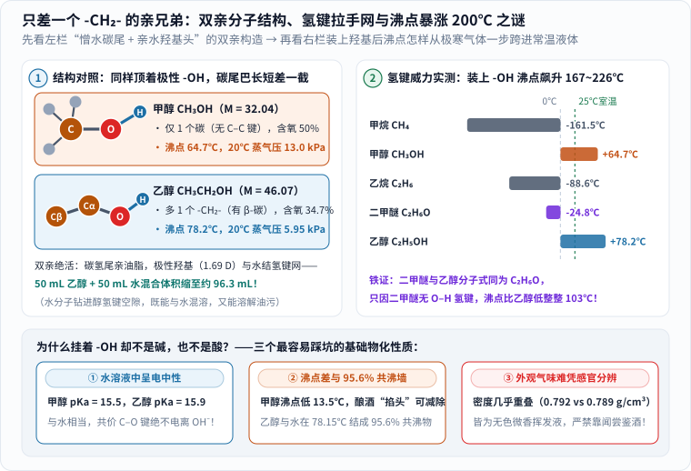
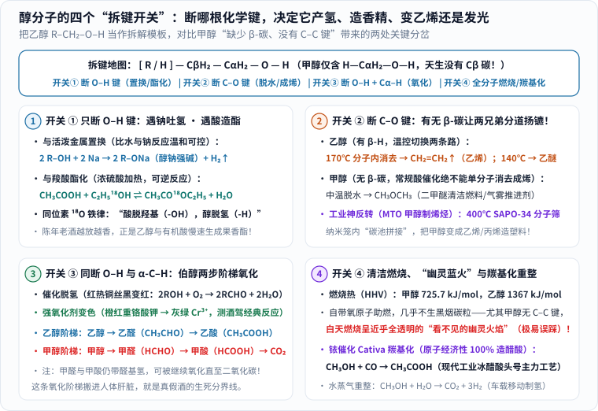
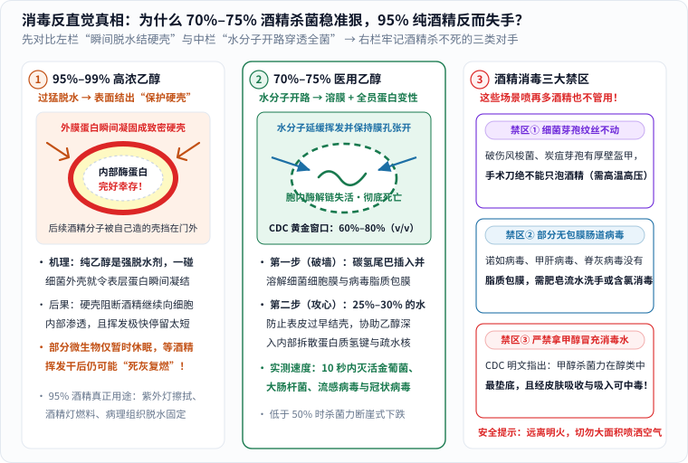
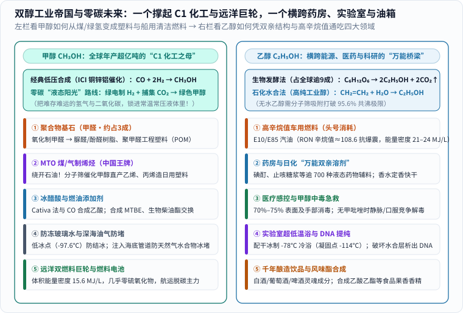

如果把两只一模一样的透明玻璃烧杯摆在你面前——左边装半杯纯**甲醇**（$\text{CH}_3\text{OH}$），右边装半杯纯**乙醇**（$\text{CH}_3\text{CH}_2\text{OH}$）——单靠肉眼和鼻子，哪怕是老练的调酒师也极难一眼分出高下：

它们同样清澈如水，同样带着微甜而清冽的挥发醇香，同样能与水按任意比例混溶；在 $20^\circ\text{C}$ 下，甲醇密度是 $0.792\text{ g/cm}^3$，乙醇密度是 $0.789\text{ g/cm}^3$，连比重计放进去都几乎停在同一条刻度线上。把分子模型拆开看，这对醇类家族里的“老大”和“老二”更是亲得不能再亲：乙醇不过是在甲醇的碳原子和羟基之间，多塞进去了一个平平无奇的**亚甲基**（$-\text{CH}_2-$）。

然而，就是这区区一个碳、两个氢的微小差距，却在人间划出了一道惊心动魄的生死鸿沟——

一个是陪伴人类走过九千年酿造史的杯中美酒、擦拭伤口的 $75\%$ 医用酒精、调配香水的灵魂溶剂；另一个却被称为夺命“木精”，误饮仅仅 **$4\text{–}15\text{ mL}$**（还不到半个矿泉水瓶盖！）就足以在十几个小时的诡异平静后让人坠入“暴风雪”般的永久失明。更让人拍案称奇的是：**当有人误喝甲醇假酒被推进急诊室时，在特效药到来之前，医生手里最经典的救命武器之一，偏偏就是给他灌下或静脉滴注真正的医用乙醇！**

只差一个碳，这对孪生兄弟的脾气究竟是从哪一步开始分道扬镳的？为什么挂着羟基（$-\text{OH}$）的它们既不是酸也不是碱？为什么 $95\%$ 的高纯酒精反而杀不死细菌？那个对人类视神经剧毒无比的甲醇，凭什么又在今天摇身一变，成了中国化工绕开石油造塑料的王牌，以及跨洋集装箱巨轮争相加注的“液态阳光”？

今天，我们就顺着原子与化学键的脉络，把**甲醇**与**乙醇**的物化本性、四大拆键反应、肝脏生死暗战与亿吨级工业版图一次看个通透。

---

## 一、从“烤木头滴出的怪酒”到宇宙云团：两兄弟的身世与双亲结构

在走进化学反应之前，先认清两兄弟的“户口本”。

人类认识**乙醇**（Ethanol，俗称酒精）极早。早在距今约九千年前的新石器时代（如中国河南贾湖遗址出土的陶罐残留物），先民就已经利用天然酵母菌，把谷物、蜂蜜与野果里的葡萄糖在无氧条件下变成了乙醇。

相比之下，**甲醇**（Methanol）的登场则充满炼金术向近代化学过渡的烟火气。1661 年，英国化学家**罗伯特·波义耳**（Robert Boyle）把黄杨木塞进隔绝空气的曲颈甑里高温干馏，从冷凝管末端接出了一种能点着火的透明液体，将它命名为“黄杨木之精”（*spirit of box*）——这就是甲醇至今被称为**“木精”或“木醇”（Wood alcohol）**的由来。直到 1834 年，法国化学家杜马（Jean-Baptiste Dumas）与佩利戈（Eugène Péligot）才测清它的元素组成，用希腊语里的“酒”（*methy*）拼上“树木”（*hȳlē*），造出了“甲基”（methyl）这个日后贯穿整部有机化学史的词根。

有趣的是，甲醇并非只有化工厂和烂木头里才有：
- **每天吃水果都在微量摄入它**：苹果、柑橘等果皮细胞壁富含**果胶**（Pectin），果胶分子链上挂着大量甲酯基。当我们吃下 $1\text{ kg}$ 新鲜苹果时，肠道微生物分解果胶最多可释放约 $0.4\text{–}0.6\text{ g}$ 内源性甲醇（人体每天自身代谢也能轻松清除这丁点微量，完全无需恐慌）；但若用高果胶水果自酿果酒或蒸馏烈酒工艺不当，甲醇就会在酒头里富集——这也是传统蒸馏白酒讲究“掐头去尾”的重要原因之一（详见[《二锅头真的是蒸了两锅吗？读懂红星二锅头的酿造技艺与味道密码》]()）。
- **浩瀚星际空间里飘着巨型甲醇云**：2006 年，英国乔德雷尔班克天文台的 MERLIN 射电望远镜阵列在银河系 W3(OH) 恒星形成区，探测到了一片横跨约 **4630 亿公里**（近 3100 个日地距离！）的巨型星际甲醇分子云——因为 $\text{CH}_3\text{OH}$ 结构足够简单，在宇宙尘埃冰粒表面就能由一氧化碳逐级加氢合成。

### 为什么装上一个 $-\text{OH}$，沸点瞬间暴涨 $200^\circ\text{C}$？

回到分子结构上。甲烷（$\text{CH}_4$）和乙烷（$\text{C}_2\text{H}_6$）原本是两种脾气冷淡的非极性气体：甲烷要冻到 **$-161.5^\circ\text{C}$** 才液化，乙烷沸点也低至 **$-88.6^\circ\text{C}$**。可一旦拿掉一颗氢，换上由一氧一氢组成的官能团**羟基（$-\text{OH}$）**，奇迹立刻发生：

- 甲醇（$\text{CH}_3\text{OH}$，$M = 32.04\text{ g/mol}$）沸点直接蹿升到 **$+64.7^\circ\text{C}$**——足足暴涨了 **$226.2^\circ\text{C}$**！
- 乙醇（$\text{CH}_3\text{CH}_2\text{OH}$，$M = 46.07\text{ g/mol}$）沸点跃升到 **$+78.2^\circ\text{C}$**——比乙烷暴涨了 **$166.8^\circ\text{C}$**！

谁有这么大的本事把零下一百多度的气体硬生生拽成常温液体？答案正是**分子间氢键（Hydrogen bond）**。

_图 1：先看左栏两兄弟“非极性碳氢尾巴 + 强极性羟基头”的双亲结构，再看右栏实测沸点标尺——乙醇与二甲醚（$\text{CH}_3\text{OCH}_3$）原子种类和个数分毫不差（同为 $\text{C}_2\text{H}_6\text{O}$），仅仅因为二甲醚氧原子上没有直连氢、结不成分子间氢键，沸点就比乙醇低了整整 $103^\circ\text{C}$！（[单独打开高清图](/assets/images/methanol-ethanol/molecule-hbond-boiling-jump.svg)）_

氧原子是个抢电子的高手（鲍林电负性高达 $3.44$，而氢只有 $2.20$、碳只有 $2.55$）。在 $-\text{O}-\text{H}$ 键里，共用电子对严重偏向氧原子，使得氧带部分负电（$\delta^-$），氢几乎裸露出带部分正电的质子核（$\delta^+$），整个分子的偶极矩达到 **$1.69\text{ D}$**。于是，成千上万个醇分子头尾相吸，氧原子拉住邻居的羟基氢，在液体内部编织出一张密密麻麻的 $\text{O}-\text{H}\cdots\text{O}$ **动态氢键网**。想让醇分子挣脱液面飞进空气（沸腾），就必须额外掏出一大笔能量拆散这张氢键网！

这张氢键网还顺手赋予了甲醇和乙醇两项大名鼎鼎的看家绝活：

1. **50 + 50 小于 100 的“体积缩水魔术”**：把 $50\text{ mL}$ 纯乙醇和 $50\text{ mL}$ 纯水倒进同一个量筒摇匀，液面刻度不会停在 $100\text{ mL}$，而是收缩到约 **$96.3\text{ mL}$**（同时微微放热）。这是因为水分子和醇分子重新洗牌缔合氢键时，个头娇小的水分子钻进了醇分子碳氢链撑开的空隙里，就像往一筐乒乓球里倒进一把绿豆。
2. **水油通吃的“双亲外交官”**：两兄弟一头是亲水的极性 $-\text{OH}$（能跟水任意混溶），另一头是非极性的碳氢尾巴 $-\text{CH}_3$ 或 $-\text{CH}_2\text{CH}_3$（能靠色散力亲近油脂、树脂、圆珠笔油墨和植物芳香精油）。碳链多出一截的乙醇，水油平衡拿捏得尤为恰到好处——这正是它能成为药房“酊剂”（如碘酒、藿香正气水）和香水头号溶剂的物理根基。

| 核心物化指标（标准大气压） | 甲醇（$\text{CH}_3\text{OH}$） | 乙醇（$\text{CH}_3\text{CH}_2\text{OH}$） | 工程与生活启示 |
| :--- | :--- | :--- | :--- |
| **摩尔质量 / 氧质量分数** | $32.04\text{ g/mol}$ / **$49.9\%$** | $46.07\text{ g/mol}$ / **$34.7\%$** | 甲醇一半重量都是氧，燃烧几乎零黑烟 |
| **熔点（凝固点）** | $-97.6^\circ\text{C}$ | **$-114.1^\circ\text{C}$** | 极难结冰，可做寒区防冻液、干冰低温冷浴与红液温度计 |
| **正常沸点** | **$64.7^\circ\text{C}$** | **$78.2^\circ\text{C}$** | 甲醇沸点低 $13.5^\circ\text{C}$，但与乙醇混溶后绝非简单煮沸就能彻底除净 |
| **$20^\circ\text{C}$ 饱和蒸气压** | **$13.02\text{ kPa}$** | $5.95\text{ kPa}$ | 甲醇挥发速率逾乙醇两倍，密闭空间极易吸入蒸气中毒 |
| **闭杯闪点 / 空气爆炸极限** | **$11\text{–}12^\circ\text{C}$** / **$6\%\text{–}36\%$** | **$13\text{–}14^\circ\text{C}$** / $3.3\%\text{–}19\%$ | 室温下液面蒸气遇火星即燃；甲醇爆炸浓度窗口极宽！ |
| **水溶液酸度系数 $\text{p}K_{\text{a} }$** | **$15.5$**（$25^\circ\text{C}$） | **$15.9$**（$25^\circ\text{C}$） | 均呈电中性，石蕊与酚酞试液皆不变色 |

*(数据核查来源：CRC Handbook of Chemistry and Physics；Ballinger & Long, J. Am. Chem. Soc., 1960；NIST Chemistry WebBook SRD 69)*

这里顺便解开一个初学者最容易犯迷糊的问题：**甲醇和乙醇尾巴上明明挂着 $-\text{OH}$，为什么不像烧碱（$\text{NaOH}$）那样呈强碱性？**
因为烧碱里的钠与氧是**离子键**，下水直接散架成自由的 $\text{OH}^-$；而醇分子里的碳和氧之间是结结实实的**极性共价键**（键能约 $358\text{ kJ/mol}$），泡在水里根本不会断出 $\text{OH}^-$！至于羟基上那颗氢，水溶液中甲醇 $\text{p}K_{\text{a} } = 15.5$、乙醇 $\text{p}K_{\text{a} } = 15.9$，和纯水自身差不多（乙基的微弱给电子诱导效应让负离子 $\text{CH}_3\text{CH}_2\text{O}^-$ 略微更不稳定，因此乙醇在水里比甲醇还要弱一丁点儿），所以在水中是彻头彻尾的**中性分子**（关于同挂羟基为何分道扬镳的完整电负性标尺，可参看[《为什么柠檬酸掉牙碱水却滑溜溜？彻底读懂酸碱性质的底层原因》]()）。

另外，乙醇与水还有一个让无数酿酒师头疼的物理脾气：**共沸极限（Azeotrope）**。无论你把蒸馏塔修得多高，常压下把发酵酒液反复蒸馏，最多只能得到质量分数 **$95.6\%$ 乙醇 + $4.4\%$ 水**的恒沸混合物（共沸温度 $78.15^\circ\text{C}$，比纯乙醇沸点 $78.23^\circ\text{C}$ 还低一点点！）。想要跨过这道坎拿到 $99.5\%$ 以上的**无水乙醇**，工业上必须改用 $3\text{ \AA}$ 分子筛把小个头的水分子专门“卡”进微孔里吸走，实验室里则常加入生石灰（$\text{CaO}$）把水死死锁成氢氧化钙再蒸馏。反观**甲醇与水完全不形成共沸物**，靠普通精馏塔就能一路提纯到 $99.9\%$ 以上！

---

## 二、一张“拆键地图”看懂全部化学性质：四个开关决定四种命运

很多人学有机化学最怕背方程式——一会儿钠冒气泡，一会儿浓硫酸 $140^\circ\text{C}$、一会儿又 $170^\circ\text{C}$，一会儿铜丝变黑又变红。其实你根本不用死记硬背！

只要盯着醇分子的骨架 $\text{R}-\text{C}_\beta\text{H}_2-\text{C}_\alpha\text{H}_2-\text{O}-\text{H}$ 看，甲醇和乙醇几乎所有的化学性质，全都是围绕着**极性羟基周围哪几根化学键被打断**展开的。我们把它们归结为清清楚楚的**“四个拆键开关”**——其中开关 ① 和 ③ 两兄弟步调一致，而开关 ② 和 ④ 则因为**甲醇天生没有 $\beta$-碳、没有 $\text{C}-\text{C}$ 键**，走出了截然不同的精彩路线！

_图 2：甲醇与乙醇的“四大拆键开关”全景图——按①只断 $\text{O}-\text{H}$ 键、②断 $\text{C}-\text{O}$ 键、③同时断 $\text{O}-\text{H}$ 与 $\alpha\text{-C}-\text{H}$ 键、④全分子氧化燃烧与羰基化重整四条主线对照，一眼看清两兄弟在哪一步同频共振、哪一步分道扬镳。（[单独打开高清图](/assets/images/methanol-ethanol/four-bond-cleavage-map.svg)）_

### 开关 ①：只断 $\text{O}-\text{H}$ 键——遇活泼金属吐氢气，遇有机酸酿果香

虽然醇在水里不显酸性，但羟基上那颗带部分正电的氢原子终究是个“活泼氢”。只要遇到脾气暴躁的碱金属——比如切一小块银白色的**金属钠（$\text{Na}$）**丢进无水乙醇或无水甲醇里：

$$2\text{CH}_3\text{CH}_2\text{OH} + 2\text{Na} \longrightarrow 2\text{CH}_3\text{CH}_2\text{ONa} + \text{H}_2\uparrow$$

你会看到一幕和“钠投进水里”截然不同的优雅景象：钠块密度（$0.97\text{ g/cm}^3$）比甲醇和乙醇都大，所以它不会像在水面上那样疯狂乱窜甚至炸出火星，而是**乖乖沉到杯底**，慢条斯理地吐出一串串细密的氢气小泡。实验室里遇到残余金属钠废屑不敢直接冲水时，往往就是先用乙醇温柔地把它“化掉”。反应生成的**甲醇钠**（$\text{CH}_3\text{ONa}$）和**乙醇钠**（$\text{CH}_3\text{CH}_2\text{ONa}$），则是有机合成与生物柴油工业里最常用的强碱催化剂（遇到水会瞬间抢回质子变回醇和烧碱）。

只断 $\text{O}-\text{H}$ 键的另一出重头戏，是与羧酸联手上演的**酯化反应（Esterification）**。把乙醇、冰醋酸和几滴浓硫酸混在一起微热，不一会儿试管口就会飘出一股令人心旷神怡的清甜果香——这就是**乙酸乙酯**：

$$\text{CH}_3\text{COOH} + \text{H}^{18}\text{OC}_2\text{H}_5 \underset{\Delta}{\overset{\text{浓 }\text{H}_2\text{SO}_4}{\rightleftharpoons} } \text{CH}_3\text{CO}^{18}\text{OC}_2\text{H}_5 + \text{H}_2\text{O}$$

科学家当年把乙醇里的氧原子偷偷换成重氧同位素 $^{18}\text{O}$ 追踪去向，发现生成的水里完全没有 $^{18}\text{O}$，重氧百分百留在了乙酸乙酯里！这就铁板钉钉地证明了那句经典口诀：**“酸脱羟基，醇脱氢”**。
- **乙醇造酯**：陈年白酒和葡萄酒越放越醇厚芬芳，很大程度上就是酒液里的乙醇与微量有机酸历经岁月缓慢酯化，攒出了乙酸乙酯、己酸乙酯等果香分子；
- **甲醇造酯**：甲醇与水杨酸（柳树皮提取物同源酸）酯化生成的**水杨酸甲酯**，就是跌打损伤红花油和风油精里那股清凉透骨的“冬青油”香气；甲醇与植物油脂或地沟油发生**酯交换反应**（Transesterification），更是全世界生产**生物柴油（脂肪酸甲酯，FAME）**的标准工业路线！

### 开关 ②：断 $\text{C}-\text{O}$ 键——有没有“$\beta$-碳”，让两兄弟彻底分家！

如果用浓硫酸把醇分子的羟基质子化成 $-\text{OH}_2^+$（一个极易脱落的“水分子包袱”），整根 $\text{C}-\text{O}$ 键就会断裂。**就在这一步，多一个碳和少一个碳的本质差异彻底爆发了！**

先看**乙醇**（$\text{CH}_3-\text{CH}_2-\text{OH}$）。紧挨着羟基的碳叫 $\alpha$-碳，隔壁那个甲基碳叫 **$\beta$-碳**。根据加热温度不同，浓硫酸能精准切换乙醇的两种脱水模式：

- **$140^\circ\text{C}$ 分子间脱水（两分子拉手成醚）**：一个乙醇脱掉 $-\text{OH}$，另一个乙醇脱掉 $-\text{H}$，拼成外科手术史上最早的全身麻醉剂与优良溶剂**乙醚**：
  $$2\text{CH}_3\text{CH}_2\text{OH} \xrightarrow[140^\circ\text{C}]{\text{浓 }\text{H}_2\text{SO}_4} \text{CH}_3\text{CH}_2\text{OCH}_2\text{CH}_3 + \text{H}_2\text{O}$$
- **$170^\circ\text{C}$ 分子内消去（单分子脱去一分子水成烯）**：羟基从 $\alpha$-碳脱走的同时，顺手拽走隔壁 $\beta$-碳上的一颗氢原子，两个碳之间咔嗒锁成双键，吐出塑料工业的头号基石**乙烯**：
  $$\text{CH}_3\text{CH}_2\text{OH} \xrightarrow[170^\circ\text{C}]{\text{浓 }\text{H}_2\text{SO}_4} \text{CH}_2=\text{CH}_2\uparrow + \text{H}_2\text{O}$$

再看**甲醇**（$\text{CH}_3\text{OH}$）——它浑身上下**只有 1 个碳原子，压根没有隔壁的 $\beta$-碳**！一个巴掌拍不响，常规酸液加热下，甲醇绝对不可能靠单分子内部脱水直接生成什么“甲烯”。它在酸催化剂上只能走两分子拼接路线，脱水生成清洁气雾推进剂与代用燃气**二甲醚**（$\text{CH}_3\text{OCH}_3$）。

**等等！既然甲醇单分子变不出烯烃，为什么新闻里总说中国用煤造出了甲醇，再拿“甲醇制烯烃（MTO）”造出了满大街的聚乙烯塑料袋和聚丙烯口罩？**

这就是当代催化化学最漂亮的“神反转”之一！中国科学院大连化学物理研究所等团队率先实现工业化的 **MTO（Methanol-to-Olefins）工艺**，把甲醇蒸气送进 $400\text{–}500^\circ\text{C}$ 的 **SAPO-34 分子筛**纳米笼子里。分子筛笼内预先驻留着多甲基苯环组成的“烃池（Hydrocarbon pool）”活性中间体：源源不断涌入的 $\text{CH}_3\text{OH}$ 先在笼子里像搭积木一样把甲基贴到芳环上长大，再咔嚓剪下两个碳或三个碳的碎片；而 SAPO-34 笼口的孔径只有 **$0.38\text{ nm}$**，胖乎乎的苯环根本钻不出来，只有身材苗条的**乙烯**（$\text{C}_2\text{H}_4$）和**丙烯**（$\text{C}_3\text{H}_6$）能顺利钻出笼口（Tian et al., *ACS Catalysis*, 2015）！靠着这招“纳米笼内借壳拼碳”，少油富煤的中国硬是用一碳甲醇绕开石油，撑起了每年上千万吨的烯烃与塑料产能。

### 开关 ③：同断 $\text{O}-\text{H}$ 与 $\alpha\text{-C}-\text{H}$ 键——两步阶梯氧化与吹气测酒驾

把一根绕成螺旋状的亮红色纯铜丝在酒精灯上烧得通红发黑（表面生成黑色氧化铜 $\text{CuO}$），趁热迅速插进乙醇试管里——只听“滋”的一声，黑铜丝奇迹般瞬间恢复光亮紫红色，同时鼻尖闻到一股略带刺激性的苹果青涩气味！

这是因为与羟基直接相连的 $\alpha$-碳上还挂着氢原子。灼热的 $\text{CuO}$ 一口揪走羟基上的 1 颗氢和 $\alpha$-碳上的 1 颗氢，把碳氧单键升级为**碳氧双键（羰基 $\text{C}=\text{O}$）**，自己还原回红铜。这就开启了伯醇标志性的**“醇 $\to$ 醛 $\to$ 羧酸”两步阶梯氧化**：

- **乙醇阶梯**：
  $$\text{C}_2\text{H}_5\text{OH} \xrightarrow[-\text{H}_2]{\text{氧化} } \text{CH}_3\text{CHO} \xrightarrow{+\text{O} } \text{CH}_3\text{COOH}$$
- **甲醇阶梯**：
  $$\text{CH}_3\text{OH} \xrightarrow[-\text{H}_2]{\text{氧化} } \text{HCHO} \xrightarrow{+\text{O} } \text{HCOOH} \xrightarrow{+\text{O} } \text{CO}_2 + \text{H}_2\text{O}$$

请注意甲醇这条线上的致命细节：它第一步变成防腐标本液福尔马林的主成分**甲醛**，第二步变成蚂蚁蜇人时喷射的强刺激性有机酸**甲酸**（甲酸分子里依然保留着醛基结构 $\text{H}-\text{CH}=\text{O}$ 的一侧特征，所以强氧化剂还能把它继续拆成二氧化碳）。工业上每年约三成以上的甲醇，正是通过银催化剂或铁钼氧化物催化空气氧化，源源不断地变成甲醛，再去合成装修板材粘合剂（脲醛树脂、酚醛树脂）和耐磨齿轮用的聚甲醛工程塑料（POM）。

如果在常温下不用铜丝，改用强氧化剂**酸性重铬酸钾**（$\text{K}_2\text{Cr}_2\text{O}_7$）呢？橙红色的六价铬离子（$\text{Cr}_2\text{O}_7^{2-}$）一碰到呼出气体里的乙醇蒸气，立刻把乙醇氧化成乙醛和乙酸，自己则被还原成**灰绿色**的三价铬离子（$\text{Cr}^{3+}$）：

$$3\text{C}_2\text{H}_5\text{OH} + 2\text{Cr}_2\text{O}_7^{2-} + 16\text{H}^+ \longrightarrow 3\text{CH}_3\text{COOH} + 4\text{Cr}^{3+}\text{（灰绿）} + 11\text{H}_2\text{O}$$

这就是第一代交警“吹管变色测酒驾”的经典化学原理（现代手持呼气酒精测试仪则升级成了更精准的**铂电极燃料电池传感器**：乙醇在阳极催化氧化释放电子产生微电流，电流大小直接正比于血液酒精浓度）。

### 开关 ④：全分子燃烧与赛场惊魂——为什么甲醇的火在太阳底下“完全看不见”？

点燃酒精灯，乙醇会安静地跳动着淡蓝色火焰，偶尔边缘闪过一丝微黄：

$$\text{C}_2\text{H}_5\text{OH}(l) + 3\text{O}_2(g) \longrightarrow 2\text{CO}_2(g) + 3\text{H}_2\text{O}(l), \quad \Delta_{\text{c} }H^\circ = -1367\text{ kJ/mol}$$

而甲醇燃烧得还要彻底：

$$2\text{CH}_3\text{OH}(l) + 3\text{O}_2(g) \longrightarrow 2\text{CO}_2(g) + 4\text{H}_2\text{O}(l), \quad \Delta_{\text{c} }H^\circ = -725.7\text{ kJ/mol}$$

为什么蜡烛、汽油和木柴烧起来火光耀眼还冒黑烟，甲醇烧起来却连一点黄色火苗都没有？我们在[《火到底是什么？为什么偏偏往上蹿？》]()里拆解过：日常火焰明亮的橙黄色光芒，几乎全靠未燃尽的碳链裂解聚合成微米级**炽热碳烟微粒（Soot）**发出的黑体热辐射！

而甲醇分子里**连一根碳碳键（$\text{C}-\text{C}$）都没有，且自身质量一半都是氧原子**，燃烧时压根聚不出半点碳烟颗粒，只有激发态自由基发出极其微弱的淡紫蓝色分子光谱。一到阳光灿烂的室外大白天，**熊熊燃烧的甲醇大火在肉眼看来就像空气一样近乎完全透明！**

1981 年美国印第安纳波利斯 500 英里大奖赛（Indy 500）维修站里，就曾上演过著名的惊魂一幕：传奇车手瑞克·米尔斯（Rick Mears）加油时甲醇泄漏起火，直播镜头里完全看不到半点火焰，只见车手和机械师突然疯狂拍打全身四处奔逃、在空气中“凭空”被灼伤——直到救援人员端起水枪冲灭看不见的火舌，观众才意识到整辆赛车刚刚正被上千度的甲醇“幽灵火”包围！（也正是吸取了这一血泪教训，印地赛车后来在 2007 年全面改用了燃烧略带可见色泽、且可掺少量汽油显色的燃料乙醇。）

---

## 三、肝脏里的生死分岔口：为什么乙醇变食醋，甲醇喝半盖却毒瞎眼睛？

读完上面的“开关 ③（两步阶梯氧化）”，全篇最扣人心弦的谜题就已经水到渠成了：

**为什么甲醇和乙醇在烧杯里长得像亲兄弟，一喝进肚子里，一个只是让人微醺脸红，另一个却成了精准废掉双眼甚至夺人性命的冷血杀手？**

最讽刺的真相是：**甲醇分子本身其实并没有那么剧毒！** 如果人体里没有任何代谢酶去动它，甲醇顶多像乙醇一样引起轻度中枢神经抑制（头晕、嗜睡），然后慢慢从尿液和呼吸里排走。真正把甲醇变成剧毒夺命符的，偏偏是我们自己肝脏里兢兢业业干活的**同一套解酒酶流水线**——毒理学上把这种悲剧称为**“致死性合成 / 代谢活化”（Lethal synthesis）**！

_图 3：肝脏脱氢酶流水线的生死分岔与急诊“抢座位”解毒过程（自动分步播放一次并定格完整终态；若开启系统“减少动态效果”则直接展示静态全图）。先看第 ① 排乙醇如何经两步脱氢变成无害食醋成分，再看第 ② 排甲醇如何在潜伏十余小时后攒出锁死视神经线粒体的甲酸根，最后看第 ③ 排甲吡唑与真乙醇如何抢占 ADH 酶活性口袋救命。（[单独打开高清动图，刷新页面可重播](/assets/images/methanol-ethanol/liver-oxidation-and-antidote-anim.svg)）_

顺着图 3 的三条通道，我们一步步看清这场细胞级的暗战：

### 1. 乙醇通道：哪怕脸红宿醉，终点也是温和的“食醋”

当你喝下一杯真酒，约 $90\%$ 的乙醇进入肝脏，依次走过两道酶促关卡：
1. **第一关（乙醇脱氢酶 ADH）**：胞质里的 $\text{ADH}$ 配合辅酶 $\text{NAD}^+$，把乙醇脱氢变成**乙醛**（$\text{CH}_3\text{CHO}$）。乙醛性质活泼，能扩张毛细血管、刺激交感神经并损伤肝细胞膜——它就是让人面红耳赤、心跳加速、第二天头痛宿醉的罪魁祸首。
2. **第二关（乙醛脱氢酶 ALDH2）**：线粒体里的 $\text{ALDH2}$ 紧接着把乙醛氧化成**乙酸根**（$\text{CH}_3\text{COO}^-$）——也就是家里凉拌菜食醋的主要成分！随后乙酸根转化成乙酰辅酶 A，顺畅并入全身细胞的**三羧酸循环**，彻底烧成二氧化碳和水呼出体外。

*(顺便一提：约 $40\%\text{–}50\%$ 的东亚人群体内携带突变的慢速型 `ALDH2*2` 等位基因，酶活性大幅跳水，导致第一关产出的乙醛排着长队散不出去，“一沾酒就上脸变关公”——所以喝酒脸红绝不是豪爽能喝，而是基因拉响的乙醛中毒警报！)*

### 2. 甲醇陷阱：真正毒瞎视神经的不是甲醛，而是“甲酸根”！

现在，假设有人误喝了假酒或防冻液里的**甲醇**。肝脏里的 $\text{ADH}$ 是个“脸盲”，一看来了个带 $-\text{OH}$ 的小分子醇，二话不说照样往活性口袋里塞（氧化速率大约只有乙醇的十分之一）：

$$\text{CH}_3\text{OH} \xrightarrow{\text{ADH} } \text{HCHO} \xrightarrow{\text{FDH / ALDH} } \text{HCOO}^- + \text{H}^+$$

这里一定要澄清一个流传极广的科普误区：很多人以为甲醇中毒是因为“肝脏造出甲醛，把视神经泡成了标本”。**错！** 毒理学家麦克马丁（McMartin et al., *J. Pharmacol. Exp. Ther.*, 1979）与临床毒理综述（Liesivuori & Savolainen, 1991；Moon, *J. Korean Med. Sci.*, 2017）早已证实：肝脏里的甲醛脱氢酶系运转极快，**甲醛在血液中的半衰期只有短短 $1\text{–}2$ 分钟**，根本来不及在血液或眼球里积聚，瞬间就被全数推到了下一站——**甲酸 / 甲酸根（Formate，$\text{HCOO}^-$）**！

偏偏人类跟啮齿类动物不同：老鼠肝脏里叶酸储备极其充沛，能飞快把甲酸拆成 $\text{CO}_2$；而人类肝脏叶酸池很小，拆解甲酸慢如蜗牛！于是，这出潜伏杀局分两幕爆发：

- **第一幕（极具欺骗性的 $10\text{–}30$ 小时无症状潜伏期）**：刚喝下甲醇的前半天，甲酸还没攒够，患者只觉得微醺困倦，跟喝普通白酒差不多，往往倒头睡一觉，白白错过了最佳洗胃与阻断窗口。
- **第二幕（线粒体窒息与“暴风雪失明”）**：十几个小时后，血液里堆积如山的 $\text{HCOO}^-$ 与大量 $\text{H}^+$ 引发严重的**高阴离子间隙代谢性酸中毒**；更致命的是，甲酸根能精准结合并锁死细胞线粒体呼吸链第四复合体——**细胞色素 c 氧化酶（Cytochrome c oxidase）**的三价铁中心！
  全身上下哪里的细胞每分每秒耗能最凶、线粒体最密集？恰恰是负责感光与传导电信号的**视网膜神经节细胞、视神经乳头以及大脑基底节壳核（Putamen）**！发电厂一旦被甲酸根拉闸断电，视神经轴突立刻水肿坏死，患者醒来眼前就像刮起鹅毛大雪（临床典型的**“暴风雪样视物模糊” Snowstorm vision**），紧接着坠入不可逆的黑暗。临床数据显示，成人口服纯甲醇仅 **$4\text{–}15\text{ mL}$ 即可导致永久失明**，$15\text{–}30\text{ mL}$ 以上即可能危及生命（人类口服半数致死量估计值约 $56.2\text{ g}$，合 $\sim 71\text{ mL}$）。

### 3. 急诊室“以酒制酒”：抢占酶座位的化学智慧

看懂了这条酶促流水线，急诊科抢救甲醇中毒的“组合拳”（Brent, *N. Engl. J. Med.*, 2009）简直让人拍案叫绝：

既然甲醇自己不可怕、全怪第一道门卫 **$\text{ADH}$** 多管闲事把它加工成毒物，那我们干脆**派一个跟 $\text{ADH}$ 关系更铁的“关系户”冲进去把座位全部占满**，让甲醇连大门都挤不进去！
- **现代一线王牌解毒药——甲吡唑（Fomepizole，4-甲基吡唑）**：它对人类 $\text{ADH}$ 的结合亲和力比甲醇高出约 **$8000$ 倍**，一针静脉推进去，就像给所有 $\text{ADH}$ 锁孔灌满钢水，当场冻结甲酸生成，而且不会让人醉酒昏睡。
- **经典应急救命招——医用真乙醇**：在基层医院一时调不到昂贵的甲吡唑时，**乙醇对 $\text{ADH}$ 的亲和力也比甲醇高出约 $10\text{–}20$ 倍**！只要通过静脉滴注无菌乙醇或鼻饲高度医用酒，把患者血液乙醇浓度精准维持在约 $100\text{–}150\text{ mg/dL}$，整座肝脏的 $\text{ADH}$ 就会忙着伺候乙醇，根本顾不上搭理旁边的甲醇。
- **同步清毒收尾**：趁甲醇被堵在门外“干瞪眼”，医生立即用**碳酸氢钠**纠正酸中毒（升高血液 $\text{pH}$ 让未解离甲酸重新变成带电的 $\text{HCOO}^-$，阻止它钻进视神经细胞膜），上**血液透析**直接把小分子甲醇和甲酸根双双滤出体外，再静脉大剂量补充**亚叶酸（Folinic acid）或叶酸**，给肝脏的一碳代谢炉火添柴，把残余甲酸根加速烧成无害的 $\text{CO}_2$ 和水！

*(郑重安全提醒：“真酒救假酒”是必须在严密血药监测、纠酸与血液透析配合下实施的急诊抢救手段！一旦怀疑误服工业酒精、散装假酒或防冻液，**第一件事永远是立刻拨打急救电话送医**，绝不可在家自行灌酒耽误透析时机！)*

---

## 四、消毒水里的反直觉真相：为什么 $75\%$ 酒精稳准狠，$95\%$ 纯酒精反而失手？

把目光从急诊室转回家里的医药箱。几乎所有人都背过常识：“买消毒酒精要认准 **$75\%$**（体积分数，v/v），别拿 $95\%$ 的往手上喷。”

可你想过没有：**既然杀菌靠的是乙醇分子，浓度越高火力不是应该越猛吗？为什么纯度高达 $95\%\text{–}99\%$ 的乙醇，杀菌本领反倒不如兑了四分之一水的 $75\%$ 酒精？**

美国疾控中心（CDC）发布的《医疗机构消毒与灭菌指南》（*Guideline for Disinfection and Sterilization in Healthcare Facilities*）给出了非常清晰的生物化学解答：

_图 4：对比左栏 $95\%$ 高浓乙醇“过猛脱水瞬间结出蛋白保护壳”与中栏 $70\%\text{–}75\%$ 医用乙醇“水分子开路穿透全菌并彻底变性蛋白质”的微观过程；右栏汇总临床感控必须牢记的三大酒精消毒盲区与甲醇禁用红线。（[单独打开高清图](/assets/images/methanol-ethanol/disinfection-75-vs-95-ethanol.svg)）_

1. **$95\%\text{–}99\%$ 高浓乙醇：下手太急，亲手给细菌糊了一层“防弹壳”**
   蛋白质维持精巧的三维折叠构象，离不开外围水合层与内部氢键。无水或 $95\%$ 乙醇具有极强的夺水能力，刚一接触细菌最外层细胞壁与膜蛋白，瞬间就把表层蛋白质脱水凝固成一层**致密坚硬的变性蛋白硬壳**（就像滚烫热油瞬间把鸡蛋清表面炸出一层焦皮）。这层硬壳反过来把后续的乙醇分子死死挡在门外，加上纯乙醇挥发极快，躲在壳里面的细胞质酶系完好无损——等酒精一挥发干，不少没死透的细菌又能重新苏醒繁殖！
2. **$70\%\text{–}75\%$ 医用乙醇（CDC 有效窗口 $60\%\text{–}80\%$）：水分子打掩护，里应外合连锅端**
   兑入 $25\%\text{–}30\%$ 的水之后，水分子一方面延缓了乙醇的挥发速度、延长了接触时间，另一方面维持着细菌表膜的水合湿润状态，阻止表皮过早结壳。于是，乙醇的非极性乙基尾巴先像撬棍一样插进细菌磷脂双分子层（或病毒的脂质包膜）把围墙溶穿，紧接着水分子与乙醇携手涌入菌体深处——**有水在场时，蛋白质的氢键与疏水核心解链变性要比无水环境下彻底、迅速得多！** 实验表明，$70\%$ 乙醇仅需 **$10\text{ 秒}$** 就能灭活金黄色葡萄球菌、大肠杆菌、铜绿假单胞菌，并对流感病毒、疱疹病毒、HIV 及冠状病毒等**带脂质包膜的病毒**具有极强的秒杀能力；而一旦浓度跌破 **$50\%$**，杀菌力便断崖式暴跌。

不过，再好用的 $75\%$ 乙醇也有**三块绝对啃不动的硬骨头**（我们在[《一文读懂细菌与病毒的区别》]()中也提到过结构差异）：
- **第一，杀不死细菌芽孢（Bacterial spores）**：面对破伤风梭菌、肉毒梭菌、艰难梭菌这类裹着多层致密蛋白盔甲休眠的芽孢，酒精哪怕泡上几天也奈何不了它们——因此外科手术刀片绝不能只拿酒精泡一泡就上台，必须经过高温高压蒸汽灭菌！
- **第二，难对付部分“无包膜亲水病毒”**：像引起秋季集体呕吐腹泻的**诺如病毒**、甲肝病毒、脊髓灰质炎病毒，外头压根没有怕酒精的脂质包膜，只有一圈结实的纯蛋白衣壳。遇到诺如病毒高发季，光搓免洗酒精凝胶不管用，必须用肥皂加流动水认真搓洗冲走，物体表面则要用含氯消毒液（如 84 消毒液）。
- **第三，绝对严禁拿甲醇冒充医用酒精！** CDC 指南特别点名警告：**在常见脂肪醇里，碳链最短的甲醇疏水破膜力最差，杀菌活性垫底！** 更可怕的是，甲醇极易直接穿透完整皮肤或随高挥发蒸气吸入肺泡引发慢性或急性视神经中毒——过去国内外多次爆发的“毒洗手液 / 假医用酒精致盲事件”，罪魁祸首全是不法商贩用廉价工业甲醇偷梁换柱。

---

## 五、撑起现代文明的双醇版图：从“C1 化工之母”、“液态阳光”到高辛烷值油箱

聊到这里，你可能会替甲醇捏一把汗：“又不能喝、又不能消毒、火苗还看不见，人类每年干嘛还要拼命生产**超过 1.1 亿吨**甲醇？”

答案恰恰藏在它那个看似寒酸的“单碳身材”里：**对人体视神经来说，甲醇是毒药；但对整个现代化学工业与零碳能源转型来说，甲醇是当之无愧的“C1（一碳）化工之母”和最理想的常温液态储氢载体！**

_图 5：甲醇（左栏）与乙醇（右栏）的现代工业合成路线及各自五大支柱用途全景对比——甲醇挑起了大宗基础化工原料与绿色航运燃料的大梁，乙醇则主宰着生物可再生车用能源、医药食品溶剂与实验室纯化技术。（[单独打开高清图](/assets/images/methanol-ethanol/industrial-tree-and-green-methanol.svg)）_

### 甲醇的五大硬核战场：从煤炭变塑料，到驱动跨洋巨轮的“液态阳光”

早在 1923 年，德国巴斯夫（BASF）的米塔施（Alwin Mittasch）团队就在洛伊纳建成了世界上第一座高压合成甲醇工厂；1960 年代英国帝国化学工业（ICI）又开发出温和高效的 $\text{Cu}/\text{ZnO}/\text{Al}_2\text{O}_3$ 低压催化工艺（$5\text{–}10\text{ MPa}$，$200\text{–}300^\circ\text{C}$），把煤、天然气或生物质气化得到的**合成气**（Syngas）源源不断变成甲醇：

$$\text{CO} + 2\text{H}_2 \xrightarrow[\Delta,\,p]{\text{Cu/ZnO/Al}_2\text{O}_3} \text{CH}_3\text{OH}$$

今天，这一亿多吨甲醇撑起了五根现代工业支柱：
1. **树脂与工程塑料源头（约占全球消费近三成）**：催化氧化制取甲醛，进而生产人造板材胶黏剂、保温泡沫、氨纶弹性纤维原料（经 1,4-丁二醇）以及替代金属精密齿轮的聚甲醛（POM）。
2. **MTO / MTP 煤制烯烃（绕开石油造万物）**：通过前文揭秘的分子筛纳米笼催化，把煤炭转化来的甲醇直接变成乙烯和丙烯，织成衣服、吹成保鲜膜、注塑成汽车保险杠。
3. **100% 原子经济性造冰醋酸（Cativa 工艺）**：别以为全世界的醋酸都是粮食酿出来的！工业级冰醋酸（用于制造聚酯纤维 PTA、胶卷片基、乳白胶 PVAc）的主力路线，是用金属铱配合物做催化剂，让甲醇和一氧化碳一对一严丝合缝拼成乙酸（Sunley & Watson, *Catalysis Today*, 2000）：
   $$\text{CH}_3\text{OH} + \text{CO} \xrightarrow{\text{Ir / I}^-\text{ 催化} } \text{CH}_3\text{COOH}$$
   反应物所有原子 $100\%$ 进产品，连一滴水副产物都不浪费！
4. **深海能源管道护航手与寒区玻璃水**：海底高压低温输气管道极易结出像冰块一样堵死管线的“可燃冰”（天然气水合物），工程上全靠注入低冰点（$-97.6^\circ\text{C}$）的甲醇破除水分子笼；污水处理厂还经常往反硝化池里投加微量甲醇，给脱氮细菌充当精准的“口粮碳源”，把水体硝酸盐还原成无害氮气。
5. **零碳转型新宠——“液态阳光”绿色甲醇与远洋巨轮**：
   风电、光伏发出的绿电虽然清洁，但电解水制出的氢气（$\text{H}_2$）极难储存运输（要么压到 $700$ 个大气压，要么冻到 $-253^\circ\text{C}$ 液化）。如果我们把绿氢和从工业烟气或空气里捕集来的二氧化碳（$\text{CO}_2$）送进反应器（中国科学家李灿院士团队等将其形象地称为**“液态阳光”**）：
   $$\text{CO}_2 + 3\text{H}_2 \longrightarrow \text{CH}_3\text{OH} + \text{H}_2\text{O}$$
   原本脾气暴烈的氢气和温室气体二氧化碳，瞬间就变成了一桶常温常压下安安静静待在普通铁罐里的**绿色甲醇**（低位体积能量密度达 $15.6\text{ MJ/L}$，而且万一泄漏进海水或土壤，微生物 $1\text{–}7$ 天就能将它自然生物降解，远不像重油那样造成生态灾难）！自 2023 年起，马士基（Maersk）、中远海运等全球航运巨头已陆续下水数十艘可烧绿色甲醇的双燃料超大型集装箱船，几乎零硫氧化物（$\text{SO}_x$）排放；在微型电源领域，**直接甲醇燃料电池（DMFC）**更是无需重整器就能在常温下直接把甲醇电化学氧化发电。

### 乙醇的五大舞台：油箱里的抗爆猛将与分子生物学家的“提纯魔杖”

再看另一边的乙醇。全球每年生产的数千万吨乙醇里，超过 $90\%$ 来自玉米、甘蔗（如巴西主力路线）、木薯或纤维素的**酵母生物发酵**，其余少数高纯工业溶剂级乙醇则由石油乙烯直接催化水合制得（$\text{CH}_2=\text{CH}_2 + \text{H}_2\text{O} \xrightarrow{\text{H}_3\text{PO}_4} \text{C}_2\text{H}_5\text{OH}$）。

除了我们最熟悉的美酒与 $75\%$ 消毒水，乙醇在另外三个隐秘角落同样不可或缺：
1. **乙醇的头号去向其实不是酒桌，而是汽车油箱！**
   全世界产出的乙醇，最大宗的消耗其实是**车用燃料乙醇**（如北美与中国多省市推广的 **E10 乙醇汽油**——掺 $10\%$ 无水乙醇；以及巴西满街跑的灵活燃料汽车和 E85）。别看乙醇每升热值（约 $21.2\text{ MJ/L}$）只有普通汽油（约 $32\text{–}34.8\text{ MJ/L}$）的三分之二左右，但它有一项令内燃机工程师垂涎三尺的天赋：**纯乙醇的研究法辛烷值（RON）高达 $108.6$**（普通汽油仅 $92\text{–}95$），而且汽化潜热极大！写进油箱配方里，它既自带氧原子助燃减少一氧化碳与积碳排放，又能强力抵抗气缸爆震，允许涡轮增压发动机采用更高的压缩比压榨动力。
2. **横跨医药与日化的“安全双亲桥梁”**：
   据药剂学统计，在对乙酰氨基酚口服液、止咳糖浆、碘酊等**超过 700 种液态药物制剂**，以及漱口水、香水、除臭喷雾里，乙醇都是不可替代的助溶剂与抑菌辅料——它先把难溶于水的脂溶性药效成分或香精统统化开，喷到皮肤表面后又迅速挥发带走热量，留下清爽凉意与持久留香（当然，服用头孢类抗生素期间必须严格远离任何含乙醇饮品或藿香正气水等药剂，因为头孢基团会像堵死防洪闸一样抑制肝脏 $\text{ALDH2}$ 酶，引发凶险的**双硫仑样乙醛中毒反应**！）。
   *(小知识：工业上为了防止有人把免征酒税的廉价工业乙醇偷去勾兑饮用酒，往往会故意往里掺入甲醇、异丙醇或世界第一苦味剂“苯甲地那铵 Denatonium”，制成绝对不可饮用的**变性酒精 Denatured alcohol**。)*
3. **生命科学实验室的“DNA 捕手”与低温冷浴**：
   走进任何一间分子生物学或基因测序实验室，冰箱里永远冻着几瓶冰镇无水乙醇和 $70\%$ 乙醇。为什么？因为 DNA 和 RNA 骨架上布满带负电的磷酸基团，平时全靠水分子裹着水合层才安稳溶解在水里；只要往细胞裂解液里加入两倍体积的**冰无水乙醇**（配一点钠盐中和电荷），乙醇就会大举抢走周围的水分子、拉低溶液介电常数，原本看不见摸不着的 **DNA 长链瞬间抱团析出，变成一团肉眼可见的洁白絮状丝线**，拿玻璃棒一挑就能捞出来！而在有机合成实验室里，把干冰块丢进乙醇（凝固点低至 $-114.1^\circ\text{C}$）槽里，几分钟就能配出一盆恒定在 **$-78^\circ\text{C}$** 的超低温冷却浴。

---

## 结语：一个碳原子的分寸感

回望甲醇（$\text{CH}_3\text{OH}$）与乙醇（$\text{CH}_3\text{CH}_2\text{OH}$）这对孪生兄弟的故事，你会发现大自然写下的化学剧本精准得近乎冷酷，又美妙得令人敬畏：

- **同顶着一颗羟基（$-\text{OH}$）**，它们双双挣脱了零下一百多度的气态宿命，靠动态氢键网化作常温下水油通吃的透明清泉；
- **只因相差一个 $-\text{CH}_2-$**，乙醇拥有了可消去成乙烯的 $\beta$-碳，也在人体肝脏两道脱氢酶的接力下温和落幕为食醋与呼吸；而少了那一个碳的甲醇，却在同一座肝脏里变成了卡死视神经线粒体发电机的甲酸根，同时又在分子筛纳米笼与双燃料巨轮的发动机舱里，挑起了从一氧化碳与二氧化碳重构现代材料和清洁能源的千钧重担。

在化学家的眼里，从来没有天生的“天使分子”或“魔鬼分子”——**读懂每一根化学键在什么条件下断裂、在哪一座酶口袋里停靠，把致命的风险关进铁律的笼子，把独特的禀赋放到最对的舞台上**，这或许正是化学送给人类文明最迷人的分寸感。

---

## 参考资料与核查出处

本文涉及的物化常数、反应机理、临床毒理学数据及工业技术参数，均核查自以下权威数据库、临床指南与原始学术文献（均可点击访问核验）：

1. **甲醇（Methanol）基础物化与热化学参数**：
   - 美国国家生物技术信息中心（NCBI）PubChem 化合物档案：[Methanol (CID 887)](https://pubchem.ncbi.nlm.nih.gov/compound/Methanol)（核查 CAS 67-56-1、摩尔质量 $32.04\text{ g/mol}$、沸点 $64.7^\circ\text{C}$、熔点 $-97.6^\circ\text{C}$、闪点 $11\text{–}12^\circ\text{C}$、蒸气压 $13.02\text{ kPa}$ 及爆炸极限 $6\%\text{–}36\%$）。
   - 美国国家标准与技术研究院（NIST）化学网络数据库：[NIST Chemistry WebBook — Methanol (SRD 69)](https://webbook.nist.gov/cgi/cbook.cgi?ID=C67561&Mask=4)（核查标准摩尔燃烧焓 $\Delta_{\text{c} }H^\circ = -725.7\text{ kJ/mol}$ 及气液相变热力学数据）。
2. **乙醇（Ethanol）基础物化、酸度常数与燃料辛烷值参数**：
   - NCBI PubChem 化合物档案：[Ethanol (CID 702)](https://pubchem.ncbi.nlm.nih.gov/compound/Ethanol)（核查 CAS 64-17-5、摩尔质量 $46.07\text{ g/mol}$、密度 $0.789\text{ g/cm}^3$、熔点 $-114.1^\circ\text{C}$、沸点 $78.2^\circ\text{C}$、蒸气压 $5.95\text{ kPa}$、$\text{p}K_{\text{a} } = 15.9$（甲醇水溶液 $\text{p}K_{\text{a} } = 15.5$ 源自 Ballinger & Long, *J. Am. Chem. Soc.*, 1960, 82, 795）及水醇 $95.6\%$ 共沸参数）。
   - NIST 化学网络数据库：[NIST Chemistry WebBook — Ethanol (SRD 69)](https://webbook.nist.gov/cgi/cbook.cgi?ID=C64175&Mask=4)（核查标准摩尔燃烧焓 $\Delta_{\text{c} }H^\circ = -1367\text{ kJ/mol}$）。
3. **甲醇毒理学机理（甲酸根抑制细胞色素 c 氧化酶）与竞争性解毒临床方案**：
   - Moon, C. S. (2017). *Estimations of the lethal and exposure doses for representative methanol symptoms in humans*. **Annals of Occupational and Environmental Medicine**（全文开放获取：[NCBI PMC: PMC5625597](https://pmc.ncbi.nlm.nih.gov/articles/PMC5625597/)，核查人类致盲低剂量阈值 $4\text{–}15\text{ mL}$ / $3.16\text{ g}$ 及口服半数致死剂量估计值）。
   - Brent, J. (2009). *Fomepizole for Ethylene Glycol and Methanol Poisoning*. **New England Journal of Medicine**, 360(21), 2216–2223（[PubMed: PMID 19458366](https://pubmed.ncbi.nlm.nih.gov/19458366/)；核查肝脏 $\text{ADH}\to\text{ALDH}$ 代谢生成甲酸根、$10\text{–}30$ 小时潜伏期、甲吡唑与乙醇竞争性抑制 $\text{ADH}$、碳酸氢钠纠酸、亚叶酸一碳清除及血液透析联合方案）。
   - NCBI PubChem 药物档案：[Fomepizole / 4-Methylpyrazole (CID 3406)](https://pubchem.ncbi.nlm.nih.gov/compound/Fomepizole)（核查甲吡唑药理机制与世界卫生组织基本药物目录信息）。
4. **医疗酒精浓度窗口（$70\%\text{–}75\%$ 优于无水乙醇的原因）与消毒盲区**：
   - 美国疾病控制与预防中心（CDC）：[Guideline for Disinfection and Sterilization in Healthcare Facilities — Chemical Disinfectants (Alcohol)](https://www.cdc.gov/infection-control/hcp/disinfection-sterilization/chemical-disinfectants.html)（核查 $60\%\text{–}90\%$ 最佳杀菌浓度窗口、纯乙醇因表面蛋白瞬间脱水凝结而降低杀菌力、乙醇在有水条件下变性蛋白质更快、对细菌芽孢及部分无包膜病毒无效，以及甲醇杀菌力最弱不得用作消毒剂的官方结论）。
5. **现代甲醇催化工业（MTO 甲醇制烯烃与 Cativa 羰基化制乙酸）**：
   - Tian, P., Wei, Y., Ye, M., & Liu, Z. (2015). *Methanol to Olefins (MTO): From Fundamentals to Commercialization*. **ACS Catalysis**, 5(3), 1922–1938（[ACS Publications DOI](https://pubs.acs.org/doi/10.1021/acscatal.5b00007)，核查 SAPO-34 分子筛烃池机理及中国煤经甲醇制取乙烯/丙烯工业化历程；综合词条参看 [Wikipedia: Methanol](https://en.wikipedia.org/wiki/Methanol) 与 [Wikipedia: Ethanol](https://en.wikipedia.org/wiki/Ethanol)）。
