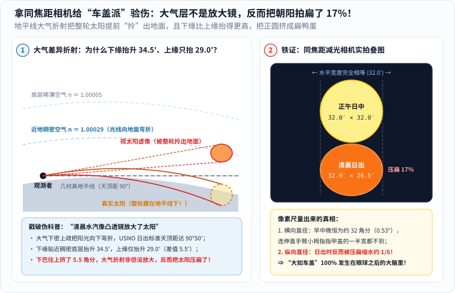
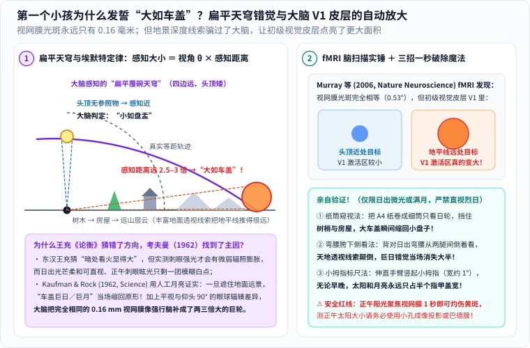
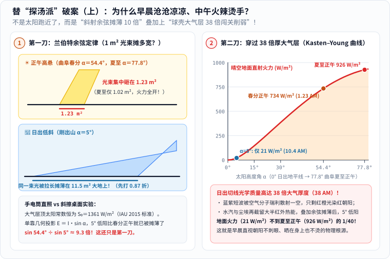
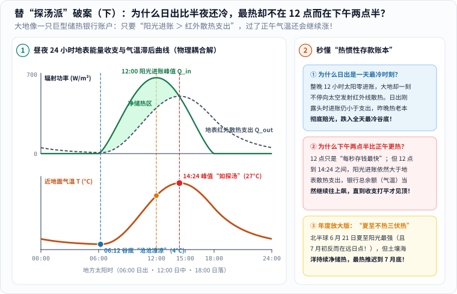

大概每个中国人的小学语文课本里，都住着那两个把“至圣先师”问到哑口无言的小孩。

故事出自《列子·汤问》，全文不过百余字，逻辑交锋却像两把快刀一样利落：

> 孔子东游，见两小儿辩斗，问其故。
> 一儿曰：“我以日始出时去人近，而日中时远也。”
> 一儿以日初出远，而日中时近也。
> 一儿曰：“**日初出大如车盖，及日中则如盘盂，此不为远者小而近者大乎？**”
> 一儿曰：“**日初出沧沧凉凉，及其日中如探汤，此不为近者热而远者凉乎？**”
> 孔子不能决也。两小儿笑曰：“孰为汝多知乎？”

一个是**视觉派**：同一个东西，离得近看着大，离得远看着小——早晨红日像马车顶棚那么大，正午烈日缩得像只小菜盘，当然是早晨近！
一个是**体感派**：同一团火，凑近了烤手，退远了发凉——清早出门凉飕飕，正午晒得像把手伸进滚水里，当然是中午近！

很多大人给孩子讲完故事，会顺手补上一句标准答案：“因为地球自转，中午咱们转到了朝向太阳的一面，比早晨近了一个地球半径；至于早晨看着大，是因为大气层像放大镜一样把太阳折射大了。”

如果你也是这么听说的——**恭喜你，这两个流传最广的“常识答案”，第一个漏掉了一半关键账本，在整整半年时间里连胜负都判反了；第二个则彻头彻尾说反了光学事实：大气层不仅没有放大初升的太阳，反而把它硬生生压扁了六分之一！**

今天，我们就请现代天体力学、大气物理学、气象热力学和大脑视觉神经科学联合升堂，给这桩悬了两千年的千古奇案下一份经得起像素尺和卫星数据检验的终审判决。

---

## 一、先翻老卷宗：这根本不是小孩斗嘴，而是汉晋天文学家吵了四百年的宇宙危机

在请出卫星和望远镜之前，我们先替孔子说句公道话：《两小儿辩日》绝不是谁编出来取笑孔子的脑筋急转弯，它背后藏着中国古代宇宙模型最痛的一根软肋。

从文献年代看，今天传世的《列子》由东晋学者张湛整理作注（成书约公元 4 世纪）；但早在它面世**两百多年前**的东汉章帝元和三年（约公元 86 年），思想家**王充**就已经在《论衡·说日篇第三十二》里白纸黑字记下了这场大论战——吵架的根本不是路边顽童，而是当时最博学的**汉代儒生与天文学家**：

> “儒者或以旦暮日出入为近，日中为远；或以日中为近，日出入为远。其以日出入为近、日中为远者，见日出入时大，日中时小也……其以日中为近、日出入为远者，见日中时温，日出入时寒也……二论各有所见，故是非曲直未有所定。”

为什么一道看似简单的问题，会把汉晋两代学者（从西汉末年的桓谭、东汉的王充，一路吵到东晋的葛洪，详见《晋书·天文志上》）逼进死胡同？

答案就在当时占统治地位的**“盖天说”**里。盖天说认为天像一口倒扣的斗笠或平铺的华盖，悬在大地上方不过几万里高，太阳就在这层天幕下面贴着转圈。王充在《论衡》里专门拿屋梁立竹竿做几何演示：屋顶高三丈，竹竿垂直立在正下方（好比正午太阳在头顶），距离地面正好三丈；可要是把竹竿斜戳到远处的墙角（好比清晨太阳在天边），斜边一定比直角边长得多！

这下麻烦大了：按照盖天说的几何学，正午太阳离人明明应该比日出近得多，视直径起码该大上一两倍才对；可天下所有人的眼睛偏偏都看到**日出大、日中小**！西汉学者桓谭和东晋葛洪正是抓住这记响亮的耳光，反过来痛击盖天说、力挺天地如鸡蛋般的“浑天说”；而王充为了替盖天说圆场，不得不打了个聪明却猜错方向的比方——“白天看火苗显得小，夜里看火苗显得大”（我们在第三节马上会看到，这个猜想为什么在太阳身上不成立）。

看懂了这段历史，你就会明白：两小儿的每一次追问，其实都在拷问**日地真实尺度、光线如何穿过空气，以及人眼究竟怎样丈量世界**。

---

## 二、第一锤裁决：早上和中午，太阳到底哪个离我们更近？

我们先回答两小儿争得面红耳赤的核心事实题：**从清晨 6 点日出，到正午 12 点日中，我们脚下这块土地，离太阳到底是变近了还是变远了？**

要算清这笔账，不能只盯着脚下的地球仪，必须同时打开**两本账册**：一本叫**地球自转**，另一本叫**地球椭圆公转**。

### 1. 账本 A：地球自转 6 小时，把孔子往太阳那边“端”近了 5186 公里

按照国际天文学联合会（IAU 2015 年第 B3 号决议）采用的标准常数，日地平均距离（$1\,\text{AU}$）约为 $1.49598\times 10^8\,\text{km}$（约 **1.496 亿公里**），而地球赤道半径 $R_E \approx 6{,}378.1\,\text{km}$。

假设地球待在原地不动、只绕地轴自转（关于行星自转与转轴倾角的来历，可以参看站内另一篇[《宇宙里的星球为什么都在转？》]()）：
- 清晨 6 点日出时，你刚好站在地球昼夜交界的**晨昏线**上，地心到你的连线与阳光几乎垂直；
- 过了 6 个小时到正午 12 点，地球自转了整整 $90^\circ$，把你稳稳转到了正朝向太阳的向阳面。

如果孔子站在赤道上，这半圈自转能让他离太阳变近整整一个地球半径（约 $6{,}378\,\text{km}$）。但孔子东游的鲁国曲阜一带位于**北纬 $\varphi \approx 35.6^\circ$**，他在纬线圈上的回转半径是 $R_E\cos 35.6^\circ$。以昼夜平分的春分或秋分日为例，从日出到正午，地球自转把孔子朝太阳方向拉近的距离是：

$$\begin{aligned}
\Delta d_{\text{自转} } &= -R_E \cos\varphi \\
&\approx -6{,}378.1 \times \cos 35.6^\circ \\
&\approx \mathbf{-5{,}186\,\text{km} }
\end{aligned}$$

（负号代表日地距离缩短，也就是**正午更近**。）许多科普文章算到这里就拍板结案，宣布第二个小孩赢了——慢着！在这整整 6 个小时里，地球自己可没有站在原地等太阳啊！

### 2. 账本 B：椭圆轨道 6 小时狂奔上万公里，春天的答案竟然直接翻盘！

早在 1609 年开普勒就发现，地球绕太阳的公转轨道不是正圆，而是一条偏心率 $e \approx 0.01671$ 的**椭圆**（详见[《从开普勒到牛顿：行星为什么不会掉进太阳？》]()）：
- 每年 **1 月初**（北半球隆冬！），地球经过**近日点**，距离太阳约 **1.471 亿公里**；
- 每年 **7 月初**（北半球盛夏！），地球经过**远日点**，距离太阳约 **1.521 亿公里**。

短短半年时间，地球和太阳之间的距离足足进出了 **500 万公里**！地球绕日公转的平均线速度高达 $v_{\text{orb} } \approx 29.78\,\text{km/s}$；在春分（4 月前后，地球正远离太阳奔向远日点）和秋分（10 月前后，地球正加速扑向近日点）附近，地球沿着日地连线方向靠近或远离太阳的**径向速度**达到峰值：

$$\begin{aligned}
v_r &\approx \pm e \cdot v_{\text{orb} } \\
&\approx \pm 0.01671 \times 29.78\,\text{km/s} \\
&\approx \pm 0.498\,\text{km/s} \approx \mathbf{\pm 1{,}790\,\text{km/h} }
\end{aligned}$$

每秒钟将近半公里、每小时 **1790 公里**——比民航客机巡航速度还快一倍！那么从早晨 6 点日出到中午 12 点这 **6 个小时**里，地球公转轨道本身让日地距离改变了多少？

$$\begin{aligned}
\Delta d_{\text{公转} } &= v_r \times 6\,\text{h} \\
&\approx \pm 1{,}791\,\text{km/h} \times 6\,\text{h} \\
&\approx \mathbf{\pm 10{,}750\,\text{km} }
\end{aligned}$$

算出来的一瞬间是不是倒吸一口凉气？**6 小时公转带来的日地距离变化（$\pm 10{,}750\,\text{km}$），竟然是曲阜自转拉近量（$5{,}186\,\text{km}$）的两倍还多！**

把两本账合在一起，戏剧性的季节大反转出现了：
- **如果孔子是在秋天早晨（如 10 月初）遇到两小儿**：地球正在往近日点俯冲，6 小时公转拉近 $10{,}750\,\text{km}$，叠加上自转拉近 $5{,}186\,\text{km}$，**正午的太阳比日出近了约 $15{,}900\,\text{km}$**——第二个小孩险胜；
- **如果孔子是在春天早晨（如 4 月初，“暮春者，春服既成”正是孔子最爱带弟子春游的时节！）遇到两小儿**：地球正在往远日点撤退，6 小时公转推远了 $10{,}750\,\text{km}$，把自转拉近的那 $5{,}186\,\text{km}$ 全抵消掉还倒贴一截，结果**早晨日出时的太阳，反而比正午近了约 $5{,}560\,\text{km}$**——第一个小孩意外翻盘！

*图 1：先看左卡地球自转 6 小时的几何投影（曲阜拉近约 5186 km，图中地球半径为看清几何作了放大示意），再看右卡地球椭圆公转在 6 小时内高达 ±10750 km 的径向位移如何让秋季与春季的远近胜负彻底掉头（含单次旋转与揭晓动画；系统开启“减弱动态效果”时自动定格完整终态，[点此单独打开 SVG 查看或刷新重播](/assets/images/two-children-sun/distance-paradox-rotation-vs-orbit.svg)）。*

### 3. 终极比例尺验算：往 10 米外的篝火跟前凑了 0.4 毫米

不过，先别急着给任何一个小孩发奖状。无论差距是 $5{,}560\,\text{km}$ 还是 $15{,}900\,\text{km}$，除以日地平均距离 $1.496\times 10^8\,\text{km}$，相对变化率只有：

$$\begin{aligned}
\frac{|\Delta d|}{d} &< \frac{15{,}900}{149{,}598{,}000} \\
&\approx \mathbf{0.0106\%} \quad (\text{约万分之一})
\end{aligned}$$

万分之一是什么概念？打个最直观的比方：**这就像你站在 10 米开外烤一团篝火，从早晨到中午，你的脚尖只往前挪了 0.4 毫米——还不到半张信用卡的厚度！**

根据几何光学与平方反比定律，万分之一的距离变化只能让太阳视直径改变 $0.003$ 角分（人眼分辨极限的几百分之一），让阳光能量改变约 $0.02\%$（连精密温度计都很难从微风波动里挑出来）。

换句话说：**两个小孩观察到的现象全都千真万确——早晨太阳看起来确实大得多，中午太阳晒起来也确实烫得多；但他们俩用来解释现象的“远近推理”，在万分之一的比例尺面前双双归零！** 真正的幕后黑手，一个藏在你的大气层与大脑皮层里，另一个藏在脚下的大气厚度与土地账本里。

---

## 三、替“车盖派”破案（上）：大气层不是放大镜，反而把朝阳压扁了 17%！

既然日地距离几乎没变，那早晨那轮“大如车盖”的红日到底是怎么变大的？

每当问起这个问题，十个人里往往有八个会脱口而出：“因为地平线附近空气厚、水汽多，大气层就像一面凸透镜，把初升的太阳折射放大了！”

听起来特别像那么回事，对不对？只可惜，只要架起一台**固定焦距、装好专业巴德减光膜**的单反相机，在日出和正午各拍一张照片叠在一起拿像素尺一量，这个流传百年的伪科普当场就会碎一地（美国宇航局 NASA 在解释地平线日月错觉时也专门辟过这条谣）：

1. **水平方向（横向直径）**：无论是刚露头的红日，还是正午当空的烈日，照片上的横向像素宽度**分毫不差**，视角恒定在 **$32.0$ 角分**左右（约 $0.533^\circ$，也就是半度多一点）；
2. **垂直方向（纵向高度）**：日出时的太阳非但没有变大，上下高度反而**缩水了约 17%**，只剩下大约 **$26.5$ 角分**，活脱脱被挤成了一颗扁扁的咸鸭蛋！

为什么大气折射不放大太阳，反而专挑它的“下巴”往上挤？

这要从地球大气的密度梯度说起（我们在[《连光都会被太阳掰弯吗？》]()里聊过太阳引力场对星光的弯曲，其实地球空气密度梯度弯折光线的本领比太阳表面引力还要猛上千倍！）。高空空气稀薄，折射率接近真空的 $1.00000$；越靠近地面空气越稠密，标准海平面空气折射率约为 $n_0 \approx 1.00029$。当朝阳的光线贴着地平线斜射进大气层时，光线会一路向密度更大的地面方向向下弯曲；而我们的眼睛不知道光线拐了弯，只会顺着进入眼球的最后一段切线反推回去，结果看到的是一轮**被向上抬高了的太阳虚像**。

精妙的地方来了——**越贴近地平线，空气密度变化越剧烈，向上抬升的折光角就越大**：
- 当你看到太阳下缘刚刚擦到地平线（视高度角 $0'$）时，大气折射足足把它往上抬高了约 **$34.5$ 角分**——注意，太阳本身的真实直径才 $32.0$ 角分！这意味着**当你亲眼看见整轮红日跃出地平线那一刻，真实的太阳其实还完完整整躲在地平线底下没露头呢**；
- 与此同时，太阳的上缘处于视高度角约 $26.5'$ 的稍高位置，那里的空气折光没那么猛，只把上缘往上抬高了约 **$29.0$ 角分**。

你算算：下巴被往上托了 $34.5$ 角分，头顶只往上托了 $29.0$ 角分，上下一挤，整轮太阳在竖直方向硬生生被削掉了 $34.5' - 29.0' = 5.5'$（约占真直径 $32.0'$ 的 **$17\%$**）！而在水平方向上，太阳左右两侧处于同一高度，受到的大气折射一模一样，宽度自然纹丝不动。

*图 2：左卡展示下密上疏的大气球壳如何把还在地平线以下的真实太阳“拎”出地面，且下缘抬升（34.5′）大于上缘抬升（29.0′）；右卡按真实比例还原同焦距减光相机实拍叠图——日出太阳横向分毫未涨，纵向反而被压扁了约 17%。*

连相机底片都作证太阳一丁点儿也没变大，可为什么从两千年前的鲁国小儿到今天的我们，只要用肉眼往东边天际一望，还是会不由自主地惊叹“好大一轮红日”？

---

## 四、替“车盖派”破案（下）：0.16 毫米视网膜光斑，怎样骗过初级视觉皮层 V1？

既然物理世界和眼球光学都没动手脚，“作案现场”就只剩下一个地方——**眼球后方的大脑视觉系统**。

我们先算一下太阳落在你眼底视网膜上的真实尺寸。人类眼球等效焦距约为 $f_{\text{眼} } \approx 17\,\text{mm}$，太阳视角 $\theta \approx 0.533^\circ \approx 0.0093\,\text{rad}$。无论清晨还是正午，太阳投在视网膜感光细胞上的物理像斑直径永远只有：

$$\begin{aligned}
d_{\text{视网膜} } &= f_{\text{眼} } \cdot \theta \\
&\approx 17\,\text{mm} \times 0.0093 \approx \mathbf{0.158\,\text{mm} }
\end{aligned}$$

只有 **0.16 毫米**——差不多就是两根头发丝并排那么细的一丁点小圆斑！

可大脑从来不是一台老老实实读像素的傻瓜相机。为了帮我们在丛林和草原上求生，人类视觉系统进化出了一套全自动的**“尺寸恒常性补偿算法”（埃默特定律，Emmert's Law）**：当两个物体的视网膜张角 $\theta$ 完全相同时，大脑感觉到的主观大小 $S_{\text{感知} }$，严格正比于大脑估算它离我们有多远 $D_{\text{感知} }$：

$$S_{\text{感知} } = \theta \times D_{\text{感知} }$$

举个生活例子：一个身高一米八的朋友站在 2 米外和站在 20 米外，他在你视网膜上的像明明缩小到了十分之一，你却绝对不会惊呼“他怎么缩成芭比娃娃了”，因为地面砖块、路灯、树木一路铺过去，告诉大脑“他在很远的地方”，大脑立刻自动把那个微小的视网膜像乘以 10 倍，还原成正常大活人。

这套平时百试百灵的算法，一旦抬起头看天空，就彻底掉进了**“扁平天穹错觉”与“庞佐透视陷阱（Ponzo Illusion）”**里：

1. **平视地平线时（参照物塞满视野）**：朝阳前面层层叠叠排着近处的草木、中景的屋脊城墙、远处的连绵青山和一层层低云。这些密集的地面透视线索拼命向大脑汇报：“天边远极了！”大脑据此把地平线处的天幕推到了极远的位置 $D_{\text{地平线} }$；
2. **仰望正午头顶时（空无一物的蓝天）**：头顶上方既没有树也没有楼，完全缺乏深度参照物（加上人眼仰头平躺或向上看时，眼外肌与晶状体辐辏状态倾向于把无参照背景默认在较近距离），大脑便把头顶的天幕估算得很矮很近 $D_{\text{天顶} }$——在人类主观感觉里，天空不是一口等半径的半球锅，而是一只**四边极远、头顶压扁的浅口大汤碗**！
3. **自动乘法的戏剧后果**：同样是 $0.16\,\text{mm}$ 的视网膜小圆斑，放在“很近的头顶”乘出来只是一只小盘子（如盘盂）；放在“远在天边的地平线”乘以 2.5 到 3 倍的感知距离，大脑当场就给你渲染出了一顶气势恢宏的马车大华盖（大如车盖）！

这里顺便回应前面东汉王充在《论衡》里的猜想：王充认为“暗处看火大、亮处看火小”，其实在生理光学上恰恰相反——黑夜里的亮火苗显得大，是因为强光在暗适应视网膜上发生了散射与神经“辐照错觉（Irradiation illusion）”；而清晨的红日被厚厚大气削弱得温润柔和，轮廓清清楚楚，正午烈日反而亮到刺眼眩光、根本没法看清边缘。**1962 年，心理学家考夫曼与洛克（Lloyd Kaufman & Irvin Rock）在《科学》（*Science*）杂志连发两篇经典实验论文**，用半透半反镜把同一个人造光斑分别投射到有远山城际线的地平线和被纸板遮住地景的天空，无可辩驳地证明：**只要挡住地面远景深度线索，“车盖巨月／巨日”瞬间就会缩回原形！**

更震撼的证据来自 21 世纪的脑成像实验室。**2006 年，神经科学家默里（Scott O. Murray）等人在《自然·神经科学》（*Nature Neuroscience*）发表功能性磁共振成像（fMRI）研究**：当受试者注视视网膜张角完全相等、但受背景深度线索影响看起来“一远一近”的两个圆球时，哪怕在人类视觉通路最底层的第一站——**大脑枕叶初级视觉皮层（V1 区）**，那个被感知为“在远处”的目标，**实实在在点亮了面积更大的一片神经元版图**！也就是说，高级脑区算完距离后，直接把放大指令反馈回了底层视觉皮层——第一个小孩根本没撒谎，在他大脑的 V1 屏幕上，早晨的太阳真的占了更大一块地盘！

*图 3：左卡展示树木房屋远山深度线索构造出的“扁平覆碗天穹”如何按埃默特定律把 0.53° 视角放大成“车盖”；右卡展示 2006 年 Nature Neuroscience 的 V1 初级视觉皮层激活扩张证据，以及明早就能亲手试做的三招破除错觉小实验。*

> **⚠️ 护眼安全红线与三招一秒破除“车盖魔法”**：
> **切记：永远不要用肉眼、墨镜或未贴专业巴德膜的望远镜直视刺眼的太阳！** 正午阳光经眼球晶状体聚焦在视网膜黄斑上，功率密度比正午地面强上万倍，短短一两秒即可造成不可逆的日光性视网膜灼伤（测正午太阳大小只能用小孔成像投在白纸上量！）。但对着**满月**，或者刚刚露头、红彤彤毫克级微光的**地平线初升红日**，你可以试试这三个立竿见影的小把戏：
> 1. **卷纸筒窥视法**：拿一张 A4 纸卷成细筒，闭上一只眼，只透过纸筒看地平线上的红日或大月亮，把周围的树梢、高楼统统挡在视野外——你会震惊地发现，大车盖在一秒钟之内“啪”地缩成了小硬币！
> 2. **弯腰胯下倒看法**：背对初升的红日或圆月，弯下腰从两腿之间倒着往后看。上下颠倒会让大脑瞬间无法正常解析地面透视线索，巨日／巨月错觉当场消退大半；
> 3. **伸臂小拇指标尺法**：把手臂笔直伸向前方，竖起你的小拇指。成年人伸直手臂时，**小拇指指甲盖的宽度大约是 $1^\circ$（60 角分）**，而太阳和月亮的视角永远只有 **$0.53^\circ$（32 角分）**——不管它看起来像多大的车盖，你伸出小拇指一比，半片指甲盖就能把它严严实实遮住！

---

## 五、替“探汤派”破案（上）：余弦斜射摊薄 × 38 倍大气层闯关

破完了“视觉派”的案子，轮到第二个小孩出场了：“日初出沧沧凉凉，及其日中如探汤”——既然太阳早晚距离几乎一样，凭什么早晨晒在脸上一点不烫，到了大中午却像把手伸进滚烫的热汤里？

这回一点儿也不是错觉，而是实打实的**辐射几何学**与**大气消光物理学**联手砍出的两记重刀。

### 1. 第一刀：兰伯特余弦定律——同样一束光，斜着照被摊薄了近 10 倍

在地球大气层顶外，垂直迎着阳光每平方米每秒收到的太阳辐射总功率，是一个非常稳定的物理量——**太阳常数 $S_0 \approx 1{,}361\,\text{W/m}^2$**（IAU 2015 标准标称值，相当于每平方米同时点亮十几个百瓦大灯泡）。

但地面是平躺着的！当太阳高度角（阳光与地平面的夹角）为 $\alpha$ 时，一束横截面积为 $1\,\text{m}^2$ 的阳光斜斜照到水平地面上，光斑会被拉长成面积为 $A = 1 / \sin\alpha$ 的大长条，单位面积分到的辐射功率瞬间要乘上一个 $\sin\alpha$（这就是光学里的**兰伯特余弦定律**，因为太阳天顶角 $\theta_z = 90^\circ - \alpha$，$\cos\theta_z = \sin\alpha$）：

$$\begin{aligned}
E_{\text{地面水平} } &= I_{\text{直射光束} } \cdot \sin\alpha
\end{aligned}$$

我们还是回到孔子所在的山东曲阜（$\varphi = 35.6^\circ\text{N}$）算笔明白账：
- **春分正午 12 点**，太阳升到 $\alpha = 90^\circ - 35.6^\circ = 54.4^\circ$（若是夏至正午，更升到 $\alpha = 77.8^\circ$），$1\,\text{m}^2$ 的阳光集中砸在 **$1.23\,\text{m}^2$**（夏至仅 **$1.02\,\text{m}^2$**）的地面上，火力几乎全额集中；
- **清晨刚日出不久**，比如太阳刚爬到山尖上方 $\alpha = 5^\circ$ 时，$\sin 5^\circ \approx 0.0872$，同一束 $1\,\text{m}^2$ 的阳光被远远拉长、稀稀拉拉地摊平在 **$11.47\,\text{m}^2$** 的一大片土地上！

你晚上拿手电筒在桌面上试一下就秒懂：手电筒垂直往下照，光斑又圆又亮；手腕一压平贴着桌面斜擦过去，光斑拖出半张桌子长，亮度立马暗淡无光。单靠这一刀几何投影，清晨 $5^\circ$ 低阳分给每平方米地面的能量，就已经比春分正午缩水了 $11.47 \div 1.23 \approx \mathbf{9.3}$ **倍**！

### 2. 第二刀：Kasten–Young 球壳大气——早晨的阳光要多闯 38 倍厚的空气关卡！

如果地球没有大气层（比如在月球上），算完上面第一刀也就结束了。但在地球上，阳光抵达你的皮肤之前，还得先穿过包裹地球的大气层。

我们把太阳正居头顶（$\alpha = 90^\circ$）时，阳光垂直穿过整层大气所经历的空气柱质量定义为 **1 个标准大气光学质量（Air Mass，$1.0\,\text{AM}$）**。到了日出时分（$\alpha = 0^\circ$），阳光沿着地平线切线横穿大气球壳，路程变长了多少倍？

如果把地球误当成无限大平面，$\alpha = 0^\circ$ 时路径长度会变成无穷大；但在真实球形地球加折射弯曲大气中，大气物理学家卡斯滕与杨（Fritz Kasten & Andrew T. Young，1989 年发表于 *Applied Optics*）给出了今天全球光伏工程与气象学通用的高精度**球壳相对光学质量公式**：

$$\begin{aligned}
&\text{AM}(\alpha) = \bigl[\sin\alpha \\
&\;\; + 0.50572\,(\alpha + 6.07995^\circ)^{-1.6364}\bigr]^{-1}
\end{aligned}$$

把角度代进去一算，数字让人瞠目结舌：
- **曲阜夏至正午（$\alpha = 77.8^\circ$）**：$\text{AM} \approx \mathbf{1.02}$ 倍大气厚度；
- **曲阜春分正午（$\alpha = 54.4^\circ$）**：$\text{AM} \approx \mathbf{1.23}$ 倍大气厚度；
- **日出后不久（$\alpha = 5^\circ$）**：$\text{AM} \approx \mathbf{10.4}$ 倍大气厚度；
- **日出擦地平线瞬间（$\alpha = 0^\circ$）**：$\text{AM} \approx \mathbf{37.9 \approx 38}$ **倍大气厚度**！

整整 **38 层标准大气**横在朝阳面前当拦路虎！阳光在这趟漫长的闯关路上遭遇了双重盘剥：
1. **短波紫光、蓝光、绿光被空气分子按 $\lambda^{-4}$（瑞利散射）打得七零八落**，向四面八方散射开去，只剩下波长最长、最善钻空子的红橙光勉强穿过重围——这正是朝阳之所以红彤彤且柔和不刺眼的原因；
2. **近红外与可见光热能被沿途的水汽、臭氧和气溶胶尘埃层层吸收衰减**（按比尔—朗伯指数消光定律急剧滑坡）。

把“余弦摊薄”和“大气消光”两把刀叠乘在一起（采用晴空标准大气辐射模型）：晴朗夏至正午，每平方米水平地面接收的直射阳光功率高达 **$926\,\text{W/m}^2$**（春分正午也有 **$734\,\text{W/m}^2$**）；而在日出后 $\alpha = 5^\circ$ 时，这个数字暴跌到只剩 **$24\,\text{W/m}^2$** 左右——**前后相差近 40 倍**！

*图 4：左卡对比正午高悬光束（集中于 1.23 m²）与清晨低斜光束（摊薄于 11.5 m²）的余弦面积稀释；右卡绘出叠加大气 38 倍光学质量消光后，晴空地面水平直射火力从 5° 时的约 24 W/m² 飙升到正午 734–926 W/m² 的陡峭跃升。*

---

## 六、替“探汤派”破案（下）：为什么日出比半夜还冷，最热却在下午两点半？

细心的读者可能会追问最后一个漏洞：**“不对呀！就算早晨 6 点半的阳光只有 24 瓦，那也比半夜 12 点一丁点阳光都没有（0 瓦）要强啊！为什么我们早起晨跑时，反而觉得日出前后是一整天里最冻人的‘沧沧凉凉’？而且正午 12 点阳光最强，为什么夏天最热的时候却总在下午两点到三点？”**

问到点子上了！因为你身体感受到的冷暖，不仅取决于贴在皮肤上的阳光，更取决于包围着你的**近地面空气温度**；而空气温度不是由太阳直接晒热的（干净空气对可见光几乎透明），而是**太阳先晒热大地，大地再通过红外长波辐射与热对流把空气煨热**（关于红外热辐射与浮力热对流，可以联动阅读上一篇[《火到底是什么，为什么偏偏往上蹿？》]()）。

把脚下的土壤、岩石、建筑和近地空气层看作一个**“热量银行账户”**，账户余额（气温 $T$）的变化率，取决于每秒钟吸收的**阳光存款功率 $Q_{\text{进} }$** 减去大地每时每刻向高空与太空发射红外线的**散热取款功率 $Q_{\text{出} }$**：

$$C_{\text{地表} } \frac{\mathrm{d}T}{\mathrm{d}t} = Q_{\text{进} }(t) - Q_{\text{出} }(T)$$

一旦用“银行存取款”的眼光看这口方程，一天 24 小时的冷暖节奏瞬间清清楚楚：

1. **为什么日出前后是一天最冷的“沧沧凉凉”？**
   从昨天傍晚 18:00 太阳落山开始，阳光存款归零（$Q_{\text{进} } = 0$），但大地一秒钟也没停止向漆黑的夜空辐射红外热量（$Q_{\text{出} } > 0$）。半夜 0 点只亏了 6 个小时老本，到了凌晨四五点已经连亏十个小时！哪怕清晨 6:00 太阳刚刚露头，最初十几二十分钟微弱的斜射阳光还不够填补地表的红外散热窟窿（$Q_{\text{进} } < Q_{\text{出} }$），气温还在继续往下掉——直到**日出后一刻钟到半小时左右（图中耦合模型约 06:12，实际随湿度与风速在 06:10–06:40 之间）**，阳光进账终于追平散热支出，账户余额才触底反弹。**所以第二个小孩说的“日初出沧沧凉凉”，精准抓住了全天 24 小时气温曲线的最低谷！**

2. **为什么一天最热不在 12 点，而在午后两点半？**
   正午 12:00 太阳升到最高，这只是**“每秒钟往银行存钱最快”**的时刻（$Q_{\text{进} }$ 达峰）；过了 12 点，下午一点、两点虽然存钱速度比正午稍微慢了一点点，但**只要阳光进账依然大于地表散热支出（$Q_{\text{进} } > Q_{\text{出} }$），你的银行总存款（气温）就一定还在继续往上涨**！直到**下午 14:00–15:00 左右（图中模型交点约 14:24）**，西斜的阳光减弱到与滚烫地表的散热打成平手，全天气温才真正爬上“如探汤”的最高峰。

*图 5：左卡用耦合热平衡方程算出阳光吸收曲线 $Q_{\text{in} }$、地表散热曲线 $Q_{\text{out} }$ 与近地面气温曲线——两条功率曲线的清晨交点（06:12）正是全天最冷谷底，午后交点（14:24）才是全天最热峰值；右卡总结“储热银行”规律及其年度放大版“夏至不热三伏热”。*

### 两个一锤定音的反例：彻底粉碎“离太阳近才热”

如果第二个小孩听了还是半信半疑，你只需要再送他两个现代人人人都能验证的反例，就能把“近者热而远者凉”的朴素直觉彻底校正过来：

- **反例一（季节大反转）**：前面算过，每年 **1 月初**地球在近日点，比 **7 月初**远日点足足**离太阳近了 500 万公里**！如果真是“离太阳近就热”，北半球一月份应该酷暑难耐、七月份应该大雪纷飞才对。可事实完全相反——因为地轴倾斜 $23.4^\circ$ 带来的**阳光直射角与白昼时长优势**，轻松碾压了那 500 万公里的距离差；而且跟午后两点半最热一个道理，北半球阳光最强的日子明明是 6 月 21 日夏至，最热的日子却因为海洋和陆地的储热滞后，硬生生推迟到了七月下旬到八月上旬的**“三伏天”**！
- **反例二（高山反常寒）**：珠穆朗玛峰海拔 $8{,}848.86$ 米，比海平面实打实**离太阳近了将近 9 公里**，空气稀薄得连紫外线都能把皮肤晒脱皮；可珠峰顶上非但没有“如探汤”，反而终年零下二三十摄氏度、冰雪封山！原因正是对流层大气的暖气片装在**脚下的地面**，离地面越远、空气越稀薄留不住长波红外热，就算往太阳跟前凑近 9 公里也照样冻得发抖。

---

## 七、结语：两千年前那句“孔子不能决也”，为什么最值得敬佩？

案子破到这里，我们可以替当年东游路上的孔子写一份跨越两千年的合议庭判词了：

| 争辩焦点 | 两个小孩的观察 | 现代科学终审裁决 |
| :--- | :--- | :--- |
| **早晚谁离太阳更近？** | 两人各执一词（以为早晚距离差极大） | **秋季正午近约 1.59 万 km，春季日出反而近约 0.56 万 km**；但相对 1.496 亿 km 均不足**万分之一**，对大小与冷暖毫无体感影响 |
| **为何日出大如车盖？** | 视觉派小儿观测属实（主观感觉大 2–3 倍） | **不是距离近，也不是大气折射放大**（大气反而把朝阳竖着压扁 17%）；而是地面深度线索构造扁平天穹，让大脑 V1 皮层放大了同为 0.16 mm 的视网膜像 |
| **为何日中热如探汤？** | 体感派小儿体感属实（中午远比清晨炽热） | **不是距离近**；而是正午高度角大（余弦投影集中 9 倍以上）＋ 穿过大气光学质量从 **38 倍骤降到 1.2 倍** ＋ 地表整夜散热与白天储热的热惯性账本 |

回过头再读《列子》最后那两句话——“**孔子不能决也。两小儿笑曰：‘孰为汝多知乎？’**”——很多人读出的是圣人的窘迫，但在科学史的眼光里，这恰恰是整篇故事最闪光的一笔。

要知道，在孔子生活的春秋时代，人类既不知道脚下是一颗半径六千多公里、一边自转一边以每秒 30 公里狂奔的岩质行星，也不知道太阳是一颗远在 1.5 亿公里外、直径 139 万公里的核聚变等离子火球，更不可能用核磁共振去扫描大脑枕叶的 V1 皮层。面对两个逻辑自洽却彼此冲突的经验事实，没有证据就不强行瞎编、不拿圣人权威去压服孩童，坦坦荡荡地承认一句**“这个问题我现在裁决不了”**——这份“知之为知之，不知为不知”的诚实，正是此后两千年人类一步步走出盖天斗笠、算准椭圆轨道、测透大气折射与大脑错觉的真正起点。

下次清晨带孩子看日出，或者傍晚在回家路上遇见一轮悬在高楼尽头的巨大圆月时，不妨陪他一起伸直手臂、竖起小拇指比一比，再卷起一张纸筒看一看——那一刻，两千年前鲁国路边那场可爱的争吵，就在你们父子俩的指尖完成了最美妙的结案。

---

## 参考资料与核查来源

1. **《列子·汤问篇》与东汉王充《论衡·说日篇第三十二》、《晋书·卷十一·天文志上》**（维基文库古籍原文核查）：
   - [《列子·汤问》原文](https://zh.wikisource.org/zh-hans/%E5%88%97%E5%AD%90/%E6%B9%AF%E5%95%8F%E7%AF%87)：核查“两小儿辩日”百字原文措辞（“日初出大如车盖，及日中则如盘盂”“日初出沧沧凉凉，及其日中如探汤”）。
   - [王充《论衡·说日篇第三十二》（约公元 86 年）](https://zh.wikisource.org/zh-hans/%E8%AB%96%E8%A1%A1/32) 与 [《晋书·天文志上》](https://zh.wikisource.org/zh-hans/%E6%99%8B%E6%9B%B8/%E5%8D%B7011)：核查早于今本《列子》两百余年的汉代儒者远近之争原文、盖天说“屋高三丈立竿”几何论证、王充“昼夜察火”猜想，以及桓谭、葛洪围绕盖天与浑天模型的交锋史实。
2. **国际天文学联合会（IAU）日地与太阳标称常数决议**：
   - Prša, A., Harmanec, P., Torres, G., et al. (2016). *Nominal values for selected solar and planetary quantities: IAU 2015 Resolution B3*. The Astronomical Journal, 152(2), 41（预印本全文：[arXiv:1510.07674](https://arxiv.org/html/1510.07674v1)）。支持本文中地球赤道半径 $R_{e\text{E} } = 6{,}378.1\,\text{km}$、太阳标称半径 $R_\odot = 6.957\times 10^8\,\text{m}$、大气层顶标称总太阳辐照度（太阳常数）$S_\odot = 1{,}361\,\text{W/m}^2$，以及结合地球轨道偏心率 $e \approx 0.01671$ 推算的近日点／远日点距离与春秋 6 小时径向公转位移（$\pm 10{,}750\,\text{km}$）。
3. **NASA 地平线日月错觉辟谣与大气差异折射数值**：
   - NASA Science: [*The Moon Illusion: Why Does the Moon Look So Big Sometimes?*](https://science.nasa.gov/solar-system/moon/the-moon-illusion-why-does-the-moon-look-so-big-sometimes/)；以及标准天文折光表（Bennett, G. G., 1982, *Journal of Navigation*, 35(2), 255–259）。支持地平线大气折射绝不放大日月横向视角（恒约 $32'$），而是将下缘抬升约 $34.5'$、上缘抬升约 $29.0'$，使初升太阳在几何地平线以下即提前现身且竖直方向被压扁约 $17\%$，并支持卷纸筒、弯腰倒看与伸臂手指测角等实证检验方法。
4. **扁平天穹与地面深度线索（Ponzo 机制）经典实验**：
   - Kaufman, L., & Rock, I. (1962). *The Moon Illusion, I & II*. Science, 136(3520), 953–961 & 136(3521), 1027–1033。用人工光斑与地形遮挡对照实验证明地面远景深度线索与感知距离缩放（埃默特定律）是地平线日月显大的核心机制。
5. **人类初级视觉皮层（V1）编码主观感知角大小的功能磁共振成像研究**：
   - Murray, S. O., Boyaci, H., & Kersten, D. (2006). *The representation of perceived angular size in human primary visual cortex*. Nature Neuroscience, 9(3), 429–434（[UMN 机构出版物记录与 DOI: 10.1038/nn1641](https://experts.umn.edu/en/publications/the-representation-of-perceived-angular-size-in-human-primary-vis/)）。支持视网膜张角完全相同时，受深度线索影响被感知为更远更大的目标会在大脑 V1 皮层激活更大的视网膜拓扑面积。
6. **球壳大气相对光学质量（Air Mass）标准模型**：
   - Kasten, F., & Young, A. T. (1989). *Revised optical air mass tables and approximation formula*. Applied Optics, 28(22), 4735–4738；工程参考页见美国桑迪亚国家实验室 [Sandia PV Performance Modeling Collaborative — Air Mass](https://pvpmc.sandia.gov/modeling-guide/1-weather-design-inputs/irradiance-insolation/air-mass/)。支持正午与地平线（$\alpha = 0^\circ$ 时 $\text{AM} \approx 37.9 \approx 38$）的大气光学质量计算及地面直射辐照衰减分析。
