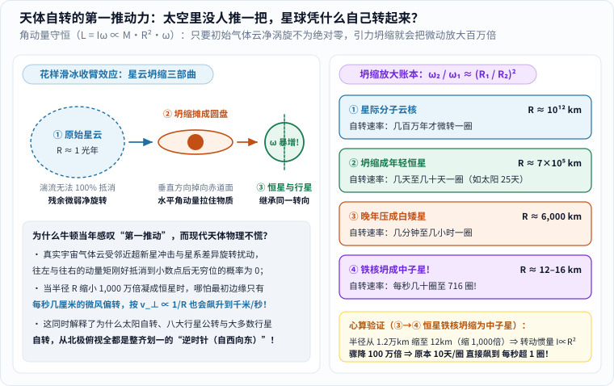
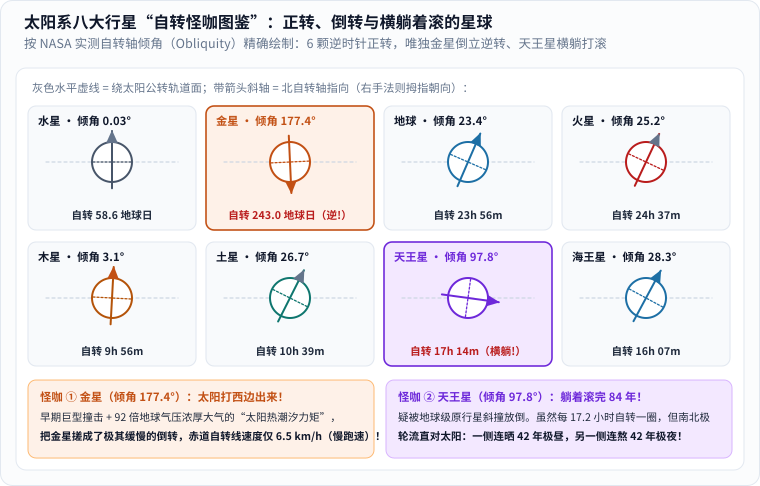
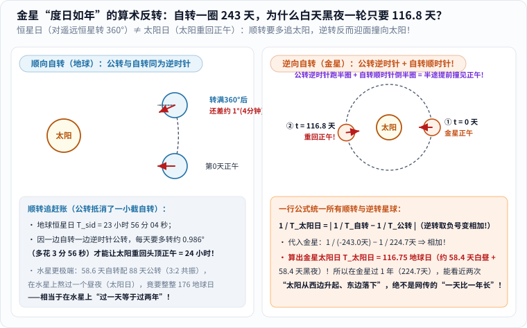
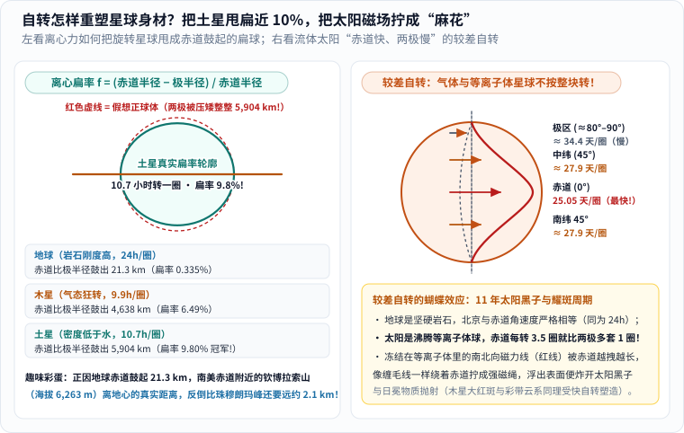
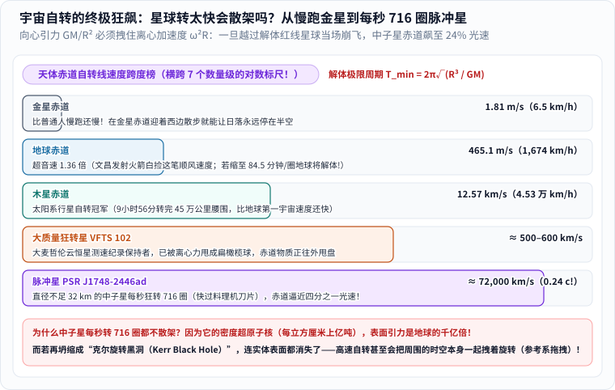

如果你此刻正端着杯子坐在椅子上，你可能觉得自己一动没动。

但只要把视角拉到太空，画面立刻变得惊心动魄：在赤道上，地球表面正以 **465.1 米/秒（约 1,674 公里/小时）** 的线速度自西向东狂飙——比民航客机的巡航速度还要快将近一倍；哪怕在北京、西安、上海这样的中纬度城市，你脚下的大地也在以每秒三四百米超音速飞奔。

更奇妙的是，放眼整个宇宙，从月球、八大行星、太阳，到几千光年外的白矮星、中子星乃至黑洞，**几乎没有任何一颗天体是不自转的**。而且它们的转法千奇百怪：

- **金星**是“倒着转”的，在那儿看太阳是**西升东落**；它自转一圈要 **243 个地球日**，比绕太阳公转一圈（224.7 天）还要慢，可金星上的一个昼夜却又偏偏只有 **116.75 天**；
- **天王星**干脆把自转轴歪到了 **97.77°**，像一只被打翻在公转轨道上的酒桶，“躺着”往前滚；
- **木星和土星**明明是体积庞大的巨行星，自转一圈却只要 **10 个小时左右**，硬生生把自己甩成了肉眼可见的“扁橘子”；
- **太阳**压根不肯“齐步走”——赤道 25 天转一圈，两极却要 34 天多，硬把磁力线拧成麻花，憋出黑子和耀斑；
- **月球**永远只拿正脸对着我们，以至于很多人误以为“月球不自转”；
- 而在球状星团 Terzan 5 里，一颗名叫 **PSR J1748-2446ad** 的脉冲星，每秒钟要原地狂转 **716 圈**，比你家厨房破壁机的刀片转得还要快！

没有谁在太空里给星球装发动机，它们最初的那股旋转劲儿究竟是从哪来的？为什么有的星球快到快要散架，有的星球却被活活刹停？今天我们就顺着一条物理主线，把宇宙里这场永不停歇的旋转大戏彻底看懂。

---

## 一、第一推动力从哪来：没有谁推它，为什么宇宙里的星球天生都在转？

牛顿当年在解释太阳系运动时，曾留下过“第一推动”的著名追问。但到了今天的天体物理学里，“星球为什么会转”其实有一个极其朴素的答案：**在引力和湍流统治的宇宙里，“转起来”才是常态，“完全不转”反而是概率为零的奇迹。**

### 1. 彻底静止反而是零概率奇迹：星际分子云里的微小净湍流

恒星和行星并不是凭空变出来的，它们诞生于直径动辄几光年、极其稀薄寒冷的**巨分子云**。这团星际气体云并不是一块死水般的刚体：路过的邻近恒星引力扰动、银河系旋臂的剪切差异、远处超新星爆发吹来的冲击波（我们在[宇宙元素形成与138亿年演化史]()里刚见过它的威力），都会在气体云内部搅起无数杂乱无章的局部涡旋。

如果你把亿万团朝不同方向乱飘的气流加总起来，向左转的分量和向右转的分量能不能**分毫不差地精确抵消到小数点后无穷多位**？几乎不可能。就像往洗脸盆里放满水再拔掉塞子，哪怕你觉得水面平静得像镜子，水往下漏时也总会因为一丝极其微弱的初始不对称而拧成漩涡。星际云在自身引力作用下开始坍缩时，哪怕最初几万亿年才勉强转一圈，只要净角动量 $L \neq 0$，接下来的引力坍缩就会化身一台恐怖的**转速放大器**。

### 2. 花样滑冰运动员的抱臂加速：角动量守恒与 $R^2$ 放大器

你一定在冬奥会转播里见过这一幕：花样滑冰运动员在冰面上先张开双臂慢悠悠地转起来，随后突然把双臂和浮腿紧紧抱回胸前——没有任何人推她，她却瞬间化作一道残影高速旋转起来。

这就是物理学里最铁面无私的守恒律之一——**角动量守恒定律**。对于一个质量为 $M$、特征半径为 $R$、自转角速度为 $\omega$ 的球对称天体，它的转动惯量 $I = k M R^2$（其中无量纲形状系数 $k$ 反映质量分布集中程度：均匀实心球 $k = 0.4$，质量越往核心集中的真实恒星 $k$ 越小），在没有外部力矩干扰的孤立坍缩过程中，总角动量 $L$ 必须保持不变：

$$
\begin{aligned}
L &= I \omega = k M R^2 \omega = \text{常量} \\
\Longrightarrow \quad \omega &\propto \frac{1}{R^2}, \qquad T_{\text{自转} } = \frac{2\pi}{\omega} \propto R^2
\end{aligned}
$$

请盯紧这个平方反比关系 $\omega \propto 1/R^2$！半径缩为原来的 $\frac{1}{10}$，角速度不是快 10 倍，而是暴涨 **100 倍**！

我们不妨拿太阳系的真实尺度算一笔账：一团准备坍缩成太阳的原始分子云核，初始半径大约是 $R_0 \approx 0.1\text{ 光年} \approx 10^{12}\text{ km}$；当它一路收缩成今天半径 $R_\odot \approx 7 \times 10^5\text{ km}$ 的太阳时，半径缩小了超过 **$1.4 \times 10^6$ 倍（一百四十万倍）**！按 $R^2$ 换算，哪怕原始星云最初慢到一千万年才蠕动一圈，收缩到恒星尺度时转速也会被放大 **$2 \times 10^{12}$（两万亿）倍**！事实上，如果原始太阳星云的角动量真的全部留在太阳自己身上，太阳早就在半路上被离心力撕碎了——正是因为绝大部分角动量分流给了外围公转的行星（尤其是木星，独自扛走了太阳系约 60% 的角动量）以及早期原恒星喷流和磁制动，今天的太阳才得以温和地大约 25 天转一圈。

### 3. 为什么行星系是扁平圆盘而不是圆球：向心力拦住赤道、重力拍扁两极

角动量守恒还顺手解释了另一个困扰很多人的问题：**引力明明是四面八方一视同仁往中心拉的，为什么太阳系八大行星的轨道面、土星光环，甚至整个银河系，全都长成了扁平的“煎饼盘”，而不是圆滚滚的蜂窝球？**

看下面这张分步图解，跟着左、右两栏把受力和加速过程走一遍：

_图 1：怎么看这张图——先看左栏（1→2→3）：一团携带微小净旋转的分子云在引力下收缩时，平行于自转轴（上下南北极方向）的物质不需要向心力，直接顺着引力掉向中心面；而垂直于自转轴（水平赤道方向）的物质越往里缩转得越快，越来越强的离心效应顶住了引力，于是三维球云在气体碰撞耗散中必然被“拍扁”成原行星盘，盘中凝聚出的行星天然继承了逆时针公转与自转。再看右栏四级阶梯：同样的角动量守恒定律，在恒星晚年核心坍缩为白矮星、中子星时，会把长达数周的自转周期一口气压缩到毫秒级。_

把左栏的物理逻辑浓缩成一句话就是：**自转轴方向只有引力没有离心力，物质一路往下掉；赤道方向越缩越快被旋转撑住，掉不进去。** 上下掉下来的气体在中平面迎头相撞，垂直方向的动能在发热辐射中耗散殆尽，水平方向的净角动量却因为守恒而消不掉——于是，所有年轻恒星周围都会自然摊出一张扁平的**原行星盘**，盘里像滚雪球一样聚拢长大的行星，天生就顺着同一个大方向一边公转、一边自转。

---

## 二、太阳系自转动物园：倒着转的金星、躺着滚的天王星，与“度日如年”的太阳日悖论

如果故事只讲到这里，太阳系八大行星应该像仪仗队一样整整齐齐：全都笔直站立（自转轴垂直于公转轨道面），全都自西向东（从北黄极俯视呈逆时针）匀速自转。

然而当我们把望远镜和深空探测器真正对准八大行星时，看到的却是一座热闹非凡的“叛逆动物园”。

### 1. 八大行星的倾角与转速巡礼：没有两颗脾气一模一样

先看这张根据 **NASA 国家空间科学数据中心（NSSDCA）行星事实表** 实测倾角绘制的八大行星自转姿态全景图：

_图 2：怎么看这张图——图中每颗行星球体大小仅作视觉示意（未按真实半径比例缩放），但每根红色虚线自转轴相对于公转轨道垂线的倾角均严格按 NASA NSSDCA 实测赤道倾角绘制。浅绿底色为顺行自转（自西向东），暖红底色为异常姿态：金星倾角 177.4° 相当于头朝下倒立逆转，天王星倾角 97.8° 相当于横躺着在轨道上滚动。_

为了方便精确对照，我们把 NASA NSSDCA 官方行星事实表中的核心自转指标整理在同一张表里（负号表示逆行自转，即自东向西转）：

| 天体 | 赤道倾角（度） | 恒星自转周期 $T_{\text{sid} }$ | 太阳日长度（昼夜周期） | 公转周期 $T_{\text{orb} }$ | 赤道自转线速度 |
| :--- | :---: | :---: | :---: | :---: | :---: |
| **水星** | $0.034^\circ$ | $58.646\text{ 地球日}$（$1407.6\text{ h}$） | **$175.94\text{ 地球日}$** | $87.969\text{ 地球日}$ | $3.02\text{ m/s}$ |
| **金星** | **$177.36^\circ$** | **$-243.023\text{ 地球日}$**（$-5832.5\text{ h}$） | **$116.75\text{ 地球日}$** | $224.701\text{ 地球日}$ | $1.81\text{ m/s}$ |
| **地球** | $23.44^\circ$ | $23\text{ h }56\text{ m }04\text{ s}$（$23.9345\text{ h}$） | $24.0000\text{ h}$ | $365.256\text{ 地球日}$ | $465.1\text{ m/s}$ |
| **月球** | $6.68^\circ$（对轨道） | $27.3217\text{ 地球日}$（$655.7\text{ h}$） | $29.5306\text{ 地球日}$（朔望月） | $27.3217\text{ 地球日}$（绕地） | $4.62\text{ m/s}$ |
| **火星** | $25.19^\circ$ | $24\text{ h }37\text{ m }22.7\text{ s}$（$24.6229\text{ h}$） | $24\text{ h }39\text{ m }35\text{ s}$ | $686.98\text{ 地球日}$ | $241.2\text{ m/s}$ |
| **木星** | $3.13^\circ$ | **$9\text{ h }55\text{ m }30\text{ s}$**（$9.925\text{ h}$） | $9\text{ h }55\text{ m }33\text{ s}$ | $11.86\text{ 地球年}$ | **$12,570\text{ m/s}$** |
| **土星** | $26.73^\circ$ | $10\text{ h }39\text{ m }22\text{ s}$（$10.656\text{ h}$） | $10\text{ h }39\text{ m }25\text{ s}$ | $29.45\text{ 地球年}$ | $9,870\text{ m/s}$ |
| **天王星** | **$97.77^\circ$** | $-17\text{ h }14\text{ m }24\text{ s}$（$-17.24\text{ h}$） | $17\text{ h }14\text{ m }23\text{ s}$ | $84.01\text{ 地球年}$ | $2,590\text{ m/s}$ |
| **海王星** | $28.32^\circ$ | $16\text{ h }06\text{ m }36\text{ s}$（$16.11\text{ h}$） | $16\text{ h }06\text{ m }37\text{ s}$ | $164.79\text{ 地球年}$ | $2,680\text{ m/s}$ |

读这张表，你会立刻发现三个极其耐人寻味的规律：
1. **火星和地球简直像双胞胎**：火星倾角 $25.19^\circ$（地球 $23.44^\circ$），同样有分明的春夏秋冬；火星的一天（称为一个“火星太阳日” Sol）长 **24 小时 39 分 35 秒**，只比地球多出不到 40 分钟——正因为如此，NASA 好奇号、毅力号火星车地面控制团队的工程师在任务初期甚至会直接戴着特制的“火星手表”按火星时间上下班！
2. **四颗巨行星全都转得飞快**：质量是地球 318 倍的木星，不到 **10 小时**就转完一圈，赤道云顶线速度高达 **12.57 公里/秒**（比地球逃逸速度还快！），因为气态巨行星在吸积大量气体时保留了丰沛的原始角动量，又没有贴近太阳遭受强烈的潮汐刹车。
3. **金星和水星的“太阳日”跟“恒星自转周期”差得离谱**——这恰恰是科普文章里最容易写错的重灾区！

### 2. 一道公式解开所有怪历法：恒星日、公转周期与太阳日的精确换算

网上流传着一句家喻户晓的段子：“在金星上，度日如年——因为金星自转一圈要 243 天，公转一圈只要 225 天，所以金星的一天比一年还长！”

这句话**只说对了一半，却掉进了一个大坑**！

金星相对于遥远恒星背景原地转满 $360^\circ$ 的**恒星自转周期（恒星日，$T_{\text{sid} }$）**确实是 **243.02 个地球日**，比它的公转周期（**224.70 个地球日**）长；但如果你真的站在金星地面上，拿秒表从今天正午太阳当空计时到下一次正午太阳当空——也就是金星的**太阳日（昼夜交替周期，$T_{\text{solar} }$）**——你会惊讶地发现：只过了 **116.75 个地球日**，太阳就又回到你头顶了！非但不是 243 天，反而比金星的一年短了将近一半！

为什么会这样？我们在[同步卫星为什么能钉在头顶不动]()里曾经算过地球的 **23 小时 56 分 04 秒** 与 **24 小时** 之差，其实全宇宙所有行星都服从同一条极其优美的角速度合成公式。

设行星相对于恒星背景的自转角速度为 $\omega_{\text{sid} } = \frac{2\pi}{T_{\text{sid} } }$（规定与公转同向的顺行自转为正，逆行自转为负），绕太阳公转的平均角速度为 $\omega_{\text{orb} } = \frac{2\pi}{T_{\text{orb} } } > 0$。那么站在行星地面上的观察者看到的太阳视运动角速度，正是两者的差值 $|\omega_{\text{sid} } - \omega_{\text{orb} }|$。两边同除以 $2\pi$，立刻得到**太阳日通式**：

$$
\frac{1}{T_{\text{solar} } } = \left| \frac{1}{T_{\text{sid} } } - \frac{1}{T_{\text{orb} } } \right|
$$

其中 $T_{\text{sid} }$ 带正负号（顺行为 $+$，逆行为 $-$），算出的 $T_{\text{solar} } > 0$ 就是两次日出（或两次正午）之间的真实昼夜长度！我们把三颗最有代表性的行星代进去验算一遍，对照图 3 一眼就能看穿谜底：

_图 3：怎么看这张图——跟着每栏行星赤道上的“红点小人”看它头顶什么时候再次正对太阳：(1) 左栏地球：公转与自转同向（逆时针），地球转满 360°（23 小时 56 分 04 秒）时已在轨道上往前走了约 0.986°，红点必须顺着再多转约 3 分 56 秒才能重新对准太阳，凑成整整 24 小时；(2) 中栏金星：公转逆时针而自转顺时针（逆行，代负号），公转非但不拖后腿，反而迎面把太阳“送”到红点面前，两者角速度相加，每 116.75 个地球日就完成一次西升东落的昼夜循环；(3) 右栏水星：顺行 3:2 自转轨道共振（公转 2 圈恰好自转 3 圈），算出来一个水星昼夜长达 175.94 个地球日，整整等于 2 个水星年！_

把数字代入公式核验，严丝合缝：
- **地球**（顺行，$T_{\text{sid} } = +0.99727\text{ d}$，$T_{\text{orb} } = 365.256\text{ d}$）：

$$
\begin{aligned}
\frac{1}{T_{\text{solar} } } &= \frac{1}{0.99727} - \frac{1}{365.256} = 1.00000\text{ d}^{-1} \\
\Longrightarrow \quad T_{\text{solar} } &= 1\text{ 天（24 小时）}
\end{aligned}
$$

- **金星**（逆行，$T_{\text{sid} } = -243.023\text{ d}$，$T_{\text{orb} } = 224.701\text{ d}$，减负等于相加！）：

$$
\begin{aligned}
\frac{1}{T_{\text{solar} } } &= \left| -\frac{1}{243.023} - \frac{1}{224.701} \right| = 0.008565\text{ d}^{-1} \\
\Longrightarrow \quad T_{\text{solar} } &= \mathbf{116.75\text{ 地球日} }
\end{aligned}
$$

- **水星**（顺行 3:2 共振，$T_{\text{sid} } = +58.646\text{ d} = \frac{2}{3} T_{\text{orb} }$，$T_{\text{orb} } = 87.969\text{ d}$）：

$$
\begin{aligned}
\frac{1}{T_{\text{solar} } } &= \frac{1}{58.646} - \frac{1}{87.969} = \frac{1}{175.94}\text{ d}^{-1} \\
\Longrightarrow \quad T_{\text{solar} } &= \mathbf{175.94\text{ 地球日} } = 2\,T_{\text{orb} }
\end{aligned}
$$

你看！真正配得上“**一天等于两年**”称号的其实是**水星**：在水星上过完一个白天加一个黑夜（176 个地球日），水星已经绕太阳跑完**整整两圈**了！

### 3. 金星为什么倒着转、天王星为什么躺着滚：远古巨型撞击与大气潮汐的两重身世

好端端的顺行原行星盘里，怎么会冒出金星和天王星这两个异类？这里我们要严格区分**已有观测事实**与**仍在持续完善的天体动力学模型**（NASA 行星科学页面对此给出了非常审慎的归纳）：

1. **天王星的 $97.77^\circ$ 横躺**：目前天文学界最主流的解释是**太阳系早期巨型撞击假说**——在距今约 40 亿年前的原行星混乱碰撞期，至少有一颗地球质量级别的原行星以倾斜角度猛烈撞击了年轻的天王星（也有近年数值模拟提出是两次以上连续撞击，这样更容易解释天王星的卫星群和光环为什么也整整齐齐跟着歪了约 $98^\circ$）。这一撞直接把天王星的自转轴踹翻在地，导致它今天出现太阳系最极端的季节：在长达 **84 个地球年** 的公转周期里，北极先连续晒上约 21 年不落的极昼烈日，而南极则坠入长达 21 年暗无天日的极夜寒冬；等走到春分、秋分附近，它才短暂恢复正常的中低纬昼夜交替。
2. **金星的 $177.36^\circ$ 慢速逆转**：早年教科书常简单归因于“被一颗大星体迎头撞翻了”，但现代行星动力学研究提出了第二种甚至不需要极端大碰撞也能成立的精妙机制——**太阳引力固体潮 + 浓厚大气热潮汐的联合博弈**。金星表面裹着高达 **93 倍地球大气压** 的超厚二氧化碳大气层；白天一侧的大气受太阳强烈加热膨胀形成气压分布不对称（大气热潮汐），太阳引力拉扯这团大气产生的力矩，恰好可以跟岩石星体内部的固体潮汐摩擦相抗衡，再加上核幔摩擦与混沌自转轴翻转，最终把金星锁在了如今这个缓慢逆行的平衡态附近。究竟巨型撞击和大气潮汐各自占几分功劳，仍是未来金星探测任务（如 NASA VERITAS、DAVINCI 与 ESA EnVision）要进一步验证的前沿课题。

---

## 三、转得太快会把星球捏成什么样：赤道鼓包、钦博拉索山反转与太阳的“拧麻花”自转

星球并不是绝对坚硬的钢球。在数千乃至数万公里的行星尺度上，岩石圈在亿万年的应力下会像软泥一样发生静水压平衡形变，气态与等离子体星球更是直接流动的流体。一旦高速自转起来，星球自己的身材和脾气都会被彻底重塑。

### 1. 离心力把星球甩成扁球：土星肉眼可见的 9.8% 扁率，与地球最远山峰反转

任何随星球一起自转的地面物体，都需要一部分引力充当绕自转轴做圆周运动的向心力。在纬度为 $\varphi$ 的地面上，物体到自转轴的垂直距离是 $r_\perp = R \cos\varphi$，离心加速度大小为 $a_c = \omega^2 R \cos\varphi$，它在竖直方向抵消掉的重力分量为 $\omega^2 R \cos^2\varphi$。因此，地面实测有效重力加速度大致满足：

$$
g_{\text{eff} }(\varphi) \approx \frac{GM}{R(\varphi)^2} - \omega^2 R(\varphi) \cos^2\varphi
$$

在南北两极（$\varphi = \pm 90^\circ$），$\cos\varphi = 0$，完全没有离心力帮忙；而在赤道（$\varphi = 0^\circ$），离心效应达到最大值！结果有两个直接可测的效应：

第一，**赤道被往外甩出一圈“啤酒肚”（赤道隆起）**。天文学家用**扁率（Oblateness / Flattening）**来衡量星球有多扁：

$$
f = \frac{R_{\text{赤道} } - R_{\text{极} } }{R_{\text{赤道} } }
$$

- **土星是八大行星里的“扁球冠军”**：土星平均密度只有 $0.687\text{ g/cm}^3$（比水还轻！），偏偏 10 小时 39 分就猛转一圈。NASA NSSDCA 实测土星赤道半径高达 **$60,268\text{ km}$**，极半径却只有 **$54,364\text{ km}$**——南北两极比赤道整整矮了 **$5,904\text{ km}$（将近一个地球半径！）**，扁率高达 **$f = 0.09796 \approx 9.8\%$**！你哪怕用一台普通天文望远镜看土星，不用拿尺子量，肉眼就能一眼看出它的圆盘是明显压扁的椭圆；木星紧随其后，扁率也达到 **$6.49\%$**（赤道比两极鼓出 $4,638\text{ km}$）。
- **地球也被甩出了 $21.3\text{ km}$ 的赤道隆起**：地球赤道半径 **$6,378.14\text{ km}$**，极半径 **$6,356.75\text{ km}$**，扁率 $f \approx 1/298.26$。别小看这 **21.3 公里** 的鼓包，它直接造就了一个超级反直觉的地理冷知识——**地球表面离地心最远的点，并不是海拔 8,848.86 米的珠穆朗玛峰，而是厄瓜多尔海拔 6,263 米的钦博拉索山（Mount Chimborazo）！** 因为珠峰位于北纬 $28^\circ$，而钦博拉索山位于南纬 $1.47^\circ$，几乎正好骑在地球赤道隆起的最高脊背上：算上地心半径后，钦博拉索山顶距地心 **$6,384.4\text{ km}$**，反而比珠峰峰顶（$6,382.3\text{ km}$）远了整整 **约 2.1 公里**！与此同时，加上赤道离地心更远和离心力直接抵消两项效应，你在赤道称体重（$g \approx 9.780\text{ m/s}^2$）会比在南北极（$g \approx 9.832\text{ m/s}^2$）轻掉约 **$0.53\%$**——100 斤的人站上弹簧秤，凭空“瘦”掉半斤多！

### 2. 气体与等离子体星球不用“齐步走”：太阳的较差自转怎样拧出黑子与耀斑

如果一颗天体连固态外壳都没有——比如像太阳这样由电离气体组成的巨型火球（详见[太阳的光是怎么来的]()与[等离子体到底是什么]()）——自转还会玩出更花哨的把戏：**较差自转（Differential Rotation）**，也就是不同纬度各转各的速！

17 世纪初，伽利略和沙伊纳用望远镜连续追踪太阳黑子移动时就发现太阳在自转；到了 19 世纪中叶，英国天文学家卡林顿更精准地测出：靠近太阳赤道的黑子跑得快，高纬度的黑子跑得慢。今天根据 NASA 太阳事实表给出的标准经验公式，太阳表面恒星自转角速度 $\Omega$（单位：度/地球日）随日面纬度 $L$ 的变化遵循：

$$
\Omega(L) = 14.37 - 2.33\sin^2 L - 1.56\sin^4 L \quad (\text{度/天})
$$

用 $360^\circ / \Omega(L)$ 一除就能算出各纬度的真实自转周期：
- **太阳赤道（$L = 0^\circ$）**：每天转 $14.37^\circ$，自转一圈只需 **$25.05\text{ 个地球日}$**（从运动中的地球上看，黑子重回日面中央的会合周期约为 $27.28\text{ 天}$）；
- **黑子最活跃的纬度带（$L = 16^\circ$）**：自转一圈约 **$25.38\text{ 个地球日}$**；
- **太阳两极附近（$L \to 90^\circ$）**：每天只转 $10.48^\circ$，自转一圈慢达 **约 $34.4\text{ 个地球日}$**！

结合图 4，我们把左边的离心扁球和右边的较差自转拧磁场过程放在一起看：

_图 4：怎么看这张图——左栏上方的土星金色椭圆严格按 NASA 实测极半径与赤道半径之比 $0.902:1$ 绘制，与外圈红色正圆虚线一比就能直观看到两极被压矮 5,904 公里的扁球形变；左栏下方解释了赤道 21.3 公里隆起如何托起钦博拉索山反超珠峰。右栏展示太阳较差自转：原本南北走向的极向磁力线被“冻结”在导电等离子体中，赤道跑得快、两极跑得慢，转上几圈就把磁力线越拉越紧地缠成东西向磁通量管；磁通量管浮出光球层的地方成对形成太阳黑子，磁力线扭结断裂重联时便猛烈释放磁能，爆发太阳耀斑与日冕物质抛射（CME）。_

这也是为什么地球每隔大约 **11 年**就会迎来一次太阳黑子极大期和极光盛宴——太阳表面每一场壮丽的磁暴，归根结底都是**较差自转给磁场“拧发条”**拧出来的能量！顺带一提，气态巨行星木星和土星同样存在较差自转（木星赤道云带约 9 小时 50 分一圈，高纬云带约 9 小时 56 分一圈），配合科里奥利力把云层拉扯成了深浅交替的平行条带和盘踞数百年的大红斑风暴。

---

## 四、谁在给星球偷偷踩刹车：月球为什么永远露正脸，地球的一天为什么越来越长？

既然角动量守恒这么铁面无私，星球是不是一旦转起来就永远不会变慢？

条件别漏看四个字——**“不受外力矩”**！只要两颗天体离得足够近，彼此不均匀的引力就会化作一对无形的“刹车片”，把自转硬生生拖进共振节拍。这就是宇宙里最普遍的减速机制：**潮汐锁定（Tidal Locking）**。

### 1. 先破除最大误区：“永远正脸朝向地球”恰恰说明月球在自转

人类自古抬头看月亮，看到的永远是同一幅吴刚伐桂（或月兔捣药）的正面月海图案；直到 1959 年苏联“月球 3 号”探测器飞到月球背后拍照、2019 年中国“嫦娥四号”人类首次软着陆月球背面冯·卡门撞击坑，普通人才得以一睹月背真容。

于是很多人直觉地以为：“既然永远看不见背面，说明月球根本没有自转，只是绕着地球转圈！”

**恰恰相反！如果月球真的完全不自转，站在地球上的你反而每个月都能把月球的正面、侧面、背面看个遍！**

百闻不如一见，请看下面这张**双轨对比动画**（支持减少动态效果模式；若滚动到这里时单次动画已播完，[点击单独打开 SVG 刷新即可重播](/assets/images/celestial-spin/tidal-locking-and-moon-brake.svg)，静态虚线标记同样完整给出了 $90^\circ$、$180^\circ$、$270^\circ$ 四个相位的结果）：

_图 5：怎么看这张图——先看左栏上下两个圆形轨道对比（红点代表月球正面中央，浅灰半圆代表月背）：上方是真实的月球，绕地球公转一圈（27.32 天）的同时自己也恰好逆时针自转一圈（1:1 同步自转），因此无论走到北、西、南、东哪个位置，红点始终死死朝向中心的地球；下方是假想“完全不自转”的月球，它的朝向始终平行锁定远方星空（红点永远朝左），结果走到轨道左半边（180° 位置）时，灰色月背就彻底暴露给了地球！再看右栏：地球转得快（24 小时），把受月球引力拉出的海水潮汐鼓包往前带偏了一个小角度 $\delta$，前鼓包引力反拽月球加速并每年外推 3.8 厘米，月球则反拽鼓包给地球自转踩刹车。_

其实你在家里绕着餐桌走一圈就能亲身验证：如果你规定自己的脸必须始终正对餐桌中央的花瓶，当你从桌子南边走到东边、北边、西边再回到南边时，你的身体相对于房间的东、南、西、北四面墙是不是刚好原地转满了整整 $360^\circ$？**公转周期 = 自转周期 = 27.3217 天**（恒星月；而月相盈亏的朔望月是 29.5306 天，两者的换算原理我们在[农历和公历如何计算]()里详细推导过），这才是“永远露正脸”背后的几何真相！

而且月球绝不是孤例——根据 NASA 月球潮汐锁定专题统计，太阳系里几乎所有个头较大的天然卫星，包括木星的四颗伽利略卫星（木卫一、木卫二、木卫三、木卫四）、土星最大的土卫六（泰坦），乃至冥王星和它的大卫星卡戎（**彼此互相锁定**，永远面对面跳双人舞！），全都已经被潮汐力驯服成了 1:1 同步自转。

### 2. 潮汐鼓包的超前拖拽：地球怎样用刹车换来月球每年远走 3.8 厘米

月球原本转得也比今天快得多，只因地球质量是月球的 81 倍，强大的地球引力早早就把月球的岩石圈捏出潮汐隆起，在内部摩擦中耗尽了它多余的自转，把它锁定在 27.32 天一圈。

但故事还没完——**月球也在反过来给地球踩刹车！**

读懂图 5 右栏只需三步：
1. **拉出双侧潮汐鼓包**：月球引力对面向月球一侧的海水拉得最强，对地心次之，对背向月球一侧拉得最弱，合力差（引潮力 $\propto 1/d^3$）把地球海洋（连同微幅形变的地壳）拉成了朝向月球和背向月球两头凸起的橄榄球状鼓包。
2. **地球快转把鼓包“往前拽偏”**：地球自转一圈只要 24 小时，比月球绕地公转（27.32 天）快了 27 倍多！粗糙的海底与大陆架摩擦拖着海水往前跑，使得靠近月球这侧的高潮鼓包**没有正对地月连线，而是超前了一个小夹角 $\delta$（几度左右）**。
3. **一对作用力与反作用力同时改写命运**：离月球更近的“前鼓包”斜着往前拉月球，给月球的轨道运动输入正向切向力——就跟我们在[从开普勒到牛顿：行星为什么不会掉进太阳]()与变轨力学里学过的一样，顺着轨道推一把，月球的轨道机械能和轨道角动量增大，轨道半径就会慢慢变大！阿波罗登月宇航员留在月面的**激光角反射器阵列**经过半个多世纪毫米级测距证实：**月球正以每年约 $3.8\text{ 厘米}$（约 $4\text{ cm/yr}$）的速度稳步远离地球**——正好跟人类手指甲一年长出的长度差不多！

天下没有白捡的角动量：月球轨道拿走的角动量，全是从**地球自转角动量**里扣出来的！作为反作用力，月球往后拽着地球的前鼓包，日复一日地给地球自转踩刹车。古生物学家在距今约 **4 亿年前泥盆纪**的珊瑚化石上数过日生长纹与年生长带：那时候地球一年足足有 **约 400 天**！不是当时地球绕太阳跑得慢（公转周期几乎没变），而是 4 亿年前地球转得更快，**一天只有约 21.9 小时**！再往前推到约 14 亿年前的中元古代，地球的一天甚至只有 18 到 19 个小时左右。

如果太阳有无穷漫长的寿命，大约再过 **500 亿年**，地球也会被月球彻底刹到“一天等于一个月（届时约 47 个现在的地球日）”，与月球像冥王星—卡戎一样永远脸对脸互相潮汐锁定——只不过大约 50 亿年后太阳就会膨胀成红巨星，这场漫长的刹车大概率等不到终点铃响。

### 3. 原子钟抓到的短期意外：为什么 2022 年地球反而创下“最短一天”纪录？

讲到这里，细心的读者可能会想起几年前上过热搜的一条新闻：“科学家发现地球自转突然加快，2022 年 6 月 29 日创下有原子钟记录以来最短的一天！”——咦，不是说月球一直在给地球踩刹车吗，怎么还会突然变快？

根据**美国国家标准与技术研究院（NIST）**时频实验室发布的权威复盘，这里一定要分清**世纪尺度的长期趋势**与**几年到几十年尺度的内部角动量倒腾**：
- **长期趋势确实在变慢**：自 1600 年有精密天文计时以来，地球太阳日长度平均每世纪拉长约 **$1.4\text{ 毫秒}$**（地质长期潮汐摩擦本底约为 $+2.3\text{ ms/世纪}$，但上一次冰河期结束后北极高纬冰盖融化、地壳向上回弹使地球变圆了一点点——就像滑冰运动员微微收了一点手臂——抵消掉了约 $0.6\sim 0.9\text{ ms/世纪}$）。为了不让极其精准的铯原子钟（UTC）与变慢的地球自转时间（UT1）脱节超过 0.9 秒，国际地球自转服务组织自 **1972 年以来一共给全世界钟表插入过 27 次“正闰秒”（$23:59:60$）**，从未插过负闰秒。
- **短期几毫秒的忽快忽慢**：地球不是实心铁坨，地幔底下裹着滚烫流动的**液态铁镍外核**，地表还有大气环流、洋流和极地冰川融水重分布。当液态地核在电磁与地形耦合下稍微转慢一丝丝，地幔和地壳就会按角动量守恒立刻转快一丝丝！2022 年 6 月 29 日那天，地球自转比标准 86,400 秒快了 **$1.59\text{ 毫秒}$**（2024 年 7 月 5 日又刷出过快 **$1.66\text{ 毫秒}$** 的纪录），这就像坐在一艘慢慢减速的大船里，乘客往后跑两步让船身往前蹿了一下，并不会改变月球潮汐在亿万年尺度上让地球越转越慢的大方向。

---

## 五、宇宙自转速度的终极天花板：再快一步就会散架的恒星、每秒 716 圈的脉冲星与拖拽时空的黑洞

既然坍缩能让天体越转越快，那宇宙里有没有转速上限？一颗星球到底能转多快而不把自己甩碎？

### 1. 离心解体极限：为什么地球一旦 84.5 分钟转一圈，赤道上的石头就会原地飘进太空？

答案藏在一个极其干脆的临界条件里：**赤道表面不能出现“离心力大于万有引力”**！

如果天体越转越快，快到赤道表面的离心加速度 $\omega_{\max}^2 R$ 追平了自身的万有引力加速度 $\frac{GM}{R^2}$，赤道上的岩石、海水或大气只需要靠全部引力才刚刚好够做圆周运动——此时赤道有效重力 $g_{\text{eff} } = 0$！再快哪怕一丁点，赤道物质就会直接被甩离表面抛洒进太空，整颗星球发生**离心解体（Centrifugal Breakup）**！

令 $\frac{v_{\max}^2}{R} = \frac{GM}{R^2}$，并代入球体质量与平均密度 $\bar{\rho}$ 的关系 $M = \frac{4}{3}\pi R^3 \bar{\rho}$，你会得到两个令人拍案叫绝的简洁公式：

$$
\begin{aligned}
v_{\max} &= \sqrt{\frac{GM}{R} } \quad (\text{第一宇宙速度}) \\
T_{\min} &= \frac{2\pi R}{v_{\max} } = 2\pi \sqrt{\frac{R^3}{GM} } = \sqrt{\frac{3\pi}{G\bar{\rho} } }
\end{aligned}
$$

请仔细欣赏这两行推导出的两个物理洞见：
1. **天体赤道不解体的最大自转线速度 $v_{\max}$，分毫不差就等于这颗天体表面的第一宇宙速度（环绕速度）**！（关于第一、第二、第三宇宙速度的完整推导，可以回看我们的[从发射卫星读懂三大宇宙速度]()。）对地球而言，$v_{\max} \approx 7.91\text{ km/s}$；换算成最短自转周期就是 **$T_{\min} \approx 84.5\text{ 分钟}$（约 1 小时 24 分半）**！也就是说，假如哪天地球自转加快了 **17 倍**，变成 84.5 分钟一天，赤道上的人和石头不用火箭发射，原地一松脚就是一颗贴地飞行的近地卫星！
2. **更神奇的是 $T_{\min} = \sqrt{\frac{3\pi}{G\bar{\rho} } }$ 里竟然完全消掉了半径 $R$ 和总质量 $M$，只取决于平均密度 $\bar{\rho}$！** 不管是一颗几百米宽的碎石堆小行星，还是一颗几万公里宽的巨行星，只要平均密度差不多，它们的离心解体周期上限就几乎一样！天文学家观测太阳系小行星自转时就发现了著名的**“2.2 小时自转壁垒（Spin Barrier）”**：直径大于约 200 米的小行星绝大多数都是靠引力松散聚拢的“碎石堆（Rubble pile）”，平均密度约 $2\text{ g/cm}^3$，代入上式算出的解体极限正好就是 **约 2.2 小时**——任何转得比 2.2 小时更快的小天体，全都是靠分子化学键硬扛拉力的整块巨岩！

### 2. 从慢跑速度的金星到每秒 716 圈的脉冲星：7 个数量级的赤道狂飙榜

有了 $\sqrt{3\pi/(G\bar{\rho})}$ 这把标尺，你就立刻明白：**想要突破小时级、分钟级甚至秒级的转速天花板，唯一的办法就是把物质压到不可思议的超高密度！**

看下面这张横跨 **7 个数量级** 的宇宙天体赤道自转线速度与极限转速阶梯图：

_图 6：怎么看这张图——注意上方横轴采用**对数坐标（$\log_{10}$）**，每往右走一大格，赤道自转线速度就暴涨 10 倍：(1) 最左端金星赤道线速度仅 1.81 米/秒（6.5 公里/小时），你在金星赤道顺着向西小跑就能追着夕阳永不日落；(2) 中段地球（465 米/秒）与木星（12.57 公里/秒）跨入超音速与高超音速；(3) 大麦哲伦云里的巨质量恒星 VFTS 102 赤道狂飙至约 500–600 公里/秒，紧贴恒星离心甩碎红线；(4) 最右端毫秒脉冲星 PSR J1748-2446ad 靠核物质超高密度冲到每秒 716 圈，赤道以光速的 24% 飞驰！_

顺着这张对数标尺从左往右看，每一档都是活生生的物理奇观：
- **慢跑档——金星（$1.81\text{ m/s} \approx 6.5\text{ km/h}$）**：比成年人慢跑还悠闲！忽略金星地表地狱般的高温高压，单从几何速度算，你只要骑辆自行车在金星赤道往东骑（因为金星向西逆转，太阳在天上缓慢往东走），就能让头顶的太阳一动不动挂在半空。
- **恒星狂飙档——VFTS 102（$\sim 500\text{–}600\text{ km/s}$）**：欧洲南方天文台甚大望远镜在大麦哲伦云蜘蛛星云里测到的这颗 O 型大质量恒星，赤道线速度高达每秒五六百公里（超过百万英里每小时），已经被离心力甩成了极扁的椭球，赤道边缘几乎正在往外甩出炽热的等离子体圆盘。
- **普通脉冲星档——蟹状星云脉冲星（$30\text{ 圈/秒}$）**：大质量恒星燃料耗尽坍缩成半径仅约 $10\text{–}15\text{ km}$、一立方厘米重达数亿吨的**中子星**时，角动量守恒瞬间把它催快到每秒几十圈；磁轴与自转轴不重合发射出的电磁辐射束像海上灯塔一样扫过地球，每转一圈我们就收到一次精确到微秒的脉冲信号。
- **目前已知中子星自转冠军——PSR J1748-2446ad（$716\text{ 圈/秒}$）**：2006 年，麦吉尔大学天文学家 Jason Hessels 团队利用**美国国家射电天文台（NRAO）绿岸望远镜（GBT）**，在距地球约 1.8 万光年的人马座球状星团 Terzan 5 中抓到了这颗怪兽级**毫秒脉冲星**。它不仅靠诞生坍缩获得了转速，还在漫长岁月里不断吸积伴星掉下来的物质（就像有人持续顺着陀螺边缘抽鞭子，即“脉冲星再循环加速”），最终把自转频率推到了惊人的 **$716\text{ Hz}$（自转周期仅 $1.396\text{ 毫秒}$）**！普通厨房搅拌机高速档大约也就每秒转 250 到 500 圈，而这颗质量接近太阳 **2 倍** 的致密星球，每秒原地狂转 **716 圈**！根据不解体条件与广义相对论约束，NRAO 团队直接由此反推出它的半径**绝对不可能超过 16 公里**（直径小于 32 公里），而在赤道表面，中子星外壳正以 **超过 $70,000\text{ km/s}$——将近光速的四分之一（$\approx 0.24\,c$）** 呼啸飞旋！

那为什么至今没发现每秒转 1,500 圈甚至 2,000 圈的脉冲星？除了中子星状态方程决定的离心撕裂极限（理论上限约 $1,000\text{–}1,500\text{ Hz}$）之外，天体物理学家认为当转速冲到 $700\text{ Hz}$ 以上时，中子星内部的微弱不对称与流体振荡（r-mode 不稳定性）会激发强烈的**引力波辐射**，像隐形的电磁涡流刹车一样把多余的角动量直接带走！

### 3. 连空间本身都被拖着转：旋转黑洞（克尔黑洞）的参考系拖拽效应

如果恒星核心质量更大，连中子简并压都扛不住，彻底坍缩成了没有实体表面的**黑洞**，自转还会继续存在吗？

**不仅存在，而且自转是黑洞仅存的三个基本物理标签之一**（“黑洞无毛定理”：质量、电荷、角动量；宇宙中真实黑洞几乎电中性，所以只剩**质量 $M$** 和**角动量 $J$** 两个参数）！1963 年，新西兰数学家罗伊·克尔（Roy Kerr）求出了爱因斯坦场方程描述旋转黑洞的精确解——**克尔度规（Kerr Metric）**。物理学家用无量纲自旋参数 $a_*$ 来衡量黑洞转得多疯狂：

$$
a_* = \frac{c J}{G M^2}, \qquad 0 \le a_* < 1
$$

当 $a_* \to 1$ 时（极端克尔黑洞，观测中不少吸积黑洞的 $a_*$ 高达 $0.9$ 以上），事件视界以趋近光速的速度旋转，并在视界外围撑开一圈奇特的扁球形区域——**能层（Ergosphere）**。

在能层内部，爱因斯坦广义相对论预言的**参考系拖拽效应（Frame Dragging / Lense–Thirring Effect）**达到了登峰造极的地步：不再是物质在空间里转，而是**旋转的黑洞像插进浓稠蜂蜜里的搅拌棒一样，把周围的时空结构本身一起拽着旋转**！哪怕你开着全宇宙马力最猛的飞船冲进能层，把引擎开到最大死命往反方向喷火，在外人看来你依然会被旋转的时空强行顺着黑洞自转方向拖着走——因为在能层里，“相对于远方星空保持静止”根本不再是一条允许存在的类时世界线（那需要超越局域光速）！

甚至连温和自转的地球，其实也在极其微弱地拖拽周围的时空：NASA 历时数十年研制的**引力探测器 B（Gravity Probe B）**卫星搭载四颗人类制造过最圆的超高精度石英陀螺仪绕地飞行，在 2011 年正式宣布测出了地球自转拖拽周围时空造成的每年 **约 37 毫角秒（$0.00001^\circ$）** 的微小进动，与广义相对论的计算结果完美吻合。

---

## 结语：旋转，是宇宙写给万物的动量胎记

回头再看窗外升起又落下的日月星辰，你会发现“天体自转”从来不是孤立的冷门词条，而是贯穿整个宇宙演化史的一根金线：

1. **它记录了诞生的出身**：原始星云那一丝无法完全抵消的微弱湍流，借着引力坍缩与角动量守恒 $L = I\omega$ 的平方放大，摊平了孕育地球的原行星盘，让万亿颗恒星与行星生来就在旋转；
2. **它刻下了成长的伤痕与个性**：远古巨型撞击与浓厚大气潮汐，把天王星撞得横躺滚动，让金星倒立逆转、太阳西升东落，用一道 $\frac{1}{T_{\text{solar} } } = \left|\frac{1}{T_{\text{sid} } } - \frac{1}{T_{\text{orb} } }\right|$ 编织出太阳系千姿百态的昼夜历法；
3. **它塑造了星球的体态与脉搏**：离心力把土星甩成扁球、让赤道上的钦博拉索山成为离地心最远的巅峰；较差自转在太阳表面日夜拧紧磁力线，驱动着 11 年一轮回的空间天气；
4. **它还在静悄悄改写着未来**：潮汐锁定让月球永远深情凝望地球，又以每年 3.8 厘米的道别把地球的白天从 4 亿年前的 21.9 小时拉长到今天的 24 小时；而在恒星死亡的终点，每秒狂转 716 圈的毫秒脉冲星与拖拽时空的旋转黑洞，仍在把角动量守恒推向相对论的终极边界。

下次傍晚看到夕阳沉入地平线时，不妨在心里换个视角：并不是太阳落山了，而是脚下这颗重达 60 万亿亿吨的蔚蓝星球，依然忠实地守着 46 亿年前星云坍缩留给它的那份角动量，载着我们向东转进了夜空。

---

## 参考资料与核查说明

本文所有行星自转周期、倾角、扁率、太阳较差自转公式、地月潮汐演化速率与毫秒脉冲星极限参数均逐一核对自以下官方权威机构原始数据页：

1. **NASA 国家空间科学数据中心（NSSDCA）行星事实总表（Planetary Fact Sheet - Metric）**：提供太阳系八大行星及月球的赤道半径、极半径、扁率、恒星自转周期（Length of Day / Rotation Period）、太阳日长度、公转周期与赤道倾角权威实测值。  
   链接：<https://nssdc.gsfc.nasa.gov/planetary/factsheet/>
2. **NASA Science 金星官方档案（Venus Facts）**：核查金星 243 地球日逆行恒星自转周期、225 地球日公转周期、117 地球日太阳日昼夜长度、$177.4^\circ$ 倾角、太阳西升东落现象及 93 巴超厚二氧化碳大气参数。  
   链接：<https://science.nasa.gov/venus/venus-facts/>
3. **NASA Science 天王星官方档案（Uranus Facts）**：核查天王星 $97.77^\circ$ 横躺自转轴倾角、17 小时 14 分逆行自转、84 地球年公转周期、极端极昼极夜季节成因与早期大撞击演化模型。  
   链接：<https://science.nasa.gov/uranus/facts/>
4. **NASA NSSDCA 木星与土星专题事实表（Jupiter & Saturn Fact Sheets）**：核查木星 9.925 小时最快行星自转及 $6.487\%$ 扁率，土星赤道半径 $60,268\text{ km}$、极半径 $54,364\text{ km}$、$9.796\%$ 最大行星扁率与云带较差自转周期。  
   链接：<https://nssdc.gsfc.nasa.gov/planetary/factsheet/jupiterfact.html> 与 <https://nssdc.gsfc.nasa.gov/planetary/factsheet/saturnfact.html>
5. **NASA NSSDCA 太阳事实表（Sun Fact Sheet）**：核查太阳表面较差自转标准经验公式 $\Omega = 14.37 - 2.33\sin^2 L - 1.56\sin^4 L\text{ (deg/day)}$、赤道 25.05 天与极区约 34.4 天恒星自转周期差异。  
   链接：<https://nssdc.gsfc.nasa.gov/planetary/factsheet/sunfact.html>
6. **NASA Science 月球潮汐锁定专题（Tidal Locking）**：核查月球及太阳系大卫星 1:1 同步自转几何机制、地球海洋潮汐鼓包超前拖拽力矩、地球自转长期减速以及月球每年约 4 厘米（激光测月精确值约 $3.8\text{ cm/yr}$）的轨道退行机制。  
   链接：<https://science.nasa.gov/moon/tidal-locking/>
7. **美国国家标准与技术研究院（NIST）地球自转计时专题（Spotlight: Keeping Time With Earth's Rotation, 2022）**：核查 1600 年以来地球日长平均每世纪增加约 1.4 毫秒、1972 年以来累计插入 27 次正闰秒，以及液态地核—地幔角动量交换引发的短期自转加速（如 2022 年 6 月 29 日 $-1.59\text{ ms}$ 最短日纪录）。  
   链接：<https://www.nist.gov/news-events/news/2022/08/spotlight-keeping-time-earths-rotation>
8. **美国国家射电天文台（NRAO）绿岸望远镜发现已知最快自转脉冲星官方公报（Astronomers Discover Fastest Spinning Pulsar — PSR J1748-2446ad）**：核查 Hessels et al. (*Science*, 2006) 测得的 $716\text{ Hz}$ 自转频率（周期 $1.396\text{ ms}$）、直径小于 $32\text{ km}$（半径 $<16\text{ km}$）上限及赤道表面约 $0.24\,c$ 相对论级线速度。  
   链接：<https://public.nrao.edu/news/astronomers-discover-fastest-spinning-pulsar/>
