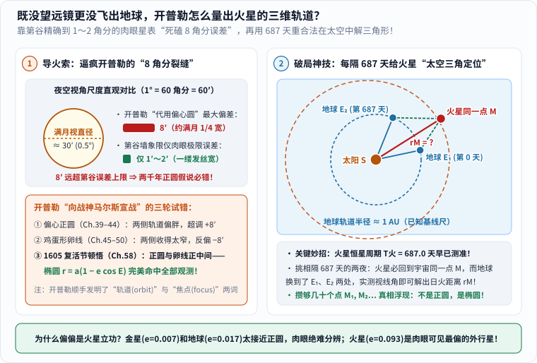
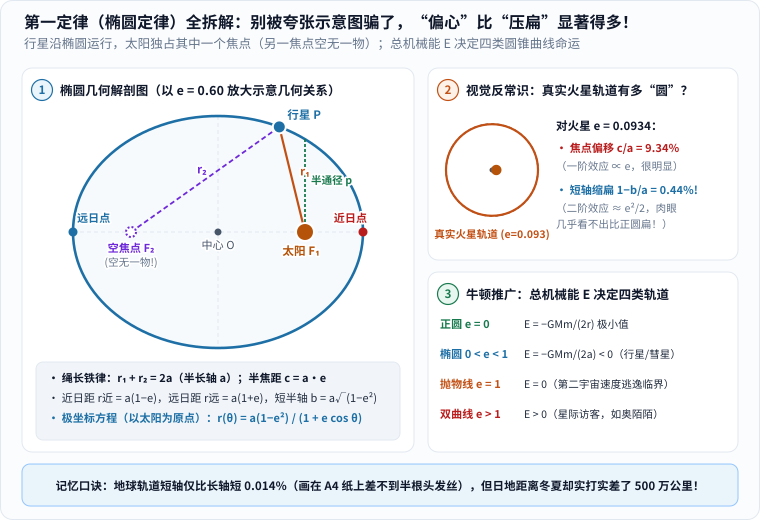
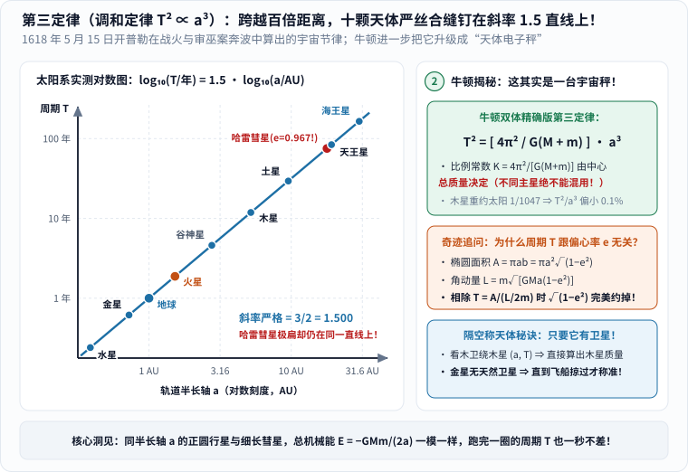
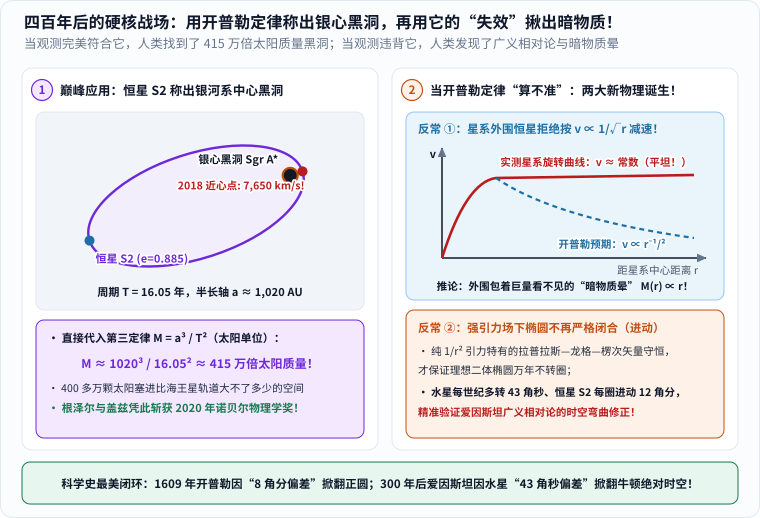

先来做一道几乎所有人都会凭直觉答错的日历算术题。

一年有大约 $365.24$ 天，春分和秋分把地球公转轨道对半分开——太阳直射北半球的日子（春分到秋分，也就是北半球的**春夏半年**）和直射南半球的日子（秋分到次年春分，北半球的**秋冬半年**），天数应该一模一样吧？

如果你真拿天文年历一天天加起来，会发现一个让人瞪大眼睛的数字：

- **北半球春夏半年（春分 → 夏至 → 秋分）**：约 **$186.4\text{ 天}$**；
- **北半球秋冬半年（秋分 → 冬至 → 次年春分）**：约 **$178.8\text{ 天}$**！

没算错——在今天的地球上，**北半球的温暖半年，实打实比寒冷半年多出了整整 $7.6$ 天（将近 8 天）！** 而造成这 8 天“时间差”的幕后推手更反直觉：**每年 1 月初北半球裹着羽绒服瑟瑟发抖时，地球恰恰处在离太阳最近的位置（近日点）**，正踩足油门以每秒 $30.29\text{ 公里}$ 的全年最高速狂飙；到了 7 月初酷暑难耐时，地球反而退到了离太阳最远的地方（远日点），慢悠悠地以每秒 $29.29\text{ 公里}$ 散步！

这组藏在每本日历里的奇观，连同人类发射每一颗通信卫星、精准预报哈雷彗星回归，乃至 2020 年诺贝尔物理学奖隔着 $2.6$ 万光年“称”出银河系中心超大质量黑洞的看家本领，全都源自四百多年前一个穷困潦倒、视力残障的德国数学家，在近千页手算草稿纸里抠出来的三条铁律——**开普勒行星运动三大定律（Kepler's Three Laws of Planetary Motion）**。

在之前的文章[《从开普勒到牛顿：行星为什么不会掉进太阳？》]()里，我们顺着牛顿接棒的脉络俯瞰过天体力学的全貌。今天这篇文章，我们专门把镜头推到最深处，把读懂开普勒三大定律最容易卡壳的四个核心问题一次拆透：

1. **既没望远镜更没飞出地球，地球自己还在跑，开普勒凭什么单靠角度记录算出了火星的真实三维距离？**
2. **第一定律说轨道是椭圆，为什么看真实比例的地球和火星轨道“肉眼跟正圆一模一样”，课本插图却全画得像压扁的鸡蛋？**
3. **为什么开普勒在历史上其实是“先发现第二定律，三年后才算出第一定律”？它怎么解释夏天多赚 8 天与苏联卫星的“悬停魔术”？**
4. **第三定律里神秘的 $T^2 \propto a^3$ 为什么偏偏是 $3/2$ 次方、且完全无视轨道有多扁？当开普勒定律“算不准”时，又怎样撞开了广义相对论与暗物质的大门？**

---

## 一、向战神马尔斯宣战：8 角分裂缝与“每隔 687 天拍合照”的太空三角术

在讲三条公式之前，先感受一下现代天文词汇里留下的“开普勒烙印”——我们今天张口就来的三个高频词，竟然全都是**约翰内斯·开普勒（Johannes Kepler, 1571–1630）一个人造出来的**（据圣安德鲁斯大学 MacTutor 数学史档案考证）：

- **“轨道”（orbit，拉丁文 *orbita*，原意为车轮压出的车辙）**：在开普勒 1609 年《新天文学》（*Astronomia Nova*）之前，欧洲天文学家一直用 *orbis*（水晶球壳），默认行星是镶嵌在透明固体球壳上滚动的珠子；是开普勒砸碎了球壳，把行星走过的空间路径命名为 *orbita*。
- **“焦点”（focus，拉丁文原意为“壁炉、火塘”）**：1604 年他在光学著作《天文学的光学部分》（*Astronomiae Pars Optica*）里把光线汇聚之处比作家里生火聚热的壁炉，第一次把圆锥曲线里的这个特殊点叫作 *focus*。
- **“卫星”（satellite，拉丁文 *satelles*，原意为贵族身边的随从护卫）**：1610 年伽利略用望远镜发现木星旁有四颗小星绕着转，开普勒写信力挺伽利略，幽默地把这些寸步不离绕着行星转的随从命名为 *satellites*。

### 1. 美丽的误会与布拉格的宿命相遇

少年时代的开普勒体弱多病，幼年染上天花，不仅双手落下残疾，视力也严重受损，看星星时常常出现重影（复视加近视）——他可能是人类历史上最不适合当观测天文学家的人，却拥有一双能穿透海量数字看清几何结构的眼睛。

1596 年，24 岁的年轻数学教师开普勒出版了处女作《宇宙的奥秘》（*Mysterium Cosmographicum*）：当时人类只知道水、金、地、火、木、土 **6 颗行星**，它们之间恰好有 **5 个轨道间隙**；开普勒突发奇想，把古希腊数学证明仅有的 **5 种柏拉图正多面体**（正八面体、正二十面体、正十二面体、正四面体、正六面体）一层层嵌套进球壳之间，间距比例居然跟哥白尼的行星轨道数据颇为接近！

以现代眼光看，这当然是一个**美丽的几何巧合**——后来天王星（1781）和海王星（1846）被发现，太阳系根本不止 6 颗大行星，正多面体嵌套模型彻底失效。但正是这本充满狂热数学想象力的小书寄出去后，引起了当时全世界最顶尖的肉眼观测巨匠——丹麦贵族**第谷·布拉赫（Tycho Brahe, 1546–1601）**的注意。

1600 年初，因宗教迫害离开格拉茨的开普勒奔赴布拉格，投奔担任神圣罗马帝国皇家数学家的第谷。两人的性格堪称冰火两重天：第谷腰缠万贯、脾气火爆，在丹麦汶岛（Hven）建起过天文城堡，用半径近两米的巨型铜制**墙象限仪（mural quadrant）**，在望远镜尚未发明的年代，硬是凭肉眼瞄准把行星位置误差压到了惊人的 **$1\text{–}2\text{ 角分}$（$1' = \frac{1}{60}^\circ$，大约相当于十米外看一根牙签的粗细）**！但他极度护食，生怕开普勒抢走风头，只把最难啃的一块硬骨头——**火星（Mars，罗马战神马尔斯）**的观测账本丢给开普勒去算。

1601 年 10 月，第谷骤然病逝，临终前反复喃喃自语：“别让我白活一场……”接任皇家数学家的开普勒继承了第谷攒下二十余年的无价星表，正式打响了科学史上著名的**“对火星之战”（War with Mars）**。

*图 1：怎么在没有望远镜、地球自己也在公转的前提下量出火星轨道？先看左栏尺度对比：满月视直径约 $30'$，开普勒用传统圆轨道模型拼到极限仍剩 $8'$ 偏差（约满月宽度的 $1/4$），远超第谷 $1'\text{–}2'$ 的观测误差上限；再看右栏破局神技：利用火星公转周期恰好 $687.0\text{ 天}$ 重回空间同一点 $M$，从地球不同位置 $E_1, E_2$ 做太空三角测量，直接解出日火距离。*

### 2. 第一个烧脑难题：地球也在跑，怎么量出火星有多远？

很多读者第一次了解这段历史时都会卡在一个极其犀利的问题上：**第谷的账本里只有每天晚上抬头看火星的“视线方向角”，根本没有激光测距仪，而且地球自己也在绕着太阳飞奔！连脚下的站台都在动，开普勒怎么知道火星离太阳有多远？**

看图 1 右侧，开普勒耍了一招堪称教科书级的**“宇宙定时快照三角术”**：

1. **抓住火星的不变节拍**：虽然当时还不知道火星轨道的确切形状，但古人通过上千年记录早就把火星绕太阳一圈的**恒星周期**算得极准——**$T_{\text{火} } = 687.0\text{ 地球日}$**。这意味着，不管火星走什么怪异闭合曲线，**每过整整 $687$ 天，火星必定精准回到三维宇宙空间里的同一个固定点 $M$！**
2. **让地球充当移动观测基站**：地球公转一圈是 $365.25\text{ 天}$，两圈是 $730.5\text{ 天}$。于是第 $0$ 天地球在位置 $E_1$，第 $687$ 天时地球还没跑完第二圈（差了 $43.5$ 天，大约转差了 $43^\circ$），停在了轨道上的另一点 $E_2$！
3. **两道视线锁死一个顶点**：在这相隔 $687$ 天的两个夜晚，火星像钉死在太空里的灯塔一样待在同一点 $M$ 不动。开普勒先反过来用几组这样的配对校准了地球自身的轨道位置（发现地球轨道中心也偏离太阳，且地球自身也在快慢变化！），随后以日地平均距离 $1\text{ AU}$（天文单位）为基线尺，利用第谷实测的太阳方向与火星视线夹角 $\angle S E_1 M$、$\angle S E_2 M$，在平面上直接解三角形 $\triangle S E_1 M$ 与 $\triangle S E_2 M$，**一步算出了此刻火星到太阳的真实距离 $r_M$（以 $\text{AU}$ 为单位）和方位角 $\theta_M$**！

在**对数表（1614 年纳皮尔才发表）和微积分都还没诞生**的年代，开普勒全凭手工乘除和三角函数表，整整算满了 **900 多页大开本手稿**！

### 3. 掀翻两千年正圆执念的“8 角分判决”

从古希腊柏拉图、亚里士多德，到地心说集大成者托勒密，再到提出日心说的哥白尼和第谷本人，整整两千年里，所有天文学家都把一条哲学信条奉若神明：**天体是神圣完美的，一切天体运动必定由“匀速正圆”叠加而成**（本轮套均轮，或偏心圆配等距点 *equant*）。

在《新天文学》前 16 章里，开普勒也老老实实用偏心正圆去凑第谷的火星冲日数据。他凑出的“代用假说”（*vicarious hypothesis*）准到什么程度呢？在整个黄道一圈大多数位置上，算出来的火星经度跟第谷实测值相差**不到 $2\text{ 角分}$**！

换作任何一个普通学者，看到误差压进 $0.03^\circ$ 以内，早就开香槟宣布大功告成了。但当开普勒用这套圆模型去核对火星轨道两侧象限附近的距离和纬度时，死活卡着一道抹不掉的裂缝——**最大误差达到了 $8\text{ 角分}$（$8' = \frac{8}{60}^\circ \approx 0.133^\circ$，约等于满月视直径 $30'$ 的四分之一）**！

正是这区区 $8$ 角分，引爆了科学史上最动人的一段独白。开普勒在《新天文学》第 19 章郑重写道：

> “上苍赐予了我们第谷·布拉赫这样一位极其勤勉的观测者，他的观测揭露了这个计算模型 $8$ 角分的误差；我们理应感恩并善加利用这份天赐之礼……**仅仅因为这 $8$ 角分是不允许被忽视的，它独自指引我彻底革新了整座天文学大厦！**”

在接下来的五年苦战里，开普勒经历了三轮惊心动魄的几何搏杀（图 1 左下）：
- **第一轮（偏心正圆）**：轨道两侧腰身太胖，算出的火星位置比实测偏快，误差 **$+8'$**；
- **第二轮（鸡蛋形“卵线” *ovum*，第 45–50 章）**：他引入物理直觉，设想火星像小船在太阳漩涡里划桨，算出了一条一头尖一头圆的鸡蛋形曲线，结果两侧腰身又收得太窄，误差反过来变成 **$-8'$**；
- **第三轮（1605 年复活节顿悟，第 58–59 章）**：看着正圆偏 $+8'$、卵线偏 $-8'$，开普勒突然意识到，真相就夹在正圆和卵线正中间——当他把辅助圆纵向均匀压缩一个常数比例 $b/a = \sqrt{1 - e^2}$，写出极径关系 $r = a(1 - e\cos E)$ 时，他拍案惊呼：自己苦苦寻觅了好几年的曲线，不就是古希腊数学家阿波罗尼奥斯早就研究透了的**椭圆（ellipse）**吗？！

由于第谷继承人索要数据版权并审查文稿，这部 1605 年完稿的旷世巨著直到 **1609 年**才在海德堡正式印行，书名霸气十足——**《新天文学》（*Astronomia Nova*）**。人类终于向统治星空两千年的“正圆教条”正式告别。

（顺带解答一个趣味问题：**为什么立下头功的偏偏是火星？** 因为金星偏心率只有 $0.0068$，地球也只有 $0.0167$，放在第谷的肉眼精度下几乎跟偏心正圆无法区分；水星虽然更扁 $e = 0.2056$，但整天贴在耀眼的太阳旁边极难连续观测；木星、土星又转得太慢。唯独**火星 $e = 0.0934$**，既是整夜能看清的外行星，偏心率又刚好跨过了第谷 $1'\text{–}2'$ 精度的检出线——简直是大自然特意留给人类的通关钥匙！）

---

## 二、开普勒第一定律（椭圆定律）：别被夸张插图骗了，“偏心”比“压扁”猛二十倍！

先把**开普勒第一定律（椭圆定律，Law of Ellipses，1609）**用最准确的一句话立住：

> **每一颗行星绕太阳运行的轨道都是一个椭圆，而太阳位于这个椭圆的两个焦点之一上。**

千万别漏掉后半句里的细节：**一个椭圆有两个对称的焦点 $F_1$ 和 $F_2$，太阳独占其中一个焦点（比如图 2 中的 $F_1$），而另一个焦点 $F_2$ 处在茫茫太空里，那里空空如也，什么天体都没有！**

*图 2：第一定律完整解剖图。先看左栏（以 $e = 0.60$ 放大展示几何关系）：两焦点间距离为 $2c = 2ae$，行星到两焦点距离之和恒为 $r_1 + r_2 = 2a$，太阳独占焦点 $F_1$；再看右上反常识真相：按真实比例画出火星轨道（$e=0.0934$），短半轴只比长半轴缩了 $0.44\%$（肉眼看纯纯是个圆！），但太阳焦点却偏了 $9.34\%$；右下则给出牛顿按总机械能 $E$ 推广的四类圆锥曲线家族。*

### 1. 一张纸两枚图钉：读懂椭圆轨道的五个核心参数

如果你在木板上钉两枚图钉代表两个焦点 $F_1$、$F_2$，套上一根总长度固定的细绳，用铅笔尖绷紧绳子画一圈（我们在[《用几何读懂圆锥曲线与丹德林球》]()里严格证明过它等价于平面斜切圆锥），就能把天体力学里最常用的五个参数一次认全（对照图 2 左栏）：

1. **半长轴 $a$（semi-major axis，单位：米 $\text{m}$ 或天文单位 $\text{AU}$）**：椭圆最长直径（长轴）的一半，满足绳长守恒铁律
   $$r_1 + r_2 = 2a$$
   它是描述椭圆“个头大小”的头号标尺。地球轨道的半长轴定义为 $a_{\oplus} \approx 1.000\text{ AU} \approx 1.496 \times 10^8\text{ km}$。
2. **偏心率 $e$（eccentricity，无量纲纯数，椭圆满足 $0 < e < 1$）**：椭圆中心 $O$ 到焦点的距离（半焦距 $c$）与半长轴 $a$ 的比值：
   $$e = \frac{c}{a} \quad \Longleftrightarrow \quad c = ae$$
   当 $e \to 0$ 时两枚图钉合二为一，椭圆退化成正圆；当 $e \to 1$ 时图钉拉到两端顶点，椭圆被拉成极细长的雪茄状。
3. **短半轴 $b$（semi-minor axis）**：椭圆最窄处宽度的一半。当行星走到最上方的短轴顶点时，左右两段绳长对称相等（$r_1 = r_2 = a$），由勾股定理立得：
   $$a^2 = b^2 + c^2 \quad \Longrightarrow \quad b = a\sqrt{1 - e^2}$$
4. **近日点与远日点距离（perihelion $r_{\text{近} }$ & aphelion $r_{\text{远} }$）**：太阳坐在焦点 $F_1$ 上，离中心偏了 $ae$，所以行星离太阳最近和最远的距离分别是：
   $$r_{\text{近} } = a(1 - e), \qquad r_{\text{远} } = a(1 + e)$$
   两者相加恰好等于长轴总长 $r_{\text{近} } + r_{\text{远} } = 2a$！
5. **以太阳为原点的极坐标标准方程**：天文学家算轨道时，不会把坐标原点放在空荡荡的椭圆中心 $O$，而是直接放在**太阳 $F_1$** 上。设行星当前位置与近日点方向的夹角为**真近点角 $\theta$（true anomaly）**，则日星距离 $r(\theta)$ 满足极简洁的圆锥曲线统一公式：
   $$r(\theta) = \frac{p}{1 + e\cos\theta}, \qquad p = a(1 - e^2)$$
   其中 $p = a(1 - e^2)$ 叫作**半通径（semi-latus rectum）**，几何意义就是图 2 左栏绿虚线标出的“过太阳垂直于长轴向上量到轨道的弦长”（代入 $\theta = 90^\circ, \cos\theta = 0$ 立得 $r(90^\circ) = p$）。验证两个端点：$\theta = 0^\circ$ 时 $r(0^\circ) = \frac{a(1-e^2)}{1+e} = a(1-e) = r_{\text{近} }$；$\theta = 180^\circ$ 时 $r(180^\circ) = \frac{a(1-e^2)}{1-e} = a(1+e) = r_{\text{远} }$，分毫不差！

### 2. 破除课本最大视觉误区：地球和火星轨道其实“圆得离谱”！

几乎所有科普书画行星轨道时，为了让你一眼看出那是椭圆，都会画成图 2 左栏那种 $e = 0.6$ 甚至 $e = 0.8$ 的扁鸡蛋。结果导致无数人产生了一个根深蒂固的错觉：**以为地球和火星的轨道肉眼看去也是扁扁的！**

来算一笔能让你瞬间清醒的泰勒展开账：

- **太阳偏离中心的比例（一阶小量）**：$\frac{c}{a} = e$，跟 $e$ 成正比；
- **椭圆短轴比长轴缩窄的“压扁率”（二阶小量！）**：
  $$1 - \frac{b}{a} = 1 - \sqrt{1 - e^2} \approx \frac{1}{2}e^2$$

看懂这个 $\frac{1}{2}e^2$ 的威力了吗？当 $e$ 很小时，$e^2$ 比 $e$ 小了整整一个数量级！我们拿 NASA 行星参数表里的真实数据算给你看：

- **地球（$e = 0.0167$）**：短半轴与半长轴之比 $b/a = \sqrt{1 - 0.0167^2} \approx \mathbf{0.99986}$，只压扁了 **$0.014\%$**！什么概念？如果你在电脑屏幕上画一个直径 $1000\text{ 像素}$ 的标准地球轨道，它的横向宽度是 $1000\text{ 像素}$，纵向高度是 **$999.86\text{ 像素}$**——差值还不到七分之一个像素，人类肉眼绝对看不出它比正圆扁！**但是**，太阳偏离中心 $1.67\%$（在屏幕上偏出约 $8.4\text{ 像素}$），放到真实太阳系里，让地球近日点（$1.471\times 10^8\text{ km}$）和远日点（$1.521\times 10^8\text{ km}$）硬生生拉开了 **$500\text{ 万公里}$** 的差距！
- **火星（$e = 0.0934$，见图 2 右上真实比例图）**：短半轴 $b = 0.9956a$，只比正圆扁了 **$0.44\%$**，肉眼看依然圆溜溜的；但太阳焦点偏移高达 **$9.34\%$**，近日点（$2.067\times 10^8\text{ km}$）和远日点（$2.492\times 10^8\text{ km}$）足足差了 **$4{,}250\text{ 万公里}$**！

> **一句话记住第一定律的精髓**：对太阳系八大行星来说，椭圆轨道最显眼的特征根本不是“圆圈被压扁了”，而是**“太阳歪坐在一边（偏心）”**！真正扁成雪茄状的是长周期彗星——比如著名的**哈雷彗星（$e = 0.967$）**，近日点钻进金星轨道以内（$0.586\text{ AU}$），远日点却甩到海王星轨道之外（$35.1\text{ AU}$）！

### 3. 牛顿的升维推广：不只椭圆，四类圆锥曲线由“总机械能 $E$”一键切换

开普勒当年只知道受太阳束缚的行星走椭圆；78 年后，牛顿在 1687 年《自然哲学的数学原理》里用万有引力定律 $F = \frac{GMm}{r^2}$ 严格证明：在二体平方反比引力场中，任何不受外力干扰的天体，其轨道极坐标方程必然是

$$r(\theta) = \frac{L^2 / (GMm^2)}{1 + e\cos\theta}$$

$$e = \sqrt{1 + \frac{2 E L^2}{G^2 M^2 m^3} }$$

这里 $L$ 是天体的角动量大小，$E = \frac{1}{2}mv^2 - \frac{GMm}{r}$ 是系统的**总机械能**（规定无穷远处引力势能为零）。看根号底下那一项 $\frac{2EL^2}{G^2 M^2 m^3}$——总机械能 $E$ 的正负号，直接充当了轨道命运的“分道岔开关”（图 2 右下，亦可对照[《从发射卫星读懂三大宇宙速度》]()）：

1. **$E < 0$（负能量束缚态 $\implies 0 \le e < 1$，正圆与椭圆）**：动能不足以挣脱太阳引力井，满足 $E = -\frac{GMm}{2a}$，天体永远被锁在闭合椭圆（特例 $e=0$ 为正圆）上一圈圈往复运行；
2. **$E = 0$（零能量逃逸临界 $\implies e = 1$，抛物线）**：动能恰好抵消引力势能（$\frac{1}{2}mv^2 = \frac{GMm}{r}$，即刚好达到当地的逃逸速度／第二宇宙速度），天体沿开口抛物线滑向无穷远，到无穷远处速度刚好归零；
3. **$E > 0$（正能量非束缚态 $\implies e > 1$，双曲线）**：天体怀揣富余动能闯入太阳系，绕着太阳拐一道优雅的弯后扬长而去，永不回头！最经典的实测案例就是 2017 年闯入太阳系的人类首颗确诊星际访客**“奥陌陌”（`1I/'Oumuamua`）**，天文学家测出它的轨道偏心率高达 **$e \approx 1.20 > 1$**——单凭这一个数字大于 $1$，就能铁板钉钉断定它绝非太阳系原住民，而是来自外恒星系的过客！

---

## 三、开普勒第二定律（等面积定律）：比第一定律早出生三年，还藏着夏天多出 8 天的秘密！

如果按教科书编号顺序读，人人都会以为开普勒是先发现第一定律，再发现第二定律。**真实历史恰恰相反！**

在 1602 年前后的手稿里，开普勒为了算出火星在不同位置耗费的时间，先猜想“行星速度与日星距离成反比”（在近日点和远日点这两个特殊点上完全精确，中间略有近似偏差），接着灵光一闪，把无穷多段微小距离累加换成**扇形面积**，在 **1602 年就率先用上了“等面积定律”做时间标尺**——正是靠着这把时间尺子，他才在三年后的 **1605 年**倒推出了第一定律的椭圆形状！

**开普勒第二定律（等面积定律，Law of Equal Areas，1609）**的表述干净利落：

> **太阳与行星的连线（矢径），在相等的时间间隔内扫过相等的面积。**

*图 3：第二定律真实计时模拟与四季时长揭秘（[单独打开图片可重新播放 7 秒单次轨道动画](/assets/images/kepler-three-laws/second-law-equal-area-and-seasons-anim.svg)）。先看左栏（$e = 0.55$ 教学轨道）：12 颗圆点按开普勒方程严格等时间间隔（每格 $T/12$）标出，橙色宽矮扇形 $A_1$ 与蓝色细长扇形 $A_2$ 耗时均为 $T/6$，面积严格相等；即使不看动画或开启减少动态效果，点位的“近疏远密”也一眼说明近快远慢。再看右栏：角动量守恒本质，以及地球 1 月过近日点如何让北半球春夏比秋冬多出 $7.6$ 天。*

### 1. 三行微元几何揭开底牌：它其实就是“角动量守恒”的几何化身！

为什么扫过的面积非得跟时间成正比？不用高深数学，切一小块极窄的比萨饼（无穷小时间 $\mathrm{d}t$ 内扫过的窄三角形 $\mathrm{d}A$）就能看穿本质：

在极短时间 $\mathrm{d}t$ 里，日星距离为 $r$，行星速度 $\mathbf{v}$ 可以分解成顺着连线的径向分量 $v_r$（只拉长缩短连线，不扫面积）和**垂直于连线的切向分量 $v_\perp$**（真正横扫面积）。小三角形的底是 $r$，高是 $v_\perp\,\mathrm{d}t$，于是扫过的微小面积为：

$$\mathrm{d}A = \frac{1}{2} r (v_\perp\,\mathrm{d}t) \quad \Longrightarrow \quad \frac{\mathrm{d}A}{\mathrm{d}t} = \frac{1}{2} r v_\perp$$

现在把右边分子分母同乘行星质量 $m$！还记得我们在[《花滑收臂暴涨四倍速、猫咪半空翻身、陀螺斜着不倒：一文读懂无处不在的角动量》]()里讲过的轨道角动量定义 $L = |\mathbf{r} \times m\mathbf{v}| = m r v_\perp$ 吗？代进去立刻得到天体力学最漂亮的一座桥梁：

$$\frac{\mathrm{d}A}{\mathrm{d}t} = \frac{L}{2m} = \text{常数}$$

**为什么角动量 $\mathbf{L}$ 一定守恒？** 因为太阳对行星的引力 $\mathbf{F}$ 始终严格沿着两者的连线指向太阳（这叫**有心力／中心力，central force**），力臂永远为零，产生的力矩 $\boldsymbol{\tau} = \mathbf{r} \times \mathbf{F} = \mathbf{0}$！没有力矩，角动量 $\mathbf{L}$ 的大小和方向就纹丝不动：
- **方向不变** $\implies$ 行星运动永远被锁死在同一个固定平面（轨道面）内，绝不会自己翘起来乱飘；
- **大小不变** $\implies$ 掠面速率 $\frac{\mathrm{d}A}{\mathrm{d}t} = \frac{L}{2m}$ 永远恒定！就像花样滑冰运动员收拢手臂（$r$ 变小）会瞬间加速旋转一样，行星靠近太阳时 $r$ 缩短，切向速度 $v_\perp$ 必然等比例暴涨！

> **关键适用边界与反例（极易考错！）**：
> 1. **第一定律和第三定律依赖引力严格与距离平方成反比（$F \propto 1/r^2$），但第二定律不依赖！** 只要力始终指向固定中心（$\boldsymbol{\tau} = \mathbf{0}$），哪怕你把太阳换成一根遵守胡克定律的巨型橡皮筋（$F = -kr$），或者换成 $1/r^3$ 的怪力，**等面积定律依然 100% 严格成立**！
> 2. **什么时候第二定律会失效？** 一旦出现**非中心切向力**——比如低轨人造卫星遭遇稀薄高层大气阻力（阻力逆着速度方向，$\boldsymbol{\tau} \neq \mathbf{0}$），或者航天器点火启动变轨发动机（见[《卫星飞行原理与全过程》]()中的霍曼变轨点火瞬间），角动量 $L$ 发生改变，掠面速率就会跟着跳变。

在近日点和远日点这两个极端点上，行星速度方向恰好严格垂直于日星连线（$v = v_\perp$），由 $m r_{\text{近} } v_{\text{近} } = m r_{\text{远} } v_{\text{远} }$ 立得极其好用的**近远日点速率比公式**：

$$\frac{v_{\text{近} } }{v_{\text{远} } } = \frac{r_{\text{远} } }{r_{\text{近} } } = \frac{a(1 + e)}{a(1 - e)} = \frac{1 + e}{1 - e}$$

再结合机械能守恒 $E = \frac{1}{2}mv^2 - \frac{GMm}{r} = -\frac{GMm}{2a}$，还能顺手推出航天工程师每天都在用的**活力公式（*vis-viva* equation）**——知道任意位置距离 $r$，一行算出瞬时速率 $v$：

$$v^2 = GM\left(\frac{2}{r} - \frac{1}{a}\right)$$

拿图 3 左栏的 $e = 0.55$ 轨道验算：$\frac{v_{\text{近} } }{v_{\text{远} } } = \frac{1.55}{0.45} \approx 3.44$ 倍；若是哈雷彗星（$e = 0.967$），它在近日点掠过太阳时的极速（约 $54.6\text{ km/s}$）竟是远日点龟速（约 $0.91\text{ km/s}$）的 **$60$ 倍**！

### 2. 难倒三百年数学大师的“开普勒方程”：$M = E - e\sin E$

知道第一定律（轨道在哪）和第二定律（面积匀速扫过），是不是就能轻松算出“明天晚上八点火星在哪个角度”了？

开普勒自己试着反解时，撞上了一堵硬墙！如果定义一个随时间均匀增长的**平近点角 $M = \frac{2\pi}{T}(t - t_{\text{近} })$**（代表时间进度条），再借助外接辅助圆上的**偏近点角 $E$**，第二定律的等面积条件会严格化简为著名的**开普勒方程（Kepler's Equation）**：

$$M = E - e\sin E$$

别看它长得人畜无害，只有短短三项：已知几何角 $E$ 算时间 $M$ 易如反掌；但**已知时间 $M$ 反过来求角度 $E$，这是一个没有初等代数封闭解的超越方程！** 开普勒在书里感叹“谁要是能替我解出它，我将无比感激”。正是为了攻克这个反演难题，后世数学家接力发明了**牛顿迭代法**、**拉格朗日反演级数**，德国天文学家贝塞尔（Friedrich Bessel, 1817–1824）更是在将它展开成傅里叶级数时，系统锻造出了纵横整个物理与工程界的**贝塞尔函数 $J_n(x)$**！

### 3. 解开开篇日历悬案 + 俄罗斯“闪电卫星”的悬停奇招

现在，回到文章开头的两个现实奇观，一切豁然开朗：

- **为什么北半球春夏比秋冬多出近 8 天？**
  在公元 21 世纪的今天，地球每年 **1 月 3 日至 4 日左右经过近日点**（$r_{\text{近} } \approx 1.471\times 10^8\text{ km}$），此时正值北半球隆冬！按活力公式和等面积定律，地球在近日点附近跑得最快，达 **$30.29\text{ km/s}$**；到了 **7 月 4 日左右经过远日点**（$r_{\text{远} } \approx 1.521\times 10^8\text{ km}$），正值北半球盛夏，公转速度降到全年最慢的 **$29.29\text{ km/s}$**。
  同样跨过 $180^\circ$ 黄经：秋冬半圈路程略短、车速又快，“嗖”一下 $178.8\text{ 天}$ 就跑完了；春夏半圈路程略长、车速又慢，足足磨蹭了 $186.4\text{ 天}$——里外里差出 **$7.6\text{ 天}$**！
  *(顺带辟个高频谣：既然 1 月离太阳最近，为什么北半球 1 月反而冷？因为地球四季冷暖的主因是 **$23.44^\circ$ 地轴倾角**带来的正午阳光直射／斜射与白昼长短，南北半球辐射差高达数倍，完全碾压了日地距离 $3.3\%$ 带来的约 $6.7\%$ 阳光总通量波动！)*

- **航天工程师怎样“反向白嫖”第二定律？——闪电轨道（Molniya Orbit）**
  在[《同步卫星为什么能钉在头顶不动》]()里我们讲过，地球静止轨道只能悬在**赤道正上方**；像俄罗斯、加拿大北部这样接近北极圈的高纬度地区，抬头看赤道同步卫星几乎贴着南边地平线，信号极易被楼房山脉挡死。
  怎么办？苏联轨道专家想出了一招妙到毫巅的方案：发射偏心率高达 **$e \approx 0.74$**、倾角 $63.4^\circ$、周期 $12\text{ 小时}$ 的大椭圆**闪电轨道（Molniya）卫星**，把近地点（仅约 $600\text{ km}$ 高）压在南半球，把远地点（高达近 $40{,}000\text{ km}$）高高抛在莫斯科和西伯利亚头顶！根据开普勒第二定律，卫星在南半球近地点“嗖”地几十分钟掠过，而在北半球远地点慢如蜗牛——**每 $12$ 小时一圈里，有超过 $8\text{ 小时}$ 近乎“悬停”在北国高空**！只需三颗卫星轮班接力，就能全天候覆盖整个极北地区！

---

## 四、开普勒第三定律（调和定律）：战火与审巫案中算出的 $T^2 \propto a^3$，如何变成“宇宙磅秤”？

1609 年发表前两条定律时，开普勒心里其实还憋着一个更大的执念：第一、第二定律只管**单颗行星自己怎么跑**（火星管火星，地球管地球）；那么水星、金星、地球、火星、木星、土星这几兄弟之间，**离太阳越远的行星转得越慢，它们的距离 $a$ 和公转周期 $T$ 之间到底藏着什么统一密码？**

接下来的十年，是开普勒人生最凄风苦雨的十年：1611 年他最疼爱的 6 岁儿子死于天花，发妻紧接着病逝，赞助人鲁道夫二世被迫退位；他流寓奥地利林茨，被路德宗神学家开除领圣餐资格；1615 年更晴天霹雳——他远在符腾堡故乡的七旬老母亲卡塔琳娜被邻里诬告施展巫术关进大牢，面临火刑威胁！开普勒不得不放下手头工作，冒着三十年战争爆发前夕的动荡，一次次坐着颠簸马车往返奔波，亲自撰写上百页法律辩护状，整整耗时六年才把老母亲活着救出牢房。

就在这样颠沛流离的缝隙里，他从未停下推算星辰的笔。1618 年 3 月 8 日，他脑海里第一次闪过“周期的平方对比距离的立方”的念头，却因忙乱中手算出了个小笔误，懊恼地把它划掉了；两个月后的 **1618 年 5 月 15 日**，他重新核对了一遍算式，所有行星的数据瞬间严丝合缝咬合在一起！1619 年，他在名著《世界的和谐》（*Harmonices Mundi*）第五卷正式写下**开普勒第三定律（调和定律，Law of Harmonies，1619）**：

> **任何两颗绕太阳运行的行星，其公转周期 $T$ 的平方之比，严格等于它们椭圆轨道半长轴 $a$ 的立方之比（对同一中心天体，$K$ 为常数）：**
> $$\frac{T_1^2}{T_2^2} = \frac{a_1^3}{a_2^3} \quad \Longleftrightarrow \quad \frac{T^2}{a^3} = K$$

*图 4：第三定律跨越近百倍尺度的惊人统治力。先看左栏实测双对数坐标图（$\log_{10} T$ 对 $\log_{10} a$）：从水星一路排到开普勒生前根本不知道的天王星、海王星、小行星带谷神星，甚至轨道扁到极致的哈雷彗星（$e=0.967$），十颗天体像穿糖葫芦一样死死钉在斜率 $1.500$ 的直线上！再看右栏：牛顿如何揭示比例常数 $K$ 里的中心质量 $M$，以及为什么椭圆扁度 $e$ 会完美抵消。*

### 1. 直觉破冰：为什么偏偏是“$3/2$ 次方”（$T \propto a^{3/2}$），而不是正比于距离 $a$？

如果所有行星都以同样的线速度绕太阳跑（就像操场上不同跑道但同样步速慢跑的人），那外圈跑道长 $k$ 倍，跑一圈的时间 $T$ 自然只长 $k$ 倍（$T \propto a^1$）。**多出来的那半个次方 $a^{1/2}$ 是哪来的？**

我们先拿最简单的正圆轨道（半径 $r = a$）做三行极简推导，一眼看穿物理来源：
万有引力提供圆周运动向心力：

$$\frac{GMm}{a^2} = m\frac{v^2}{a} \quad \Longrightarrow \quad v = \sqrt{\frac{GM}{a} } \propto a^{-1/2}$$

看清了！离太阳越远，太阳引力拉拽越弱，行星根本不需要跑那么快就能维持轨道平衡——**距离扩大为 $k$ 倍时，行星的线速度会降为原来的 $\frac{1}{\sqrt{k} } = k^{-1/2}$ 倍**！

现在算跑完一圈（周长 $2\pi a$）所需的周期 $T$：

$$T = \frac{2\pi a}{v} = \frac{2\pi a}{\sqrt{GM / a} } = \frac{2\pi}{\sqrt{GM} }\,a^{3/2}$$

两边一平方，就是牛顿补全物理常数后的第三定律标准形式（计入双体绕共同质心旋转的精确质量项 $M + m$）：

$$T^2 = \frac{4\pi^2}{G(M + m)} a^3$$

原来 $a^{3/2}$ 拆开看一点也不神秘：**“跑道周长变长了 $a^1$ 倍” $\times$ “行进车速变慢了 $a^{1/2}$ 倍” $=$ 耗时变成 $a^{3/2}$ 倍**！

如果以地球为基准尺——**距离用天文单位 $\text{AU}$（地球 $a_\oplus = 1\text{ AU}$），时间用地球公转年 $\text{yr}$（地球 $T_\oplus = 1\text{ yr}$）**，那么对所有绕太阳转且自身质量远小于太阳（$m \ll M_\odot$）的天体，比例常数自动变成最清爽的 **$1$**：

$$\left(\frac{T}{\text{yr} }\right)^2 \approx \left(\frac{a}{\text{AU} }\right)^3$$

我们用 NASA 行星实测表与 JPL 轨道根数现场核对一圈（注意看倒数第二行的哈雷彗星！）：

| 太阳系天体 | 半长轴 $a\ (\text{AU})$ | 公转周期 $T\ (\text{yr})$ | 偏心率 $e$ | $a^3$ | $T^2$ | 实测比值 $T^2 / a^3$ |
| :--- | :---: | :---: | :---: | :---: | :---: | :---: |
| **水星** | $0.3871$ | $0.2409$ | $0.2056$ | $0.0580$ | $0.0580$ | **$1.000$** |
| **金星** | $0.7233$ | $0.6152$ | $0.0068$ | $0.3785$ | $0.3785$ | **$1.000$** |
| **地球** | $1.0000$ | $1.0000$ | $0.0167$ | $1.0000$ | $1.0000$ | **$1.000$** |
| **火星** | $1.5237$ | $1.8809$ | $0.0934$ | $3.5375$ | $3.5378$ | **$1.000$** |
| **木星** | $5.2026$ | $11.862$ | $0.0489$ | $140.82$ | $140.71$ | **$0.999$** |
| **土星** | $9.5371$ | $29.448$ | $0.0565$ | $867.45$ | $867.18$ | **$1.000$** |
| **哈雷彗星** | $17.834$ | $75.32$ | **$0.9671$** | $5672.2$ | $5673.1$ | **$1.000$** |
| **海王星** | $30.069$ | $164.79$ | $0.0086$ | $27187$ | $27156$ | **$0.999$** |

*(注：细心的读者会发现木星和海王星的 $T^2/a^3 \approx 0.999$ 比 $1.000$ 小了千分之一！这不是测量误差，恰恰是牛顿精确公式的勋章——木星质量约为太阳的 $\frac{1}{1047}$，使 $M_\odot + m_{\text{木} } \approx 1.00095\,M_\odot$，分母变大千分之一，$T^2/a^3$ 就精准缩小千分之一；海王星轨道内侧更是把木星、土星等巨行星质量一并包了进去！)*

### 2. 第二个神奇追问：哈雷彗星扁成一根针，凭什么周期跟同半长轴正圆一秒不差？

看上表里的哈雷彗星，偏心率高达 $e = 0.9671$，轨道又细又长，凭什么算周期时偏心率 $e$ 连影子都不见，只看半长轴 $a$？

把第二定律的掠面速率 $\frac{\mathrm{d}A}{\mathrm{d}t} = \frac{L}{2m}$ 拿过来跑满一整圈，三行代数直接见证奇迹：
- 椭圆一整圈的总面积是 $A_{\text{总} } = \pi a b = \pi a^2 \sqrt{1 - e^2}$；
- 二体椭圆轨道的角动量与半通径 $p = a(1 - e^2)$ 满足 $p = \frac{L^2}{GMm^2}$，即 $L = m\sqrt{GM a (1 - e^2)}$；
- 用总面积除以每秒扫过的面积，就是整圈周期 $T$：

$$T = \frac{A_{\text{总} } }{L / (2m)} = \frac{2\pi a^2 \sqrt{1 - e^2} }{\sqrt{GMa(1 - e^2)} }$$

$$T = \frac{2\pi}{\sqrt{GM} }\,a^{3/2}$$

看到了吗？！分子上因为椭圆变扁缩水了一个因子 $\sqrt{1 - e^2}$，分母上角动量也一模一样缩水了同一个因子 $\sqrt{1 - e^2}$——**上下一约分，偏心率 $e$ 灰飞烟灭！** 只要半长轴 $a$ 相同，不管是圆滚滚的行星还是细如银针的彗星，它们的总机械能 $E = -\frac{GMm}{2a}$ 完全相等，跑完一圈的周期 $T$ 也分秒不差！

### 3. 给全宇宙天体隔空称重（附初学者头号避坑指南！）

把牛顿精确公式移项变形，人类就拿到了一杆能伸向百亿光年之外的**“宇宙电子秤”**（可与前文[《没法把地球搬上电子秤，人类是怎么测出它有 60 万亿亿吨重的？》]()测出引力常数 $G$ 联动阅读）：

$$M + m = \frac{4\pi^2 a^3}{G T^2}$$

- **初学者头号误区警告**：**千万不能把“绕不同中心天体转”的两颗星混进同一个常数 $K$ 里比大小！** 比如你不能拿“月球绕地球的 $T_{\text{月} }^2 / a_{\text{月} }^3$”直接等于“地球绕太阳的 $T_{\oplus}^2 / a_{\oplus}^3$”——因为前者的中心质量是地球 $M_\oplus$，后者是太阳 $M_\odot$，两者的比值整整差了约 **33.3 万倍**！
- **反过来，这恰恰成了称重神器**：只要一颗行星拥有卫星（$m \ll M$），拿望远镜看清这颗小卫星绕它一圈的轨道半长轴 $a$ 和周期 $T$，甚至连卫星自己多重都不用知道，代进公式立刻就能算出中心大行星的质量 $M$！牛顿当年就是拿木卫四绕木星的数据，一举算出了木星质量约为太阳的千分之一；而在太阳系里，**没有天然卫星的水星和金星**，它们的质量反而在好几个世纪里最难测准，直到 20 世纪人类派探测器近距离飞掠感受到引力偏折后才彻底敲定！

---

## 五、四百年后的前沿战场：称出银心 415 万倍太阳黑洞，再用“失效”揪出暗物质！

有人可能会问：开普勒三大定律毕竟是四百年前的古典力学成果，到了黑洞、暗物质和爱因斯坦相对论唱主角的 21 世纪，它过时了吗？

答案恰恰相反——**在今天的天体物理最前沿，开普勒定律左手是寻找黑洞与系外行星的定海神针，右手则是检验新物理的照妖镜：凡是它算得准的地方，人类看清了隐形巨兽；凡是它“算不准”的地方，全都炸出了诺贝尔奖级的新物理！**

*图 5：开普勒定律在当代天体物理中的两大高光现场。先看左栏（2020 年诺贝尔物理学奖成果）：恒星 S2 沿着偏心率 $e = 0.885$ 的极扁椭圆，每 $16.05\text{ 年}$ 绕银河系中心一片漆黑的焦点狂飙一圈，直接用第三定律“称”出 $415\text{ 万倍}$太阳质量的超大质量黑洞 Sgr A\*；再看右栏：当星系外围恒星拒绝按 $v \propto r^{-1/2}$ 减速时，人类发现了暗物质晕；当近日点发生微小进动时，人类验证了广义相对论。*

### 1. 封神之战：恒星 S2 绕着“空气”狂飙，称出银河系中心超大质量黑洞！

在距离地球约 $2.66\text{ 万光年}$ 的银河系正中心人马座方向，射电天文学家早就注意到一个致密射电源 **Sgr A\***（人马座 A\*），怀疑那里藏着一颗不发光的超大质量黑洞，却一直苦于拿不出铁证。

从 20 世纪 90 年代初开始，德国马普地外物理研究所的**赖因哈德·根泽尔（Reinhard Genzel）**团队与美国加州大学洛杉矶分校的**安德烈娅·盖兹（Andrea Ghez）**团队，借助红外自适应光学技术穿透厚重的银心尘埃，一帧一帧死盯紧挨着 Sgr A\* 的一群高速恒星，整整追拍了二十多年！

其中编号为 **S2（又称 S0-2）** 的恒星走出了教科书般震撼的开普勒轨道（图 5 左栏）：
- 它绕着一片在光学与红外波段**空无一物、看不见任何恒星**的焦点，精准画出了一个偏心率高达 **$e = 0.8847$** 的闭合椭圆；
- 公转周期仅 **$T = 16.05\text{ 年}$**，轨道半长轴约 **$a \approx 1{,}020\text{ AU}$**；
- 2018 年 5 月 19 日，S2 俯冲掠过距离黑洞仅约 **$120\text{ AU}$**（大约是海王星到太阳距离的 $4$ 倍）的近心点，轨道速度一路狂飙到惊世骇俗的 **$7{,}650\text{ km/s}$——达到了光速的 $2.55\%$**！

现在，让我们亲手用四百年前的开普勒第三定律（以太阳质量 $M_\odot$、天文单位 $\text{AU}$、年 $\text{yr}$ 为单位，满足 $\frac{M}{M_\odot} = \frac{(a/\text{AU})^3}{(T/\text{yr})^2}$）给这个看不见的焦点称重：

$$\frac{M_{\text{Sgr A*} } }{M_\odot} \approx \frac{1{,}020^3}{16.05^2} \approx 4.12 \times 10^6$$

（结合欧洲南方天文台 GRAVITY 干涉仪精确校准银心距离 $8.18\text{ kpc}$ 后的精细拟合值为 **$4.15 \times 10^6\text{–}4.3 \times 10^6\,M_\odot$**！）

**415 万颗太阳的质量，严丝合缝塞在比太阳系边缘大不了多少的狭小空间里，而且完全不发光！** 除了超大质量黑洞，已知物理学没有任何其他天体能做到这一点。2020 年，根泽尔与盖兹凭此双双站上了诺贝尔物理学奖领奖台。

### 2. 当开普勒定律“算不准”时，人类迎来了三次物理学大革命

最后，千万别把开普勒三大定律当成死板的终极真理。它的严格成立有两个苛刻前提：**① 理想二体系统（没有第三颗天体拉扯）；② 引力严格服从牛顿瞬时平方反比律 $F = \frac{GMm}{r^2}$**。在过去两百年里，每当实测数据与理想开普勒轨道出现哪怕一丝丝偏差，物理学的大门就被撞开一次：

1. **天王星“走歪了” $\longrightarrow$ 笔尖下算出海王星（1846 年）**
   1781 年天王星被发现后，天文学家发现它老是不听话地偏离开普勒椭圆几十角秒。法国青年勒维耶（Urbain Le Verrier）与英国青年亚当斯（John Couch Adams）没有怀疑引力定律，而是断定**二体前提被打破**——天王星外侧还藏着一颗未知大行星在拽它！1846 年 9 月 23 日晚，柏林天文台伽勒按勒维耶信中算出的坐标调转望远镜，不到一小时就在距离预言位置不到 $1^\circ$ 处抓住了**海王星**！
2. **水星椭圆“自己转圈” $\longrightarrow$ 验证爱因斯坦广义相对论（1915 年 & 2020 年）**
   在纯牛顿 $1/r^2$ 引力下，除了能量与角动量守恒，还存在一个特殊的守恒矢量——**拉普拉斯—龙格—楞次矢量（LRL vector）**，它像一根定海神针锁死了近日点方向，保证孤立二体椭圆万年严格闭合。然而离太阳最近的水星，在扣除其他全部行星的引力拉扯后，它的近日点每 100 年依然顽固地多转了 **$43\text{ 角秒}$（$43''$）**！这一次不再有“火神星”，而是牛顿引力本身需要修正：1915 年 11 月，爱因斯坦用广义相对论弯曲时空算出水星每世纪额外进动 $\Delta\varphi = \frac{6\pi GM_\odot}{a(1-e^2)c^2} \times \frac{100\text{ yr} }{T_{\text{水} } } = \mathbf{42.98''}$，一剑封喉！而在 2020 年，GRAVITY 合作组更在银心恒星 S2 身上直接测出了每转一圈高达 **$12\text{ 角分}$** 的强引力场史瓦西进动！
3. **星系外围恒星“拒绝减速” $\longrightarrow$ 发现宇宙暗物质晕（20 世纪 70 年代）**
   刚才推导第三定律时我们算过：如果一个星系的质量绝大部分集中在明亮的星系盘中心，那么外围恒星的轨道速度必须按开普勒规律 **$v(r) = \sqrt{\frac{GM}{r} } \propto r^{-1/2}$** 随距离递减（图 5 右上蓝虚线）。然而 20 世纪 70 年代，天文学家**薇拉·鲁宾（Vera Rubin）**与肯特·福特精确测量仙女座等数十个漩涡星系的光谱多普勒红移时震惊地发现：直到发光星盘边缘以外很远的地方，**恒星的旋转速度居然拉成了一条近乎水平的直线 $v(r) \approx \text{常数}$**（图 5 右上红实线）！代回 $\frac{v^2}{r} = \frac{GM(r)}{r^2}$ 一看，要让 $v$ 不随 $r$ 下降，轨道内包裹的总质量必须满足 **$M(r) \propto r$**——这意味着我们肉眼可见的璀璨星系，仅仅是漂浮在一团重达数倍、完全不发光也不吸光的巨大**暗物质晕（Dark Matter Halo）**中心的冰山一角！

看看这跨越四百年的回响有多奇妙：1609 年，开普勒死死咬住第谷星表里 **$8\text{ 角分}$** 的裂缝不松口，砸碎了束缚人类两千年的正圆水晶球；三百多年后，物理学家同样咬住水星 **$43\text{ 角秒}$** 的进动与星系边缘拒绝下垂的速度曲线，接连撞开了弯曲时空与暗物质的新世界。

---

## 六、一张表收好开普勒三大定律 + 亲手可玩的官方互动实验室

把今天拆解的全部硬核武器浓缩成一张随时可查的对账表：

| 定律名称与发表年份 | 核心数学表达式 | 回答了什么问题 | 深层物理根基与适用边界 |
| :--- | :--- | :--- | :--- |
| **第一定律（椭圆定律）** *Astronomia Nova*, 1609 | $r(\theta) = \dfrac{a(1 - e^2)}{1 + e\cos\theta}$ | **轨道长什么样？** 椭圆（太阳在单一焦点，空焦点无物） | 平方反比引力 $F \propto 1/r^2$ + 负总机械能 $E = -\frac{GMm}{2a} < 0$；若 $E \ge 0$ 则变为抛物线／双曲线 |
| **第二定律（等面积定律）** 1602 先发现，1609 发表 | $\dfrac{\mathrm{d}A}{\mathrm{d}t} = \dfrac{L}{2m} = \text{常数}$ $\dfrac{v_{\text{近} } }{v_{\text{远} } } = \dfrac{1 + e}{1 - e}$ | **单颗星快慢怎么变？** 近日点狂奔，远日点散步（北半球春夏长 7.6 天） | **中心力场角动量守恒**（$\boldsymbol{\tau} = \mathbf{r}\times\mathbf{F} = \mathbf{0}$）；对**任何有心力**皆成立，无需平方反比！ |
| **第三定律（调和定律）** 1618.5.15 发现，*Harmonices Mundi* 1619 | $T^2 = \dfrac{4\pi^2}{G(M + m)} a^3$ | **不同轨道周期怎么比？** 只看半长轴 $a$，与偏心率 $e$ 无关；可反推中心天体质量 | 平方反比引力 + 牛顿第二、第三定律；**不同中心主星的比例常数 $K$ 绝不可混用** |

如果你想在浏览器里亲手拖动偏心率滑块、打开秒表验证等面积扇形，或者实时三维俯瞰地球、火星与哈雷彗星此刻在太阳系里的真实位置，推荐两个零门槛的权威官方交互页面（需联网并开启浏览器 JavaScript；即使不打开外站，本文全部推导与配图已完整自洽）：

1. **科罗拉多大学博尔德分校 PhET 官方交互实验《Kepler's Laws》（支持中文界面）**：<https://phet.colorado.edu/en/simulations/keplers-laws> —— 可自由切换第一、第二、第三定律实验台，实时显示两个焦点、空焦点、扫过扇形面积柱状图与 $\log T\text{–}\log a$ 连线。
2. **NASA 喷气推进实验室（JPL）官方三维实景星图《Eyes on the Solar System》**：<https://eyes.nasa.gov/apps/solar-system/> —— 基于真实 JPL 星历驱动，可随时快进时间观察火星冲日、地球近远日点及哈雷彗星的大椭圆轨迹。

---

## 参考资料与核查来源

1. **圣安德鲁斯大学 MacTutor 数学史档案（University of St Andrews）**：
   - J. J. O'Connor & E. F. Robertson, *Johannes Kepler Biography*（核查开普勒生平、1596《宇宙的奥秘》、1600 布拉格投奔第谷、1609《新天文学》、1618 年 5 月 15 日发现第三定律、母亲审巫案辩护及 *orbit / focus / satellite* 术语首创史）：<https://mathshistory.st-andrews.ac.uk/Biographies/Kepler/>
   - *Kepler's Planetary Laws* 专题史料（核查第谷 8 角分观测危机、687 天火星空间三角定位、第二定律先于第一定律发现过程及复活节椭圆证明）：<https://mathshistory.st-andrews.ac.uk/HistTopics/Keplers_laws/>
2. **大学物理权威开源教材 OpenStax *University Physics Volume 1*, §13.5 *Kepler's Laws of Planetary Motion***（核查圆锥曲线极坐标方程、掠面速率角动量推导、活力公式及哈雷彗星轨道算例）：<https://openstax.org/books/university-physics-volume-1/pages/13-5-keplers-laws-of-planetary-motion>
3. **美国国家航空航天局（NASA）戈达德太空飞行中心 *Planetary Fact Sheet***（核查太阳系八大行星半长轴、恒星周期、偏心率、地球近日点 $1.471\times 10^8\text{ km}$ 与远日点 $1.521\times 10^8\text{ km}$ 实测参数）：<https://nssdc.gsfc.nasa.gov/planetary/factsheet/>
4. **银心超大质量黑洞 Sgr A\* 与恒星 S2 实测论文及诺奖背景**：
   - GRAVITY Collaboration (R. Abuter et al.), *Detection of the Schwarzschild precession in the orbit of the star S2 near the Galactic centre massive black hole*, **Astronomy & Astrophysics** 636, L5 (2020), `arXiv:2004.07187`（核查恒星 S2 周期 $16.05\text{ yr}$、偏心率 $e = 0.88466$、近心点极速 $\approx 7{,}650\text{ km/s}$、中心黑洞质量 $\approx 4.15\text{–}4.26\times 10^6\,M_\odot$ 及每圈 $12'$ 相对论进动）：<https://arxiv.org/abs/2004.07187>
   - 诺贝尔奖官方科学背景报告 *The Nobel Prize in Physics 2020 — Popular Science Background*（核查根泽尔与盖兹二十余年银心恒星轨道追踪历史）：<https://www.nobelprize.org/prizes/physics/2020/popular-information/>
5. **星系平坦旋转曲线与暗物质晕研究档案**：
   - 薇拉·鲁宾天文台官方科学传记 *Vera C. Rubin Observatory — Who was Vera Rubin?*，及经典原始论文 Vera C. Rubin & W. Kent Ford Jr., *ApJ* 159, 379 (1970) / *ApJ* 238, 471 (1980)（核查对逾 60 个漩涡星系的测速表明外围恒星速度违背开普勒 $r^{-1/2}$ 衰减、呈现平坦旋转曲线并确立暗物质晕证据）：<https://rubinobservatory.org/about/vera-rubin>
