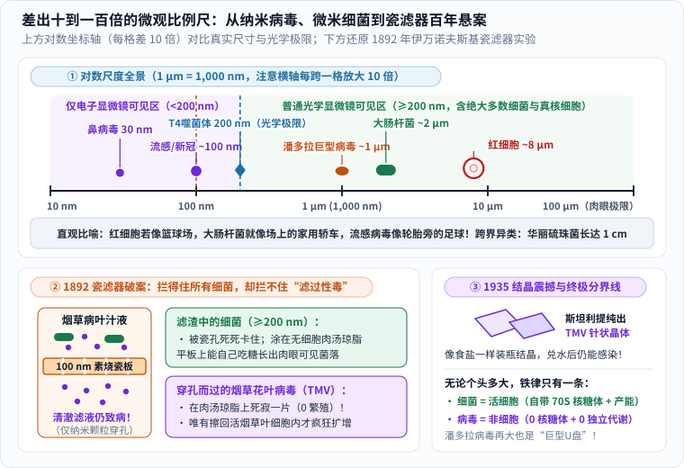
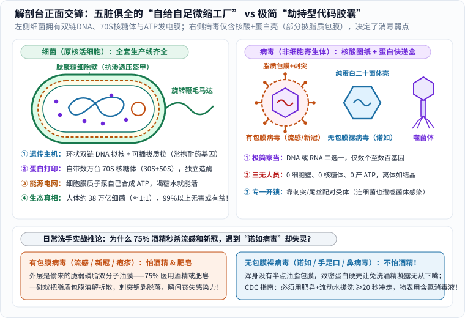
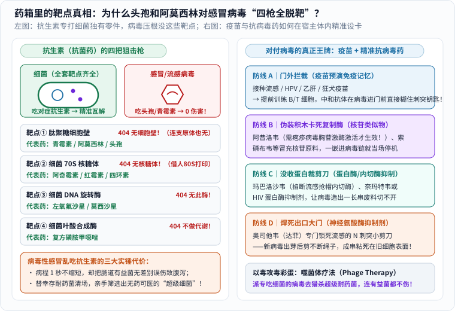
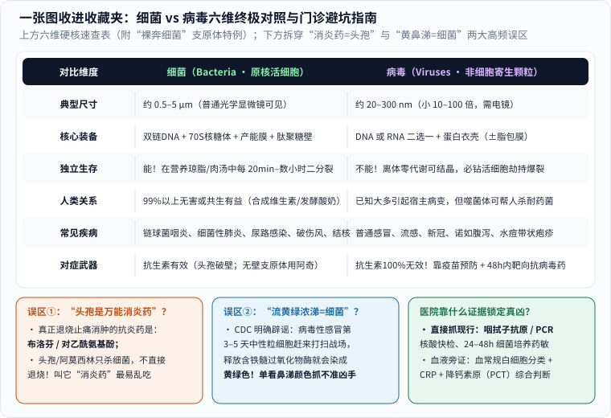

每逢换季降温，只要家里有人开始打喷嚏、嗓子疼、额头烧到 $38.5^\circ\text{C}$，甚至第三天擤出了一团黄绿色的浓鼻涕，药箱前十有八九会上演同一幕经典对话：

> “肯定是染上病菌发炎了！赶紧把上次剩下的头孢（或者阿莫西林）吃两粒压一压！”

可如果你翻开微生物学教材和[美国疾控中心（CDC）的抗生素临床指南](https://www.cdc.gov/antibiotic-use/about/index.html)，看到的却是一盆毫不留情的冷水：**面对普通感冒、流感、新冠或诺如腹泻这些病毒感染，就算把头孢和青霉素当饭吃，对真正的幕后凶手也是“零伤害”——病程一秒钟都不会缩短，哪怕鼻涕已经黄得发绿也一样！**

为什么中文口语里习惯打包合称的“细菌病毒”，到了药物面前却像活在两个平行宇宙？

答案既反直觉又充满戏剧性：**如果把细菌和病毒放到生命演化的解剖台上对比，它俩的差距比“蓝鲸和狗尾巴草”还要大得多**——蓝鲸和小草好歹都是货真价实的真核细胞生物；而**细菌**是一座五脏俱全、自带发电厂和生产线、给口糖水就能独立繁衍三十多亿年的**单细胞活体城市**；**病毒**却连细胞都不是，不吃不喝不呼吸，离开活细胞能像食盐一样凝成亮晶晶的死物晶体，一旦摸进宿主体内却能瞬间化身劫持整座工厂的**“流氓代码 U 盘”**！

今天，我们就顺着**“尺寸悬殊 → 硬件拆解 → 繁殖斗法 → 药箱靶点 → 门诊实战”**五幕大戏，把这对微观世界最容易被搞混的冤家彻底扒个底朝天。

---

## 一、第一幕：差出十到一百倍的微观比例尺与百年“瓷滤器悬案”

### 1. 如果红细胞是一座篮球场，细菌和病毒分别有多大？

很多人以为细菌和病毒都是“反正肉眼看不见的小点点”，个头应该差不多。其实在微观尺度上，它俩完全不在同一个量级（参见 [OpenStax《微生物学》1.3 节](https://openstax.org/books/microbiology/pages/1-3-types-of-microorganisms)）：

- **人体红细胞**：直径约 $8\ \mu\text{m}$（微米，$1\ \mu\text{m} = 1{,}000\text{ nm}$）；
- **典型细菌**（如大肠杆菌 *Escherichia coli*、金黄色葡萄球菌）：尺寸大多在 **$0.5\text{–}5\ \mu\text{m}$（即 $500\text{–}5{,}000\text{ nm}$）** 之间；
- **典型病毒**（如鼻病毒、流感病毒、冠状病毒）：尺寸大多只有 **$20\text{–}300\text{ nm}$（纳米）**，比普通细菌整整小了 **$10$ 到 $100$ 倍**（体积更是相差上千到上百万倍）！

换算成咱们每天看得见的参照物，画面感立刻就出来了：**假如把一颗直径 $8\ \mu\text{m}$ 的人体红细胞放大成一座标准篮球场，那么一根 $2\ \mu\text{m}$ 长的大肠杆菌就像停在球场中央的一辆家用小轿车；一颗约 $100\text{ nm}$ 的流感病毒或新冠病毒，只相当于轿车轮胎旁边摆着的一只足球；而引发普通感冒的鼻病毒（约 $30\text{ nm}$），不过是一颗高尔夫球！**

_图 1：先看上方对数坐标轴（注意横轴每跨一大格代表尺寸放大 10 倍！）——普通光学显微镜受可见光衍射极限（约 $200\text{ nm}$）限制，只能看清右侧绿色区的细菌与人体细胞，左侧紫色区绝大多数病毒必须借助电子显微镜才能现形。再看下方还原的 1892 年素烧瓷滤器实验与 1935 年病毒结晶震撼。_

正是这道尺寸鸿沟，在科学史上制造了长达两百六十多年的“视觉盲区”：可见光波长大约在 $400\text{–}700\text{ nm}$，受限于阿贝光学衍射极限，普通光学显微镜的分辨率天花板卡在 **$200\text{ nm}$ 左右**。因此早在 1670 年代，荷兰布商列文虎克用自磨单透镜显微镜就已经亲眼看见了牙垢和水滴里欢快游动的细菌；可在此后整整两个半世纪里，哪怕是巴斯德和科赫这样的微生物学泰斗，把光学显微镜调到冒烟，面对狂犬病、天花和流感时依然连半个凶手的影子都找不到。

### 2. 1892 素烧瓷板奇案：连细菌都钻不过去的筛子，漏过了什么？

真正撕开病毒神秘面纱的，是一场著名的“筛子破案”（详见 [OpenStax《微生物学》6.1 节](https://openstax.org/books/microbiology/pages/6-1-viruses)）：

1884 年，巴斯德实验室的查尔斯·尚贝兰（Charles Chamberland）发明了一种孔径仅约 **$100\text{ nm}$（$0.1\ \mu\text{m}$）** 的素烧瓷滤器——当时已知的所有细菌直径都在 $200\text{ nm}$ 以上，液体只要压过这块瓷板，所有细菌都会被死死卡在滤渣里，滴下来的滤液绝对无菌。

1892 年，俄国植物学家伊万诺夫斯基（Dmitri Ivanovsky）把患上“烟草花叶病”的病叶捣碎榨汁，压过了尚贝兰素烧瓷滤器（图 1 左下）。按常理，既然细菌全被拦住了，滴下来的清澈滤液应该绝对安全才对——**可当他把这滴清澈透明的滤液涂回健康烟草叶上时，健康的烟草竟然照样烂成了花叶！**

伊万诺夫斯基起初还怀疑是不是瓷板漏了，或者有某种极小的细菌孢子。直到 1898—1899 年，荷兰微生物学家贝杰林克（Martinus Beijerinck）做了一个更绝的对照实验：
- 把普通细菌滴进没有活细胞的牛肉汤琼脂平板上，细菌自己大口吃糖，几天就长出肉眼可见的菌落；
- 把这滴神秘滤液滴进最丰盛的牛肉汤琼脂里，哪怕等上一年，平板上也是**死寂一片，半点都不会增殖**；可只要擦进**正在生长的活烟草叶片**里，它又瞬间成千上万倍地扩增出来，还能一轮接一轮无限传染下去（排除了单纯化学毒素被稀释失效的可能）！

贝杰林克意识到人类撞见了一种前所未见的生命形态，将它命名为 *contagium vivum fluidum*（意为“有感染性的活流质”），并重新启用了拉丁语词 **_virus_（原意为“黏液、毒汁”）**。

更颠覆三观的一幕发生在 **1935 年**：美国生物化学家温德尔·斯坦利（Wendell Stanley，1946 年诺贝尔化学奖得主）竟然把整整一吨感染烟草叶里的烟草花叶病毒（TMV）像提纯白糖和食盐一样，**结晶成了一瓶毫无生命迹象的白色针状晶体**（图 1 右下）！把它锁在玻璃瓶里，它不呼吸、不产热、不代谢，跟一块矿石没两样；可只要挑一撮晶体重新兑进水里抹上烟草叶，它立刻“满血复活”大肆复制！直到 1939 年电子显微镜问世，人类才第一次看清这根长 $300\text{ nm}$、宽 $18\text{ nm}$ 的蛋白核酸小短棒。

### 3. 科学边界彩蛋：也有肉眼可见的巨无霸细菌与“微米级巨型病毒”！

严谨的科学从不迷信一刀切。过去二十年里，微生物学家接连挖出了两类打破尺寸刻板印象的“跨界怪兽”：

- **肉眼直接看得见的厘米级细菌**：2022 年，Jean-Marie Volland 等人在《科学》（*Science*）上正式描述了加勒比海红树林落叶上的[**华丽硫珠菌**（*Thiomargarita magnifica*）](https://en.wikipedia.org/wiki/Thiomargarita_magnifica)——**单颗细菌细胞平均长达 $1\text{ 厘米}$（最长可达 $2\text{ 厘米}$）**，像一根根白色的眼睫毛，不用任何显微镜就能用镊子夹起来！它之所以没被扩散极限憋死，是因为细胞中央塞着一只占体积 $65\%\text{–}80\%$ 的巨大液泡，把活跃的细胞质挤在边缘薄薄一层，甚至用膜囊（pepins）把 DNA 分装管理。
- **比小细菌还胖的巨型病毒**：2003 年与 2013 年，科学家在变形虫体内先后发现了**拟菌病毒（*Mimivirus*，直径约 $400\text{–}750\text{ nm}$）**与**潘多拉病毒（*Pandoravirus*，长达 $1{,}000\text{ nm} = 1\ \mu\text{m}$，基因组高达 $2.5\text{ Mb}$）**，个头大到普通光学显微镜一眼就能瞧见，刚发现时甚至被误当成了革兰氏阳性球菌！

**那既然尺寸有重叠，生物学靠什么铁律一锤定音区分细菌和病毒？** 这就要推开第二幕解剖室的大门了——答案根本不在胖瘦，而在**“体内有没有全套独立谋生的核糖体工厂与发电膜”**！

---

## 二、第二幕：解剖台正面交锋——“五脏俱全的微缩工厂” vs “三无代码胶囊”

把一颗细菌和一颗病毒切开剖面并排放在一起（参见图 2 及 [OpenStax《微生物学》3.3 节](https://openstax.org/books/microbiology/pages/3-3-unique-characteristics-of-prokaryotic-cells)），你会瞬间明白什么叫“正规军基地”与“特洛伊木马”的差别：

_图 2：先看左上角细菌解剖——环状双链 DNA、可交换质粒、数万台 70S 核糖体、细胞膜质子泵与肽聚糖盔甲一应俱全；再看右上角三类经典病毒——无论有包膜的流感/新冠、无包膜的诺如病毒还是像登月舱一样的噬菌体，内部都只有一团核酸加蛋白外壳；底部揭示这一硬件差异如何直接决定了手消酒精管不管用。_

### 1. 细菌：麻雀虽小、五脏俱全的“原核活细胞”

细菌虽然属于**原核生物**（没有像人体真核细胞那样用核膜把细胞核单独包成一间经理办公室），但作为一颗完整的生命细胞，它独立生存所需的四大家当样样不缺：

1. **全套双链 DNA 主机 + 质粒“外挂插件”**：所有细胞生物无一例外都用稳定的[**双链 DNA（dsDNA）**保存遗传总账]()。比如一粒大肠杆菌的环状染色体约有 $460\text{ 万}$ 个碱基对，编码约 $4{,}300$ 个基因，衣食住行全写得明明白白。更绝的是，细菌细胞质里还漂着许多独立的小型双链 DNA 圆环——**质粒（Plasmid）**：两颗细菌甚至能伸出“性菌毛”搭一座桥，像蓝牙传文件一样把写有“抗青霉素秘籍”的质粒共享给邻居！
2. **数万台 `70S` 核糖体（蛋白质 3D 打印机）**：大肠杆菌体内时刻轰鸣着两万到七万台 **`70S` 核糖体**（由 `30S` 小亚基和 `50S` 大亚基拼成；注意这和人体细胞质里的 **`80S` 核糖体**尺寸结构不同，记住这个伏笔，第四幕抗生素全靠它精准索命！）。只要有原料，它自己就能照着 mRNA 图纸源源不断打印几千种酶和结构蛋白。
3. **自带细胞膜发电厂与“肽聚糖”防爆盔甲**：细菌虽然没有线粒体，但它直接把[呼吸作用电子传递链和 ATP 合酶]()装在了自己的**细胞膜**上，喝口糖水就能自己发电造 ATP！细胞膜外头还砌着一层细菌独有的钢筋混凝土城墙——**肽聚糖细胞壁（Peptidoglycan）**，专门顶住细胞内高达数个大气压的渗透压，防止细菌吸水涨破（革兰氏阳性菌拥有 $30\text{–}100\text{ nm}$ 厚的肽聚糖城墙；革兰氏阴性菌则是 $\le 4\text{ nm}$ 薄壁外再套一层含脂多糖内毒素 LPS 的外膜）。许多细菌尾部还装着每分钟狂转上万圈的分子螺旋桨**鞭毛**，遇到极端饥荒高温时，芽孢杆菌和梭菌还能脱水缩成刀枪不入的休眠**芽孢（Endospore）**，沉睡几百年后再发芽！
4. **必须为细菌平反的一笔大账——99% 以上的细菌根本不是坏蛋！** 听到“细菌”千万别条件反射只想喷消毒水。以色列魏茨曼科学研究所的 Ron Sender、Shai Fuchs 和 Ron Milo 在 2016 年发表于 [《PLOS Biology》的经典定量核查论文](https://journals.plos.org/plosbiology/article?id=10.1371/journal.pbio.1002533)中算清了人体细胞账本（顺手修正了流传几十年的“人体细菌是自身细胞 10 倍”的旧估算）：一个 $70\text{ kg}$ 标准成年人体内约有 **$3.0\times 10^{13}$（$30\text{ 万亿}$）个人体细胞**，同时驻扎着约 **$3.8\times 10^{13}$（$38\text{ 万亿}$）颗细菌**（比例接近 **$1.3:1$**，总重约 $0.2\text{ kg}$），绝大部分聚居在结肠里。它们不仅帮我们发酵膳食纤维、合成维生素 K 与 B 族维生素、霸占肠道生态位挡住外来致病菌，放眼地球生态圈，餐桌上的酸奶泡菜奶酪靠乳酸菌发酵，庄稼的氮肥靠根瘤菌固氮，连你此刻吸入肺里的每一口氧气，追根溯源都是二十多亿年前海洋里的**蓝细菌（Cyanobacteria）**辛辛苦苦光合作用攒下来的家底！真正会让人生病的致病菌，在细菌大家族里连 $1\%$ 都不到。

### 2. 病毒：砸碎一切常规的“极简代码快递盒”

再把镜头切到图 2 右侧的病毒——画风瞬间从“现代化工业园”变成了“家徒四壁”：

- **三无人员（0 细胞壁、0 核糖体、0 ATP 合成）**：病毒体内既没有细胞质，也没有半台核糖体，更没有合成 ATP 能量的代谢酶系。所以哪怕是前面提到长达 $1\ \mu\text{m}$ 的潘多拉巨型病毒，本质上依然是一只造不出半粒蛋白质的“大号空壳 U 盘”，生物学分类上属于**非细胞生物（Acellular）**，被挡在细菌域、古菌域和真核域组成的“生命三域树”门外。
- **乱拳打死老师傅的核酸百宝箱**：所有细胞生物都老老实实用双链 DNA 当主硬盘，病毒却把遗传介质玩出了花（巴尔的摩七大分类）——**每一种病毒颗粒内部只装 DNA 或 RNA 二选一**，但可以是双链 DNA（疱疹病毒、腺病毒、T4 噬菌体）、单链 DNA（细小病毒）、双链 RNA（轮状病毒）、正链单链 RNA（新冠、鼻病毒、诺如病毒，进门就能直接当 mRNA 翻译！）、负链单链 RNA（流感、狂犬、埃博拉，必须自带依赖 RNA 的 RNA 聚合酶先翻印成正链），甚至是自带逆转录酶把 RNA 倒写回 DNA 塞进人类染色体的**逆转录病毒（HIV）**！而且它们的基因组往往精简到极致——甲型流感病毒总共只有 $8$ 小段 RNA、编码十几种蛋白质，却足以在全球掀起大流行。
- **外壳只有两三样零件**：核心核酸外头裹着一层由蛋白质亚基严丝合缝拼成的几何**衣壳（Capsid）**——常见有像足球一样的**正二十面体**（鼻病毒、诺如病毒）、像玉米棒一样的**螺旋管状**（烟草花叶病毒），以及专吃细菌的噬菌体那种“二十面体脑袋 + 注射器尾鞘 + 六根起落架尾丝”的**复合登月舱构型**。部分病毒在钻出上一个宿主细胞时，还会顺手扯走一小片宿主的磷脂细胞膜披在身上，插满开锁用的糖蛋白**刺突（Spike）**，这层油膜就叫**包膜（Envelope）**。

### 3. 日常救命冷知识：为什么 75% 酒精秒杀流感和新冠，遇到诺如病毒却当场吃瘪？

看懂了上面“有没有脂质包膜”这一条硬件差别，你就能立刻破解一个让无数家长踩坑的日常卫生谜题（图 2 底部）：

- **有包膜病毒（流感病毒、新冠病毒、疱疹病毒、乙肝病毒、HIV）——看似凶猛，实则“一碰酒精肥皂就散架”**：它们最外层那件偷来的磷脂双分子层包膜本质上是一层脆弱的油脂膜，开锁全靠插在油膜上的刺突蛋白（如流感的 H 刺突、新冠的 S 刺突）。当你喷上 **$60\%\text{–}75\%$ 的医用酒精**或抹上肥皂洗手液时，酒精和表面活性剂会像洗洁精化油污一样瞬间溶解拆散脂质包膜，让刺突钥匙哗啦脱落，病毒在几秒钟内彻底报废！
- **无包膜“裸病毒”（诺如病毒、引发手足口病的肠道病毒、普通感冒鼻病毒、轮状病毒）——浑身纯蛋白铁甲，酒精免洗洗手液拿它没辙！** 每到秋冬季学校幼儿园爆发上吐下泻的**诺如病毒（Norovirus）**，很多家长猛给孩子涂免洗酒精凝露，结果全家照样中招。原因就写在 [CDC《诺如病毒预防指南》](https://www.cdc.gov/norovirus/prevention/index.html)头版头条上：**诺如病毒是典型的无包膜裸病毒**，外头根本没有怕酒精的油脂膜，只有一圈锁得死紧的正二十面体纯蛋白硬壳，普通醇类手消很难破坏它！对付诺如病毒只有两招真正管用：**双手必须用肥皂加流动清水认真搓洗至少 $20\text{ 秒}$**（靠水流和泡沫把病毒颗粒物理冲下水道），而被呕吐物污染的地板马桶必须用 **$1{,}000\text{–}5{,}000\text{ ppm}$ 的含氯消毒液（如 84 消毒液稀释液）**强氧化撬碎它的蛋白硬壳！

---

## 三、第三幕：繁殖大斗法——20 分钟一分为二的“细胞分家” vs 先隐身再百倍爆裂的“木马劫持”

硬件配置差出十万八千里，注定了细菌和病毒传宗接代的画风一个是“勤劳致富办分厂”，另一个是“单枪匹马劫印钞机”。

_图 3：左侧上下两栏对比 $37^\circ\text{C}$ 下大肠杆菌的二分裂与 T4 噬菌体（专吃细菌的病毒）的五步裂解循环；右侧对数坐标曲线动态扫描 $0\text{–}60\text{ 分钟}$ 的粒子数变化——绿色曲线稳步按 $2^n$ 翻倍，灰色虚线代表无细胞肉汤里病毒永远停在 $1$，紫色曲线则展现病毒先跌入“隐蔽期归零”再瞬间百倍跳涨的一步生长奇观。（[单独打开动态图查看，刷新页面可重播动画](/assets/images/bacteria-vs-virus/replication-fission-vs-hijack-anim.svg)）_

### 1. 细菌的“二分裂”：给口营养汤，12 小时理论能翻 36 代

细菌繁殖完全不需要骚扰任何活细胞——只要温度合适、周围有糖分氨基酸和无机盐（比如一碗没放进冰箱的隔夜肉汤，或者化脓伤口里的组织液），细菌就会启动清爽利落的**二分裂（Binary Fission）**（详见 [OpenStax《微生物学》9.1 节](https://openstax.org/books/microbiology/pages/9-1-how-microbes-grow)）：

1. **双向复制账本**：细菌吃饱长大，从环状 DNA 的复制起点出发双向抄写出一模一样的两份染色体（顺便一提，正如我们在[《基因分裂变异与生物演化》]()中算过的，DNA 聚合酶极高的校对精度让细菌稳健传代，而极小概率的自发突变则为演化留了后门）；
2. **FtsZ 蛋白环收腰砌墙**：两份 DNA 分居细胞两头，细胞正中央组装出一圈由 **FtsZ 蛋白**构成的收缩“Z 环”，一边像束口袋一样收紧腰身，一边指挥酶在中间砌起全新的肽聚糖隔膜；
3. **对等分家**：隔膜彻底合拢，一颗母细胞平平安安变成两颗地位对等的子细胞！

设初始细菌数为 $N_0$，每翻一倍所需的**代时（Generation time）**为 $g$，经过时间 $t$ 后的细菌总数遵循经典的指数增长公式：

$$
N(t) = N_0 \cdot 2^{t / g}
$$

在 $37^\circ\text{C}$ 营养充足的实验室培养液里，大肠杆菌的代时 $g$ 短至惊人的 **$20\text{ 分钟}$**（每小时翻 $3$ 倍）！照这个速度算一笔账：哪怕碗里最初只掉进 **$1$ 颗**大肠杆菌，短短 $10\text{ 小时}$（$30$ 代）就能变成 **$2^{30} \approx 10.7\text{ 亿颗}$**！（幸亏现实中营养很快耗尽、代谢废物堆积，菌群会在数小时后撞上“稳定期天花板”，否则一天之内地球都要被大肠杆菌埋了；另外也不是所有细菌都这么急性子，比如引发肺结核的结核分枝杆菌每 $15\text{–}20\text{ 小时}$ 才慢吞吞分裂一次。）

### 2. 病毒的“五步夺舍”：为什么刚钻进细胞的前十几分钟，病毒反而“凭空消失”了？

反观病毒：你把十亿颗流感病毒放进最顶级的无细胞牛肉膏蛋白胨培养皿里供着，哪怕等上一百年，它也绝不会生出一颗新病毒（图 3 右侧灰色水平虚线）。它唯一的繁殖出路，就是找到表面装有对应受体锁孔的**活宿主细胞**——而且连细菌自己都逃不过病毒的魔爪！专门猎杀大肠杆菌的 **[T4 噬菌体](https://en.wikipedia.org/wiki/Escherichia_virus_T4)**（长约 $200\text{ nm}$），就是分子生物学史上最经典的“病毒劫持教科书”（详见 [OpenStax《微生物学》6.2 节](https://openstax.org/books/microbiology/pages/6-2-the-viral-life-cycle)）：

1. **精准吸附（Attachment）**：病毒绝不乱撞——流感病毒认准呼吸道上皮细胞的唾液酸受体，HIV 专挑免疫系统的 $\text{CD4}^+$ T 细胞，狂犬病毒专走神经细胞通道（这种挑食习性叫**组织嗜性 Tissue tropism**）；而 T4 噬菌体用六根细长尾丝精准钩住大肠杆菌外膜的脂多糖（LPS）与 OmpC 孔蛋白。
2. **穿入与脱壳（Penetration & Uncoating）**：T4 噬菌体底座咔哒变形，弹簧般的尾鞘猛然收缩过半，像打针一样用尾管刺穿细菌细胞壁，把头部的 $16.9\text{ 万}$ 碱基对双链 DNA 注射进细菌体内，空的蛋白质外壳直接扔在门外！（动物病毒则大多靠欺骗细胞“内吞”进门或包膜融合进门，随后在胞内脱掉蛋白衣壳。）
3. **诡异的“隐蔽期”（Eclipse Phase）与流水线赶工**：1939 年埃利斯（Emory Ellis）与德尔布吕克（Max Delbrück）绘制噬菌体**一步生长曲线（One-step growth curve）**时发现了一个怪现象（图 3 左下②与右侧紫色曲线谷底）——在病毒钻进细胞后的前 **$4\text{–}15\text{ 分钟}$** 里，如果你人为把宿主细胞敲碎检查，**里面竟然连 $1$ 颗完整的传染性病毒都找不到！** 病毒去哪儿了？原来它已经彻底拆掉了外壳，先派核酸内切酶把大肠杆菌自己的染色体剪得粉碎，接着全面接管细菌现成的 **`70S` 核糖体、ATP 能量、氨基酸和核苷酸原料**，像黑客霸占全自动工厂一样，分头疯狂赶印几百份病毒 DNA、几百个二十面体脑壳、几百根尾鞘和尾丝零件！
4. **自组装成熟（Maturation）**：第 $15\text{ 分钟}$ 起，满屋子散装蛋白零件与新印好的病毒基因组靠分子热运动和精密卡扣自动拼装，完整的新病毒颗粒在胞内重新浮现。
5. **破壁爆裂或出芽释放（Lysis / Budding）**：在 $37^\circ\text{C}$ 下仅仅过了约 **$25\text{–}30\text{ 分钟}$**，T4 噬菌体祭出穿孔素（holin）和溶菌酶（lysozyme），从内部把细菌的肽聚糖细胞壁炸开大洞——整颗大肠杆菌轰然崩解，一次性喷涌出 **$100\text{–}150$ 颗**全新噬菌体（这一锅的产量叫**裂解量 Burst size**）！大肠杆菌辛辛苦苦 30 分钟刚够分裂成 $2\text{–}3$ 颗，病毒在同一时间里已经完成了 **$1 \to 120 \to 14{,}400$** 的阶梯式恐怖跃迁（动物 RNA 病毒如流感或脊髓灰质炎病毒，单颗被劫持细胞甚至能持续“出芽”或裂解吐出上千乃至上万颗子代病毒）！

更狡猾的是，还有一批病毒不急着杀鸡取卵，而是玩起了**“溶原／潜伏路线”（Lysogenic / Latent cycle）**：比如温和噬菌体把 DNA 悄悄缝进细菌染色体里（甚至顺手送给霍乱弧菌、肉毒梭菌剧毒的外毒素基因！）；人类身上的**单纯疱疹病毒（HSV）**和**水痘—带状疱疹病毒（VZV）**在初次感染消退后，会把基因组藏进你的三叉神经节或脊髓背根神经节里装睡几十年——等你哪天连续熬夜加班、免疫力一掉线，它立刻苏醒顺着神经杀回皮肤，让你嘴角起泡或者腰上窜出一排火辣辣的“缠腰龙”（带状疱疹）！

---

## 四、第四幕：药箱里的靶点真相——为什么头孢对病毒“四枪全脱靶”？

摸清了细菌和病毒的内部家当与繁殖套路，回到文章开头最核心的现实之问：**为什么青霉素、阿莫西林、头孢、阿奇霉素、左氧氟沙星这些神通广大的抗生素，治细菌性肺炎和化脓性扁桃体炎药到病除，碰到感冒流感病毒却瞬间变成废铁？**

答案可以用药理学最核心的四个字概括：**选择性毒性（Selective Toxicity）**。

一种好药钻进人体血管后，绝对不能“敌我不分把人体自己的细胞也毒死”（否则那不叫治病，叫喝鹤顶红）。因此科学家设计**抗生素（抗菌药）**时，瞄准的全都是**“细菌身上有、而人体真核细胞没有（或结构完全不同）”的独门零件**（详见 [OpenStax《微生物学》14.3 节](https://openstax.org/books/microbiology/pages/14-3-mechanisms-of-antibacterial-drugs)）。

现在，让我们端起人类药箱里最王牌的四把抗生素狙击枪，试着朝感冒病毒扣动扳机（参见图 4 左侧）：

_图 4：先看左侧四行靶点核对单——四类经典抗生素分别精确锁死细菌的肽聚糖细胞壁、70S 核糖体、DNA 旋转酶与叶酸合成酶，而病毒身上这四样东西统统是“404 查无此物”；再看右侧四大防线——对付病毒必须改用疫苗提前布防，或在黄金 48 小时内针对病毒独有酶设卡拦截。_

1. **第一枪：炸毁“肽聚糖细胞壁”施工队（代表药：青霉素、阿莫西林、头孢菌素类、万古霉素）**
   - **打细菌**：$\beta$-内酰胺类药物（青霉素与头孢家族）专门伪装成造墙砖块，死死卡住细菌砌墙用的转肽酶（青霉素结合蛋白 PBP）。正忙着分裂长个儿的细菌砌不上钢筋横梁，细胞壁到处漏风，眨眼间就被自身高昂的渗透压撑得原地爆炸！人体细胞本来就没有细胞壁，所以毫发无伤。
   - **打病毒**：**404 查无此墙！** 病毒连细胞都不是，哪来的肽聚糖细胞壁？头孢分子在血液里转悠八百圈，连个下嘴的把手都摸不着！
   - *（顺带附赠一个儿科门诊超实用彩蛋：为什么小朋友得**支原体肺炎**时，吃头孢和阿莫西林也完全没用？因为**肺炎支原体 Mycoplasma pneumoniae** 虽然是货真价实的细菌，但它偏偏是细菌界罕见的“脱掉肽聚糖细胞壁裸奔”的异类！没有墙，专拆城墙的头孢自然照样脱靶，必须换用下面第二枪打核糖体的大环内酯类或四环素类抗菌药！）*
2. **第二枪：卡死细菌 `70S` 核糖体打印机（代表药：阿奇霉素、红霉素、克拉霉素、多西环素、庆大霉素）**
   - **打细菌**：精准钻进细菌特有的 `30S` 或 `50S` 核糖体亚基缝隙里，让细菌造不出蛋白质活活饿死，同时绕开人体细胞质里的 `80S` 核糖体。
   - **打病毒**：**404 查无此机！** 病毒自己一台核糖体都没带，它征用的是**你本人呼吸道细胞里的 `80S` 核糖体**在印病毒蛋白！阿奇霉素既不认识病毒，也不能去砸你自己的 `80S` 核糖体（真砸了人就中毒了），所以对病毒依然是零杀伤！（注：个别情况下医生在纯病毒感染合并明确细菌继发感染时才会联用抗菌药，绝非因为阿奇霉素能杀病毒。）
3. **第三枪：锁死细菌 DNA 旋转酶（代表药：诺氟沙星、左氧氟沙星、莫西沙星等“沙星类”）**
   - **打细菌**：细菌环状双链 DNA 解旋抄写时全靠细菌特有的拓扑异构酶（DNA 旋转酶）松绑，沙星类药物一卡一个准。
   - **打病毒**：**404 查无此酶！** 流感、新冠、鼻病毒连 DNA 都没有（全是 RNA 病毒），压根不用这套酶。
4. **第四枪：断绝细菌叶酸原料线（代表药：复方磺胺甲噁唑）**
   - **打细菌**：细菌不能直接吸收现成叶酸，必须自己拿对氨基苯甲酸一步步合成；人体直接从蔬菜食物里吃现成叶酸，所以磺胺药能单向饿死细菌。
   - **打病毒**：**404 根本不做代谢！** 病毒直接抢宿主细胞现成的核苷酸池，叶酸断供对它毫无意义。

**四枪打完，枪枪脱靶！** 更糟糕的是，在纯病毒性感冒时硬吞抗生素，绝不只是“白花钱吃颗安慰剂”那么简单，CDC 统计指出它会带来三重实打实的反噬：
- **无差别屠杀肠道盟友**：头孢和广谱抗生素分不清致病菌和好细菌，一竿子扫荡肠道里数以万亿计的共生菌群，轻则引发抗生素相关性腹泻、鹅口疮真菌感染，重则让耐药的**艰难梭菌（*Clostridioides difficile*）**趁虚而入引发凶险的伪膜性肠炎；
- **严重的药物不良反应**：儿童药物不良反应急诊中，不必要的抗生素过敏、皮疹与肝肾负担常年高居榜首；
- **亲手喂出“超级耐药菌”**：每一次滥用抗生素，都是替体内碰巧携带耐药突变的少数细菌“清场腾地方”，等将来真正遇上重症细菌性肺炎或败血症时，原本救命的头孢可能就彻底失效了！

### 那人类靠什么真正降伏病毒？

既然病毒借宿在人体自己的细胞车间里赶工，“投鼠忌器”确实让抗病毒药的研发难度比抗生素高出好几个数量级——但这并不意味着人类束手无策！现代医学对付病毒握有两张王牌（图 4 右侧及 [OpenStax《微生物学》14.4 节](https://openstax.org/books/microbiology/pages/14-4-mechanisms-of-other-antimicrobial-drugs)）：

1. **头号功臣——疫苗（Vaccines，把决战打在进门之前）**：对付病毒最划算的办法，是在真病毒杀到之前，先拿灭活病毒、减毒病毒、重组蛋白或 mRNA 图纸给免疫系统搞一场“实弹军事演习”。等你体内攒好了高亲和力的**中和抗体**和记忆 B/T 细胞，真病毒一露头就会被抗体糊满全身刺突钥匙，连宿主细胞的大门都摸不进去！人类正是靠疫苗彻底根除了天花，把脊髓灰质炎（小儿麻痹症）逼到绝境，并大幅降低了乙肝、狂犬病、HPV 宫颈癌与重症流感的威胁。
2. **黄金窗口期的“特种精确制导抗病毒药”**：虽然病毒零件极少，但只要它有哪怕一两个“人类细胞没有的专属动作”，药理学家就能精准下绊子：
   - **假冒砖块卡死病毒复制酶（核苷类似物）**：比如治疗疱疹和带状疱疹的经典神药**阿昔洛韦（Acyclovir）**——它刚吃进人体时是完全无毒的“半成品”，只有钻进**已经被疱疹病毒感染的细胞**，遇到病毒独有的“胸苷激酶”才会通电激活，随后假冒鸟苷嵌进病毒 DNA 链里当场拉闸停机，对旁边健康的正常细胞秋毫无犯！
   - **没收病毒专属裁剪刀与内切酶**：比如抗流感新药**玛巴洛沙韦（速福达）**直接掐断流感病毒抢夺宿主 mRNA 帽子的内切酶；抗新冠药**奈玛特韦**与抗 HIV 蛋白酶抑制剂则没收病毒把长链多聚蛋白剪成零件的专属裁缝剪刀。
   - **焊死出口大门，让新病毒“粘死在娘胎外壁”**：抗流感名药**奥司他韦（达菲，Oseltamivir）**的原理更是妙绝——流感病毒表面的 H 刺突负责进门粘住唾液酸，复制完出芽离开时，必须靠另一把叫 **N 刺突（神经氨酸酶 Neuraminidase）**的小剪刀剪断唾液酸绳索才能飞走传染下一个细胞。奥司他韦专门死死堵住这把 N 小剪刀的刀口，结果成百上千颗刚造好的新流感病毒剪不断脐带，一嘟噜一嘟噜全粘死在旧细胞外壁上动弹不得！这也解释了为什么奥司他韦和玛巴洛沙韦必须在**发病 $48\text{ 小时}$ 内**趁早吃才最管用——如果等三四天病毒早已炸完了好几轮细胞，再锁大门就晚了！

更有意思的是，面对连碳青霉烯类王牌抗生素都奈何不了的“超级耐药菌”，科学家正在重新请出百年前的古老奇兵——**噬菌体疗法（Phage Therapy）**：既然噬菌体是专吃特定细菌的病毒，那就挑选只认准那种超级耐药菌的噬菌体注射进感染灶，它既不碰人体细胞，也不伤肠道有益菌，钻进耐药菌肚子里一传百、百传万，杀光目标细菌后自己自动散伙清零，堪称自然界最极致的“以毒攻毒”！

---

## 五、第五幕：一张图收进收藏夹——日常怎么避开“消炎药”与“黄鼻涕”两大深坑？

读到这里，底层逻辑已经彻底通透了。最后，我们把所有硬核知识点浓缩成一张随时能翻出来对照的**六维速查表**，顺手拔掉日常生活里最容易让人乱吃药的两颗钉子：

_图 5：上方汇总细菌与病毒在尺寸、结构、独立生存能力、生态角色、常见疾病与对症武器上的六维终极对比；下方拆解门诊与家庭药箱最常见的两大认知误区及医院检验破案逻辑。_

### 避坑第一条：请立刻把“消炎药”和“抗生素”这两个词在脑海里彻底分家！

在中国家庭药箱里，90% 的抗生素滥用都栽在**“消炎药”**这三个含糊不清的俗称上！

医学上，**“炎症（Inflammation）”**并不是细菌的专利，而是人体免疫系统面对细菌入侵、病毒感染、痛风结晶甚至扭伤脚踝时统一拉响的**“红、肿、热、痛”警报反应**：
- **真正的抗炎解热镇痛药（俗称退烧止痛药）**：比如**布洛芬（Ibuprofen）**、**对乙酰氨基酚（扑热息痛）**。它们直接调低大脑下丘脑的体温调定点、抑制前列腺素炎症信号——无论你是病毒性流感发烧、细菌性扁桃体炎发烧，还是智齿发炎疼得睡不着，它们都能帮你退烧止痛缓解难受（但它们既不杀细菌，也不杀病毒）。
- **抗生素／抗菌药**：比如**阿莫西林、头孢克肟、头孢呋辛、阿奇霉素、左氧氟沙星**。它们**根本不直接退烧止痛**，唯一的本事是**杀灭敏感细菌**！只有当炎症真的是由细菌作乱引起时，杀掉细菌才能釜底抽薪消除炎症；如果是病毒性感冒或扭伤脚脖子，吃头孢连半点“消炎”作用都没有！

### 避坑第二条：流黄绿色浓鼻涕，真不等于“转成细菌感染了”！

很多人刚感冒头两天流清水鼻涕还忍得住，一到第 3—5 天早上擤出黄绿色浓鼻涕，立刻慌了神：“坏了，流黄脓涕说明合并细菌感染了，快上头孢！”

[美国疾控中心（CDC）在抗生素科普页](https://www.cdc.gov/antibiotic-use/about/index.html)专门把这条误区拎出来黑体加粗辟谣：**普通病毒性感冒的正常病程本来就会经历“清涕 → 白黏涕 → 黄绿浓涕 → 逐渐好转”的演变！** 鼻涕变黄变绿，是因为你的免疫大军派出了大批**中性粒细胞**赶到鼻黏膜打扫战场，中性粒细胞释放的杀敌酶——**髓过氧化物酶（Myeloperoxidase）**里恰好含有呈绿色的铁血红素基团！只要病程在 7—10 天内逐步减轻，没有出现高烧退而复升、单侧剧烈面部胀痛或持续恶化超 10 天等细菌性鼻窦炎指征，黄鼻涕恰恰说明你的免疫军团正在卖力干活，压根不需要头孢插手。

### 医院门诊到底靠什么“铁证”揪出真凶？

既然发烧、咳嗽、嗓子疼、拉肚子这些表面症状在细菌和病毒感染里高度撞脸，医生在门诊绝不会靠“看鼻涕颜色”猜谜，而是拼合两类客观证据：

1. **直接抓现行（病原学检测）**：咽拭子／鼻拭子做**快速抗原检测**或高灵敏度的 **PCR 核酸扩增**（几十分钟到几小时就能直接抓出甲流、乙流、呼吸道合胞病毒 RSV、新冠、腺病毒、肺炎支原体或 A 群链球菌）；碰到疑难重症细菌感染，还会把痰液、血液或尿液送去做 **$24\text{–}48\text{ 小时}$ 细菌培养 + 药敏试验**——看看平板上长出哪种菌，再拿一排抗生素纸片现场测出哪把枪最灵！
2. **看免疫军团调兵遣将的旁证（血常规 + CRP + 降钙素原 PCT）**：典型急性胞外细菌感染时，血液里的**白细胞总数与中性粒细胞比例**往往明显飙升，**C 反应蛋白（CRP）**与细菌感染特异性更高的**降钙素原（PCT）**显著升高；而典型病毒感染时，白细胞总数常常正常或偏低、淋巴细胞比例相对占优、PCT 保持低位。（当然，人体免疫反应在发病头 12—24 小时或遇到EB病毒、腺病毒、支原体等特殊对手时也会有交叉波动，所以一定要交给专业医生结合体检体征、流行季节与病原快检一锤定音，切勿自己看一眼化验单箭头就乱开处方药！）

---

## 结语：生命演化硬币的两面

下次再路过药店或给孩子擦鼻涕时，不妨想起微观世界这对奇妙的宿敌与邻居：

**细菌**像一位勤勤恳恳、自备全套锅碗瓢盆闯荡地球三十多亿年的拓荒匠人——它们曾点亮地球的第一缕氧气，如今又以三十八万亿之众默默守护着我们的肠道与生态循环，只有极少数越界闯祸时，才需要人类亮出青霉素与头孢的精密手术刀；而**病毒**则像游荡在生命与非生命边界线上的极简黑客——一身轻装到连呼吸都不会，逼得所有细胞生物在长达数十亿年的攻防军备竞赛中演化出了精妙绝伦的免疫系统，甚至在人类基因组的化石层里留下了约 $8\%$ 的远古逆转录病毒遗迹。

分清谁是自带发电厂的细胞城邦、谁是借壳打印的代码胶囊，我们才能在每一次发烧咳嗽面前既不慌张盲从，也不滥用弹药——把预防交给洗手与疫苗，把对症交给精准医学，把不该吃的头孢稳稳留在药箱里。

---

## 参考资料与核查来源

1. **OpenStax *Microbiology*（莱斯大学开源大学微生物学教材）**：
   - [1.3 *Types of Microorganisms*](https://openstax.org/books/microbiology/pages/1-3-types-of-microorganisms)：微生物尺寸量级（病毒约 $100\text{ nm}$、细菌约 $1\ \mu\text{m}$、真核细胞约 $10\text{–}100\ \mu\text{m}$ 及光学显微镜可见阈值）与生命三域分类。
   - [3.3 *Unique Characteristics of Prokaryotic Cells*](https://openstax.org/books/microbiology/pages/3-3-unique-characteristics-of-prokaryotic-cells)：原核细菌的环状双链 DNA 拟核、质粒、`70S`（`30S+50S`）核糖体、细胞膜产能、革兰氏阳性（$30\text{–}100\text{ nm}$ 厚壁）与革兰氏阴性（$\le 4\text{ nm}$ 薄壁 + LPS 外膜）肽聚糖细胞壁、芽孢与旋转鞭毛结构。
   - [6.1 *Viruses*](https://openstax.org/books/microbiology/pages/6-1-viruses)：1884 年尚贝兰素烧瓷滤器（$0.1\ \mu\text{m}$ 孔径）、1892 年伊万诺夫斯基烟草花叶病滤液实验、1898—1899 年贝杰林克命名 *virus*、1935 年斯坦利提纯烟草花叶病毒晶体，以及病毒衣壳几何、包膜／裸病毒分类与巴尔的摩基因组多样性、噬菌体疗法概述。
   - [6.2 *The Viral Life Cycle*](https://openstax.org/books/microbiology/pages/6-2-the-viral-life-cycle)：噬菌体裂解循环五阶段（吸附、穿入、生物合成、成熟、裂解）、温和噬菌体溶原循环，以及动物病毒组织嗜性、正负链 RNA 与逆转录复制机制。
   - [9.1 *How Microbes Grow*](https://openstax.org/books/microbiology/pages/9-1-how-microbes-grow)：细菌二分裂机制（FtsZ 蛋白 Z 环）、代时定义（大肠杆菌最优约 $20\text{ 分钟}$，结核分枝杆菌 $15\text{–}20\text{ 小时}$）与指数生长方程 $N_n = N_0 \cdot 2^n$。
   - [14.3 *Mechanisms of Antibacterial Drugs*](https://openstax.org/books/microbiology/pages/14-3-mechanisms-of-antibacterial-drugs) 与 [14.4 *Mechanisms of Other Antimicrobial Drugs*](https://openstax.org/books/microbiology/pages/14-4-mechanisms-of-other-antimicrobial-drugs)：抗菌药选择性毒性四大靶点（$\beta$-内酰胺类阻断肽聚糖转肽酶 PBP、大环内酯／四环素／氨基糖苷类抑制 `70S` 核糖体、氟喹诺酮抑制 DNA 旋转酶、磺胺类阻断叶酸合成）与抗病毒药物机制（阿昔洛韦链终止、奥司他韦神经氨酸酶抑制剂等）。
2. **人体共生细菌与自身细胞数量核查**：Sender, R., Fuchs, S., & Milo, R. (2016). [*Revised Estimates for the Number of Human and Bacteria Cells in the Body*](https://journals.plos.org/plosbiology/article?id=10.1371/journal.pbio.1002533). *PLOS Biology*, 14(8), e1002533.（核实 $70\text{ kg}$ 参考成年人体内约 $3.0\times 10^{13}$ 个人体细胞与 $3.8\times 10^{13}$ 颗细菌细胞、总重约 $0.2\text{ kg}$，修正旧传“10:1”估算。）
3. **极端尺寸微生物记录**：Volland, J.-M., et al. (2022). *A centimeter-long bacterium with DNA contained in metabolically active, membrane-bound organelles*. *Science*, 376(6600), 1453–1458；参见 [*Thiomargarita magnifica* 词条综述](https://en.wikipedia.org/wiki/Thiomargarita_magnifica) 与 [*Escherichia virus T4* 参数综述](https://en.wikipedia.org/wiki/Escherichia_virus_T4)（T4 噬菌体约 $90\times 200\text{ nm}$，$37^\circ\text{C}$ 裂解周期约 $30\text{ 分钟}$，单细胞裂解量约 $100\text{–}150$ 颗）。
4. **临床合理用药与日常消毒公共卫生指南（美国疾控中心 CDC）**：
   - [CDC: *Healthy Habits: Antibiotic Do's and Don'ts*](https://www.cdc.gov/antibiotic-use/about/index.html)（核实抗生素对感冒、流感及伴有浓稠黄绿鼻涕的普通呼吸道病毒感染均无效，以及乱用抗生素导致艰难梭菌感染与耐药性风险）。
   - [CDC: *How to Prevent Norovirus*](https://www.cdc.gov/norovirus/prevention/index.html)（核实免洗酒精手消无法替代肥皂流动水洗手清除无包膜诺如病毒，以及 $1{,}000\text{–}5{,}000\text{ ppm}$ 含氯消毒剂物表消杀规范）。
