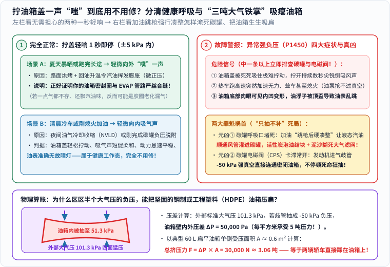
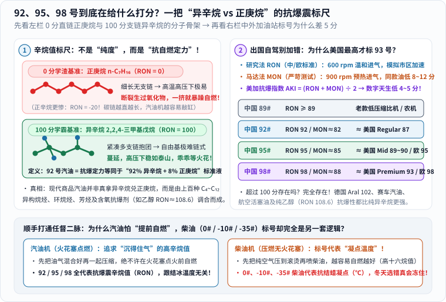
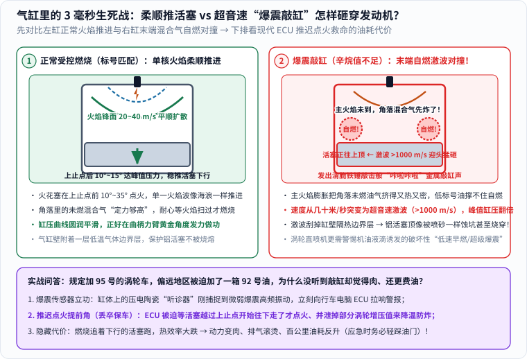
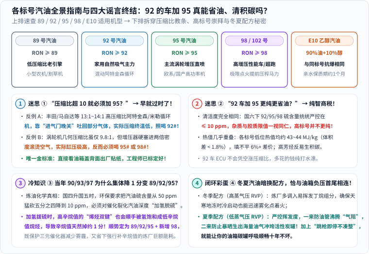

每次把车开进加油站，在短短三分钟里，几乎所有车主都遇到过两个让人心里犯嘀咕的场景——

**第一个场景在车尾油箱口：**
你伸手去拧油箱盖，刚转开两圈，耳边突然传来**“嗤——”**的一声气响。有时候像可乐开盖往外喷气，有时候又像吸尘器往里猛吸一口气。更邪门的是，汽修厂里真有车主遇到过**油箱盖像被焊死一样死活拧不动**，好不容易撬开，只听见足足五六秒刺耳的倒吸风声；把车升起来一看，底盘下那只结结实实的工程塑料甚至钢板油箱，居然像被人一脚踩扁的易拉罐一样**深深往里塌陷了一大块**！好端端的油箱，怎么会在肚子里憋出这么恐怖的“负压”？听到“嗤”一声到底用不用去修车？

**第二个场景在加油机屏幕前：**
加油员热情地问你：“加几号？今天 95 号搞活动，要不要给你的 92 号车升个级？95 号油更纯、更有劲、更耐烧，还能顺便清积碳！”再看看旁边一字排开的 **89#、92#、95#、98#**，有的性能加油站甚至摆出了 **102#**，部分省份的油枪上还印着 **E10**；要是出国自驾租车，开进美国加油站一看更懵——全站最高标号才写着 **91** 或 **93**，普通油干脆只有 **87**！这些数字到底在给汽油的什么本领打分？

有趣的是，**“油箱里的负压呼吸”**和**“油枪上的标号密码”**，表面看一个是管路机械问题、一个是发动机燃烧问题，底层却由同一团碳氢分子的脾气一手导演——前者源于汽油在常温下按捺不住的**高挥发性（蒸气压）**，后者源于汽油在气缸高温高压下沉不沉得住气的**抗自燃定力（辛烷值）**。今天我们就把这两件事串成一条完整的物理化学链条，一次彻底讲透。

---

## 一、密闭的油箱怎么“呼吸”？揭秘 EVAP 系统与油箱负压的来龙去脉

### 1. 为什么现代油箱绝不能像老水壶那样“在盖子上钻个眼”？

咱们小时候喝水的塑料水壶、或者几十年前的老式农用拖拉机，为了防止抽不出油，做法粗暴又直接——**直接在油箱盖上留一个小透气孔**。油泵从底下抽走一升油，外面的空气就顺着小孔补进来一升，油箱内外永远是同一个大气压，既不会鼓包，也绝不可能被吸瘪。

那现代汽车为什么死活不肯在油箱盖上留这个透气孔呢？

因为汽油实在太爱“逃跑”了！汽油并不是单一化合物，而是由 $$C_4\text{–}C_{12}$$ 上百种轻质烃类调合而成的挥发性液体。工程上用 **$$37.8^\circ\text{C}$$（$$100^\circ\text{F}$$）下的雷德蒸气压（Reid Vapor Pressure, RVP，测试标准 ASTM D323）**来衡量它的挥发冲动：哪怕还没沸腾，常温下的汽油液面上方也时刻顶着 **$$45\text{–}88\text{ kPa}$$**（接近半个到一个标准大气压）的饱和油气！

美国环保署（EPA）在 20 世纪 70 年代测算过一笔触目惊心的环境账：如果让汽车油箱直接敞口通大气，夏天停在太阳底下晒一天、或者往空油箱里哗哗灌油时被液面顶出来的汽油蒸气，占到了整车碳氢化合物（HC）总污染排放的 **约 $$20\%$$**！这些逃进空气的烃类分子不仅白白烧掉你的油钱、埋下静电爆燃隐患，在阳光紫外线照射下还会与氮氧化物发生光化学反应，生成刺激肺部的地表臭氧与光化学烟雾。

于是，各国法规陆续给所有汽油车下达了死命令：**油箱必须彻底全密封，一滴油气都不准直接排向大气！**（我国国六标准及北美 **ORVR 车载加油油气回收系统**甚至要求把加油瞬间涌出的油气拦截 **$$98\%$$ 以上**。）

可问题马上来了——**油箱焊死了不准漏气，油泵每小时却要从里面抽走几升到十几升液态汽油；只出不进，油箱岂不是开出几十公里就被抽成死真空、连一滴油都吸不动了吗？**

### 2. 活性炭罐 + 进气歧管抽吸：为什么健康的油箱天生带着“微负压”？

为了解决“既不准汽油味逃出去，又必须让空气补进来”的死结，汽车工程师设计出了一套精妙绝伦的闭环呼吸器官——**燃油蒸发排放控制系统（EVAP, Evaporative Emission Control System）**。

它的核心只有四位成员：**活性炭罐（Carbon Canister）**、**碳罐电磁阀（CPS，通往发动机，断电常闭）**、**大气通风阀（CVS，通往车底滤网，断电常开）**，以及时刻盯着气压变化的**油箱压力传感器（FTPS）**。先看下面这张分步动画图：上排看熄火与加油时怎样“只存油不漏味”，中排看开车时发动机怎样顺手制造出**设计内的健康微负压**，下排看电脑检漏与油箱盖救命阀怎样兜底。

*图 1：汽车油箱 EVAP 呼吸回路与负压成因分步图解（支持 `prefers-reduced-motion` 减弱动态效果；[单独打开图片刷新可重播](/assets/images/fuel-tank-gasoline/evap-loop-and-negative-pressure-anim.svg)）。所谓“油箱正常微负压”，本质上是油泵抽油与发动机进气歧管隔着活性炭床温柔抽风留下的微小流阻压差。*

跟着图里的三步走一遍，你会发现一辆完全健康的汽车，油箱里出现**轻微负压**非但不是病，反而是工程师刻意追求的保护态：

1. **熄火停车与加油时（正压吃油气）：** 车停在太阳下油温升高，或者加油枪往里灌油顶起液面时，膨胀的油气顺着油箱顶部的防倾翻分离阀涌进**活性炭罐**。罐子里装满了比表面积高达 $$1000\text{ m}^2/\text{g}$$ 的微孔活性炭，像无数微型海绵一样把汽油分子死死扣留下来，脱去油味的干净空气则穿过常开的大气通风阀（`CVS`）排到车外。可炭罐就像水杯，总有吸饱的一天，吸饱了怎么办？
2. **热车巡航脱附时（微负压主力来源，约 $$-0.5\text{～}-1.0\text{ kPa}$$）：** 等你发动汽车、水温升起进入平稳巡航后，发动机活塞下行吸气，在节气门后方的**进气歧管**里制造出了极其强悍的真空（怠速与收油滑行时表压可达 **$$-40\text{～}-70\text{ kPa}$$**）。此时行车电脑（ECU/PCM）发出占空比脉冲信号，把常闭的**碳罐电磁阀（`CPS`）**轻轻打开一条缝！
   这一开，进气歧管的负压立刻隔着管路抽吸碳罐：车外的新鲜空气从大气口 `CVS` 涌进来，反向穿过炭床把吸附的汽油分子“洗脱”吹进气缸烧掉做功（既让活性炭满血复活，又白捡回挥发的油钱！），同时顺道补进油箱填补油泵抽油腾出的体积。因为新鲜空气穿过防尘滤网、细长通风管和致密炭粒床时存在天然的**流动阻力**，根据美国《MOTOR》汽车诊断工程规范实测，正常脱附工作时油箱内部会稳定保持 **$$-2\text{～}-4\text{ 英寸水柱}$$（$$\text{in.-H}_2\text{O}$$，约合 $$\mathbf{-0.5\text{～}-1.0\text{ kPa} }$$）的柔和微负压**！这一点点微负压妙极了：只要油箱比外面大气低上千分之几个大气压，哪怕橡胶管接头有微米级老化裂纹，也是外面的空气往里钻，绝不会有一丝汽油蒸气往外漏！
3. **电脑主动抽真空检漏（约 $$-1.7\text{～}-2.0\text{ kPa}$$）与夜间热胀冷缩（NVLD）：**
   - 满足特定工况时，OBD-II 车载诊断系统还会做一套“憋气自检”：电脑故意把大气口 `CVS` 关死，再打开 `CPS` 借发动机真空把整个油箱抽到 **$$-7\text{～}-8\text{ in.-H}_2\text{O}$$（约 $$\mathbf{-1.7\text{～}-2.0\text{ kPa} }$$）**，随后关阀保压观察 $$30\text{ 秒}$$。如果上次加油后你没把油箱盖拧紧（故障码 `P0455` 大泄漏），或者软管被老鼠啃出一个直径仅 **$$0.5\text{ mm}$$（$$0.020\text{ 英寸}$$）**的针眼（故障码 `P0442` 微小泄漏），负压保不住，仪表盘上的黄色发动机故障灯就会立刻亮起提醒你！
   - 另外，就像我们在[力学与热力学状态参量]()里推导过的理想气体定律 $$PV = nRT$$：傍晚刚跑完高速的热车停进地库过夜，油箱上部空间体积 $$V$$ 不变，随着温度 $$T$$ 下降加上部分汽油蒸气重新凝结回液态（气态摩尔数 $$n$$ 减小），压强 $$P$$ 自然往下掉，生出 **$$-0.3\text{～}-1.5\text{ kPa}$$** 的自然冷却微负压（许多车型正是利用这套 **NVLD 自然真空检漏法**在熄火后静默体检）。

万一电子阀门全失灵了怎么办？工程师还在你每天手拧的那只**油箱盖**里藏了最后一道纯机械双保险——**双向弹簧限压阀**：
- 当内部暴晒正压超过约 **$$+10.3\text{ kPa}$$（$$+1.5\text{ psi}$$）** 时，正压弹簧顶开向外泄气，防油箱胀裂；
- 当内部异常负压跌破约 **$$-5.1\text{ kPa}$$（$$-1.5\text{ in.-Hg}$$）** 时，外面的大气压直接推开单向补气阀往油箱里灌气，防止油箱被吸扁！

---

## 二、拧盖“嗤”一声到底修不修？为什么“跳枪硬凑整”能招来三吨铁掌吸瘪油箱？

搞懂了正常呼吸，回到最实用的车主问题：**拧开油箱盖听到“嗤”一声，究竟是好是坏？什么情况下真会把油箱吸扁？**

我们直接用气压标尺与物理受力公式算个明明白白。请看图 2 左右两栏对比：

*图 2：油箱盖“一秒轻响”与“异常强负压吸瘪油箱”判别图解。把油箱压扁的从来不是什么神秘的“真空吸力”，而是油箱外部每平方米重达 10 吨的大气海洋在失去内部气压顶托后的无情碾压。*

### 1. 一秒钟的温柔“嗤”声：恭喜你，油箱密封健康得很！

只要你拧油箱盖时手感轻松，打开瞬间那声“嗤”**柔和短促、一两秒钟内就彻底平息**，平时开车既没有亮故障灯，也没有加速顿挫熄火——**这百分之百是正常现象，一分钱都不用花去修！**
- **夏天暴晒或刚跑完长途加油时：** 排气管烘烤加上回油升温让油气快速挥发，内部处于约 $$+1\text{～}+8\text{ kPa}$$ 微正压（还没达到油箱盖 $$+10.3\text{ kPa}$$ 机械泄压线），拧开时气流轻微**往外“噗”一下**；
- **清晨冷车或刚熄火就拧盖时：** 夜间降温收缩或刚做完碳罐负压抽洗，内部处于 $$-0.5\text{～}-3\text{ kPa}$$ 微负压，拧开时空气轻微**往里“嘶”一下**。
反过来想：如果大夏天跑完两百公里高速，拧开油箱盖一点气压声都没有，车尾还总飘着一股生汽油味，那倒要怀疑是不是油箱盖密封胶圈老化开裂漏气了！

### 2. 三吨大气铁掌碾压：两大坏习惯与故障怎样制造“吸瘪油箱”惨案？

那修车铺里那些被生生吸凹进去、甚至把内置燃油泵支架都折断的油箱，又是怎么酿成的？

正如我们在[虹吸现象与 15 米负压极限]()里讲透的核心物理直觉：自然界里根本不存在气体主动拉扯器壁的“吸力”，所谓“负压吸瘪”，全是因为地球表面压着一层标准大气压 $$P_0 \approx 101.3\text{ kPa}$$（相当于每平方米压着约 **10.3 吨**重物）的空气海洋！平时油箱不塌，全靠里面的气体用同样的压强往外顶着。

一旦下面这两个环节同时出问题，油箱就掉进了**“只抽不补”的死局**（常见故障码 `P1450`：无法排解燃油箱真空）：

- **第一刀（堵死进气路）——“加油跳枪后强行凑整”淹死活性炭罐！**
  油箱顶部特意留有 $$10\%\text{–}15\%$$ 的膨胀气室，通往碳罐的呼吸管口就设在高处。加油枪感应到液面快满自动“咔嗒”跳枪时，油位刚刚好；可不少车主偏有强迫症——比如跳枪停在 $$286$$ 元，非要让加油员把油枪往外拔一点，硬往里点射凑够 $$300$$ 元整，甚至加到油箱口能看见液面才罢休！
  这一满，液态汽油在刹车晃动或热膨胀时，就会顺着顶部的蒸气通风管**直接倒灌进原本只准进气的活性炭罐**！微孔活性炭一旦泡进液态汽油，立刻像淋湿的面粉一样结块糊死；再加上常年跑烂路泥沙堵死车底的大气通风滤网（以及油箱盖补气阀被油泥卡死），油箱唯一的大气补气口就被彻底封死了！
- **第二刀（狂抽不停歇）——碳罐电磁阀（`CPS`）卡滞在常开位！**
  碳罐被泡坏脱落的细碎炭粉，顺着管路被吸进碳罐电磁阀，很容易卡住阀芯，让原本断电应该严密关闭的 `CPS` 变成**24 小时常开直通**（维修工判断这一招极简单：拔掉电磁阀插头用嘴吹气，只要能吹通就是坏了！）。

现在算一笔让你后背发凉的力学账：
补气口被死死堵住，另一头发动机进气歧管高达 $$\Delta P = -50\text{ kPa}$$ 的强真空（外加油泵不停往外抽走液态汽油）直接连在密闭油箱上猛抽！油箱内部绝对压强掉到 $$51.3\text{ kPa}$$，内外压差高达 $$\lvert\Delta P\rvert = 50{,}000\text{ Pa}$$。一只普通的 $$60\text{ L}$$ 扁平鞍形油箱，上下单侧投影面积大约有 $$A \approx 0.6\text{ m}^2$$，外部大气压砸在油箱肚皮上的总挤压力为：

$$F = \lvert\Delta P\rvert \cdot A = 50{,}000\text{ Pa} \times 0.6\text{ m}^2 = 30{,}000\text{ N} \approx 3.06\text{ 吨力}$$

**整整三吨多的巨力！相当于把两台一吨半重的家用轿车叠罗汉一样直接压在空油箱壳上！** 别说高密度聚乙烯（HDPE）工程塑料油箱，就连冲压钢板油箱也会在沉闷的“嘭”声中向内塌陷！而且在油箱彻底瘪掉之前，你的车就会发出一连串求救信号：
1. **拧油箱盖极其费劲**，拧开瞬间发出长达四五秒尖锐响亮的倒吸风声；
2. **热车跑高速半路突然踩油门没反应、耸车甚至熄火**（因为油箱里负压太大，电动燃油泵的叶轮根本抢不过真空，吸不上油来！偏偏停路边歇十分钟漏进一点气又能打着火，极具迷惑性）；
3. **油表指针乱跳或还剩半箱显示就突然趴窝**（塌陷的箱底把油位浮子顶歪卡住了）；
4. **刚加完油第一次打火死活点不着，要踩油门干拧好几秒才轰隆着车，怠速还直哆嗦**（因为常开的 `CPS` 把加油时涌出的浓油气全灌进了进气歧管，混合气浓到“淹缸”了）。

只要出现上面任何一条症状，赶紧去花百十块钱检查碳罐电磁阀和碳罐通风滤网，千万别硬拖到换整只油箱！

---

## 三、92、95、98 号到底在给什么打分？一把跨越百年的“抗爆标尺”

护好了装油的油箱，咱们再把目光投向灌进油箱里的主角——**各个标号的汽油**。

很多人望文生义，以为“92 号汽油就是纯度 $$92\%$$、剩下 $$8\%$$ 是杂质”，所以“95 号比 92 号干净，98 号更是极品精炼油”。**这完全是一场延续了几十年的天大误会！** 汽油标号跟“纯不纯、脏不脏”半毛钱关系都没有，它衡量的是汽油分子在气缸高温高压下**“沉不沉得住气、抗拒提前自燃”的定力——也就是辛烷值（Octane Number）**。

### 1. 0 分学渣“正庚烷” vs 100 分学霸“异辛烷”

时间拨回 1927 年，美国乙基公司（Ethyl Corporation）的化学家格雷厄姆·埃德加（Graham Edgar）为了给不同汽油的抗爆脾气定一把客观标尺，在成百上千种碳氢化合物里挑出了性格最极端的两位“标准考官”（见图 3 左栏）：

*图 3：汽油辛烷值的分子标尺、中外加油站标号换算与汽柴油标号逻辑对比。先看左栏“直链易碎自燃 vs 支链抱团耐压”的分子规律，再看右栏为什么美国加油站标 87 号的普通油其实就是中国的 92 号。*

- **0 分基准（暴躁学渣）：正庚烷（*n*-Heptane, $$\text{C}_7\text{H}_{16}$$）——人为规定辛烷值 $$= 0$$。**
  它的 7 个碳原子排成一条毫无遮挡的细长直链。在气缸压缩产生的高温高压下，氧气分子极易从直链中段的仲碳原子上扯下氢原子，生成不稳定的氢过氧化物并迅速裂解出成倍增殖的羟基自由基（$$\cdot\text{OH}$$），哪怕火花塞还没点火，它自己就先一步炸膛自燃了！（顺便说个颠覆直觉的冷知识：同样叫“辛烷”的直链**正辛烷 *n*-Octane**，因为链条比正庚烷还要长一截，抗爆性比 0 分还烂，辛烷值是惊人的 **$$-20$$**！）
- **100 分基准（定力学霸）：异辛烷（特指 2,2,4-三甲基戊烷, $$\text{C}_8\text{H}_{18}$$）——人为规定辛烷值 $$= 100$$。**
  虽然也有 8 个碳原子，但它把主链缩成了短短 5 个碳，还在两侧挂上了 3 个紧凑抱团的甲基支链。这种浑圆紧致的分子骨架对自由基链式传递有着极强的“空间阻断与淬灭效应”，哪怕被活塞挤到几百摄氏度也稳如泰山，老老实实等火花塞发号施令。

有了 0 分和 100 分两头标杆，检测一桶未知汽油是几号就变得像测视力一样标准（国际通行标准 ASTM D2699 / D2700）：把待测汽油灌进一台**压缩比可以随时手摇调节的标准单缸试验机（CFR 发动机）**里运转，记录它刚好出现轻微爆震时的临界状态；然后再用纯异辛烷和纯正庚烷按不同体积比例兑出标准参比液放进去比对——
- 如果这桶汽油的抗爆定力，恰好跟 **“$$92\%$$ 体积异辛烷 $$+ 8\%$$ 体积正庚烷”** 的混合液打成平手，那它就是 **92 号汽油**！
- 跟 **“$$95\%$$ 异辛烷 $$+ 5\%$$ 正庚烷”** 打成平手，就是 **95 号汽油**！

注意：**这绝不意味着 92 号汽油里真装着 $$92\%$$ 的异辛烷！** 现代炼油厂生产的商品汽油，是由催化裂化、催化重整、烷基化等工艺炼出的上百种异构烷烃、环烷烃、芳烃（如甲苯 $$\text{RON}\approx 120$$）以及含氧抗爆组分调合而成的“大合唱”，只要最终大合唱的抗爆跑分达到 92 分，就挂上 92# 的牌子。这也解释了为什么**辛烷值完全可以突破 100 分**：像德国高速公路上著名的 Aral Ultimate **102 号汽油**、F1 与场地赛车用的百号赛油，还有我们在[甲醇与乙醇的化学性质及用途]()里刚聊过的纯生物乙醇（**$$\text{RON} \approx 108.6$$**），它们的分子比纯异辛烷还要耐压抗爆！

### 2. 出国自驾别慌张：为什么美国加油站最高才标 91 或 93 号？

很多朋友第一次去美国或加拿大自驾租车，打开油箱盖看到贴着 `Minimum Octane Rating 87`，抬头看加油机上写着 `Regular 87 / Mid-Grade 89 / Premium 91 (或 93)`，吓得不敢下手：“国内连面包车都喝 92 号了，美国怎么满大街喂 87 号粗粮？”

其实油还是同样的油，只是**考试卷子的难度和计分公式不一样**！国际上给汽油考辛烷值有两套经典工况：
1. **研究法辛烷值（RON, Research Octane Number）：** 试验机转速 $$600\text{ rpm}$$，进气温度较低，点火提前角固定在 $$13^\circ$$，模拟咱们平时**市区中低速起步、温和加速**的工况。**中国（国标 GB 17930）、欧洲（EN 228）、日本、澳大利亚**的加油站标号，直接印的就是 **RON 分数**（89 / 92 / 95 / 98）。
2. **马达法辛烷值（MON, Motor Octane Number）：** 试验机转速拉高到 $$900\text{ rpm}$$，还专门把进气混合气预热到滚烫的 $$149^\circ\text{C}$$，点火提前角随压缩比动态加大，模拟**夏天满载爬长坡、高速高负荷狂飙**的残酷工况。因为考卷难得多，同一桶汽油测出来的 `MON` 通常比 `RON` **低 $$8\text{–}12$$ 分**（这个差值 $$\text{S} = \text{RON} - \text{MON}$$ 在炼油界叫燃油的“敏感度”）。
3. **北美抗爆指数（AKI, Anti-Knock Index）：** 美国、加拿大、墨西哥和巴西加油站大黄标上印的 `Pump Octane`，既不单看 RON 也不单看 MON，而是取两者的算术平均分——油枪上往往直接印着小字公式 **$$(R + M)/2$$**：

$$\text{AKI} = \frac{\text{RON} + \text{MON} }{2}$$

拿中国的 **92 号汽油**（$$\text{RON} = 92$$，实测 $$\text{MON} \approx 82$$）代入公式一算：$$(92 + 82) \div 2 = \mathbf{87}$$！所以你在北美看到的 **`87 Regular` 就是咱们的 `92#`**，**`89–90 Mid/Plus` 对应咱们的 `95#`**，而 **`93 Premium`（加州等地多为 `91`）对应的正是咱们的 `98#` 高端油**！

*(顺手提个千万别搞混的常识：汽油的 `92 / 95 / 98` 测的是抗自燃辛烷值，四季通用不分冰点；而隔壁柴油枪上的 **`0# / -10# / -20# / -35#` 柴油**，因为柴油机没有火花塞、全靠把纯空气压烫后喷油压燃——要求柴油越容易自燃越好，看的是“十六烷值”——它的标号直接代表**柴油结蜡凝固的摄氏温度**！$$0\#$$ 柴油到 $$0^\circ\text{C}$$ 以下真会析出石蜡堵死油路，冬天开车去东北必须提前换负号柴油，而汽油车哪怕开去零下四十度的漠河也是照加 92 或 95 号！)*

---

## 四、气缸里的 3 毫秒生死战：低标号汽油引发的“爆震敲缸”是怎么砸坏活塞的？

既然标号只是“抗自燃定力”，那如果我图省钱，给一台明明要求加 **95 号**（甚至 **98 号**）的高增压发动机，长期强灌定力不足的 **92 号汽油**，气缸里面到底会发生什么可怕的事？

我们在[火的物理化学真相]()里讲过，温和受控的火焰是一层有序推进的化学反应波。在每分钟几千转的发动机气缸里，留给每一次做功燃烧的时间只有短短 **2 到 4 毫秒**。请看图 4 左右两只气缸在这 3 毫秒里的天壤之别：

*图 4：正常受控燃烧（缓燃 Deflagration）与爆震敲缸（爆轰 Detonation）对比图解。几十分之一的辛烷值差距，在气缸角落里就是“25 m/s 温柔推手”与“超 1000 m/s 攻城铁锤”的分水岭。*

- **左缸（标号匹配，正常燃烧）：单核火焰像海浪一样温柔推活塞**
  在活塞还没升到最顶端（上止点 TDC 前 $$10^\circ\text{–}35^\circ$$ 曲轴转角）时，火花塞准时跳出电火花。随后，一团球面火焰锋面以 **$$20\text{–}40\text{ m/s}$$** 的亚音速平稳扫过整个燃烧室。尽管还没烧到的角落混合气（工程上叫 **末端混合气 End-gas**）正被膨胀的火球挤得越来越热、越来越密，但因为汽油辛烷值够高，它们咬牙稳住了阵脚，乖乖等主火焰扫过来才依次点着。最终，缸内最高压力稳稳落在**活塞刚越过上止点往下走 $$10^\circ\text{–}15^\circ$$** 的黄金力臂位置，像推秋千一样顺滑有力地把活塞推下去。
- **右缸（标号过低，发生爆震 Knock）：角落油气提前失控炸膛，超音速激波迎头对撞！**
  换成辛烷值不够的低标号油后，火花塞刚点着火、主火焰才走了半程，缩在气缸边缘最热角落里的那团“末端混合气”再也扛不住高温高压的煎熬，**不等火焰走到就自己轰然爆炸了！**
  这一炸非同小可：燃烧模式瞬间从每秒几十米的缓燃，突变跃迁为传播速度高达 **$$1000\text{–}1800\text{ m/s}$$ 的超音速爆轰激波（Shockwave）**！此时活塞明明还在惯性带动下死命往上顶，两股狂暴的高压冲击波迎头砸在活塞顶和气缸壁上来回反弹震荡，气缸金属壁被敲得像钟一样高频共振——这就是老司机爬坡急加速时听到的那种清脆瘆人的**“咔啦、咔啦”金属敲缸声（Pinging / Knocking）**！

别小看这几声脆响，它对发动机的摧残是毁灭性的：
平时铝合金活塞（熔点仅约 $$660^\circ\text{C}$$）之所以能在上千摄氏度的火焰里安然无恙，全靠气缸壁与活塞表面紧贴着一层几百微米厚的低温**气体隔热边界层**；一旦超音速激波在缸内来回刮擦，这层保命隔热膜瞬间被震碎剥离，滚烫燃气直接炙烤裸露的铝金属，加上局部翻倍的尖峰压力锤击——轻则活塞顶像被高压喷砂一样蚀出密密麻麻的麻坑，重则**活塞环岸崩碎、火花塞电极烧熔，甚至直接把活塞顶烧穿一个大窟窿、把连杆生生敲弯！**（在现代小排量涡轮增压缸内直喷机上，低转速大油门时如果叠加机油蒸汽液滴自燃，还会触发比普通爆震凶狠数倍的**低速早燃 LSPI / 超级爆震**，几秒钟就能报废一台发动机。）

> **“不对呀！我上次去偏远县城没 95 号油，被迫给我的 95 号涡轮车加了一箱 92 号，怎么没听见敲缸、车也没坏？”**
> 这就得感谢装在现代发动机缸体外壁上的那颗“电子听诊器”——**压电陶瓷爆震传感器（Knock Sensor）**！一旦它监听到哪怕人耳都听不见的微弱爆震高频振波，行车电脑 ECU 会在几毫秒内启动**“丢卒保车”急救程序**：强行**推迟点火提前角（Retard Ignition Timing）**，等活塞已经越过上止点开始往下跑、气缸容积变大降温了才点火，同时打开涡轮旁通阀泄掉一部分增压压力。
> 命是保住了，代价却是热力学效率大跳水——火焰追着下行的活塞屁股后面烧，大量热能没变成机械功就白白排进了排气管。结果就是：**车子踩油门明显发肉、排气歧管烫得吓人、百公里油耗反而往上涨！** 所以应急加一次低标号油救命可以（切记温柔驾驶、别踩地板油超车），长期拿 92 号喂 95 号车，不仅毁三元催化器，省下的几毛钱油费还不够补多烧掉的油耗！

---

## 五、全标号汽油实战指南与加油站“四大万年迷思”大拆解

理清了辛烷值与爆震的物理因果，现在我们把国内加油站能见到的所有汽油牌号列一张清晰的“户籍卡”，再把流传最广的四个加油误区逐一拆穿（见图 5）：

*图 5：各标号汽油适用阵营与四大常见迷思工程拆解。记住一条极简铁律：选几号油只认油箱盖内侧的出厂标定贴纸，高配低伤车，低配高烧钱。*

### 1. 国内全标号汽油家族速查表

| 汽油牌号 | 抗爆标准（国六 GB 17930） | 典型匹配发动机与适用场景 | 特别提示 |
| :--- | :--- | :--- | :--- |
| **89 号汽油** | $$\text{RON} \ge 89$$，$$\text{MON} \ge 84$$ | 老式低压缩比化油器发动机、摩托车、园林割草机、小型通用汽油发电机 | 城市加油站已极少见，92 号可完全向下兼容替代它 |
| **92 号汽油** | $$\text{RON} \ge 92$$，$$\text{MON} \ge 87$$ | **家用主力粮**：绝大多数自然吸气发动机、丰田/本田/比亚迪等**高压缩比混动专用机**，以及专门针对粗粮调校的美系/日系/国产入门涡轮机 | 只要厂家贴纸写“请加注 92 号及以上无铅汽油”，加 92 号就是最优解 |
| **95 号汽油** | $$\text{RON} \ge 95$$，$$\text{MON} \ge 90$$ | **涡轮增压主力粮**：绝大多数欧系（大众/BBA 等）及国产中高功率涡轮增压缸内直喷（TGDI）车型 | 油箱盖写“最低 95 号”时请严格遵守，勿长期降级喝 92 号 |
| **98 号（及 100/102#）** | $$\text{RON} \ge 98$$（赛事油 $$\ge 100$$） | 高增压比大马力性能车、豪华旗舰多缸机、保时捷/法拉利等超跑及刷写过激进高阶 ECU 程序的改装车 | 允许电脑把点火提前角与增压值推向物理极限以压榨巅峰马力 |
| **E10 车用乙醇汽油** | 如 `E10 92#` / `E10 95#`（抗爆性与同标号纯汽油一致） | 由 **$$90\%$$ 普通组分汽油 $$+ 10\%$$ 变性燃料乙醇**调合（东北、华北、安徽、广西等多省普及） | 乙醇含氧助燃但体积热值低约 $$3\%$$（油耗微增 $$1\%\text{–}3\%$$）；乙醇亲水易分层，**油箱半空长期停放勿超 1 个月** |

### 2. 终结加油站最烧钱的四大谣言

#### 迷思 ①：“看发动机参数表选油就行，压缩比超过 $$10:1$$ 必须加 95，超过 $$12:1$$ 必须加 98！” —— **早就过时的老黄历！**
二十年前全是自然吸气传统奥托循环发动机时，这句口诀确实管用——按热力学定熵压缩公式 $$T_2 = T_1 \cdot r^{\gamma - 1}$$ 与奥托循环理论热效率 $$\eta = 1 - r^{1-\gamma}$$，气缸几何压缩比 $$r$$ 越高，压到顶时的温度 $$T_2$$ 就越烫，自然越需要高标号汽油。

但放在今天，只背几何压缩比会闹出大笑话！看看身边两个活生生的反例：
- **反例 A（$$13:1\text{–}14:1$$ 却愉快喝 92 号）：** 丰田 THS、比亚迪 DM-i 或马自达创驰蓝天发动机，参数表上的几何压缩比高达惊人的 **$$13:1$$ 甚至 $$14:1$$**，却清一色标定喝 **92 号汽油**！秘密就在于它们采用了**阿特金森循环 / 米勒循环**——活塞开始往上压缩时，故意让**进气门延迟关闭**，把吸进来的一小截混合气又顺手吐回进气道里！结果是**膨胀做功比高达 14（省油高效），实际有效压缩比却只有 9 到 10 左右**，压缩终温一点都不高，92 号油毫无压力。
- **反例 B（$$9.8:1$$ 却非喝 95/98 号不可）：** 一台德系 $$2.0\text{T}$$ 涡轮增压机，参数表上的几何压缩比才区区 **$$9.6:1\text{–}10.2:1$$**，为什么非要喝 95 甚至 98 号？因为涡轮增压器在进气前就已经把空气预压缩到了 **$$1.8\text{–}2.5$$ 个大气压**！本来缸里就塞进了双倍密度、自带增压温升的空气，再乘上 $$10$$ 倍压缩比，上止点时的实际缸压和温度远超普通自吸机，喂 92 号分分钟敲缸！

所以别再自己拿计算器算压缩比了——**打开油箱外盖看背面那张出厂贴纸**，研发工程师在台架上烧掉几万升油标定出来的数字，就是唯一金标准！

#### 迷思 ②：“92 号的车常加 95 或 98 号，更纯、清积碳、更有劲还省油？” —— **纯属多掏钱买心理安慰！**
我们一条条扒开真相：
1. **清洁度一模一样：** 翻开现行国家强制标准《车用汽油》（GB 17930-2016 国六标准），无论是 89#、92#、95# 还是 98#，硫含量上限统统死卡在 **$$\le 10\text{ mg/kg}$$（$$10\text{ ppm}$$）**，苯含量统统 $$\le 0.8\%$$，机械杂质与水分统统要求“无”！所谓“高标号油过滤得更干净、能洗积碳”，纯属无稽之谈——真正负责清洗喷油嘴与进气门积碳的，是添加在燃油里的**聚醚胺（PEA）等清净分散剂**，跟辛烷值是 92 还是 98 毫无关系。
2. **热值几乎重叠，根本省不回差价：** 不同标号汽油的单位质量低位发热值都在 **$$43\text{–}44\text{ MJ/kg}$$** 上下；即便高标号油因为重整芳烃略多、密度微高一丁点，折算成每升体积热值的差异也**不到 $$1.5\%\text{–}1.8\%$$**，而加油站里 95 号比 92 号贵出约 **$$6\%\text{–}7\%$$**，98 号更是贵出 **$$13\%\text{–}16\%$$**！
3. **动力不会凭空暴涨，甚至可能更容易生积碳：** 一台出厂按 92 号标定好点火Map的家用自吸车，它的气缸几何压缩比是铁铸死的，ECU 也不会因为你灌了 98 号油就突破原厂点火提前角上限。更尴尬的是，为了凑够高辛烷值调入的稠环芳烃在原本压缩温度不高的气缸里反而燃烧稍慢，长期跨两级乱加高标号油，燃烧室积碳非但没少，有时反而更厚！（*注：唯独极少数说明书上明确写着“最低可使用 92 号，**推荐使用 95 号以获得最佳性能**”的高功率涡轮车型，加 95 号才能解锁原厂满血点火提前角。*）

#### 迷思 ③：“以前明明是 90#、93#、97#，为什么后来集体降了 1 分改成 89#、92#、95#？是不是油品缩水了？”
恰恰相反，降这 1 分正是**油品环保大升级的勋章**！
在我国从“国四”升级到“国五”（GB 17930-2013）时，核心任务是把汽油里的硫含量从 **$$50\text{ ppm}$$ 猛砍五分之四降到 $$10\text{ ppm}$$**（硫会毒化尾气三元催化器里的贵金属铂、钯、铑，还会生成硫酸盐细颗粒物 PM2.5）。我国炼厂汽油池的主力是催化裂化汽油，要把它里面的硫拔干净，必须上深度**加氢脱硫工艺**；而在催化剂上往油里加氢拔硫时，汽油里原本贡献高辛烷值的**烯烃碳碳双键（$$\text{C}=\text{C}$$）也会顺手被氢原子饱和变成低辛烷值的烷烃**，导致整池汽油的研究法辛烷值天然掉下约 $$1\text{–}1.5$$ 分！
如果硬要把脱完硫的油再强行拉回 93 和 97，全国炼油厂每年要多烧掉上百万吨重整能耗、多排海量二氧化碳，而实际台架测试证明绝大部分原 93# 车烧 92# 完全不爆震；于是国家标准顺应化学规律调整为 **89# / 92# / 95#**，同时专门增设 **98#** 来服务真正挑食的高增压豪车——既护住了蓝天，又省下了冤枉能耗。

#### 迷思 ④（首尾大闭环）：“92 和 95 混加会起化学反应堵油路？冬天和夏天的汽油一模一样？”
- **偶尔混加完全不用洗油箱：** 92 号和 95 号本质上都是同一套烃类家族，混在一起既不会沉淀也不会分层结胶，结果只是辛烷值按比例折中（比如半箱 92 兑半箱 95，大约变成 93.5 号）。92 号车混了 95 号接着正常开就行；95 号车万一应急混了半箱 92 号，只要这箱油期间别大脚油门飙高转，跑空一半及时补满 95/98 号即可。
- **冬夏汽油暗藏“蒸气压换季术”，正好护住你的活性炭罐！** 细心的读者会发现，本文开头的**油箱负压 EVAP 系统**与结尾的**汽油炼制标准**在这里完美闭环了：国标 GB 17930 专门把全年分成了**冬春季高蒸气压汽油（RVP 上限 $$60\text{–}88\text{ kPa}$$）**与**夏秋季低蒸气压汽油（RVP 上限严控在 $$45\text{–}65\text{ kPa}$$）**！冬天炼厂多兑一点轻质丁烷，让你在冰天雪地里一拧钥匙就能雾化着车；到了酷暑盛夏，炼厂主动抽走轻组分压低挥发度，一来防止高温油管沸腾产生“气阻”断油，二来正是为了防止暴晒下生出过量汽油蒸气冲垮你车尾那只辛勤呼吸的**活性炭罐**！

---

## 六、带回家的四条黄金用车口诀

下次再把车开进加油站，你脑海里已经有了一张清晰的工程透视图，只需记住这四句最省心、最省钱的实操铁律：

1. **听声辨健康：** 拧开油箱盖听到 **1 秒柔和“嗤”声**是密封满分的勋章；只有当**盖子被死死吸住难拧、倒吸风声持续好几秒、伴随热车顿挫熄火或油表乱跳**时，立刻去查碳罐电磁阀（`CPS`）与大气滤网，别等三吨大气压把油箱踩扁！
2. **跳枪即收手：** 加油枪第一次自动“咔嗒”跳枪就是最佳安全液位，**绝不为了凑整十整百硬拔枪口往里点射塞满**——给油箱顶部留出那 $$10\%$$ 的气室，就是给活性炭罐留出十年不坏的呼吸肺活量。
3. **拧盖听“咔哒”：** 加完油顺时针拧紧油箱盖，直到听到棘轮发出清脆的 **“咔哒”声**再松手；否则 OBD-II 抽不出那 $$-2\text{ kPa}$$ 检漏微负压，过两天仪表盘准亮发动机黄灯吓唬你。
4. **选油认贴纸：** 别迷信“高标号更纯清积碳”，也别套用老掉牙的压缩比口诀；油箱盖背面写 **92# 及以上**就踏踏实实加 92#，省下的差价每五千公里买一瓶正经含聚醚胺（PEA）的燃油清净剂，比白烧一辈子高价 98# 油管用十倍！

---

## 参考资料与核查来源

1. **美国环保署（EPA）机动车蒸发排放（EVAP）与车载加油油气回收（ORVR）技术规范**
   - U.S. Environmental Protection Agency: *Evaporative Emissions from Onroad Vehicles* & *Onboard Refueling Vapor Recovery (ORVR)* 官方技术档案：[https://www.epa.gov/emission-standards-reference-guide/epa-emission-standards-light-duty-vehicles-and-trucks](https://www.epa.gov/emission-standards-reference-guide/epa-emission-standards-light-duty-vehicles-and-trucks)（核查敞口油箱蒸发碳氢排放占比、活性炭罐脱附回路及 ORVR $$\ge 98\%$$ 油气拦截效率）。
2. **《MOTOR》汽车诊断工程技术专刊与车载蒸发控制（EVAP / ORVR）闭环诊断档案**
   - Marinucci, D. / Savasta, B., *MOTOR Magazine* (*Troubleshooting EVAP Systems* & *Keeping Tabs on Tank Pressure*)；及 *Onboard refueling vapor recovery (ORVR & EVAP)* 工程综述：[https://en.wikipedia.org/wiki/Onboard_refueling_vapor_recovery](https://en.wikipedia.org/wiki/Onboard_refueling_vapor_recovery)（核查正常脱附微负压 $$-2\text{～}-4\text{ in.-H}_2\text{O}$$、OBD-II $$0.020\text{ in.}$$ 微漏真空测试 $$-7\text{～}-8\text{ in.-H}_2\text{O}$$、油箱盖机械正负压安全阀阈值 $$+1.5\text{ psi} / -1.5\text{ in.-Hg}$$ 及 `P1450` 强负压吸瘪油箱机理）。
3. **美国能源信息署（EIA）汽油辛烷值（RON / MON / AKI）与热值官方科普指南**
   - U.S. Energy Information Administration: *Gasoline Explained — Octane in Depth*：[https://www.eia.gov/energyexplained/gasoline/octane-in-depth.php](https://www.eia.gov/energyexplained/gasoline/octane-in-depth.php)（核查正庚烷 $$\text{RON}=0$$ 与 2,2,4-三甲基戊烷异辛烷 $$\text{RON}=100$$ 标尺定义、研究法/马达法工况差异、北美 $$\text{AKI}=(R+M)/2$$ 换算及高标号误加经济性结论）。
4. **国际标准 ASTM D2699 / D2700 与全球辛烷值分级对照**
   - ASTM International (*Standard Test Method for Research/Motor Octane Number of Spark-Ignition Engine Fuel*, ASTM D2699 & D2700)；及 *Octane rating* 各国标准对照综述：[https://en.wikipedia.org/wiki/Octane_rating](https://en.wikipedia.org/wiki/Octane_rating)（核查 CFR 可变压缩比单缸试验机测定规程、正辛烷 $$-20$$ 与纯乙醇 $$\text{RON}\approx 108.6$$ 实测值及中欧北美牌号换算）。
5. **内燃机燃烧学经典教材与爆震（Knock / Detonation）物理机制**
   - Heywood, J. B. (2018). *Internal Combustion Engine Fundamentals* (2nd ed.). McGraw-Hill Education；及 Wikipedia *Engine knocking* / *Octane rating* 综合词条：[https://en.wikipedia.org/wiki/Engine_knocking](https://en.wikipedia.org/wiki/Engine_knocking)（核查正常火焰传播速度 $$20\text{–}40\text{ m/s}$$、末端混合气自燃爆轰激波 $$>1000\text{ m/s}$$、隔热边界层剥离蚀损活塞及爆震传感器点火推迟控制）。
6. **中国国家强制性标准《车用汽油》（GB 17930）与《车用乙醇汽油（E10）》（GB 18351）**
   - 国家市场监督管理总局 / 国家标准化管理委员会：全国标准信息公共服务平台 GB 17930-2016 档案（核查 89# / 92# / 95# / 98# 研究法与马达法辛烷值限值、全牌号统一硫含量 $$\le 10\text{ mg/kg}$$、冬夏两季雷德蒸气压 RVP 分级指标，以及国五加氢脱硫烯烃饱和引发的牌号调整背景）。
