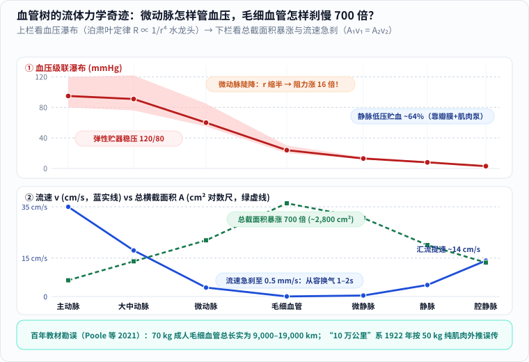
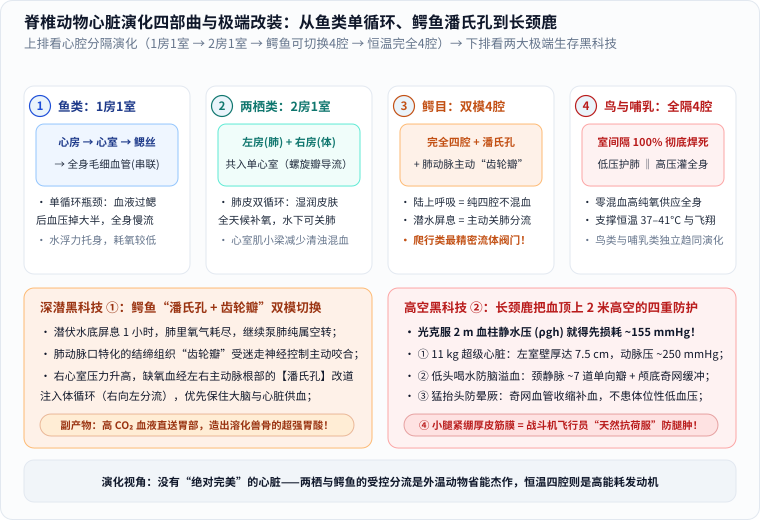
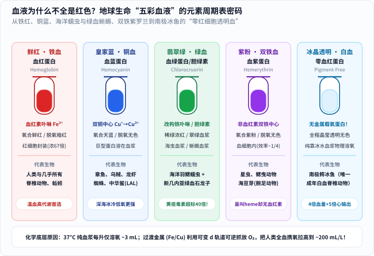

把右手轻轻搭在左胸口，再攥紧你的左拳。

你掌心里攥着的这个体积，差不多就是此刻正在你胸骨后方不知疲倦搏动的那台生命引擎——成年人的心脏重量通常只有 **$250\text{–}350\text{ 克}$**，还不到一瓶矿泉水的三分之二。

可就是这么一团肉拳头，如果你拿笔替它算一笔日常流水账，结果会吓你一跳：安静坐着读这篇文章时，它每次收缩挤出约 $70\text{ mL}$ 血液，每分钟跳动约 $72$ 次，每分钟流量约 **$5\text{ 升}$**；乘上一天 $1{,}440$ 分钟，它每天泵出的血液高达 **$7{,}200\text{ 升}$（约 $7.5\text{ 吨}$）**——足足能装满一辆城市洒水车！如果活到 $80$ 岁，它在不许停机检修哪怕五分钟的前提下，要连续跳动近 **$30\text{ 亿次}$**，累计泵血超过 **$20\text{ 万吨}$**，足够灌满 $80$ 座奥运标准泳池。

但真正令流体力学家和演化生物学家拍案叫绝的，还不只是这串天文数字，而是藏在血管深处的一连串反直觉谜题：

1. **为什么一颗心脏非要大费周章劈成左右两半、修成四居室？** 既然全身需要 $120/80\text{ mmHg}$ 的高压才能把血送上头顶，用同一个高压顺便把肺也冲一遍不省事吗？
2. **主动脉里每秒飙出 $35\text{ 厘米}$ 的急流，到了毛细血管凭什么瞬间急刹慢了 $700\text{ 倍}$？** 还有我们从小背到大的“人体毛细血管全长 $10\text{ 万公里}$、绕赤道两圈半”，为什么在 $2021$ 年被生理学家揪出来是一桩传了整整一百年的乌龙？
3. **如果跳出人类中心视角，动物界的供血脑洞有多野？** 为什么蜜蜂用着“漏水花洒”般的开放式低压血液，却能每秒振翅 $200$ 次？为什么鳄鱼潜入水底能主动“拉闸关停”肺循环？为什么章鱼要装**三颗心脏、流蓝色铜血**，新几内亚石龙子流着**剧毒翡翠绿血**，而南极海底的鳄冰鱼干脆连血红蛋白和红细胞都删光了，流着一腔**晶莹剔透的透明血**？

今天，我们就顺着**物理学铁律 $\to$ 人体精密双循环 $\to$ 动物界异星级改装**这条主线，把演化打磨了六亿年的“生命物流网”拆个底朝天。

---

## 一、为什么要修血管？先撞上一堵叫“菲克定律”的物理死墙

在聊心脏怎么跳之前，得先回答一个最底层的问题：**细菌、草履虫甚至巴掌大的海月水母都没有心脏和血管，为什么我们非长不可？**

答案藏在热学与分子运动论的一条铁律里——**菲克扩散定律（Fick's Laws of Diffusion）**。

水里的氧气分子想要靠毫无方向的布朗热运动钻进细胞，穿过厚度为 $L$ 的组织所需特征时间 $t$，并不跟距离成正比，而是残酷地与**距离的平方**成正比：

$$
t \approx \frac{L^2}{2D}
$$

这里 $D \approx 2 \times 10^{-9}\text{ m}^2/\text{s}$，是氧气在水分和软组织中的扩散系数。咱们直接代几个真实尺度算一算：

- **单细胞生物（$L = 10\,\mu\text{m}$）**：$t \approx 0.025\text{ 秒}$。眨眼四十分之一秒，氧气就穿透全身，修血管纯属多此一举；
- **扁形动物涡虫的极限薄片（$L = 1\text{ mm}$）**：距离放大 $100$ 倍，时间暴涨 $10{,}000$ 倍，$t \approx 250\text{ 秒}$（约 **$4.2\text{ 分钟}$**），勉强卡在窒息生死线上；
- **一块仅 $1\text{ 厘米}$ 厚的肌肉（$L = 1\text{ cm}$）**：$t \approx 25{,}000\text{ 秒}$，也就是整整 **$6.9\text{ 小时}$**！等表皮外的一口氧气慢吞吞晃进 $1\text{ 厘米}$ 深处，里面的细胞早就死透几百回了；
- **成年人胸腔厚度（$L \approx 10\text{ cm}$）**：纯靠扩散需要大约 **$29\text{ 天}$**。

这就是演化史上的**“菲克扩散死锁”**。大约 $6\text{ 亿年前}$前寒武纪末期，当多细胞动物第一次试图长厚、长壮、去追捕猎物时，只有两条路可选：要么像水母、海葵和涡虫那样，一辈子把活细胞摊成厚度不足 $1\text{ 毫米}$ 的薄皮；要么在体内修一套**“跨城高速公路（水泵宏观对流）+ 最后 $50$ 微米快递站（毛细血管微观扩散）”**的两级物流网。

这套把宏观流动和微观扩散嫁接在一起的工程杰作，就是**血液循环系统**。

---

## 二、被误解1400年的“造血工厂”，与一场靠小学乘法赢下的科学革命

今天连小学生都知道“血液在身体里一圈圈循环”，可在人类医学史上，这个真相足足被挡在迷雾外一千四百年。

公元 $2$ 世纪，古罗马名医**盖伦（Galen）**立下了一套统治西方与阿拉伯医学界上千年的教条：他认为人吃下去的食物在**肝脏**里源源不断熬成暗红色的静脉血，像灌溉水渠一样流向全身被组织一次性“吃光耗尽”；其中一小股血液穿过左右心室隔墙上“肉眼看不见的微孔”，混入空气变成鲜红的动脉血。按照盖伦的理论，血液是一去不复返的消耗品，绝不会流回起点（史实参见 [Circulatory system](https://en.wikipedia.org/wiki/Circulatory_system) 与 [William Harvey](https://en.wikipedia.org/wiki/William_Harvey)）。

第一锤敲裂这面铁壁的，是 $13$ 世纪大马士革与开罗的阿拉伯医学家**伊本·纳菲斯（Ibn al-Nafis，约 1213–1288）**。他在 $1242$ 年前后撰写的《伊本·西那〈医典〉解剖学注疏》中斩钉截铁地指出：左右心室之间的室间隔厚实致密，**根本不存在什么隐形小孔**！右心室的血唯一出路是流进肺部，与空气混合后再流回左心房——这是人类历史上对**肺循环**最早的准确描述（参见 [Ibn al-Nafis](https://en.wikipedia.org/wiki/Ibn_al-Nafis)）。

而彻底掀翻盖伦大厦的致命一击，来自英国医生**威廉·哈维（William Harvey）**在 **$1628$ 年**于法兰克福出版的 $72$ 页小册子《心血运动论》（*De Motu Cordis*）。哈维用了一招让所有反对者哑口无言的降维打击——**算账**。

为了不给杠精留任何借口，哈维故意把每一个数字都往小里压到极致：他测出尸体左心室容量超过 $1.5\text{ 液量盎司}$（约 $43\text{ mL}$），然后退一万步假设每次心跳只挤出区区 $1/8$（约 **$4.7\text{ mL}$**，不到现代实测值 $70\text{ mL}$ 的十分之一！），再假设半小时只跳 $1{,}000$ 次。就按这个缩水十倍的极保守账本一乘：

$$
\begin{aligned}
V_{\text{day} } &= 4.7\text{ mL} \times 2{,}000 \times 24 \\
&\approx 225.6\text{ L/天}
\end{aligned}
$$

一天下来，心脏泵出的血液重达 **$498\text{ 磅}$（约 $226\text{ 千克}$）**，比三个成年壮汉加起来还重！就算一个人从早到晚狂炫牛排狂喝水，肝脏怎么可能一天凭空变出两百多公斤新血？唯一的逻辑出口只有一个：**泵出去的血和流回来的血是同一批血，它在身体里闭环打转！**

哈维还设计了一个人人都能在自己小臂上复现的经典实验：绷紧手臂让浅表静脉鼓起，用一根手指按住近手腕处的静脉节点，另一根手指顺着向心脏方向把这段血管抹空——你会发现，只要手腕侧按住不放，上面老老实实流下来的血**绝不会倒流回来填满空瘪的血管**，因为静脉里长满了一扇扇只许向心推开的**静脉瓣（Venous valves）**！

不过科学史在这里留了一个奇妙的伏笔：哈维一辈子没有高倍显微镜，他算出了闭环，却没能亲眼看见连接最细动脉与最细静脉的那座桥梁，只能猜测血液穿过了“肌肉的微小孔隙”。就在《心血运动论》出版的**同一年（$1628$ 年 $3$ 月 $10$ 日）**，意大利博洛尼亚附近诞生了一个名叫**马尔切洛·马尔皮基（Marcello Malpighi）**的婴儿。$33$ 年后的 **$1661$ 年**，马尔皮基把早期光学显微镜对准半透明的青蛙肺脏，人类第一次亲眼目睹了红细胞排着单纵队钻过发丝般纤细的管道——**毛细血管（Capillaries）**终于现身，哈维的闭环拼上了最后一块拼图（参见 [Marcello Malpighi](https://en.wikipedia.org/wiki/Marcello_Malpighi)）。

---

## 三、拆解人体双循环引擎：四道单向门、双压8字环与自带发电站

现在，让我们打开人体这台演化巅峰期的**四腔双泵串联系统**。很多初学者看解剖图容易眼花，其实只要顺着下面这张分步短动画图走一圈，整套架构清清楚楚（先看中间四腔心与厚薄室壁 $\to$ 再顺着红蓝微粒走完上下“8”字双环 $\to$ 最后对比左右两侧悬殊的血压表盘）：

*图 1：人体四腔双泵串联“8”字闭环图解（解剖学惯例面向患者：图左为右心、图右为左心；内置一次播放短动画，支持 `prefers-reduced-motion` 无障碍静态模式，[单独打开图片刷新可重播](/assets/images/circulatory-systems/human-double-circulation-anim.svg)）。注意左右心每分钟泵血流量严格相等（约 $5\text{ L/min}$），但工作压力相差近 $5\text{ 倍}$。*

### 1. 为什么非要拆成“低压右泵”与“高压左泵”？

试想一下：大脑悬在心脏上方约 $30\text{–}40\text{ 厘米}$ 处，脚趾远在一米开外，全身遍布数以百亿计细窄高阻的微血管。要想顶住重力和摩擦阻力把氧气送到全身，左心室必须轰出 **$120/80\text{ mmHg}$**（平均动脉压约 $93\text{ mmHg}$，相当于能把水柱顶上 **$1.6\text{ 米}$** 高！）的强劲高压。为此，左心室长出了厚达 **$8\text{–}12\text{ mm}$** 的粗壮心肌壁。

可与此同时，肺泡为了让氧气一眨眼穿透进血，把气血屏障（肺泡上皮+基底膜+毛细血管内皮）削薄到了匪夷所思的 **$0.2\text{–}0.5\,\mu\text{m}$**——比肥皂泡膜还要娇嫩！如果直接拿左心室那 $120\text{ mmHg}$ 的高压水枪去冲肺泡，血浆里的水分当场就会被硬生生挤破屏障灌满肺泡，引发致命的**急性肺水肿**。

人体给出的满分答卷，是把一颗心用严丝合缝的**房中隔**与**室间隔**一劈为二，让两台水泵装在同一套外壳里同步收缩，但输出完全不同的压力：

- **右心系统（温柔护肺的低压泵）**：上、下腔静脉送回全身用过的暗红缺氧血 $\to$ **右心房** $\to$ 推开**三尖瓣** $\to$ **右心室**（室壁仅厚 $3\text{–}4\text{ mm}$）$\to$ 冲开**肺动脉瓣** $\to$ 以仅 **$25/10\text{ mmHg}$**（平均压约 $14\text{ mmHg}$）的轻柔低压漫过肺泡网换上新氧 $\to$ 经肺静脉回到左心房；
- **左心系统（翻山越岭的高压泵）**：肺静脉送来鲜红富氧血 $\to$ **左心房** $\to$ 推开**二尖瓣** $\to$ **左心室**（厚壁强力引擎）$\to$ 冲开**主动脉瓣** $\to$ 以 **$120/80\text{ mmHg}$** 高压射入主动脉灌溉全身，最后再经腔静脉流回右心房。

> **千万别掉进“红动脉、蓝静脉”的名字陷阱！**
> 解剖学命名只看方向，不看含氧量：**凡是离开心脏的管道一律叫动脉（Artery），凡是流回心脏的管道一律叫静脉（Vein）**。因此在肺循环里刚好反过来——**肺动脉**里流的是暗红色的缺氧静脉血，而四条**肺静脉**里流的才是刚充饱氧气的鲜红动脉血！

### 2. 听诊器里的“咚—哒”声，与故意踩下0.1秒刹车的自带电网

把骨骼肌（比如小腿肌）切断神经，它立刻瘫软不动；但哪怕在心脏移植手术台托盘里，一颗脱离了大脑神经连接的人类心脏，只要泡在含氧营养液中，依然能自己“噗通、噗通”规律跳动！

这是因为心脏内置了一套完全独立的**生物起搏电网**：

1. **窦房结（SA Node，最高指挥官）**：埋在右心房顶部的一小撮特化心肌细胞，它们的细胞膜天生“漏钠离子”，每过约 $0.8\text{ 秒}$ 就自动触发一次放电脉冲，命令左右心房率先收缩；
2. **房室结（AV Node，救命的 $0.1\text{ 秒}$ 红绿灯）**：电信号传到心房与心室交界处时，房室结会**故意把信号卡住约 $0.1\text{ 秒}$**！千万别嫌它慢——如果没有这 $0.1\text{ 秒}$ 延迟，心房和心室同时一齐攥拳，心房里的血根本来不及挤进心室；正是这恰到好处的停顿，让心房先把心室最后 $20\%$ 的油箱加满，随后电信号才以 **$4\text{ m/s}$** 的高速顺着希氏束—浦肯野纤维冲向心尖，让心室像**从底部往上挤牙膏**一样把血干净利落地顶进大动脉；
3. **四扇单向阀门敲出的“咚—哒”节拍**：很多人以为心跳声是肌肉撞击胸壁，其实医生听诊器里的**“咚—哒（Lub-Dub）”**全是阀门关门声——心室刚一发力，房室间的**三尖瓣与二尖瓣**“啪”地拍合防倒流，发出低沉浑厚的第一心音**“咚”**；射血结束心室一松劲，大动脉根部的**主动脉瓣与肺动脉瓣**被回弹血压“啪”地顶死，发出清脆短促的第二心音**“哒”**。

### 3. 人体循环里的两个精妙“特区”：舒张期才吃饭的冠脉，与肝门静脉海关

在标准体循环之外，人体还藏着两处绝顶聪明的特殊管路：

- **冠状动脉（唯一主要在“放松时”供血的血管）**：心脏每天泵血 $7\text{ 吨}$，但它心腔里的血流得太快，心肌自己一滴也喝不到，全靠主动脉根部刚出门就分叉出来的左右**冠状动脉**喂养。有趣的是，全身所有器官都在心脏收缩（高压期）时供血最猛，唯独**左心室心肌在收缩时把自己内部的微血管挤瘪了**！它只能在两次心跳夹缝的**舒张期（Diastole）**赶紧灌入约 $75\%\text{–}80\%$ 的救命血。这就是为什么心率一旦飙过每分钟 $180\text{–}200$ 次，舒张期被压得太短，心肌反而会缺血喊疼。
- **肝门静脉系统（双毛细血管“海关安检站”）**：普通路线都是“动脉 $\to$ **一层毛细血管** $\to$ 静脉回心”。唯独从胃、小肠、大肠和脾脏出来的静脉血，没有资格直接回心脏！它们汇成粗壮的**肝门静脉**，一头扎进肝脏，**第二次散开成肝血窦毛细血管网**。刚从小肠吸进来的高浓度葡萄糖在这里存成肝糖原，肠道菌群漏进来的氨和毒素（乃至酒精）在这里第一时间解毒扣留，安检合格后才放行回心脏。

---

## 四、血管树的流体力学魔术：微动脉水龙头、700倍急刹与百年教材乌龙

血液冲出左心室后，并不是流进几根僵硬的塑料管，而是闯进了一座会呼吸、能调压、懂变速的动态流体迷宫。请顺着图 2 上下两栏的定量曲线对比阅读（上栏看血压怎样一路跌落 $\to$ 下栏看为什么越往细处流反而越慢）：

*图 2：人体体循环七级血管的流体力学级联曲线。上栏红色包络为收缩压/舒张压脉动范围与平均压瀑布；下栏展示总横截面积扩大约 $700$ 倍（绿虚线，对数刻度）如何把血流速度从 $35\text{ cm/s}$ 刹慢至 $0.5\text{ mm/s}$（蓝实线）。*

### 1. 主动脉“弹性风箱”与微动脉的四次方“超级水龙头”

左心室射血是间歇性的：收缩时压力飙到 $120\text{ mmHg}$，舒张时左心室内压瞬间跌回接近 **$0\text{ mmHg}$**！如果主动脉是一根硬邦邦的铁管，外周血压就会变成可怕的“$120 / 0$”水锤冲击，收缩期爆血管、舒张期断流。

好在年轻健康的主动脉壁富含弹性蛋白，扮演了德国生理学家奥托·法兰克命名的**“弹性贮器（Windkessel，消防车气压稳流罐）”**：心室射血时主动脉像气球一样鼓起吞下约一半血量储能；主动脉瓣一关，管壁弹性回缩，稳稳维持住 **$80\text{ mmHg}$** 的舒张压继续推血前行。随着年龄增长动脉硬化，弹性贮器失灵，就会出现老年人典型的“高压很高、低压很低（脉压差拉大）”。

紧接着看图 2 上栏最陡的那道悬崖——血压并不是在毛细血管掉下来的，而是在进入毛细血管之前的**微动脉（Arterioles）**里一下子砍掉了一半！秘密在于法国物理学家兼医生泊肃叶发现的**哈根—泊肃叶定律（Hagen–Poiseuille Equation）**：

$$
R = \frac{8 \eta L}{\pi r^4}
$$

流体阻力 $R$ 与血管内半径 $r$ 的**四次方成反比**！这意味着微动脉平滑肌根本不需要完全夹死血管：

- 半径只需轻轻收缩 **$16\%$**（变为 $0.84\,r$），阻力就翻 **$2\text{ 倍}$**，血流量直接腰斩；
- 半径收缩一半（变为 $0.5\,r$），阻力瞬间暴涨 **$2^4 = 16\text{ 倍}$**！

微动脉因此成了全身调度血液的**“精密水龙头总控台”**：吃完午饭窝在沙发上时，肠胃微动脉拧开、骨骼肌微动脉关小；一旦遇到危险拔腿狂奔，交感神经一声令下，肠道和肾脏水龙头收紧，双腿肌肉微动脉敞开，心脏输出量翻 $4\text{–}5$ 倍，超过 $80\%$ 的滚烫血液在几秒钟内精准改道支援双腿！

### 2. 越细的管子流得越慢？总截面积放大700倍的“河口三角洲”

生活常识常让人犯迷糊：“拿手指捏扁花园浇水软管出口，水不是喷得更急更快吗？毛细血管直径只有 $5\text{–}10\,\mu\text{m}$，血流怎么反而像蜗牛爬？”

因为捏软管是**一根管子变细**，而血管树是**一根主干分叉成上百亿根支流**！不可压缩流体必须遵守连续性方程：

$$
Q = A_1 v_1 = A_2 v_2
$$

主动脉虽然粗（内径约 $2.2\text{–}2.5\text{ cm}$），但全身只有一根，横截面积 $A_1 \approx 4\text{ cm}^2$，流速高达 **$v_1 \approx 35\text{ cm/s}$**；等它一路分叉成全身毛细血管网时，单根毛细血管虽细得连直径 **$7.5\text{–}8\,\mu\text{m}$** 的无核双凹圆盘状红细胞都得“折叠弯腰、单列挤过去”，但所有毛细血管并排加起来的**总横截面积 $A_2$ 暴涨到了约 $2{,}800\text{ cm}^2$**——整整扩大了 **$700\text{ 倍}$**，就像湍急的长江突然漫入辽阔平缓的入海三角洲！

于是血流速度被迫急刹 $700$ 倍，跌到仅有 **$v_2 \approx 0.05\text{ cm/s}$（即每秒仅走 $0.5\text{ 毫米}$）**。一根毛细血管长约 $0.5\text{–}1\text{ 毫米}$，红细胞刚好用 **$1\text{–}2\text{ 秒}$** 紧贴单层内皮细胞慢悠悠擦身而过，把氧气卸得干干净净，再顺手捎走二氧化碳。

> **顺手破除一个流传百年的教科书“10万公里”乌龙！**
> 几乎每本科普书都写过：“把一个人的血管首尾相连长达 $10\text{ 万公里}$，可绕地球赤道两圈半。”2021 年，堪萨斯州立大学生理学家 David C. Poole、Yutaka Kano 等人专门发表考证论文追查源头，结果哭笑不得：这个数字出自诺奖得主奥古斯特·克罗格（August Krogh）在 **$1922$ 年**名著里的一道粗略心算——克罗格当时假设一个理想壮汉身上长着整整 **$50\text{ 千克}$ 纯骨骼肌**（按正常约 $40\%$ 肌肉率倒推，这位老兄体重得高达 $125\text{–}140\text{ kg}$！），且假设每平方毫米肌肉横截面塞满 $2{,}000$ 根毛细血管。按现代立体组织学实测，一名标准 **$70\text{ kg}$ 成年人**体内毛细血管真实总长度约为 **$9{,}000\text{–}19{,}000\text{ 公里}$**（参见 [Circulatory system](https://en.wikipedia.org/wiki/Circulatory_system) 引述 Poole et al., 2021）。虽然不用绕赤道两圈半，但一万多公里藏进一副血肉之躯里，依然足够从北京一路铺到纽约！

### 3. 脚底只有5 mmHg低压怎么爬回胸口？“小腿第二心脏”与淋巴回收网

流过毛细血管后，静脉端的血压只剩区区 **$10\text{–}15\text{ mmHg}$**，到大腔静脉入口更是只剩 **$2\text{–}5\text{ mmHg}$**。站直身体时，脚踝距离心脏一米多高，这点微弱余压凭什么对抗地心引力把血送回胸口？

人体动用了两套外力助推器，加上一套“漏水回收管道”：

- **静脉贮血库 + 小腿骨骼肌泵（“人体第二心脏”）**：静脉壁薄而柔顺，静息时全身约 **$64\%$** 的血液都安静地储存在静脉系统里。当你迈步走路或踮脚尖时，小腿腓肠肌和比目鱼肌猛烈收缩，把夹在肌肉中间的深静脉狠狠一挤——下方的静脉瓣瞬间锁死防倒流，上方的静脉瓣推开，血液就像踩风琴一样一节一节被泵回心脏！久坐长途飞机十几个小时一动不动，小腿肌肉泵停工，脚踝就会发胀，甚至诱发危险的下肢深静脉血栓（“经济舱综合征”）；
- **呼吸胸腹泵 + 淋巴系统的每天 $3\text{ 升}$ 兜底**：深吸气时胸腔变负压、腹腔受压，自动把下腔静脉血往胸口“吸”。与此同时，在毛细血管动脉端（静水压约 $35\text{ mmHg} >$ 血浆胶体渗透压 $25\text{ mmHg}$）每天约有 $20\text{ 升}$ 液体滤出滋润细胞，静脉端（静水压降至 $15\text{ mmHg}$）能吸回约 $17\text{ 升}$；剩下那**每天约 $3\text{ 升}$** 滞留在组织缝隙里的清亮液体与漏出的蛋白质，全靠盲端开口的**淋巴管网**一路收集、穿过淋巴结接受免疫巡逻兵抽检，最后在锁骨下静脉重新倒回血液循环。一旦淋巴管堵塞，肢体就会肿成惊人的“象皮肿”。

---

## 五、跳出人体看世界：昆虫的“气管作弊器”与章鱼的“三颗心脏”

看懂了人类这套密封高压双循环，我们很容易产生一种傲慢错觉：是不是所有活跃的动物都得抄人类的作业？

大自然微微一笑，反手端出了完全不同的演化工程蓝图。请看图 3 从左到右的三列对比（无血管扁平扩散 $\to$ 开放式血腔加气管外挂 $\to$ 软体动物逆天改命的三心闭管循环）：

*图 3：动物界破解“菲克扩散死锁”的三套代表性架构。注意中间一栏昆虫如何靠“气体管道与液体循环彻底分家”实现超高代谢飞行，以及右栏章鱼如何用两颗鳃心加一颗主心补齐软体动物短板。*

### 1. 开放式循环的逆袭：蜜蜂靠“漏水低压血”凭什么每秒振翅200次？

绝大多数节肢动物（昆虫、蜘蛛、虾蟹、中华鲎）和双壳贝类（蛤蜊、牡蛎）走的是另一条省钱省材料的路线——**开放式循环系统（Open Circulatory System）**。

蝗虫或蜜蜂背上只有一根细长的管状**背血管心**，管壁上开着一排带单向活门的小孔叫**心门（Ostia）**。心脏一收缩，就把无色透明的**血淋巴（Hemolymph）**顺着短短的头动脉直接泼进体内的开放大水池——**血腔（Hemocoel）**里，让所有内脏器官像泡温泉一样泡在营养液中；等心脏一舒张，血淋巴再慢吞吞从心门吸回背血管。

这套系统血压低得可怜（往往只有 **$2\text{–}5\text{ mmHg}$**），流速慢如死水，而且为了灌满整个血腔，血淋巴体积常常占到体重的 **$20\%\text{–}40\%$**（人类密封闭管血液仅占体重约 $7\%\text{–}8\%$）。按理说，这种“低压漫灌”只适合扇贝或蜗牛慢悠悠躺平——**可蜜蜂和天蛾飞行肌的单位重量耗氧率，偏偏是全地球动物界最高的，甚至超越蜂鸟！**

昆虫究竟开了什么外挂？还是 $1661$ 年发现毛细血管的那位马尔皮基，在解剖家蚕时揭开了谜底（参见 [Marcello Malpighi](https://en.wikipedia.org/wiki/Marcello_Malpighi)）：**昆虫的血液根本不管送氧气！**

在昆虫身体两侧长着一排排可开关的呼吸孔——**气门（Spiracles）**，连着一套遍布全身、由几丁质螺旋丝撑住的银白色空气管道网**气管（Tracheae）**，一路分叉到直径不足 $1\,\mu\text{m}$ 的**微气管（Tracheoles）**，直接戳进飞行肌细胞的线粒体旁边！因为氧气在**空气**中的扩散系数（$D_{\text{air} } \approx 2 \times 10^{-5}\text{ m}^2/\text{s}$）比在**水/血液**中整整**快了 $10{,}000\text{ 倍}$**，昆虫相当于给每颗肌肉细胞都接了一根“纯气态氧气光纤”，血淋巴只需要慢悠悠送点糖分、氨基酸和激素就够了！

当然，这套外挂也给昆虫戴上了永恒的体型紧箍咒：气管主要靠气体扩散加腹部伸缩换气，一旦身体直径超过几厘米，深处就会缺氧。只有在距今约 $3\text{ 亿年前}$的石炭纪雨林（大气含氧量飙到 **$31\%\text{–}35\%$**，远高于今天的 $21\%$），地球上才短暂飞舞过翼展超 $70\text{ 厘米}$ 的巨脉蜻蜓；在今天的空气里，地球绝不可能长出小汽车那么大的甲虫。

### 2. 软体动物里的“孤勇者”：章鱼为什么要长三颗心脏，一游泳主心还罢工？

跟慢吞吞的蜗牛、河蚌同属软体动物门的**头足纲（章鱼、乌贼、鱿鱼）**，是一群不甘平庸的深海猎手——它们要高速喷水追猎、瞬间变色伪装，还养着无脊椎动物界最庞大烧脑的神经系统。开放式低气压血腔根本喂不饱它们，于是头足类独立演化出了一套和脊椎动物隔空撞车的**闭管式高压循环系统**（系统血压超过 **$75\text{ mmHg}$**，参见 [Octopus](https://en.wikipedia.org/wiki/Octopus)）！

可章鱼没有鱼鳔或肺，它得靠一对致密的鳃在水里换氧，而血液钻过细密的鳃毛细血管网后，血压会掉得一干二净。为了破局，章鱼干脆豪横地给自己装上了**三颗心脏**：

- **两颗鳃心（Branchial hearts，左右各一）**：专门蹲守在两片鳃的基部，相当于两台“前置增压泵”，把全身流回来的低压缺氧蓝血狠狠加压顶过鳃丝毛细血管；
- **一颗系统主心（Systemic heart，居中）**：接住刚从两片鳃流出来的新鲜富氧蓝血，二次强力加压射向大脑和八条腕足！

但大自然给章鱼留了一个特别逗趣的软肋：当章鱼受到惊吓、猛烈收缩外套膜**喷水疾游（Jet propulsion）**时，全身血管外周阻力骤然飙升，中间那颗系统主心承受不住背压，居然会**暂时停止跳动**！游不了几米章鱼就浑身缺氧喘不上气，所以你在海底纪录片里看到的章鱼，平时总喜欢优哉游哉用八条腕足在礁石上“散步爬行”——不是它懒，是真的一狂奔心脏就拉闸罢工！

---

## 六、脊椎动物演化的神级改装：鳄鱼的“水下旁路阀”与长颈鹿的“抗荷服”

如果把镜头拉回我们脊椎动物自家门派，从登陆前的鱼类到翱翔高空的鸟类，心脏的房室隔墙一步步砌起来，像极了一部流体工程升级史（上排按 ①$\to$④ 顺看心腔分隔演化，下排细读鳄鱼深潜与长颈鹿高空供血两大极端改装）：

*图 4：脊椎动物心脏四阶段演化与两大极端流体工程案例。注意鳄目并不是“没进化好的三腔半心脏”，而是拥有完整四腔室加主动控制“潘氏孔 + 齿轮瓣”的双模智能心脏。*

### 1. 从鱼类单循环到鳄鱼“潘氏孔”：混血不是缺陷，而是按需省电！

正如我们在[淡水鱼与咸水鱼的鳃部渗透压之谜]()中聊过的，鱼类的鳃丝既是呼吸窗又是离子泵。鱼的心脏只有**一房一室**，走的是**单循环串联路线**（心室 $\to$ 鳃毛细血管 $\to$ 背主动脉 $\to$ 全身毛细血管 $\to$ 回心）。血液过鳃时已经把水泵压力耗掉大半，到全身组织时只能低压慢流；好在鱼泡在水里不用对抗重力，又是外温动物耗氧低，这套极简一泵串联刚刚好。

到了青蛙、蝾螈等**两栖类**，演化出了**两心房一心室**：左心房收肺血，右心房收全身血（外加全天候湿润皮肤吸进来的富氧血！）。虽然共用一个心室，但心室海绵状的肌小梁和圆锥动脉干里的**螺旋瓣（Spiral valve）**巧妙地利用层流时差，把富氧血优先导流向大脑，把缺氧血导流向肺和皮肤。当青蛙潜入水底冬眠屏息时，肺不再供氧，单心室正好把血液直接改道全身，省去空跑肺部的冤枉功！

而整条演化链上最让人惊叹的“流体黑科技”，当属**鳄鱼（Crocodilians）**！

过去老教材常把爬行动物笼统写成“心室隔膜不完全”，唯独鳄鱼是个彻底的例外——鳄鱼和鸟类、人类一样，拥有**室间隔 $100\%$ 完全封死的四腔室心脏**！可鳄鱼并没有把路锁死，它在左右两条主动脉根部之间特意留了一扇秘密暗门——$1833$ 年意大利解剖学家巴托洛梅奥·潘尼扎发现的**潘氏孔（Foramen of Panizza）**，还在右心室通往肺动脉的出口装了一枚全球独一份、带结缔组织锯齿的**主动“齿轮瓣（Cog-tooth valve）”**（参见 [Foramen of Panizza](https://en.wikipedia.org/wiki/Foramen_of_Panizza) 及 Franklin & Axelsson 2000 *Nature* 实验）：

- **趴在河岸晒太阳大口呼吸时**：左心室高压顶住潘氏孔，肺动脉齿轮瓣敞开，鳄鱼就是一台**纯正的四腔双循环引擎**，清浊血液滴水不混；
- **潜入浑水底屏息伏击猎物长达 $1\text{ 小时}$ 时**：肺里的氧气很快耗尽，此时再往肺里泵血纯属白费力气。鳄鱼迷走神经一声令下，**齿轮瓣的齿牙主动咬合锁紧肺动脉**！右心室压力骤升，暗红的高二氧化碳血液推开左主动脉瓣膜，实现**“右向左分流（Right-to-left shunt）”**，绕开肺部直供大脑和躯干！
- **意想不到的消化神技**：鳄鱼吞下整头角马连骨带皮趴在水底消化时，这股绕开肺部、富含 $\text{CO}_2$（碳酸原料 $\text{H}_2\text{CO}_3$！）的血液经左主动脉直灌胃部，让鳄鱼分泌出脊椎动物界最高速率的滚烫盐酸，连牛羊大腿骨和蹄角都能化得干干净净！2008 年生理学家手术封死幼年短吻鳄的潘氏孔后，小鳄鱼溶骨消化的速度当场暴跌。

直到**鸟类与哺乳类**分别走上全天候 $37^\circ\text{C}\text{–}41^\circ\text{C}$ **恒温内热（Endothermy）**的高耗能道路（静息耗氧率是同体重爬行动物的 $5\text{–}10\text{ 倍}$），任何一滴缺氧血混进动脉都无法容忍，这才把四腔室彻底焊死，再也不留半点分流旁路。

### 2. 长颈鹿的流体力学噩梦：把血顶上2米高空，低头喝水为什么不脑充血？

同样是焊死的哺乳类四腔心，一旦脖子拉长到两米以上，流体静力学就会给你出一道要命的难题——去动物园看**长颈鹿**时，不妨替它的血管捏一把汗。

成年长颈鹿心脏到大脑的垂直高差约 **$2.0\text{ 米}$**。根据流体静水压公式 $\Delta P = \rho g h$（血液密度 $\rho \approx 1{,}055\text{ kg/m}^3$）：

$$
\begin{aligned}
\Delta P &= 1055 \times 9.81 \times 2.0\text{ Pa} \\
&\approx 20{,}700\text{ Pa} \approx 155\text{ mmHg}
\end{aligned}
$$

看清这个数字了吗？人类的正常收缩压总共才 $120\text{ mmHg}$——如果把人类的心脏装进长颈鹿胸腔，血液连脖子三分之二都爬不上去就会彻底断流，长颈鹿站起来一秒钟就会晕倒！

为了把血稳稳送上云端大脑，同时保证低头喝水时不把脑血管撑爆、站在地上四条大长腿不肿成水桶，长颈鹿演化出了四套硬核装备（参见 [Giraffe](https://en.wikipedia.org/wiki/Giraffe)）：

1. **$11\text{ 千克}$ 超级增压泵**：长颈鹿心脏长达 $60\text{ cm}$、重达 **$11\text{ kg}$**，左心室肌肉壁厚达惊人的 **$7.5\text{ cm}$**，静息动脉血压常年维持在 **$250\text{–}280 / 180\text{ mmHg}$**（人类的整整两倍多！），在人类医学标准里属于“随时爆血管的极重度高血压危象”，却是长颈鹿的日常标配；
2. **低头喝水的“防爆缓冲阀”**：当长颈鹿劈开前腿、把脑袋从 $5\text{ 米}$ 高空猛降到水面喝水时，心脏原本用来爬坡的高压叠加上 $2\text{ 米}$ 倒灌重力压差，按理说脑部瞬间要承受超 $300\text{ mmHg}$ 冲击！此时长颈鹿颈静脉里多达 **$7\text{ 道}$ 单向瓣膜**层层锁死阻止上腔静脉血倒灌回脑，而颅底那团海绵状弹性血管迷宫——**奇网（Rete mirabile）**瞬间扩张吸纳多余血量，稳稳护住脑毛细血管；
3. **猛抬头的“防晕厥增压器”**：一旦池边有狮子风吹草动，长颈鹿一甩脖子在 $1$ 秒内把头抬高 $4\text{–}5\text{ 米}$，奇网血管迅速收缩把暂存的血液挤进大脑，绝不会像人类蹲久了猛站起来那样眼前发黑；
4. **小腿上的天然“战斗机抗荷服”**：长颈鹿脚踝处的血管顶着近 $4\text{ 米}$ 高血柱的恐怖静水压（超 **$350\text{–}400\text{ mmHg}$**！）。为了防止血浆从毛细血管狂漏出来把小腿泡肿，长颈鹿四肢下半截包裹着一层极厚、极紧绷、几乎毫无弹性的致密皮肤与筋膜——原理和现代超音速战斗机飞行员穿的加压**抗荷服（Anti-G suit）**一模一样，从外部死死箍住血管对抗内压！NASA 研发宇航员与飞行员抗荷服时，专门研究过长颈鹿的小腿皮肤结构。

---

## 七、地球生命的“五彩血液”博物馆：从铜蓝、剧毒翡翠绿到南极冰晶透明血

聊到这里，我们还剩最后一个让人着迷的问题：**为什么割破手指流出来的血一定是鲜红色的？外星电影里流蓝血、流绿血甚至流透明血的怪物，在地球上真的存在吗？**

不仅存在，而且就活在今天的海洋、森林与极地里！

先算一笔基础化学账：在 $37^\circ\text{C}$ 体温下，氧气在水（纯血浆）里的物理溶解度低得可怜，每升血浆最多只能溶解约 **$3\text{ mL}$** 氧气。如果人类血液不装任何载氧蛋白，心脏每分钟得狂泵 **$80\text{–}100\text{ 升}$** 水才能维持你静坐喘气！为了把携氧量提上去，地球动物不约而同盯上了元素周期表第四周期的两位过渡金属明星——我们在[宇宙元素形成史]()与[化学键底层密码]()里见过的**铁（$\text{Fe}$）**和**铜（$\text{Cu}$）**。它们未填满的 $3d$ 电子轨道既能温柔抓牢 $\text{O}_2$，又能在缺氧组织旁随时松手放掉，顺便把不同波长的可见光吸收掉，调出了地球动物界绚丽的**五色血液光谱**：

*图 5：地球动物界五种真实血液颜色及其分子配位机制对比（参见 [Respiratory pigment](https://en.wikipedia.org/wiki/Respiratory_pigment)、[Prasinohaema](https://en.wikipedia.org/wiki/Prasinohaema) 与 [Channichthyidae](https://en.wikipedia.org/wiki/Channichthyidae)）。*

### 1. 铁红血（血红蛋白 Hemoglobin）：把携氧能力暴力拉高67倍

人类和几乎所有脊椎动物（以及蚯蚓等部分环节动物）选择了嵌在卟啉大环中央的二价铁离子（$\text{Fe}^{2+}$）。每个血红蛋白四聚体可逆结合 $4$ 个 $\text{O}_2$ 分子（注意这是可逆氧合配位，铁并没有彻底丢电子变成生锈的三价铁 $\text{Fe}^{3+}$！）：结合氧气时卟啉环平面拉平，强烈吸收蓝绿光，反射出耀眼的**鲜红色**；卸下氧气后构象微拱，变成偏暗的**紫红色**。

> **小科普纠偏：手腕上青筋发蓝，不是因为静脉血是蓝色的！**
> 人类的脱氧静脉血抽进采血管里其实是**深暗樱桃红色**，绝不是蓝色。手背青筋之所以看起来发青蓝，纯粹是皮肤光学魔术：红光波长长、穿透皮肤深，一路钻进血管被暗红血液大量吸收；而蓝光波长短，还没碰到深处血管就在浅层真皮被散射回你的眼睛，大脑对比之下就把血管判读成了“青蓝色”。

人类更聪明的一招，是把高浓度血红蛋白统统塞进去掉细胞核和线粒体的**红细胞**口袋里（如果不装袋直接溶进血浆，血液会黏稠得像糖浆且撑爆肾小球滤网！），一举把全血携氧量从 $3\text{ mL/L}$ 拉高到 **$200\text{ mL/L}$**——整整翻了**近 $67\text{ 倍}$**！

### 2. 皇家蓝血（血蓝蛋白 Hemocyanin）：莲藕褐变酶的“深海亲兄弟”

章鱼、乌贼、龙虾、螃蟹、蜘蛛，还有在地球上活了 $4.5\text{ 亿年}$的活化石**鲎（Horseshoe crab）**，流淌着一腔纯正的**天蓝色血液**。

它们的载氧利器叫**血蓝蛋白（Hemocyanin）**——还记得我们在上一篇[莲藕切开变褐的双铜氧化剪刀]()里讲过的“第 3 型双铜蛋白家族”吗？植物里的多酚氧化酶和章鱼血里的血蓝蛋白，在分子演化树上是如假包换的**同源亲兄弟**！只不过章鱼把双铜活性中心周围的口袋堵严实了，不许酚类大分子钻进来捣乱，专心干一件事：

$$
\begin{aligned}
&\text{Cu(I)}\cdots\text{Cu(I)（无色）} + \text{O}_2 \\
&\rightleftharpoons \text{Cu(II)–O}_2^{2-}\text{–Cu(II)（天蓝）}
\end{aligned}
$$

脱氧时，一价铜离子 $3d^{10}$ 轨道全满，血是无色透明的；一旦抓到氧气变成双二价铜过氧桥，电子跃迁强烈吸收红橙光，血液瞬间变成明艳的**皇家蓝色**！虽然常温下铜血载氧效率不如铁血，但在深海**冰冷、低氧**环境下，巨型血蓝蛋白溶在血浆里反而比红细胞更不易卡壳。顺便一提，我们在[细菌与病毒的区别]()中提到革兰氏阴性菌外膜含有凶险的**内毒素（LPS）**——人类每支注射疫苗和点滴药液出厂前必做的无菌热原检测，长期依赖的就是鲎蓝色血液里的变形细胞裂解物（**鲎试剂 LAL**），哪怕混入万亿分之一克细菌内毒素也会瞬间凝固报警！

### 3. 翡翠绿血与紫罗兰血：蠕虫的改构铁环，与抗黄疸40倍的绿血蜥蜴

大自然连绿色和紫色也没放过：

- **海洋蠕虫的“双色血绿蛋白（Chlorocruorin）”**：海洋里摇曳生姿的羽鳃多毛类蠕虫（如缨鳃虫），把血红素卟啉环上的一个乙烯基换成了甲酰基，造出了**血绿蛋白**——稀释时呈清亮的翡翠绿色，高浓度时又泛出暗红色；
- **陆地脊椎动物的奇葩——新几内亚绿血石龙子（*Prasinohaema*）**：这群蜥蜴其实也有正常的红色血红蛋白，但它们在回收衰老红细胞时，故意不把剧毒代谢废物**胆绿素（Biliverdin）**排出去，任由它在血浆里飙升到**人类致死性黄疸浓度的 $40\text{ 倍}$ 以上**（参见 [Prasinohaema](https://en.wikipedia.org/wiki/Prasinohaema)）！浓郁的翠绿色彻底盖过了红细胞的颜色，连蜥蜴的肌肉、舌头、骨头乃至刚生下来的蛋壳全是荧光绿色的。演化生物学家推测，这身令人类当场肝昏迷的“毒血”，可能是为了毒死血液里的疟原虫寄生虫；
- **紫罗兰粉血（血紫蛋白 Hemerythrin）**：海肠近亲**星虫（Peanut worms）**和古老的**腕足动物（海豆芽）**，不用卟啉环，而是直接用氨基酸侧链夹住两颗铁原子组成非血红素双铁中心——缺氧时无色，一吸饱氧气就变成梦幻的**紫罗兰粉红色**。

### 4. 打破脊椎动物铁律的终极孤例：南极海底流“冰水透明血”的鳄冰鱼

如果有人问你：“地球上有没有哪种成年脊椎动物，体内一滴血红蛋白都没有、连红细胞都绝迹了？”

在 **$1954$ 年**之前，全世界生物学家都会斩钉截铁回答“绝无可能，没有血红蛋白的脊椎动物活不过胚胎期！”直到挪威生物学家约翰·鲁德（Johan Ruud）在南极洲冰架下验证捕鲸船员流传已久的“白血怪鱼”传说，解剖了一条**南极鳄冰鱼（Channichthyidae，又称白血鱼）**——流出来的血液真的像纯净冰水一样**晶莹透明、毫无血色**（参见 [Channichthyidae](https://en.wikipedia.org/wiki/Channichthyidae)）！

现代基因组测序揭开了这桩演化奇案：在距今约几百万年前南大洋急剧冰封的过程中，鳄冰鱼祖先发生了一次原本足以致命的基因缺失事故——负责编码血红蛋白的 $\beta$-珠蛋白基因彻底丢失，$\alpha$-珠蛋白基因也只剩一截报废残骸。换在任何温暖海域，这条突变鱼当场就窒息淘汰了；偏偏它活在地球上唯一允许这种“裸奔”存活的角落——常年 **$-1.8^\circ\text{C}$ 到 $2^\circ\text{C}$** 的南极冰海！

物理学在这里送出了双重救命礼包：

1. **气体溶解度随温度降低而暴涨**：近 $-2^\circ\text{C}$ 极寒海水的溶氧量比热带海水高出近一倍，且低温让冰鱼自身基础代谢耗氧压到了极低；
2. **省掉红细胞后，低温血液不再变稠**：普通鱼类如果把满肚子红细胞带进 $-1.8^\circ\text{C}$ 冰水里，血液黏度会飙升到心脏根本推不动；鳄冰鱼扔掉了所有红细胞，只往血浆里加满**抗冻糖蛋白（Antifreeze glycoproteins）**防结冰，血液在零下近两度依然顺滑如水！

即便如此，冰鱼透明血浆的携氧能力仍不足普通红血鱼类的 **$10\%\text{–}20\%$**。为了补上缺口，鳄冰鱼把心血管硬件暴力堆料到了极致：全身总血量扩充到同体型红血鱼的 **$4\text{ 倍}$**，长出一颗灰白色海绵状巨型心脏（甚至没有冠状动脉，直接靠心腔里流过的富氧冰血泡养心肌！），每次搏动射血量超大，**总心输出量达到普通鱼类的 $5\text{ 倍}$**，再配上超宽低阻的毛细血管与无鳞薄皮肤辅助吸氧，硬是在生命禁区活成了一大家族 $16$ 个物种！

更美妙的是，科学家在观察鳄冰鱼因缺失血红蛋白与肌红蛋白而天生骨质疏松（借此减轻体重悬浮水中）和心肌肥大机制时，意外收获了研究人类贫血代偿与骨质疏松症的珍贵天然动物模型。

---

## 八、结语：每一次平静脉搏背后，都是六亿年的物理与化学妥协

现在，你可以再次把手指搭在手腕桡动脉或者颈侧，感受那下沉稳有力的搏动。

在这短短不到一秒钟的一次脉搏里：

- 右心房顶端的**窦房结**准时点亮电火花，**房室结**体贴地踩下 $0.1\text{ 秒}$ 刹车；
- **右心室**温柔地用 $25\text{ mmHg}$ 低压抚过 $0.3\,\mu\text{m}$ 肺泡薄纱，**左心室**用 $120\text{ mmHg}$ 洪流撞开主动脉弹性风箱；
- 成千上万条**微动脉**按半径四次方定律精密拧动阀门，上百亿根总长超万公里的**毛细血管**把急流刹慢 $700$ 倍，让超新星炉火锻造出的铁原子完成一场一秒钟的氧气交接；
- 而在同一颗蓝色星球上，蜜蜂正用空气微管绕开血液振翅高飞，鳄鱼正扣紧齿轮瓣潜伏河底，章鱼的三颗心脏正推着铜基蓝血滑过珊瑚礁，南极冰层下的鳄冰鱼正泵动着晶莹剔透的无色血液。

原来所谓“血液循环系统”，从来不是一张死记硬背的红蓝解剖挂图，而是生命在**菲克扩散定律、泊肃叶流体方程、重力静水压与过渡金属配位化学**的四重夹缝中，用六亿年光阴写出的最浪漫的工程诗篇。

---

## 参考资料与核查来源

1. **人体循环系统综述与毛细血管总长度百年勘误**：Wikipedia — [Circulatory system](https://en.wikipedia.org/wiki/Circulatory_system)（涵盖体循环/肺循环血压参数、肝门静脉与冠脉循环、血管内皮 $5.4\text{–}5.1\text{ 亿年前}$演化起源，以及引述 Poole, Kano, Koga & Musch 2021 对 $70\text{ kg}$ 成人毛细血管总长度 $9{,}000\text{–}19{,}000\text{ km}$ 的实测修正与克罗格 1922 年 $10\text{ 万公里}$ 外推来源考证）。
2. **肺循环最早发现与心血运动定量革命**：Wikipedia — [Ibn al-Nafis](https://en.wikipedia.org/wiki/Ibn_al-Nafis)（$1242$ 年前后否定盖伦室间隔微孔说、首述肺循环）、[William Harvey](https://en.wikipedia.org/wiki/William_Harvey)（$1628$ 年《心血运动论》极保守心输出量计算 $498\text{ lb/day}$ 与前臂静脉瓣单向结扎实验）及 [Marcello Malpighi](https://en.wikipedia.org/wiki/Marcello_Malpighi)（$1661$ 年显微镜下首次发现蛙肺毛细血管及家蚕昆虫气管系统）。
3. **章鱼三心闭管系统与呼吸色素配位化学**：Wikipedia — [Octopus](https://en.wikipedia.org/wiki/Octopus)（双鳃心+单主心闭管高压 $>75\text{ mmHg}$、血蓝蛋白及喷水疾游时系统主心暂停机制）与 [Respiratory pigment](https://en.wikipedia.org/wiki/Respiratory_pigment)（血红蛋白、血蓝蛋白、血绿蛋白、血紫蛋白四大金属呼吸色素结构与携氧对比）。
4. **鳄目潘氏孔分流、长颈鹿高压适应与极端血液案例**：Wikipedia — [Foramen of Panizza](https://en.wikipedia.org/wiki/Foramen_of_Panizza)（鳄鱼完整四腔心、肺动脉主动齿轮瓣、水下右向左分流与高碳酸胃酸溶骨机制）、[Giraffe](https://en.wikipedia.org/wiki/Giraffe)（$11\text{ kg}$ 心脏、$7.5\text{ cm}$ 室壁、双倍血压、奇网、$7$ 道颈静脉瓣与紧致小腿皮肤抗水肿机制）、[Prasinohaema](https://en.wikipedia.org/wiki/Prasinohaema)（新几内亚绿血石龙子高浓度血浆胆绿素）及 [Channichthyidae](https://en.wikipedia.org/wiki/Channichthyidae)（南极鳄冰鱼珠蛋白基因缺失、无红细胞透明血及心血管代偿机制）。
