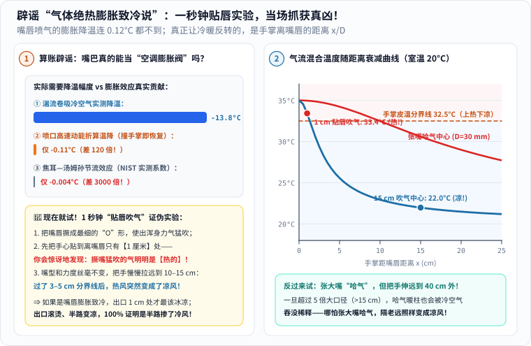
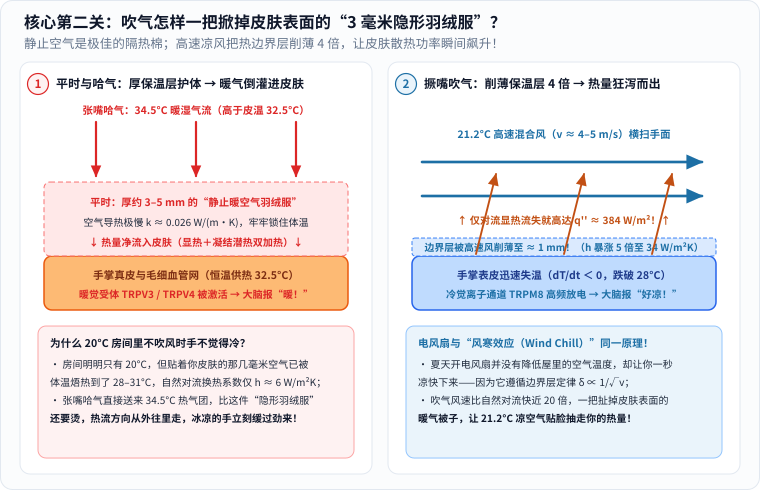
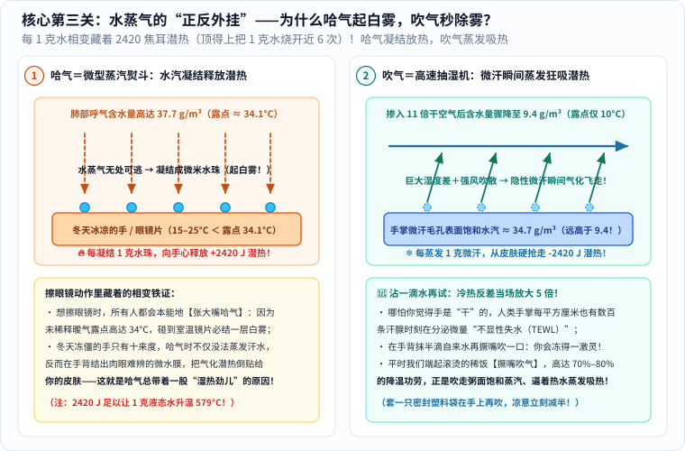
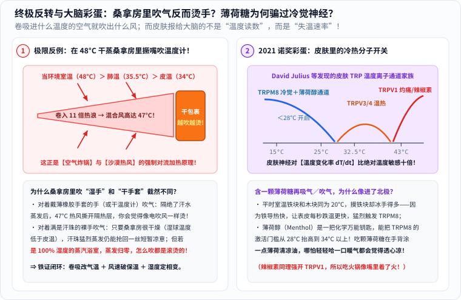

两千五百多年前，《伊索寓言》里讲过一桩离奇的“驱逐案”。

在一个大雪纷飞的寒冬，一位冻得瑟瑟发抖的旅人敲开了森林半羊神萨堤尔（Satyr）的家门。萨堤尔好心请他进屋避寒，结果刚一落座，就看见这个人类举起冻僵的双手凑到嘴边，“哈——”地吐出一口白气。

萨堤尔好奇地问：“你在干什么？”旅人搓着手笑答：“我的手冻麻了，吹口气把它们暖热。”

不一会儿，萨堤尔端上一大碗刚出锅、滚烫冒烟的热粥。谁知旅人刚端起碗，又凑到碗边撅起嘴，“呼——”地吹出一口长气。萨堤尔瞪大了眼睛：“你这又是在干什么？”旅人理所当然地说：“粥太烫了，我吹口气把它吹凉呀！”

话音未落，萨堤尔脸色大变，一把拉开房门把旅人轰了出去，留下了那句后来变成西方谚语*“blow hot and cold”*（反复无常、冷热无度）的名言（见 Joseph Jacobs 1894 年英译本《伊索寓言·人与萨堤尔》，Perry Index 第 35 则）：

> “快给我出去！我绝不跟一个**同一张嘴里既能吹出热风、又能吹出冷风**的家伙打交道！”

半羊神吓坏了，我们从小到大却习以为常：冬天等公交时张大嘴“哈气”暖手，擦眼镜时“哈气”起雾；喝热汤、吹蚊子包时撅起嘴“吹气”降温。

可只要你停下来认真想三秒钟，就会发现萨堤尔的困惑一点也不傻——**无论你是张大嘴“哈”，还是撅起嘴“呼”，这团气体在离开肺泡、穿过气管和声门的那一瞬间，明明都来自同一个恒温恒湿的胸腔：初始温度都在 $$34^\circ\text{C}\text{–}35^\circ\text{C}$$ 左右，相对湿度高达 $$95\%$$ 以上！**

短短十几厘米的空中路程，连半秒钟都不到，凭什么换个嘴型，送到手心里的感觉就能一个像暖手宝、一个像小风扇？

更有趣的是，如果你去网上搜这个问题，十篇科普里有八篇会一本正经地告诉你三个字：**“绝热膨胀”**——说撅嘴时口腔把气体压缩了，喷出嘴唇瞬间体积膨胀对外做功，所以气流把自己的温度冻低了。

今天我们不用任何实验室仪器，**只用你自己的嘴和一只手掌，花两秒钟做一个贴唇实验**，就能当场戳破这个流传最广的“伪标准答案”，再顺藤摸瓜揭开流体力学、热传导、水汽相变与神经生物学联手导演的三重真相。

---

## 一、两秒钟亲手破案：为什么“绝热膨胀变冷说”一贴嘴唇就破产？

在揭晓真凶之前，请你现在就把一只手掌举到面前，亲自做下面这个两秒钟的小实验：

1. **第一步（远距吹气）**：把掌心放在距离嘴唇大约 **$$15\,\text{cm}$$**（一拃左右）的地方，撅起嘴唇，像吹蜡烛一样使劲“呼——”地吹气。毫无疑问，掌心感受到的是一股**明显的凉风**。
2. **第二步（贴唇反转）**：**保持完全一模一样的撅嘴口型、一模一样的吹气力度不要停**，慢慢把手掌往嘴唇方向推近，一直贴到距离嘴唇只有 **$$1\,\text{cm}$$**（差不多一根手指厚）的地方！

奇迹发生了：**就在刚才还吹出凉风的那张撅起的嘴里，此刻喷在你掌心上的，赫然是一股温热的气流！**

我们可以立刻用反证法给“绝热膨胀／节流膨胀变冷说”判死刑：

如果撅嘴吹气变凉真的是因为“气体在口腔里被压缩、一出嘴唇瞬间膨胀降温”，那么**气压从口腔高压跌回外界大气压的过程，恰恰发生在离开嘴唇出口最初的几毫米之内**。照这个逻辑，距离嘴唇 $$1\,\text{cm}$$ 的地方刚完成膨胀，温度应该**最低、最冰凉**才对；越往远处走，混入周围空气后反而应该回温。可你的手掌亲测的结果完全相反：**出口 $$1\,\text{cm}$$ 处明明还是 $$34^\circ\text{C}$$ 左右的暖气，反而是飞出去 $$10\text{–}15\,\text{cm}$$ 之后，才在半路上越飞越凉！**

### 用 NIST 真实气体账本算一笔硬账：差了整整三千倍

光靠手感还不够过瘾，我们直接查热力学权威数据库，算一算人嘴吹气到底能“膨胀降温”多少度。

一个人使劲鼓起腮帮子往外吹气时，口腔内比外界大气高出的表压通常只有 $$\Delta P \approx 1\text{–}2\,\text{kPa}$$（哪怕吹小号的专业乐手，常规吹奏气压也不过几千帕，只有约 $$0.02$$ 个标准大气压；普通撅嘴吹气远低于高压气瓶放气）。气体穿过狭窄嘴唇向大气自由喷射的过程，在热力学上更接近**焦耳-汤姆孙节流过程（Joule–Thomson throttling）**加一段喷口加速。

查阅美国国家标准与技术研究院（NIST Chemistry WebBook）基于 Span 等人（2000）高精度状态方程给出的常温常压（$$300\text{–}310\,\text{K}$$，$$0.101325\,\text{MPa}$$）氮气／空气数据，空气的焦耳-汤姆孙系数仅为 $$\mu_{\text{JT} } \approx 2.0\,\text{K/MPa} = 0.002\,\text{K/kPa}$$。就算按偏大的 $$\Delta P = 2\,\text{kPa}$$ 计算，真实气体膨胀带来的温度下降也只有：

$$\begin{aligned}
\Delta T_{\text{JT} } &= \mu_{\text{JT} } \cdot \Delta P \\
&\approx 0.002\,\text{K/kPa} \times 2\,\text{kPa} = 0.004^\circ\text{C}
\end{aligned}$$

**只有千分之四摄氏度！**别说人的手掌，连普通医用体温计都测不出这点零头。

也许有人会追问：“那把内能转化为气流高速动能的温降呢？”我们也把它算出来。按定压比热容 $$c_p \approx 1{,}006\,\text{J/(kg}\cdot\text{K)}$$、撅嘴出口高速气流 $$v_0 = 15\,\text{m/s}$$ 计算，气流的静温下降为：

$$\begin{aligned}
\Delta T_{\text{动能} } &= \frac{v_0^2}{2\,c_p} \\
&= \frac{15^2}{2 \times 1{,}006} \approx 0.11^\circ\text{C}
\end{aligned}$$

不仅只有区区 **$$0.11^\circ\text{C}$$**，更关键的是流体力学里还有一个**驻点恢复效应（Stagnation recovery）**：当这股高速气流迎面撞上你的手掌并被迫减速刹停时，绝大部分宏观动能又会在掌心表面重新转化为内能，使手掌感受到的“恢复温度”几乎回到原来的总温！

> **什么时候喷气才会真的靠膨胀冻手？**  
> 当你按住电脑除尘罐（里面装的是几个大气压的液化二氟乙烷，沸点 $$-25^\circ\text{C}$$）或者给高压自行车胎猛放气（胎压高达 $$300\text{–}700\,\text{kPa}$$，比嘴吹高两百倍）时，剧烈的相变吸热或大幅压降确实会让喷嘴结霜冰手。有人把高压气罐的经验生搬硬套到了人类的嘴唇上，才制造出了这个流传几十年的科普乌龙。

_图 1：怎么看这张图？先看左侧柱状对比：撅嘴吹气在 15 cm 外降温约 13.8°C，真正的主力是流体卷吸混入室温空气，而动能转换（0.11°C）与焦耳-汤姆孙节流膨胀（0.004°C）连零头都算不上；再看右侧温度随距离变化曲线：红色虚线（张嘴哈气，D=30 mm）在 15 cm 内始终高于手掌皮温 32.5°C，而蓝色实线（撅嘴吹气，D=4 mm）在 1 cm 贴唇处明明高达 35°C，却在 2–3 cm 处迅速跌破皮温红线，由暖转凉。_

既然气流出嘴时明明是 $$35^\circ\text{C}$$ 的暖气，膨胀降温又只有 $$0.004^\circ\text{C}$$，那是谁在离开嘴唇后的短短 $$2\text{–}15\,\text{cm}$$ 内，把这团暖气“偷梁换柱”冻凉了将近 $$14^\circ\text{C}$$？

答案就藏在右图那条断崖式跳水的蓝色曲线里——**湍流射流的“卷吸效应”（Jet Entrainment）**。

---

## 二、第一重真相：湍流“卷吸效应”——1 份肺部暖气，半路拉进 11 份冷空气

一团流体冲进静止的周围空气时，绝对不是像一颗铁球那样“井水不犯河水”地往前飞。只要流速稍快、雷诺数超过临界值，高速气流的边缘就会跟静止空气发生剧烈的速度剪切，搓出一串串旋转翻滚的环形涡旋（Kelvin–Helmholtz 剪切涡）。

这些边缘涡旋就像一只只贪婪的手，一路把周围静止的室温冷空气（假设室温 $$T_\infty = 20^\circ\text{C}$$）源源不断地“抓”进射流内部，掺混成一团越来越粗、越来越慢、也越来越接近室温的混合气流。流体力学把这种现象叫做**卷吸（Entrainment）**（如果你读过前不久那篇[《水凭什么先往高处爬再翻墙流走？读懂虹吸现象》]()，就会记得不能一见流速快就乱套伯努利方程——真正让自由射流吞进周围空气的，正是黏性剪切层失稳制造的湍流大涡掺混，使得射流静压与环境气压几乎相等而总质量流量一路暴涨）。

1961 年，英国帝国理工学院的流体力学家弗朗西斯·里库（F. P. Ricou）与布莱恩·斯波尔丁（D. B. Spalding）在《流体力学杂志》（*Journal of Fluid Mechanics*, 11(1), 21–32）上发表了一项经典实验：他们用多孔圆筒精确测量了轴对称湍流圆射流沿程吞入周围空气的速率，发现一旦走过出口最初约 **$$4.5D\text{–}5D$$** 长的未稀释“势流核心区”（Potential core，$$D$$ 为喷口直径），射流的总质量流量 $$\dot{m}(x)$$ 就会随距离 $$x$$ 呈极其漂亮的线性增长：

$$\begin{aligned}
\frac{\dot{m}(x)}{\dot{m}_0} &\approx 0.32\,\frac{x}{D} \qquad (x \gtrsim 5D)
\end{aligned}$$

请死死盯住分母上的那个字母 **$$D$$（嘴唇开口直径）**！解开“哈气暖、吹气凉”的全部钥匙，就锁在这个分母里：

### 1. 张大嘴“哈气”：宽口慢流，15 厘米长的“纯暖气保鲜通道”

当你张大嘴巴温柔地“哈——”气时，嘴唇围成的等效圆口直径高达 **$$D \approx 30\,\text{mm}$$（$$3\,\text{cm}$$）**，出口流速只有慢悠悠的 **$$v_0 \approx 1.2\text{–}1.5\,\text{m/s}$$**。

算一下它的未稀释“势流核心区”有多长：

$$L_{\text{核心,哈} } \approx 5D = 5 \times 3\,\text{cm} = 15\,\text{cm}$$

而你冬天冻手“哈气”时，手掌捧在嘴前多远？通常只有 **$$8\text{–}12\,\text{cm}$$**（$$x/D \approx 2.7\text{–}4.0$$）！

也就是说，周围 $$20^\circ\text{C}$$ 的冷空气刚在气流最外圈啃了一点皮，根本还没来得及钻进射流中心，这团几乎原汁原味的肺部热气就已经撞上了你的掌心！此时到达掌心的气流中心温度依然高达 **$$34^\circ\text{C}\text{–}34.8^\circ\text{C}$$**，比正常室温下手掌的皮肤表面温度（约 **$$32^\circ\text{C}\text{–}33^\circ\text{C}$$**，冬天户外甚至只有 $$15^\circ\text{C}\text{–}25^\circ\text{C}$$）还要高——热量顺着温差源源不断往皮肤里灌，手当然觉得暖洋洋！

### 2. 撅起嘴“吹气”：细孔急流，半路掺进 11 倍室温冷空气！

现在把嘴唇紧紧撅成一个小圆孔“呼——”地吹气。此时开口直径骤缩了将近 **8 倍**，只剩 **$$D \approx 4\,\text{mm}$$（$$0.4\,\text{cm}$$）**；同样的肺部呼气量挤过面积缩小约 56 倍的窄门，出口流速瞬间飙升到 **$$v_0 \approx 12\text{–}18\,\text{m/s}$$**（相当于六七级强风！）。

再算一下它的“势流核心区”还剩多长：

$$L_{\text{核心,吹} } \approx 5D = 5 \times 0.4\,\text{cm} = 2.0\,\text{cm}$$

**仅仅 2 厘米！**这就是为什么刚才你把手贴到 $$1\,\text{cm}$$ 处（还在 $$2\,\text{cm}$$ 核心区内）会摸到 $$34^\circ\text{C}$$ 暖风，而一旦退到常规吹气距离 **$$x = 15\,\text{cm}$$**，无量纲距离 $$x/D$$ 就暴涨到了惊人的 **$$150\,\text{mm} / 4\,\text{mm} = 37.5$$**！

代入里库-斯波尔丁卷吸公式：

$$\begin{aligned}
\frac{\dot{m}(15\,\text{cm})}{\dot{m}_0} &\approx 0.32 \times 37.5 = 12.0
\end{aligned}$$

这意味着什么？**从你嘴里真正吹出来的 $$35^\circ\text{C}$$ 肺部暖气只有 1 份，而它在飞向手掌的短短 15 厘米路上，硬生生把周围 $$20^\circ\text{C}$$ 的室温空气拉进来了整整 11 份！**

按焓值守恒一算这 12 份混合气体的平均温度 $$T_{\text{mix} }$$：

$$\begin{aligned}
T_{\text{mix} } &= T_\infty + \frac{T_0 - T_\infty}{\dot{m}(x)/\dot{m}_0} \\
&\approx 20^\circ\text{C} + \frac{35^\circ\text{C} - 20^\circ\text{C} }{12.0} \approx \mathbf{21.25^\circ\text{C} }
\end{aligned}$$

哪怕只看最核心的轴线峰值温度，在 $$15\,\text{cm}$$ 处也跌到了约 **$$22^\circ\text{C}$$**——比你 $$32.5^\circ\text{C}$$ 的手掌皮温足足低了 **$$10^\circ\text{C}$$ 以上**！明明出门时是 $$35^\circ\text{C}$$ 的热气，半路上被 11 倍的冷空气“稀释夺舍”，扑到手心里的早已是一团彻头彻尾的室温冷风。

_图 2：怎么看这张图？上下两栏从完全相同的 35°C 肺部暖气出发。上栏张大嘴“哈气”（D≈30 mm），未稀释势流核心区长达约 15 cm，10 cm 处的手掌直接承接 34.5°C 原装暖气；下栏撅起嘴“吹气”（D≈4 mm），暖核在 2 cm 内就被高速剪切涡旋撕碎，一路卷吸 11 倍体积的 20°C 室温空气，抵达 15 cm 手掌时混合温度只剩约 21.2°C。支持动画的浏览器会在加载时播放一次暖气团与冷风卷吸对比并定格在终态（系统开启“减少动态效果”时直接显示完整静态终态； 刷新页面可重播）。_

---

## 三、第二重真相：扒掉手掌上 4 毫米厚的“隐形空气羽绒服”

读到这里，眼尖的读者一定会立刻举手提出第二个尖锐问题：

> “等一下！就算撅嘴吹气的混合温度跌到了 $$21.2^\circ\text{C}$$，可我屋里的空气本来就是 $$20^\circ\text{C}$$ 呀！为什么我的手静静悬在 $$20^\circ\text{C}$$ 的房间里一点也不觉得冷，偏偏被 $$21.2^\circ\text{C}$$（甚至比室温还高 $$1.2^\circ\text{C}$$！）的气流一吹，反而觉得冰凉刺骨？”

问到点子上了！这正是热传递里最容易被忽略的第二重杀手锏——**热边界层（Thermal Boundary Layer）**。

静止空气其实是非常优秀的绝热体：在常温下，干空气的导热系数只有 $$k_{\text{air} } \approx 0.026\,\text{W/(m}\cdot\text{K)}$$，比液态水（约 $$0.60\,\text{W/(m}\cdot\text{K)}$$）低 23 倍，和优质羽绒服里填充蓬松绒朵锁住的死空气本就是同一种东西。

当你的手静静放在无风的 $$20^\circ\text{C}$$ 房间里时，$$32.5^\circ\text{C}$$ 的温暖皮肤会把紧贴表皮的一薄层空气烤暖。就像我们在[《火到底是什么、为什么偏偏往上蹿？读懂火的真相》]()里分析自然对流浮力羽流那样，手温与室温只差十几度，浮力驱动的自然对流非常微弱，手掌表面自然对流换热系数只有 $$h_{\text{静} } \approx 6\text{–}7\,\text{W/(m}^2\cdot\text{K)}$$。折算成等效导热气膜厚度 $$\delta_{\text{eff} } = k_{\text{air} } / h$$，你的每寸裸露皮肤外面，其实都常年裹着一件厚约 **$$4\,\text{mm}$$ 的“隐形暖空气羽绒服”**：

$$\begin{aligned}
\delta_{\text{静} } &= \frac{k_{\text{air} } }{h_{\text{静} } } \approx \frac{0.026}{6.5} = 0.004\,\text{m} = \mathbf{4.0\,\text{mm} }
\end{aligned}$$

有了这层 $$4\,\text{mm}$$ 暖气垫隔在中间，安静状态下皮肤向空气散失的显热通量只有温和的：

$$\begin{aligned}
q_{\text{静} } &= h_{\text{静} }\,(T_{\text{皮} } - T_\infty) \\
&\approx 6.5 \times (32.5 - 20) \approx 81\,\text{W/m}^2
\end{aligned}$$

人体微血管源源不断送来的血液热量刚好和这 $$81\,\text{W/m}^2$$ 打平，所以你在 $$20^\circ\text{C}$$ 屋里觉得不冷不热。

**可一旦你撅起嘴“呼——”地吹来一股高速射流，局势瞬间崩盘：**

即使到了距离嘴唇 $$15\,\text{cm}$$ 的地方，撅嘴射流的中心风速仍然高达 **$$3\text{–}5\,\text{m/s}$$**，而且充满了强湍流脉动。这股猛风正面拍击手掌（流体工程上专门用这种“射流冲击换热 Impinging jet”来给滚烫的高功率芯片和燃气轮机叶片强力散热！），一巴掌就把那层 $$4\,\text{mm}$$ 厚的隐形空气羽绒服撕得粉碎，把等效气膜厚度硬生生削薄了 **5 倍以上**，只剩不到 **$$0.8\,\text{mm}$$**！

气膜削薄 5 倍，对流换热系数瞬间飙升到 $$h_{\text{吹} } \approx 34\,\text{W/(m}^2\cdot\text{K)}$$。哪怕吹过来的混合风温是 $$21.2^\circ\text{C}$$，手掌每秒钟被强行抽走的显热通量也会暴涨到：

$$\begin{aligned}
q_{\text{吹} } &= h_{\text{吹} }\,(T_{\text{皮} } - T_{\text{mix} }) \\
&\approx 34 \times (32.5 - 21.2) \approx \mathbf{384\,\text{W/m}^2}
\end{aligned}$$

**散热功率瞬间翻了将近 5 倍！**这正是冬天天气预报里“风寒效应（Wind chill）”和夏天吹电风扇凉快的底层逻辑：电风扇从来没有给房间制冷半度，它只是扒掉了裹在你皮肤外面的那件 $$4\,\text{mm}$$ 空气羽绒服。

反过来，张嘴“哈气”时吹过来的是 $$34.5^\circ\text{C} > T_{\text{皮} }$$ 的暖流：气流扰动越是削薄边界层，反而越能帮高过皮温的热量更快传进皮肤（$$q_{\text{哈,显热} } \approx -30\,\text{W/m}^2$$，负号代表皮肤净吸热）！

_图 3：怎么看这张图？左侧为安静无风或轻柔哈气状态，手掌表皮外覆盖着厚约 4.0 mm 的静止暖空气边界层，如同穿了一件隐形羽绒服（安静散热量仅约 81 W/m²，哈气时因气流高于皮温反而倒灌净吸热）；右侧为撅嘴高速吹气冲击掌心，21.2°C 的湍流直接把边界层削薄至约 0.76 mm，对流换热系数暴涨 5 倍以上，每秒从掌心抽走约 384 W/m² 的显热。_

---

## 四、第三重真相：每克水 2420 焦耳的“相变外挂”——一边凝结烫手，一边蒸发结冰

如果只有“冷风卷吸 + 扒掉边界层”这两招，故事其实只讲了一半。真正让“哈气”和“吹气”拉开云泥之别的隐藏大魔王，是我们呼吸里看不见的**水蒸气**。

液态水变成水蒸气（或反过来水蒸气凝结成液态水）是一门能量密度高得吓人的生意。根据 NIST 饱和水与水蒸气热物性表，在皮肤与呼吸温度附近（$$30^\circ\text{C}\text{–}35^\circ\text{C}$$），水的汽化／凝结潜热高达：

$$L_v \approx \mathbf{2{,}420\,\text{J/g} }$$

$$2{,}420\,\text{J}$$ 是什么概念？液态水的比热容是 $$4.18\,\text{J/(g}\cdot\text{K)}$$。也就是说，**仅仅 $$1\,\text{g}$$ 水（大约小半瓶盖、二十滴水）在掌心蒸发或凝结所搬运的潜热，如果拿去加热或冷却同质量的液态水，足够让它的温度剧烈改变 $$579^\circ\text{C}$$！**

现在看看你肺里呼出的那口湿气，在“哈气”和“吹气”两条路上怎样触发了截然相反的相变开关：

1. **张嘴“哈气”：触发“天锅式凝结放热”外挂（$$+\,2{,}420\,\text{J/g}$$）**  
   肺泡里的空气在 $$35^\circ\text{C}$$ 下几乎被水蒸气喂饱了：NIST 数据显示 $$35^\circ\text{C}$$ 饱和水汽密度高达 $$39.67\,\text{g/m}^3$$，按呼出气 $$95\%$$ 相对湿度算，绝对含湿量高达 **$$37.7\,\text{g/m}^3$$**，对应的**露点温度高达 $$34.1^\circ\text{C}$$**！  
   当你张大嘴近距离往冻凉的冬日手掌（皮温往往只有 $$15^\circ\text{C}\text{–}25^\circ\text{C}$$）或者冰冷的眼镜片上“哈——”气时，这团没有被稀释的高湿暖气直接撞上低于露点 $$34.1^\circ\text{C}$$ 的表面。两点重逢瞬间，第一件事就是抑制手掌原本的水分蒸发；一旦皮温低于 $$34.1^\circ\text{C}$$，水蒸气更会当场在皮肤微纹理上**凝结成肉眼难辨的微米级液膜**，每凝结 $$1\,\text{mg}$$ 水就往你皮肤里白送 $$2.42\,\text{J}$$ 的纯热能！这跟我们在[《二锅头真的是蒸了两锅吗？读懂红星二锅头的酿造技艺与味道密码》]()里讲过的传统甑锅“天锅冷凝”如出一辙——热酒汽一撞冷天锅底，立刻把成千上万焦耳的潜热狠狠拍进冷却水里，难怪手心像贴了蒸汽眼罩一样瞬间回暖。

2. **撅嘴“吹气”：触发“隐性汗液闪蒸吸热”外挂（$$-\,2{,}420\,\text{J/g}$$）**  
   可当你撅起嘴在 $$15\,\text{cm}$$ 外“呼——”地吹气时，别忘了刚才算过的 **1:11 卷吸掺混**！假设室内空气是 $$20^\circ\text{C}$$、相对湿度 $$40\%$$（绝对含湿量仅 $$6.9\,\text{g/m}^3$$），1 份高湿肺气跟 11 份偏干室温空气一兑，到达手掌时的水汽密度瞬间暴跌到只有 **$$9.4\,\text{g/m}^3$$**（露点跌至约 **$$10^\circ\text{C}$$**），远低于 $$32.5^\circ\text{C}$$ 皮肤表面的饱和水汽密度（约 $$34.8\,\text{g/m}^3$$）。  
   别以为手心没出汗就是绝对干燥的！活人的角质层每时每刻都在通过小汗腺和表皮间隙向外渗出微量的**经表皮失水（Transepidermal Water Loss, TEWL）**，手掌更是全身小汗腺最密集的部位之一（每平方厘米多达数百个汗孔）。高速偏干气流一边扒掉水汽扩散边界层，一边逼着皮肤表层的微量水分加速蒸发，每吹干 $$1\,\text{mg}$$ 水就从真皮神经末梢硬抢走 $$2.42\,\text{J}$$ 热量！

**想亲眼验证这个 2420 焦耳外挂有多猛？**  
现在去水龙头上沾**一滴自来水**抹在手背上，再分别隔 $$10\,\text{cm}$$ 张嘴“哈气”和隔 $$15\,\text{cm}$$ 撅嘴“吹气”——你会发现湿水那一块皮肤在撅嘴吹气下简直像贴了一小块冰，凉意比干皮肤猛烈好几倍！

_图 4：怎么看这张图？核心标尺是每克水高达 2420 J 的汽化／凝结潜热（相当于让 1 g 液态水升降温 579°C）。左栏张嘴哈气保留了 37.7 g/m³ 的高湿肺气（露点 34.1°C），遇到微凉手掌或冷镜片直接凝结放热；右栏撅嘴吹气被 11 份偏干室内空气稀释至 9.4 g/m³（露点仅 10°C），高速扫过表皮时强力加速微量汗液蒸发，在显热散热之上再叠一层猛烈的潜热抽吸。_

---

## 五、终极反例与诺贝尔奖彩蛋：48°C 桑拿房里的“吹气烫手”反转，以及薄荷为什么能骗大脑？

任何一个靠谱的物理模型，都必须经得起**极端反例**的拷打。既然撅嘴吹气变凉是因为“半路卷吸了 11 倍的 $$20^\circ\text{C}$$ 室温冷空气 + 扒掉 $$4\,\text{mm}$$ 空气隔热层”，那么脑洞大开一下：

**如果周围的环境空气比你的肺（$$35^\circ\text{C}$$）和皮肤（$$33^\circ\text{C}$$）还要烫——比如走进一间 $$48^\circ\text{C}$$ 的干蒸桑拿房，或者置身吐鲁番正午的热浪里，这时候撅嘴“吹气”还会凉吗？**

把 $$T_\infty = 48^\circ\text{C}$$ 代入我们刚才一模一样的里库-斯波尔丁混合公式：

$$\begin{aligned}
T_{\text{mix,桑拿} } &\approx 48^\circ\text{C} + \frac{35^\circ\text{C} - 48^\circ\text{C} }{12.0} \\
&\approx \mathbf{46.9^\circ\text{C} }
\end{aligned}$$

惊人的反转出现了！从你肺里吹出来的 $$35^\circ\text{C}$$ 气流明明比桑拿房空气**更凉快**，可它在半路上卷吸了 11 份 $$48^\circ\text{C}$$ 的滚烫空气，飞到 $$15\,\text{cm}$$ 外时反而被加热到了 **$$46.9^\circ\text{C}$$**！

如果你这时候戴着一只**干燥的隔热手套**，或者对着一支**干燥的温度计探头**撅嘴吹气，高速气流一把撕碎表面的隔热气膜，把 $$46.9^\circ\text{C}$$ 的热浪狠狠拍上去——**撅嘴“吹气”非但不凉，反而比张嘴“哈气”（约 $$37^\circ\text{C}$$）更烫手！**厨房里的**空气炸锅**和电吹风热风挡，靠的正是这一招“高温强迫对流撕碎边界层”，才把原本要烤半小时的鸡翅十几分钟就烤得焦脆。

（补充一个极妙的生理细节：如果在干燥的 $$48^\circ\text{C}$$ 桑拿房里对着**满头大汗的裸露皮肤**吹气，最初几秒钟汗水剧烈蒸发抢走的 $$-2{,}420\,\text{J/g}$$ 潜热甚至还能跟 $$47^\circ\text{C}$$ 热风掰一掰手腕；可一旦往桑拿炉石头上泼一瓢水，让房内湿度飙升、堵死汗液蒸发通道，这时候谁敢在桑拿房里对着同伴吹气，对方一定会烫得跳起来喊救命！）

### 2021 年诺贝尔奖揭开的最后一环：皮肤根本不是“温度计”

故事的最后一块拼图，藏在你的手掌皮肤底下。

很多人误以为皮肤里长着一个个微型水银温度计，专门测量外面空气是多少度。2021 年诺贝尔生理学或医学奖颁给了美国科学家戴维·朱利叶斯（David Julius）和阿登·帕塔普蒂安（Ardem Patapoutian），表彰他们发现了人类感知温度与触觉的分子受体（见诺贝尔奖委员会 2021 年官方新闻公报）：

- **温热／灼痛通道 `TRPV3`、`TRPV4` 与 `TRPV1`**：当真皮神经末梢被加热升温时（其中辣椒素受体 `TRPV1` 在 $$>43^\circ\text{C}$$ 激活，这就是吃辣椒觉得“火辣辣烫嘴”的原因），阳离子通道打开，向大脑发送“暖／烫”信号；
- **冷觉／薄荷醇通道 `TRPM8`**：当真皮浅层以较快速度失热降温（尤其是局部温度向 $$<28^\circ\text{C}$$ 下滑、降温速率 $$-\mathrm{d}T_{\text{皮} }/\mathrm{d}t$$ 增大）时，`TRPM8` 通道迅速开启，向大脑拉响“好凉！”的警报（顺便一提，当腹部体表大面积受凉激活冷觉通路与自主神经反射时，甚至会加快肠道蠕动，我们在[《为什么一着凉就容易拉肚子？读懂受凉腹泻的原理》]()里就聊过这套身体警报链）。

换句话说，**你的手掌测量的从来不是“空气的绝对温度”，而是“皮肤热量得失的方向与速率”**！同样面对 $$20^\circ\text{C}$$ 的物体，摸木头觉得温和、摸铁块觉得冰手，摸 $$21.2^\circ\text{C}$$ 的高速吹气觉得凉飕飕，全是因为后两者抽走皮肤热量的功率远超血液供热，让真皮里的 `TRPM8` 通道疯狂放电。

而 `TRPM8` 还有一个最好玩的化学后门——**薄荷醇（Menthol）**能直接结合在 `TRPM8` 蛋白上，把它原本需要低于 $$28^\circ\text{C}$$ 才打开的门槛，硬生生抬高到常温甚至体温附近！所以只要你嘴里含一颗强力薄荷糖，再吸一口气或者对着手背抹一点清凉油轻轻吹气，明明没有任何真实降温，被“化学撬锁”的 `TRPM8` 也会把大脑骗得以为刚灌了一口冰泉水。

_图 5：怎么看这张图？左栏展示 48°C 干蒸桑拿房里的终极反例：当环境温度反超肺温（35°C）时，撅嘴吹气卷吸 11 份 48°C 热空气，混合温度飙至约 46.9°C，吹在干燥隔热手套或温度计上反而比哈气更烫（这正是空气炸锅的强迫对流加热原理）；右栏展示 2021 年诺贝尔奖揭示的皮肤分子受体——张嘴哈气净输热激活温热通道 TRPV3/TRPV4，撅嘴吹气高功率夺热激活冷觉通道 TRPM8，而薄荷醇能直接化学撬开 TRPM8 制造“假冷觉”。_

---

## 六、一张总表收好：同一口气是如何分道扬镳的？

下次冬天在车站搓手哈气，或者夏天给孩子吹凉一勺热汤时，你就可以笑着想起两千五百年前那个被吓跑的半羊神萨堤尔——人类嘴里并没有藏着一冷一热两个风箱，只不过是用嘴唇的开合，在十几厘米的空气里精准调度了四条物理与生理定律：

| 对比维度 | 张大嘴“哈——”气（暖手模式） | 撅起嘴“呼——”气（吹凉模式） | 背后的核心定律 |
| :--- | :--- | :--- | :--- |
| **喉部出发状态** | 约 $$35^\circ\text{C}$$，$$95\%$$ 高湿 | **完全相同**：约 $$35^\circ\text{C}$$，$$95\%$$ 高湿 | 肺泡恒温恒湿换热 |
| **嘴唇出口尺寸与流速** | 宽口 $$D \approx 30\,\text{mm}$$，慢速 $$v_0 \approx 1.5\,\text{m/s}$$ | 细孔 $$D \approx 4\,\text{mm}$$，高速 $$v_0 \approx 15\,\text{m/s}$$ | 连续性方程（截面积差数十倍） |
| **膨胀／节流自身降温** | $$< 0.001^\circ\text{C}$$（完全可忽略） | **仅约 $$0.004^\circ\text{C}$$**（驻点恢复后动能降温亦归零） | NIST 焦耳-汤姆孙效应（破除伪科普） |
| **未稀释势流核心区 ($$5D$$)** | 长达 **约 $$15\,\text{cm}$$**（包住 $$10\,\text{cm}$$ 手掌） | 仅剩 **约 $$2\,\text{cm}$$**（$$1\,\text{cm}$$ 贴唇仍暖！） | 自由湍流射流核心区 |
| **抵达手掌时的混合温度** | **约 $$34^\circ\text{C}\text{–}34.8^\circ\text{C}$$**（高于皮温 $$32.5^\circ\text{C}$$） | 卷吸 **11 倍** $$20^\circ\text{C}$$ 空气，跌至 **约 $$21.2^\circ\text{C}$$** | Ricou & Spalding (1961) 卷吸定律 |
| **皮肤 4 mm 空气羽绒服** | 温差反向，热量顺势传入表皮 | 气膜被削薄至 **$$<0.8\,\text{mm}$$**，显热流失暴涨 5 倍 | 射流冲击强迫对流换热 |
| **2420 J/g 水汽相变外挂** | 高露点（$$34.1^\circ\text{C}$$）在凉手上**凝结放热** | 稀释偏干气流加速微量汗液**蒸发抢热** | 水的汽化／凝结潜热 |
| **神经末梢最终汇报** | 表皮升温 $$\to$$ 激活 `TRPV3/TRPV4`（暖！） | 表皮急速失热 $$\to$$ 激活 `TRPM8`（凉！） | 2021 诺贝尔生理学或医学奖受体机制 |

原来最硬核的流体力学实验室，根本不需要风洞和超算——它就长在你的嘴唇和手掌之间，随时随地，一吹即现。

---

## 参考资料与核查来源

1. **《伊索寓言·人与萨堤尔》（“同一张嘴吹热又吹冷”典故原始文献）**：  
   Aesop, *The Fables of Æsop*, selected and retold by Joseph Jacobs (Macmillan, 1894), *"The Man and the Satyr"* (Perry Index 35). 维基文库公有领域全文核查页：[Wikisource — The Man and the Satyr](https://en.wikisource.org/wiki/The_Fables_of_%C3%86sop_(Jacobs)/The_Man_and_the_Satyr)（支持开篇旅人“哈气暖手、吹气凉粥”及谚语 *blow hot and cold* 出处）。
2. **轴对称湍流圆射流卷吸定律（1 份肺气卷吸 11 份室温空气的定量依据）**：  
   Ricou, F. P., & Spalding, D. B. (1961). *"Measurements of entrainment by axisymmetrical turbulent jets."* *Journal of Fluid Mechanics*, 11(1), 21–32. 剑桥大学出版社原始论文页：[DOI: 10.1017/S0022112061000834](https://doi.org/10.1017/S0022112061000834) 及帝国理工学院机构典藏核查页：[Imperial Spiral Record](https://spiral.imperial.ac.uk/entities/publication/827671ca-23dd-4aac-898c-612fd9fe1c83)（支持势流核心区约 $$4.5D\text{–}5D$$ 及自相似区质量流量线性增长率 $$\dot{m}(x)/\dot{m}_0 \approx 0.32\,(x/D)$$）。
3. **常温常压真实气体焦耳-汤姆孙系数与比热容（破除“绝热／节流膨胀变冷说”定量依据）**：  
   Span, R., Lemmon, E. W., Jacobsen, R. T., Wagner, W., & Yokozeki, A. (2000). *"A Reference Equation of State for the Thermodynamic Properties of Nitrogen for Temperatures from 63.151 to 1000 K and Pressures to 2200 MPa."* *Journal of Physical and Chemical Reference Data*, 29(6), 1361–1433；美国国家标准与技术研究院在线热物性表：[NIST Chemistry WebBook — Isobaric Properties at 0.101325 MPa (300–310 K)](https://webbook.nist.gov/cgi/fluid.cgi?P=0.101325&TLow=300&THigh=310&TInc=5&Digits=5&ID=C7727379&Action=Load&Type=IsoBar&TUnit=K&PUnit=MPa&DUnit=kg%2Fm3&HUnit=kJ%2Fkg&WUnit=m%2Fs&VisUnit=uPa*s&STUnit=N%2Fm&RefState=DEF)（支持常温常压下 $$\mu_{\text{JT} } \approx 2.0\,\text{K/MPa} = 0.002\,\text{K/kPa}$$，$$2\,\text{kPa}$$ 口腔表压节流温降仅约 $$0.004^\circ\text{C}$$）。
4. **饱和水与水蒸气密度、露点及汽化／凝结潜热（$$2{,}420\,\text{J/g}$$ 相变放大效应依据）**：  
   Wagner, W., & Pruß, A. (2002). *"The IAPWS Formulation 1995 for the Thermodynamic Properties of Ordinary Water Substance for General and Scientific Use."* *Journal of Physical and Chemical Reference Data*, 31(2), 387–535；NIST 饱和水热物性核查页：[NIST Chemistry WebBook — Saturation Properties for Water (293.15–308.15 K)](https://webbook.nist.gov/cgi/fluid.cgi?TLow=293.15&THigh=308.15&TInc=5&Digits=5&ID=C7732185&Action=Load&Type=SatP&TUnit=K&PUnit=kPa&DUnit=kg%2Fm3&HUnit=kJ%2Fkg&WUnit=m%2Fs&VisUnit=uPa*s&STUnit=N%2Fm&RefState=DEF)（支持 $$35^\circ\text{C}$$ 饱和水汽密度 $$39.67\,\text{g/m}^3$$ 及汽化潜热 $$h_{fg} \approx 2{,}418\text{–}2{,}430\,\text{J/g}$$）。
5. **皮肤冷热离子通道 `TRPM8`（冷觉／薄荷醇）与 `TRPV1`/`TRPV3`/`TRPV4`（温热／辣椒素）神经生物学机制**：  
   The Nobel Assembly at Karolinska Institutet (2021). *"Press release: The Nobel Prize in Physiology or Medicine 2021 — David Julius and Ardem Patapoutian."* 诺贝尔奖官方网站核查页：[NobelPrize.org — 2021 Medicine Press Release](https://www.nobelprize.org/prizes/medicine/2021/press-release/)（支持皮肤通过 TRP 阳离子通道感知局部温度变化与热流，以及薄荷醇直接激活 `TRPM8` 冷觉受体的分子机制）。
