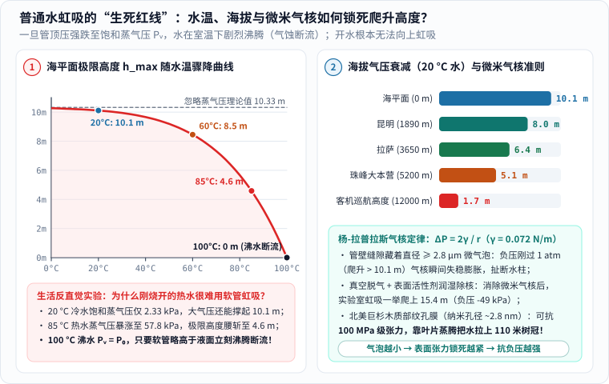
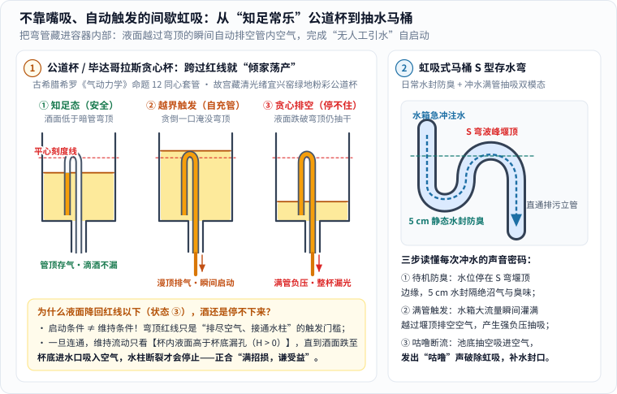
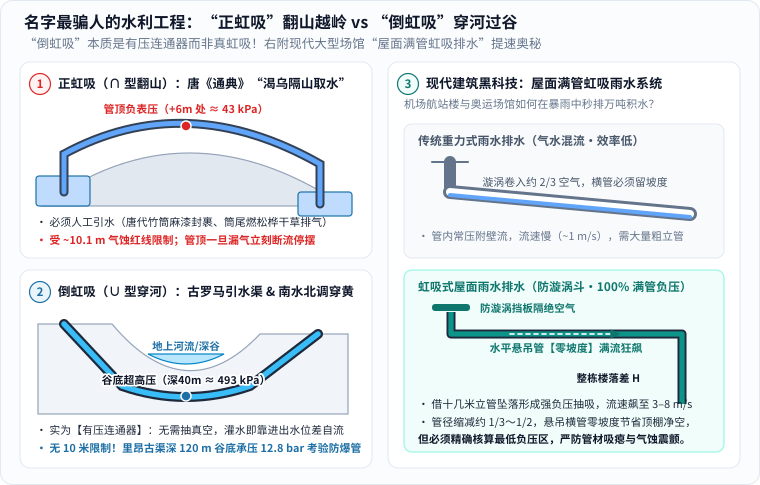

给家里鱼缸换过水的人，大多体验过一种近乎“白嫖物理定律”的快乐：

拿一根软塑料管灌满水，两头拿手指堵紧，一头捅进高处的鱼缸，另一头垂到地上的水桶上方。松开手指的瞬间，奇迹发生了——鱼缸里的水既没有水泵抽吸，也没有通电加压，却老老实实**先逆着重力向上爬升二三十厘米、翻越玻璃缸沿**，接着顺着外侧软管哗哗冲进水桶，直到你把管口拔出水面，或者两边的液面彻底齐平。

如果你去逛故宫博物院，还会在陶瓷馆里见到一只清光绪年间的宜兴窑粉彩**公道杯**（谦受益杯）：酒倒七分满时滴水不漏；只要贪杯多倒几滴、漫过杯心寿星老人的胸口，整杯美酒就会在一声轻响后顺着杯底暗孔**滴酒不剩地漏光**。每天清晨你按下抽水马桶冲水键，听见最后那声干脆的“咕咚”，同样是同一套物理机关在替你把污物彻底抽走。

这就是我们从小听说、却极少有人真正答对底层机制的**虹吸现象**（Siphon）。

别看它用一根几块钱的软管就能演示，围绕“到底是谁把水拉过了最高点”，人类足足吵了两千年——直到 **2010 年**，一位澳大利亚物理学家偶然翻开《牛津英语词典》（*Oxford English Dictionary*），发现这本权威词典对“虹吸”的解释竟然写了整整 99 年的争议答案，由此直接引爆了 2010 年至 2016 年国际物理学界的一连串极限实验：有人把虹吸管塞进了没有空气的超高真空腔，有人用看不见的二氧化碳气体做成了“无液虹吸”，有人开动军用低压舱在等效 1.2 万米高空造出了“管内瀑布”，还有人硬生生打破了教科书里“水虹吸绝对不可能超过 10.33 米”的铁律，搭出了 **15.4 米**高的负压水虹吸！

今天，我们就顺着那根灌满水的弯管，把虹吸现象里的直觉陷阱、数学账本、极限红线与古今工程巧思一层层剥开。

---

## 一、两千年前被戳破的错觉：是因为“外侧管子里的水更重”吗？

面对虹吸管，十个人里往往有八个会给出一个听起来特别顺耳的直觉解释：

> “这还不简单？垂在鱼缸外面的那截管子更长，里面装的水比鱼缸内侧那截短管**总重量更大**。重的一边往下坠，就像拔河一样把轻的那一边拽过来了呗！”

这个比喻实在太像搭在滑轮上的铁链了，以至于两千年前古希腊与罗马的工匠们也普遍这么想。然而早在**公元 1 世纪**，亚历山大港的机械大师**希罗**（Hero of Alexandria）就在传世名著《气动力学》（*Pneumatics*，第 1 命题 *The Bent Siphon*）里，用一个极简的思想实验当场把这个“比总重量”的说法砸得粉碎：

假设我们把虹吸管做成**一粗一细**的不对称怪管——
- 插在高处水箱里的左臂，是一根**内径只有 $2\,\text{毫米}$、高 $50\,\text{厘米}$** 的细长玻璃管，里面装的水总共才 **$1.6\,\text{克}$**；
- 垂在外面的右臂，接上一根**内径 $10\,\text{厘米}$、长 $40\,\text{厘米}$** 的粗壮大圆筒，里面足足灌满了 **$3140\,\text{克}$（6 斤多）** 的水！

按“哪边水更重就往哪边拽”的逻辑，外侧 6 斤多的水岂不是要把内侧 1.6 克的水瞬间猛拽出来？

**恰恰相反！**只要外侧粗筒的下沿开口比水箱里的自由液面**高出哪怕 $5\,\text{厘米}$**（也就是出口高于进口液面），松开封口后，外侧那 6 斤多水不仅拽不动半滴水，反而会被倒推着翻过管顶，**逆流灌回水箱里**，直到粗筒液面跌到与水箱液面齐平为止！

为什么 3140 克水拔河竟然输给了 1.6 克水？因为流体传递的从来不是“总重量”，而是单位面积上的**压强**（$\text{力} \div \text{面积}$）。粗管截面积放大了 $2500$ 倍，水柱总重虽然大了，分摊到每一平方毫米管口上的压强却**只取决于竖直高度 $\rho g h$，与管子粗细和总水量毫无关系**！

---

## 二、分步拆解虹吸账本：水怎么爬上管顶，软管流速为什么远小于自由落体？

既然“比总重”是错觉，那水到底凭什么翻墙？我们把一根内径均匀、灌满 $20^\circ\text{C}$ 清水的虹吸软管放进真实尺度里，按**“先捏住管口看静水压强 → 再松开手指算流动能量”**两步把账算清（先读下图左半侧的 $A\text{–}B\text{–}C\text{–}D$ 四个关键截面，再对照右半侧沿管路展开的绝对压强曲线；图中带单次流线短动画，[点此单独打开 SVG 大图，刷新页面即可重播流线过程](/assets/images/siphon-phenomenon/siphon-anatomy-pressure-and-bernoulli.svg)）：

### 1. 松手前的一瞬间：左右水柱在管顶打了一场“减法仗”

设上池自由液面 $A$ 的高度为基准 $z = 0$，大气压 $P_0 = 101.3\,\text{kPa}$ 均匀压在上池水面上；管顶最高点 $C$ 比上池水面高出 $h_1 = 0.60\,\text{m}$；外侧下出口 $D$ 比上池水面低了净落差 $H = 0.80\,\text{m}$（即从管顶 $C$ 到下出口 $D$ 的总竖直长度是 $h_2 = h_1 + H = 1.40\,\text{m}$）。

现在，我们先**用手指堵死下出口 $D$**，让管里的水静止：

1. **看左半支爬升管**：它底部连着上池。为什么把吸入口往鱼缸深处多捅 $25\,\text{厘米}$，既不会让虹吸变快也不会变慢？因为水下深 $d$ 处的静水压强虽然增大到了 $P_0 + \rho g d$，但水顺着管子爬回液面等高处 $B$（$z = 0$）时，恰好又扣掉了 $\rho g d$，回到 $P_B = P_0$！继续往上爬到管顶 $C$（$z = +h_1$），重力往下拽水柱，左半支在管顶 $C$ 左侧维持的静水压强是：

$$
P_{C,\text{左} } = P_0 - \rho g h_1
$$

2. **再看如果换作堵住管顶、只打开下出口 $D$**：右半支水柱总高达 $h_1 + H$，下出口 $D$ 同样顶着大气压 $P_0$。要想托住右半支水柱不往下掉，管顶右侧所需的平衡压强必须低到：

$$
P_{C,\text{右} } = P_0 - \rho g (h_1 + H)
$$

看到了吗？当你松开手指、左右连通的刹那，管顶左侧压强比右侧平衡值整整高出了：

$$
\Delta P = P_{C,\text{左} } - P_{C,\text{右} } = \rho g H
$$

爬升高度 $h_1$ 在相减时**干脆利落地抵消了**！

- 只要 $H > 0$（出口低于上池自由液面），$\Delta P > 0$，水就必然顺着 $A \to B \to C \to D$ 加速流出；
- 一旦两池水面齐平（$H = 0$），驱动压差归零，虹吸自动停止；
- 如果你把下出口举得比上池水面还高（$H < 0$），$\Delta P < 0$，这就是刚才希罗反例里水倒灌回上池的原因！

### 2. 稳定流动时：为什么真实软管流速只有理想值的三分之一？

松开手指进入稳定流动后，如果假设水完全没有黏性摩擦（理想流体），我们可以对从上池宽阔液面 $A$（流速 $v_A \approx 0$，压强 $P_0$）到下出口自由射流 $D$（射流暴露在空气中，截面压强同样等于 $P_0$）列写我们在[《如何能实现飞行》]()里熟悉的**伯努利方程**：

$$
\begin{aligned}
P_0 &= P_0 + \frac{1}{2}\rho v_{\text{ideal} }^2 - \rho g H \\
\implies v_{\text{ideal} } &= \sqrt{2 g H}
\end{aligned}
$$

这正是托里拆利定律（也和[《摆线为什么绕远路反而先到》]()里无摩擦滑落的速率公式一模一样）：落差 $H = 0.80\,\text{m}$ 时，理想出水速度高达 $v_{\text{ideal} } = \sqrt{2 \times 9.81 \times 0.80} \approx \mathbf{3.96\,\text{m/s} }$！

但你拿家里换水用的透明软管（比如内径 $d = 12\,\text{mm}$、总长 $L = 3.0\,\text{m}$）实测一下就会发现：水流根本没有每秒近 4 米那么猛，实测流速只有 **$1.29\,\text{m/s}$** 左右（每分钟出水约 $8.7\,\text{升}$），动能连理想值的九分之一都不到！那另外 **$89\%$** 的重力势能去哪儿了？

答案是：**全被管壁剪切摩擦和弯头涡流“吃掉”变成了微弱的热量**。在真实流体力学中，必须使用包含达西-魏斯巴赫（Darcy–Weisbach）沿程摩阻与局部损失的**扩展伯努利方程**：

$$
\begin{aligned}
\rho g H &= \frac{1}{2}\rho v^2
\left(1 + \sum K + f\frac{L}{d}\right) \\
\implies v &= \sqrt{\frac{2 g H}{1 + \sum K + f L / d } }
\end{aligned}
$$

这里每一个符号都有明确的物理含义：
- $f$ 是无量纲**沿程摩擦系数**（对内径 $12\,\text{mm}$ 的光滑软管，雷诺数 $\text{Re} = \rho v d / \mu \approx 1.5\times 10^4$ 处于湍流区，$f \approx 0.028$）；
- $L / d = 3.0 / 0.012 = 250$ 是**长径比**——管子越细、拖得越长，$f L / d$ 这一项就急剧膨胀（本例中 $f L / d = 7.0$，相当于动能头的 $7$ 倍！）；
- $\sum K \approx 1.5$ 是管口突缩吸水和两个大弯头造成的**局部涡流损失系数**。

三项相加，分母变成了 $\sqrt{1 + 1.5 + 7.0} = \sqrt{9.5} \approx 3.08$，于是真实流速稳稳落在 $3.96 \div 3.08 \approx \mathbf{1.29\,\text{m/s} }$！这也顺手揭开了上图右侧压强曲线里一个令很多工科生恍然大悟的反直觉现象：

- **理想无摩擦时**，水飞速冲过管顶 $C$，位置势能损失 $\rho g h_1$（$5.87\,\text{kPa}$）加上巨大的动能抽吸 $\frac{1}{2}\rho v_{\text{ideal} }^2 = \rho g H$（$7.83\,\text{kPa}$），会把管顶绝对压强一口气拉低到 **$87.6\,\text{kPa}$**；
- **真实细长软管里**，下游整整两米长的管壁摩擦像踩住了刹车，把全管流速限制在 $1.29\,\text{m/s}$，因此管顶 $C$ 的真实绝对压强反而温和得多，停在 **$91.9\,\text{kPa}$**！

换句话说：**在虹吸管出口适当缩口或增加下游阻力，反而能抬高管顶压强、防止管顶低压沸腾断流**——这正是大型水利泄洪虹吸道里常用的防气蚀绝招。

### 3. 顺手解开一个日常小困惑：为什么不能拿消防粗管悬空做虹吸？

既然流速看落差和摩阻，那换成一根内径 $10\,\text{厘米}$ 的粗管悬在半空做自由出口虹吸，岂不是几秒钟就能抽干鱼缸？

真试过的人会发现：粗管口一悬空松手，“咕噜”钻进一个大空气泡直冲管顶，水哗啦一下从两头各自退回，虹吸当场夭折！

这是因为悬空出口处，向下的水流和想往管里钻的浮力气泡（流体力学称为**泰勒气泡，Taylor Bubble**）正在打架。定义表面张力与重力之比的**邦德数**（Bond number）为 $\text{Bo} = \rho g D^2 / \gamma$：
- 当管内径极细（对常温水 $D \lesssim 5\,\text{mm}$，对应 $\text{Bo} \lesssim 3.4$）时，水的表面张力 $\gamma$ 足以像绷紧的橡皮膜一样箍住管口弯月面，空气根本钻不进去；
- 一旦管径变粗（$D > 1\,\text{cm}$），表面张力锁不住管口，就必须靠足够猛的出水流速（弗劳德数 $\text{Fr} = v / \sqrt{g D} \gtrsim 0.5$）把企图逆流的气泡冲出去——或者干脆像工程上那样，**把下出口也浸没在下池水面以下做“水封”**，彻底断绝空气倒灌的后路。

---

## 三、引爆全球物理圈的《牛津词典》公案：到底是大气压“推”上去，还是分子链条“拉”上去？

看懂了压强曲线：管顶 $C$ 低于大气压，上池水面顶着大气压。那么问题来了——**把水送上管顶的功臣，究竟是外面的大气压“推泵”，还是水分子手拉手的“内聚力链条”？**

2010 年 5 月，澳大利亚昆士兰科技大学物理学家斯蒂芬·休斯（Stephen Hughes）在查阅《牛津英语词典》（OED）时惊讶地发现，自 **1911 年**词条编写以来，这部权威词典一直明确写道：虹吸管是靠**大气压**（atmospheric pressure）推动液体爬过最高点的。

休斯随即公开发文抗议，认为词典写错了将近一百年！他的理由听起来同样铿锵有力：虹吸的本质是重力拉动下游较长的水柱，再通过液体分子的氢键**内聚力**（cohesion）像铁链翻过滑轮一样把上游的水“拉”上来——否则你怎么解释科学家已经在真空里做出了虹吸？

谁也没想到，这场“词典纠错”迅速演变成《物理教育》《化学教育》《科学报告》等期刊上一场横跨六年的实验擂台赛。支持“分子链条说”与支持“大气压推动说”的物理学家和化学家们谁也不服谁，干脆各自设计出了四组把物理条件推向极致的判决实验（见下图）：

### 实验一：抽干全部空气——高真空里的离子液体虹吸（2011）

如果大气压是虹吸必不可少的动力，那把空气抽光（$P_0 \approx 0$），虹吸必定立刻停摆。普通水在真空里会瞬间沸腾成水蒸气，无法测试；于是英国诺丁汉大学团队（Boatwright, Puttick & Licence, 2011）换用了一种常温下几乎完全不挥发、蒸气压接近绝对零的**离子液体**，放进高真空腔室里。

结果毫不含糊：**在完全没有大气压的真空里，离子液体依然稳稳爬过弯管最高点，完成了虹吸！**这直接证明：大气压并不是虹吸在宇宙中存在的绝对前提，液体分子间的内聚抗拉强度完全可以独自充当跨过管顶的“传力链条”。

### 实验二：砍断分子链条——二氧化碳“无液虹吸”与气泡断链虹吸（2011）

“链条派”还没来得及宣布全胜，“气压派”立刻回敬了两记漂亮的反杀：

1. 美国卡尔顿学院化学家拉梅特父子（Ramette & Ramette, 2011）干脆**连液体都不用了**——他们在高处烧杯里装满比空气重约 $1.5$ 倍的**二氧化碳气体**（$\text{CO}_2$），用一根预先充满 $\text{CO}_2$ 的弯管翻出杯口垂向低处。气体分子间隔极远，**分子间内聚抗拉强度严格为零**，根本不可能“手拉手”；但红外成像与酸碱指示剂清晰显示，$\text{CO}_2$ 照样翻越最高点源源不断虹吸到了低处烧杯！
2. 同年，夏威夷大学希洛分校的里歇特与宾德（Richert & Binder, 2011）设计了“气泡断链虹吸”：在透明水虹吸管的起点故意注入一团大气泡，把上下游水柱**彻彻底底截成互不接触的两段**，水分子链条完全断裂。结果气泡翻过管顶时只是略微膨胀降压，后面的上游水柱照样在外部大气压的推举下紧跟着爬过管顶，虹吸全程没有中断！

### 实验三：飞上 1.2 万米高空——低压舱里的“管内瀑布”（2014）

为了看清大气压退场时虹吸究竟怎样一步步“死去”，引发争论的休斯本人（Hughes & Gurung, *Scientific Reports*, 2014）把一套管顶高 $1.52\,\text{m}$ 的水虹吸装置搬进了澳大利亚国防军的大型**低压舱**（模拟高空稀薄大气）：

- 从海平面（$101.3\,\text{kPa}$，流量 $5.6\,\text{L/min}$）一路抽气升到等效海拔 $10000\,\text{米}$ 的过程中，流量几乎纹丝不动——说明日常气压波动并不改变驱动力 $\rho g H$；
- 当气压降到等效 **$40000\,\text{英尺}$（约 $12.2\,\text{公里}$，$P_0 = 18.75\,\text{kPa}$）** 时，理论防沸腾高度跌到了 $1.57\,\text{m}$。此时管顶的水开始剧烈室温沸腾（气蚀），在下游管段顶部形成了一道长约 **$41\,\text{厘米}$ 的管内自由落体“瀑布”**！奇妙的是，尽管下游水柱已经被水蒸气腔截断，左臂仍在外部残余气压推动下以 **$4.11\,\text{L/min}$** 的流量源源不断翻过管顶跌入“瀑布”；
- 直到气压进一步跌破阈值（降至 $41000\,\text{英尺}$，$17.87\,\text{kPa}$），水柱才彻底从管顶向两侧退缩，**一分为二变成两支背靠背的托里拆利水银式气压计**！而当研究人员重新往舱里放气升压时，两边水柱又自动爬升到管顶重新会合，虹吸当场复活！

### 实验四：打破 10.33 米铁律——15.4 米绝对负压水虹吸（2015–2016）

既然纯水分子间的氢键理论抗拉强度高达上百个大气压，为什么日常水虹吸一过 10 米就断？因为自来水里溶满了肉眼看不见的微米级空气核！

- **2015 年**，诺丁汉大学与休斯合作（Boatwright, Hughes & Barry, *Scientific Reports*, 2015），将水在高真空下深度脱气并覆盖硅油隔绝空气，成功建起了高达 **$15.04 \pm 0.02\,\text{米}$** 的连续水虹吸，管顶水处在 **$-47.4\,\text{kPa}$** 的**绝对负压**（像拉紧的橡皮筋一样承受张力，而非正压强！）下持续流动了 14 分钟；
- **2016 年**，智利天主教大学维拉团队（Vera et al., *PLOS ONE*, 2016）更进一步，在 $3\,\text{升}$ 普通自来水里滴入 **$3\,\text{毫升}$ 洗碗机表面活性剂**（将表面张力降至纯水的 $63\%$，促使管壁缝隙里的微气核全部浮出排净）并静置脱气 2 小时，搭出了创纪录的 **$15.4\,\text{米}$** 水虹吸（管顶绝对压强 **$-49.4\,\text{kPa}$**），不仅稳定运行了 $224\,\text{秒}$，中途互换上下水桶高度还能顺畅反向虹吸！

### 百年争论的终极合流：分清“发动机”和“传动轴”

四组实验摆在一起，百年争论终于水落石出——**两派当年之所以吵翻天，是因为把“提供能量的发动机”和“跨过管顶传递动量的传动轴”混为一谈了**：

1. **唯一的能量发动机永远是【重力】**：无论在深海高压、海平面还是超高真空，只要没有进出口液面高度差（$H \le 0$），任何液体或气体都休想自己往外流半滴；整个系统消耗的都是高处流体降到低处释放的引力势能。
2. **跨过管顶的“传动桥梁”则有两条并行通道**：
   - 在**日常含气自来水、鱼缸换水、抽油以及气体虹吸**里，管顶绝对压强始终大于零（$0 < P_C < P_0$），液体内部处于**受压态而非受拉态**——此时完全是**外部环境大气压**托举着上游液体紧贴下游液柱不脱节，《牛津英语词典》对日常虹吸的描述并没有冤枉大气压！
   - 而在**真空腔室或超过 $10.3\,\text{米}$ 的深度脱气水虹吸**里，管顶压强跌破绝对零点变成负值（$P_C < 0$），大气压已经不够托到管顶，剩余的那几米就完全靠**液体分子间的内聚抗拉力**硬生生“拽”过最高点！

---

## 四、普通水虹吸的“生死红线”：为什么开水没法虹吸，拉萨最高只能抽 6.4 米？

回过头看我们身边的普通自来水、河水或茶水——它们既没有经过实验室真空脱气，管壁也布满微小划痕与气核。一旦管顶绝对压强 $P_C$ 跌到水在当前温度下的**饱和蒸气压 $P_v(T)$**，水根本不需要加热到 $100^\circ\text{C}$，就会在室温下瞬间沸腾气化（工程上称为**空化／气蚀，Cavitation**），大量水蒸气与析出空气泡聚在管顶形成“气锁”（Vapor Lock），把连续水柱一刀斩断！

由此就能推导出普通含气液体虹吸管顶的最大爬升高度公式：

$$
\begin{aligned}
P_C &= P_0 - \rho g h_1 \\
&\quad - \frac{1}{2}\rho v^2
\left(1 + K_{\text{up} } + f\frac{s_C}{d}\right) \\
h_{1,\max} &= \frac{P_0 - P_v(T)}{\rho(T)\, g }
- \Delta h_{\text{摩阻} }
\end{aligned}
$$

即使在流速趋近于零的静力极限下，最大爬升高度 $h_{\max} = \frac{P_0 - P_v(T)}{\rho(T)\,g }$ 也绝不是中学课本常背的死数字“$10.33\,\text{米}$”，而是随着**水温**和**海拔**剧烈跳水（对照下图左右两栏真实热力学计算曲线）：

1. **水温越高，蒸气压呈指数暴涨，虹吸上限断崖下跌**：
   - 在海平面 $0^\circ\text{C}$ 冰水下，$P_v \approx 0.61\,\text{kPa}$，理论极限高达 **$10.28\,\text{米}$**（中学课本的 $10.33\,\text{米}$ 其实是完全忽略了水蒸气压的“干真空”近似值）；
   - 到了常温 **$20^\circ\text{C}$**，$P_v \approx 2.34\,\text{kPa}$，静力极限降到 **$10.1\,\text{米}$**（实际工程扣除流速头与管壁析气余量，通常限制在 **$7\text{–}8\,\text{米}$** 以内）；
   - 水温升到 **$60^\circ\text{C}$** 时跌至 **$8.5\,\text{米}$**；升到 **$85^\circ\text{C}$** 时只剩 **$4.6\,\text{米}$**；
   - **当你试图虹吸刚烧开的 $100^\circ\text{C}$ 沸水时**，饱和蒸气压 $P_v = 101.3\,\text{kPa} = P_0$，分子直接变成 $0$，**$h_{\max} = 0\,\text{米}$**！哪怕弯管只比水面高出几厘米，热水刚一爬升减压就剧烈沸腾吐泡，瞬间断流！（同理，汽油的饱和蒸气压远高于水，夏天高温下抽吸汽油极易发生“气阻”断流，更严禁用嘴吸——误吸一口挥发汽油蒸气进肺就可能引发致命化学性肺炎。）

2. **海拔越高，头顶大气压 $P_0$ 越薄，虹吸越“腿短”**：
   同样是 $20^\circ\text{C}$ 常温冷水，海平面能爬 **$10.1\,\text{米}$**；到了春城**昆明**（海拔 $1890\,\text{m}$）降为 **$8.0\,\text{米}$**；到了日光城**拉萨**（$3650\,\text{m}$）只剩 **$6.4\,\text{米}$**；到了**珠峰大本营**（$5200\,\text{m}$）仅剩 **$5.2\,\text{米}$**！

3. **顺手解开植物学之谜：百米红杉凭什么不受 10 米限制？**
   我们在[《植物春天开花的能量来源》]()与[《红星二锅头的酿造技艺与味道密码》]()里都见过界面表面张力 $\gamma$ 的威力。根据**杨-拉普拉斯方程**（Young–Laplace equation），一颗直径为 $d$ 的微小气核要想在负压张力 $\Delta P$ 下失稳膨胀成破坏水柱的大气泡，必须跨过表面张力筑起的门槛：

$$
\Delta P_{\text{临界} } = \frac{4\gamma}{d}
$$

   对常温水（$\gamma \approx 0.072\,\text{N/m}$），只要水中藏着直径大于 **$2.84\,\text{微米}$** 的气核，区区 $1\,\text{个大气压}$ 的负压就能把它吹爆断流；但百米高的北美红杉与杏仁桉，并不是靠树顶向下“虹吸”，而是靠叶片蒸腾配合木质部导管纹孔膜上直径仅约 **$2.8\,\text{纳米}$**（缩小了一千倍！）的纤微孔隙死死卡住外部空气，能扛住高达 **$100\,\text{MPa}$（约 $1000\,\text{个大气压}$）** 的负压张力而不气蚀，稳稳把地下水抽上百米树冠！

---

## 五、不吸气也能自己启动！从公道杯、索氏提取器到抽水马桶的“间歇自启动虹吸”

普通鱼缸换水最麻烦的一步是“引水灌管”——管里原本全是空气，必须先灌满水或捏气囊抽气才能启动。那么，有没有一种聪明结构，**不用人去吸气灌水，只要水位涨过一条红线就自动开启虹吸，而且不把整杯水抽干绝不停手**？

有！这就是机械史与化学实验室里最精妙的无源自动开关——**间歇自启动虹吸**（Intermittent / Bell Siphon，也称同心套管虹吸或贪婪杯结构）。我们结合三阶段液位剖面图，一次看懂它的机关：

1. **阶段 ① 知足不漏（安全蓄水，$y < y_{\text{顶} }$）**：
   杯子中央藏着一根暗通杯底漏孔的倒 U 形弯管（或“内立管 + 外扣钟罩”同心双层管，进水小孔开在最贴近杯底的位置）。倒酒或蓄水时，液面沿着夹层同步上升，但因为还没漫过内管最高弯顶 $y_{\text{顶} }$，管顶封着一团空气，水绝对流不进中央排液管，此时滴水不漏。

2. **阶段 ② 贪心越界（漫顶自启动，$y > y_{\text{顶} }$）**：
   只要再多倒几滴液体，让液面哪怕刚刚漫过弯管内顶 $y_{\text{顶} }$，液体立刻翻过弯顶顺着中央竖管急速坠落！由于这个隐藏暗管内径通常只有几毫米，高速下坠的液柱像活塞一样把弯管顶部的残余空气一扫而空，瞬间填满整条管道——**不需要任何外力抽气，虹吸自动点火成功**！

3. **阶段 ③ 一泄到底（排空断流，$y \to y_{\text{底} }$）**：
   这才是最绝的一步：很多人以为液面一跌回警戒线 $y_{\text{顶} }$ 以下就会停止漏水——**错！**一旦管路被液体充满，决定虹吸存亡的就不再是弯顶高度，而是**杯内液面与杯底外出口之间的总高差**！只要杯底夹层进水小孔还泡在液体里，哪怕液面早已跌到杯底，虹吸也会毫不留情地把整杯液体抽得干干净净，直到液面跌破最底部的进水孔、空气钻入管顶打破真空，才会彻底复位等待下一轮蓄水。

认准这“三步曲”，你会发现东西方两千年的四件名器竟然是血脉相连的亲兄弟：

- **古希腊与中国的“戒贪酒器”**：在西方，它叫**毕达哥拉斯贪婪杯**（Pythagoras Cup），最早的严谨机械图解见于公元 1 世纪希罗《气动力学》第 2 命题（同心套管虹吸）与第 12 命题（坦塔罗斯杯）；在中国，宋代文人行酒令时已流行同类机关杯，明代传说更衍生出朱元璋赐宴功臣的“九龙杯／公道杯”故事。故宫博物院馆藏的**清光绪宜兴窑绿地粉彩公道杯**（高 $6\,\text{cm}$、口径 $12\,\text{cm}$），杯心圆柱内还巧妙加装了一枚随酒液浮起的瓷塑寿星老人，刚好用寿星胸口标示隐藏弯管最高点，“知足者酒存，贪心者全漏”。
- **化学家的全自动萃取神器——索氏提取器（Soxhlet Extractor，1879）**：德国化学家弗朗茨·冯·索氏（Franz von Soxhlet）为测定牛奶脂肪含量发明的玻璃仪器。下方烧瓶里的少量有机溶剂受热蒸发、在顶部冷凝后一滴滴落入装有样品的萃取室；每当溶剂积满漫过侧边细玻璃虹吸管顶端，就自动把整室富含萃取物的溶液一次性抽回烧瓶重蒸——仅靠几十毫升溶剂就能自动循环几十次，把固体里的目标成分榨干取净！
- **每家每户每天都在用的——虹吸式抽水马桶**：蹲在马桶侧面看一眼底座轮廓，你会发现里面浇筑着一条弯弯曲曲的 **S 形排污弯道**。平时弯道低谷存着约 **$5\,\text{厘米}$ 深的水封**，严严实实挡住下水道的臭气与病菌；当你按下冲水键，水箱与喷射孔在两三秒内猛灌入大量急流，排污流量瞬间超过 S 弯顶部的自然溢流能力，把 S 弯管顶彻底灌满封死——强大的满管虹吸瞬间建立，把污物连同整条水柱“嗖”地抽进主排污立管！排空末端空气涌入发出标志性的“咕咚”声打断虹吸，随后补水管缓缓注入清水，重新恢复那 $5\,\text{厘米}$ 的防臭水封。（全自动洗衣机的**柔顺剂盒**为什么倒进去时不流、最后一遍漂洗进水漫过盒内小帽管时才一次性吸干？连大自然喀斯特溶洞里每隔几十分钟准时涨落的**间歇泉／潮泉**，背后全都是同一个间歇虹吸方程！）

---

## 六、从东汉“渴乌”、唐代“过山龙”到南水北调：看懂“正虹吸”与“倒虹吸”的天壤之别

把视线从杯子和卫生间拉向高山大河，虹吸在人类水利工程史上还留下了两段极易混淆、物理本质却截然相反的传奇（对照下图上下两栏）：

### 1. 中国古代“渴乌”与唐代火烧引水“过山龙”

翻开《后汉书·宦者列传·张让传》，记载东汉灵帝**中平三年（公元 186 年）**，掖庭令**毕岚**铸造铜人、铜钟之余，“**又作翻车、渴乌，施于桥西，用洒南北郊路，以省百姓洒道之费**”。唐代章怀太子李贤在注文中解释道：“**渴乌，为曲筒，以气引水上也。**”

需要严谨区分的是，正如中国科学院自然科学史研究所吴伟等学者的考证，“渴乌”在汉唐文献中早期曾兼指多种弯曲引水筒或漏刻构件；但到了**唐德宗贞元十七年（公元 801 年）**杜佑撰成的政书《通典·卷一百五十七·兵十》，里面记载的军中“**渴乌隔山取水**”（宋代《武经总要》进一步发展为“**过山龙**”），则是一份细节严丝合缝、百分之百标准的**大型跨山正虹吸工程手册**：

- **选材与气密**：取大竹筒打通竹节，首尾相接，接口处用麻布缠紧并反复涂刷生漆——古人非常清楚，管顶处于低压抽吸区，哪怕漏进一丝空气都会导致气锁断流；
- **水封与火引排气**：将进水端探入山涧水面以下五尺深；怎么把几十米长竹管里的空气排空启动呢？《通典》写下了极具巧思的**热力引水法**——在竹管高处或尾端留出排气孔，点燃松桦干草加热驱赶管内空气，待管内空气受热膨胀逸出后迅速封死气孔，冷却收缩形成的低压便配合外部大气压一举将涧水吸过山脊，源源不断引入军营！

### 2. 千万别被名字骗了：“倒虹吸”其实根本不是虹吸！

开车经过南水北调中线干渠，或是翻看古罗马高卢引水渠史料时，你常会看到写着“某某河**倒虹吸**工程”（Inverted Siphon）的巨型标志牌。很多人望文生义，以为它也是靠负压抽吸过河——**恰恰相反，倒虹吸在物理学上根本没有负压虹吸效应，而是一座彻头彻尾的高压连通器！**

我们把**正虹吸**（∩ 形翻山）和**倒虹吸**（U 形穿河）放在一起一比就明白：

| 对比维度 | 正虹吸（True Siphon，∩ 形向上拱起） | 倒虹吸（Inverted Siphon，U 形向下潜伏） |
| :--- | :--- | :--- |
| **管路走向与适用场景** | **向上翻越**矮山脊、堤坝、水箱壁或屋顶挡墙 | **向下钻过**地上河流、铁路、公路或深邃峡谷 |
| **管路极值点压强状态** | 最高点低于大气压（**$P_{\min} < P_0$，负表压抽吸**） | 最低谷远高于大气压（**$P_{\max} = P_0 + \rho g h_{\text{深} } > P_0$，高压受撑**） |
| **是否有 10 米高度红线** | **有！**受饱和蒸气压气蚀严格限制（常温水约 $10.1\,\text{m}$） | **完全没有！**潜深百米照样通水（只要管壁扛得住内压） |
| **启动条件与致命隐患** | 必须预先排气灌水；最怕**管顶漏气、气蚀断流与外压压瘪** | 进水即自流，无需抽真空；最怕**高压爆管与谷底泥沙淤积** |

早在古罗马时期，里昂引水渠为了跨越深达 **$120\,\text{米}$** 的河谷，工匠们放弃了难以架设百米高石拱渡槽的方案，改用多排并列的厚壁铅管顺着山坡下潜过谷再爬上对岸——谷底管壁承受着高达 **$1.2\,\text{MPa}$（约 $12\,\text{个大气压}$）** 的惊人正水压！

而在现代中国**南水北调中线工程**中，渠道途经河北石家庄遇上宽阔汹涌的滹沱河，工程师们在河床底下建起了气势恢宏的**滹沱河倒虹吸工程**：主体采用 $3$ 孔钢筋混凝土箱涵潜入河底，管身长 **$2225\,\text{米}$**（轴线全长 $2993.64\,\text{米}$），设计流量高达 **$85\,\text{立方米/秒}$**，仅凭进出口渠道之间精心分配的 **$0.884\,\text{米}$** 水头落差，就让千里丹江水在河底高压暗涵中安静地“钻河而过”！

### 3. 机场巨型穹顶下的现代魔法：虹吸式屋面雨水排放系统

既然正虹吸规矩这么多，现代建筑还在用它吗？不仅在用，而且用在了你每次坐高铁、赶飞机时头顶那片几万平方米的流线型巨型屋顶上！

传统楼房阳台落水管采用的是“重力流排水”：雨水夹杂大量空气只占满管径的约 $1/3$，横管必须留出 $1\%\text{–}3\%$ 的倾斜坡度才能慢吞吞流走。如果把这套老办法搬到首都机场航站楼或大型体育场几百米宽的平屋顶上，光是留坡度就会占掉好几米宝贵的室内净高，还得在地面戳满密密麻麻的粗立管。

现代**虹吸式屋面雨水排放系统**（Siphonic Roof Drainage）只改动了一个关键部件——在屋面雨水斗入口装上精巧的**防涡流挡板**：
- 小雨时，它和普通雨水斗一样按重力慢流；
- 一旦暴雨倾盆、屋面积水淹没雨水斗设计水位，防涡流挡板立刻切断空气漩涡吸入，让进入悬吊管与立管的雨水瞬间变成 **$100\%$ 满管无气泡纯水柱**！
- 几十米高的竖直立管水柱轰然下坠，瞬间拉起全屋顶管网的强劲负压虹吸：管内流速从传统重力流的 $1\,\text{m/s}$ 飙升到 **$3\text{–}8\,\text{m/s}$**，不仅管径大幅缩细、排水能力暴涨数倍，连天花板下长达上百米的水平悬吊总管都可以做到**完全水平（零坡度）铺设**！

---

## 七、三句话带走虹吸的全部精髓

下次再看到鱼缸里的水乖乖翻过玻璃缸沿，或是听见抽水马桶那声干脆的“咕咚”，你可以把两千年的物理故事浓缩成三句底牌：

1. **谁在提供能量？永远是重力落差 $H$**——不是外侧管子水更重，也不是无中生有的永动机；只要出口液面低于上池自由液面（$H > 0$），引力势能就是唯一的引擎，而管内摩擦吃掉了家庭软管里近九成的势能。
2. **谁把水带过最高点？日常靠大气压“托举”，极限靠分子氢键“硬拽”**——在 $10.1\,\text{米}$（常温海平面）以内和气体虹吸里，正气压差足以防止液柱脱节；一旦抽成真空或挑战 $15.4\,\text{米}$ 超高水虹吸，脱气水分子间的内聚抗拉强度就会接棒承受绝对负压。
3. **怎样驯服虹吸？管住气泡就能上天入地**——用 $2.8\,\text{微米}$ 以下的无核环境能突破十米红线，用弯顶溢流能做成公道杯与抽水马桶的无电自动开关，而分清“管顶负压的正虹吸”与“谷底高压的倒虹吸”，正是两千年水利工程最凝练的物理智慧。

---

## 参考资料与核查来源

1. **亚历山大港的希罗（Hero of Alexandria，约公元 1 世纪）**：*The Pneumatics of Hero of Alexandria*（Bennet Woodcroft 编，1851 年英译本，[Project Gutenberg #77400 全文](https://www.gutenberg.org/files/77400/77400-h/77400-h.htm)）。核查第 1 命题（*The Bent Siphon*，第 11–14 页，提出细长内管与粗短外管反例证明液面高差 $H$ 而非外管水体总重决定流向）、第 2 命题（同心套管虹吸）、第 5 命题（虹吸管抽气启动器）及第 12 命题（坦塔罗斯／毕达哥拉斯间歇虹吸杯）。
2. **Vera, F., Rivera, R., Romero-Maltrana, D., & Villanueva, J. (2016)**：*Negative Pressures and the First Water Siphon Taller than 10.33 Meters*, **PLOS ONE**, 11(4): e0153055（[PMC4824372 开放获取全文](https://pmc.ncbi.nlm.nih.gov/articles/PMC4824372/)）。核查脱气水加表面活性剂搭建 **$15.4\,\text{m}$** 水虹吸实验数据（管顶绝对压强约 $-49.4\,\text{kPa}$、稳定运行与双向换向 $224\,\text{s}$），以及真空离子液体虹吸与二氧化碳气体虹吸的统一力学综述。
3. **Boatwright, A., Hughes, S., & Barry, J. (2015 / 2017)**：*The height limit of a siphon*, **Scientific Reports**, 5: 16790（[PMC4667279 全文](https://pmc.ncbi.nlm.nih.gov/articles/PMC4667279/) 及 [2017 年勘误说明 PMC5411809](https://pmc.ncbi.nlm.nih.gov/articles/PMC5411809/)）。核查深度真空脱气水 **$15.04 \pm 0.02\,\text{m}$** 虹吸实验（环境气压 $99.8\,\text{kPa}$、管顶负压约 $-47.4\,\text{kPa}$）、杨-拉普拉斯微气核临界直径计算（$1\,\text{atm}$ 下约 $2.84\,\mu\text{m}$，树木木质部 $2.8\,\text{nm}$ 纹孔膜对应约 $100\,\text{MPa}$）等关键数据。
4. **Hughes, S. W., & Gurung, S. (2014)**：*Exploring the boundary between a siphon and barometer in a hypobaric chamber*, **Scientific Reports**, 4: 4741（[PMC3994459 全文](https://pmc.ncbi.nlm.nih.gov/articles/PMC3994459/)）。核查 $1.52\,\text{m}$ 水虹吸在军用低压舱升至 $40000\,\text{ft}$（$18.75\,\text{kPa}$）时出现 $41\,\text{cm}$ 管内气蚀瀑布（流量 $4.11\,\text{L/min}$）、$41000\,\text{ft}$（$17.87\,\text{kPa}$）分裂为背靠背气压计及升压自动重连数据；并追溯作者 2010 年《物理教育》（*Physics Education* 45: 162）引发的《牛津英语词典》虹吸词条大讨论。
5. **中国科学院自然科学史研究所 · 吴伟**：《渴乌是虹吸管吗？——小析古代引水器具渴乌》（[中科院农史室学术专栏原文](http://agri-history.ihns.ac.cn/scholars/wuwei1.htm)）。核查《后汉书·宦者列传·张让传》中平三年（186 年）毕岚作“翻车、渴乌”及李贤注原文、早期“渴乌”多义性辨析，以及唐代杜佑《通典·卷一百五十七·兵十》“渴乌隔山取水”竹筒麻漆密封与火烧排气引水法。
6. **故宫博物院数字文物库**：《宜兴窑绿地粉彩公道杯》（清光绪，新00156650，[故宫博物院官方藏品页](https://www.dpm.org.cn/collection/ceramic/227003.html)）。核查藏品尺寸（高 $6\,\text{cm}$，口径 $12\,\text{cm}$）、杯心寿星浮标与底部暗孔间歇虹吸排空构造及宋代酒令渊源。
7. **中央网信办／南水北调工程纪实报道**：《“潜龙”静卧滹沱河——探访南水北调中线滹沱河倒虹吸工程》（[中央网信办转载官方工程报道](https://www.cac.gov.cn/2018-06/03/c_1122930361.htm)）。核查滹沱河倒虹吸 3 孔钢筋混凝土箱涵、管身长 $2225\,\text{m}$（轴线长 $2993.64\,\text{m}$）、设计流量 $85\,\text{m}^3/\text{s}$ 与分配水头损失 $0.884\,\text{m}$ 等实测工程参数。
