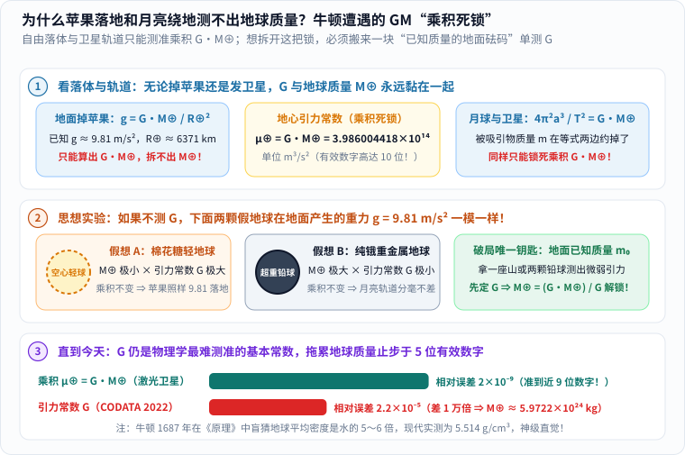
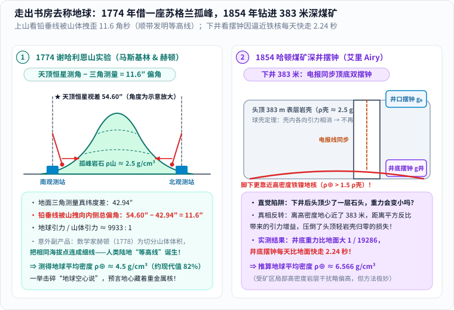
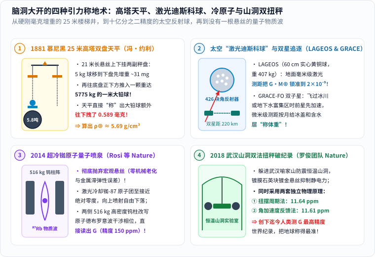
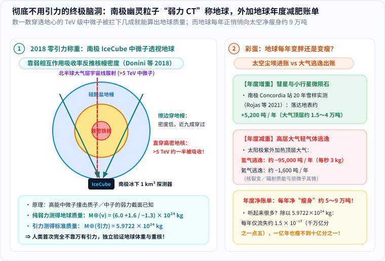

打开任何一本中学地理或物理课本，你都能翻到一行写得明明白白的数字：

> **地球质量 $$M_\oplus \approx 5.9722 \times 10^{24}\text{ kg}$$**——也就是将近 **60 万亿亿吨**（$$5.9722 \times 10^{21}$$ 吨，[NASA 地球参数档案](https://nssdc.gsfc.nasa.gov/planetary/factsheet/earthfact.html)）。

可只要合上书稍微想一秒，一个朴素得让人发懵的问题就会冒出来：**谁去称的？拿什么秤称的？**

平时我们在菜市场买条鱼、在家里量体重，靠的是地球把物体往下拽、挤压弹簧或压电传感器读出“重量”。可地球自己就飘在茫茫宇宙里，脚底下既没有地板，更塞不进一台行星级电子秤。更要命的是，正如我们在[《空间站为什么会失重》]()里聊过的，整颗地球正以每秒约 $$29.78\text{ km}$$ 的速度绕着太阳做无支承自由落体运动——真要拿一把假想弹簧秤挂在地球轨道上，地球处于完全失重状态，示数只会是**零**！

因此，物理学家口中流传了三百年的浪漫说法——**“给地球称重（Weighing the World）”**，测量的其实不是日常语境里随重力变化的“视重”，而是地球这颗蓝色大球一共攒下了多少物质，即**地球的质量 $$M_\oplus$$**。

既然早在古希腊时代，埃拉托斯特尼就用两座城市的日影夹角算出了地球周长，17 世纪法国天文学家让·皮卡尔（Jean Picard）又用三角测量把地球平均半径精确到了 $$R_\oplus \approx 6{,}371\text{ km}$$，地球的总体积早就不是秘密：

$$V_\oplus = \frac{4}{3}\pi R_\oplus^3 \approx 1.0832 \times 10^{21}\text{ m}^3$$

于是，“给地球称重”等价于一个让牛顿抓耳挠腮的问题：**地球的平均密度 $$\bar{\rho}_\oplus$$ 到底是水的几倍？我们脚下几千公里深处，究竟像早期空心地球派幻想的那样是个巨大的空壳，还是塞满了一颗比花岗岩重得多的实心铁球？**

今天，我们就顺着科学史上最精彩的一条破案链，看看人类怎样先用**万有引力**撬开牛顿留下的“乘积死锁”，又发明出**借大山、下煤矿、搭高塔、打激光、抛冷原子、甚至完全不用万有引力的南极幽灵粒子透视**等七大奇招，把脚下这颗星球的家底称得明明白白。

---

## 一、牛顿遭遇的“乘积死锁”：为什么掉苹果和看月亮都称不出地球？

很多人第一反应会觉得：牛顿在 1687 年出版《自然哲学的数学原理》时，不是已经写出了万有引力定律吗？既然苹果落地和月亮绕地球转都归地球引力管，顺手代进公式不就算出地球质量 $$M_\oplus$$ 了吗？

还真算不出来！不信我们现场列两个最简单的式子试试看。

**第一条路：拿秒表测地面苹果自由落体。**  
一颗质量为 $$m$$ 的苹果在地球表面受到的地球引力，等于苹果质量乘以地面重力加速度 $$g \approx 9.81\text{ m/s}^2$$（暂略去极微小的地球自转离心修正）：

$$m g = \frac{G M_\oplus m}{R_\oplus^2} \implies g R_\oplus^2 = G M_\oplus$$

看清楚发生什么了吗？苹果自己的质量 $$m$$ 在等号两边**消得干干净净**！哪怕你把 $$g$$ 和地球半径 $$R_\oplus$$ 测得再准，你算出来的也不是地球质量 $$M_\oplus$$，而是**引力常数 $$G$$ 与地球质量的乘积 $$G M_\oplus$$**。

**第二条路：拿望远镜测月球或人造卫星绕地球转。**  
正如我们在[《从发射卫星读懂三大宇宙速度》]()与[《高悬头顶不烧油的铁疙瘩到底怎么飞》]()里推导过的，一颗轨道半长轴为 $$a$$、公转周期为 $$T$$ 的卫星，由地球引力提供向心力，开普勒第三定律直接给出：

$$\frac{4\pi^2 a^3}{T^2} = G M_\oplus$$

卫星自己的质量照样在两边约掉了！你算出来的，**依然只是同一个乘积 $$\mu_\oplus = G M_\oplus$$**（天体力学里专门管它叫**地心引力常数**）。

_图 1：先看第 ① 步，无论地面测重力加速度 $$g$$ 还是太空测卫星轨道，等式右边永远只能锁死乘积 $$\mu_\oplus = G M_\oplus$$；再看第 ② 步，如果不单独测出引力常数 $$G$$，“极轻的棉花糖地球配超强 $$G$$”与“极重的纯重金属地球配超弱 $$G$$”在地面产生的 $$9.81\text{ m/s}^2$$ 分毫不差；第 ③ 步展示直到今天，$$G$$ 的测量不确定度仍比 $$G M_\oplus$$ 粗糙约一万倍。_

这就是困扰了物理学界整整一个世纪的**“$$G M_\oplus$$ 乘积死锁”**：

- 如果没人知道“$$1\text{ kg}$$ 标准物质距离另一块 $$1\text{ kg}$$ 标准物质 $$1\text{ m}$$ 时，彼此到底拉了多大劲”（也就是比例常数 $$G$$），那么单看苹果落地或月亮绕地，你根本分不清地球到底是一个**引力常数极大、肚子里塞满泡沫的空心轻球**，还是一个**引力常数极小、实心铸造的超重铅球**。
- 牛顿自己在《原理》第三卷命题十里没法做实验拆锁，只能凭行星受太阳照射加热与物质凝聚的物理直觉大胆盲猜了一句名言：**“地球全体的平均密度，大约在水的 5 倍到 6 倍之间。”** 后来实测结果揭晓为 **$$5.514\text{ g/cm}^3$$**——恰好卡在牛顿盲猜区间的正中央，堪称科学史上最恐怖的直觉之一！
- 更有趣的是，这个死锁直到今天还在卡人类的脖子：借助激光测距卫星，人类已经把乘积 $$\mu_\oplus = G M_\oplus = 3.986004418(8) \times 10^{14}\text{ m}^3/\text{s}^2$$ 测准到了**有效数字近 10 位**（相对误差仅 $$2 \times 10^{-9}$$）；但根据国际科技数据委员会最新推荐值（[NIST CODATA 2022 引力常数档案](https://physics.nist.gov/cgi-bin/cuu/Value?bg)），万有引力常数

$$G = 6.67430(15) \times 10^{-11}\text{ m}^3\,\text{kg}^{-1}\,\text{s}^{-2}$$

的相对标准不确定度高达 **$$2.2 \times 10^{-5}$$（百万分之二十二）**——比其他基本物理常数粗糙几千到几百万倍，比 $$G M_\oplus$$ 粗糙了整整**一万倍**！正因为 $$M_\oplus = (G M_\oplus)/G$$，今天我们之所以只能把地球质量写到 $$5.9722 \times 10^{24}\text{ kg}$$ 这五位有效数字，唯一的短板就是**万有引力实在太弱，人类太难在地面把 $$G$$ 测准了**。

要撬开这把乘积锁，人类只有一个办法：**找一块我们自己能算出质量的“已知大砝码”，让它跟脚下整颗地球公开拔河！**

---

## 二、走出书房硬刚大自然：借一座苏格兰孤峰，钻一口 383 米深煤井

牛顿当年算过一笔账：两颗直径一英尺的实心铅球哪怕紧挨在一起，彼此的引力也微弱到要花好几个星期才能慢吞吞靠拢，在实验室里根本没戏；唯一现实的“大砝码”，是直接去野外**借一座几亿吨重的大山**！

### 奇招一（1774）：谢哈利恩山拽歪铅垂线——顺手发明了全世界的“等高线”

道理非常直观：平时建筑工人手里的**铅垂线**之所以笔直指向脚下地心，是因为整颗地球在往下拉它。可如果你把铅垂线拎到一座陡峭孤峰的山脚下，侧面那几亿吨岩石也会横着拉铅锤一把，把原本垂直的线**微微拽向山体一侧**！只要量出这根线歪了多少度，再算出这座山有多重，就能按拔河比例算出地球是这座山的多少倍重。

1738 年，法国科学家皮埃尔·布格（Pierre Bouguer）率队爬上海拔超过 $$6{,}000$$ 米的厄瓜多尔钦博拉索火山试水，在暴风雪冻掉眉毛、帐篷被狂风掀翻的绝境里隐约测到了约 $$8''$$（角秒）的偏折，但误差太大难以服众。

真正把这场拔河做成传世经典的，是英国皇家天文学家**内维尔·马斯基林（Nevil Maskelyne）**。1774 年夏天，他在苏格兰中部精心挑中了一座东西狭长、南北陡峭对称、四面孤立的完美山峰——海拔 $$1{,}083$$ 米的**谢哈利恩山（Schiehallion）**，在南北山坡各搭起一座天文帐篷苦守了整整四个月（[圣安德鲁斯大学数学史档案：马斯基林 1775 年皇家学会原论文节选](https://mathshistory.st-andrews.ac.uk/Extras/Maskelyne_Schehallien/)）。

马斯基林怎么量出铅垂线那肉眼绝对看不见的微小偏角呢？他用了一招绝妙的**“天地对账法”**：

1. **先在地上拿尺子量“真纬度差”**：测量队绕着山脚做精密三角测量，算出南北两座观测站沿着地球曲面的真实几何纬度差，严格等于 **$$42.94''$$**（$$1$$ 角秒 $$= 1/3600$$ 度）；
2. **再抬头看星星量“视纬度差”**：在南坡，山在北边，把铅垂锤往北拽，导致顺着铅垂线反方向指天的“假天顶”往南歪；在北坡恰好反过来，山在南边，把“假天顶”往北歪。用天顶仪观测几十颗恒星过中天的高度，测出来的表观纬度差竟然变成了 **$$54.6''$$**！
3. **两本账一减，山体引力原形毕露**：

$$2\theta = 54.6'' - 42.94'' \approx 11.6''$$

平均每侧铅垂线只被整座大山拽歪了 **$$5.8''$$**——相当于盯着 **3.5 公里外的一枚一元硬币宽度**！这也直接证明：脚下整颗地球的引力大约是这座大山侧向引力的 **9,933 倍**。

_图 2：左图展示 1774 年谢哈利恩山实验——山体引力把南北两侧铅垂锤向内拉偏，使恒星测出的视天顶夹角（$$54.60''$$）比三角测量真纬度差（$$42.94''$$）多出 $$11.6''$$，赫顿为切分山体还发明了陆地等高线；右图展示 1854 年哈顿煤矿实验——下井 $$383\text{ m}$$ 后更靠近高密度铁核，摆钟每天快走 $$2.24$$ 秒。图中角度与井深比例为示意放大。_

可接下来轮到数学家**查尔斯·赫顿（Charles Hutton）**头大了：山又不是标准圆锥，测量员交上来成千上万个散乱的山坡高程数字，怎么算这座山的真实体积和每个石块对铅锤的分力？

赫顿坐在书桌前苦思冥想，干脆拿一支淡墨水笔，**把地图上所有海拔高度相同的测量点用细线一圈圈连起来**，再把整座山切成一圈圈垂直石柱做积分求和（[Rann 等, *Abstracts of the ICA*, 2019](https://ica-abs.copernicus.org/articles/1/307/2019/)）。就这样，为了给地球称重，今天每一张越野地图和地理课本上都在用的**陆地等高线（Contour Lines）**意外诞生了！

结合谢哈利恩山石英岩与片岩约 $$2.5\text{ g/cm}^3$$ 的密度，赫顿在 1778 年算出地球平均密度约为 **$$\bar{\rho}_\oplus \approx 4.5\text{ g/cm}^3$$**（换算成地球质量约 $$4.9 \times 10^{24}\text{ kg}$$，已达现代真值的 **82%**）。尽管受限于当时对山根深部地质密度的低估偏小了近两成，但它第一次用铁打的实验数据证明：**地球绝不是空心的！既然地表岩石只有 $$2.5\text{ g/cm}^3$$，而全地球平均高达 $$4.5$$ 以上，地心深处必然藏着一颗重金属大核！**

### 奇招二（1854）：钻进地下 383 米深煤矿——下井后重力变小还是变大？

如果不往上爬山，反过来**往地底下挖洞**呢？

1854 年，继任英国皇家天文学家的**乔治·艾里（George Biddell Airy）**带着两台顶级精密摆钟，下到了英格兰北部深达 **$$1{,}256$$ 英尺（约 $$383\text{ m}$$）的哈顿煤矿（Harton Colliery）**井底，并拉起当时最时髦的高科技——**电报铜线**，让井口和井底两台摆钟通过电脉冲实时对表。

在公布答案前，不妨先猜一道曾绊倒无数理科生的直觉题：**下到 $$383$$ 米深的矿井底部，重力加速度 $$g$$ 会比地面更小，还是更大？**

- **直觉派说“变小”**：根据牛顿球壳定理，当你钻到地下深度 $$d$$ 时，头顶那一层厚度为 $$d$$ 的球壳岩石对你的引力从四面八方互相抵消、归零了！拉你的地球变小了一圈，重力当然变小！
- **反直觉真相却是——变大了！** 因为地球**并不是密度均匀的实心球**！虽然你失去了头顶那层密度只有 $$\rho_{\text{壳} } \approx 2.5\text{ g/cm}^3$$ 的轻飘飘表层岩石，但你同时离脚下极重的高密度铁镍地核**近了整整 $$383$$ 米**！写出深度 $$d \ll R_\oplus$$ 处的一阶重力公式就能一眼看穿胜负：

$$g(R_\oplus - d) \approx g_0 \left[ 1 + \frac{d}{R_\oplus}\left(2 - \frac{3\rho_{\text{壳} } }{\bar{\rho}_\oplus}\right) \right]$$

只要表层岩壳密度不到全地球平均密度的三分之二（$$\rho_{\text{壳} } < \frac{2}{3}\bar{\rho}_\oplus \approx 3.68\text{ g/cm}^3$$），括号里就是正数——**越往下钻，重力反而越强**（事实上沿着真实地球一直往下钻，重力会一路涨到地下 $$2{,}890\text{ km}$$ 的核幔边界达到峰值约 $$10.7\text{ m/s}^2$$，随后才向地心归零）！

艾里连续观测三周后发现：矿井底部的摆钟每天比井口摆钟**快走了 $$2.24$$ 秒**，对应井底重力增强了 **$$1 / 19{,}286$$**！据此他推算出地球平均密度 $$\bar{\rho}_\oplus \approx 6.566\text{ g/cm}^3$$。虽然因为煤矿周围局部岩层异常致密导致结果偏高了约 $$19\%$$，但“下煤井用单摆给地球探心”的物理构思堪称神来之笔。

---

## 三、把地球搬进花园木屋：卡文迪许如何称出“一粒细沙”的引力？

大山和煤井虽然气派，却有一个死穴：**谁也没法把整座大山或整片矿区敲碎了挨个测密度**，地下深处多一条高密度矿脉就会把结果带偏。要想真正测准地球，终究得回到实验室，用**成分百分之百纯净、重量一克不差的人造金属球**来做。

可牛顿不是算过“两颗铅球的引力小到根本没法测”吗？

破解牛顿死刑判决的人，是英国地质学家兼牧师**约翰·米歇尔（John Michell）**，以及接力完成实验的传奇孤僻天才**亨利·卡文迪许（Henry Cavendish）**。米歇尔生前设计出了一台化腐朽为神奇的装置——**扭秤（Torsion Balance）**，可惜在 1793 年动手测量前抱憾离世。仪器几经辗转送到卡文迪许庄园后，这位连跟女管家说话都只留纸条的“社恐首富科学家”，在 1797—1798 年间上演了物理学史上最屏息凝神的精密测量（Cavendish, *Philosophical Transactions of the Royal Society* **88**, 469–526, 1798）。

### 1. 为什么竖着拉测不出，横着“拧细丝”就能测出来？

如果你拿弹簧秤竖着测两颗铅球的引力，你是在跟地球表面 $$9.81\text{ m/s}^2$$ 的庞大重力硬碰硬，信号立刻淹没在千万倍的背景噪声里。

米歇尔和卡文迪许的天才之处，是把整场拔河**转了 $$90^\circ$$ 放到水平面上**：

- 用一根细长的镀银铜丝，在半空水平吊起一根长 $$6$$ 英尺（$$L \approx 1.8\text{ m}$$）的轻木杆，木杆两头各挂一颗直径 $$2$$ 英寸、重 **$$m = 0.73\text{ kg}$$（$$1.61$$ 磅）的小铅球**；
- 地球巨大的重力竖直向下，跟竖直铜丝在同一直线上，**完全不产生水平扭转力矩**！
- 这时，再从侧面用独立悬架把两颗直径 $$12$$ 英寸、各重 **$$M = 158\text{ kg}$$（$$348$$ 磅）的大铅球**，摆到距离小铅球球心 $$r = 225\text{ mm}$$（$$8.85$$ 英寸）的地方。

我们来亲手算一算，这颗 $$158\text{ kg}$$ 大铅球拉动 $$0.73\text{ kg}$$ 小铅球的万有引力到底有多小：

$$F = \frac{G M m}{r^2} \approx 1.74 \times 10^{-7}\text{ N}$$

$$1.74 \times 10^{-7}$$ 牛顿是什么概念？折算成地面重量，它只相当于 **$$0.0177$$ 毫克（$$17.7$$ 微克）——差不多是一粒肉眼勉强看清的极细石英沙的重量**，只有小铅球自身重量的**五千万分之一**！

### 2. 人绝不能进屋！双层密封木屋 + 墙外望远镜／光杠杆

面对“一粒细沙”级别的力，假如卡文迪许本人走到木箱旁边弯腰看刻度，会发生什么？**他自己 $$37^\circ\text{C}$$ 的体温烤热一侧空气掀起的微弱热对流，甚至轻轻喘一口气，推在木杆上的风力都比万有引力大上百倍！**

为了彻底封杀热对流，卡文迪许把扭秤锁进一个厚实的**桃花心木防风内箱**，又把整个内箱锁进庄园草坪上一座**门窗紧闭的独立花园木屋**里：

- 大铅球的换位完全靠**通到木屋外面的滑轮绳索**远程拉动；
- 屋里连蜡烛都不敢靠近，照明灯挂在屋外透光进去；
- 卡文迪许本人站在风吹雨打的木屋墙外，透过嵌在厚墙洞里的**天文望远镜**，瞄准木杆尽头精度达 $$0.01$$ 英寸（$$0.25\text{ mm}$$）的象牙游标尺读数！而在后世的物理实验室（如 1895 年查尔斯·博伊斯石英丝扭秤及现代大学近代物理实验）中，科学家更在中央悬丝上贴了一片几毫米宽的小反射镜——用一束细光打上去反射到远处的标尺上，只要悬丝轻轻转过微小角度 $$\theta$$，反射光束就会扫过 **$$2\theta$$**，拉远几米就能把微米级蠕动放大几百倍，这就是著名的**“光杠杆（Optical Lever）”**！

_图 3：卡文迪许扭秤俯视原理与单次动画示意（可，刷新页面重播）。先看左侧双层密封木屋：门外拉动 158 kg 大铅球靠近 0.73 kg 小铅球后，悬臂克服镀银铜丝扭力矩缓缓转过平衡角 $$\theta$$（实测仅 $$0.03^\circ\text{–}0.16^\circ$$，图中为看清结构做了角度放大），中心小镜同步将反射光束偏转 $$2\theta$$ 投向墙外标尺；再看右侧三步拆解，如何靠自由扭摆周期消去悬丝刚度。_

### 3. 最聪明的一步：怎么知道那根细铜丝“有多难拧”？

很多读者看到这里会卡在最后一步：木杆只转了 **$$0.16^\circ$$**（后来换硬铜丝后只转 **$$0.03^\circ$$**），要想从转角 $$\theta$$ 算出引力 $$F$$，必须知道铜丝扭转 $$1$$ 弧度需要多大扭矩——即**扭转刚度系数 $$\kappa$$**。可要是拿测力计去硬拽铜丝标定刚度，测力计本身的误差比 $$10^{-7}\text{ N}$$ 大几万倍，岂不是前功尽弃？

卡文迪许给出了一个让所有物理学家拍案叫绝的解法：**根本不用去掰铜丝，拿秒表看它“荡秋千”就行了！**

实际上，水平木杆从来不会乖乖停死在平衡点上，而是像机械手表的摆轮一样，绕着新平衡位置慢悠悠地顺时针、逆时针来回扭摆（前 3 组软丝周期约 **15 分钟**，后 26 组硬丝周期约 **7.5 分钟**）。设木杆加两颗小球的转动惯量为 $$I \approx 2 m (L/2)^2 = \frac{1}{2} m L^2$$，简谐扭摆的固有周期公式直接把未知刚度 $$\kappa$$ 暴露了出来：

$$T = 2\pi \sqrt{\frac{I}{\kappa} } \implies \kappa = \frac{4\pi^2 I}{T^2} = \frac{2\pi^2 m L^2}{T^2}$$

把它代回双侧铅球引力矩与铜丝扭力矩的平衡方程 $$\kappa \theta = 2 F \cdot (L/2) = \frac{G M m L}{r^2}$$，你看——不仅小铅球质量 $$m$$ 消掉了，连最头疼的铜丝刚度 $$\kappa$$ 也彻底蒸发了：

$$G = \frac{2\pi^2 L r^2 \theta}{M T^2}$$

顺带澄清一个常被教科书搞混的历史冷知识：**卡文迪许 1798 年的原论文里其实根本没有出现字母 $$G$$！** 引力常数 $$G$$ 的现代写法直到 75 年后的 1873 年才由法国物理学家科尔尼（Cornu）和巴尤（Baille）正式引入。卡文迪许当年直接拿大铅球引力与地球对小球的重力做比值，算出了 29 组地球相对于水的平均密度——真实算术平均值为 **$$5.448 \pm 0.033\text{ g/cm}^3$$**（他手算均值时不小心把一处小数抄漏了一位印成 $$5.480$$，1821 年由天文学家弗朗西斯·贝利复核发现）。

把 $$5.448\text{ g/cm}^3$$ 换算成今天的地球质量，等于 **$$5.90 \times 10^{24}\text{ kg}$$**——在两百多年前的花园小木屋里，仅凭两对铅球、一根木棍和一架望远镜，他与现代真值（$$5.514\text{ g/cm}^3$$）的差距竟然只有 **1.2%**！这一精度纪录整整尘封了将近一百年才被后人打破。

---

## 四、还有哪些脑洞大开的引力称地奇招？高塔巨秤、激光球、冷原子与山洞双剑

卡文迪许之后，物理学家们并没有停下脚步，而是把“怎么花式给地球称重”玩出了一场跨越两个世纪的头脑风暴：

_图 4：四种极具巧思的引力称地实验——① 1881 年慕尼黑大学 25 米楼梯井双盘天平硬称 5.8 吨铅球拉力；② LAGEOS 激光角反射器卫星与 GRACE-FO 双星追逐；③ 2014 年抛弃宏观悬丝的超冷铷原子物质波干涉；④ 2018 年华中科技大学武汉山洞双法扭秤破世界纪录。_

### 奇招四（1881）：不服扭秤，非要拿真天平硬称！——慕尼黑 25 米高塔实验

总有人心里犯嘀咕：横着拧铜丝终究是“侧面迂回”，能不能造一台真正的**上下挂盘天平**，像菜市场买菜一样把引力直接“称”出来？

1878—1881 年，德国慕尼黑大学物理学家**菲利普·冯·约利（Philipp von Jolly）**向学校申请了一座高 **25 米**的独立楼梯塔楼（[马克斯·普朗克科学史研究所档案：冯·约利高塔天平](https://einstein-virtuell.mpiwg-berlin.mpg.de/VEA/SC-1816523987_MOD355385129_SEQ-114471879_SL154826715_en.html)）：

1. 他把一台超精密横梁天平架在塔顶，从左右两只上秤盘底下各垂下一根受锌管防风保护、长 **21 米**的细钢琴丝，在塔底挂上第二副下秤盘；
2. 先把两只装满水银、严格配平的 **$$5\text{ kg}$$ 玻璃球**放在上盘；随后把左球移到 $$21$$ 米深的左下盘——仅仅因为左球离地心近了 $$21$$ 米（$$\Delta g / g \approx 2h / R_\oplus$$），左球当场**变重了约 $$31.7\text{ mg}$$**！
3. 接着最震撼的一幕来了：工人们在塔底左下盘正下方，缓缓砌入一颗由铅块拼成、直径近一米、重达 **$$5{,}775\text{ kg}$$（近 5.8 吨）的实心大铅球**！这颗巨型铅球在地球引力之上又多拽了玻璃球一把，让天平读数再次多沉下去 **$$0.589\text{ mg}$$**！

就靠这半毫克的额外增重，冯·约利完全不借助扭丝摆动，直接用天平算出了地球平均密度 **$$\bar{\rho}_\oplus \approx 5.69\text{ g/cm}^3$$**（误差约 $$3\%$$）。

### 奇招五（1976 至今）：太空“激光迪斯科球”与按月给冰川称重的双子星

进入太空时代后，虽然卫星拆不开 $$G$$ 和 $$M_\oplus$$，但它把乘积 $$\mu_\oplus = G M_\oplus$$ 推到了匪夷所思的极致，还顺手解锁了**“给地球局部搬家称重”**：

- **太空“实心黄铜迪斯科球” `LAGEOS-1` 与 `LAGEOS-2`**（[NASA 国际激光测距服务 ILRS 官方档案](https://ilrs.gsfc.nasa.gov/missions/satellite_missions/current_missions/lag1_general.html)）：1976 年和 1992 年发射的这两颗怪卫星，身上没有任何电池、天线或发动机，纯粹是一颗直径 $$60\text{ cm}$$、重达 **$$407\text{ kg}$$**、浑身镶满 **$$426$$ 块熔融石英角反射器**的实心黄铜铝壳圆球！它在近 $$5{,}900\text{ km}$$ 高空几乎不受稀薄大气阻力干扰，全球激光站往它身上打一束皮秒级激光并计时回波，距离误差不到几毫米，硬是把 $$G M_\oplus$$ 锁死到了**十亿分之二**！卡尔·萨根还在球芯里塞了一块画着大陆漂移图的金属牌，因为它的轨道寿命长达 **840 万年**。
- **一前一后追逐称水的 `GRACE` 与 `GRACE-FO` 双子星**（[NASA/JPL GRACE-FO 任务主页](https://gracefo.jpl.nasa.gov/mission/overview/)）：两颗一模一样的卫星在同一轨道上一前一后相距 **$$220\text{ km}$$** 飞行，中间用微波和激光死死盯住彼此的距离（精度达**微米级**，相当于一根头发丝直径的几十分之一！）。当前面那颗卫星率先飞到格陵兰冰盖或雨季亚马逊河上方时，脚下多出来的几千亿吨水冰引力会先把前星往前拉快一点点，拉开双星间距；等后星飞到同一位置又追回来。靠这套“太空追逐秤”，人类现在**每个月都能称出南极和格陵兰化掉了几千亿吨冰、甚至华北平原与加州地下水位降了多少厘米**！

### 奇招六（2014）：扔掉金属丝！用接近绝对零度的“量子原子喷泉”称地球

既然两百多年来所有扭秤都绕不开一根宏观悬丝（钨丝或石英丝内部微小的金属晶界滑移和滞弹性损耗很难彻底消除），能不能干脆**一根丝都不用**？

2014 年，意大利佛罗伦萨大学蒂诺（G. M. Tino）团队在《自然》发表了一项极具未来感的实验（[Rosi 等, *Nature* **510**, 518–521, 2014 / arXiv:1412.7954](https://arxiv.org/abs/1412.7954)）：

- 他们用激光把一团**铷-87（$$\text{}^{87}\text{Rb}$$）原子**冷却到离绝对零度仅差百万分之几度的超低温，像喷泉一样在真空腔里竖直向上抛起；
- 根据量子力学波粒二象性，超冷原子展现出清晰的**德布罗意物质波**特性，激光脉冲像分光镜一样把每个原子的波包劈成上下两路再重新合拢干涉；
- 此时，实验人员在真空管外围上下移动重达 **$$516\text{ kg}$$ 的高密度钨合金圆柱阵**。钨柱微弱的万有引力轻轻拨动了原子物质波的量子干涉相位，从而在完全没有机械悬丝的情况下测出 $$G = 6.67191(99) \times 10^{-11}\text{ m}^3\,\text{kg}^{-1}\,\text{s}^{-2}$$（相对不确定度 $$150\text{ ppm}$$），开辟了量子引力精密测量的新纪元！

### 奇招中的精度之王（2018）：武汉喻家山防空山洞里的“双剑合璧”

那么，今天全人类把引力常数 $$G$$ 测得最准、从而把地球质量称得最准的人是谁？答案就在中国武汉！

华中科技大学**罗俊院士团队**钻进武汉喻家山人防山洞深处——山体岩石天然屏蔽了地面卡车震动，昼夜温差极小。团队磨制出几何精度达亚微米级的镀膜石英摆块与高密度不锈钢源质量，并于 2018 年在《自然》发表里程碑成果（Li, Xue, Liu, Wu, ..., Yang, Shao & Luo, *Nature* **560**, 582–588, 2018；[国家自然科学基金委官方通报](https://www.nsfc.gov.cn/english/site_1/news/A2/2018/10-17/116.html)）：

- 同一实验室独立运行两套完全不同的物理测量法：**扭摆周期法**测得 $$G_1 = 6.674184 \times 10^{-11}$$，相对不确定度 **$$11.64\text{ ppm}$$**；**角加速度反馈法**（让转盘主动跟着摆体转，使悬丝完全不发生扭转形变，从根源消灭悬丝滞弹性误差！）测得 $$G_2 = 6.674484 \times 10^{-11}$$，相对不确定度 **$$11.61\text{ ppm}$$**。
- 两项结果双双将人类测量 $$G$$ 的最高精度推进到**百万分之十一**，至今仍是全球公认的精度标杆！

---

## 五、终极颠覆：彻底不用万有引力！用南极“幽灵粒子”给地球做 CT 称重

讲到这里，敏锐的读者一定会发现一个隐藏共性：不管是借孤峰、下煤矿、拧铅球、架高塔还是抛冷原子，过去三百年所有办法测出来的全都是地球的**引力质量（Gravitational Mass）**——全靠物质之间的万有引力说话。

**如果有一天，外星裁判规定“不准使用万有引力”，人类还能称出地球有多重吗？**

2018 年 11 月，三位西班牙物理学家多尼尼（Andrea Donini）、帕洛马雷斯-鲁伊斯（Sergio Palomares-Ruiz）与萨尔瓦多（Jordi Salvado）在《自然·物理学》上交出了一份震撼物理学界的答卷（[*Nature Physics* **15**, 37–40, 2019 / arXiv:1803.05901](https://arxiv.org/abs/1803.05901)；参见[《今日物理》专题报道](https://physicstoday.aip.org/news/neutrinos-reveal-earths-inner-structure)）：**他们只靠四大基本力里的“弱相互作用”，数了数穿透地球的“幽灵粒子”——中微子，就把地球重新称了一遍！**

_图 5：左图按真实核幔半径比（地核半径 $$3{,}485\text{ km}$$ / 地球半径 $$6{,}371\text{ km}$$）展示南极 IceCube 中微子透视称重——擦过地幔的高能中微子近九成幸存，而直穿致密铁核的 $$>5\text{ TeV}$$ 中微子约有一半被弱核力拦下；右图展示地球每年的太空尘埃进账与大气氢氦逃逸账单。_

这招“幽灵粒子称重术”到底是怎么运转的？分三步就能看懂：

1. **北极头顶自带一台免费“粒子X光机”**：宇宙射线每时每刻都在猛烈轰击地球高层大气的氮氧原子核，向四面八方源源不断地洒下**大气中微子（Atmospheric Neutrinos）**。
2. **能量一旦飙过 $$5\text{ TeV}$$，地球就不再透明了！** 平时太阳核聚变发出的兆电子伏（$$\text{MeV}$$）低能中微子，穿透一光年厚的铅板都不会撞上几个原子核；但弱相互作用有一个奇妙脾气——**中微子能量越高，它撞上质子或中子（核子）并被吸收转化为缪子（$$\mu$$）的反应截面 $$\sigma(E_\nu)$$ 就越大！** 当大气中微子能量跨过几万亿电子伏特（$$> 5\text{ TeV}$$）门槛时，它在地球内部的平均自由程恰好缩短到与地球直径（$$12{,}742\text{ km}$$）相当！沿不同天顶角弦长路径 $$L(\theta_z)$$ 的存活概率 $$P_{\text{存活} }$$ 遵循指数衰减律：

$$P_{\text{存活} } = \exp\!\left[ -\sigma(E_\nu)\, N_A \int_L \rho(s)\,\mathrm{d}s \right]$$

   其中 $$N_A$$ 是阿伏伽德罗常数，$$\rho(s)$$ 就是路径上地球岩石与铁核的真实核子质量密度！
3. **在南极冰盖下 $$2$$ 公里数“漏网之鱼”**：埋在南极点深冰层里、体积整整 **$$1$$ 立方公里**的 **IceCube 中微子天文台**，把整颗地球当成了头顶的“滤光片”。研究团队分析了一整年的穿透型缪子中微子数据发现：从地平线附近斜擦过硅酸盐地幔（密度 $$3.3\text{–}5.5\text{ g/cm}^3$$）的中微子绝大部分顺利抵达；而从北极方向正面捅穿高密度铁镍地核（密度 $$10\text{–}13\text{ g/cm}^3$$）的 $$>5\text{ TeV}$$ 中微子，**竟然有大约一半在半路撞上核子被吸收了**！

根据不同天顶角 $$\theta_z$$ 的吸收率反演地球五层径向密度，他们得出了人类历史上第一个**完全不依赖万有引力的“弱力地球质量”**：

$$M_\oplus^{\nu} = \left(6.0^{+1.6}_{-1.3}\right) \times 10^{24}\text{ kg}$$

看看这个数字：$$6.0 \times 10^{24}\text{ kg}$$！跟三百年引力实验测出的 $$5.9722 \times 10^{24}\text{ kg}$$ 正面对撞、完美吻合！同时他们还纯靠弱相互作用测出地核质量 $$M_{\text{core} }^{\nu} = \left(2.72^{+0.97}_{-0.89}\right) \times 10^{24}\text{ kg}$$，核幔平均密度差高达 $$13.1^{+5.8}_{-6.3}\text{ g/cm}^3$$。虽然仅靠一年中微子计数的统计误差棒还比较宽，但随着 IceCube 十年以上数据积累与地中海深海 `KM3NeT` 探测器投入运行，幽灵粒子正在成为继地震波与万有引力之后，人类透视地心的第三只眼睛。

---

## 六、两个趣味彩蛋：地球每年在“减肥”吗？你在家阳台怎么亲手称地球？

### 彩蛋一：地球此时此刻正在变胖，还是在悄悄“瘦身”？

既然地球重近 $$60$$ 万亿亿吨，它的体重是万年不变的死数字吗？恰恰相反，地球每天都在跟外太空做着一笔有进有出的“体重买卖”：

- **太空进账（吃进宇宙尘埃）**：法国国家科学研究中心（CNRS）与巴黎萨克雷大学团队在地球最干净的“天然集尘布”——南极内陆 Dome C 康考迪亚站连续采集了近 20 年超洁净积雪，筛出数千颗直径 $$30\text{–}200\text{ }\mu\text{m}$$ 的星际微陨石（约八成来自木星族彗星，两成来自小行星），于 2021 年发表权威实测（Rojas 等, *Earth and Planetary Science Letters* **560**, 116794, 2021；[CNRS 官方公报](https://www.cnrs.fr/en/press/more-5000-tons-extraterrestrial-dust-fall-earth-each-year)）：每年真正穿过大气层落到地球表面的外星微陨石约为 **$$+5{,}200$$ 吨**（即使把在高层大气烧蚀气化的流星物质全算上，大气顶层总截获量也不过每年 **$$1.5\text{–}4$$ 万吨**，大块陨石更是每年不足 $$10$$ 吨）。
- **太空出账（漏掉氢气和氦气）**：太阳极紫外辐射日夜不停地加热地球外逸层顶部的稀薄气体，水分子光解产生的轻盈氢原子一旦热运动速度跨过 $$11.2\text{ km/s}$$ 的逃逸速度，就会永远挣脱地球引力飞向深空——地球每秒钟大约向太空漏掉 **$$3\text{ kg}$$ 氢气**，一年就是约 **$$-95{,}000$$ 吨**，再加上每年逃逸的约 **$$-1{,}600$$ 吨氦气**！

进出两笔账一抵扣：**地球其实常年处在“太空轻断食”状态，每年净瘦身约 $$5\text{–}9$$ 万吨！** 不过完全不用替地球焦虑——拿每年瘦掉 $$9$$ 万吨除以它 $$5.9722 \times 10^{24}\text{ kg}$$ 的丰厚家底，每年只轻了 **千万亿分之一点五（$$1.5 \times 10^{-17}$$）**，哪怕连续瘦上一亿年，体重缩水也还不到十亿分之一！

### 彩蛋二：周末花 10 分钟，用一根细线和手机秒表在阳台“称地球”

如果今天我们站在卡文迪许和罗俊院士的肩膀上——允许直接借用课本里测好的引力常数 $$G = 6.6743 \times 10^{-11}\text{ m}^3\,\text{kg}^{-1}\,\text{s}^{-2}$$ 和地球半径 $$R_\oplus = 6.371 \times 10^6\text{ m}$$，你甚至不需要买任何实验器材，**今天下午在家里阳台就能亲手给地球称一次重**：

1. 找一根结实不弹的缝衣线，下端拴一把小铜锁或重螺母，上端固定在门框上，用卷尺量准悬点到重物重心的摆长（比如调成整整齐齐的 $$L = 1.000\text{ m}$$）；
2. 把重物轻轻拉开**不超过 $$5^\circ$$** 的小角度松手（大角度会偏离等时摆公式），打开手机秒表，一气呵成测出它来回完整摆动 **20 个全周期**的总时间（大约会停在 **$$40.12\text{ s}$$** 左右），除以 $$20$$ 得到单次周期 $$T \approx 2.006\text{ s}$$；
3. 把单摆周期公式 $$T = 2\pi\sqrt{L/g}$$ 与重力公式 $$g = G M_\oplus / R_\oplus^2$$ 联立，直接按手机计算器：

$$M_\oplus = \frac{4\pi^2 L R_\oplus^2}{G T^2}$$

代入 $$L = 1.000\text{ m}$$、$$T = 2.006\text{ s}$$，屏幕上跳出来的数字正是 **$$5.98 \times 10^{24}\text{ kg}$$**——你在自家阳台上用一根棉线和一部手机，十分钟就把整颗地球称到了误差 **$$1\%$$ 以内**！

---

## 七、一张表收好：人类三百年“给地球称重”七大奇招全景对比

最后，我们把这三百年间最精彩的七种称地方案浓缩成一张对照表，一眼看清人类怎样把不可能变成可能：

| 年份与代表人物 | 核心方法与外号 | 拿什么当参考系／探针 | 关键观测信号 | 测得密度或质量结果 | 核心优缺点与历史地位 |
| :--- | :--- | :--- | :--- | :--- | :--- |
| **1774 马斯基林 & 赫顿** | **谢哈利恩山铅垂线法** | 一整座苏格兰孤峰（岩石 $$\rho \approx 2.5\text{ g/cm}^3$$） | 南北铅垂线向山体总偏折 **$$11.6''$$** | $$\bar{\rho}_\oplus \approx 4.5\text{ g/cm}^3$$（约现代值 $$82\%$$） | 首次实测地球不空心且有重核；**顺手发明陆地等高线** |
| **1798 米歇尔 & 卡文迪许** | **密封木屋水平扭秤** | 两颗 $$158\text{ kg}$$ 大铅球拉两颗 $$0.73\text{ kg}$$ 小铅球 | $$1.74\times 10^{-7}\text{ N}$$ 引力扭转细丝 $$0.03^\circ\text{–}0.16^\circ$$ | $$\bar{\rho}_\oplus = 5.448\text{ g/cm}^3$$（**误差仅 $$1.2\%$$**） | 借扭摆周期消去悬丝刚度，统治学界百年的精密测量神作 |
| **1854 乔治·艾里** | **383 米深煤矿摆钟法** | 头顶 $$383\text{ m}$$ 岩壳消去 vs 逼近致密铁核 | 井底摆钟每天比地面**快走 $$2.24\text{ s}$$** | $$\bar{\rho}_\oplus \approx 6.566\text{ g/cm}^3$$ | 验证地底重力反常增强，受矿区局部岩层密度不均干扰 |
| **1881 冯·约利** | **25 米高塔双盘天平** | $$21\text{ m}$$ 上下秤盘 + 底盘下 **$$5{,}775\text{ kg}$$ 大铅球** | 铅球给 $$5\text{ kg}$$ 球额外增重 **$$0.589\text{ mg}$$** | $$\bar{\rho}_\oplus \approx 5.69\text{ g/cm}^3$$ | 真正用横梁天平硬刚毫克级引力，直观验证万有引力 |
| **1976–今 LAGEOS / GRACE** | **激光测距球 + 双星追逐** | $$426$$ 块角反射器黄铜球 + 相距 $$220\text{ km}$$ 双星 | 毫米级激光回波与微米级星间距离涨落 | 锁定 $$G M_\oplus$$ 至 **$$2\times 10^{-9}$$**；按月称冰盖地下水 | 没法单拆 $$G$$，但把地心引力常数与全球水体搬家测到极致 |
| **2014 Rosi 等 / 2018 罗俊团队** | **超冷原子干涉 / 山洞双法扭秤** | $$\text{}^{87}\text{Rb}$$ 量子物质波 + $$516\text{ kg}$$ 钨柱；山洞石英扭秤 | 物质波干涉相移；周期法 + 角加速度反馈 | 武汉山洞把 $$G$$ 推至 **$$11.6\text{ ppm}$$**；$$M_\oplus = 5.9722\times 10^{24}\text{ kg}$$ | 冷原子彻底摆脱机械悬丝；山洞双法创下迄今人类最高精度 |
| **2018 多尼尼等（IceCube）** | **南极幽灵粒子弱力 CT** | 穿透地球的 $$>5\text{ TeV}$$ 大气中微子（**零引力！**） | 直穿地核的中微子约 **$$50\%$$** 被弱核力吸收 | $$M_\oplus^\nu = (6.0^{+1.6}_{-1.3})\times 10^{24}\text{ kg}$$ | **三百年来首次完全不靠万有引力**，仅凭弱力称出地球与铁核 |

从苏格兰寒风里被孤峰拽歪 $$5.8$$ 角秒的一根铅垂线，到伦敦郊外密封木屋里一粒细沙重量的微弱扭动，再到南极两千米坚冰下捕捉穿过地心的幽灵粒子——人类从来没有因为自己渺小得像地球皮肤上的一粒灰尘，就放弃给脚下整颗星球称重的雄心。毕竟，测量的本质从来不是蛮力，而是用物理定律搭起一根比阿基米德更聪明的支点。

---

## 参考资料与核查来源

1. **NASA 地球标准物理参数（质量、体积、平均密度、核半径与大气水圈质量）**：David R. Williams, *Earth Fact Sheet*, NASA Goddard Space Flight Center (NSSDCA) — [https://nssdc.gsfc.nasa.gov/planetary/factsheet/earthfact.html](https://nssdc.gsfc.nasa.gov/planetary/factsheet/earthfact.html)
2. **万有引力常数 $$G$$ 最新国际推荐值与相对不确定度（$$2.2 \times 10^{-5}$$）**：NIST Reference on Constants, Units, and Uncertainty, *CODATA 2022 Newtonian constant of gravitation* — [https://physics.nist.gov/cgi-bin/cuu/Value?bg](https://physics.nist.gov/cgi-bin/cuu/Value?bg)
3. **1774 年谢哈利恩山铅垂线实验原始数据（视纬度差 $$54.6''$$、三角测量真纬度差 $$42.94''$$、总偏角 $$11.6''$$）**：Nevil Maskelyne (1775), *An Account of Observations Made on the Mountain Schehallien for Finding Its Attraction*, *Philosophical Transactions of the Royal Society* **65**, 500–542（圣安德鲁斯大学 MacTutor 数学史原始文献选编：[https://mathshistory.st-andrews.ac.uk/Extras/Maskelyne_Schehallien/](https://mathshistory.st-andrews.ac.uk/Extras/Maskelyne_Schehallien/)）
4. **查尔斯·赫顿 1778 年谢哈利恩山体积积分与陆地等高线发明史核查**：Karen Rann, David Fairbairn & Ella Southern (2019), *Reconstructing the lost contours of Charles Hutton*, *Abstracts of the International Cartographic Association* **1**, 307 — [https://ica-abs.copernicus.org/articles/1/307/2019/](https://ica-abs.copernicus.org/articles/1/307/2019/)
5. **1798 年卡文迪许扭秤实验参数与数据复核**：Henry Cavendish (1798), *Experiments to Determine the Density of the Earth*, *Philosophical Transactions of the Royal Society* **88**, 469–526；综述与现代单位换算参见 [https://en.wikipedia.org/wiki/Cavendish_experiment](https://en.wikipedia.org/wiki/Cavendish_experiment)
6. **1881 年慕尼黑大学 25 米高塔双盘天平实验**：Philipp von Jolly (1881), *Die Anwendung der Waage auf Probleme der Gravitation*, *Annalen der Physik*；马克斯·普朗克科学史研究所数字展品档案 — [https://einstein-virtuell.mpiwg-berlin.mpg.de/VEA/SC-1816523987_MOD355385129_SEQ-114471879_SL154826715_en.html](https://einstein-virtuell.mpiwg-berlin.mpg.de/VEA/SC-1816523987_MOD355385129_SEQ-114471879_SL154826715_en.html)
7. **LAGEOS 激光地球动力学卫星与 GRACE-FO 双星重力场任务**：NASA International Laser Ranging Service (*LAGEOS-1, -2*) — [https://ilrs.gsfc.nasa.gov/missions/satellite_missions/current_missions/lag1_general.html](https://ilrs.gsfc.nasa.gov/missions/satellite_missions/current_missions/lag1_general.html)；NASA/JPL *GRACE-FO Mission Overview* — [https://gracefo.jpl.nasa.gov/mission/overview/](https://gracefo.jpl.nasa.gov/mission/overview/)
8. **超冷铷原子量子干涉仪测量引力常数 $$G$$**：G. Rosi, F. Sorrentino, L. Cacciapuoti, M. Prevedelli & G. M. Tino (2014), *Precision measurement of the Newtonian gravitational constant using cold atoms*, *Nature* **510**, 518–521 — [https://arxiv.org/abs/1412.7954](https://arxiv.org/abs/1412.7954)
9. **华中科技大学罗俊院士团队双独立方法创 $$G$$ 测量最高精度（$$11.6\text{ ppm}$$）**：Qing Li, Chao Xue, Jian-Ping Liu, Jun-Fei Wu, Shan-Qing Yang, Cheng-Gang Shao, Jun Luo et al. (2018), *Measurements of the gravitational constant using two independent methods*, *Nature* **560**, 582–588；国家自然科学基金委员会英文通报 — [https://www.nsfc.gov.cn/english/site_1/news/A2/2018/10-17/116.html](https://www.nsfc.gov.cn/english/site_1/news/A2/2018/10-17/116.html)
10. **南极 IceCube 大气中微子弱相互作用层析与零引力测量地球质量**：Andrea Donini, Sergio Palomares-Ruiz & Jordi Salvado (2018/2019), *Neutrino tomography of Earth*, *Nature Physics* **15**, 37–40 — [https://arxiv.org/abs/1803.05901](https://arxiv.org/abs/1803.05901)；Christine Middleton, *Neutrinos reveal Earth's inner structure*, *Physics Today* (2018) — [https://physicstoday.aip.org/news/neutrinos-reveal-earths-inner-structure](https://physicstoday.aip.org/news/neutrinos-reveal-earths-inner-structure)
11. **南极康考迪亚站 20 年微陨石通量实测（每年约 $$5{,}200$$ 吨落达地表）**：J. Rojas, J. Duprat, C. Engrand et al. (2021), *The micrometeorite flux at Dome C (Antarctica), monitoring the accretion of extraterrestrial dust on Earth*, *Earth and Planetary Science Letters* **560**, 116794；CNRS 新闻公报 — [https://www.cnrs.fr/en/press/more-5000-tons-extraterrestrial-dust-fall-earth-each-year](https://www.cnrs.fr/en/press/more-5000-tons-extraterrestrial-dust-fall-earth-each-year)
