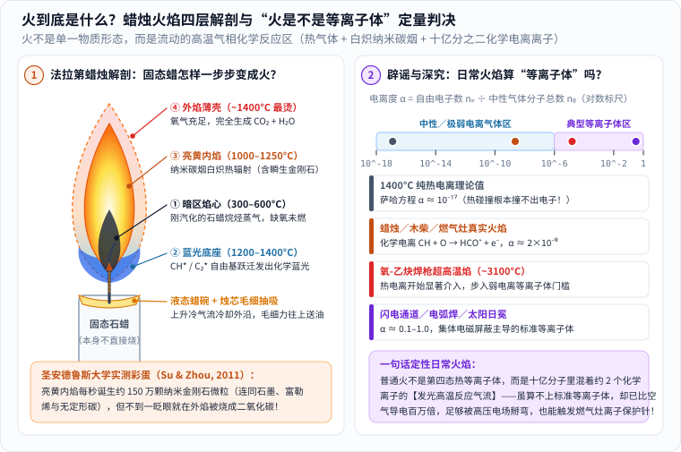
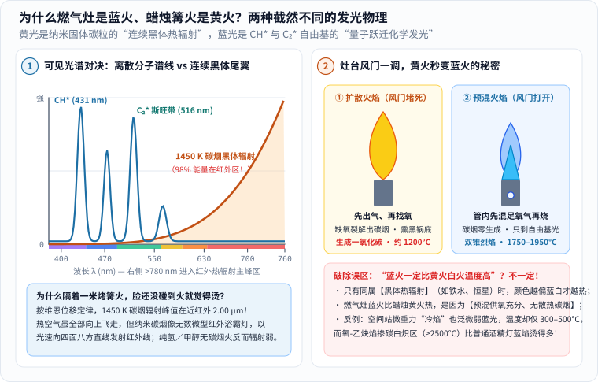
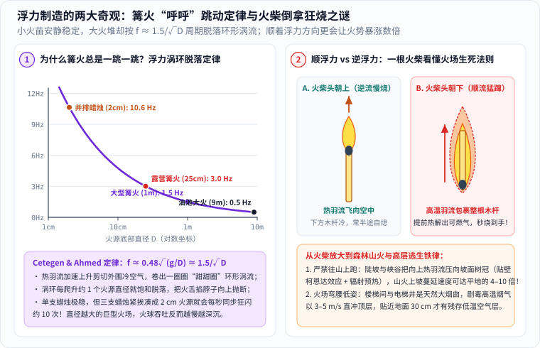

吹灭生日蜡烛的那一秒，如果你手疾眼快，把一根点燃的火柴凑到灯芯上方两三厘米处那缕袅袅升起的**白烟**旁边——神奇的一幕会发生：

火柴明明连灯芯都没碰到，半空中却突然“嗖”地蹿出一道火舌，**顺着白烟逆流扑回灯芯**，把熄灭的蜡烛隔空重新点着！

如果这还不够颠覆直觉，不妨再看另外两场真实发生过的实验：
- 在距离地面四百公里的“和平号”与国际空间站里，宇航员划着火柴点燃同一支石蜡蜡烛，火苗竟然彻底忘了哪边是“上”——它没有拉成黄澄澄的尖头泪滴，而是缩成了一颗直径只有 **1.5 厘米**、不冒半点黑烟的**暗蓝色圆球**，安安静静地烧了整整 **45 分钟**；
- 回到地面，把点燃的蜡烛封进一只透明玻璃罐，端着罐子坐进紧闭车窗的汽车。绿灯亮起、司机一脚油门往前冲的瞬间，你身体被椅背狠狠往后推，可玻璃罐里的蜡烛火苗居然**违背直觉地朝车头方向前倾**！

火，大概是人类最熟悉、却最难用一句话答对本质的东西：它看得见、摸着烫，却既装不进瓶子，也称不出“一斤火有多重”。千百年来，古希腊人把它列为与土、水、气并列的四大元素之一，18 世纪化学家又以为木头里藏着一种叫“燃素”的神秘流体；到了现代网络科普里，又常有人斩钉截铁地说“火就是物质第四态——等离子体”。

**火究竟是什么？它真的是等离子体吗？地球上的火苗为什么非要一门心思往上蹿、无风时还要每秒钟有节奏地抖动十来下？** 今天，我们就从拆开一支普通蜡烛开始，把这团陪伴人类几十万年的光与热一层层剥个透彻。

---

## 一、火到底是什么？先拆开一支蜡烛的四层微缩化工厂

### 1. 固体石蜡根本烧不着：法拉第的“毛细虹吸”接力赛

1860 年圣诞节假期，英国皇家学会的讲演厅里座无虚席。电磁学大师**迈克尔·法拉第**（Michael Faraday）举起一支最普通的蜡烛，为伦敦的孩子们献上了科学史上最著名的科普杰作——《**蜡烛的化学史**》（*The Chemical History of a Candle*，1861 年结集出版）。

在第一讲一开场，法拉第就戳破了一个绝大多数人习以为常的错觉：**固体的石蜡和固体的木头，其实根本不能直接起火燃烧！**

你不妨拿打火机去烧一大块实心石蜡的侧面——它只会化出几滴蜡油流走，怎么也点不着。一支蜡烛想要稳定燃烧，必须在几毫米的空间里完成一场精密的**固—液—气三相接力**：

1. **热风雕碗（固 $\to$ 液）**：点燃灯芯后，辐射热把灯芯根部的石蜡融化成液态蜡油。妙的是，蜡烛外圈源源不断向上涌动的冷空气，恰好替蜡烛最外沿风冷降温，留下一圈高耸不化的固态边缘，在顶端自动雕出一只端端正正的“小酒碗”，兜住蜡油不让它乱淌（一旦你在穿堂风里点蜡烛，一侧上升气流被吹歪，“碗沿”被烧塌，蜡油就会哗哗流泪——法拉第把这叫做 *guttering*）。
2. **毛细爬坡（液态输运）**：编织棉线灯芯里有成千上万道微米级缝隙，液态石蜡顺着毛细管力一路逆重力爬上灯芯顶端——法拉第在讲座中特意拿搭在水盆边把水抽干的毛巾打比方，指出这与我们在[《水凭什么先往高处爬再翻墙流走？读懂虹吸现象》]()里讲过的毛细抽吸如出一辙。
3. **高温气化（液 $\to$ 气）**：爬到灯芯尖端的液态石蜡（长链烷烃，典型分子式如 $\text{C}_{25}\text{H}_{52}$）被 $600^\circ\text{C}$ 以上的高温瞬间煮沸、裂解成**气态烃类蒸气**。

这就是文章开头那个“隔空点白烟”魔术的全部谜底：你一口气吹灭蜡烛时，吹跑了外层的火焰，但滚烫的灯芯还在继续蒸发石蜡。那缕白烟根本不是烧完的灰烬，而是**来不及烧掉的石蜡蒸气遇冷重新凝结成的微米级石蜡雾滴**——火柴一碰，这根悬在空中的“可燃蒸气引线”自然当场复燃！

### 2. 一朵火苗的四层解剖与“每秒 150 万颗纳米钻石”

既然真正参与燃烧的是气态燃料与空气中的氧气，那么我们肉眼看到的那朵轮廓分明的“火苗”又是什么？让我们对照下图左侧，顺着从里到外的顺序把一朵蜡烛火焰剖开：

_图 1：先看左卡从下往上的三相燃料接力与 ①–④ 四层火焰解剖，注意“火苗”并非塞满燃料的实心袋子，而是燃料蒸气与外界氧气迎头相遇的**发光反应薄壳**；再看右卡底部电离度对数标尺，对比 $1400^\circ\text{C}$ 纯热电离（$10^{-17}$）、火焰化学电离（$2\times 10^{-9}$）与真正等离子体的巨大鸿沟。图中火焰各层厚度为看清结构略作放大示意。[单独打开图片](/assets/images/fire-physics/candle-flame-anatomy-and-material-nature.svg)_

- **① 焰心暗区（约 $300\text{–}600^\circ\text{C}$）**：紧包着灯芯的一团透明暗区。这里全是刚蒸发出来的石蜡蒸气，外界氧气根本挤不进来，因此**焰心内部其实没有燃烧**！如果你把一根火柴梗飞快横插进焰心停两秒再抽出来，会看见火柴紧贴外圈烫出了两个黑焦环，唯独正中央夹在焰心里的一段完好无损。法拉第当年甚至把一根细玻璃管直接插进焰心，把里面的透明蜡蒸气引出来，在玻璃管另一头点起了第二朵小火苗！
- **② 根部蓝光区（约 $1200\text{–}1400^\circ\text{C}$）**：火焰最底部直接迎着新鲜冷空气，氧气最充沛。烃类分子在这里被拆成激发态的甲川自由基（$\text{CH}^*$）和双碳自由基（$\text{C}_2^*$），发出清澈的幽蓝色荧光。
- **③ 明亮黄光内焰（约 $1000\text{–}1250^\circ\text{C}$）**：石蜡蒸气继续往上走，氧气一时供不上，长链烷烃在高温缺氧下发生热裂解（Pyrolysis），脱去氢原子，聚合成无数直径 **$20\text{–}50\,\text{纳米}$** 的固体碳烟微粒（Soot）。这些纳米碳粒被周围上千度的高温气体烧得白炽发亮，构成了蜡烛最耀眼的暖黄色光芒（如果你拿一只冷瓷盘压进这层黄光区，盘底立刻会糊上一层还没来得及烧掉的黑烟炱）。
  更令人拍案叫绝的是 **2011 年**英国圣安德鲁斯大学化学家苏子学、周午纵（Wuzong Zhou）与张阳发表在《化学通讯》（*Chemical Communications*）上的一项发现：他们用多孔阳极氧化铝薄膜瞬间伸入蜡烛黄色火焰中心采样，在透射电子显微镜下赫然找到了碳元素的全部四种同素异形体——石墨碳、富勒烯碳、无定形碳，以及直径约 $3\,\text{纳米}$ 的**天然纳米钻石颗粒**！计算表明，一支普通蜡烛火焰每秒钟都在凭空锻造出约 **150 万颗纳米钻石**，只可惜几毫秒后它们升入外焰，就全被氧气烧成二氧化碳飞走了。
- **④ 外焰薄壳（最高温区，约 $1400^\circ\text{C}$）**：火焰最外层与空气全面接触的极薄界面，碳烟颗粒与一氧化碳在这里同氧气彻底化合，变成无色透明的二氧化碳（$\text{CO}_2$）和水蒸气（$\text{H}_2\text{O}$），释放出最猛烈的反应热。

现在，我们可以给“**火到底是什么**”下一个毫不含糊的物理学定义了：

> **火不是一种独立的化学元素或物质形态，而是一个正在发生剧烈放热氧化反应的“发光流动过程”。** 你肉眼看见的火苗，本质上是一团**高温反应气流（$\text{CO}_2$、$\text{H}_2\text{O}$、$\text{N}_2$、$\text{O}_2$ 与燃料蒸气）**中正在发光的薄层——里面同时混杂着**激发态自由基分子**、**烧红的白炽纳米固体碳粒**，以及**极微量的带电离子与自由电子**。它之所以装不进瓶子，是因为一旦切断燃料与氧气的持续流动，化学反应在几毫秒内停止，发光消失，瓶子里剩下的就只有一团冷却下来的二氧化碳和水蒸气。

### 3. 硬核辟谣：普通火苗真的是“第四态等离子体”吗？

听到火苗里有自由电子和带电离子，很多读者马上会想起我们在[《固体、液体、气体之后：等离子体到底是什么？》]()里讲过的“物质第四态”。网上流传最广的一句科普也是：“火能导电、能被高压电场掰弯，所以火就是等离子体！”

**这句话只猜对了现象，却把背后的物理量级夸大了整整几百万倍。** 我们可以当场算一笔硬账：

在标准大气压（$P = 1.013\times 10^5\,\text{Pa}$）、蜡烛外焰最高温度 $T = 1400^\circ\text{C} \approx 1673\,\text{K}$ 下，理想气体状态方程给出每立方厘米火焰里的中性气体分子总数为：

$$
n_0 = \frac{P}{k_B T} \approx 4.39\times 10^{18}\,\text{个/cm}^3
$$

此时单个气体分子的平均热运动动能大约只有 $\frac{3}{2}k_B T \approx \mathbf{0.22\,\text{eV} }$；而要把氮气、氧气、二氧化碳或水分子外层的电子硬撞下来，需要的电离能高达 **$12\text{–}15.6\,\text{eV}$**——足足差了五六十倍！如果把 $T = 1673\,\text{K}$、电离能 $E_i \approx 12\,\text{eV}$ 代入天体物理标准的**萨哈热电离方程**（Saha Ionization Equation），纯靠高温碰撞撞出来的热电离度只有：

$$
\alpha_{\text{Saha} } = \frac{n_e}{n_0} \approx 1.2\times 10^{-17}
$$

每一亿亿个分子里才电离出一个电子——按纯热力学算，$1400^\circ\text{C}$ 的蜡烛火苗跟绝缘体几乎没区别！

**那为什么真实的蜡烛火苗放在两块高压电极板之间确实会偏转、也能微弱导电呢？**

真正立功的不是温度，而是一条巧妙绕开高温门槛的化学捷径——**化学电离**（Chemi-ionization）。在火焰根部蓝光区，高活性的甲川自由基（$\text{CH}$）撞上氧原子（$\text{O}$）形成化学键时释放出的巨大化学能，直接把刚生成的甲酰基分子身上的一个电子踢飞出去（Cheng, Chen & Shiea, 2017）：

$$
\begin{aligned}
\text{CH} + \text{O} &\longrightarrow \text{CHO}^+ + e^- \\
\text{CHO}^+ + \text{H}_2\text{O} &\longrightarrow \text{H}_3\text{O}^+ + \text{CO}
\end{aligned}
$$

这条化学捷径把蜡烛与燃气火焰中的真实自由电子／水合氢离子密度一口气拉高了 **8 个数量级**，达到 $n_e \sim 10^9\text{–}10^{11}\,\text{个/cm}^3$，对应真实电离度：

$$
\alpha_{\text{chem} } = \frac{n_e}{n_0} \approx 2\times 10^{-9} \quad (\text{十亿分之二})
$$

看清这个数字（图 1 右下对数标尺），争议就彻底水落石出了：
- 一方面，**十亿分之二**的电离度意味着火焰里 **$99.9999998\%$ 全是普通中性分子**。带电粒子走不了多远就会撞上中性分子，集体电磁力远不能主导整团流体的运动，部分低温区的德拜长度甚至接近火苗厚度本身——因此，**日常蜡烛、木柴、燃气灶的火焰（$1000\text{–}1700^\circ\text{C}$）在严格物理学上并不是热平衡第四态等离子体**，而是“**含有痕量化学电离离子的高温反应气流**”（只有超过 $3000^\circ\text{C}$ 的氧乙炔焊炬核心、电弧焊或三万度的闪电，热电离才真正接管成为等离子体）。
- 但另一方面，哪怕只有十亿分之二的自由电子与 $\text{H}_3\text{O}^+$ 离子，也足以让火焰的导电率比室温空气暴涨**一百万倍以上**！到文章第五节你会看到，正是这十亿分之二的微弱导电性，在今天每一户家庭的厨房燃气灶上默默守护着我们的生命安全。

---

## 二、为什么火苗偏偏往上蹿？重力、热膨胀与太空里的蓝色圆球火

### 1. 火自己根本不知道哪边是“上”：真正的推手是重力和冷空气

搞懂了火是一团约 $1200\text{–}1400^\circ\text{C}$ 的高温反应气体，第二个问题——“**火为什么向上烧**”——很多人会脱口而出：“因为热气轻，热气自己喜欢往上跑呀！”

再往下追问一步：**热气凭什么一定要“往上”跑，而不是往左、往右或者待在原地？**

答案藏在一个常被忽略的前提里：**火苗本身没有任何方向感；真正把火苗往上推的，是地球重力拽着周围更沉的冷空气，从四面八方抄底把热气“挤”上去的！**

我们可以用高中物理的理想气体定律与阿基米德浮力直接算出这股推力有多猛：

火焰敞开在大气中燃烧，压强 $P$ 与周围室温空气（$T_{\text{air} } = 20^\circ\text{C} = 293\,\text{K}$，密度 $\rho_{\text{air} } \approx 1.20\,\text{kg/m}^3$）几乎相等。燃烧生成的气体平均摩尔质量与空气相近，但火焰平均温度飙升到了 $T_{\text{flame} } \approx 1500\,\text{K}$（约 $1227^\circ\text{C}$）。体积剧烈膨胀之下，火焰气体的密度暴跌到周围冷空气的**五分之一**左右：

$$
\begin{aligned}
\frac{\rho_{\text{flame} } }{\rho_{\text{air} } } &\approx \frac{T_{\text{air} } }{T_{\text{flame} } } = \frac{293\,\text{K} }{1500\,\text{K} } \\
&\approx 0.195 \approx \frac{1}{5.1}
\end{aligned}
$$

这就好比你摁着一只装满空气的乒乓球沉进水底！根据阿基米德定律，单位体积热火焰受到的冷空气向上浮力为 $\rho_{\text{air} }g$，而它自身的向下重力只有 $\rho_{\text{flame} }g$。两者相减再除以热气自身质量，如果不计黏性阻力，刚生成的热气团获得的初始**向上净浮力加速度**高达：

$$
\begin{aligned}
a_{\text{buoy} } &= \frac{(\rho_{\text{air} } - \rho_{\text{flame} })g}{\rho_{\text{flame} } } = \left(\frac{T_{\text{flame} } }{T_{\text{air} } } - 1\right)g \\
&\approx 4.1\,g \approx \mathbf{40\,\text{m/s}^2}
\end{aligned}
$$

足足 **4 倍重力加速度**向上猛蹿！哪怕只爬升一支小蜡烛火焰的高度（$H = 5\,\text{cm} = 0.05\,\text{m}$），按自由羽流估算的上升速度也达到：

$$
\begin{aligned}
v &\sim \sqrt{2 g H \frac{\rho_{\text{air} } - \rho_{\text{flame} } }{\rho_{\text{air} } } } \\
&\approx \sqrt{2 \times 9.81 \times 0.05 \times 0.805} \approx \mathbf{0.89\,\text{m/s} }
\end{aligned}
$$

算上与周围空气的黏性剪切摩擦，实测一支静止蜡烛顶端的无形热羽流流速也稳稳高达 **$0.5\text{–}0.8\,\text{m/s}$**！正是这股每秒大半米的自然对流抽吸，在火焰底部形成低压，源源不断把两侧新鲜冷空气**水平卷吸**进灯芯根部供氧，同时像拉面师傅揪面团一样，把反应发光区硬生生向上拉长成我们熟悉的**上尖下宽泪滴形**。

法拉第当年在皇家学会讲台上还做过一个绝妙的反向证明：他在酒精灯旁竖起一根开口向下的抽风铜管，只要人工把气流往下抽，失去浮力主导的酒精火焰立刻乖乖掉头，变成了一朵**朝下燃烧的倒立火苗**！

### 2. 把重力关掉：空间站里安静燃烧 45 分钟的 1.5 厘米蓝色圆球火

既然“火向上蹿”全靠地球重力制造的冷热密度差浮力（$\Delta\rho \cdot g$），那么一个顺理成章的推论立刻浮现：**如果我们把这支蜡烛带到自由落体失重的空间站里，让等效重力 $g_{\text{eff} } = 0$（详见[《空间站为什么会失重？》]()），火苗会变成什么样？**

在没有太空飞行之前，不少科学家甚至怀疑：没了浮力对流排走二氧化碳废气、抽进新鲜氧气，蜡烛在失重环境下点着几秒钟就会把自己活活闷死！

1992 年美国“哥伦比亚号”航天飞机（STS-50）与随后的俄罗斯“和平号”空间站上，NASA 格伦研究中心的迪特里希（Daniel L. Dietrich）、罗斯（Howard D. Ross）与华裔燃烧学家田长霖弟子钱曾（James S. T'ien）团队先后完成了约 **80 次微重力蜡烛燃烧实验**（Dietrich et al., 2001）。实验拍回的照片（见下图右半对比与单次动态演示）轰动了整个物理学界：

_图 2：左右对照地球 $1g$ 与太空 $0g$ 下的同一支蜡烛。左卡包含一次短动画演示热羽流上升与侧向冷风卷吸；右卡演示失去浮力后氧气靠分子热运动 $360^\circ$ 等速漫入、二氧化碳向四周扩散，火苗变成无碳烟的蓝色圆球（若页面加载后动画已播完，[单独打开图片](/assets/images/fire-physics/earth-buoyancy-plume-vs-space-spherical-flame.svg)并刷新即可重播；开启系统“减少动态效果”时直接呈现完整静态流线与数据）。_

在微重力（$g_{\text{eff} } \approx 10^{-6}\,g$）下，热空气不再比冷空气“轻”，自然对流速度瞬间归零。蜡烛非但没有立刻熄灭，反而切换到了另一种极其温柔的底层输运模式——纯粹依靠气体分子热运动乱撞的**菲克分子扩散**（Fick's Law，$J = -D_{\text{diff} }\nabla c$）：

1. **形状变成标准圆球／半球**：既然没有哪个方向叫“上”或“下”，灯芯蒸发出的烃类分子向 $360^\circ$ 四面八方等速扩散，舱内氧气也从四面八方等速漫入，两军交火的化学反应面自然严丝合缝地围成一颗直径约 **$1.5\,\text{厘米}$ 的球壳**（受下方蜡烛柱遮挡呈饱满半球形）。
2. **亮黄色彻底消失，变成无烟暗蓝色**：分子扩散供氧比地球浮力送风慢得多，单位时间烧掉的石蜡极少，火焰峰值温度降低，长链烃来不及大量裂解结块成纳米碳烟，就算偶有碳前驱体也有充裕时间被慢慢氧化干净——没有了白炽固体碳烟，火苗就露出了自由基最原本的**暗蓝色**，而且不冒一丝黑烟！
3. **寿命暴涨近五倍**：在地球上十来分钟就烧完的同款实验蜡烛，在“和平号”空间站微重力舱里细水长流地**连续燃烧了长达 45 分钟**！临近熄灭前的最后一分钟，这颗蓝色火球还会以约 **$1\,\text{Hz}$（每秒一次）**的节奏自发忽大忽小地脉动呼吸，随后悄然熄灭。

故事还没完！**2012 年**，NASA 在国际空间站开展液滴燃烧实验（FLEX）时又撞见了一桩怪事（Nayagam, Dietrich, Hicks et al., 2012）：一颗庚烷燃料液滴在微重力下点燃后，明亮的热火焰因为向外辐射散热而很快熄灭；可就在研究人员以为实验结束时，红外与紫外相机却发现燃料仍在黑暗中以 **$500\text{–}800\,\text{K}$（约 $230\text{–}530^\circ\text{C}$）**的低温悄无声息地继续烧了许久！**2021 年**，空间站 CFI-G 实验进一步首次造出了气态燃料的稳定球形**冷焰**（Cool Flame）——这种依靠过氧自由基低温链式反应维持、肉眼几乎看不见的“幽灵火焰”，直接改写了人类对内燃机爆震与深空航天器防火的认知。

顺带一提，这也给载人航天立下了一条铁律：**在空间站里，千万不能直接照搬地球天花板上的家用烟雾报警器！** 因为失重舱里着火时，热烟根本不会自己往“天花板”飘，一旦舱内通风风扇停转，火团和毒烟就会原地悬成一团球；航天器烟感必须安装在强制通风回风管道口才能救命。

---

## 三、为什么燃气灶是蓝火、蜡烛篝火是黄火？隔着一米烤火烫脸的秘密

### 1. 黄光与蓝光，根本不是同一种发光物理！

解决了形状与方向，再来看每个人天天打交道的颜色之谜：**同样是烧碳氢化合物，为什么停电点的蜡烛和露营点的木柴篝火是明亮的橙黄色，而厨房燃气灶和实验室本生灯却是清澈的蓝火？**

翻开光谱仪（图 3 左卡），你会惊讶地发现：黄色火光和蓝色火光，连底层的**发光物理机制**都截然不同！

_图 3：左卡对比 $380\text{–}760\,\text{nm}$ 可见光谱中两条截然不同的曲线——橙色连续上升曲线是 $1450\,\text{K}$ 纳米碳烟颗粒的普朗克黑体热辐射尾翼（峰值在右侧不可见的 $2.00\,\mu\text{m}$ 近红外区），蓝色尖峰则是 $\text{CH}^*$ 与 $\text{C}_2^*$ 自由基的量子化学发光；右卡对比燃气灶风门关闭（扩散黄火）与打开（预混蓝火）及温度误区反例。[单独打开图片](/assets/images/fire-physics/blue-radical-spectra-vs-yellow-soot-blackbody.svg)_

#### （1）暖黄／橙红火光 = 固体纳米碳粒的“连续黑体热辐射”

蜡烛、木柴、油灯属于**扩散火焰**（燃料先冒出来，再一边升空一边找氧气）。中间缺氧区裂解出的无数 $20\text{–}50\,\text{nm}$ 固体碳烟颗粒，本质上跟老式白炽灯泡里的钨丝、打铁炉里烧红的铁块一模一样——任何凝聚态固体只要被烧到上千开尔文，内部带电粒子热振动就会向外发射连续波长的**普朗克黑体辐射**。

根据**维恩位移定律**（Wien's Displacement Law），热辐射最强峰值波长 $\lambda_{\text{peak} }$ 与绝对温度 $T$ 成反比：

$$
\lambda_{\text{peak} } = \frac{2897.8\,\mu\text{m}\cdot\text{K} }{T}
$$

把蜡烛与篝火碳烟颗粒的典型温度 $T = 1450\,\text{K}$（约 $1177^\circ\text{C}$）代进去，算出来的辐射主峰落在：

$$
\lambda_{\text{peak} } = \frac{2897.8}{1450} \approx \mathbf{2.00\,\mu\text{m} } \quad (\text{近红外线})
$$

人眼只能看见 $0.38\text{–}0.76\,\mu\text{m}$ 的可见光。也就是说，篝火里纳米碳粒发出的电磁辐射有 **超过 $98\%$ 全是肉眼看不见的红外热辐射**，只有短短一截尾巴伸进了可见光长波端——红光最多、橙黄次之，$450\,\text{nm}$ 以下的蓝紫光连百分之一都不到！红、橙、黄混在一起，进到我们眼里就是温暖明亮的**橙黄色火光**。

**这顺手解开了一个极有趣的生活疑问：既然上一节刚算过热空气全以每秒近一米的速度笔直往上飞走了，为什么你大冬天坐在篝火侧面一米远，没有半点热风吹向你，脸颊却依然烤得发烫？**

答案正是这 **$98\%$ 的近红外黑体辐射**！热空气（对流）确实全飞上了天，但火焰里成千上万亿颗白炽纳米碳粒就像无数盏微型红外浴霸灯，以每秒 30 万公里的光速向四面八方直线发射 $2\,\mu\text{m}$ 红外线，直接穿透冰冷的空气照在你脸上转化成热量！

反过来，如果化工厂里发生**纯氢气（$\text{H}_2$）**或赛车场上发生**纯甲醇（$\text{CH}_3\text{OH}$）**泄漏起火，因为分子里完全不产生固体碳烟颗粒，一则白天几乎看不见火苗，二则侧面红外热辐射只有碳氢黄火的零头——人往往走到离火苗咫尺之遥还没感觉到“烤脸”，一脚踩进去才酿成严重烧伤！

#### （2）幽蓝／青蓝火光 = 激发态自由基的“量子跃迁化学发光”

打开厨房天然气灶（主要成分甲烷 $\text{CH}_4$），火盘下方其实藏着一套精巧的文丘里引射管与**风门拨片**（图 3 右卡）：燃气高速喷出时，提前把足量空气抽进管道里与燃气搅匀，再从火盖小孔喷出点燃——燃烧学称之为**预混火焰**（Premixed Flame）。

因为每颗甲烷分子身边早就配齐了氧分子，根本不给它缺氧聚合成固体碳烟的机会，黄光黑体辐射被彻底清零！此时唱主角的，是化学反应瞬间激发出来的短寿命自由基分子（与我们在[《读懂液晶显示与百年屏幕进化史》]()里讲过的受激发光同属离散能级跃迁）：
- **$\text{CH}^*$ 自由基**从激发态跳回基态，精准吐出波长 **$431.5\,\text{nm}$** 的蓝紫色光子；
- **$\text{C}_2^*$ 双碳自由基**跳回基态，吐出著名的**斯旺谱带**（Swan bands，主峰 **$473.7\,\text{nm}$** 蔚蓝光与 **$516.5\,\text{nm}$** 青绿光）。

两者叠加，就是你在燃气灶上看到的那圈干净利落的**青蓝色火苗**！一旦你家燃气灶某天突然冒出红黄火头、把锅底熏得乌黑，十有八九是灶底风门错位或火盖孔被油污堵死，退化成了缺氧的扩散火焰——这时不仅费气，还会大量排出无色无味的剧毒**一氧化碳（$\text{CO}$）**，必须立刻开窗通风并清理风门。

### 2. 留个心眼：“蓝火一定比黄火温度高”是真的吗？

中学考卷和短视频里常有一句口诀：“蓝色火焰比黄色火焰温度高。”**这句话必须加上严格的前提条件，否则一脚就会踩进反例坑里！**

1. **同一碳氢燃料下，蓝火确实更热**：比如同样烧天然气，风门堵死冒黄火时因为燃烧不完全且碳烟向外大量辐射丢热，温度只有约 $1100\text{–}1200^\circ\text{C}$；调好风门变成充分预混蓝火后，化学能一步到位释放，火焰温度可达 **$1700\text{–}1900^\circ\text{C}$**。恒星表面也是纯粹的黑体辐射（$10000\,\text{K}$ 的蓝白色天狼星确实比 $3500\,\text{K}$ 的橙红色参宿四热得多）。
2. **一旦跨燃料或混入金属盐，颜色根本不代表温度高低！**
   - 往只有 $800\text{–}900^\circ\text{C}$ 的酒精灯里撒一点氯化铜（焰色反应），铜离子原子发射谱线立刻把低温火苗染成炫目的蓝绿色；前面空间站里的“冷焰”靠甲醛化学发光同样泛着微弱蓝光，温度却只有区区 **$300\text{–}400^\circ\text{C}$**！
   - 反过来，铝热剂焊轨、镁条燃烧或富氧金属火焰里充满极高温氧化物微粒，温度高达 **$2500\text{–}3000^\circ\text{C}$**，发出的却是刺眼的**亮黄白光**，比厨房 $1700^\circ\text{C}$ 的蓝火热得多！

---

## 四、无风的房间火苗为什么每秒抖 10 下？火柴朝下与火场逃生的生死铁律

### 1. 哪怕关紧门窗屏住呼吸，火苗为什么还在有节奏地“呼吸跳动”？

盯着书桌上的一支蜡烛或院子里的一堆篝火看几秒钟，你会发现另一件怪事：哪怕门窗紧闭、一丝穿堂风都没有，火苗也绝不会像石头雕塑那样纹丝不动，它的尖端总会一耸一耸、有节奏地**周期性闪烁跳动**（Flickering / Puffing）。

是谁在拨弄它？依然是我们第二节算出来的那股**浮力上升热羽流**！

当火焰内部 $1500\,\text{K}$ 的轻热气以每秒近一米的速度猛往上冲，而外围 $293\,\text{K}$ 的重冷空气几乎静止时，热火柱与冷空气交界处就形成了一层剧烈摩擦的**速度剪切层**。流体力学告诉我们，重流体在侧、轻流体加速上冲的剪切面天生不稳定——在火苗底座上方不到一倍直径的高度内，外侧冷空气会像卷浪花一样定期向内卷起一圈圈看不见的**甜甜圈状环形涡流**（Toroidal Vortex，图 4 左卡）：

- 环形涡流向内一掐，把火苗腰部收窄拉长，顶端甚至分离出一小团火舌；
- 紧接着下一团热气鼓起冲破涡环，周而复始！

_图 4：左卡绘制浮力火焰脉动频率公式 $f \approx 1.5/\sqrt{D}$ 的实测标度曲线，从 $2\,\text{cm}$ 蜡烛群每秒跳动约 $11$ 次一直跨越到 $9\,\text{m}$ 油罐大火每 $2$ 秒喘息一次；右卡对比火柴头朝上与朝下截然不同的蔓延速度，并解释森林山坡火与高层楼梯间烟囱效应。[单独打开图片](/assets/images/fire-physics/puffing-frequency-and-upward-flame-spread.svg)_

更不可思议的是，燃烧学家塞特根与艾哈迈德（Cetegen & Ahmed, 1993）以及夏溪与张鹏团队（Xia & Zhang, 2018）通过跨越四个数量级的实验与涡动力学推导证明：无论烧的是蜡烛、木柴、酒精池还是十米宽的油罐大火，这种浮力涡环脱落的闪烁频率 $f$（每秒跳动次数）只由重力加速度 $g$ 和火源底座直径 $D$ 决定，严格遵循一条简洁优雅的**平方根反比定律**：

$$
\begin{aligned}
f &\approx 0.48\sqrt{\frac{g}{D} } \approx \frac{1.5}{\sqrt{D} } \\
&\quad (D\text{ 单位：}\text{m},\; f\text{ 单位：}\text{Hz})
\end{aligned}
$$

把不同尺寸的火代进这条公式，日常观察瞬间全对上了号：
- **两三支紧挨着的蜡烛（等效直径 $D \approx 0.02\,\text{m}$）**：$f \approx 1.5 / \sqrt{0.02} \approx \mathbf{10.6\,\text{Hz} }$——每秒钟肉眼可见地抖动约 **10 到 11 下**！更妙的是，如果你把两支燃烧的蜡烛拉近到相距 $1\text{–}2\,\text{厘米}$，它们各自的环形涡流会互相耦合锁相，两朵火苗立刻像排练好的舞者一样，自动进入“同升同降”或“一高一低交替”的同步振荡！
- **露营篝火（$D \approx 0.25\,\text{m}$）**：$f \approx 1.5 / 0.5 = \mathbf{3.0\,\text{Hz} }$，每秒跳动 **3 下**，正是篝火那种令人放松的跃动节奏；
- **一米宽的大型篝火（$D = 1.0\,\text{m}$）**：$f \approx \mathbf{1.5\,\text{Hz} }$；
- **直径 9 米的工业储油罐池火（$D = 9.0\,\text{m}$）**：$f \approx 1.5 / 3 = \mathbf{0.5\,\text{Hz} }$——巨型大火不再快速抖动，而是每 **2 秒钟**才深沉地向上“喘息”喷发出一朵巨大的蘑菇状火球！

### 2. 一根火柴试出火场生死线：为什么千万别往山上跑、别往楼上冲？

“火向上烧”不仅是茶余饭后的物理趣题，在火场里更是直接决定生死的铁律。做过饭或划过火柴的人都知道一个常识（图 4 右卡）：
- **火柴头朝上竖着拿**：浮力热羽流全部往火柴头上方飘走了，底下的未燃木梗只靠极其缓慢的固体导热预热，火苗只能慢吞吞往下爬，常常烧到一半就自己灭了；
- **火柴头朝下倒着拿**：$1000^\circ\text{C}$ 的上升热羽流像舌头一样死死裹住上方整根未燃的木梗，瞬间把上方木材烤热裂解出可燃气体——火苗顺着木梗往上蹿的速度比朝下蔓延**快出 5 到 10 倍**，两秒钟就能烫到你的手指！

把这根小小的倒立火柴放大一万倍，就是真实灾难中最凶险的两大杀手：

1. **山林野火的“上坡加速效应”**：平地起火时，热羽流垂直向上，对前方草木只靠辐射预热；一旦大火烧到山坡脚下，上升热羽流与坡面之间的夹角变小，低压卷吸直接把滚烫的火舌吸向贴近上坡地面的树冠与枯草，提前把整片山坡烤到燃点。消防实测表明，**山坡坡度每增加约 $10^\circ\text{–}15^\circ$，火势向坡顶推进的速度就会翻一倍**，甚至超过博尔特的百米冲刺速度！因此遭遇山火时，**绝对不能顺着上坡往山顶逃跑**，而应逆风向两侧侧向或向已过火的安全低处撤离。
2. **高层建筑的“楼梯间烟囱效应”**：高楼内部贯通的电梯井、敞开防火门的疏散楼梯间，在火灾中就是一根几十米高的巨型“直立烟囱”。$800^\circ\text{C}$ 的剧毒浓烟在浮力驱动下沿竖井向上狂飙的速度高达 **$3\text{–}5\,\text{m/s}$**（每秒蹿升一层楼！），人是绝对跑不过上升毒烟的；与此同时，楼梯与走廊贴近地面的 $30\text{–}50\,\text{厘米}$ 薄层里，因为冷空气密度大而沉在最下方，温度最低、氧气最足——这就是火场逃生必须**随手关严防火门、弯腰低姿沿墙撤离**的硬核流体力学原因。

---

## 五、终极脑洞与厨房黑科技：加速车厢里蜡烛往哪偏？燃气灶 0.1 秒断气的离子开关

### 1. 关紧车窗猛踩油门，玻璃罐里的蜡烛火苗竟然“往前冲”！

现在，让我们揭开文章开头留下的最后一个悬念：**把点燃的蜡烛封进一只透明玻璃罐，端着它坐在车窗紧闭的轿车里。绿灯亮起，车子以加速度 $a$ 向前猛冲时，罐子里的火苗到底往后倒，还是往前倾？**

十个人里有九个半会猜“往后倒”——理由听上去无懈可击：“我人都被甩向椅背了，蜡烛火苗有惯性，当然也被甩向车尾！”

可只要你亲手试一次（注意安全，用密封玻璃罩防止明火外露），就会亲眼看到令全场惊呼的一幕：**汽车向前加速的整段过程里，玻璃罐中的蜡烛火苗稳稳当当地朝车头方向前倾！一脚急刹车时，火苗反而朝车尾方向后仰！**

为什么火苗这么“叛逆”？如果你读过本站[《连光都会被太阳掰弯吗？从电梯思想实验到日全食追星，读懂爱因斯坦光线弯曲的百年验证》]()，直接请出爱因斯坦 **1907 年的等效原理**就能一招秒杀（图 5 左卡）：

_图 5：左卡拆解紧闭加速车厢内密封罐蜡烛向前倾斜 $\theta = \arctan(a/g)$ 的压强梯度与等效引力场机制；右卡展示现代燃气灶火盖旁那根不起眼的“离子感应针”如何利用火焰内自由电子与重离子的迁移率悬殊实现单向整流与意外熄火自动断气。[单独打开图片](/assets/images/fire-physics/accelerating-jar-tilt-and-flame-ion-sensor.svg)_

在随着汽车以加速度 $\mathbf{a}$ 向前加速的非惯性参考系里，罐内所有物质除了受到竖直向下的地球重力 $\mathbf{g}$ 之外，还等效受到一个水平向后的惯性力场 $-\mathbf{a}$。但罐子里并不是真空——里面装满了密度为 $\rho_{\text{air} } \approx 1.20\,\text{kg/m}^3$ 的冷空气，和一团密度只有 $\rho_{\text{flame} } \approx 0.24\,\text{kg/m}^3$ 的轻火焰！

车子一踩油门，**重出五倍的冷空气**率先被惯性力甩向玻璃罐后壁，导致罐子**后方气压高、前方气压低**，形成精确的水平压强梯度 $\partial P / \partial x = -\rho_{\text{air} } a$。就像拴在车厢地板上的氦气球一样，周围沉重的冷空气从车尾挤过来，硬生生把轻飘飘的火苗往低压的车头方向“挤”了过去！

从等效引力场 $\mathbf{g}_{\text{eff} } = \mathbf{g} - \mathbf{a}$（斜指向后下方）来看就更直观了：**火苗永远逆着等效重力方向（即顺着净浮力方向）生长！** 因此，火苗向车头前倾的夹角 $\theta$ 甚至连火焰温度都不用代，直接由汽车水平加速度 $a$ 与重力加速度 $g$ 的比值唯一锁定：

$$
\tan\theta = \frac{a}{g} \implies \theta = \arctan\!\left(\frac{a}{g}\right)
$$

比如一辆家用电车以 $a = 3.5\,\text{m/s}^2$（百公里加速约 $7.9\,\text{秒}$）起步时，玻璃罐里的火苗就会像一只精准的液体水平仪一样，朝车头方向稳稳前倾：

$$
\theta = \arctan\!\left(\frac{3.5}{9.81}\right) \approx \mathbf{19.6^\circ}
$$

看，这一歪，把“火苗向上烧本质上是冷空气浮力推举”这条物理铁律演绎得淋漓尽致！

### 2. 厨房里的“火焰二极管”：汤洒灭灶火时，谁替你关上了燃气阀？

文章最后，让我们回到每天做饭的厨房灶台，把第一节算出来的那个“十亿分之二化学电离”串成完美的闭环。

低头看看你家燃气灶的铜火盖旁边，通常会竖着两根小金属针：一根顶端带白瓷套、按下旋钮会“哒哒哒”冒电火花的是**脉冲点火针**；那旁边另一根静静杵在火苗里的金属针是干什么的？

它就是国家强制安全标准要求必须配备的**意外熄火保护传感器**（常见有热电偶式与更灵敏的**火焰离子感应式**，后者广泛用于现代电子脉冲灶具、燃气热水器与壁挂炉）。

如果用热敏元件测温来判断火灭没灭，刚烧完饭的铸铁火盖余温高达几百度，火被风吹灭好几秒钟温度还没降下来，燃气早就漏了一厨房；而**火焰离子感应针**走的是一条绝妙的电学路线（图 5 右卡）：

1. 控制电路在“细小的感应针”与“接地的大面积金属火盖”之间加上一束微弱的低压**交流电（AC）**。
2. 火苗正常燃烧时，反应区里每立方厘米都有约 $10^{10}$ 对化学电离产生的**自由电子（$e^-$）**与**水合氢正离子（$\text{H}_3\text{O}^+$）**。注意两者的体重差距：**一颗 $\text{H}_3\text{O}^+$ 离子的质量是电子的约 $3.5\times 10^4$ 倍**，笨重如大象比蚊子！
   - 当感应针处于**正半周**（针为 $+$、大火盖为 $-$）时，轻盈敏捷的自由电子飞速扑向感应针，大面积火盖也能轻松接纳慢吞吞的正离子，电路顺畅导通；
   - 当感应针切换到**负半周**（针为 $-$、大火盖为 $+$）时，细小的感应针只能收集极少数挪步缓慢的笨重 $\text{H}_3\text{O}^+$ 离子，反向电流几乎被卡死！
3. 结果，**这团正在燃烧的火苗，竟然活生生变成了一只“单向导电的流体二极管”**——把输入的交流电整流成了微安级（$1\text{–}10\,\mu\text{A}$）的单向直流信号（工程上称为**火焰离子整流，Flame Rectification**）！

**为什么要费劲用交流整流，而不干脆测直流电阻呢？** 设计师的心思缜密到了极致：万一你煲汤溢锅，咸汤水或陈年油垢糊在感应针根部，导致针与灶体直接漏电短路怎么办？如果只测电阻，漏电的咸汤就会骗过电脑板说“火还着呢”，继续狂喷燃气！而在交流整流电路里，咸汤和油垢是双向对称导电的普通电阻，**绝对造不出单向直流整流信号**——只要汤水浇灭火焰，化学电离瞬间停摆，离子在几毫秒内复合消失，单向整流电流立刻归零，电磁阀“啪”的一声自动切断气源！

---

## 六、一张表收束全篇：火的四重物理档案

走完这趟从 1860 年伦敦讲演厅到国际空间站、再到自家厨房灶台的旅程，我们不妨用一张简表把不同场景下“火”的脾气彻底收进脑海：

| 对比维度 | 地球蜡烛／篝火（扩散黄火） | 家用燃气灶（预混蓝火） | 空间站微重力火（$0g$ 球形火） | 闪电／电焊电弧（真正热等离子体） |
| :--- | :--- | :--- | :--- | :--- |
| **供氧混合方式** | 先出燃料蒸气，靠浮力对流边升边混氧 | 喷嘴前风门预先混入足量空气 | 浮力归零，纯靠分子热运动 $360^\circ$ 扩散 | 无需燃烧氧化，强电场／超高温直接击穿 |
| **火焰几何形状** | 上尖下宽泪滴形，按 $f\approx 1.5/\sqrt{D}$ 脉动 | 紧贴火盖的短促双层蓝锥 | **直径约 $1.5\,\text{cm}$ 的饱满圆球／半球** | 扭曲放电通道／磁约束电弧柱 |
| **核心发光机制** | $20\text{–}50\,\text{nm}$ 白炽碳烟**黑体热辐射**（$98\%$ 在近红外） | $\text{CH}^*(431\,\text{nm})$ 与 $\text{C}_2^*(474, 516\,\text{nm})$ **自由基化学发光** | 无碳烟自由基微弱化学发光（另有 $500\text{–}800\,\text{K}$ 不可见冷焰） | 高能电子碰撞激发与复合辐射 |
| **典型核心温度** | $1000\text{–}1400^\circ\text{C}$ | $1700\text{–}1900^\circ\text{C}$ | 约 $800\text{–}1100^\circ\text{C}$（慢速燃烧达 $45\,\text{分钟}$） | $10000\text{–}30000\,\text{K}$ |
| **真实电离度 $\alpha$** | $\sim 10^{-9}$（十亿分之几，靠化学电离） | $\sim 10^{-9}\text{–}10^{-8}$（足以驱动离子熄火保护针） | 极微弱化学电离 | **$10^{-2}\text{–}1$（热电离主导，集体电磁行为显著）** |

下次再点亮一支生日蜡烛，或是拧开灶台旋钮看到那圈清澈跳动的蓝火时，你眼前的将不再是一团模糊神秘的“元素”，而是一场精妙绝伦的物理与化学交响曲：重力拖拽冷空气托起五倍膨胀的羽流，每秒百万颗纳米钻石在微秒间生灭，近红外光子穿越冷空气温暖你的脸庞，而十亿分之二的微小离子正替你守望着人间烟火的平安。

---

## 参考资料与延伸阅读

1. **Michael Faraday (1861)**, *The Chemical History of a Candle: A Course of Lectures Delivered Before a Juvenile Audience at the Royal Institution* (ed. William Crookes). [Project Gutenberg 全文原著 (#14474)](https://www.gutenberg.org/cache/epub/14474/pg14474.html) —— 支持第一、二节中石蜡固—液—气三相燃烧机制、上升冷气流塑造蜡碗边缘、毛细灯芯输运、焰心玻璃管引出可燃蜡蒸气，以及人工向下抽风使酒精火焰倒立向下燃烧的经典实验。
2. **Zixue Su, Wuzong Zhou & Yang Zhang (2011)**, "New insight into the soot nanoparticles in a candle flame", *Chemical Communications*, 47(16), 4700–4702 (`DOI: 10.1039/c0cc05785a`). [圣安德鲁斯大学学术门户论文页](https://research-portal.st-andrews.ac.uk/en/publications/new-insight-into-the-soot-nanoparticles-in-a-candle-flame/) —— 支持第一节中利用阳极氧化铝采样膜在蜡烛黄色碳烟区检出碳的全部四种同素异形体及每秒约 150 万颗纳米钻石颗粒的生成与氧化机制。
3. **Syi-Yi Cheng, Jung-Lee Chen & Jentaie Shiea (2017)**, "Flame Atmospheric Pressure Chemical Ionization Mass Spectrometry", *Mass Spectrometry*, 6, S0065. [PubMed Central 开放获取全文 (PMC5448330)](https://pmc.ncbi.nlm.nih.gov/articles/PMC5448330/) —— 支持第一、五节中碳氢火焰内 $\text{CH} + \text{O} \to \text{CHO}^+ + e^-$ 初级化学电离反应、质子转移生成水合氢离子 $\text{H}_3\text{O}^+$ 及火焰真实离子产率的实验证据。
4. **Daniel L. Dietrich, Howard D. Ross, David T. Frate, Francis E. Takahashi & James S. T'ien (2001)**, *Candle Flames in Microgravity*, NASA Glenn Research Center / Sixth International Microgravity Combustion Workshop (`NASA/CP-2001-210826`). [NASA 技术报告服务器 (NTRS 20010074076)](https://ntrs.nasa.gov/citations/20010074076) 与 [NASA 官方对比图解：Candle Flame 1g vs Microgravity](https://www.nasa.gov/image-article/candle-flame-1g-vs-microgravity/) —— 支持第二节中航天飞机（STS-50）与“和平号”空间站约 80 次微重力蜡烛实验结论：直径约 $1.5\,\text{cm}$ 半球／球形无烟暗蓝火焰、分子扩散供氧、最长燃烧 45 分钟及熄灭前约 $1\,\text{Hz}$ 自发振荡。
5. **Vedha Nayagam, Daniel L. Dietrich, Paul V. Ferkul, Michael C. Hicks & Forman A. Williams (2012 / 2021)**, 微重力液滴与气体冷焰（Cool Flames）系列研究：[NASA SVS #11640 可视化档案](https://svs.gsfc.nasa.gov/11640)、[NTRS 20120015928 (FLEX 实验)](https://ntrs.nasa.gov/citations/20120015928) 与 [NASA 国际空间站首次气态球形冷焰公报 (2021 CFI-G)](https://www.nasa.gov/missions/station/cool-flames-created-during-a-first-for-international-space-station-research/) —— 支持第二节中热火焰辐射熄灭后转入 $500\text{–}800\,\text{K}$ 低温过氧链式反应“冷焰”的实验发现。
6. **Baki M. Cetegen & Tarek A. Ahmed (1993)**, "Experiments on the periodic instability of buoyant plumes and pool fires", *Combustion and Flame*, 93(1–2), 157–184 ([OSTI 文献记录 #6537545](https://www.osti.gov/biblio/6537545))；以及 **Xi Xia & Peng Zhang (2018)**, "A vortex-dynamical scaling theory for flickering buoyant diffusion flames", *Journal of Fluid Mechanics*, 855, 1156–1169 ([arXiv:1803.10400 全文](https://arxiv.org/abs/1803.10400)) —— 支持第四节中浮力火焰环形涡流周期性脱落机制及闪烁脉动频率标度律 $f \approx 0.48\sqrt{g/D} \approx 1.5/\sqrt{D}$。
